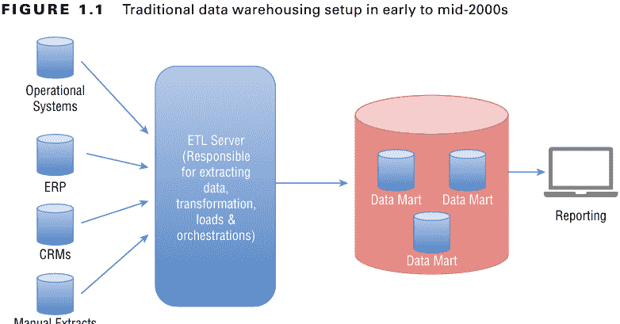
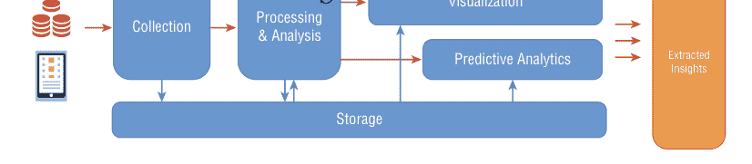
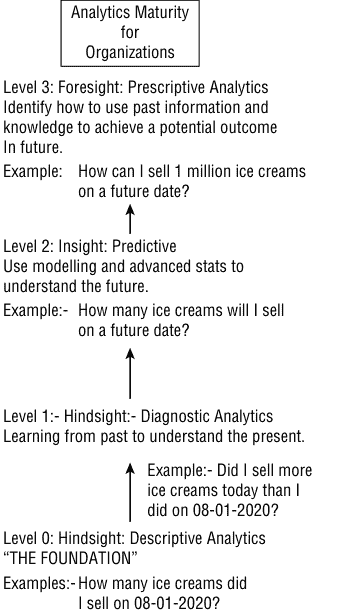
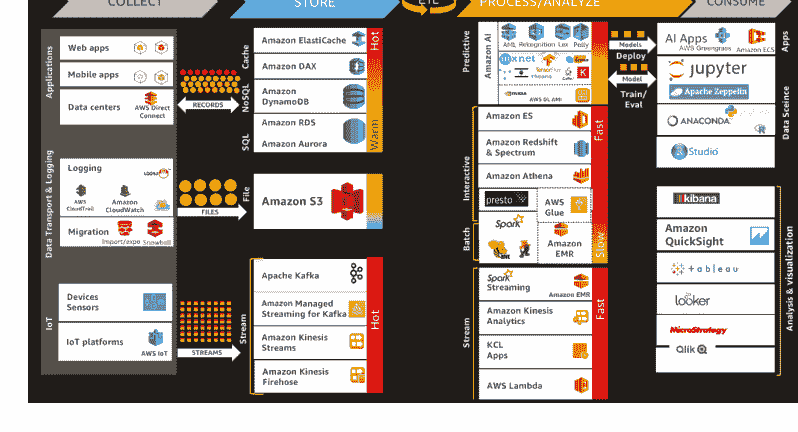
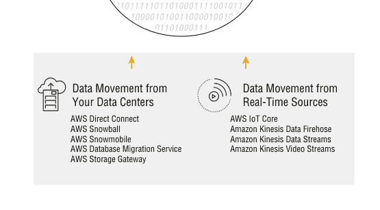
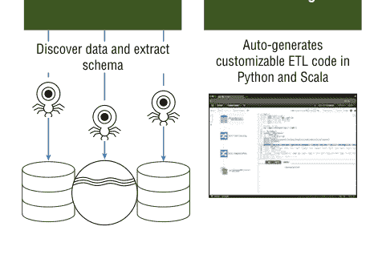

# AWS 认证数据分析学习指南：专项 (DAS-C01) 考试

献给我所有的老师、家人和挚友，你们是我不断学习、快乐和幸福的源泉！

## 致谢

撰写致谢是写书最困难的部分，原因是许多人和组织直接或间接影响了写作过程。你最不愿意做的事情就是忘记感谢应得感谢的人。以下是我为确保认可在本书写作过程中给予我启发和帮助的每一个人所做的微薄努力。如果有遗漏，我深表歉意。

首先，我要感谢 AWS 的优秀同仁们，他们不仅非常努力地打造出色的技术，还以博客、AWS re:Invent 视频和支持指南的形式创作了如此精彩的内容，这些内容是灵感和学习的巨大来源。如果没有利用我的 AWS 大家庭所产出的优质资源，这本书就不可能完成。你们太棒了！我要感谢 AWS 的每一位员工；你们不断抬高标杆。我很想在此一一列举所有人的名字，但有人告诉我致谢不能写成一本书。

我还要感谢 John Streit，他在本书写作过程中给予了极大的支持。我要感谢我在 EMEA（欧洲、中东和非洲）地区的专家团队，他们随时提供支持。你们是我整个职业生涯中遇到的最有才华的人。

我还要感谢 Wiley 的优秀团队，他们在整个过程中对我很有耐心，包括 Kenyon Brown、David Clark、Todd Montgomery、Saravanan Dakshinamoorthy、Christine O’Connor 和 Judy Flynn，以及出色的内容编辑和制作团队。

## 关于技术编辑

**Todd Montgomery**（德克萨斯州奥斯汀）是一家大型国际咨询公司的资深数据中心网络工程师，参与网络设计、安全以及新兴数据中心和云技术的实施。他拥有六项 AWS 认证，包括数据分析专项认证。Todd 拥有电子工程学位，并持有 Cisco Systems、Juniper Networks 和 CompTIA 的多项认证。Todd 还领导奥斯汀 AWS 认证聚会小组。在业余时间，Todd 喜欢赛车运动、现场音乐和旅行。

## 引言

为任何认证考试而学习似乎都令人生畏。《AWS 认证数据分析学习指南：专业级（DAS-C01）考试》的设计与开发涵盖了相关主题、问题和练习，使云从业者能够将宝贵的学习时间和精力集中在恰当的抽象层级上切题的主题集合，从而自信地参加 AWS 认证数据分析 – 专业级（DAS-C01）考试。

本学习指南围绕数据与分析管道呈现了一系列主题，讨论了包括数据收集、数据转换、数据存储与处理、数据分析、数据可视化以及管道所涵盖的安全元素在内的各种主题。学习指南还包括参考资料、附加材料和实践研讨会，这些内容被强烈推荐，将有助于你的整体学习体验。

## 本书涵盖什么内容？

本书涵盖了你为准备 AWS 认证数据分析 – 专业级（DAS-C01）考试而需要了解的主题：

- 第 1 章：数据分析与大数据的历史 本章首先介绍大数据的历史及其多年来的演变，然后讨论分析管道和大数据参考架构。本章还讨论了一些分析管道的关键架构原则，并在介绍用于构建数据湖的 AWS Lake Formation 之前引入了数据湖的概念。

- 第 2 章：数据收集 数据收集通常是分析管道的第一步。本章讨论数据收集所涉及的各种服务，从与流式数据摄取相关的服务（如 Amazon Kinesis 和 Amazon SQS）到小型批处理和大型批量传输（如 AWS Glue、AWS Data Pipeline 和 AWS Snow 系列）。

- 第 3 章：数据存储 第 3 章讨论了 Amazon Web Services 上可用的各种存储选项，包括 Amazon S3、Amazon S3 Glacier、Amazon DynamoDB、Amazon DocumentDB、Amazon Neptune、AWS Storage Gateway、Amazon EFS、Amazon FSx for Lustre 和 AWS Transfer for SFTP。我不仅讨论了不同的选项，还讨论了每个选项适用的用例以及何时选择其中一个而不是另一个。

- 第 4 章：数据处理与分析 在第 4 章中，我们将介绍 AWS 技术栈上的数据处理和分析技术，包括 Amazon Athena、Amazon EMR、Amazon Elasticsearch Service、Amazon Redshift 和 Amazon

AWS 还为数据与分析考试提供免费的数字化考试备考培训，可以在线免费参加。该培训可通过 www.aws.training/Details/eLearning?id=46612 获取。这是一个 3.5 小时的数字化培训课程，将帮助你在以下方面做好准备：

- 了解考试流程的相关安排
- 理解考试结构和题型
- 识别问题与 AWS 数据分析概念的关系
- 解读考试问题所测试的概念
- 制定个性化的学习计划来备考

这不仅是一个确保你已涵盖考试所有重要材料的好方法，也是一个制定个性化备考计划的好方法。

一旦你为考试做好了学习准备，就该做一些模拟题了。虽然 AWS 考试备考培训有助于你备考，但没有什么比参加一次模拟考试、在与考试条件相似的情况下测试自己更好的了。AWS 提供模拟考试，我建议你在实际考试前至少一周参加一次，以判断你是否有能力参加实际考试。根据与其他考生的交流，如果你在模拟考试中取得了大约 80% 的分数，你应该相当有信心参加实际考试。不过，在模拟考试之前，请确保你完成了其他可用的测试。本书附带了两套模拟测试，它们应该能让你对考试准备程度有所了解。请务必在一次完整的考试时间内完成这些测试，而不是分散在几天内完成。完成之后，你需要审视所有你答对的问题，以及答案为什么是正确的。有可能出现这样的情况：虽然你答对了问题，但你并没有理解问题所测试的概念，或者遗漏了某些可能会改变答案的细节。

你需要通读每项测试的参考资料，以确保你已经涵盖了通过考试所需的必要方面。

## 考试前一晚

AWS 专业级考试要求你处于最佳状态，就像任何职业选手一样，你需要考前休息充分。我建议考试前一晚睡足八小时。关于考试时间的安排，我经常被问到参加认证考试的最佳时间是什么。我个人喜欢在清晨考试；然而，你需要找出一天中自己最有精力的时间。有些人清晨精力充沛，而另一些人则慢慢进入状态，到下午中段才全力运转。

## 考试期间

参加考试前你应该充分补充水分。

你有 170 分钟（2 小时 50 分钟）来回答 68±3 个问题，具体取决于考试中你会遇到多少个测试题。这些测试题实际上是为了改进考试而使用的，因为新问题会定期引入，通过率表明一个问题是否对考试有效。平均每题大约有两分半钟的时间，大多数问题有两到三段（将近一页）的篇幅，并且至少有四个看似合理的选项。所谓看似合理的选项意味着，对于经验不足的考生来说，四个选项似乎都是正确的；然而，问题中会有引导信息，使得一个选项比其他选项更正确。这也意味着你在考试中大部分时间都在阅读题目，有时还要读两遍，如果你的阅读速度不够快，你会发现很难完成整个考试。

请记住，虽然考试确实测试你的知识，但我相信它同时也是对你耐心和专注力的考验。

你需要确保不仅通读了本书讨论的核心材料，还通读了参考资料，并且完成示例和实践研讨会的内容。

祝你考试一切顺利！

## 交互式在线学习环境和题库

我努力提供了一些非常棒的工具来帮助你的认证过程。随《AWS 认证数据分析学习指南：专业级（DAS-C01）考试》附带的交互式在线学习环境提供了一个带有学习工具的题库，帮助你备考认证考试——并增加你第一次就通过的机会！题库包括以下内容：

- **模拟测试：** 本书中的所有问题均已提供，包括本引言末尾的评估测试和每章末尾的复习题。此外，还有两套各含 65 道题的模拟考试。使用这些问题来测试你对学习指南内容的掌握程度。在线题库支持在多种设备上运行。

- **闪卡：** 在线题库包含超过 150 张专门为你加强训练而编写的闪卡，所以如果你一开始没有顺利通过它们，也不要气馁。它们的存在是为了确保你真正为考试做好了准备。而且不用担心——有了阅读材料、参考资料、复习题、模拟考试和闪卡，当考试日到来时，你将做好充分的准备。问题以数字闪卡格式提供（一个问题后跟一个正确答案）。你可以使用闪卡来巩固学习，并在考试前进行最后的考前准备。

- **术语表：** 本书关键术语的术语表以完全可搜索的 PDF 形式提供。

请访问 www.wiley.com/go/sybextestprep 进行注册，以访问这个带有学习工具的交互式在线学习环境和题库。

## 考试目标

AWS 认证数据分析 – 专业级（DAS-C01）考试面向从事数据分析相关工作的人员。该考试验证考生对使用 AWS 服务设计、构建、保护和维护从数据中提供洞察的分析解决方案的综合理解。它验证考生在以下领域的能力：

- 使用 AWS 设计、开发和部署基于云的解决方案
- 使用 AWS 技术栈在 AWS 上设计和开发分析项目
- 设计和开发数据管道
- 设计和开发数据收集架构
- 理解收集系统的操作特性
- 选择能够处理数据频率、数据量和数据来源的收集系统
- 理解不同类型的数据收集方法，以及这些方法在数据格式、排序和压缩方面的差异
- 设计最佳的存储和数据管理系统，以满足数据量、数据多样性和数据速度的要求
- 理解分析存储解决方案的操作特性
- 理解数据的访问和检索模式
- 理解合适的数据布局、模式、结构和格式
- 根据使用模式和业务需求理解数据生命周期

- 确定用于编目数据和元数据的适当系统
- 根据业务 SLA、数据量和成本，确定最合适的数据处理解决方案
- 设计数据转换解决方案，并为后续分析做好准备
- 针对给定场景，自动实施适当的数据可视化解决方案
- 确定适当的身份验证和授权机制
- 应用数据保护和加密技术
- 应用数据治理和合规性控制

## 推荐的 AWS 知识

- 至少 5 年使用常用数据分析技术的经验
- 至少 2 年 AWS 实操经验
- 具有使用 AWS 服务设计、构建、保护和维护分析解决方案的经验和专业知识

## 目标分布

| 领域 | 考试百分比 | 章节 |
|---|---:|---|
| **领域 1.0：数据收集** 1.1 – 确定收集系统的运行特性。 1.2 – 选择能够处理数据频率、数据量和数据来源的收集系统。 1.3 – 选择能够处理数据关键属性（如顺序、格式和压缩）的收集系统。 | 18% | 1, 2, 3 |
| **领域 2.0：存储和数据管理** 2.1 – 确定分析存储解决方案的运行特性。 2.2 – 确定数据访问和检索模式。 2.3 – 选择适当的数据布局、模式、结构和格式。 2.4 – 根据使用模式与业务需求定义数据生命周期。 2.5 – 确定用于编目数据和管理元数据的适当系统。 | 22% | 3, 4 |
| **领域 3.0：处理** 3.1 – 确定适当的数据处理解决方案需求。 3.2 – 设计用于转换和准备数据以进行分析的解决方案。 3.3 – 自动化并运营数据处理解决方案。 | 24% | 3, 4 |
| **领域 4.0：分析与可视化** 4.1 – 确定分析和可视化层的运行特性。 4.2 – 针对给定场景选择适当的数据分析解决方案。 4.3 – 针对给定场景选择适当的数据可视化解决方案。 | 18% | 3, 4, 5 |
| **领域 5.0：安全性** 5.1 – 选择适当的身份验证和授权机制。 5.2 – 应用数据保护和加密技术。 5.3 – 应用数据治理和合规性控制。 | 18% | 2, 3, 4, 5, 6 |

## 评估测试

1. 你被一家大型媒体集团聘为解决方案架构师，该公司希望以经济高效的方式存储大量采访录音（以 MP4 文件形式收集），并希望建立一个数据仓库系统来捕获整个企业的数据，并通过 BI 工具提供访问。针对这一需求，以下哪项是最具成本效益的解决方案？

A. 将大型媒体文件存储在 Amazon Redshift 中，将元数据存储在 Amazon DynamoDB 中。使用 Amazon DynamoDB 和 Redshift 通过 BI 工具为决策提供支持。

B. 将大型媒体文件存储在 Amazon S3 中，将元数据存储在 Amazon Redshift 中。使用 Amazon Redshift 通过 BI 工具为决策提供支持。

C. 将大型媒体文件存储在 Amazon S3 中，将媒体元数据存储在 Amazon EMR 中。使用 EMR 上的 Spark 通过 BI 工具为决策提供支持。

D. 将媒体文件存储在 Amazon S3 中，将媒体元数据存储在 Amazon DynamoDB 中。使用 DynamoDB 通过 BI 工具为决策提供支持。

2. 以下哪项是 Apache Hadoop 上的分布式数据处理选项，并且是 Hadoop 2.0 之前的主要处理引擎？

A. MapReduce

B. YARN

C. Hive

D. ZooKeeper

3. 你是一家总部位于西班牙马德里的大型时尚零售商的企业架构师。团队希望构建 ETL，并且有大量需要转换的数据集。数据来自多个来源，因此去重也是一个重要因素。以下哪项是在 AWS 上处理数据的最简单方法？

A. 将数据加载到 Amazon Redshift 中，并使用 SQL 构建转换。构建自定义去重脚本。

B. 使用 AWS Glue 通过内置的 FindMatches ML Transform 转换数据。

C. 将数据加载到 Amazon EMR 中，构建 Spark SQL 脚本，并使用自定义去重脚本。

D. 使用 Amazon Athena 进行转换和去重。

4. 关于 AWS Glue 爬网程序，以下哪些说法是正确的？（选择三项。）

A. AWS Glue 爬网程序提供内置分类器，可用于对任何类型的数据进行分类。

B. AWS Glue 爬网程序可以连接到 Amazon S3、Amazon RDS、Amazon Redshift、Amazon DynamoDB 以及任何 JDBC 数据源。

C. AWS Glue 爬网程序提供自定义分类器，可以对内置分类器无法分类的数据进行分类。

D. AWS Glue 爬网程序将元数据写入 AWS Glue Data Catalog。

5. 你是一家大型娱乐行业企业的企业架构师，该公司通过有机增长和收购其他媒体公司发展壮大。团队希望构建一个跨多个数据库（所有这些数据库都有 JDBC 接口）、Amazon S3、Amazon Redshift、Amazon RDS 和 Amazon DynamoDB 表的中央信息目录。以下哪项是在 AWS 上实现这一目标的最具成本效益的方式？

A. 编写脚本，使用原生 API 从不同数据库提取元数据，并将其加载到 Amazon Redshift 中。构建适当的索引和用户界面以支持搜索。

B. 编写脚本，使用原生 API 从不同数据库提取元数据，并将其加载到 Amazon DynamoDB 中。构建适当的索引和用户界面以支持搜索。

C. 编写脚本，使用原生 API 从不同数据库提取元数据，并将其加载到 RDS 数据库中。构建适当的索引和用户界面以支持搜索。

D. 使用 AWS 爬网程序爬取数据源以构建中央目录。使用 AWS Glue UI 支持元数据搜索。

6. 你是一家大型金融机构的数据架构师，该机构已在 AWS 上构建了数据平台。该机构希望通过识别重复客户账户，并检查新建账户是否与之前欺诈用户的账户匹配，来实施欺诈检测。公司希望快速实现这一目标，并希望减少构建此功能可能需要的大量自定义代码。以下哪项是在 AWS 上实现这一目标的最具成本效益的方式？

A. 使用 Amazon EMR 上的 Spark 构建自定义去重脚本。使用 PySpark 比较表示新客户和欺诈客户的数据框，以识别匹配项。

B. 将数据加载到 Amazon Redshift 中，并使用 SQL 构建去重。

C. 将数据加载到 Amazon S3，这构成了数据湖的基础。使用 Amazon Athena 构建去重脚本。

D. 将数据加载到 Amazon S3。使用 AWS Glue FindMatches Transform 实现此功能。

7. 在 AWS Glue 服务中，元数据定义存储在哪里？

A. 表

B. 配置文件

C. 模式

D. 项目

8. AWS Glue 提供了与 Amazon SageMaker 笔记本和 Apache Zeppelin 笔记本服务器的接口。你也可以直接从 AWS Glue 控制台打开 SageMaker 笔记本。

A. 正确

B. 错误

C. Amazon MSK
D. 分片

24. 关于 KPL（Kinesis Producer Library，Kinesis 生产者库），以下哪些说法是正确的？（选择三项。）

A. 写入一个或多个 Kinesis Data Streams，并具有自动且可配置的重试机制。

B. 聚合用户记录以增加有效负载大小。

C. 代表你提交 CloudWatch 指标，以提供生产者性能的可视性。

D. 强制调用应用程序阻塞并等待确认。

E. KPL 不会产生任何处理延迟，因此对所有向 Kinesis 流写入数据的应用程序都很有用。

F. 库中的 RecordMaxBufferedTime 设置为 1 毫秒，且不可更改。

25. 关于 Kinesis Client Library（KCL），以下哪项是正确的？（选择三项。）

A. KCL 是一个 Java 库，不支持其他语言。

B. KCL 连接到数据流，并枚举数据流中的分片。

C. KCL 从数据流中拉取数据记录。

D. KCL 不提供检查点机制。

E. KCL 为每个流实例化一个记录处理器。

F. KCL 将记录推送到相应的记录处理器。

26. Amazon Kinesis Data Streams 代理将以下哪些指标发送到 Amazon CloudWatch？（选择三项。）

A. MBs Sent

B. RecordSendAttempts

C. RecordSendErrors

D. RecordSendFailures

E. ServiceErrors

F. ServiceFailures

27. 你是一家游戏初创公司的数据工程师，运营团队通知你，他们正在收到 ReadProvisionedThroughputExceeded 错误。他们请你帮助确定问题原因并协助解决。以下哪些说法会有所帮助？（选择两项。）

A. 在一段时间内，GetRecords 调用被 KinesisDataStreams 限制。

B. GetShardIterator 在一段时间内无法获取新的分片。

C. 对您的流重新分片，以增加分片数量。

D. 重新设计您的流，增加检查预置吞吐量的间隔时间，以避免错误。

### 28. 你是一家微博网站的数据工程师，该网站使用 Kinesis 进行流式 Web 日志数据传输。运维团队通知你，他们从流中获取记录时延迟增加。他们请你帮助找出问题原因并协助解决。下列哪些说法有助于解决这个问题？（选择三项。）

- A. 记录数量增加导致延迟增加。
- B. 每次 GET 请求的记录大小增加。
- C. 分片迭代器（shard iterator）延迟增加，导致记录获取延迟增加。
- D. 增加流中的分片数量。
- E. 缩短流保留期以赶上数据积压。
- F. 将处理迁移到 MSK 以减少延迟。

### 29. 关于 Amazon Kinesis 上的速率限制（rate limiting）功能，以下哪项是正确的？（选择两项。）

- A. Amazon Kinesis 内无法实现速率限制，需要 MSK 来实现速率限制。
- B. 速率限制只能通过 Kinesis Producer Library 实现。
- C. 速率限制在 Amazon Kinesis 中通过令牌和桶（tokens and buckets）实现。
- D. 速率限制使用标准计数器实现。
- E. 速率限制阈值设置为 50%，且不可配置。

### 30. Kinesis 流的默认数据保留期是多长？

- A. 12 小时
- B. 168 小时
- C. 30 天
- D. 365 天

### 31. 以下哪些选项有助于提高 Kinesis Producer Library 的效率？（选择两项。）

- A. 聚合（Aggregation）
- B. 收集（Collection）
- C. 增加分片数量
- D. 减少整体加密

### 32. 以下哪些服务是 Amazon Kinesis Firehose 的有效目标？（选择三项。）

- A. Amazon S3
- B. Amazon SageMaker
- C. Amazon Elasticsearch
- D. Amazon Redshift

### 37. 如何在爬网程序（crawler）完成后自动启动 AWS Glue 作业？（选择两项。）

- A. 使用 AWS Glue 触发器在爬网程序运行完成时启动作业。
- B. 使用 Amazon CloudWatch 事件规则创建 AWS Lambda 函数。
- C. 使用 AWS Glue 工作流。
- D. 这不可能实现。你必须手动运行。

### 38. 你是一家广告公司的顾问，该公司聘请了多名数据科学家，他们正在努力改善公司的在线和离线广告活动，并在大部分数据工程工作负载中使用 AWS Glue。这些数据科学家在广告技术（adtech）工作负载方面拥有丰富经验，在加入团队之前开发了一些 Python 库，并希望能在 AWS Glue 中使用这些库。他们如何在 AWS Glue 作业中使用外部 Python 库？（选择两项。）

- A. 将库打包成 .tar 文件，并上传到 Amazon S3。
- B. 将库打包成 .zip 文件，并上传到 Amazon S3。
- C. 在作业或作业运行中使用该库。
- D. 在作业或作业运行中使用库之前，以编程方式解压压缩文件。

### 39. 你是一家大型企业集团的顾问，该集团最近收购了另一家公司。它希望通过消息系统集成应用程序，并希望应用程序保持解耦，但仍然能够发送消息。以下哪项服务是实现该目标最具成本效益且可扩展的服务？

- A. Amazon EMR 上的 Apache Flink
- B. Amazon Kinesis
- C. Amazon SQS
- D. AWS Glue 流处理（AWS Glue streaming）

### 40. Amazon SQS 支持哪些类型的队列？（选择两项。）

- A. 标准队列
- B. FIFO 队列
- C. LIFO 队列
- D. 高级队列

### 41. 你是一家电信运营商的数据工程师，该运营商使用 DynamoDB 作为其运营数据存储。公司希望使用 AWS Data Pipeline 进行工作流编排，并且需要在订单下达且 DynamoDB 表中出现记录时立即发送一些 SNS 通知。处理此需求的最佳方式是什么？

- A. 配置一个 Lambda 函数持续扫描 DynamoDB 表。一旦看到新记录，就发送 SNS 通知。
- B. 配置 Amazon DynamoDB 流来编排 AWS Data Pipeline 的启动。
- C. 配置一个读取 DynamoDB 表的 AWS Glue 作业，以触发 AWS Data Pipeline 作业。
- D. 使用 AWS Data Pipeline 中可用的前置条件（preconditions）。

### 42. 你从事 AWS 分析平台咨询工作已有几年。你的一位重要客户联系你，希望了解将 DynamoDB 表数据导出到 S3 数据湖的最佳方式。客户希望将成本降至最低，并且最好暂时不需要咨询专家参与。处理此需求最简单的方法是什么？

- A. 使用 EMR 自定义脚本将数据从 Amazon DynamoDB 导出到 Amazon S3。
- B. 构建一个自定义 Lambda 函数，扫描 DynamoDB 中的数据并将其写入 S3。
- C. 使用 AWS Glue 读取 DynamoDB 表，并使用 AWS Glue 脚本生成功能为你生成脚本。
- D. 使用 AWS Data Pipeline 将数据从 DynamoDB 复制到 Amazon S3。

### 43. 你已在 Amazon S3 上构建了组织的数据湖。你希望捕获并跟踪对某个 Amazon S3 存储桶的所有请求。启用此功能的最简单方法是什么？

- A. 使用 Amazon Macie。
- B. 使用 Amazon CloudWatch。
- C. 使用 AWS CloudTrail。
- D. 使用 Amazon S3 服务器访问日志记录（server access logging）。

### 44. 你的客户在黑色星期五（Black Friday）促销期间向 Amazon S3 摄取数据时，多次收到 503 Slow Down 错误。此错误可能是什么原因造成的？

- A. Amazon S3 无法扩展以满足你的数据摄取模式的需求。
- B. 这是来自你的 Web 应用程序的特定于应用程序的错误，与 Amazon S3 无关。
- C. 你正在每个前缀写入大量对象。Amazon S3 正在后台扩展以应对流量高峰。
- D. 你正在写入大型对象，导致 Amazon S3 出现此错误。

### 45. 以下哪项是全面托管的 NoSQL 服务？

- A. Amazon Redshift
- B. Amazon Elasticsearch
- C. Amazon DynamoDB
- D. Amazon DocumentDB

### 46. 你的客户正在将 Amazon DynamoDB 用于运营场景。其中一名工程师意外删除了 10 条记录。关于恢复 Amazon DynamoDB 数据，以下哪项陈述是正确的？

- A. 使用 Amazon S3 中的备份来重新创建表。
- B. 使用 Amazon Redshift 中的备份来重新创建表。
- C. 使用其他区域的数据。
- D. 使用 Amazon DynamoDB PITR 恢复已删除的数据。

### 47. 以下哪些场景适合 DynamoDB 的预置扩展模式？（选择两项。）

- A. 你拥有可预测的应用程序流量。
- B. 你运行的应用程序流量稳定或逐渐增加。
- C. 你无法预测容量需求。
- D. 你更喜欢按需付费的定价模式。

### 48. 关于 DynamoDB 中的主键，以下哪些陈述是正确的？（选择两项。）

- A. 表的主键可以在表创建后定义。
- B. DynamoDB 仅支持两种类型的主键。
- C. 复合主键等同于分区键和排序键的组合。
- D. DynamoDB 使用排序键作为内部哈希函数的输入，其输出决定项目存储的分区。

### 49. 你是一家大型公司的数据工程师，该公司使用 DynamoDB 为其低延迟应用程序请求提供支持。该应用程序基于一个客户订单表，该表用于根据特定客户 ID 提供客户订单信息。最近出现了一个新需求：根据特定产品 ID 识别客户。你决定将其实现为二级索引。应用程序工程团队成员最近抱怨他们从二级索引获得的性能不佳。以下哪项是 DynamoDB 中二级索引性能下降的最常见原因？

- A. 应用程序工程团队正在查询项目属性的数据。
- B. 应用程序工程团队正在查询二级索引中未投影（projected）的数据。
- C. 应用程序工程团队正在查询不属于本地二级索引一部分的分区键。
- D. 应用程序工程团队正在查询不同的排序键值的数据。

### 50. 你的客户希望降低本地存储的开销，同时确保应用程序的低延迟，该应用程序依赖于整个数据集的一个子集。客户对 Amazon S3 的特性很满意。你会推荐以下哪项？

- A. 缓存卷（Cached volumes）
- B. 存储卷（Stored volumes）
- C. 文件网关（File gateway）
- D. 磁带网关（Tape gateway）

12. C. Amazon Kinesis 让您能够轻松收集、处理和分析实时流式数据，从而及时获取洞察并快速响应新信息。Amazon Kinesis 提供了关键能力，能够以经济高效的方式处理任意规模的流式数据，并允许您灵活选择最适合应用需求的工具。借助 Amazon Kinesis，您可以接收实时数据，例如视频、音频、应用程序日志、网站点击流以及 IoT 遥测数据，用于机器学习、分析和其他应用。Amazon Kinesis 使您能够在数据到达时进行处理和分析，并立即做出响应，而不必等到所有数据收集完毕后再开始处理。

13. A. 批处理是指对多个项目执行单个操作，而不是对每个项目重复执行该操作。

14. D. Kinesis 数据流是一组分片。每个分片都有一系列数据记录。每条数据记录都有一个由 Kinesis Data Streams 分配的序列号。

15. B. Amazon Kinesis Firehose 可以将流式数据投递到 S3，因此是此场景的理想选择。虽然使用其他技术也可以实现相同的功能，但这需要额外的工作和自定义实现。

16. C. Amazon Managed Streaming for Kafka 是将本地 Kafka 安装迁移到 AWS 平台的理想解决方案，这可以确保代码库保持不变。您可以减少大量管理基础设施的时间，并且作为一种托管服务，它确保资源可以分配给其他应用程序，而不是让您承担管理 Kafka 的繁琐任务。

17. B, D. 作为最佳实践，请使用本地集群作为集群配置的参考，并使用 MSK 计算器进行定价和规模估算。

18. A, C, D, E. 请参考以下文档链接：docs.aws.amazon.com/msk/latest/developerguide/bestpractices.html#bestpractices-monitor-disk-space。

19. B. Amazon Kinesis Data Streams 是唯一可以直接将数据放入 Amazon Kinesis Firehose 的服务。

20. D. 分区键用于在流中按分片对数据进行分组。Kinesis Data Streams 将属于某个流的数据记录分隔到多个分片中。它使用与每条数据记录关联的分区键来确定给定数据记录属于哪个分片。

21. A, B, C. 生产者是将数据写入 Amazon Kinesis Data Streams 的应用程序。您可以使用 AWS SDK for Java 和 Kinesis Producer Library 为 Kinesis Data Streams 构建生产者。

22. D. 问题中的要求是流式数据、SQL 技能和按需付费定价。所有这些要求都可以通过 KDA 满足。

23. B. 生产者将数据写入 Kinesis 流。

24. A, B, C. 请参考 KPL 文档。选项 D 不正确，因为它是异步架构。由于 KPL 可能会在将记录发送到 Kinesis Data Streams 之前缓冲记录，因此它不会强制调用方应用程序阻塞并等待记录已到达的确认。选项 E 不正确，因为 KPL 可能会在库内产生额外的处理延迟，延迟时间最高可达 RecordMaxBufferedTime（用户可配置）。较大的 RecordMaxBufferedTime 值会带来更高的打包效率和更好的性能。选项 F 不正确，因为 RecordMaxBufferedTime 在库中是可配置的。

25. B, C, F. 选项 A 不正确，因为虽然 KCL 是一个 Java 库，但通过名为 MultiLangDaemon 的多语言接口提供了对 Java 以外语言的支持。选项 D 不正确，因为 KCL 确实提供了检查点机制。选项 E 不正确，因为 KCL 会为每个分片实例化一个记录处理器。

26. B, C, E. 选项 A 不正确，因为指标是 BytesSent 而不是 MBs Sent。选项 D 不正确，因为指标是 RecordSendErrors 而不是 RecordSendFailures。选项 F 不正确，因为指标是 ServiceErrors 而不是 ServiceFailures。

27. A, C. 当 GetRecords 调用在一段时间内被 Kinesis Data Streams 限制时，会出现 ReadProvisionedThroughputExceeded 错误。如果违反以下限制，您的 Amazon Kinesis 数据流可能会被限流：

- 每个分片每秒最多支持五次读取事务（或每个分片每秒五次 GetRecords 调用）。
- 每个分片最多支持 2 MiB/秒的读取速率。
- GetRecords 每次调用最多可从单个分片检索 10 MiB 数据，每次调用最多可检索 10,000 条记录。如果一次 GetRecords 调用返回 10 MiB 数据，则在接下来的 5 秒内进行的后续调用将导致错误。

28. A, B, D. 如果每次 GET 请求的记录数或记录大小增加，GetRecords.Latency 可能会增加。如果您在生产者向流中写入数据时尝试重启应用程序，记录可能会累积而未被消费。记录数或要获取的数据量的增加会提高 GetRecords.Latency 的值。此外，如果应用程序无法跟上摄取速率，IteratorAge 会增加。注意：在 Kinesis 数据流上启用服务端加密也会增加延迟。

29. B, C. 选项 A 不正确，因为 Kinesis 可以实现速率限制。选项 D 不正确，因为速率限制使用令牌桶算法实现，并且对 Kinesis Data Streams 记录和字节分别使用独立的桶。选项 E 不正确，因为该阈值是可配置的，但默认设置为实际分片限制的 50% 以上，以允许单个生产者使分片饱和。

30. B. Amazon Kinesis Data Streams 支持更改流的数据记录保留期。Kinesis 数据流是按顺序排列的数据记录序列，旨在实时写入和读取。因此，数据记录临时存储在流的分片中。从记录添加到不再可访问的时间段称为保留期。Kinesis 数据流默认将记录存储 24 小时，可配置为最长 168 小时。

31. A, B. KPL 支持两种批处理类型：

- *聚合（Aggregation）* – 将多条记录存储在一个 Kinesis Data Streams 记录中
- *集合（Collection）* – 使用 API 操作 PutRecords 将多条 Kinesis Data Streams 记录发送到 Kinesis 数据流中的一个或多个分片

32. A, C, D. Kinesis Data Firehose 可以将记录发送到 Amazon Simple Storage Service (Amazon S3)、Amazon Redshift、Amazon Elasticsearch Service (Amazon ES) 以及您拥有或您的任何第三方服务提供商拥有的任何 HTTP 端点，包括 Datadog、New Relic 和 Splunk。

33. D. Kinesis Data Firehose 可以调用您的 Lambda 函数来转换传入的源数据，并将转换后的数据投递到目的地。您可以在创建投递流时启用 Kinesis Data Firehose 数据转换。

34. A, B. Kinesis Firehose 可以将数据转换为 Parquet 和 ORC 格式。选项 C 不正确，因为它不受支持。选项 D 不正确，因为它不是一种文件格式。

35. B. 跳过记录的最常见原因是 processRecords 抛出了未处理的异常。Kinesis Client Library (KCL) 依赖您的 processRecords 代码来处理处理数据记录时出现的任何异常。从 processRecords 抛出的任何异常都会被 KCL 吸收。

36. B, C, E. 如果您有敏感数据，可以在使用 Amazon Kinesis Data Firehose 时启用服务端数据加密。具体做法取决于您的数据源。

37. B, D. 无法使用 AWS Glue 触发器在爬网程序运行完成时启动作业。请改用以下方法之一：

- 创建 AWS Lambda 函数和 Amazon CloudWatch Events 规则。选择此选项时，Lambda 函数始终处于开启状态。无论您在何处或何时启动爬网程序，它都会对其进行监控。您还可以修改此方法以自动化其他 AWS Glue 功能。

  有关更多信息，请参阅“How can I use a Lambda function to automatically start an AWS Glue job when a crawler run completes?”
  https://aws.amazon.com/premiumsupport/knowledge-center/start-glue-job-crawler-completes-lambda

- 使用 AWS Glue 工作流。此方法要求您从 AWS Glue 控制台的 Workflows 页面启动爬网程序。有关更多信息，请参阅“How can I use AWS Glue workflows to automatically start a job when a crawler run completes?”
  https://aws.amazon.com/premiumsupport/knowledge-center/start-glue-job-after-crawler-workflow

38. B, C. 要在 Apache Spark ETL 作业中使用外部库：

- 1. 将库文件打包为 `.zip` 文件（除非库包含在单个 `.py` 文件中）。
- 2. 将包上传到 Amazon Simple Storage Service (Amazon S3)。
- 3. 在作业或作业运行中使用该库。

关于分析学的定义有很多，但我个人认为，*分析学*既是一门科学，也是一门艺术。科学的一面在于能够针对正确的任务使用正确的工具，将原始数据转化为精炼、可随时使用的可操作信息；艺术的一面则在于解读这些信息以及为有效管理和壮大业务而创建的 KPI。因此，分析学是数据与有效决策之间的桥梁，它让组织和企业领导者能够从凭直觉做决策，转变为基于支持性数据做决策。

那么问题来了：分析学是一种新现象，还是已经存在很长时间了？虽然我们在大约十年前才开始听说大数据和分析学，但数据总是以某种方式超过计算能力，而且根据定义，一旦数据超过系统的计算能力，就可以被视为大数据。根据最早的记录，1663 年，约翰·格朗特（John Graunt）记录了伦敦的死亡率，以建立腺鼠疫的预警系统，这促成了更好的会计系统和记录系统。

1865 年，*商业智能*一词首次被理查德·米勒·德文斯（Richard Millar Devens）使用于他的*《商业与商业轶事百科全书》*（Cyclopædia of Commercial and Business Anecdotes，D. Appleton and company，1865）。德文斯创造这个词是为了解释亨利·弗内斯爵士（Sir Henry Furnese）如何通过收集其经营环境的信息而获得优于竞争对手的优势。

1880 年，美国人口普查局遇到了第一个已知的大数据问题。据估计，处理 1890 年人口普查计算的数据需要 8 年时间，而人口普查本身还需要额外的 10 年，这意味着数据增长已经超过了现有的计算能力。1881 年，在该局担任工程师的赫尔曼·霍勒里斯（Herman Hollerith）发明了一种制表机，将这项工作从 10 年减少到 3 个月，并因此被称为自动化计算之父。他创立的公司后来成为 IBM。

尽管二十世纪还发生了许多其他重要的发明和发现，但直到 1989 年，*大数据*一词才首次被埃里克·拉森（Erik Larkson）使用，他在*《哈泼斯杂志》*上发表了一篇文章，讨论他所收到的垃圾邮件的来源。他有一句名言：“大数据的保管者说他们这样做是为了消费者的利益。但数据总是会以超出最初意图的方式被使用。”

世界可用数据的规模首次由米歇尔·莱斯克（Michel Lesk）在一篇论文中提出理论估计（“世界上有多少信息？”），估计在 1990 年代末约有 12,000 PB（www.lesk.com/mlesk/ksg97/ksg.html）。谷歌搜索也在同一年首次亮相。尽管当时有关于信息量增长的喧嚣，但总体格局相对简单，主要的信息存储机制是在线事务处理（OLTP）数据库，而在线分析处理（OLAP）仅限于少数大型公司。

关键要点是，大数据和分析学已经存在很长时间了。即使在今天，如果公司使用不正确的工具来解决手头的问题，它们在处理大数据时仍会面临挑战。虽然定义大数据的关键指标包括体量（volume）、多样性（variety）和速度（velocity），但事实是，大数据可以是任何限制你用现有工具进行分析能力的数据。因此，对少数组织来说，艾字节（exabyte）规模的数据是大数据问题，而对另一些组织来说，从几太字节（terabytes）的数据中提取信息可能就已经很困难了。

## 多年来的分析架构演进

我在数据领域已经工作了 20 多年，见证了分析管道的各个演进阶段。

大约 20 年前，当你谈论分析学时，听众会认为这是一种魔法。事实上，*统计学*比*数据科学*、*机器学习*、*人工智能*或*高级分析*更为常用。拥有数据仓库被视为一种奢侈，大多数系统采用标准的三层架构，由多个数据源组成，通常通过抽取-转换-加载（ETL）工具（这被视为奢侈）或使用所选脚本语言编写的手写 ETL 脚本（通常就是传统的 shell 脚本）来访问。图 1.1 展示了 2000 年代初非常常见的传统数据仓库设置。

数据抽取和转换是在运行 ETL 脚本的落地服务器上完成的，在某些情况下还会使用像 Informatica 这样的 ETL 工具。如果你问我这个环境中什么造成的麻烦最多，那就是这个 ETL 服务器。由于种种原因，它常常成为企业担忧的对象，包括磁盘空间有限、内存不足、计算能力有限以及整体编排问题。正如你所看到的，这一部分是数据源与期望从中提取的潜在信息和洞察之间的“粘合剂”。

这种设置中的关键挑战包括僵化的流程，一切都以瀑布模型运作，业务方被要求在周期很早期就提供需求。正是这些需求构成了信息模型创建的基础，而大型项目的信息模型通常需要 6 到 12 个月。由于没有任何原型设计能力、有限的扩展性和可用的工具，业务需求与最终交付的产品往往大相径庭，而且经常是当 IT 部门交付需求时，业务方已经不再需要这些需求，导致两个团队之间产生不满。

随着互联网泡沫，数据世界不断扩张，系统日志不断产生，却只因为存储过于昂贵而被塞进某种归档系统，对如此大量的数据进行计算变得不可能。当时世界更满足于获得 CSV 和 TSV，而对 XML 等多结构化数据和文本等非结构化数据还没有做好准备。尽管 CIO 们知道这些数据集有价值，但你必须为任何这种规模的投资提供商业案例，这一事实意味着这些数据集常常被归档或丢弃。

商业智能（BI）工具往往非常僵化，用户无法直接访问数据和自助分析，而必须依赖 BI 开发人员，他们需要围绕信息模式构建“universe”，最终满足用户需求。除此之外，如果你无法根据业务需求弹性扩展硬件，你经常会看到解决方案架构师在今年的 9 月就努力理解和预测明年 12 月的容量需求，并确保在 1 月之前准备好预算以采购必要的硬件和软件，而这些硬件和软件直到 12 个月后才真正需要。

再加上通常基于软件运行的核心数量或存储数据量计算的严格许可成本，这意味着 IT 预算不断攀升，常常受到越来越多的审视，而 IT 部门却未能达到预期。

这个故事描绘了 15 到 20 年前分析世界黯淡的景象，但情况并没有那么糟。一直与传统 BI 基础设施挑战作斗争的企业已经开始寻找其他选择，需要乃发明之母。企业意识到需要满足几个关键要求：

- 1. 分布式存储
- 2. 分布式计算

有人认为 Hadoop 是万能的灵丹妙药，而另一些人则认为 Hadoop 在分析领域有其自身的位置，但尚未准备好取代“真正的工具”。请注意，开源世界仍在推出一些非常酷且重要的项目，旨在弥补现有项目的不足。例如，Map Reduce 最初是为了解决搜索问题而构建的，但由于其成功，现在被用作分析批处理引擎，由 Hive 和 Pig 等工具前端驱动，这导致 Hadoop（最初是批处理引擎）被用于迭代分析，从而无法满足那些习惯于从企业数据仓库系统获得高速数据访问的用户的高期望。

这导致了 Apache Spark 的创建，这是一个项目将找到一种新的方法来解决数据工程和迭代分析问题，随后其他引擎以 Spark SQL（最初称为 Shark）、Spark Streaming、Spark ML 和 GraphX 的形式被添加到其中。想法是这是一个一站式解决方案，涵盖所有分析相关需求。

由于云计算变得流行，越来越多的客户希望利用云的弹性特性来运行数据工程工作负载（本身具有弹性），并要求 Amazon Web Services 为此类工作负载提供支持。客户已经在 Amazon EC2 实例上运行 Hadoop 工作负载；例如，*New York Times* 使用 100 个 EC2 实例运行 Hadoop 应用程序，将 4 TB 的原始 TIFF 数据（存储在 S3 中）处理为 1100 万份成品 PDF，耗时 24 小时，计算成本为 240 美元。随着此类工作负载的流行和巨大需求，亚马逊开始着手一个名为 Amazon Elastic MapReduce（EMR）的新项目，于 2009 年 4 月发布。EMR 的初始目标是托管的 Hadoop 环境，但该服务后来成为大数据领域其他开源项目的目录，如 HBase、Spark、Presto 和 Livy。

随着数据工程方面的环境看起来相当令人印象深刻，商业智能（BI）方面也在经历巨大变化，业务经理越来越多地要求直接访问数据，以便更有效地应对业务挑战，从而为允许快速和临时访问数据的工具以及对更多自助式 BI 工具的需求铺平道路。这导致 Tableau、Spotfire 和 Qlik 等流行工具，尽管存在已久，但在市场上变得更受欢迎并被广泛接受。

BI 和分析的世界与 20 年前相比看起来非常不同，那时 ETL 工具更加智能，BI 工具允许你只需几次点击即可创建深度学习模型。本书讲述了你今天看到的以及未来的 BI 和分析世界，并特别讲述了 AWS 平台，该平台在大数据和分析解决方案方面提供了最深和最广的覆盖范围。

## Analytics Pipeline

由于这是一本高级书籍，我们将直接跳到分析管道，这是你在进行任何大数据项目之前需要理解的关键组件。图 1.2 显示了一个典型的包含数据管理各个阶段的大数据管道。虽然在某些情况下你可能需要根据需求调整管道，但在大多数情况下，这就是客户通常为解决分析问题而构建的管道类型。技术可能会发生变化，但关键思想保持不变。

### FIGURE 1.2 Overview of an analytics pipeline

大数据管道的一般流程如下：

- 1. 数据由收集工具收集。
- 2. 数据以持久的方式存储。
- 3. 数据被处理和分析。通常这种处理涉及多个步骤，并且通常在处理系统和存储系统之间移动数据。分析的结果可能需要另一次分析和处理。
- 4. 处理完成后，数据会被提供给业务用户，他们可以使用 BI 工具来可视化并从数据中生成进一步的洞察。
- 5. 数据通常也用于预测分析。示例包括流失预测、客户细分和产品推荐。

让我们更详细地查看这些阶段中的每一个。

## Data Sources

在任何分析管道中，你的工作将从生产者系统产生的数据开始。产生数据的系统可能是像你的客户关系管理（CRM）系统或你的零售销售点系统这样的 OLTP 系统，运行在 MySQL、Postgres、Aurora 或其他商业数据库上，也可能是你的现有数据仓库，如 Teradata、Oracle 或 Netezza。生产者通常不限于关系数据源，因为它们通常还包括商店和工厂车间上的传感器和设备，产生温度、湿度、噪音和热度等事件数据，甚至可以从 Twitter 和 Facebook 捕获的社交媒体 feed。因此，数据可能以各种格式存在，并且需要在不同的速度、种类和规模下捕获。这些数据源就是产生数据的地方，而通常分析管道的关键目标是将这些原始数据转化为可被业务用户消费的信息。

这引出了大数据管道的收集部分。

吞吐量（100+ Mb/秒/核心），从而允许机器学习、深度学习和高性能计算（HPC）等复杂应用程序消费相同的数据集。我们将在第 3 章“Data Storage”中查看存储技术。

## Processing and Analysis

处理和分析通常是手牵手进行的，因为数据集的预处理通常是进行有意义分析所必需的，这通常会导致额外的处理需求。处理可能涉及将数据从一种格式转换为另一种格式（例如，从 CSV 到 Parquet），也可能涉及更复杂的处理，涉及对来自各种来源的数据应用某些业务规则。这通常涉及去重过程、数据清洗如缺失值替换等。

市场上有很多工具可用于数据处理，包括最常见的 Hadoop、Spark 和 SQL 环境，如 Amazon Redshift。工具的选择取决于特定的用例，这可能是前面讨论的用例之一，也可能是构建数据集市。我们将在第 4 章“Data Processing and Analysis”中更详细地探讨这一点。

分析通常是一个迭代过程，范围从临时分析到基于标准访问路径的更频繁查询模式。鉴于我们可用的各种选择，如 Apache Presto、Amazon Redshift、Apache Hive、Apache Pig 和 Apache Spark SQL，我们将在第 4 章“Data Processing and Analysis”中讨论基于特定需求和用例的工具选择标准。

## Visualization, Predictive and Prescriptive Analytics

可视化，通常称为 BI，包括企业用于分析数据并向关键利益相关者提供信息的工具、技术和流程。分析通常通过从回顾到前瞻的方式进行分类，可视化通常关注描述性和诊断性分析方面。

可视化技术的目标是了解发生了什么，这通常通过各种可视化技术实现。企业依靠各种工具来理解数据中可用的信息，然后深入挖掘以了解正面或负面影响的根本原因。Gartner 在其 2012 年发布的分析上升模型中，将分析从信息到优化的进展进行了框架化。图 1.3 显示了从分析历史数据到预测企业未来状况的业务分析谱系，以及在业务上升的每个阶段可以预期的疑问。

正如你所知，过去通常（并非总是）是未来的良好预测；然而，机器学习和人工智能可用于预测未来并帮助企业为未来的潜在结果做计划。例如，如果一家企业基于预测分析

意识到某个特定客户即将流失 (https://tinyurl.com/y9ho4kbu)，他们可能会制定政策，通过各种营销活动来留住客户。我们将在本书后面介绍描述性、诊断性和预测性分析。

### FIGURE 1.3 Business analytics spectrum

Source: Gartner Analytics Maturity Model. https://www.zdnet.com/article/a-guide-for-prescriptive-analytics-the-art-and-science-of-choosing-and-applying-the-right-techniques/

虽然预测性分析提供了关于需要做什么的建议，但细节超出了本书的范围。

## The Big Data Reference Architecture

我们已在前面部分查看了大数据管道。现在是时候开始查看大数据参考架构以及适合分析生态系统的 AWS 和合作伙伴组件了。AWS re:Invent 通常是您在分析和 AWS 分析生态系统方面会遇到的最精彩内容的来源之一。图 1.4 改编自 Siva Raghupathy 在 re:Invent 2017 上的演讲，展示了分析管道的各个阶段，并将 AWS 服务映射到管道的各个阶段。

### FIGURE 1.4 AWS analytics architecture

## Data Characteristics: Hot, Warm, and Cold

选择合适的处理技术取决于数据的特征，数据可以从冷到热不等。您可能听说过多温度数据管理这一术语，其中数据的温度由数据的访问频率、数据的更新和维护频率、所需的耐久性水平以及您希望维护的历史深度决定。

让我们看一个金融机构的例子，该机构拥有其所有客户的数据：他们的在线资料、多年来的交易等。考虑以下一组交易：客户正在前往 Amazon.com 购买一些日常必需品。任何金融机构都会对单笔交易进行欺诈检测；因此，您在此用例中不仅需要实时捕获数据，还需要根据客户和交易资料识别交易是否欺诈。您不仅需要实时捕获交易，还需要对其进行分析操作，这表明您的数据收集技术将由用例定义，在本例中需要您进行流处理，而您的处理技术也将由用例定义，这定义了您处理的数据的温度。

由于您的行动时间相对较短，这就是热数据的案例，因此技术选择将由所选技术满足您对低延迟和高速访问的需求来定义。

让我们考虑另一笔或一组交易，这些交易发生在十四年前。客户已向监管机构投诉超额收费（如英国的付款保护保险或 PPI 申诉），您有六周时间根据此申诉回应投诉或向客户退款。

- 高耐久性
- 智能分层（自动将数据从高耐久性/高成本迁移到低耐久性/低成本）
- 安全
- 每 GB 低成本

一些客户倾向于将 Apache Hadoop 分布式文件系统（HDFS）上的 Hadoop 集群视为持久存储；然而，在某些情况下，HDFS 可用于最热的数据集（例如，在迭代处理某个数据集时），而 Amazon S3 可用于频繁访问的数据。我们将在第 4 章“数据处理和分析”中更详细地讨论这一点。

对于温数据和热数据，Amazon 支持各种选项，可分为三大类：

- **SQL-Based Systems**  Amazon 提供 Amazon RDS，这是一种托管的关系数据库服务，用于 SQL 操作以存储数据。

- **NoSQL-Based Systems**  Amazon 提供 Amazon DynamoDB 和 Amazon DocumentDB，这些是托管的 NoSQL 服务。我们将在第 3 章“数据存储”中更详细地了解它们。

- **Cache Repositories**  Amazon 还提供 Amazon ElastiCache，这是一种托管的 Memcached 和 Redis 服务，以及 Amazon DynamoDB Accelerator (DAX)，这是一种用于 DynamoDB 的内存缓存，可提供低延迟和高吞吐量。

如本章前面所述，选择合适的工具来完成合适的工作非常重要。十年来试图将每个用例都强行套用到关系引擎、NoSQL 引擎或您在不同用例中曾取得成功的任何其他技术上的传统做法，不仅使初始实施变得复杂，也使长期管理变得复杂。AWS 平台上市场上的大量托管解决方案和合作伙伴产品使您能够为工作选择合适的工具。您的应用程序架构现在可以受益于各种内存、图、NoSQL、SQL 和搜索技术，从而使您能够专注于正确的长期架构，而不是在技术限制下进行变通，以确保您能够专注于业务问题的真正本质。组织在将用例改造以适应技术限制上花费的集成工作量巨大，而 AWS 生态系统的广度和深度使我们能够摒弃这些反模式。

## Process/Analyze

一旦数据根据最佳存储选项被摄取和存储，您就可以对数据进行处理以供下游分析，或如果数据处于合适的格式，则直接运行分析。处理和分析的类型取决于多个因素，但可归类为以下类别：

- **Batch Processing and Analytics** 批处理包括运行时间从几分钟到几小时的工作负载，通常包括每日、每周或每月报告。对于批处理，通常效果良好的技术包括 Amazon EMR。客户经常使用 AWS Glue，这是一种完全托管的（无服务器）ETL 服务，可让您轻松且经济高效地对数据进行分类。

- **Interactive Analytics** 交互式分析包括运行时间以秒计的工作负载，示例包括使用 Amazon QuickSight 等技术或 Tableau 等技术构建的自助式仪表板，以及使用 Amazon Athena 和 Amazon EMR 配合 Presto 和 Spark 进行的临时访问。

- **Stream Processing and Analytics** 流处理分析包括欺诈检测等工作负载，其中延迟为秒到毫秒，包括 Spark Streaming（在 Amazon EMR 中）、Amazon Kinesis Analytics、KCL、AWS Lambda、Apache Flink 和 Kafka 等技术。

- **Predictive Analytics** 预测性分析包括客户流失预测、欺诈检测、异常检测、需求预测和语音识别等工作负载，响应时间从毫秒（实时预测分析）到分钟（批处理），使用 Lex、Polly、Amazon Rekognition 和 Amazon 机器学习（ML）和深度学习 AMI 等技术，框架包括 MxNet、TensorFlow、Theano、Torch、CNTK 和 Caffe。

## Consumption

一旦建立了完整的管道来捕获、存储和处理数据，您就有多种选择以各种形式消费数据。有各种角色在 AWS 上消费数据和生成的洞察，了解这些角色是什么以及他们如何消费您分析平台上生成的信息和洞察非常重要。

- **Developers and Operations** 开发人员和运营团队经常在 EC2 或 ECS 容器上开发、管理和运行应用程序，消费通过数据管道生成的数据资产。

- **Data Scientists** 数据科学家处理数据以了解其中的模式、构建模型并将模型部署到生产环境。他们喜欢使用交互式界面（如 Notebooks（Jupyter、Zeppelin）、SageMaker 和其他数据科学平台和 IDE）进行工作。

  数据科学家还喜欢直接使用 API（例如 Spark DataFrame API、Glue DynamicFrame API）来原生地使用它们，并对数据工程和数据建模方式有更多控制。

- **Business Users** 业务用户使用数据通过 AWS 上提供的各种工具构建报告和仪表板，例如一流服务如 Kibana 或 QuickSight，或 AWS 市场上提供的工具如 Tableau、Qlik、MicroStrategy 和 Looker。

从 Hadoop 分布式文件系统（HDFS）迁移到 S3，其中一个主要原因是 S3 能够对同一数据集应用各种计算技术，从而有效实现计算与存储的分离。Amazon S3 提供 99.999999999%（十一个九）的持久性，并以传统数据存储方案的一小部分成本提供海量存储。

## 第 2 步：数据摄取——将数据移入数据湖

一旦你确定了 S3 作为核心存储引擎，就需要找到将数据移入 S3 的方法。数据移动取决于多种因素，包括数据出现的体量、多样性和速度。如果查看图 1.8 的左侧，可以看到 AWS 提供了多种数据摄取选项，每种技术都有其最适合的特定场景。

如果需要将数据从本地数据中心迁移到 S3，并且需要高吞吐量和带宽，则可能需要在源数据中心与 S3 中的数据湖之间建立专用连接。在这种情况下，AWS Direct Connect 是正确的选择。我们将在本书后面的第 2 章“数据收集”中更详细地介绍 Direct Connect。

在数据迁移中，移动大量数据始终是棘手的问题。如果你想将数 TB 的数据移入 S3，通过互联网连接运行的 S3 CLI 可能不是最快的选项，因此 AWS Snowball 等选项更有意义。如果你的数据超过数 TB，达到 PB 或 EB 级别，AWS 提供了 AWS Snowmobile 等选项。我们将在本书后面的第 2 章“数据收集”中逐一介绍这些选项。

图 1.8 将数据移入 S3

来自传感器等 IoT 设备的数据以高速到达，需要捕获以供进一步处理。Amazon 提供 Kinesis Firehose 等引擎，可用于捕获数据并将其存储在 Amazon S3 中，供其他分析处理使用。

在将数据从数据库迁移到 Amazon S3 时，就 AWS 原生服务而言，有几种选择。AWS Glue 和 AWS Database Migration Service 可用于将数据从现有 SQL 数据库引擎移动到 S3 数据湖。

我们将在本书后面的第 2 章“数据收集”和第 4 章“数据处理与分析”中更详细地介绍这些服务中的每一项。

## 第 3 步：清理、准备和编目数据

从源系统获取数据并将其放入 Amazon S3 后，通常会对数据进行清理、准备和编目。Amazon 提供 AWS Glue，这是一个无服务器 ETL 引擎，允许你自动发现数据并识别其 schema，使元数据可搜索，以便编写其他 ETL 作业。Glue 允许你生成可自定义的代码，并调度你的 ETL 作业，使你能够标记处理进度。图 1.9 展示了 AWS Glue 的数据目录和 ETL 作业编写功能。由于 Glue 是一项托管服务，Glue 用户受益于该平台的无服务器特性：他们可以在控制台上开发 ETL，而 Glue 在后台的 Spark 集群中运行作业，管理集群的启动、作业的执行和集群的关闭，无需用户手动干预。我们将在本书后面的第 2 章“数据收集”中介绍 AWS Glue。

构建数据目录至关重要且非常有价值，因为它允许 Athena、EMR 和 Redshift 等其他 AWS 服务重用该目录。我们将在本书后面详细讨论数据目录以及另一项名为 AWS Lake Formation 的服务，该服务简化了构建数据湖的过程。

图 1.9 AWS Glue

## 第 4 步：保护数据和元数据

由于你的数据集中在一个位置，并且你已经以数据目录的形式为数据湖提取了元数据，因此不仅要保护数据，还要保护相关元数据，这一点变得至关重要。默认情况下，所有 Amazon S3 存储桶都是私有的，你可以使用基于资源的策略（S3 存储桶策略和 IAM 用户策略）以及 KMS 为数据启用客户端加密和服务端加密。S3 还允许你将对象标记与 IAM 结合使用。我们将在第 3 章“数据存储”和第 6 章“数据安全”中讨论所有这些内容，届时我们将更详细地讨论 S3。

如前所述，你可以使用 AWS Glue 为数据湖中的数据提供元数据，并且可以使用各种策略保护元数据。

1. 使用基于身份的策略保护元数据：
   - AWS IAM 策略，由 IAM 管理
   - AWS IAM 策略，附加到 IAM 主体（如 IAM 用户和 IAM 角色）
2. 使用基于资源的策略保护元数据：
   - 基于资源的策略由 AWS Glue 管理。
   - 每个账户/目录一个策略
   - 允许跨账户访问

我们将在第 6 章“数据安全”中更详细地讨论这些内容。

## 第 5 步：让数据可用于分析

一旦数据被获取、存储和预处理，下一步就是让数据可用于分析。AWS 中可用的分析服务有很多，如 Redshift、Amazon Elasticsearch Service、EMR 和 QuickSight 等，每种服务都适用于各种不同的用例。我们在本章前面的“处理/分析”部分已经从较高层次了解了可用服务的类型，并将在本书后面的第 4 章“数据处理与分析”和第 5 章“数据可视化”中更详细地讨论。

## 使用 Lake Formation 在 AWS 上构建数据湖

正如你从刚刚讨论的过程中看到的，构建数据湖通常是一个非常复杂的过程，而且一旦湖构建完成，设置安全性以确保不同的下游服务能够访问湖中的数据可能相当费力，内部构建数据湖通常可能需要数月时间。Amazon 在 re:Invent 2018 上发布了 AWS Lake Formation，旨在通过一个统一的仪表板点击几下即可自动化数据湖的构建过程。该服务的目标是将建立数据湖的时间从数月缩短到数天。

AWS 通过将构建数据湖所涉及的各个阶段整合到单个控制台中来简化设置流程。AWS Lake Formation 允许你爬取数据源，将数据移入 Amazon S3 数据湖，然后使用机器学习自动将数据布局到 Amazon S3 分区中，并将其转换为 Parquet 和 ORC 等列式格式，以加快分析速度。

数据去重是最关键的数据处理任务之一，因为数据来自多个不同的来源。AWS Lake Formation 允许你对记录进行去重并查找匹配的记录，从而提高数据质量。

在传统的数据湖构建中，在用户、表和列级别设置访问权限和权限也是一个挑战，通常会在数据湖构建阶段消耗大量时间。

AWS Lake Formation 允许你从单个屏幕为数据湖设置所有权限，然后将跨所有消费数据湖数据的服务实施这些权限，包括但不限于 Amazon Redshift、Amazon Athena 和 Amazon EMR。

现在我们已经从较高层次了解了这些服务，接下来看一下考试目标。本书的编写旨在帮助你进一步了解 AWS Analytics 技术栈，同时帮助你通过 AWS Certified Data Analytics - Specialty 认证。

## 考试目标

*AWS Certified Data Analytics – Specialty 认证考试*面向具有在 AWS 上设计和构建分析项目经验的人员。你应该了解以下考试概念：

- 使用 AWS 设计、开发和部署基于云的解决方案
- 使用 AWS 技术栈在 AWS 上设计和开发分析项目
- 设计和开发数据管道
- 设计和开发数据收集架构
- 了解收集系统的运维特性
- 选择能够处理数据频率、数据量和数据来源的收集系统
- 了解不同类型的数据收集方法，以及这些方法在数据格式、排序和压缩方面的差异
- 设计最佳的存储和数据管理系统，以应对数据的体量、多样性和速度
- 了解分析存储解决方案的运维特性

- 对数据访问和检索模式的理解
- 对适当的数据布局、模式、结构和格式的理解
- 基于使用模式和业务需求对数据生命周期理解
- 确定用于编目数据和元数据的适当系统
- 根据业务 SLA、数据量和成本确定最合适的数据处理解决方案
- 设计数据转换的解决方案并为进一步分析做好准备
- 为给定场景自动化适当的数据可视化解决方案
- 识别适当的身份验证和授权机制
- 应用数据保护和加密技术
- 应用数据治理和合规控制

## 目标映射

下表列出了每个领域在考试中的权重，以及本书中涵盖该领域目标和子目标的章节。

| 领域 | 考试占比 | 章节 |
|---|---|---|
| **领域 1.0：数据收集** | 18% | 1, 2, 3 |
| 1.1 – 确定收集系统的运营特征。 |  |  |
| 1.2 – 选择能够处理数据频率、数据量和来源的收集系统。 |  |  |
| 1.3 – 选择能够处理数据关键属性的收集系统，例如顺序、格式和压缩。 |  |  |
| **领域 2.0：存储和数据管理** | 22% | 3, 4 |
| 2.1 – 确定分析存储解决方案的运营特征。 |  |  |
| 2.2 – 确定数据访问和检索模式。 |  |  |
| 2.3 – 选择适当的数据布局、模式、结构和格式。 |  |  |
| 2.4 – 基于使用模式和业务需求定义数据生命周期。 |  |  |
| 2.5 – 确定用于编目数据和管理元数据的适当系统。 |  |  |

- B. 使用 AWS Snowball 将数据迁移到 S3，使用 AWS Glue 爬取数据并构建目录，并使用 Amazon Athena 进行分析。
- C. 使用 Amazon Snowball 将数据迁移到 Amazon S3，使用在 EMR 上运行 Spark 的 Hive 构建目录，并使用 Spark SQL 分析数据。
- D. 使用 CLI 接口将数据迁移到 Amazon S3，使用在 EMR 上运行 Spark 的 Hive 构建目录，并使用 Spark SQL 分析数据。

5. 一家领先的金融机构希望将其企业数据仓库迁移到 AWS。其数据仓库中有 30 TB 数据，但仅使用 500 GB 用于报表和仪表板，而剩余数据偶尔需要用于合规目的。以下哪种方案更具成本效益？

- A. 将数据迁移到 AWS。创建带有附加 HDFS 存储的 EMR 集群托管 30 TB 数据。使用 Amazon QuickSight 进行仪表板，使用 Hive 进行合规报表需求。
- B. 将数据迁移到 Amazon S3。创建托管 30 TB 数据的 Redshift 集群。使用 QuickSight 进行仪表板，使用 Athena 从 S3 查询。
- C. 将数据迁移到 Amazon S3。创建托管 500 GB 数据的 Redshift 集群。使用 Amazon QuickSight 进行仪表板，使用 Redshift Spectrum 在需要时查询剩余数据。
- D. 将数据迁移到 AWS 中的 Amazon Elasticsearch Service 集群。使用 Kibana 进行仪表板，使用 Logstash 从 ES 集群查询数据。

6. 一家即将推出的游戏初创公司正在收集其最近发布且非常受欢迎的游戏的游戏日志。日志以 JSON 格式到达，每个记录有 500 个不同的属性。CMO 请求基于六个属性的仪表板，这些属性指示根据营销部门 ML 团队生成的游戏内购买推荐所产生的收入。数据以原始 JSON 格式存储在 S3 上，并且使用 QuickSight 对可用数据生成报表。目前报表创建需要一个小时，而发布报表则非常快。此外，IT 部门抱怨 S3 数据扫描的成本。

他们已要求您作为解决方案架构师提供一种提高性能并优化成本的解决方案。以下哪个选项最适合满足要求？

- A. 使用 AWS Glue 将 JSON 数据转换为 CSV 格式。使用 Glue Crawler 爬取转换后的 CSV 格式数据并使用 Amazon Athena 构建报表。在 Amazon QuickSight 上构建前端。
- B. 将 JSON 数据加载到 Amazon Redshift 的 VARCHAR 列中。使用 SQL 构建报表并在 QuickSight 上构建前端。
- C. 将 JSON 数据加载到 Amazon Redshift。从 JSON 列的表中提取可报表属性。使用 SQL 构建报表并在 QuickSight 上构建前端。
- D. 使用 AWS Glue 将 JSON 数据转换为 Parquet 格式。使用 Glue Crawler 爬取转换后的 Parquet 格式，并使用 Athena 构建报表。在 Amazon QuickSight 上构建前端。

7. 一家领先的制造组织正在运行一个大型 Redshift 集群，并抱怨查询响应时间缓慢。您会检查哪些配置选项来识别问题的根本原因？

- A. 表中列的数量和类型
- B. 主键和外键约束
- C. 表的排序键与 SELECT 语句中谓词的对齐
- D. 表中的行数
- E. 数据库的分区模式

8. 您的客户要求您帮助在 S3 上构建数据湖。源系统为 MySQL、Oracle 和标准 CSV 文件。数据没有增量键。客户期望您在数据湖构建阶段捕获初始数据转储和更改。您会推荐哪些工具/技术来降低迁移的总体成本？

- A. 使用 AWS Glue 加载初始转储和更改。
- B. 使用 DMS（数据库迁移服务）加载初始转储和更改。
- C. 使用 AWS Glue 加载初始转储，并使用 AWS Glue 和 DMS（数据库迁移服务）捕获更改。
- D. 使用 DMS（数据库迁移服务）加载初始转储，并使用 AWS Glue 进行数据更改。

9. QuickSight 仪表板允许您查看源数据但不能对其进行任何更改。

- A. 真
- B. 假

10. Amazon QuickSight 可以为您解读图表和表格，并以纯英语建议见解。

- A. 真
- B. 假

## 参考文献

1. www.weforum.org/agenda/2015/02/a-brief-history-of-big-data-everyone-should-read/
2. www.kdnuggets.com/2017/07/4-types-data-analytics.html
3. research.google.com/archive/gfs-sosp2003.pdf
4. research.google.com/archive/mapreduce-osdi04.pdf
5. en.wikipedia.org/wiki/Amazon_Web_Services
6. open.blogs.nytimes.com/2007/11/01/self-service-prorated-super-computing-fun/
7. AWS re:Invent Presentation by Siva Raghupathy in 2017 www.youtube.com/watch?v=a3713oGB6Zk

