# 第 2 章

## 数据收集

system. AWS IoT Analytics 未直接涵盖在考试中，因此我们在此书中不会更详细地介绍它。如果您想了解更多关于 AWS IoT Analytics 的信息，请访问链接 https://aws.amazon.com/iot-analytics

**AWS IoT SiteWise** 是一款完全托管的服务，旨在简化大规模收集和组织来自工业设备的难度。您可以监控工业设施中的设备以识别浪费，例如设备和流程的故障、生产效率低下以及产品缺陷。AWS IoT SiteWise 未直接涵盖在考试中，因此我们在此书中不会更详细地介绍它。如果您想了解更多关于 AWS IoT SiteWise 的信息，请访问链接 https://aws.amazon.com/iot-sitewise。

**AWS IoT Events** 是一款完全托管的服务，使检测和响应来自物联网传感器和应用程序的事件变得更容易。事件基本上是识别出比正常预期更复杂情况的数据模式。一个例子可能是装配厂中传送带卡住时设备变化，或运动探测器使用移动信号激活灯光和安全摄像头。

FIGURE 2.3 AWS IoT 数据服务

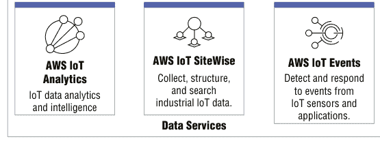

### AWS IoT 的常见用例

客户正在为许多有趣的用例使用 AWS IoT，但其中最主要的有以下几种：

- 预测性维护
- 智能库存管理
- 健康和 wellness 解决方案
- 最优资产利用
- 生产力和流程优化


- 连接的建筑、工厂和城市
- 设施管理
- 物流和供应链优化
- 地理围栏
- 设备车队管理
- 能源效率监控
- 支付和连接式商业
- 保护制造设施
- 自动结账
- 智能货架
- 店内布局优化

## AWS IoT 如何工作

AWS IoT 是一个托管平台，使您能够以安全的方式将 IoT 设备连接到各种 AWS 服务和其他设备。AWS IoT 平台允许您处理设备数据并对其采取行动，并使应用程序能够在设备离线时与设备交互。该服务的规模使其能够支持数十亿台设备和消息，并处理和路由消息到其他设备。物联网设备是大数据的主要生产者之一，因此物联网设备能够与大数据服务协同工作，您可以使用这些服务在流上分析数据并以无缝的方式处理和存储数据，无论规模如何，这使得构建大数据应用程序变得容易。

从考试角度来看，了解这些物联网设备如何与 AWS IoT 服务交互以及每个 AWS IoT 服务如何与 AWS 上的分析服务交互以分析数据并提取洞察非常重要。

当物联网设备向 AWS IoT 服务发送消息时，IoT 服务会触发“规则操作”将数据写入：

- Elasticsearch 域
- Kinesis Firehose 流
- Kinesis 数据流
- DynamoDB 表
- Amazon ML

IoT 服务规则操作允许您执行以下操作：

- 更改 CloudWatch 报警或捕获指标。
- 写入 S3 存储桶。
- 写入 SQS 队列。
- 写入 SNS 作为推送通知。
- 调用 lambda 函数。

作为考生，您需要知道您可以为各种服务创建规则操作，包括 Amazon Kinesis Data Streams 和 Amazon Kinesis Data Firehose、AWS Lambda 服务、Amazon DynamoDB 和 Amazon ML 服务。

如果您查看图 2.4，左侧是 AWS IoT Device SDK，它允许您使用 HTTP、WebSockets、MQTT 协议和其他协议将设备连接到 AWS IoT 服务。

**FIGURE 2.4 AWS IoT - How it Works**

Source: www.amazonaws.cn/en/iot-core/features

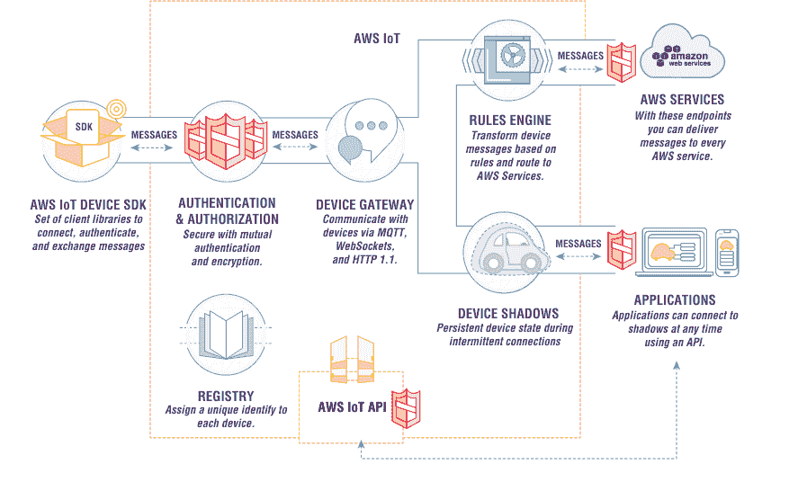

从物联网角度来看，安全性至关重要，因为您的设备必须连接到 AWS IoT 服务；身份验证和授权变得至关重要。AWS IoT Core 为身份验证提供身份服务，并在所有连接点进行端到端加密，以确保数据在设备和 AWS IoT 之间交换时从未未经证实身份。您可以通过应用具有细粒度权限的策略来保护对设备和应用程序的访问。

虽然 AWS IoT 是 AWS 大数据专业考试的关键部分，但它不是您将在新的 AWS 数据分析专业认证考试中接受测试的核心服务，因此我们不会在本书中花费更多时间讨论它。如果您想了解有关 AWS IoT 和相关服务的更多信息，请访问 https://docs.aws.amazon.com/iot/index.html。

## Amazon Kinesis

Amazon Kinesis 是 AWS Analytics 服务组合中的分析产品组合的一部分。Amazon Kinesis 在客户对捕获、处理和分析流数据的原生 AWS 服务有巨大需求后推出。如今产生的大部分数据，高达 95%，都是非结构化数据。随着数据的增长，其中大部分以高速到达，需要被捕获、处理、分析和采取行动，同时在挖掘这些数据以获取洞察方面提供巨大价值。流系统需要在具有高且可变输入速率的数据上以低延迟产生持续结果。重要的是要理解数据具有保质期，数据价值会随时间推移而降低，因此洞察时间至关重要。这并不意味着所有数据都会随时间推移而失去价值，但要说明的重点是某些应用程序需要极低延迟，而其他应用程序则可以接受更高延迟。考虑信用卡交易欺诈检测用例的例子，识别欺诈的时间至关重要。越早检测到欺诈，公司处理情况和减轻此类交易风险的能力就越好。图 2.5 展示了洞察的易腐性以及需要快速采取行动以实现最佳价值的必要性。

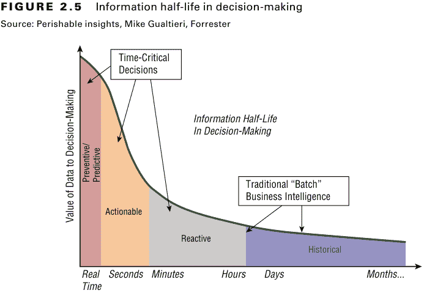

模型，您无需支付任何预付费用或最低费用，但按分片小时和 PUT 有效负载单元付费。

如图 2.6 所示，您可以摄取和存储数据，然后将其传递给不同的应用程序进行处理，包括 Kinesis Data Analytics、Spark on EMR 和使用 AWS Lambda 进行处理。您甚至可以在您喜欢的 BI 工具中可视化处理后的数据。

**FIGURE 2.6 Kinesis Data Streams overview**

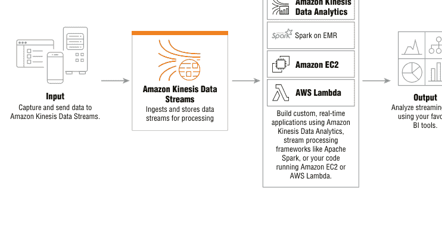

## Kinesis Data Streams 用途是什么？

从技术角度来看，Kinesis Data Stream 可用于任何高速数据捕获和聚合，但有一些关键场景 Kinesis Data Streams 真正表现出色：

### 加速日志和数据馈送摄取和处理

网络服务器、应用程序服务器和物联网设备经常产生需要在创建后立即捕获的日志。Kinesis Data Streams 允许您以低延迟捕获这些数据并实时处理，从而保护您免受服务器和磁盘故障以及数据丢失的影响。

### 实时指标收集和报告

企业经常需要业务的实时视图——例如，在任何特定时间看到工厂车间有多少设备处于活动状态以及当前生产水平如何。这些指标

**FIGURE 2.7 Kinesis Data Streams data flow**

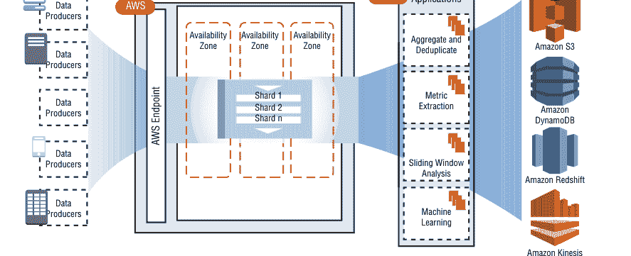

1. 在创建 Kinesis 数据流之前，确定流的初始大小。Kinesis Data Stream 由多个分片组成。分片是流中唯一标识的数据记录序列，并提供固定容量。您可以将分片视为流内数据的分区。每个分片可支持每秒最多五次读取事务，每秒最多读取 2 MB 数据。每个分片可支持每秒最多 1000 次写入事务，每秒最多写入 1 MB 数据。多个 Amazon Kinesis 应用程序可以从一个分片读取。您可以在创建流后并且 Kinesis 应用程序正在从流中消费数据时动态调整 Kinesis Data Stream 的大小或添加和删除分片。有关如何调整流大小的更多信息，请参阅 docs.aws.amazon.com/streams/latest/dev/amazon-kinesis-streams.html。
2. 生产者将数据记录提交到 Kinesis Data Stream。您可以配置生产者将数据放入流中。要将数据放入流中，您可以对您的 Kinesis Data Stream 调用 Amazon Kinesis 服务的 PutRecord() 操作。每次调用 PutRecord() 都需要 Kinesis Data Stream 的名称、分区键以及要添加到 Kinesis Data Stream 的数据 blob。分区键是一个重要概念，因为它用于确定数据记录添加到流中的哪个分片。分片中的所有数据都发送到同一个

**FIGURE 2.8 Aggregation and collection with KPL**

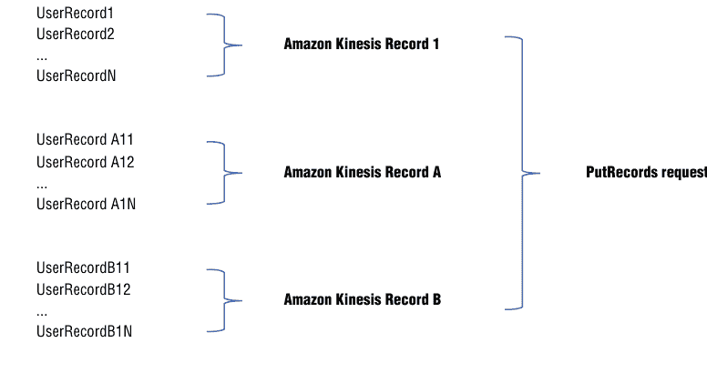

### 消费者侧易用性

消费者侧开发人员可以选择使用 Kinesis Consumer Library (KCL) 或简单地使用 GetRecords() 等 API 方法从流中检索数据。

如果您使用 KCL，它会自动与 KPL 协同工作，在将记录返回给用户之前检索单个记录。但是，如果您不使用 KCL，您可以使用 KPL Java 库在将记录返回给用户之前提取单个记录。

KCL 将使消费者侧的生活更轻松，就像 KPL 在生产侧所做的那样。

### 生产者监控

KPL 与 CloudWatch 密切配合，并将吞吐量、错误和其他指标发送到 CloudWatch。您可以配置事件发布的级别，从流级别到分片再到生产者级别。

### 异步架构

KPL 具有异步架构。对 KPL 的任何 put 数据调用都会立即返回，而无需等待记录发送或从服务器接收响应。会创建一个“Future”对象，该对象在稍后时间接收将记录发送到 KPL 的结果。


Kinesis Producer Library 是一个库，充当生成事件的应用代码与 Kinesis Data Streams API 所需调用操作之间的中介。

有关 KPL 的更多详细信息，请访问 AWS 文档 (amzn.to/2ZtbMeZ)。

## 使用 KPL 写入 Kinesis 数据流

基本的 Kinesis 生产者代码如下：

```java
KinesisProducer kinesis = new KinesisProducer();
for (int j = 0; j < 100; j++) {
    ByteBuffer data = ByteBuffer.wrap("myData".getBytes("UTF-8"));
    kinesis.addUserRecord("mystream", "mypartitionkey", data);
}
```

## 使用 Kinesis Agent 将数据写入流

Kinesis Agent 是一个独立的 Java 软件应用程序，提供了一种简单的方法来收集数据并发送到 Kinesis 流。该代理处理以下事项：

- 监控文件并将数据发送到 Kinesis 流
- 文件轮转
- 检查上次已处理的数据
- 监控数据写入失败并在失败后重试
- 发送 CloudWatch 指标。

默认情况下，Kinesis Agent 使用换行符 `\n` 来识别单个记录；但是，可以将代理配置为处理多行记录。

使用 Kinesis Agent 将数据写入 Kinesis 流的步骤：

1. 安装 Kinesis Agent：

   使用 Amazon Linux AMI 安装：

   ```bash
   sudo yum install -y aws-kinesis-agent
   ```

   使用 Red Hat Enterprise Linux 安装：

   ```bash
   sudo yum install -y https://s3.amazonaws.com/streaming-data-agent/aws-kinesis-agent-latest.amzn1.noarch.rpm
   ```

   使用 GitHub 设置：

   a. 从 awslabs/amazon-kinesis-agent 下载代理。

   b. 安装代理：

   ```bash
   sudo ./setup --install
   ```

```java
PutRecordsRequest putRecordsRequest = new PutRecordsRequest();
putRecordsRequest.setStreamName(streamName);
List<PutRecordsRequestEntry> putRecordsEntryList = new ArrayList<>();

for (int i = 0; i < 100; i++) {
    PutRecordsRequestEntry putRecordsRequestEntry = new PutRecordsRequestEntry();
    putRecordsRequestEntry.setData(ByteBuffer.wrap(String.valueOf(i).getBytes()));
    putRecordsRequestEntry.setPartitionKey(String.format("partitionKey-%d", i));
    putRecordsEntryList.add(putRecordsRequestEntry);
}

putRecordsRequest.setRecords(putRecordsEntryList);
PutRecordsResult putRecordsResult = kinesisClient.putRecords(putRecordsRequest);
System.out.println("Put Result: " + putRecordsResult);
```

PutRecord：此操作用于通过每个 HTTP 请求向您的流发送单个记录。每个记录都有一个唯一的序列号，该序列号由 Kinesis Data Streams 在您调用 putRecord() 向流中添加数据时分配。通常建议使用 PutRecords() 而不是单独调用 PutRecord()。分区键用于对流中的数据进行分组，数据记录会根据分区键分配给流中的分片。

## 从 Kinesis 流读取数据

我们已经看到了多种将数据写入 Kinesis 数据流的方法。Kinesis 还提供了多种从流中消费数据的方式。多个消费者可以并行地从数据流中读取数据。默认情况下，流中的分片提供 2 MB/秒的读取吞吐量，或每个分片每秒 5 次读取事务。该吞吐量容量由从该分片读取的所有消费者共享。但是，当消费者使用增强型扇出时，它获得自己的 2 MB/秒读取吞吐量容量，从而允许多个消费者以高容量并行读取数据。

您可以使用以下方式之一从 Kinesis 数据流消费数据。

### Kinesis Data Analytics

您可以使用 Amazon Kinesis Data Analytics 应用程序通过 SQL 或 Java 处理和分析 Kinesis 流中的数据。Kinesis Data Analytics 可以使用其他参考源的数据来丰富数据，执行数据聚合，或使用机器学习来发现数据异常。

### Kinesis Data Firehose

您可以使用 Kinesis Data Firehose 处理来自 Amazon Kinesis 数据流的数据。Amazon Kinesis Data Firehose 是一项完全托管服务，用于将实时流数据传送到 Amazon S3、Amazon Redshift、Amazon Elasticsearch Service 和 Splunk 等目的地。Amazon Kinesis Data Firehose 允许您在传送到目的地之前转换数据并转换数据记录格式。

### AWS Lambda

AWS Lambda 可用于转换和处理来自数据流的数据。AWS Lambda 是一项完全托管、可扩展的服务，客户只需为计算时间付费，无需任何管理。

### 使用 Kinesis Client Library 的自定义消费者

您可以使用 Amazon Kinesis Client Library 来消费和处理来自 Kinesis 数据流的数据。从具有多个分片的流中消费记录可能相当复杂，因为您需要在多个实例之间平衡负载、应对实例故障、检查已处理的记录，并经常对数据重新分片做出反应。KCL 将您从这种复杂性中抽象出来，让您专注于业务逻辑，同时处理分布式记录消费的具体细节。

您可以使用 KCL 以 Java 或 Python 开发消费者。

## Amazon Kinesis Firehose

流中数据的处理是通过结合使用 Amazon Kinesis Data Streams 和 AWS Lambda 来实现的；然而，通常需要将数据持久化以进行长期存储或进一步分析。虽然 Amazon Kinesis Data Streams 是第一个构建的服务，但团队很快意识到，流式应用程序最流行的用例之一是实时捕获这些设备发出的数据，并在存储以供长期分析之前对其进行缓冲。Amazon 以其一贯的客户至上理念，决定构建 Amazon Kinesis Firehose，这是一项完全托管服务，允许用户将流式数据传送到 Amazon S3、Amazon Redshift、Amazon Elasticsearch Service 和 Splunk 等目的地。Amazon Kinesis Firehose 允许您创建传输流，各种生产者可以向其写入数据（最大记录长度为 1000 KB），并在将数据传送到目标目的地之前缓冲数据（可配置参数，以 MB 或秒为单位）。

最流行的用例之一是客户通过将转换后的数据和原始数据分发到不同的目的地来转换到达 Kinesis Firehose 流的数据（见图 2.9）。

将流数据传送到不同目的地的方式有所不同。例如，当您的目标是 Elasticsearch 集群时，数据将直接流式传输到集群；但当目标是 Redshift 时，数据会传送到 S3 存储桶，然后发出 Copy 命令将数据从 S3 存储桶复制到 Amazon Redshift（见图 2.10 和图 2.11）。

**图 2.9 数据流 - S3 目的地**

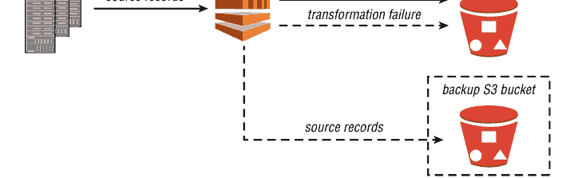

**图 2.10 Amazon Redshift 作为 Kinesis Firehose 的目的地**

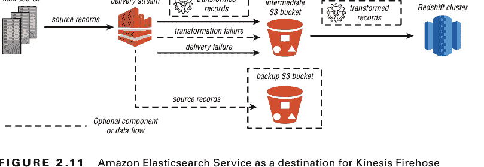

**图 2.11 Amazon Elasticsearch Service 作为 Kinesis Firehose 的目的地**

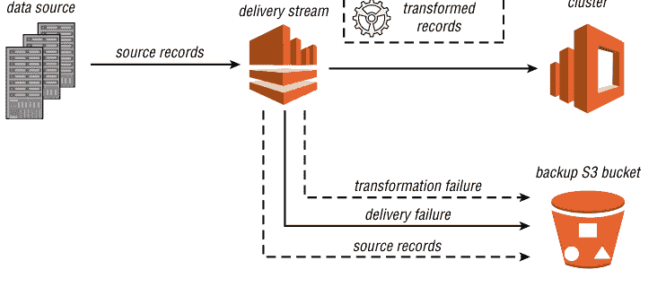

当目的地是 Splunk 时，流数据会传送到 Splunk，但也可以选择备份到 S3（见图 2.12）。

**图 2.12 Splunk 作为 Kinesis Firehose 的目的地**

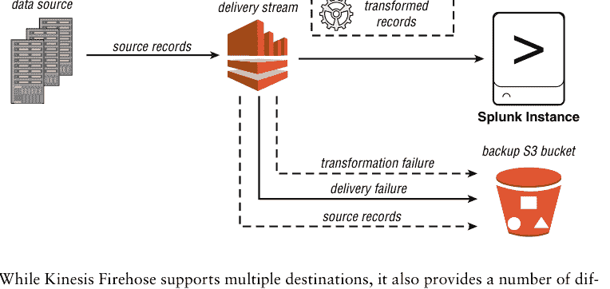

虽然 Kinesis Firehose 支持多个目的地，但它还在平台上提供了许多可以直接写入 AWS Kinesis Firehose 的不同原生来源。使用 Kinesis API，您还可以为新来源构建连接器。

原生来源如下：

- Kinesis Data Streams：
  - 如果您的源 Kinesis 数据流配置了聚合，Kinesis Firehose 会在将记录传送到目的地之前对记录进行反聚合。
  - 当 Kinesis Data Streams 用作 Kinesis Firehose 的源时，putRecord() 和 putRecordBatch() 操作将被禁用。如果您仍想使用 putRecord() 或 putRecordBatch()，可以在 Kinesis Data Stream 本身上使用它们。
  - Kinesis Firehose 从 Kinesis 流的最新位置开始读取记录，并且多个 Kinesis Firehose 传输流可以读取同一个 Kinesis 流。
- Kinesis Agent
- AWS SDK
- CloudWatch Logs
- CloudWatch Events
- AWS IoT


## 使用 Amazon Kinesis Firehose 进行数据转换

虽然捕获数据至关重要，但您通常还需要对高速数据流执行数据转换。您可以使用 Amazon Kinesis Firehose 启用数据转换，它默认会缓冲最多 3 MB 的传入数据。Kinesis Firehose 会以同步方式调用指定的 Lambda 函数，每个缓冲批次使用 AWS Lambda 同步调用模式。任何 Lambda 调用的请求和响应都有 6 MB 的最大负载大小限制，因此您必须确保函数的缓冲大小小于或等于 6 MB。

您还可以将预构建的 Lambda 蓝图与 Kinesis Data Firehose 结合使用。以下 Lambda 蓝图可用于最常见的转换：

- 通用 Firehose 处理：用于任何自定义转换逻辑。
- Apache 日志转 JSON
- Apache 日志转 CSV
- Syslog 转 JSON
- Syslog 转 CSV
- Kinesis Data Firehose 将记录流作为源处理：一个基本 Lambda 函数，用于访问输入中的 Kinesis Data Stream 记录并返回处理状态。
- Kinesis Data Firehose CloudWatch Logs 处理器：从 CloudWatch Logs 订阅筛选器发送的记录中解析并提取每个单独的日志事件。

Kinesis Firehose 的每次 Lambda 函数调用最长可持续 5 分钟。

## 在 Amazon Kinesis 中转换输入记录格式

最常见的分析需求之一是将行格式转换为列格式，以优化分析查询。客户最常用的列格式是 Parquet 或 ORC，因为它们不仅可以压缩数据，还能为分析查询提供最佳性能。Amazon Kinesis Firehose 允许您将 JSON 数据转换为 Parquet 或 ORC。Amazon Kinesis Firehose 需要三个要素来转换数据的记录格式：

1. 用于读取输入数据 JSON 的反序列化器：您可以选择以下两种反序列化器之一：
   - Apache Hive JSON SerDe
   - OpenX JSON SerDe
2. 用于确定如何解释数据的模式：您可以使用 AWS Glue 从数据中推断模式，并将其存储在 Glue Data Catalog 中。然后，Kinesis Firehose 会引用该模式并使用它来解释您的数据。

您还可以为 Kinesis Data Analytics 应用程序使用 Apache Flink 接口。本质上，您可以在自己熟悉的集成开发环境（IDE）中创建 Flink 应用程序，然后将应用程序代码上传到 Kinesis Data Analytics。这样，您就可以在完全托管的弹性服务中运行应用程序。然后，您可以使用 AWS 生态系统来管理应用程序。例如，您可以通过 Amazon CloudWatch 配置各种指标（如应用程序、任务、操作符和并行度），还可以在 AWS Management Console 中显示作业图。

Kinesis 提供 Kinesis 处理单元（KPU）作为运行代码的资源。在撰写本文时，每个 KPU 包含 1 个 vCPU、4 GB 内存和 50 GB 存储。应用程序所需的 KPU 数量通过 Parallelism 和 ParallelismPerKPU 属性计算：

- Parallelism – 此属性用于设置默认的 Apache Flink 应用程序并行度。除非在应用程序中显式覆盖，否则所有操作符、接收器和来源都将使用此并行度。默认值为 1，最大值为 64。

- ParallelismPerKPU – 此属性用于设置应用程序每个 KPU 可调度的并行任务数。默认值为 1，最大值为 8。

请注意，这些限制是软限制，可以通过请求提高限制来增加。

您可以使用 Kinesis 应用程序的自动扩缩容功能，根据需求和所需吞吐量上下调整资源（图 2.19）。

### 图 2.19 Kinesis Data Analytics - Flink 接口

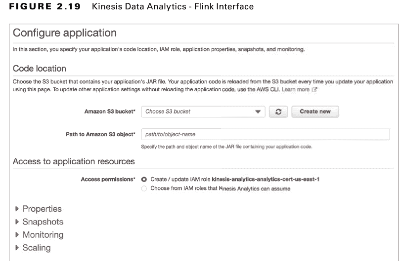

您可以在 AWS 控制台上配置 Kinesis Data Analytics 应用程序时，配置并行度和每个 KPU 的并行度，同时启用自动扩缩容（图 2.20）。

### 图 2.20 使用 Kinesis 扩展您的 Flink 应用程序

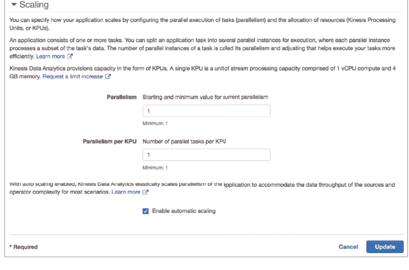

## Amazon Kinesis Video Streams

随着 IoT 和集成设备的出现，您可以捕获其他测量数据，现在还可以捕获视频数据，这些数据需要以实时方式进行存储、分析和响应。视频对于智能家居、智慧城市、视频监控安全、工业自动化和计算机视觉等许多应用至关重要。虽然实时传输、处理和分析视频的需求不断增长，但构建这样的视频摄取系统至少可以说是相当复杂的。事实证明，您需要集成许多不同的设备和操作系统，而为各种设备和开发环境编写代码非常复杂。此外，随着设备数量的增长，您需要扩展流式传输和分析应用程序，同时支持流上的延迟、节奏和抖动。需要提供 API 来检索视频、处理视频并重放视频。

视频流分析是媒体客户最常提出的需求之一，亚马逊在 2017 年的 re:Invent 大会上发布了 Amazon Kinesis Video Streams，其主要目标是传输视频和时间编码数据以供分析。Amazon Kinesis Video Streams 是一项完全托管的可扩展服务，允许您从数百万个来源传输视频，包括智能手机、安全摄像头、网络摄像头、无人机、汽车内置摄像头等。您还可以发送非视频的时间序列化数据，例如音频数据、热成像、深度数据、RADAR（无线电探测和测距）数据等。当来自这些来源的实时视频流进入 Kinesis 视频流时，您可以构建应用程序，逐帧实时访问数据以进行低延迟处理。Amazon Kinesis Video Streams 与来源无关；您可以使用 GStreamer 库从计算机的网络摄像头传输视频，或使用 RTSP 从网络上的摄像头传输视频。

Amazon Kinesis Video Streams 不仅允许您捕获这些数据，还可以轻松构建支持视觉的应用程序。它提供持久存储，您可以在其中配置保留期限、加密静态数据，并根据生产者时间戳和摄取时间戳为数据添加时间戳（图 2.21）。存储的数据可搜索，并允许您与各种下游服务集成，例如 Amazon AI 服务、Apache MXNet、TensorFlow 和其他第三方提供商。Kinesis Video Streams 为客户带来的主要优势如下：

- 连接并从数百万台设备传输流。
- 以持久方式存储和索引数据。
- 专注于业务案例，而不是基础设施管理。
- 按需付费的定价模式。
- 以安全方式传输数据。
- 构建实时和批处理应用程序。

关键概念如下：

- **生产者** – 生产者是向 Kinesis Video Streams 提供数据的任何应用程序、设备或来源。生产者可以是生成视频的设备，甚至可以发送非视频数据，如音频流、图像或 RADAR 数据。

- **Kinesis Video Producer Libraries** – 这些库应安装在您的设备上，允许您连接到 Kinesis 流，并实时或通过缓冲将视频传输到流中。

- **Kinesis Video Streams** – 生产者将视频放入 Kinesis 视频流，这基本上是一种资源，使您能够传输实时视频数据，可选地存储该数据，并让数据可供实时消费以及批量或临时消费。您可以从 AWS 控制台或使用 AWS SDK 创建 Kinesis 视频流（见图 2.22）。


### 图 2.22 Kinesis 视频流

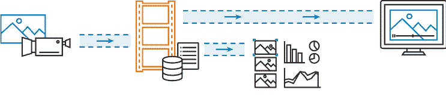

**Kinesis 生产者**

生产者是生成视频、音频和其他时间编码数据流的设备，并将其发布到 Kinesis 视频流。

**Kinesis 视频流**

Kinesis 视频流捕获、存储并索引时间编码的数据片段，以支持实时和批处理类用例。

**Kinesis 消费者**

消费者是自定义应用程序，它们处理来自 Kinesis 视频流的片段，用于机器学习、视频分析和其他工作流。

消费者还可以从 Kinesis 视频流请求和显示片段。

## AWS Glue

AWS Glue 是一项完全托管的*提取、转换和加载（ETL）*服务，允许您从数据库等各种来源提取数据和元数据，并构建信息目录，然后可使用该目录将数据转换为您所需的目标状态。ETL 是分析平台从来源提取数据、使用各种工具/技术进行转换，并将其加载到目标数据存储库的过程。AWS Glue 不仅允许您构建 ETL 作业，还允许您在 Python shell 或完全托管的无服务器 Spark 环境中以完全托管的方式运行这些作业。此外，AWS Glue 还允许您与 AWS 生态系统中的其他服务共享此元数据，并与这些数据进行交互（见图 2.23）。

AWS 在 Amazon S3、Amazon Redshift、Elasticsearch、Athena 等数据服务的使用量上出现了显著增长。然而，虽然 AWS 在 AWS 市场上提供了许多不同的合作伙伴工具，但云上的大部分 ETL 仍然是手工脚本编写的 ETL，这不仅创建耗时，而且长期维护也具有挑战性。AWS 意识到人们出于各种原因（如灵活性）进行手工编码。然而，能力越大，责任越大。如果源系统发生更改、数据格式发生变化或目标模式更改，您都需要更改已编写的 ETL 代码并长期维护。此外，每个新数据源都意味着您需要重复完全相同的过程。

AWS Glue 旨在通过提供一个用户界面来自动化手工 ETL 脚本编写这一繁琐且容易出错的过程，使客户能够专注于编写其核心转换逻辑，而不是维护运行此代码的基础设施。

AWS Glue 还提供内置和自定义分类器。分类器是一段代码，它使用多种规则将源数据分类为数字、字符串、电话号码、社会安全号码和地址。

### 图 2.23 Glue 流程

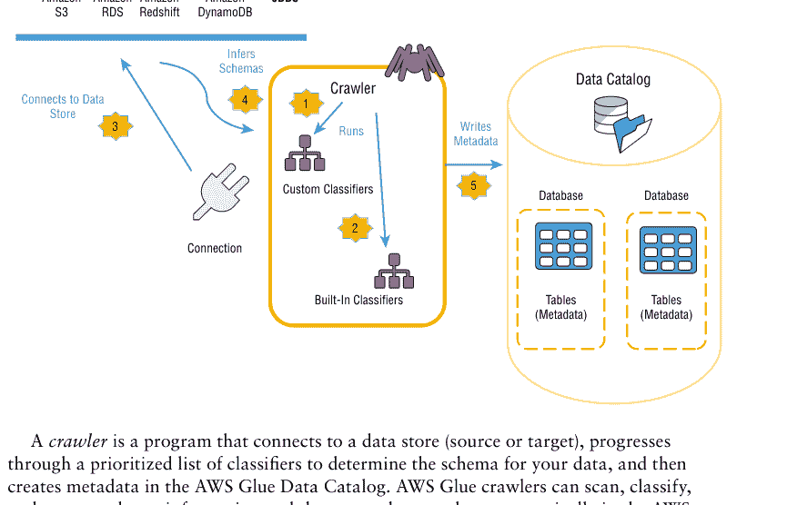

爬网程序是一个连接到数据存储库（源或目标）、遍历优先分类器列表以确定数据模式，然后在 AWS Glue 数据目录中创建元数据的程序。AWS Glue 爬网程序可以扫描、分类和提取模式信息，然后自动将元数据存储在 AWS Glue 数据目录中。元数据以表的形式存储。爬网程序还可以检测模式更改，为先前爬取过的数据存储库对表进行版本控制，并检测 Amazon S3 上的 Hive 风格分区。对于先前爬取过的 Amazon S3 分区数据，爬网程序将默认添加新分区或更新已更改的分区。爬网程序可根据您的需求按需运行或按计划运行。

Glue 流程始于爬网程序，它使用自定义分类器或内置分类器，通过连接到其中一个数据源（S3、RDS、Redshift、DynamoDB 或 JDBC），推断模式，并将元数据写入数据目录。

AWS Glue 有三个主要组件：

- 数据目录
- 编写 ETL 作业
- 执行 ETL 作业

### Glue 数据目录

考虑这样一种场景：您进入一个藏有最珍贵书籍的图书馆，但这些书是随机存放的，您无法搜索到想要的书。当信息被良好地组织、管理和更易于查找时，它才真正有用。类似的规则也适用于您数据存储库中的数据，例如数据湖、源数据库等。为了使数据工程师、数据分析师、数据科学家和业务用户能够访问这些信息，对数据进行编目并在整个组织内共享非常重要。

AWS Glue 数据目录的构建也出于类似意图，并允许您通过各种选项管理表元数据：

- Web UI
- Hive Metastore API
- Hive SQL
- 爬网程序

Glue 元数据的层次结构始于数据库，数据库由多个表组成，这些表基于使用您的爬网程序（标准或自定义）推断出的各种列。

图 2.24 显示了示例目录中定义的表。表的名称指示了已捕获的源，您还可以看到其他信息，例如表所属的数据库、此表数据的存储位置、文件的分类（如 Parquet、CSV、JSON、XML）以及上次更新的日期。

### 图 2.24 示例目录中定义的表

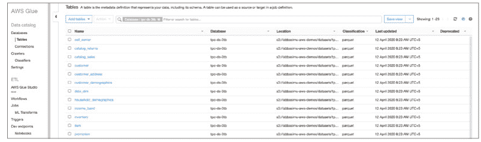

此目录中包含的元数据本质上是技术性的。但是，您可以灵活地搜索元数据以发现其不同元素，包括数据集的位置、其来源分类（是 JDBC 源、Amazon S3 存储桶还是 Amazon

有三种类型的迁移，每种都有其细微差别。

- 现有数据：
  - 在目标数据库中创建文件或表。
  - 使用来自源的数据填充表。
  - AWS 控制台中的“迁移现有数据”选项和 API 中的 Full Load 选项。
- 现有数据和复制更改：
  - 在迁移期间捕获源上的更改。
  - 初始迁移完成后，更改将作为已完成事务的单元应用于目标。
  - AWS 控制台中的“迁移现有数据并复制持续更改”选项和 API 中的 full-load-and-cdc 选项。
- 仅复制更改：
  - 读取源数据库上的恢复文件。
  - 将事务分组并将它们应用到目标。根据需要缓冲。
  - AWS 控制台中的“仅复制数据更改”选项。

对于目标准备，您可以选择以下三个选项：

- 不执行任何操作：在不执行任何操作模式下，AWS DMS 假定目标表已预先创建。在全量加载或全量加载加 CDC 的情况下，请确保在启动迁移之前目标表为空。
- 在目标上删除表：在“在目标上删除表”模式下，AWS DMS 会在启动迁移之前删除目标表并重新创建它们。这确保了迁移开始时目标表是空的。
- 截断：在截断模式下，AWS DMS 在迁移开始前截断所有目标表。

## AWS DMS 支持什么？

AWS DMS 无缝支持托管硬件、软件、补丁、升级和错误报告，而您可以专注于迁移数据。它为迁移活动提供了可扩展的解决方案。可以根据资源需求扩展或缩减资源。它具有成本效益的定价，您根据资源使用量付费。如果主复制服务器发生故障，它支持自动故障转移。

此外，AWS DMS 提供了到新软件或新硬件的无缝迁移。例如，您可能希望从旧数据库迁移到具有尖端功能的新数据库（如 Amazon Aurora），或者您甚至可能希望在保持相同数据库引擎的同时升级底层基础设施。

它支持多种数据库作为源数据库：

- Oracle
- Microsoft SQL Server
- MySQL
- MariaDB
- PostgreSQL
- Db2 LUW
- SAP
- MongoDB
- Amazon Aurora

以及多种数据库作为目标：

- Oracle
- Microsoft SQL Server
- PostgreSQL
- MySQL
- Amazon Redshift
- SAP ASE
- Amazon S3
- DynamoDB

AWS DMS 支持使用以下方式进行安全迁移：

- KMS 用于静态数据加密
- SSL 用于传输中数据

要了解有关 AWS DMS 的更多信息，请访问 amzn.to/2Vvfj6i。


从考试的角度来看，重要的是要知道 DMS 实际上可以用于将数据加载到 Amazon S3 和 Amazon Redshift。此外，在捕获增量记录方面，它提供了更好的灵活性。


## Task Runner

任务运行是一个持续轮询新任务然后执行它们的流程。*Task Runner* 会安装在由你的管道定义创建的资源上并自动运行。当 Task Runner 安装并配置好后，它会轮询已激活的 AWS 管道以获取任务。一旦任务被分配，Task Runner 就会执行该任务并将状态报告回 AWS Data Pipeline。需要记住的是，虽然一个管道可能被评估为多个任务，但单个任务是一个独立的工作单元。Task Runner 的总体流程接下来会进行说明。

AWS Data Pipeline 可以与以下服务配合进行数据转换：

- Amazon EC2
- Amazon EMR

AWS Data Pipeline 与以下服务配合存储数据：

- Amazon DynamoDB
- Amazon RDS
- Amazon Redshift
- Amazon S3

AWS Data Pipeline 可以通过以下接口访问：

- AWS Management Console
- AWS CLI
- AWS SDK
- Query API：提供使用 HTTPS 请求调用的低级 API。这是访问 AWS Data Pipeline 的最直接方式之一，但它要求你的应用程序处理低级细节。这可能很繁琐，但 AWS Data Pipeline 提供了关于此的良好文档。

AWS Data Pipeline 还有一些其他概念，也在用户指南中进行了介绍：

- **Data nodes：** 数据节点定义了管道用作输入或输出的数据的位置和类型。支持以下数据节点：
  - DynamoDBDataNode
  - SqlDataNode
  - RedshiftDataNode
  - S3DataNode
- **Databases：** AWS Data Pipeline 支持以下数据库：
  - JdbcDatabase – 任何符合 JDBC 的数据库
  - RdsDatabase – 任何 RDS 数据库
  - RedshiftDatabase
- **Activities：** 在 AWS Data Pipeline 中，活动实际上是执行的工作。AWS Data Pipeline 提供了多个预打包的活动，以适应客户现场常见的场景：
  - CopyActivity – 将数据从一个位置复制到另一个位置
  - EmrActivity – 运行 Amazon EMR 集群
  - HiveActivity – 在 Amazon EMR 集群上运行 Hive 查询
  - HiveCopyActivity – 在 Amazon EMR 集群上运行 Hive 查询，并支持高级过滤和 S3 数据节点支持
  - PigActivity – 在 Amazon EMR 集群上运行 Pig 脚本
  - RedshiftCopyActivity – 将数据复制到和从 Amazon Redshift 表中复制
  - ShellCommandActivity – 运行自定义 Unix/Linux shell 命令活动
  - SqlActivity – 在数据库上运行 SQL 查询
- **Preconditions：** 在开始活动之前，经常需要检查某些条件。例如，你可能想要检查某个 DynamoDB 表是否存在，或者在运行下游处理之前检查某个特定日期的某个特定 S3 Key 是否存在。AWS Data Pipeline 支持两种主要类型的先决条件：
  - 系统管理的先决条件由 AWS Data Pipeline 代表你运行，并且不需要计算资源。以下是系统管理先决条件的一些示例：
    - DynamoDBDataExists
    - DynamoDBTableExists
    - S3KeyExists
    - S3PrefixNotEmpty
  - 用户管理的先决条件：
    - Exists – 检查数据节点是否存在
    - ShellCommandPrecondition – 作为先决条件运行自定义 Unix/Linux 命令
- **Resources：** 活动需要资源来执行。例如，像 PigActivity 或 EmrActivity 这样的活动需要像 EMR 这样的计算资源可用。AWS Data Pipeline 支持以下类型的资源：
  - Ec2Resource
  - EmrCluster
- **Actions：** 在管道执行期间，步骤可能会成功、失败或延迟。当此类事件发生时，你需要采取适当的行动。AWS Data Pipeline 满足了管道构建的这一需求，并支持以下操作：
  - SnsAlarm – 此操作根据 onSuccess、onFail 和 onLateAction 事件向主题发送 SNS 通知。
  - Terminate – 此操作触发挂起或未完成的活动、资源或数据节点的取消。

## Large-Scale Data Transfer Solutions

我们已经看到了许多不同的技术，可以在数据量较低到中等时从不同的数据源收集数据。然而，当你遇到需要迁移大量数据的情况时，例如数据大小超过多个 TB 或 PB，通过 Internet 连接传输数据可能需要极其大量的时间。也有一些场景需要便携式数据传输，但需要传输多个 TB 的数据。这些就是你需要便携式解决方案如 AWS Snowcone 或大规模数据传输选项如 AWS Snowball 和 AWS Snowmobile 以及连接选项如 AWS Direct Connect 的场景。让我们更详细地了解一下这些选项。

### AWS Snowcone

AWS Snowcone 是 AWS Snow 家族中最小的成员，重量轻至 2.1 kg，并为你提供 8 TB 的可用存储。其小巧的尺寸使其非常适合狭小空间或便携性是关键的情况。它在许多场景中都很有用，包括组织希望将多个 TB 的数据迁移到云端但缺乏足够的网络带宽的情况，或在数据所在位置几乎没有或完全没有连接的情况下。

此外，AWS Snowcone 在医疗物联网中可能很有用，可用于在医疗机构或偏远医疗区域进行数据收集和数据处理。它可用于实时从急救车辆传输关键数据。

### AWS Direct Connect

AWS Direct Connect 让你能够在你的网络与 AWS Direct Connect 位置之一之间建立专用网络连接。使用工业标准 802.1Q VLAN，此专用连接可以划分为多个虚拟接口。这使你能够使用同一连接通过公共 IP 地址空间访问公共资源，例如存储在 Amazon S3 中的对象，并通过私有 IP 空间访问私有资源，例如在 Amazon Virtual Private Cloud (VPC) 中运行的 Amazon EC2 实例，同时在公共和私有环境之间保持网络隔离。虚拟接口可以随时重新配置以满足你不断变化的需求。

AWS Direct Connect 的主要优势如下：

- 降低你的带宽成本
- 一致的网络性能
- 与所有 AWS 服务兼容
- 与你的 Amazon VPC 的私有连接
- 在 1 Gbps 到 10 Gbps 之间弹性扩展

> **Exam Tip**
>
> AWS Direct Connect 从考试角度来看是一个重要主题，因此你对 AWS Direct Connect 的理解将有助于考试准备。

## Summary

在本章中，我们讨论了在将数据摄取到 AWS 云时数据管道的各个组件。我们查看了使用 AWS IoT 从物联网设备摄取数据、使用 Amazon Kinesis 流式传输数据、使用 AWS Glue 从数据库和其他数据源传输数据，以及使用 AWS Database Migration Service 从数据库迁移大规模数据并捕获增量更改。我们还查看了用于事件的 Amazon SQS、用于过大而无法通过标准 Internet 连接传输的数据传输的 Amazon Snowball 和 Snowmobile，以及用于在你的数据中心和 AWS 之间建立直接连接的 AWS Direct Connect。

现在数据已在 AWS 上可用，下一章将介绍使用我们可用的各种工具处理数据。


## Chapter 2 ▪ Data Collection

- 8. 您的 CIO 最近宣布您将迁移到 AWS，以通过利用平台的广度和深度来降低成本并提高整体敏捷性。您有多个本地 Oracle 数据库，从许可角度来看不仅昂贵，而且难以扩展。您意识到您可以用 Amazon Aurora 获得相同的性能，成本仅为 1/10，因此希望继续进行迁移。您希望在 AWS MySQL 实例上预先创建架构。以下哪种方法最容易实现此操作？
  - A. 使用 AWS Database Generation Tool 在目标数据库中生成架构。
  - B. 使用 AWS Schema Conversion Tool 在目标数据库中生成架构。
  - C. 创建脚本在目标数据库中生成架构。
  - D. 使用 AWS Config Tool 在目标数据库中生成架构。

- 9. 以下哪一项可用于将极大量数据迁移到 AWS，每台设备最高可达 100 PB？
  - A. AWS Snowmobile
  - B. AWS Snowball
  - C. AWS S3 Export
  - D. AWS S3 Transfer Acceleration
  - E. AWS Direct Connect

- 10. 您最近已迁移到 AWS，但仍维护本地数据中心。您已将 BI/分析 和 DWH 工作负载迁移到 Amazon Redshift，现在需要迁移大量数据到 Redshift，以确保每周报告的数据保持最新。哪种 AWS 管理服务可用于以简单、快速和安全的方式进行此数据传输？（选择两项。）
  - A. Direct Connect
  - B. Import/Export to AWS
  - C. Data Pipeline
  - D. Snowball

### References

- 1. aws.amazon.com/iot/
- 2. https://docs.aws.amazon.com/streams/latest/dev/introduction.html
- 3. https://docs.aws.amazon.com/glue/latest/dg/what-is-glue.html
- 4. https://docs.aws.amazon.com/datapipeline/latest/DeveloperGuide/what-is-datapipeline.html
- 5. https://docs.aws.amazon.com/snowball/latest/snowcone-guide/index.html
- 6. https://docs.aws.amazon.com/snowball/latest/developer-guide/index.html
- 7. https://docs.aws.amazon.com/snowball/latest/ug/index.html
- 8. https://docs.aws.amazon.com/directconnect/latest/UserGuide/Welcome.html
- 9. aws.amazon.com/iot-core/features/
- 10. docs.aws.amazon.com/cognito/latest/developerguide/authentication-flow.html

### Exercises & Workshops

我们强烈建议读者通过以下练习和工作坊列表，以熟悉产品和服务。AWS Data Analytics Specialty 认证考试期望用户对所测试的服务具有实践知识，因此仅有理论知识不足以通过考试。

- 1. Building Streaming Analytics applications on AWS
  https://real-time-streaming-with-kinesis.workshop.aws
- 2. Database Migration Immersion Day – Database Migration Service and Schema Conversion tool
  https://www.immersionday.com/dms
- 3. Data Engineering Immersion Day – AWS Glue, Data Lakes, Amazon Athena and Amazon QuickSight
  https://www.immersionday.com/data-engineering
- 4. Serverless Data Lake Day
  https://www.immersionday.com/serverless-data-lake
- 5. Copy CSV data between Amazon S3 buckets using AWS Data Pipeline
  https://docs.aws.amazon.com/datapipeline/latest/DeveloperGuide/dp-copydata-s3.html
- 6. Export MySQL Data to Amazon S3 using AWS Data Pipeline
  https://docs.aws.amazon.com/datapipeline/latest/DeveloperGuide/dp-copydata-mysql.html
- 7. Process real-time stock data using KPL and KCL 2.x
  https://docs.aws.amazon.com/streams/latest/dev/tutorial-stock-data-kplkcl2.html
- 8. Analyze Real-Time stock data using Kinesis Data Analytics for Java Applications
  https://docs.aws.amazon.com/streams/latest/dev/tutorial-stock-data.html
- 9. Using AWS Lambda with Amazon Kinesis Data Streams
  https://docs.aws.amazon.com/streams/latest/dev/tutorial-stock-data-lambda.html


