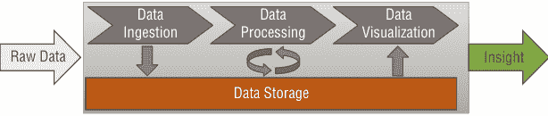
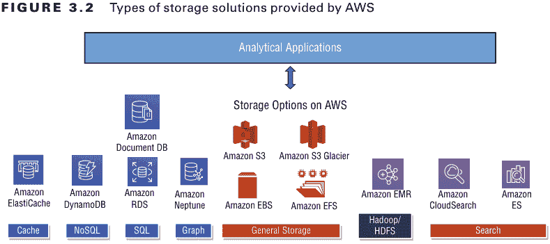
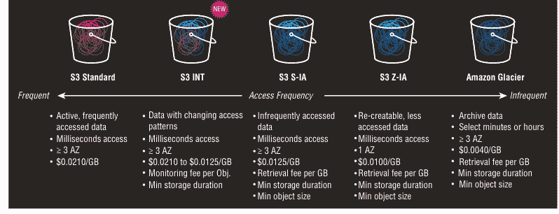
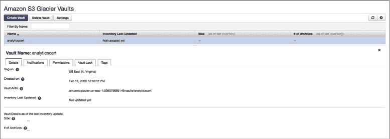
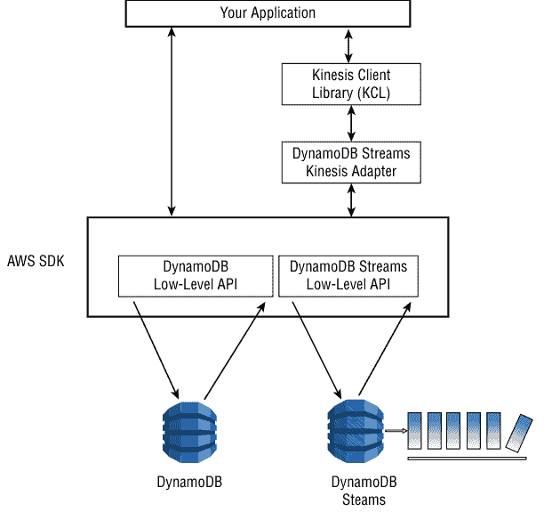
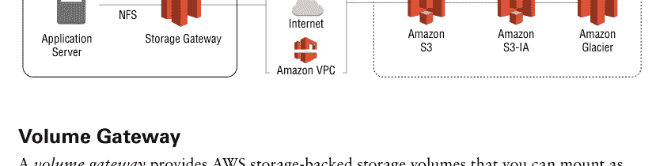
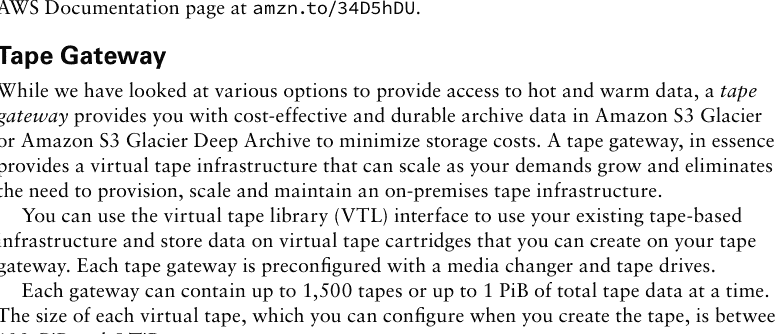
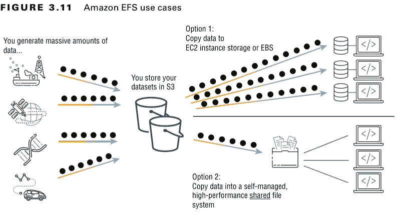

# Chapter 3 Data Storage

THE AWS DATA ANALYTICS SPECIALTY CERTIFICATION EXAM OBJECTIVES COVERED IN THIS CHAPTER MAY INCLUDE, BUT ARE NOT LIMITED TO, THE FOLLOWING:

- ✓ Domain 2.0: Storage and Data Management
  - 2.1 Determine the operational characteristics of a storage solution for analytics
  - 2.2 Determine data access and retrieval patterns
  - 2.3 Select an appropriate data layout, schema, structure, and format
  - 2.4 Define a data lifecycle based on usage patterns and business requirements
  - 2.5 Determine an appropriate system for cataloging data and managing metadata


### Introduction

在本章中，您将学习如何根据用例需求在 AWS 平台上存储来自不同摄取源的数据，并使数据可供下游消费。我们将讨论各种服务，例如 Amazon S3、Amazon DynamoDB、Amazon DocumentDB、Amazon Neptune、Amazon Timestream、Amazon FSx for Windows、Amazon FSx for Lustre 和 Amazon Storage Gateway。正如您在前几章中所见，每个服务都适合特定的用例概况。考试的关键主题是评估您对这些服务如何适应用例的理解，而非单个配置参数。本章涵盖了几乎 22% 的考试题目，因此更好地理解这些目标将有助于提高您的整体考试成绩。图 3.1 显示了数据存储在分析管道中的重要性。



在过去，客户会为所有存储需求选择单一数据库，通常使管道复杂化，并尝试将用例改造到他们因特定用例而选择的<|message|> 技术。选择有限的日子已经结束，客户现在可以为工作选择合适的工具。正是因为这种特定需求和客户需求，AWS 为您的分析应用程序提供多种存储选择。

图 3.2 显示了 AWS 平台上可用的不同服务数量，以支持从 Amazon S3、Amazon EBS 和 Amazon EFS 等通用存储到 Amazon ElastiCache、Amazon DynamoDB、Amazon RDS、Amazon DocumentDB、Amazon Neptune、Amazon EMR、Amazon CloudSearch 和 Amazon ES 等特定用例存储的广泛用例。其中一些服务是数据库服务，不在 AWS Data Analytics Specialty 认证考试范围内。我将涵盖通过此考试所需的所有必要服务。



让我们查看不同的 AWS 存储服务和架构模式以及何时使用它们。

### Amazon S3

*Amazon Simple Storage Service (S3)* 构成了在 AWS 平台上构建的大多数数据和分析应用程序的骨干。Amazon S3 是一项 Web 服务，允许您从世界任何地方存储和检索任意数量的数据。它提供多种不同的交互接口，包括基于控制台和 API 的访问。Amazon S3 是一种对象存储，因此提供特定的 API 与其交互以存储和检索对象及其元数据。为了有效地使用 Amazon S3，您需要了解以下概念，这对于建立对该服务的理解很重要：

**Bucket**  *Bucket* 只是一个对象的容器。在 S3 中没有对象可以不通过 bucket 存在，因此 bucket 是 S3 中的基本概念。Bucket 有助于提供某些关键功能：

- 您使用它们在最高级别组织 Amazon S3 命名空间。
- 由于每个 bucket 都有相关的存储和检索成本，因此有助于识别负责数据存储和传输费用的账户。
- Bucket 帮助您为组织内不同数据定义适当的访问控制。


通常，支持数据湖架构的技术提供更廉价的存储选项，因此你可以存储更细粒度级别的数据，而不是聚合级别的数据。这使得数据科学家能够处理详细数据，并在原始数据上进行大规模特征工程。

由于以下各种因素，S3 非常适合作为数据湖的存储层：

- **成本：** 与其他选项相比，S3 上的数据存储相对便宜。例如，在撰写本书时，你可以在标准存储层上以每月低至 2,150 美元的价格在 S3 上存储 100 TB 数据。如果数据访问频率较低，实际上你可以以更低的价格存储数据。
- **持久性：** S3 提供 11 个 9（99.999999999）的持久性。为了让你有直观认识，11 个 9 的持久性意味着，从统计上讲，你每 659,000 年才会丢失一个文件。你被陨石击中的可能性大约是它的 411 倍。
- **可用性：** S3 旨在提供 99.99% 的可用性。100% 的服务可用性意味着系统将经历零停机；然而，大多数服务的可用性介于 99% 到 100% 之间。
- **高性能：** S3 提供高性能的数据摄取和检索，应用程序可以实现每秒数千次事务的请求性能。例如，你的应用程序在存储桶中的每个前缀每秒至少可以实现 3,500 个 PUT/COPY/PASTE/DELETE 和 5,500 个 GET/HEAD 请求。但是，存储桶中的前缀数量没有限制。例如，如果你的应用程序每秒需要 50 万次读取请求，你可以在 S3 存储桶中创建 100 个前缀来并行化读取。S3 还支持分段上传和 Range GET 以优化摄取和读取性能。S3 还提供了分段上传选项，该选项基本上使你可以分部分上传大型对象。
- **易于使用：** 你可以通过多种方式与 S3 交互。你可以使用 AWS 管理控制台来处理 S3，或使用 REST API 或 AWS SDK。你还可以配置事件通知，以便在存储桶中发生某些事件时接收通知。事件通知通常在几秒钟内送达，但偶尔可能需要更长时间，在极少数情况下可能会丢失。
- **生命周期管理：** 生命周期管理是数据管理的重要组成部分，S3 提供了开箱即用的功能，你可以将对象转换到不同的存储类、归档它们，或在指定时间段后删除它们。S3 为你存储的对象提供了多种不同的存储类，这些类通常取决于使用场景。
  - 频繁访问的对象/性能敏感的使用场景：S3 为性能敏感的使用场景提供了两种存储类型。性能敏感的使用场景通常需要在毫秒级别访问对象。
    - 标准 – S3 使用的默认存储类
    - 减少冗余 – 用于非关键且可重新生成的数据的存储类。不建议用于生产环境。

## 图 3.3 AWS 提供的 S3 存储类类型

来源：re:Invent 2018 优化成本（bit.ly/2QQ3IhM）



## Amazon S3 中的数据复制

Amazon S3 可以自动将 S3 存储桶中的数据复制到同一账户或不同账户的存储桶中。你还可以使用同区域复制（SRR）在同一 AWS 区域内复制对象，或使用跨区域复制（CRR）在不同 AWS 区域之间复制对象。有关更多信息，请参见表 3.1。你可以使用复制执行以下操作：

- 复制对象，包括创建时间、版本 ID 等元数据。
- 将对象复制到不同的存储类。
- 更改复制对象的所有权。
- 使用复制时间控制（RTC）在可预测的时间范围内复制对象（99.99% 的对象可以在 15 分钟间隔内复制）。

## 表 3.1 同区域复制（SRR）与跨区域复制（CRR）

| 同区域复制 | 跨区域复制 |
|---|---|
| 将日志聚合到单个存储桶中，以便更简单地处理。 | 满足合规性要求。 |
| 在生产账户和测试账户之间复制数据。 | 最大限度地减少不同地理位置客户的延迟。 |
| 遵守数据主权法律和合规性要求。 | 优化多个 AWS 区域所需计算性能。 |

> 从考试的角度来看，SRR 和 CRR 是重要的概念。强烈建议在 AWS 文档（amzn.to/34CWDf3）中查看此主题的更多详细信息。

## Amazon S3 中的服务器访问日志记录

安全、审计和合规性要求通常要求你提供对数据进行的所有访问的详细信息。S3 服务器访问日志记录用于跟踪对 S3 存储桶发出的请求。默认情况下，服务器访问日志记录是禁用的，因此你需要启用它。启用日志记录后，访问日志将保存到同一区域内的存储桶中，每条日志都提供有关访问的详细信息，例如请求者、存储桶名称、请求的操作（GET/HEAD）、结果响应，以及可选的错误代码。虽然服务器访问日志记录是免费的，但你确实需要为存储在 S3 上的日志付费。

要启用访问日志记录，你必须执行以下操作：

- 1. 在需要启用访问日志记录的存储桶上，添加日志记录配置以打开日志交付。S3 将交付对该存储桶进行的所有访问的日志。
- 2. 日志需要存储在目标存储桶中，因此必须向 S3 日志交付组提供写入权限。权限需要通过存储桶访问控制列表（ACL）而不是存储桶策略来授予。

日志以尽力而为的方式交付、收集和整合，然后交付到目标存储桶。日志会在几小时内交付，但也可以更频繁地交付。访问日志记录的核心目标是让你了解存储桶收到的流量类型，虽然丢失记录的情况很少见，但服务器访问日志并不能完整记录所有请求。

## S3 上的分区、压缩和文件格式

S3 是一种对象存储，构成了基于 AWS 构建的数据湖的核心存储。通过使用分区、压缩和选择最佳文件格式，可以优化 S3 的性能和成本。最佳文件格式可以使用压缩，从而减少存储所需的容量，并显著提高 Athena 等将 S3 用作数据湖的分析服务的查询性能。最常见的文件格式之一是 Apache Parquet（parquet.apache.org），它是一种压缩的列式存储格式，专为查询大量数据而设计。Apache Parquet 支持多种数据处理框架，例如 Apache Spark 和 Apache Hadoop。虽然 S3 允许你存储任何类型的数据，但 Apache Parquet 通过减少存储需求和改善整体查询成本，其性能可以显著优于 CSV、JSON 和 TSV 等原始文件格式。S3 的成本基于两个主要因素：

- 扫描的数据大小
- 扫描的数据量

## Amazon S3 Glacier

Amazon S3 Glacier 是一项低成本的对象存储服务，你可以使用它以安全且持久的方式存储数据。Amazon S3 Glacier 的典型用例是数据归档和数据备份。你应该将 Amazon S3 Glacier 用于不经常访问的冷数据，并且可以等待几小时来检索数据。你可以使用数据生命周期策略在 Amazon S3 和 Amazon S3 Glacier 之间移动数据。

Amazon S3 Glacier 数据模型有两个核心概念：存储库（vault）和归档（archive）。

### 存储库（Vault）

在 Amazon S3 Glacier 中，*存储库（vault）* 是用于存储归档的容器。创建存储库需要名称和区域。存储库名称在同一账户的每个区域中是唯一的。你可以在一个存储库中存储多个归档。Amazon Glacier 支持各种存储库操作，所有操作都是特定于区域的。Amazon S3 Glacier 中的每个存储库资源都有一个唯一地址：

```
https://<region-specific endpoint>/<account-id>/vaults/<vaultname>
```

例如，如果你要在美国东部（弗吉尼亚北部）区域创建一个 analyticscert 存储库，对于账户号 1234567890，该存储库将通过以下 URI 寻址：

```
https://glacier.us-east-1a.amazonaws.com/1234567890/vaults/analyticscert
```

图 3.4 显示了在弗吉尼亚北部区域创建的 analyticscert 存储库。




能够在页面加载时间内提供数据，而不会增加额外延迟，因此它们非常适合 DynamoDB 的低个位数毫秒级读写性能。需要在突发增长时进行扩展的移动应用程序，以及需要在读写活动激增时处理峰值读写性能的投票应用程序，也非常适合 DynamoDB 的横向扩展能力。需要无模式（schema-less）模型的应用程序，例如每分钟摄取数十万个数据点的应用监控解决方案，也非常适合 DynamoDB 原生支持 JSON 的无模式模型。

> 从考试的角度来看，理解 DynamoDB 与其他服务相比的适用场景非常重要。你会遇到许多场景完全符合 DynamoDB 用例的问题，因此了解 DynamoDB 的延迟和吞吐量可以帮助你做出正确的选择。

DynamoDB 通过 API 和易于使用的管理控制台提供无缝的吞吐量和存储扩展，因此你可以轻松地向上或向下扩展以满足需求。DynamoDB 没有固定的模式，每个项目可能具有不同数量的属性。多种数据类型使数据模型更加丰富。二级索引为你可以执行的查询增加了灵活性，而不会影响性能。性能、可靠性和安全性是内置的，采用固态硬盘（SSD）存储和自动三向复制。DynamoDB 使用经过验证的加密方法来安全地验证用户身份并防止未经授权的数据访问。

DynamoDB 是一项区域级服务，通过多可用区（Multi-AZ）复制提供容错能力。区域级服务意味着，如果你有客户的数据存储在 DynamoDB 中，可以使用 Amazon EMR（Elastic MapReduce）进行处理，我将在第 4 章“数据处理与分析”中进一步讨论该服务。在高层面上，Amazon EMR 是一种按需付费服务模式下的托管 Hadoop 框架，可以处理存储在 Amazon DynamoDB 以及其他数据存储（如 Amazon RDS 和 Amazon S3）中的数据。数据处理在 Amazon EMR 内部完成，结果可以存储在 Amazon S3 中。你还可以通过 Apache Hive（Amazon EMR 中的一个项目）处理 DynamoDB 中的数据，并将其与 Hive 可以直接访问的生态系统中的其他数据（例如来自 Amazon S3 的数据）进行连接。

## Amazon DynamoDB 数据类型

Amazon DynamoDB 支持表中属性的多种不同数据类型，这些数据类型可以分为三大类：标量、文档和集合。

### 标量数据类型

标量类型只能表示一个值。标量类型包括数字、字符串、二进制、布尔值和 null。参见表 3.3。

**表 3.3 DynamoDB 中的标量数据类型**

| 数据类型 | 描述 | 范围 |
|---|---|---|
| 数字 | 数字可以为正、负或零。数字以可变长度表示。你还可以使用数字数据类型来表示日期或时间戳，使用纪元时间或任何其他时间表示形式。为了最大限度地提高跨语言和库的兼容性，所有数字都以字符串形式通过网络发送到 DynamoDB。 | 数字的精度最高可达 38 位。 |
| 字符串 | 字符串是采用 UTF-8 编码的 Unicode。 | 字符串的长度必须大于零，且最大为 400 KB（DynamoDB 项目大小限制）。对于简单主键，第一个属性值（分区键）的最大长度为 2048 字节。对于复合主键，第二个属性值（排序键）的最大长度为 1024 字节。 |
| 二进制 | 二进制类型属性可以存储任何二进制数据，例如压缩文本、加密数据或图像。在 DynamoDB 中比较二进制值时，每个字节都视为无符号字节。你的应用程序必须在将二进制值发送到 DynamoDB 之前以 base64 编码格式对其进行编码。收到这些值后，DynamoDB 会将数据解码为无符号字节数组，并将其用作二进制属性的长度。 | 长度应大于 0，且最大为 400 KB（DynamoDB 项目大小限制）。 |
| 布尔值 | 布尔数据类型是只有两个可能值（通常表示为 true 和 false）的数据类型，用于表示逻辑和布尔代数的两个真值。 | 布尔类型属性可以存储为“true”或“false”。 |
| Null | 在数据库中，Null 值表示没有值。Null 值不同于数字零。 | Null 表示未知或未定义的状态。 |

### 文档数据类型

文档类型可以表示具有嵌套属性的复杂结构，例如在 JSON 文档中可以看到的结构。文档类型包括列表和映射。需要注意的是，DynamoDB 的项目大小限制为 400 KB，因此虽然列表或映射中的值的数量没有限制，但值必须符合 DynamoDB 的项目大小限制（400 KB）。属性值不能是空集合（字符串集合、数字集合或二进制集合）。但是，允许使用空列表和空映射。参见表 3.4。

**表 3.4 DynamoDB 中的文档数据类型**

| 数据类型 | 描述 | 范围 |
|---|---|---|
| 列表 | 列表类型可以存储有序的值集合。列表用方括号括起来。DynamoDB 允许你处理列表中的单个元素，即使这些元素嵌套得很深。示例：`TopActors: ["Matt Damon", "Tom Cruise", "Kate Winslet"]` | 最大 400 KB（DynamoDB 项目大小限制）。允许空列表。 |
| 映射 | 映射类型可以存储无序的名称-值对集合。映射用花括号括起来。映射类似于 JSON 对象。映射元素中可以存储的数据类型没有限制，映射中的元素不必是相同类型。如果你的用例涉及存储原始 JSON 文档，那么映射非常适合这种数据类型。与列表数据类型类似，DynamoDB 允许你处理映射中的单个项目，即使这些项目嵌套得很深。 | 最大 400 KB（DynamoDB 项目大小限制）。允许空映射。 |

### 集合类型

集合类型可以表示多个标量值。集合类型包括字符串集合、数字集合和二进制集合。DynamoDB 支持表示数字、字符串或二进制值集合的类型。集合中的所有元素必须属于同一类型。例如，数字集合类型的属性只能包含数字；字符串集合只能包含字符串；依此类推。只要包含这些值的项目符合 DynamoDB 的项目大小限制（400 KB），集合中的值数量就没有限制。集合中的每个值必须唯一。集合中值的顺序不会被保留；因此，你的应用程序不能依赖集合中元素的任何特定顺序。最后，DynamoDB 不支持空集合。

集合的示例（字符串集合、数字集合和二进制集合）如下所示：

```
["Emirates", "Turkish", "British"]
```

```
[130, 79, 149, 110]
```

```
["U3Vubnk=", "UmFpbmk=", "U25vd3k="]
```

## Amazon DynamoDB 核心概念

在 Amazon DynamoDB 中，表、项目、属性以及分区键和排序键是核心概念：

- **表**：表与其他数据库中的表类似。Amazon DynamoDB 将数据存储在表中。表是数据的集合，包含多个项目。
- **项目**：项目类似于关系数据库中的行、元组或记录，是多个属性的组合，在表的其他项目中具有唯一可识别性。
- **属性**：每个项目由一个或多个属性组成。属性类似于关系数据库中的字段或列，不能再进一步细分。
- **分区键和排序键**：项目中的第一个属性是分区键。从性能角度来看，分区键非常重要，因为它用作内部哈希函数的输入，其输出决定了该项目在 DynamoDB 基础设施中的物理存储位置。项目中的第二个属性是排序键，它是可选的，用于按排序键值顺序对数据进行排序。具有相似分区键的项目存储在一起以提高性能。如果两个项目具有相同的分区键值，则它们必须具有不同的排序键值。

## DynamoDB 中的读写容量模式

Amazon DynamoDB 在读写方面的卓越性能意味着它必须有足够的容量来向这些表读写大量数据。Amazon DynamoDB 提供了两种模式来确保你有足够的容量读写底层表：按需容量模式和预置容量模式。

### 按需容量模式

当你拥有工作负载未知或应用程序流量不可预测的表，或者你更喜欢按使用量付费的便捷性时，按需容量模式是理想的选择。在按需模式下，DynamoDB 会在你的工作负载上升或下降到任何先前达到的流量水平时立即适应。当你的工作负载流量水平达到新的峰值时，DynamoDB 会快速适应新的工作负载。使用按需模式可以实现个位数的毫秒级延迟，并且无需更改代码即可为新表和现有表配置按需模式。

在按需模式下定义 DynamoDB 表容量的两个重要组件是读取请求单元和写入请求单元。在按需容量模式下，你无需指定读取和写入请求单元；DynamoDB 会根据你的应用程序在表上执行的数据读取和写入向你收费。


## Read Request Unit

一个读取请求单元代表一次强一致性读取请求或两次最终一致性读取请求，针对大小最多为 4 KB 的项目。因此，事务读取请求需要两个读取请求单元才能对大小最多为 4 KB 的项目执行一次读取。如果需要读取的项目大于 4 KB，DynamoDB 将需要额外的读取请求。要计算读取请求单元的总数量，你需要以下信息：

- 项目大小
- 读取类型（最终一致/强一致）

例如，假设你读取一个大小为 8 KB 的项目。你将需要以下数量的读取请求：

- 一次强一致性读取需要两个读取请求。
- 一次最终一致性读取需要一个读取请求。
- 一次事务性读取需要四个读取请求。

## Write Request Unit

一个写入请求代表对大小最多为 1 KB 的项目的写入。如果你的项目大小大于 1 KB，DynamoDB 将消耗额外的写入请求。

对于大小为 1 KB 的项目，需要以下数量的读取请求：

- 标准写入一次写入请求
- 事务性写入两次写入请求

因此，如果你需要写入一个大小为 8 KB 的项目，DynamoDB 将消耗 8 个写入请求用于标准写入，以及 16 个写入请求用于事务性写入。

## Handling Scaling in an On-Demand Capacity Mode

按需容量模式在处理读取和写入流量的峰值时处理了大量复杂性，并能适应应用程序的需求。例如，如果你有一个应用程序，其流量模式在每秒 10,000 次强一致性读取到每秒 20,000 次强一致性读取之间，而你之前的峰值是每秒 20,000 次读取，按需容量模式将能够处理每秒 40,000 次读取的持续流量。如果你的当前应用程序持续每秒 40,000 次读取，这将成为 DynamoDB 计算新容量需求的新峰值，随后的流量可达到每秒 80,000 次读取。

你可能会想知道为什么要选择预置容量模式（在下一节中讨论），当 DynamoDB 可以根据应用程序流量自动扩展时。原因是如果你在 30 分钟内新的峰值超过之前的峰值两倍以上，你可能会遇到节流。DynamoDB 建议间隔你的

## Amazon DynamoDB: Indexing and Partitioning

通过主键访问数据是一种理想的方式，因为它提供了最快的访问路径。在 DynamoDB 中，当你创建表时，必须指定表名和表的主键。主键唯一标识每个项目，因此表中不能有两个项目具有相同的主键。

DynamoDB 支持两种不同类型的主键：

- 分区键
- 复合键（分区键和排序键）

Amazon DynamoDB 通过指定主键/值来提供对表中项目的快速访问。然而，许多应用程序可能受益于拥有一个或多个二级（或替代）键，以便使用除主键之外的属性高效访问数据。为此，你可以在表上创建一个或多个二级索引，并针对这些索引发出 Query 或 Scan 请求。

二级索引是一种包含表中的属性子集和用于支持 Query 操作的替代键的数据结构。你可以使用 Query 从索引中检索数据，这与使用表进行 Query 类似。表可以有多个二级索引，这为你的应用程序提供了许多不同的查询模式。每个二级索引都与恰好一个表关联，从该表获取其数据。这称为索引的基础表。当你创建索引时，你为索引定义一个替代键（分区键和排序键）。你还定义要从基础表投影或复制到索引中的属性。DynamoDB 将这些属性连同来自基础表的主键属性一起复制到索引中。然后你可以像查询或扫描表一样查询或扫描索引。

每个二级索引都由 DynamoDB 自动维护。当你在基础表中添加、修改或删除项目时，该表上的任何索引也会更新以反映这些更改。

DynamoDB 支持两种类型的二级索引：

**Local Secondary Index (LSI)** LSI 是一个与基础表具有相同分区键但不同排序键的索引。*本地二级索引*之所以称为“本地”，是因为本地二级索引的每个分区都限定于具有相同分区键/值的基础表分区。任何一个分区键/值的索引项目总大小不能超过 10 GB。本地二级索引共享为被索引表预置的相同吞吐量。了解每个表的 LSI 限制对你很重要，尽管考试不测试服务限制，但值得知道你最多可以在每个表上定义五个本地二级索引。你可以在 AWS 文档页面 amzn.to/DDBLimits 查看最新的 DynamoDB 限制。

你可以在新表或现有表上启用流。由于 DynamoDB 流以异步方式运行，因此对原始表没有性能影响。

## Amazon DynamoDB Streams – Kinesis Adapter

建议使用 Amazon Kinesis Adapter 来消费来自 Amazon DynamoDB 流的数据。Amazon DynamoDB 流的 API 有意与 Amazon Kinesis Data Streams 类似，后者是一个实时数据处理服务（见第 2 章“数据收集”）。在这两个服务中，数据流都由分片组成，分片实际上是流记录的容器。两个服务的 API 都包含以下内容：

- ListStreams
- DescribeStream
- GetShards
- GetShardIterator

你可以使用 Kinesis Client Library (KCL) 与 Kinesis Adapter 交互。图 3.7 说明了这些库如何相互交互。

FIGURE 3.7 Amazon DynamoDB Streams – Kinesis Adapter



## Amazon DocumentDB

在 re:Invent 2018 期间，AWS 发布了 Amazon DocumentDB，旨在满足客户对托管文档数据库的需求。我将尝试介绍文档数据库的好处，然后再查看数据库的架构和接口。

### Why a Document Database?

当今的数据世界相当复杂，我们有各种数据类型和文件格式。公司将用例改造到单一工具的时代已经过去，现在你可以选择适合特定用例的工具。常见的数据类别和用例如表 3.5 所示。

**TABLE 3.5 Common data categories and use cases**

| Data Category | Key Features | Use Case |
|---|---|---|
| Relational | Referential integrity<br>ACID transactions<br>schema-on-write | Databases, data warehouses<br>ERP<br>Finance<br>CRMs<br>Lift and shift from other systems |
| Key/value | High-throughput<br>Low latency (typically milliseconds) read and writes<br>Unlimited scale | Real-time bidding<br>Shopping cart<br>Social<br>Product catalog<br>Customer preferences<br>Recommendations<br>Adverts |
| Document | Raw JSON documents<br>Quick access<br>Native reads | Content management<br>Personalization<br>Mobile<br>Catalog<br>Retail and marketing |
| In-memory | Microsecond latency | Leaderboards<br>Real-time analytics<br>Caching |
| Graph | Finding complex relationships<br>Navigate/traverse between data elements | Fraud detection<br>Social network analysis<br>Recommendation engine |
| Time series | Collect/Store/process data sequenced by time | IoT applications<br>Event tracking |
| Ledger | Complete<br>Immutable and verifiable history of all changes to data | Systems of record<br>Supply Chain<br>Healthcare<br>Registrations<br>Financial |

文档数据库在存储原始 JSON 数据和在 JSON 文档中导航时很有用。由于 JSON 文档本质上是半结构化的，它们自然不适合关系数据库，后者没有原生的 JSON 处理能力。JSON 文档模型自然映射到应用程序数据，每个文档可以具有不同的结构并且独立于其他文档。你可以在文档中的任何键上建立索引，并在整个数据集中运行临时聚合和分析。

正如你所知，在关系数据库中，每行具有相同数量的属性，而非关系数据往往每个项目的属性各不相同。让我们考虑一个关系数据库扩展性不如文档数据库有效的用例。

你正在运营一家领先的社交媒体公司，并决定在平台上添加一个名为 Ring-o-Ring 的新游戏。你希望跟踪玩该游戏的用户统计数据。你有两个选择，关系数据库或文档数据库。在关系数据库中，你将创建一个用户表：

| userid | username | firstname | lastname |
|---|---|---|---|
| 101 | fati1122 | Fatima | Abbasi |

然后创建一个 Ring-o-Ring 表：

| UserId | HiScore | LeaderboardLevel |
|---|---|---|
| 101 | 383442 | 99 |

这对于一个游戏可能有效，但一旦你在平台上添加更多游戏和应用，这可能会变得非常复杂。你可以通过在运行时执行连接来“规范化”以消除复杂性，但代价是性能，复杂性从一侧转移到另一侧，使得维护应用程序更昂贵。


在文档数据库中，你可以直接将统计数据添加到文档中。无需创建表，也无需在运行时进行昂贵的连接操作，这使得开发更加简单，维护成本也更低。

## Amazon DocumentDB 概述

Amazon DocumentDB 是一项快速、可扩展、高可用且完全托管的、与 MongoDB 兼容的服务。它具有以下关键特性，使其成为存储、处理和分析文档的理想选择：

- 能够以个位数毫秒的延迟处理数百万个请求。
- 与 AWS 平台深度集成。
- 可以使用与 MongoDB 相同的代码、驱动程序和工具。
- 安全性高。
- 完全托管。

Amazon DocumentDB 支持灵活存储，存储卷容量会随着数据库存储需求以 10 GB 为增量自动增长，最高可达 64 TB。您无需为集群预置任何多余的存储以应对增长，这一切都在后台自动完成。对于读取密集型应用，Amazon DocumentDB 最多可支持 15 个只读副本实例。由于副本共享相同的底层存储，因此无需在只读副本节点上执行写入操作，从而降低了总体成本。副本滞后时间缩短至个位数毫秒，为读取密集型工作负载提供更快的响应。Amazon DocumentDB 提供用于读写操作的集群端点和用于读取数据的读取器端点，使应用程序无需跟踪副本的添加或移除即可连接。无论存储卷大小如何，您都可以在几分钟内添加只读副本。您还可以在几分钟内完成集群计算和内存资源的扩缩容操作。

Amazon DocumentDB 会持续监控集群的健康状况，一旦检测到实例故障，它将自动重启该实例及相关进程。Amazon DocumentDB 无需进行崩溃恢复重放数据库重做日志，这大大缩短了重启时间。同时，Amazon DocumentDB 将数据库缓存与数据库进程隔离，使缓存能够在实例重启后继续存活。故障发生时，已配置的 15 个只读副本之一可以充当故障转移实例；如果客户未配置只读副本，系统会自动创建一个新的 Amazon DocumentDB 实例。

Amazon DocumentDB 还支持时间点恢复（PITR），允许您将集群恢复到保留期内（最近 5 分钟以内）的任意秒。保留期最长可配置为 15 天，备份存储在 Amazon S3 中。备份以自动增量方式进行，不会影响集群性能。

## Amazon Neptune 用例

以下是一些可能的 Amazon Neptune 用例：

- 欺诈检测
  - 识别信用卡的异常使用或发现欺诈账户。
- 推荐引擎
  - 进行产品推荐。
  - 进行社交推荐（可能认识的人）。
- 知识图谱
  - 构建复杂的知识图谱，以推荐与当前兴趣相似的其他感兴趣项目。
- 生命科学
  - 模拟疾病和基因相互作用。
  - 整合信息以推动医疗保健和生命科学研究。
- 网络/IT 运维
  - 对网络进行建模。
  - 回答诸如哪些主机正在运行特定应用程序之类的问题。

## 存储网关

从混合架构的角度来看，存储网关是一个重要概念。在这种架构中，部分客户的应用程序出于各种原因需要保留在本地，但又希望受益于云的敏捷性和易用性。在接下来的部分中，我将讨论客户为何寻求混合存储，以及 AWS Storage Gateway 如何在此类场景中提供帮助。从考试角度来看，这也是一个重要的概念。

## 混合存储需求

客户希望将其存储迁移到云端，原因在于以下潜在优势：

- 能够根据需求即时扩缩容资源，从而获得更高的敏捷性。
- 由于平台上原生提供了包括机器学习和大规模分析在内的多种服务来处理数据，因此可以实现更快的创新。

## AWS Storage Gateway

*AWS Storage Gateway* 是一项混合云存储服务，可为本地应用程序提供对 AWS 提供的无限云存储（如 Amazon S3、S3 Glacier、S3 Glacier Deep Archive、Amazon EBS（弹性块存储）和 AWS Backup）的访问。客户可以使用 AWS Storage Gateway 来降低其混合存储场景的存储成本。

AWS Storage Gateway 为这些应用程序带来了以下核心优势：

- AWS Storage Gateway 允许您使用多种协议（NFS、SMB），从而简化与现有应用程序的集成。
- AWS Storage Gateway 使用本地缓存，为频繁使用的数据提供低延迟访问。
- AWS Storage Gateway 使用优化的数据传输方式，以最大程度地减少本地系统与 AWS 之间的网络流量。
- AWS Storage Gateway 可降低您的总体成本，并与 AWS 集成，使您除了使用其他服务外，还可以使用 AWS 管理和监控解决方案。

AWS Storage Gateway 提供三种类型的解决方案：文件、卷和磁带。

### 文件网关

*文件网关*通过结合服务和虚拟软件设备，为 Amazon S3 提供文件接口。其优势在于，您可以使用行业标准协议（如网络文件系统（NFS）和服务器消息块（SMB））在 Amazon S3 中存储和检索对象。您可以在本地环境中以虚拟机（VM）形式运行该软件设备，它可以在 ESXi 或 Microsoft Hyper-V 虚拟机监控程序上运行。网关设备将以文件或文件共享挂载点的形式提供对存储在 Amazon S3 中对象的访问。这种方法的好处是，您的应用程序可以使用标准协议无缝访问 S3，并且与本地存储相比提供了更经济的替代方案。由于设备会在本地透明地缓存对象，并使用并行流式传输和管理带宽消耗来处理本地与 AWS 之间的数据传输，因此您可以获得卓越的性能。文件网关与以下 AWS 服务集成：

- AWS IAM（身份和访问管理）用于访问控制
- AWS KMS（密钥管理服务）用于加密
- Amazon CloudWatch 用于监控
- AWS AuditTrail 用于审计目的
- AWS Management Console 和 AWS CLI 用于操作
- AWS Billing 和成本管理工具

## 如何使用文件网关

要使用文件网关，您首先需要下载文件网关的 VM 镜像。然后，您可以通过 AWS Management Console 或 Storage Gateway API 激活文件网关。您也可以使用 Amazon EC2 镜像创建文件网关。文件网关激活后，您可以创建并配置文件共享，并将该共享与您的 Amazon S3 存储桶关联。这样，客户端就可以使用 NFS 或 SMB 协议访问该共享。写入文件共享的文件将成为 Amazon S3 中的对象，其路径即为键。

文件和对象之间存在一一映射关系，当您更改文件时，网关会异步更新 Amazon S3 中的对象。存储桶中现有的对象在文件系统中显示为文件，键变为路径。

对象使用 Amazon S3 服务端加密密钥（SSE-S3）进行加密。所有数据传输均通过 HTTPS 完成。该服务使用分段并行上传或字节范围下载来优化网关与 AWS 之间的数据传输，以更好地利用可用带宽。维护本地缓存可提供对最近访问数据的低延迟访问，并减少数据出口费用。

CloudWatch 指标可用，可以提供 VM 上的资源使用情况以及往返 AWS 的数据传输的见解。CloudTrail 跟踪所有 API 调用。使用文件网关存储，您可以执行诸如将云工作负载导入 S3、执行备份和归档、分层以及将存储数据迁移到 AWS 云等任务。[1]

图 3.9 显示了存储网关的文件存储部署。

## 图 3.9 文件存储部署 – 存储网关



## 卷网关

卷网关提供由 AWS 存储支持的存储卷，您可以从本地应用程序服务将其作为 iSCSI 设备挂载。卷网关有两种配置类型：缓存和存储。

### 缓存卷

顾名思义，缓存卷将数据存储在 Amazon S3 中，但将频繁访问的数据存储在本地。在提供 Amazon S3 的成本优势的同时，它也为需要较低 SLA 的应用程序提供了低延迟访问。缓存卷的范围


## 1 研究背景

随着人工智能技术的快速发展，深度学习在计算机视觉、自然语言处理等领域取得了显著的成果。本文旨在探讨一种基于注意力机制的图像分类方法，以提高模型在复杂场景下的识别精度。

传统卷积神经网络（CNN）通过局部感受野提取特征，但难以有效捕捉全局依赖关系。为此，研究者提出了多种注意力机制，如通道注意力、空间注意力以及自注意力等，以增强特征的表达能力。



图1展示了本文提出的网络整体架构。该架构由特征提取模块、注意力增强模块和分类模块组成。输入图像首先经过特征提取模块得到多尺度特征图，随后通过注意力增强模块对特征进行加权融合，最后由分类模块输出类别概率。

> 注意力机制使得模型能够动态关注输入中最相关的部分，这一思想源于人类视觉系统的选择性注意特性。

- 传统的卷积核尺寸固定，难以适应不同尺度的目标；
- 注意力模块可有效融合多尺度上下文信息；
- 实验表明，所提方法在多个基准数据集上达到了最优性能。

- *基于 NFSv4.1：* NFS 是一种用于与文件系统交互的网络协议。在后台，当您将实例连接到 EFS 时，数据通过 NFS 在网络上传输。
- *开放标准，广泛采用：* 几乎所有 Linux 发行版都提供 NFS 支持。

除了简单性、弹性和可扩展性等原则之外，让我们再谈谈 EFS 提供的其他一些功能。从性能角度来看，EFS 提供了两种不同的文件系统性能模式：

- 通用模式（GP 模式，默认）[推荐用于大多数工作负载]
- Max I/O [推荐用于扩展工作负载]

两种性能模式之间的权衡本质上是在较低的元数据延迟与每秒操作数限制之间。GP 模式提供了 EFS 能够实现的最低元数据操作延迟，而 Max I/O 模式不受任何 IO 限制，并提供最高的总吞吐量水平。
EFS 还提供两种系统性能模式：

- **突发吞吐量模式（默认）：** 吞吐量随文件系统大小线性增长，并允许在标准量之上定期突发。这推荐用于大多数工作负载。
- **预置吞吐量模式：** 您可以预置所需确切的吞吐量，以获得更一致、更确定的吞吐量性能。这推荐用于存储吞吐量比较高的工作负载。

您可以同时跨数千个客户端以及多个可用区访问 EFS，并且 AWS 还支持通过 VPC 对等连接、VPN 或通过 AWS Direct Connect 从数据中心访问 EFS。

从安全合规性角度来看，EFS 当然支持数据在静态和传输中的加密，并提供 SOC、ISO、PCI-DSS 和 HIPAA 以及 Hi-TRUST CSF 等医疗垂直领域合规计划的支持。

Amazon EFS Infrequent Access，或 EFS IA，是一种新的存储类别，与现有的 EFS 存储类别（现称为 EFS Standard）相比，可为客户节省高达 92% 的费用。客户可以使用 EFS IA 以经济高效的方式在其文件系统中存储更大量的数据，并将 EFS 的使用扩展到更广泛的应用。

EFS IA 不需要对现有应用程序进行任何更改，因为 EFS 提供了单一的文件系统命名空间，可透明地从两个存储类别——Standard 和 IA——提供文件。要将数据移动到 EFS IA，您可以为文件系统启用生命周期管理功能，该功能会自动将文件移入 IA，通过这样做，您可以获得巨大的成本节省（与 EFS Standard 存储类别相比高达 92%）。您还可以通过在 EFS 控制台中选择生命周期管理选项，为任何现有 EFS 文件系统启用 EFS A。

系统根据备份计划进行备份。备份计划将定义备份发生的窗口、备份的频率、备份的保留期以及备份将生命周期化到冷存储的时间。AWS Backup 还允许您使用 KMS 为备份提供第二层加密，并将数据存储在与源文件系统独立的存储中以提供额外的安全性。

## Amazon FSx for Lustre

虽然 Amazon 提供了多种计算密集型工作负载的选项，但在某些情况下，像 EFS 这样的当前文件系统无法满足快速扩展到数百万个核心的需求，每个核心读取超过 100 Gb/s。这通常是网格计算架构和一些在大数据上工作的分析应用程序的典型情况，希望即时处理结果。图 3.11 表明了计算密集型工作负载的外观。



您有两种处理此类快速的大型数据集的选项：

- 将数据复制到 EC2 实例存储或 EBS。
- 将数据复制到自管理的、高性能的共享文件系统。

正如您所见，我们拥有的两个选项都需要一个文件系统。这是因为当您读取如此大量的数据并需要低延迟时，您不能使用 S3，在这种情况下，读取此类数据所需的请求成本可能相当昂贵。在

## EXERCISE 3.2 (continued)

- 3. 从表中读取数据
  docs.aws.amazon.com/amazondynamodb/latest/developerguide/getting-started-step-3.html
- 4. 在表中更新数据
  docs.aws.amazon.com/amazondynamodb/latest/developerguide/getting-started-step-4.html
- 5. 在表中查询数据
  docs.aws.amazon.com/amazondynamodb/latest/developerguide/getting-started-step-5.html
- 6. 创建全局二级索引
  docs.aws.amazon.com/amazondynamodb/latest/developerguide/getting-started-step-6.html
- 7. 查询全局二级索引
  docs.aws.amazon.com/amazondynamodb/latest/developerguide/getting-started-step-7.html

## EXERCISE 3.3

## 使用 DocumentDB

- 1. 创建 Amazon DocumentDB 集群
  https://docs.aws.amazon.com/amazondynamodb/latest/developerguide/getting-started-step-7.html
- 2. 启动 Amazon EC2 实例
  https://docs.aws.amazon.com/documentdb/latest/developerguide/getting-started.launch-ec2-instance.html
- 3. 使用 Mongo shell 访问并使用您的集群
  https://docs.aws.amazon.com/documentdb/latest/developerguide/getting-started.connect.html
- 4. 删除 Amazon Document DB 和集群
  https://docs.aws.amazon.com/documentdb/latest/developerguide/getting-started.delete-cluster.html

## Review Questions

- 1. 您需要一个经济高效的解决方案来存储大量音频、视频和 PDF 文件，并使用现有的商业智能工具高效地跟踪和分析所有数据。以下哪一项将构成满足要求的解决方案？
  
  A. 将数据存储在 Amazon Dynamo DB 中，并在 Amazon Redshift 中引用其位置。Amazon Redshift 将跟踪有关音频、视频和 PDF 文件的元数据，但文件本身将存储在 Amazon S3 中。
  
  B. 将数据存储在 Amazon S3 中，并在 Amazon Redshift 中引用其位置。Amazon Redshift 将跟踪有关文件的元数据，但文件本身将存储在 Amazon S3 中。
  
  C. 将数据存储在 Amazon S3 中，并在 Amazon Dynamo DB 中引用其位置。仅使用 Amazon DynamoDB 用于元数据，但实际文件仍存储在 Amazon S3 中。
  
  D. 将数据存储在 Amazon S3 中，并在 Amazon EMR 上的 HDFS 中引用其位置。Amazon EMR 将跟踪有关文件的元数据，但文件本身将存储在 Amazon S3 中。

- 2. 您最近加入了一家在线视频流媒体公司，该公司希望将视频文件流式传输到 Amazon S3。以下哪项服务可用于以最少的编码向 S3 交付实时流数据？请选择一个选项。
  
  A. Spark Streaming on Amazon EMR
  B. Amazon Kinesis Data Firehose
  C. Amazon Kinesis Data Streams
  D. Amazon Redshift
  E. Amazon EMR

- 3. 您最近加入了一家新游戏公司担任数据架构师。该公司的最新游戏 Chocolate Bites 取得了压倒性的成功，导致产生了日志文件。您已被要求以最低的价格点使日志文件可供访问。数据每隔几周访问一次，但需要在访问请求发出时随时可用。您意识到 S3 是这种场景的良好选择。您应该使用以下哪种 S3 存储选项？
  
  A. AWS S3 Standard - Infrequent Access
  B. AWS S3 Standard
  C. AWS Glacier
  D. AWS Reduced Redundancy Storage


## 进一步阅读

我强烈建议你在此阶段查阅 AWS Well-Architected Analytics Lens，可在 https://d1.awsstatic.com/whitepapers/architecture/wellarchitected-Analytics-Lens.pdf 获取。

这是 AWS Well-Architected Framework 的一部分，有助于你理解在 AWS 上构建分析管道时所做决策的利弊。我们只是触及了 AWS Analytics 产品组合的表面，但这将为你在 AWS 上构建分析系统提供更好的理解。

## 参考文献

- 1. docs.aws.amazon.com/storagegateway/latest/userguide/WhatIsStorageGateway.html
- 2. aws.amazon.com/efs/
