# 第 4 章

### 数据处理和分析

本章涵盖的 AWS 认证分析专家考试目标可能包括但不限于以下内容：

- **Domain 3.0: Processing**
  - 3.1 Determine appropriate data processing solution requirements
  - 3.2 Design a solution for transforming and preparing data for analysis
  - 3.3 Automate and operationalize a data processing solution
- **Domain 4: Analysis and Visualization**
  - 4.1 Determine the operational characteristics of an analysis and visualization solution
  - 4.2 Select the appropriate data analysis solution for a given scenario
  - 4.3 Select the appropriate data visualization solution for a given scenario


## 引言

在本章中，你将学习如何处理和分析存储在 AWS 平台上的数据。数据处理是数据和分析管道中最关键的阶段之一，也是重要的考试主题。从考试角度来看，数据处理、分析和可视化占考试题目的四十二个百分点，因此如果你希望在考试中取得好成绩，理解概念和相关技术至关重要。AWS 平台提供了多种技术来处理数据，包括 AWS Glue、Amazon EMR、Amazon Redshift 和 Amazon Athena。我们将主要介绍数据处理和数据分析；然而，数据可视化将在第 5 章“数据可视化”中介绍。

正如本书始终强调的主题，我们希望查看 AWS 平台提供的各种选项来处理和分析数据。可用选项取决于所需的处理类型，这与用例类型直接相关。

处理和分析数据的复杂性围绕着各种因素，如数据大小、结构、处理速度需求、SLA 要求和技能水平。对于同一数据集有不止一种处理和分析方法，但选择合适的解决方案取决于你是否理解为什么在特定情况下一组解决方案和架构优于另一组。AWS 数据分析专业认证考试期望你不仅了解各种选项，还了解在给定场景中使一种选择优于另一种的关键原因。

数据处理和分析是识别、清理、转换和结构化数据的过程，使其适合识别有用信息、得出结论并支持决策。让我们看看在组织内部处理数据时可能遇到的不同类型的分析工作负载。

## 分析工作负载类型

有五种不同的分析工作负载：

Batch Workload 批处理通常涉及查询大量“冷”数据，周转时间可从几分钟到数小时不等。典型的

- Streaming workloads are easier to persist.
- **Machine Learning** 机器学习工作负载可能具有不同的延迟，可从几毫秒到几分钟到数小时的处理时间。典型的用例包括预测客户流失、推荐产品或预测特定产品的需求。机器学习工作负载的一个例子是 Amazon EMR 上的 Spark ML 和 Amazon SageMaker。

让我们看看 AWS 平台上可用的一些数据处理和分析工具。

## Amazon Athena

*Amazon Athena* 是一种交互式查询服务，可让你使用标准 SQL 轻松分析 S3 中的数据。它是无服务器的，这意味着你无需管理维护任何基础设施，而是可以立即开始分析数据。Amazon Athena 支持 schema-on-read 概念，这在半结构化和多结构化数据不断增长的时代至关重要。它支持 ANSI SQL 操作符和函数，这使你能够将查询从其他分析工具移植过来。Amazon Athena 具有大规模可扩展性，这意味着当数据量增长时，你无需手动扩展基础设施。它还允许你运行跨区域查询并管理成本。

Amazon Athena 具有以下关键优势：

- Query data directly on S3 and other sources – Amazon Athena 使数据工程师、数据分析师和数据科学家能够对存储在关系型、非关系型和自定义数据源中的数据执行 SQL 查询。在 2019 年 11 月之前，Athena 主要用于查询 S3（对象存储）中的数据；然而，随着 Athena Federated Query（amzn.to/2YtsR3u）的发布，Amazon Athena 现在可使用内置和自定义连接器查询多个数据源。
- Serverless – Amazon Athena 是无服务器的，因此你无需管理任何基础设施。你无需管理配置、软件更新、故障或基础设施可扩展性。用户可以专注于核心业务问题而不是所需的基础设施。
- Highly performant – Amazon Athena 通过以并行方式访问数据提供卓越的性能。
- Pay-as-you-go model – Amazon Athena 具有简单的按需付费模式，你按查询付费，并提供最佳实践来通过使用最佳文件格式、压缩和数据分区来降低查询成本。

Amazon Athena 在幕后使用 Apache Presto 进行 SQL 查询，使用 Apache Hive 进行 DDL 功能。

- **Connectors** – 作为分布式查询引擎，Presto 提供了各种连接器，使其易于连接到不同的数据源。它具有大量内置连接器，可用于常见的 Hive、Kafka、MySQL、MongoDB、Redshift、Elasticsearch、SQL Server、Redis 和 Cassandra 等数据源，还包括许多其他数据源。然而，你也有能力开发自定义连接器。

Presto 由于以下原因提供卓越的性能：

- Data is piped across many workers in a massively parallel processing (MPP) fashion in multiple stages and data is streamed across multiple stages.
- Multi-threaded execution makes the processing across multiple workers faster.
- Presto uses flat-memory data structures, which minimize garbage collection and optimize processing.
- Presto provides optimized readers for commonly used columnar formats like Parquet and ORC.
- Presto uses fast query optimization techniques.

在使用 Athena 时，你被抽象化了 Apache Presto 的底层细节。然而，一般来说，了解底层架构是个好主意。此外，Apache Presto 也是 Amazon EMR 可用的项目，因此从架构角度来看，了解何时使用原版 Apache Presto 以及何时使用无服务器替代方案 Amazon Athena 很重要。

## Apache Hive

Amazon Athena 在幕后使用 Apache Hive 进行数据定义语言（DDL）功能。Apache Hive 是由 Jeff Hammerbacher 在 Facebook 的团队构建的项目，旨在为 Apache Hadoop 提供数据仓库框架。

Facebook 在社交网络和关联图方面处理大规模问题，大部分数据存储在 Hadoop 分布式文件系统（HDFS）上。由于 Hadoop 上的主要处理框架是 MapReduce，这需要广泛的 Java 技能并以键/值对形式思考问题，因此对于更熟悉 SQL 技能集的分析师来说，分析数据变得困难。Hive 框架是为分析师创建的，让他们可以继续编写 SQL，但框架会将 SQL 转换为 MapReduce 范式。SQL 作为一种语言非常适合集合处理，并且在行业中广为人知，这使得 Hadoop 项目变得更受欢迎并被广泛使用。Hive 支持 Hive-QL（一种类 SQL 语言）并允许你在 MapReduce 或 Apache Tez 范式中运行 SQL。Hive 支持原始类型，如整数、浮点数、字符串、日期、时间和二进制类型，以及复杂类型，如结构体、映射（键/值元组）和数组（可索引列表）。Apache Hive 支持多种数据格式，如 Apache Parquet 和 Apache ORC，并对数据进行分区以实现最佳处理。

你可以使用 Apache Hive 与 Amazon Athena 一起进行 DDL 功能，但作为最终用户，复杂性已被抽象化。


您还可以使用免注册的联合查询，这对于快速原型开发非常有用。您只需将前缀 `"lambda:<function_name>"` 添加为目录名称，即可访问数据源。

例如，`SELECT * from "lambda:cmdb".ec2.ec2_instances`。

在撰写本书时，可用的连接器如下：

- HBase
- DocumentDB
- DynamoDB
- JDBC
- Redis/ElastiCache
- Amazon CloudWatch Logs
- Amazon CloudWatch Metrics
- TDPS Data Generator

您还可以使用 Amazon Athena Query Federation SDK 编写自己的数据源连接器。一个示例连接器可从 bit.ly/2YEm0og 获取。Amazon Athena Query Federation SDK 包含以下主要功能：

- S3 溢出
- 分区裁剪
- 并行扫描
- 可移植的列式内存格式（Apache Arrow）
- 授权
- 拥塞控制/避免

## Amazon Athena 自定义 UDF

Amazon Athena 现在增加了构建自定义 *用户定义函数（UDF）* 的能力，这些函数能够在数据访问期间对数据进行预处理或后处理、提供访问控制并添加自定义逻辑。您可以在 Amazon Athena 查询的 select 或 filter 阶段调用 UDF。Amazon Athena 自定义 UDF 提供以下功能：

- UDF 由 AWS Lambda 提供支持。
- UDF 支持网络调用。
- UDF 调用可用于查询的 select 和/或 filter 阶段。
- Athena 会优化性能，从而让您专注于业务逻辑。

## 在 Amazon Athena 中使用机器学习

Amazon Athena 允许您直接从 SQL 查询调用 ML 模型进行推理。您可以在 SQL 分析中使用机器学习进行异常检测、客户群组分析，

Presto、Apache Pig 以及其他一些项目。我们将在本章后面详细讨论其中一些项目。

## Apache Hadoop 概述

Apache Hadoop 是一个开源项目，网址为 www.hadoop.apache.org，它允许使用简单的编程模型跨计算机集群对大型数据集进行分布式处理。它旨在实现线性可扩展性、高可用性和容错能力。Apache Hadoop 是最受欢迎的开源项目之一，也是 Amazon EMR 的关键组成部分。

Apache Hadoop 的联合创始人 Doug Cutting 和 Mike Cafarella 将 Hadoop 的创建归功于 Google 发表的两篇论文。“Google 文件系统”发表于 2003 年，而“MapReduce：大型集群上的简化数据处理”发表于 2004 年。Hadoop 0.1 于 2006 年 4 月发布，此后彻底改变了大范围数据处理领域。

Apache Hadoop 包含以下主要模块：

- **Hadoop Common**：这些是 Apache Hadoop 项目中支持其他 Hadoop 模块的通用工具。
- **Hadoop 分布式文件系统（HDFS）**：HDFS 是一个分布式文件系统，可提供对数据的高吞吐量访问，并具有内在的数据复制能力（默认为 3 倍）。
- **Hadoop MapReduce**：MapReduce 是 Hadoop 最初的默认处理框架，后来分离为 YARN（资源处理）和 MapReduce（处理）。
- **YARN**：YARN 代表 *另一个资源协调器*，是一个用于在 Hadoop 集群中调度作业和管理资源的框架。

Apache Hadoop 成为一个流行的数据处理框架，有望取代传统的大规模数据处理系统，这些系统不仅效率低下，而且成本高昂。尽管该技术在规模和性能方面承诺良多，但其易用性仍有很多不足之处。希望取代传统内部数据处理系统的传统企业当时运行着许多不同的工作负载，而通过 MapReduce 将它们改造到 Hadoop 上，即使并非不可能，也显得极具挑战性。

例如，传统数据处理系统最常见的用户是那些更熟悉数据流语言和 SQL 的分析师，而用 Java 编程语言编写 MapReduce 并不是他们的强项。这促使了 Apache Hive 和 Apache Pig 等项目的诞生。

此外，数据科学家希望利用这个可扩展平台进行机器学习，但在此平台上开发、训练和部署模型变得困难重重，由此催生了 Apache Mahout 和 Spark ML 等项目。

由于开源项目如此丰富，生态变得异常拥挤，要部署一个包含必要项目的 Hadoop 平台变得困难重重，因为每个项目团队都在按照自己的发布周期独立工作。这造成了一个

Macie，具有使用 IAM 控制访问和权限以及使用 Kerberos 进行身份验证的能力。

Amazon EMR 使 Hadoop 集群的部署变得简单，让您能够在几分钟内启动 Hadoop 或 Spark 集群。您无需担心资源预置、集群设置、Hadoop 配置或集群调优。它使您能够在几分钟内预置数百或数千个计算实例。Amazon EMR 可以使用自动扩展功能自动扩展您的 Hadoop 或 Spark 集群，以处理任意大小的数据，并在作业完成时将其缩减。这有助于避免为未使用的容量付费，从而节省成本。

您还可以通过承诺使用预留实例来节省长期运行的 Hadoop 集群的成本，最高可节省 75% 的费用；对于间歇性工作负载，您可以利用备用计算容量，通过 Spot 实例最高可节省 90% 的费用。使用 Amazon EMR，成本节省来源于多种因素：

- 管理和支持 Hadoop 集群的管理开销更少
- 无需为硬件采购或软件安装支付前期成本
- 通过节省数据中心空间、电力和散热费用来降低运营支出
- 由于减少了延迟成本、能够使用最新最好的软件而具有更强的竞争能力，从而更快实现业务价值；同时，由于最注重安全的组织的需求，云中的安全性也得到了改进

## Amazon EMR 上的 Apache Hadoop

我在本章前面简要讨论了 Apache Hadoop。现在让我们来看看 Hadoop 的架构、主要用例，以及 Hive、Tez、Pig、Mahout 等生态系统项目，以及对 Apache Spark 的需求。

Hadoop 采用主从架构进行分布式存储和计算，主节点称为 *名称节点*，从节点称为 *数据节点*。该架构源于大规模数据处理领域的 *大规模并行处理（MPP）* 世界，一些数据库（如 Teradata）已经在类似的架构框架上运行。MPP 架构的目标是将存储和计算分散到多台机器（数据节点）上，并通过单个主节点（名称节点）进行管理。

名称节点（主节点）负责管理命名空间，例如整个文件系统元数据，以及节点的位置和特定文件的块位置。这些信息在系统启动时从数据节点重建。由于名称节点的重要性，考虑到它拥有文件和块的位置映射，使其能够从故障中恢复非常重要。这通常通过备份文件系统元数据或运行辅助名称节点进程（通常在不同的机器上）来实现。然而，辅助名称节点在发生故障时并不提供高可用性。您需要启动一个新的名称节点来恢复失败的名称节点，并使用元数据副本重建名称节点，这一过程可能需要 30 分钟到 1 小时。


数据节点是集群中实际的工作节点，负责存储和检索实际数据，并与 NameNode 通信，以在 NameNode 层面保持命名空间的最新状态。

我们之前讨论过的主要组件如下：

### Hadoop 分布式文件系统（HDFS）

这是一个开源文件系统，负责管理多台机器上的存储，每台机器都包含数据集的一部分。HDFS 的目标是在一组商用机器上管理大型数据集，在这些机器上，故障是常态而非例外。HDFS 针对商用硬盘上的高数据吞吐量进行了优化，但这会带来一个代价——查询延迟。HDFS 并不适合需要低延迟数据访问的查询。图 4.3 展示了 HDFS 的架构以及客户端读取和客户端写入的结构。

## 图 4.3 HDFS 架构

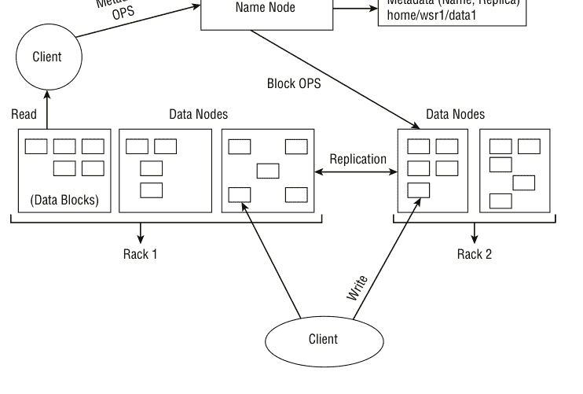

> 在考试中，如果遇到需要低延迟访问或大量小文件的场景，HDFS 不是一个可选方案。当情况需要这种需求时，使用像 HBase 这样的工具会更好。

此外，文件系统元数据由 NameNode 保存在内存中，这意味着小文件可能会给 Hadoop 带来巨大的问题。在实践中，我曾见过 NameNode 内存耗尽的情况，导致在为大量小文件存储元数据时整个集群崩溃。当你谈到小文件时，一个常见的问题是 HDFS 上推荐的文件大小是多少。在回答这个问题之前，首先了解文件系统是如何构建的非常重要。

由于 I/O 是导致延迟的最重要因素之一，典型的文件系统通过处理数据块来优化磁盘读写。块大小是可读取或写入的最小数据量，虽然磁盘块大小为 512 字节，但大多数文件系统处理的块大小为几千字节。HDFS 也使用块大小，但默认块大小为 128 MB。HDFS 之所以采用较大的块大小，是因为它旨在处理大量数据，因此你希望最大限度地减少寻道成本，并在每次单独的 I/O 中获取更多数据。

HDFS 的设计初衷是在商用硬盘上运行，在这些硬盘上故障是常态而非例外，因此它提供了默认的 3 倍复制（可配置），这意味着写入 HDFS 的每个块都会被复制到一组物理上独立的机器上，以实现容错和高可用性。当客户端应用程序尝试读取数据时，HDFS 会根据块的可用性决定读取哪个数据副本。

## MapReduce

在 Hadoop 2.0 之前，MapReduce 是 Hadoop 上数据处理的事实标准编程模型，当时它衍生出了 Apache YARN（稍后将更详细地讨论）。MapReduce 作业基本上是一个问题的解决方案，例如，应用程序（或客户端）希望以 MapReduce 编程模型在集群上执行的数据转换作业或一些基本分析，通常针对存储在 HDFS 或任何其他共享存储上的数据。MapReduce 作业分为两个主要任务：Map 和 Reduce。这些任务由 YARN 在集群的节点上进行调度，YARN 不仅调度任务，还与 ApplicationMaster（我们将在后面的章节中更详细地介绍）合作，在集群中重新调度失败的任务。

Mapper 任务将输出写入本地磁盘而不是 HDFS，因为输出是中间输出，然后由 reducer 阶段拾取以生成最终输出。作业完成后，mapper 的输出会被丢弃。一般来说，reduce 任务从多个 mapper 任务接收数据，并将输出存储在 HDFS 中以便持久化。Mapper 任务的数量取决于分片数量（输入分片由 Hadoop 定义），而 reduce 任务的数量则是独立定义的，并不直接依赖于输入的大小。选择 reducer 的数量被认为是一门艺术而非科学，因为 reducer 太少可能会影响整体并行性，从而拖慢作业速度，而 reducer 太多可能会产生大量较小的文件和大量的 mapper 与 reducer 之间的流量（shuffle/sort）。

图 4.4 描述了 MapReduce 作业的结构以及所涉及的主要步骤，例如将输入数据转换为分片、运行 mapper 阶段、使用 combiner、执行 shuffle 和 sort，然后运行 reduce 阶段以创建要存储在 HDFS 上的输出数据。

## 图 4.4 MapReduce 作业的结构

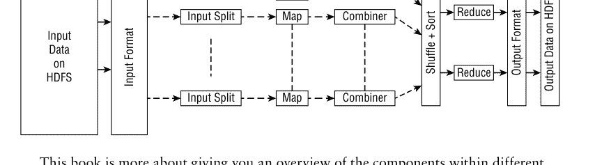

本书更侧重于让你了解不同 AWS 服务中的组件及其与考试的关系。如果你想了解更多关于该主题和各个阶段的细节，我强烈推荐 Tom White 所著的《Hadoop: The Definitive Guide》一书（amzn.to/2E1qYwJ）。

### YARN（另一种资源协调器）

YARN，顾名思义，是一个为管理 Hadoop 平台上运行的应用程序与集群资源之间的协商过程而创建的项目。其目标是将资源管理和计算框架从 MapReduce v1.0 中拆分出来，以便调度可以独立于计算进行，从而为平台上的其他计算引擎（如 Apache Tez 和 Apache Spark）铺平道路。

图 4.5 展示了 MapReduce、Spark 和 Tez 等框架如何受益于 YARN 的资源协商能力。Apache Hive、Apache Pig 和 Apache Crunch 等应用程序可以使用底层框架，而不是原生地与 YARN 集成。

## 图 4.5 YARN 应用程序

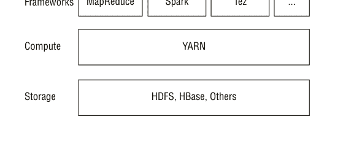

YARN 有两种类型的长期运行守护进程：

- 一个 ResourceManager 守护进程 – 该守护进程在每个集群中运行一次，顾名思义，它用于管理集群的资源。
- 一个 NodeManager 守护进程 – 该守护进程在集群的所有节点上运行，用于启动新容器并监控现有容器。容器基本上是从集群中以内存、CPU 等形式分配一组资源。例如，你可能有一个容器被分配了两个 CPU 核心和 128 GB 的 RAM。

一个 YARN 应用程序遵循以下步骤：

1. 客户端联系资源管理守护进程，请求它运行一个 ApplicationMaster。
2. ResourceManager 拥有集群中资源可用性的完整视图，并找到一个可以在容器中启动 ApplicationMaster 的 NodeManager。
3. ApplicationMaster 的后续步骤取决于其预期目的：
   a. 在运行它的容器内运行应用程序，计算结果，并将结果发送回客户端。
   b. 像 MapReduce YARN 应用程序那样，向 ResourceManager 请求额外的容器，并以分布式方式运行应用程序。

YARN 应用程序的寿命可以很短，运行数秒到数分钟，也可以与集群的寿命相同。

## EMR 上的 Hadoop

现在你已经了解了 Apache Hadoop 中的不同组件，让我们看看 AWS 在 EMR 中提供了什么。由于 Amazon 提供 EC2（弹性计算云）实例，EMR 集群实际上是 EC2 实例的集合，每个实例具有不同的角色，如主节点、核心节点和任务节点。这些角色基于安装在 EC2 实例上的软件组件。

在 Apache Hadoop 中，你只有 NameNode 和 DataNode，而在 EMR 中，你有三种不同的节点类型：

- 主节点：主节点基本上是集群的 NameNode，与 NameNode 类似，它通过运行各种软件组件来协调其他节点之间的数据和任务分布，从而管理集群以进行处理。主节点是集群中必需的节点，并且可以创建仅包含一个主节点的单节点集群。主节点运行 YARN ResourceManager 服务来管理应用程序的资源，以及 HDFS NameNode 服务。


- *核心节点：* 核心节点在 Hadoop 集群中扮演数据节点的角色；它作为主力运行任务，并将数据存储在 HDFS 中。如果您有多节点集群，则必须要有核心节点。核心节点运行 DataNode 守护进程，作为 HDFS 的一部分来协调存储。它们还运行 Task Tracker 守护进程，并执行其他并行计算任务。

- *任务节点：* 任务节点同样扮演主力角色，但从本质上讲是可选的，因为它们不会在 HDFS 中存储任何数据。它们被添加到集群中以增加算力，并对数据执行并行计算，例如运行 Hadoop MapReduce 任务和 Spark 执行器。任务节点不运行 DataNode 守护进程。任务节点通常与竞价实例一起使用，因此 Amazon EMR 提供默认功能：当运行在竞价实例上的任务节点被终止时，正在运行的作业不会失败。正是由于这个特定原因，Application Master 进程只运行在核心节点上。

## EMR 集群的类型

Amazon EMR 将存储和计算分离，这使您能够在配置不同的集群上运行不同的工作负载，并充分利用可用资源，同时根据 SLA 为不同工作负载确定合适的价格点。

- *持久集群：* 传统上，本地 Hadoop 集群一直是长期运行的持久集群。如果您的工作负载需要集群全天候可用（24x7），那么长期运行的持久集群是理想的方案。

- *临时集群：* 临时集群适合批处理作业。批处理作业的一个示例是夜间作业，它从某些源系统提取数据，并将其集成到数据集市中，然后供查询使用。EMR 的存储和计算分离使这成为可能，并降低了在 AWS 上运行 Hadoop 的总体成本。

- *工作负载特定集群：* 由于 Hadoop 有多个版本，您可以针对特定工作负载优化集群。运行工作负载特定的 Amazon EMR 集群可以在提供最优成本的同时，为您带来最佳性能。您可以根据各个工作负载的需求调整容器的设置。

## 选择哪种实例类型

Amazon EMR 提供多种实例类型，要为工作负载选择正确的实例类型可能会变得相当复杂。

通常，EMR 上运行的工作负载有四大类型，如表 4.3 所述。该表很重要，因为您可能会被要求为某个工作负载类型确定最佳的实例系列。

### 表 4.3：Amazon EMR 实例类型

| 工作负载类型 | 实例推荐 |
|---|---|
| 通用型 – 批处理 | M5 系列<br>M4 系列 |
| 计算密集型 – 机器学习 | C5、C4m、z1d 系列 |
| 内存密集型 – 交互式分析 | X1、R4、R5a、R5d 系列 |
| 存储密集型 – 大容量 HDFS 需求 | D2、I3 系列 |
| 深度学习 – GPU 实例 | G3、P2 系列 |

## 创建 EMR 集群

您可以通过三种不同的方式创建 EMR 集群：使用 AWS Management Console、AWS CLI 和 Java SDK。

### AWS Management Console

请观看 bit.ly/2RXBguQ 上的视频演示，了解如何创建 EMR 集群。您应该通过完成练习 4.1 进行快速设置来练习，或者使用高级选项，以更好地控制集群的创建方式。

### AWS CLI

您可以使用以下命令从 CLI 创建相同的集群：

```
aws emr create-cluster
  --name "demo-cluster"
  --release-label emr-5.28.0
  --applications Name=Hive Name=Spark
  --use-default-roles
  --instance-groups
InstanceGroupType=MASTER,InstanceCount=1,InstanceType=m5.xlarge
InstanceGroupType=CORE,InstanceCount=2,InstanceType=m5.xlarge
```

### AWS SDK

您可以使用 Java SDK 创建相同的集群。请按照 AWS 文档中的示例来了解如何创建此类集群（amzn.to/2qWJdpb）。

考试不会测试您从 CLI 或以编程方式创建 EMR 集群的确切细节。然而，从架构的角度来看，这些知识是有益的，并且最好了解您可以在数据管道中以编程方式创建 EMR 集群。

在集群创建过程中，尤其是在控制台中，您可能会看到各种选项，例如 EMR MultiMaster 和 Glue Data Catalog。让我们快速了解这些选项的含义：

- **EMR MultiMaster** – 如前文在 Hadoop 概述中所述，名称节点（也称为主节点）可能是 Hadoop 集群中的单点故障。EMR MultiMaster 允许您创建一个具有三个主节点的集群，从而在主用主节点发生故障时自动故障转移至备用主节点，以此支持高可用性。

- **Glue Data Catalog 设置** – Glue Data Catalog 可以充当平台的中央目录。EMR 允许您将 Glue Data Catalog 用作外部元数据存储，一旦配置完成，Hive、Spark 和 Presto 都会支持它。当您需要在不同集群、服务、应用程序和 AWS 账户之间共享元数据时，这是一个非常有用的选项。

- **编辑软件设置** – 您在创建集群时可能看到的另一个选项是“编辑软件设置”。您可以通过提供配置对象来编辑 Hadoop 应用程序的默认配置，这有助于在 EMR 集群上配置软件。配置对象由分类、属性和可选的嵌套配置组成。此选项的优点是可以用更简单的方式编辑最常见的 Hadoop 配置文件，包括 `hive-site`、`hadoop-env`、`hadoop-log4j` 和 `core-site`。

- **添加步骤** – 步骤是您可以提交到集群的工作单元，可以是以下之一：
  - 流式程序
  - Hive 程序
  - Pig 程序
  - Spark 应用程序
  - 自定义 JAR

您还可以选择在完成后自动终止集群。长期运行的集群可以选择启用终止保护，以防止集群被意外终止。

## 引导操作和自定义 AMI

引导操作是在每个节点上的 Hadoop 守护进程启动之前，可以在 Hadoop 集群上执行的脚本。它们通常用于安装额外的软件，Amazon EMR 允许您运行最多 16 个引导操作。您可以根据某些条件运行引导操作，如以下示例所示：

- RunIf – Amazon EMR 提供预定义的 RunIf 引导操作，用于在以下任一文件中找到特定于实例的值时运行命令：
  - `instance.json`
  - `job-flow.json`

  条件语句的一个示例是 `isMaster=true`，这意味着如果运行该操作的节点在集群中具有主节点角色，则会运行该操作。

- 自定义 – 运行自定义脚本，例如将数据从 S3 复制到每个节点。

您还可以使用自定义 AMI，通过预先安装应用程序和执行其他自定义操作，而不是使用引导操作，来缩短集群启动时间。这还可以防止意外的引导操作失败。

自定义 AMI 存在某些限制：

- 必须是 Amazon Linux AMI
- 必须是基于 HVM 或 EBS 的 AMI
- 必须是 64 位 AMI
- 不得有与 Hadoop 应用程序使用的用户名相同的用户（例如，hadoop、hdfs、yarn 或 spark）

## EMR 安全性

需要一个 EC2 密钥对才能通过 SSH 登录主节点。您还会看到一个复选框，它表示集群对创建者以外的其他方的可见性。如果该复选框未被选中（默认情况下为选中），集群将仅在控制台和 CLI 中对集群的创建者可见。

## EMR 的权限

Amazon EMR 需要三种不同的角色才能在该平台上运行：

- EMR 角色 – 允许 EMR 访问 EC2 等资源。
- EC2 实例配置文件 – 允许集群中的 EC2 实例访问 S3 等资源。
- 自动扩缩容角色 – 允许自动扩缩容添加和终止实例。

Amazon EMR 可以在创建集群时为您创建默认角色。如果角色已经存在，则将使用现有角色；如果不可用，则会创建这些角色。您也可以指定自定义角色。


## 安全配置

你还可以定义安全配置，以配置数据加密、Kerberos 认证以及用于 EMRFS 的 Amazon S3 授权。该安全配置可用于多个 EMR 集群。安全配置可以通过 AWS 控制台、AWS CLI 和 AWS SDK 创建，也可以通过 CloudFormation 模板创建。

对于数据加密，你可以指定以下内容：

-   静态数据加密
-   动态/传输中数据加密

Amazon EMR 的静态数据存储在不同位置，包括本地磁盘和通过 EMRFS 的 S3。

你还可以通过为特定应用程序选择适用于传输中数据的开源加密功能选项来选择传输中加密。可用的传输中加密选项可能因 EMR 发行版而异。

对于认证，你可以使用 Kerberos 主体为集群上某些应用程序组件之间的交互启用 Kerberos 认证。对于大多数开发和测试工作负载以及一些生产工作负载，你可以选择让 EMR 在集群的主节点上安装 KDC 服务器，或者配置外部 KDC。对于生产工作负载，客户通常更喜欢使用外部 KDC，这需要你与 EMR 集群共享 KDC 详细信息。

你还可以配置 Lake Formation 集成，并使用企业凭证和 Lake Formation 权限来控制对数据目录和底层数据存储的访问。您必须创建数据湖并在 Lake Formation 中配置相关权限。

图 4.6 和图 4.7 展示了如何在 EMR 中创建安全配置。

## EMR 笔记本

Jupyter 笔记本已成为数据工程师和数据科学家处理数据的最常见方式之一。虽然你可以在 EMR 集群内配置 Jupyter 笔记本，但 AWS 宣布了 EMR 笔记本功能，这意味着你可以使用基于 Jupyter 的 EMR 笔记本，通过实时代码、叙述文本、可视化等交互式分析数据（见图 4.8）。你可以创建笔记本并将其附加到运行 Hadoop、Spark 和 Livy 的 Amazon EMR 集群。笔记本免费运行，并独立于集群保存在 Amazon S3 中。

在 Amazon EMR 中创建笔记本时，你可以选择连接到现有集群或创建新集群。从笔记本界面创建新集群通常是在开发/测试场景中进行的。

你还可以将笔记本链接到 Git 仓库。

**图 4.6 EMR 中的安全配置（加密）**

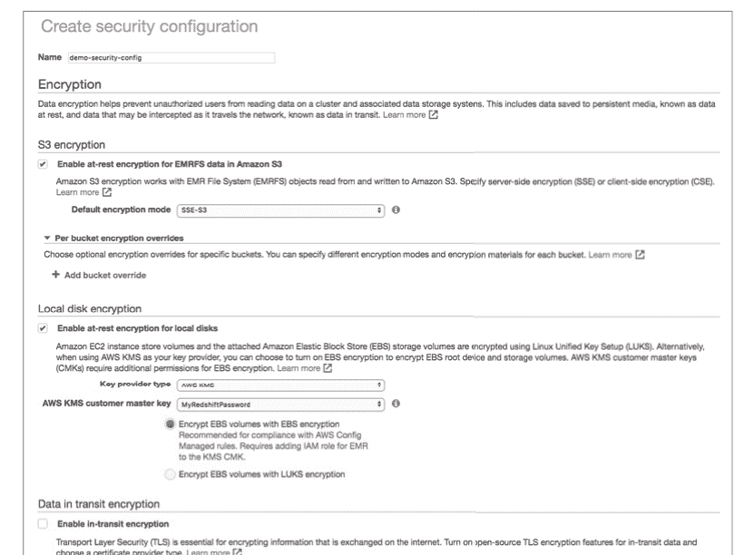

## Amazon EMR 上的 Apache Hive 和 Apache Pig

如前面各节所述，Apache Hadoop 已迅速成为数据中心领域数据处理的事实标准；然而，MapReduce 作为一种编程模型的复杂性意味着人们希望使用传统编程语言（如 SQL 和数据流语言），这导致了 Apache Hive（起源于 Facebook）和 Apache Pig（起源于 Yahoo）等项目的兴起。

### Apache Hive 概述

我们在本章前面的“Amazon Athena”一节中已经提到了 Apache Hive。Apache Hive 是一个运行在 Hadoop 上的开源类 SQL 数据仓库解决方案，专为希望使用 Hadoop 框架但又希望受益于类 SQL 语言的强大性和简单性的 SQL 分析师、SQL 开发人员和数据科学家而构建。

Apache Hive 相对于 MapReduce 编程范式有一些优点和缺点，其中部分内容见表 4.4，这将帮助你回答考试问题。

**表 4.4 Apache Hive 的优缺点**

|  | Hive | MapReduce |
|---|---|---|
| 技能 | 分析师可以继续使用他们的 SQL 技能，无需学习新语言。 | 对于不熟悉 MapReduce 范式和 Java 语言的人来说，学习和用 MapReduce 表达新问题可能具有挑战性。 |
| BI 集成 | 您可以使用 JDBC/ODBC 驱动程序将 BI 工具连接到 Hive。 | 现有工具无法连接。 |
| S3 集成 | 与 S3 原生集成，包括使用分区 | 支持 S3 集成 |
| UDF | 您可以使用和移植现有的 UDF。 | 重写函数，但使用现有的 Java 函数。 |
| 数据转换能力 | 仅限于 SQL | Java 语言的完整转换能力 |

**图 4.7 EMR 中的安全配置（EMRFS 的认证和 IAM 角色）**

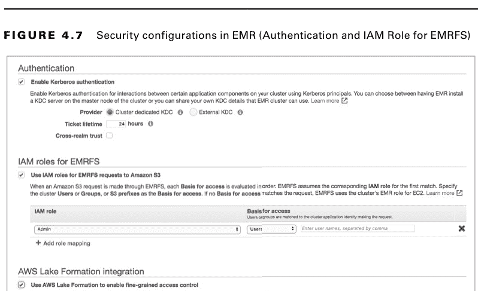

-   Pig 执行环境——分析师/程序员开发的 Pig 脚本在执行环境中执行。你有两个选项：
    -   在 JVM 中本地运行脚本。
    -   在 Hadoop 集群上的分布式执行环境中运行脚本。

Pig 是一种用于大型数据集的可扩展语言，使数据科学家、工程师和分析师的数据分析过程更加简单。Pig 支持表 4.5 和表 4.6 中所示的数据类型。

**表 4.5** Apache Pig – 简单数据类型

| 数据类型 | 描述 |
|---|---|
| int | 有符号 32 位整数（示例：10） |
| long | 有符号 64 位整数（示例：10L） |
| float | 32 位浮点数（示例：10.5F） |
| double | 64 位浮点数（示例：10.5） |
| chararray | UTF-8 格式的字符数组字符串（“Hello World”） |
| bytearray | 字节数组（二进制长对象） |
| boolean | 布尔值（true/false） |
| datetime | 日期时间（1970-01-01T00:00:00+00:00） |
| biginteger | Java 大整数（20000000000） |
| bigdecimal | Java 大十进制数（33.4567812345） |

来源：bit.ly/2sG6zQs

**表 4.6** Apache Pig – 复杂数据类型

| 数据类型 | 描述 |
|---|---|
| tuple | 有序字段集（19,2） |
| bag | 元组集合 {（19,2），（23,1）} |
| map | 一组键/值对 |

来源：bit.ly/2sG6zQs

下面的代码示例演示了加载“student”数据，然后打印他们的姓名和年龄：

```
dataset = LOAD 'students' USING PigStorage() as (name:chararray, age:int, gpa:float);
studentsage = FOREACH dataset GENERATE name, age;
DUMP studentsage;
(Roger,25)
(Tom,22)
(Cristina,29)
(Steffen,26)
(Vincent,29)
```

从考试的角度来看，你需要了解与传统的 MapReduce 程序相比，Apache Pig 和 Apache Hive 在哪些场景下更有用。

## Amazon EMR 上的 Apache Presto 概述

我们已经在“Amazon Athena”一节中讨论了 Apache Presto，你也许记得，Apache Presto 是 Amazon Athena 背后的技术。你也可以将 Apache Presto 作为 EMR 安装的一部分来运行。数据科学家和数据分析师使用 Apache Presto 来寻求快速的交互式查询响应。其优缺点列于表 4.7 中，这将帮助你回答有关该技术的考试问题。

**表 4.7 Apache Presto 的优缺点**

| 优点 | 缺点 |
|---|---|
| 基于 SQL，因此你可以使用自己的 SQL 技能 | 在大型表的连接规划期间需要优化 |
| 低延迟响应 | 不适合批处理 |
| 符合 JDBC/ODBC | 容错性有限（重新运行失败的作业） |
| BI 集成 | 内存要求高 |
| 支持 UDF |  |
| 联合查询（Hive/Cassandra/关系数据库/对象存储） |  |

-   执行器
-   任务

**图 4.10 Apache Spark 架构**

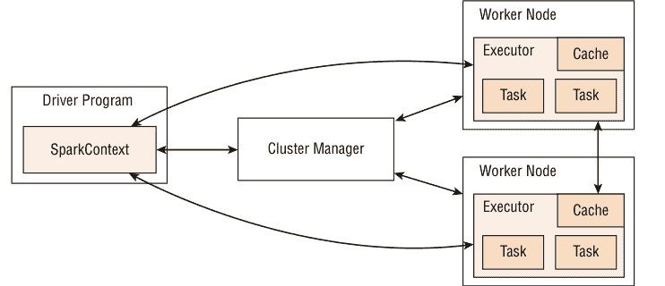

### 驱动程序

所有 Spark 应用程序都由一个驱动程序组成，该程序运行程序的 main() 函数，通常位于集群的某个节点上。驱动程序“驱动”Spark 应用程序，基本上是应用程序的大脑，维护着关于程序的所有相关和关键信息。它有三个主要职责：

-   维护有关应用程序的所有信息。
-   响应用户的输入。
-   分析、分发和调度跨执行器的工作。

### 集群管理器

集群管理器通常是一种服务，用于代表应用程序获取集群上的资源。Apache Spark 支持多种不同的集群管理器：

-   Standalone——Apache Spark 发行版附带一个简单的集群管理器，包含在 Spark 中，使集群的设置变得容易。
-   Apache Mesos——Apache Mesos 是一个通用集群管理器，在开源界非常流行，允许在计算机集群上运行的应用程序之间进行有效的资源共享。Apache Mesos 还可以运行 Hadoop MapReduce 应用程序。
-   Hadoop YARN——Hadoop YARN 是 Hadoop 集群的默认资源管理器，支持运行 Spark。
-   Kubernetes——Kubernetes 是一个开源系统，用于自动化、扩展和管理容器化应用的部署。


## 工作节点

一个集群通常包含许多工作节点，这些节点运行一个或多个执行器，负责处理驱动程序分配的任务。

## 执行器

执行器负责实际执行驱动程序分配的任务。每个执行器按驱动程序的要求执行代码，然后将执行状态报告给驱动节点。执行器将运行 Spark 代码。

## 任务

任务是代码实际运行的个体单元。理解任务如何创建并在集群中调度非常重要。Spark 会先创建执行图（如 RDD 图），然后创建执行计划。如果你查看一个基础单词计数的驱动程序，你会看到多个阶段，每个阶段会创建多个任务，并在工作节点之间调度。通常，任务的创建取决于数据的分布方式。

如需了解更多架构信息，请访问 Apache Spark 文档：bit.ly/2tNHCmD。

## Spark 编程模型

从前一节可以看到，Spark 采用主从架构，多个工作节点和执行器并行运行代码以优化处理。Spark 引入了弹性分布式数据集（RDD）的概念，它本质上是分布并缓存在 Spark 集群节点内存中数据的指针/抽象。RDD 的概念具有两个主要属性：

- 弹性——RDD 是分布在集群中数据的抽象，本质上是弹性的，这意味着它提供容错的分布式能力，并且在发生故障时可以重建。

- 分布式——RDD 所表示的数据分布在集群中。

你可以通过两种方式创建 RDD：

- 在驱动程序中并行化现有集合。

- 引用外部存储系统中的数据集，如 S3、HDFS 或 HBase。

RDD 支持两大类操作：

- 转换（Transformations）——从现有数据集创建新数据集，例如 `map`、`flatMap()`、`filter()`、`sample()`、`union()`、`distinct()` 或 `groupByKey()`。Spark 中的所有转换本质上都是惰性的，这意味着当你调用转换时，Spark 不会立即计算结果，而是等到某个行动被调用时才执行。

- 行动（Actions）——行动会触发转换的计算，并将数据集返回给驱动程序。行动的示例包括 `reduce()`、`collect()`、`count()`、`first()`、`take()`、`saveAsTextFile()` 和 `saveAsObjectFile()`。

### Spark 中的 Shuffle

Spark 中的某些操作会触发一种称为 *shuffle* 的事件。Shuffle 是最复杂、代价最高的操作之一，因为它通常需要通过网络在多个执行器和机器之间复制数据。该操作涉及磁盘 I/O、数据序列化和网络 I/O，因此只要某个操作需要 shuffle，就必须特别小心。以下操作会在 Spark 中引起 shuffle：

- `Repartition`
- `Coalesce()`
- 所有 `ByKey` 操作，例如 `GroupByKey()`、`ReduceByKey()`（`Counts` 除外）
- `Cogroup()`
- `Join()`

### Spark 中的 DataFrame 与 Dataset API

数据集（Dataset）是分布式数据集合（Spark 1.6 中引入），它提供了 RDD 的优势，并附加了 Spark SQL 优化执行引擎的好处。Spark 2.0 将 DataFrame 和 Dataset API 合并为一个 Dataset API。从 Spark 2.0 开始，Spark SQL 的入口是 SparkSession。每个条目都是 ROW 类型。例如，一个包含两列（列 A 和列 B，均为整数）的 DataFrame 看起来像 `DataFrame(ROW(A=25,B=30), ROW(A=3,B=9))`。

Spark 中的 DataFrame 概念受 Python 和 R 中的 data frame 启发，但从性能角度看，它的实现优于 R 和 Python 中的实现。

Spark 使用 RDD API 作为基础数据结构。所有计算都在 RDD 上完成，RDD 是 Spark 的基本构建块。从 Spark 2.0 开始，Dataset 具有两种不同的 API 特征：

- 强类型 API
- 非类型化 API

由于 Python 和 R 没有编译时类型安全性，因此在 R 和 Python 中只有非类型化 API（DataFrame），而没有 Dataset API。

RDD 提供强大的编译时类型安全性（*类型安全*是指编程语言防止类型错误的程度），并提供面向对象的操作。RDD 可以使用高级表达式，如 lambda 函数（匿名函数，与 AWS Lambda 无关）和 `map` 函数。RDD 的缺点在于其性能，因为垃圾回收（JVM 对象的创建与销毁）以及对单个对象进行序列化会产生大量开销。

*DataFrame* API 为数据提供关系型和结构化视图，使 Spark 能够管理 schema，并在节点之间传递数据而无需使用 Java 序列化器。Spark DataFrame 使用 Catalyst 优化器来优化查询执行计划和执行查询。Spark DataFrame 还使用 Tungsten 执行后端，通过优化 Spark 作业的 CPU 和内存效率来改进 Spark 执行。

Spark DataFrame 还可以对数据使用 SQL 表达式，如 `group`、`filter` 和 `join`。DataFrame API 的缺点是没有提供强大的编译时类型安全性。

Dataset API 兼有 RDD 和 DataFrame API 的优点。它使用强编译时类型安全性、RDD 的面向对象操作，并加入了 Catalyst 优化器。

## Spark SQL

Spark SQL 是一个用于结构化数据处理的模块。你可以在磁盘或内存中处理数据，并使用 Hive metastore 等元数据存储。在 Amazon EMR 中，你可以选择使用 Lake Formation 目录等目录服务。Spark SQL 兼容 Hive、Avro、Parquet、ORC、JSON、JDBC 及其他数据源。你可以通过 JDBC 和 ODBC 连接器进行连接。

要了解更多关于 Spark SQL 的信息，请参阅 Apache Spark 关于 Spark SQL 的文档：bit.ly/SparkSQLDoc。

考试可能会问你如何在 Spark SQL、Apache Hive、Apache Pig 和 Athena 之间进行选择。

## Spark Streaming

我们已经讨论过摄取流式数据的重要性，Spark 提供了使用 *Spark Streaming* 对实时数据流进行可扩展、高吞吐、容错的流式处理选项。Spark 内置支持多种数据源，包括 Kafka、Flume、Kinesis、Twitter 和 S3/HDFS，并允许你使用 `map`、`reduce`、`join` 和窗口操作等函数构建复杂的处理算法。数据处理完成后，可以推送到各种文件系统、数据库、仪表板或其他流式应用程序。

### 离散化流

Spark Streaming 提供了一种名为离散化流（DStream）的高级抽象，其中来自数据源的实时数据被分成小批次（迷你批次）。DStream 由一系列连续的 RDD 表示，这些 RDD 包含特定时间间隔的数据。图 4.11 展示了离散化流与 RDD 之间的关系。

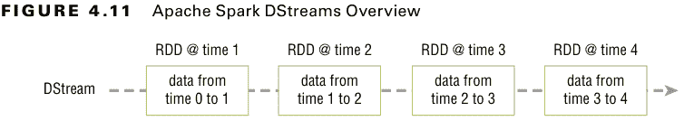

Spark Streaming 允许你在 DStream 上运行各种不同的转换，如 `map()`、`flatMap()` 和 `filter()`。

Spark Streaming 提供两类内置流式数据源：

- *基本数据源*是 StreamingContext API 中直接可用的数据源。示例包括文件系统和套接字连接。
- *高级数据源*包含 Kafka、Flume 和 Kinesis 等数据源，可通过额外的工具类获得。

Spark Streaming 还提供窗口计算，这意味着你可以对滑动窗口中的数据应用转换。常见的窗口操作包括：

- `window(windowLength, slideInterval)`
- `countByWindow(windowLength, slideInterval)`
- `reduceByWindow(func, windowLength, slideInterval)`
- `reduceByKeyAndWindow(func, windowLength, slideInterval, [numTasks])`
- `reduceByKeyAndWindow`
- `countByValueAndWindow`

### 结构化流

Apache Spark 还提供了结构化流（Structured Streaming），这是一个直接构建在 Spark SQL 引擎之上的流处理框架。结构化流使用现有的 API（如 DataFrame、Dataset 和 SQL），因此你可以受益于熟悉的 API，而无需重新学习处理流式数据的新方法。事实上，其核心承诺是：在结构化流中，你将表视为无界表，计算方式与静态数据集完全相同，而结构化流引擎会在新数据到达流中时，增量地在新数据上运行查询。

使用结构化流的好处是，在进行批处理或流处理时，你无需更改查询代码；根据运行查询的目标（例如静态表或流式无界表），Spark 引擎会自动决定如何最优地运行查询。

如果你想了解更多关于 Spark Streaming 的信息，我强烈推荐 Matei Zaharia 和 Bill Chambers 所著的《Spark: The Definitive Guide》（amzn.to/SparkDefinitiveGuide）。

## Spark 机器学习（Spark MLlib）

MLlib 是 Spark 平台上用于机器学习的主要库。Spark ML 是基于 DataFrame 的 API（RDD 风格的 API 自 Spark 2.0 起进入维护模式），提供了 Tungsten API 和 Catalyst 优化器等新特性。

Spark ML 是 Spark 的插件，自 Spark 0.8.0 起随每次安装一并提供。它提供了可扩展的分布式机器学习算法库，可通过 Spark API 访问，用于 Spark 及其所有其他模块（Spark SQL、Spark Streaming 和 GraphX）之上。它能够以 Spark 集群的速度执行机器学习，与在 MapReduce 上运行的类似作业相比，可以节省时间。

其中包含以下类型的机器学习算法：

- 分类：逻辑回归、决策树分类器、随机森林分类器、梯度提升树、线性支持向量机、朴素贝叶斯
- 回归：广义线性回归（GLM）、决策树回归、随机森林回归、梯度提升回归、生存回归、保序回归
- 协同过滤：交替最小二乘法（ALS）


- 聚类：K-means，潜在狄利克雷分配（LDA），高斯混合模型（GMM）
- 分解：奇异值分解（SVD），主成分分析

## Spark GraphX/Graph Frames

图计算对于图问题变得越来越常见。图是描述关系的一种自然方式，我们倾向于用关系数据库中的自连接来解决的许多问题。

许多应用程序都在使用图算法，与传统的集合处理相比，图算法不仅更容易实现，而且更适合此类关系分析。例如，搜索引擎使用 PageRank 算法对搜索结果进行排名，电信和社交媒体平台使用社交网络分析来更好地理解行为并提供准确的推荐，银行使用图分析来了解洗钱，安全机构使用图来打击恐怖网络。

GraphX 是 Spark 中用于这些目的的重要组件。GraphX 引擎扩展了 Spark RDD 接口并引入了新的 Graph 扩展，它基本上是一个带有属性的定向多图，每个顶点（图的节点）和边（节点/顶点之间的连接）都附加了属性。图 4.12 显示了一个无向图，包含七个顶点和九条边。

图 4.12 包含七个顶点/节点和九条边的无向图


GraphFrames 目前作为 Spark 外部包提供，您需要在启动 Spark 应用程序时加载它。虽然 GraphX 自诞生以来一直很受欢迎，但 DataFrame API 随着时间的推移变得更受欢迎，因此基于 DataFrame 的 API GraphFrames 在 Spark 中引入。GraphFrames 提供了更好的用户体验，尽管以极其微小的性能影响为代价。

## Hive on Spark

虽然 Spark SQL 是在 Spark 上运行 SQL 的标准，但许多组织一直在使用 Apache Hive，并且其代码库使用 HiveQL，但希望将脚本从 Hadoop 迁移到 Spark 平台以获得更好的性能。Hive on Spark 为这些组织提供了在 Apache Spark 上运行 Hive 程序的选项，并且提供了一个清晰的迁移路径，而无需承担大量的维护和迁移开销。

## 何时使用 Apache Spark

从考试角度来看，了解何时 Apache Spark 比其他平台更合适非常重要。Apache Spark 因表 4.8 中列出的原因而被推荐。

### 表 4.8 Apache Spark 优势

| Tenant | Description |
|---|---|
| Performance | Apache Spark 的性能优于 MapReduce。 |
| Deployment | Apache Spark 可以通过 Apache Mesos、通过 YARN 的 Apache Hadoop 或 Apache Spark 的独立集群管理器进行部署。 |
| Application types | Apache Spark 支持批处理、交互式和流式应用程序。 |
| Data sources | 支持文件、对象、关系和非关系源 |
| Connectors | 提供标准的 JDBC/ODBC 连接器 |
| API | 提供 Java、Scala、Python、R 的 API 并允许使用 SQL |
| Resource handling | 需要精细的资源处理。内存密集型作业需要大量资源。 |
| Streaming | Apache Spark 通过 DStreams 和 Structured Streaming 提供流处理；然而，它采用微批处理方法而不是纯流处理。延迟不能以毫秒为单位，您需要考虑无序流处理。 |

## 在 Amazon EMR 上运行 Spark 的优势

您可以将 Apache Spark 作为独立应用程序运行，也可以作为现有 Hadoop 安装的一部分运行。您还有各种选项可以将 Apache Spark 作为各种云提供商提供的各种发行版的一部分运行，其中一个选项是使用 Amazon EMR 运行它。表 4.9 列出了将其作为 Amazon EMR 的一部分运行可能为您带来的一些原因。

### 表 4.9 在 Amazon EMR 上运行 Apache Spark

| Tenant | Description |
|---|---|
| Storage options | 在 Amazon EMR 上运行 Apache Spark 可让您受益于整个平台，例如使用 EMR-DynamoDB 连接器连接到 Amazon DynamoDB，使用 JDBC 连接到 Amazon RDS，或使用 Elasticsearch 连接器连接到 Elasticsearch，或使用 Spark-Redshift 连接器连接到 Amazon Redshift，或连接到流源如 Amazon Kinesis 和 Apache Kafka（或 MSK）或连接到 Amazon S3。 |
| Data catalog | 在 Amazon EMR 上运行 Apache Spark 可让您受益于 AWS Glue 目录/Lake Formation 目录（如果启用）。 |
| Failover/recovery | Amazon EMR 会为您恢复失败的节点。 |
| Logging | Amazon EMR 聚合集群日志并将其写入 S3，这使您可以轻松调试并确定问题。 |
| Cost | Amazon EMR 可让您通过运行临时集群或运行小型初始集群并通过使用任务实例添加处理能力来降低成本。 |
| API | 提供 Java、Scala、Python、R 的 API 并允许使用 SQL。 |
| Amazon EMRFS | Amazon EMR 与 S3 的集成可让您从 Amazon S3 中的数据创建 RDD 和 Data Frames。 |
| Spark metrics and Cloud-Watch | 您可以使用 Amazon CloudWatch 监控 Spark 集群的指标，在 CPU/内存指标上设置警报，并在阈值达到/超出时通过电子邮件、SNS 或 HTTP API 调用接收通知，从而允许您采取手动或配置自动响应。 |
| Variety of Spark versions | Amazon EMR 可让您使用各种 Spark 版本，从而允许您运行组织根据合规标准内部商定的版本。 |

## Amazon EMR 上的 Apache HBase

*HBase* 是一个分布式列式存储，建立在 HDFS 之上，用于在需要对极大数据集进行实时读写随机访问时使用，这通常是 MapReduce 和 Apache Spark 无法实现的。

HBase 是为线性可扩展而构建的，是最受欢迎的 NoSQL 数据库之一。它开箱即用不支持 SQL；然而，您可以使用 Apache Phoenix 等项目在 HBase 上运行 SQL。

HBase 由 Chad Walters 和 Jim Keller 参照 Google 的 Bigtable 进行建模，并于 2007 年 10 月作为 Hadoop 0.15 的一部分发布，后来于 2010 年 5 月分离为一个单独的子项目。

虽然 HBase 在各行业中用于各种用例，但其中最受欢迎的是 Facebook 的消息基础设施在 HBase 上运行，以及 Twitter 在其整个 Hadoop 集群中使用 HBase。

## HBase 架构

HBase 通常遵循主从架构，通常包含四个主要组件：

- Master
- Region server
- ZooKeeper cluster
- Storage (/HDFS/S3)

## 使用 Amazon EMR 设置 HBase

您可以在快速选项和高级模式下设置 HBase（见图 4.13）。

图 4.13 使用快速选项创建模式设置 HBase

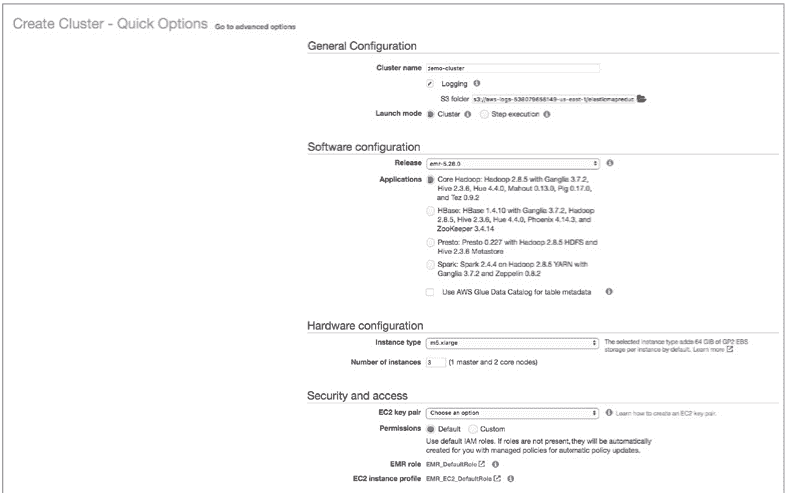

在高级选项中，当您在软件配置选项中选择 HBase 时，您可以选择 HBase 数据的存储层，可以是 HDFS 或 S3。HDFS 选项使用默认位置，而对于 S3，您可以选择目标存储桶（见图 4.14）。

### 图 4.14 使用高级选项设置 HBase

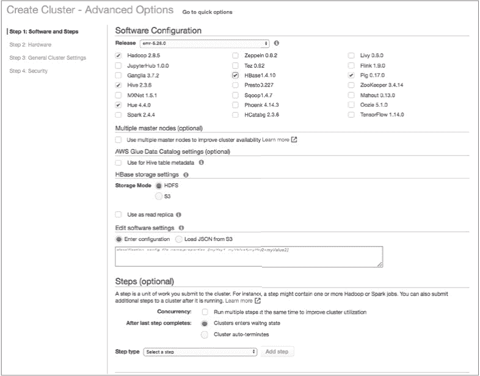

## Apache Flink、Apache Mahout 和 Apache MXNet

如果您在设置 Amazon EMR 集群时打开高级配置，您将看到可以作为 EMR 配置的一部分安装的某些其他项目。本书仅在高层次上介绍这些项目是什么，但我不会详细介绍，因为它超出了本书的目的。

## Apache MXNet

*Apache MXNet* 是一个开源深度学习框架，目前处于孵化状态。它适用于多种用例，例如计算机视觉、语言处理、预测和推荐引擎。MXNet 是为企业开发者构建的，在 Amazon.com 上使用非常广泛。它因以下关键因素而受欢迎：

- *原生分布式训练支持：* Apache MXNet 支持在多个 CPU/GPU 机器上进行分布式训练，以利用云平台提供的计算规模。
- *灵活的编程模型：* Apache MXNet 支持命令式和符号式编程，以最大化效率和生产力。
- *从云到客户端的可移植性：* Apache MXNet 可在各种设备上运行，从 CPU 到 GPU 以及集群、服务器、台式机或手机。
- *多语言：* 您可以使用多种编程语言编程 Apache MXNet，从 Python、R、Scala、Julia、C++、Matlab 或 JavaScript。
- *性能优化：* Apache MXNet 具有优化的 C++ 后端引擎，可并行化计算和 I/O，而不论源语言如何。

Amazon EMR 允许您在 EMR 集群上配置 Apache MXNet。

## Apache Mahout

Mahout 是驾驶、控制和照顾工作大象的人。该项目因与 Hadoop（大象）和 mahout（骑大象）相关而得名。

*Apache Mahout* 是一个开源 ML 库，主要用于一些主要的 ML 案例，如分类、降维、推荐引擎和聚类。

了解和学习 Apache Mahout 超出了本书的范围，但就考试而言，它是一个可与 EMR 提供的分析库。

## Apache Flink

*Apache Flink* 是用于有界（有明确开始和结束）和无界（有明确开始但无结束）数据流的有状态计算的分布式流处理引擎。Flink 已设计为在集群环境中运行，并在低延迟和大容量下执行计算。

Apache Flink 因多种原因而受欢迎，但主要原因如下：

- *事件时间和处理时间语义：* 许多流处理引擎使用处理时间，但使用事件时间允许您处理顺序很重要时的乱序事件。处理时间通常用于极低延迟的应用程序，其中事件需要在到达的瞬间被处理。


-   *精确一次语义*：Apache Flink 为您提供精确一次的处理语义。
-   *低延迟/高吞吐*：Apache Flink 即便每秒处理数百万个事件，也能提供毫秒级的处理延迟。
-   *广泛的连接器生态*：Apache Flink 为您提供连接器，可连接最常用的存储和处理系统，例如 Apache Kafka、Apache Cassandra、Elasticsearch、Amazon Kinesis，以及 Amazon S3（和 HDFS）等分布式存储系统。
-   *多种部署选项*：Apache Flink 支持通过 YARN、Apache Mesos 和 Kubernetes 部署您的应用程序。
-   *高可用性*：Apache Flink 让您可以选择在 24x7 环境中运行流式应用程序。

要了解更多关于 Apache Flink 的信息，请访问 `flink.apache.org/flink-architecture.html`。

图 4.15 展示了 Apache Flink 的概览，它可以作为 Amazon EMR 上的一个项目进行配置。

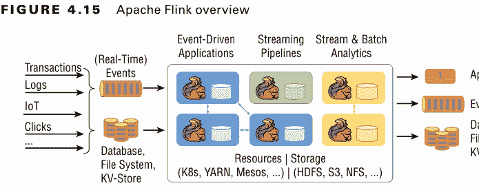

## 选择正确的分析工具

正如您所见，Amazon EMR 在 AWS 云上提供了多种选择，往往很难判断何时该选择哪个选项。表 4.10 列出了一些讨论中涉及的标准。

数据正在快速增长，由于以下关键原因而难以分析：

-   此类数据的种类繁多且数据量非常大。
-   用户的分析需求正从批量报表转向实时和预测性分析。
-   客户希望降低运营开销，专注于获得正确的答案。
-   客户希望通过在应用程序中融入语音、图像识别和 IoT 用例来丰富其应用。

这需要以不同的方式为客户提供分析，我们不能依赖基于批处理的数据仓库解决方案。客户期望做到以下几点：

-   以经济高效的价格点，近实时地摄取大量机器生成的数据。
-   为实时到达的数据建立索引，以便基于关键问题开始搜索。
-   搜索、关联、分析并可视化这些数据以获取洞察。

对这种解决方案日益增长的需求推动了 Elasticsearch 的巨大发展。Elasticsearch 一直被评为基于 Apache Lucene 构建的顶级开源软件项目，原因如下：

-   Elasticsearch 是开源的。
-   Elasticsearch 提供了简单的摄取机制。
-   Elasticsearch 通过 Kibana 提供动态可视化。
-   Elasticsearch 是分布式的，并且整体性能非常高。

搭建 Elasticsearch 集群并对其进行维护、监控和备份可能相当麻烦。Amazon Web Services 提供了 Amazon Elasticsearch Service，它简化了 Elasticsearch 集群的部署、管理和扩展的整个过程。由于 Elasticsearch 与其他 AWS 服务紧密集成，因此可以轻松地从 AWS 内的其他服务摄取数据。

## Elasticsearch 核心概念（ELK 技术栈）

ELK 是一个缩写词，用来描述三个最热门的开源项目：Elasticsearch、Logstash 和 Kibana，它们通常被统称为 Elasticsearch。

### E = Elasticsearch

Elasticsearch 是一个基于 Lucene 构建的开源 RESTful 分布式搜索和分析引擎。

它提供的功能远不止 Lucene 所具有的：

-   Elasticsearch 是一个分布式文档存储。
-   它支持多种语言，并且性能卓越。
-   Elasticsearch 中的每个字段都可以被索引并支持搜索。
-   Elasticsearch 提供实时数据分析选项（运营分析）。
-   它具有可扩展性，这意味着您可以用它索引从 TB 级到 PB 级的数据。

Elasticsearch 的核心概念如下：

-   *节点*：节点是 Elasticsearch 的单个实例。
-   *集群*：节点的集合构成 Elasticsearch 集群，该集群跨节点提供索引和搜索能力。
-   *索引*：Elasticsearch 中的索引是不同类型文档及其属性的集合。您可以使用本列表稍后所述的“分片”来提高索引性能。在 Elasticsearch 中，默认情况下每个字段中的所有数据都会被索引。
-   *文档*：Elasticsearch 中的文档是 JSON 文档中字段的集合。每个文档都属于某个类型，并存在于某个索引中。每个文档都与一个称为 UID 的唯一标识符相关联。
-   *分片*：Elasticsearch 中的索引可以拆分为分片，以提高性能并增加并行度。每个分片都是一个 Lucene 索引实例，您可以将其视为一个自包含的搜索引擎，负责为特定 Elasticsearch 索引的数据子集建立索引并处理搜索查询。

如果您来自 RDBMS 领域，表 4.11 中术语之间的对应关系可能有助于您更轻松地理解这些概念。

**表 4.11 Elasticsearch 与 RDBMS 的对比**

| Elasticsearch 术语 | 对应的 RDBMS 术语 |
| --- | --- |
| 集群 | 数据库 |
| 分片 | 分片 |
| 索引 | 表 |
| 字段 | 列 |
| 文档 | 行 |

### L = Logstash

*Logstash* 是一个开源数据摄取工具，允许您从各种来源收集数据、转换数据，然后将其发送到目标位置。它自带预构建的过滤器和超过 200 种不同插件的支持。Logstash 允许用户摄取数据，无论数据来源或类型如何。它最初由 Jordan Sissel 于 2013 年创建，当时他发现需要聚合和管理日益增长的日志文件。Logstash 具有以下最显著的特性，使其成为非常强大的数据管道工具：

-   它是一个非常可扩展、成熟且健壮的解决方案，能够以非常高的数据量处理大量数据。
-   Logstash 可以从海量来源摄取数据，并可以对数据进行丰富并与其他日志来源进行关联。
-   Logstash 拥有可扩展的插件生态系统，并且还支持编写自定义插件。
-   Logstash 被设计为高可用的。

### K = Kibana

Kibana 是一个开源数据可视化工具，用于查看日志和事件。它提供交互式图表、预构建的聚合和过滤器以及地理空间支持，非常适合可视化存储在 Elasticsearch 中的数据。Kibana 的关键特性使其成为 ELK 技术栈中非常重要的组件，具体如下：

-   使用可视化能力进行探索性数据分析
-   使用多种图表组件
-   应用机器学习进行异常值和趋势检测。

## Amazon Elasticsearch Service

Amazon 提供用于运营分析的 Elasticsearch Service，使用该服务可为您带来以下关键优势：

-   *部署和可管理性* – Amazon Elasticsearch Service 简化了 Elasticsearch 在平台上的部署和管理。您可以在几分钟内部署一个 Elasticsearch 集群。
-   *高度可扩展且高可用* – Amazon Elasticsearch Service 允许您在单个集群中存储多达 3 PB 的数据。可以通过 API 或 AWS 控制台来扩展集群。您可以在多可用区环境中部署该服务，并在同一 AWS 区域内的三个可用区之间复制数据。
-   *高度安全* – Amazon Elasticsearch Service 为您提供各种安全功能，以确保您的 Elasticsearch 安装安全可靠：
    -   在 Amazon VPC 内进行网络隔离
    -   静态数据加密
    -   传输中数据加密
    -   使用 Amazon Cognito 和 AWS IAM 管理身份验证和访问控制
    -   符合 HIPAA 资格；符合 PCI、DSS、SOC、ISO 和 FedRAMP 标准


数百GB到PB甚至更多。它采用列式存储、数据压缩和zone maps来减少执行查询所需的I/O量。Amazon Redshift具备大规模并行处理（MPP）架构，将SQL操作并行化并分布式执行，以充分利用所有可用资源。底层硬件专为高性能数据处理而设计，使用本地附加存储来最大化CPU与磁盘驱动器之间的吞吐量，并使用10Gb网状网络来最大化节点之间的吞吐量。

- *可扩展*——通过AWS管理控制台或简单的API调用，当性能或容量需求发生变化时，您可以轻松更改数据仓库中的节点数量或类型。Amazon Redshift允许您从单个160 GB的DC2.Large节点起步，一路扩展到拥有128个RA3.16xLarge节点的8.2 PB规模。
- *成本效益高*——Amazon Redshift没有前期成本。您只需为调配的资源付费。您可以选择无前期成本或长期承诺的按需定价，也可以通过预留实例定价获得大幅折扣。有关更多详细信息，请参阅 aws.amazon.com/redshift/pricing/ 上的Amazon Redshift定价页面。
- *简单*——您可以在几分钟内开始使用Amazon Redshift。借助AWS管理控制台或简单的API调用，您可以创建集群并指定其大小、底层节点类型和安全配置文件。Amazon Redshift会调配您的节点、配置它们之间的连接并保护集群安全。您的数据仓库应在几分钟内启动并运行。
- *全托管*——Amazon Redshift负责管理、监控和扩展数据仓库所需的所有工作，从监控集群健康状况和进行备份到应用补丁和升级。当性能和容量需求发生变化时，您可以轻松地在集群中添加或删除节点。通过处理所有这些耗时且劳动密集型的任务，Amazon Redshift帮助您专注于数据与业务本身。
- *容错*——Amazon Redshift具有多项功能，可增强数据仓库集群的可靠性。写入集群中某个节点的所有数据会自动复制到集群内的其他节点，并且所有数据会持续备份到Amazon S3。Amazon Redshift持续监控集群健康状况，自动从故障驱动器中重新复制数据，并在必要时替换节点。
- *自动备份*——Amazon Redshift的自动快照功能会持续将集群上的新数据备份到Amazon S3。快照是连续、增量且自动的。Amazon Redshift会将您的快照存储用户自定义的期限，该期限可以是1到35天。您可以随时创建自己的快照；这些快照会利用所有现有的系统快照，并一直保留到您明确删除为止。
- *快速恢复*——您可以使用任何系统或用户快照，通过AWS管理控制台或Amazon Redshift API恢复集群。一旦系统元数据恢复完成，您的集群即可使用，您可以在后台加载用户数据的同时开始运行查询。
- *安全性*——Amazon Redshift提供多种安全选项，包括加密、网络隔离以及符合各种审计要求。
- *加密*——您可以设置Amazon Redshift使用SSL来保护传输中的数据，并使用硬件加速的AES-256加密来保护静态数据。如果启用静态数据加密，则写入磁盘的所有数据以及备份都将被加密。默认情况下，Amazon Redshift负责密钥管理，但您也可以使用自己的硬件安全模块（HSM）来管理密钥。
- *网络隔离*——Amazon Redshift允许您配置防火墙规则，以控制对数据仓库集群的网络访问。您还可以在Amazon Virtual Private Cloud（Amazon VPC）中运行Amazon Redshift，将您的数据仓库集群隔离在您自己的虚拟网络中，并使用行业标准的加密IPsec VPN将其连接到您现有的IT基础设施。
- *审计与合规*——Amazon Redshift与AWS CloudTrail集成，使您能够审计所有Redshift API调用。Amazon Redshift还会记录所有SQL操作，包括连接尝试、查询和数据库更改。您可以使用SQL查询系统表来访问这些日志，或者将它们下载到Amazon S3上的安全位置。Amazon Redshift符合SOC1、SOC2、SOC3和PCI DSS Level 1要求。有关更多详细信息，请参阅 aws.amazon.com/compliance。我们将在第6章“数据安全”中更详细地讨论这些内容。
- *SQL兼容*——Amazon Redshift是一个SQL数据仓库，使用行业标准的ODBC和JDBC连接以及PostgreSQL驱动程序。许多主流软件供应商正在将Amazon Redshift与其产品进行认证，以便您能够继续使用目前使用的工具。有关更多信息，请参阅 aws.amazon.com/redshift/partners。

## Redshift架构

Redshift的架构与您之前看到的Hadoop类似。它采用主从式MPP（大规模并行处理）、无共享架构。Redshift有两种主要节点类型：领导节点和计算节点：

- *领导节点：* 您无需定义领导节点，因为每个Redshift集群都会自动配置一个，其规格与计算节点类似。领导节点是集群的SQL端点，存储元数据、协调计算节点上的并行SQL处理，并使用机器学习来优化查询计划。您的SQL编辑器和BI工具通常通过JDBC/ODBC桥接到领导节点端点来连接Redshift集群。领导节点将使用机器学习生成高效的查询计划，例如根据需要将短查询路由到可用队列、缓存结果、缓存编译代码等。机器学习的运用帮助Redshift在各种用例中发现优化机会。
- *计算节点：* 计算节点是Redshift集群的主力，位于领导节点之后，为用户执行查询。由于Redshift采用无共享MPP架构，计算节点协同工作以完成所需任务。计算节点被划分为多个切片，切片数量在2到16之间，具体取决于您在Redshift集群中配置的节点类型。切片是Redshift计算节点架构中的基本组件，每个切片分配计算节点的一部分内存和磁盘空间，因此充当虚拟计算节点。每个切片作为虚拟计算节点，处理领导节点分配给计算节点的部分工作。因此，为计算节点设置适当的数据分布至关重要，这可以通过我们稍后将讨论的各种机制来实现。每个切片充当对称多处理（SMP）单元，并与其他切片协同完成操作。

Redshift支持多种实例类型，实例类型的选择直接取决于您计划在数据仓库上运行的工作负载。表4.12显示了Redshift可用的实例类型及其对应的磁盘类型、大小、内存、CPU数量和切片数量。

**表4.12 Redshift实例类型**

| 实例类型 | 磁盘类型 | 大小 | 内存 | CPU数量 | 切片数量 |
|---|---|---|---|---|---|
| ra3.4xlarge | RMS | 最高可扩展至16 TB | 96 GB | 12 | 4 |
| ra3.16xlarge | RMS | 最高可扩展至64 TB | 384 GB | 48 | 16 |
| dc2.large | SSD | 160 GB | 16 GB | 2 | 2 |
| dc2.8xlarge | SSD | 2.56 TB | 244 GB | 32 | 16 |
| ds2.xlarge | 磁介质 | 2 TB | 32 GB | 4 | 2 |
| ds2.8xlarge | 磁介质 | 16 TB | 244 GB | 36 | 16 |

## Redshift Spectrum/Lakehouse节点

数据湖是整个分析架构的重要组成部分，如前所述，Redshift提供湖仓（也称为Redshift Spectrum），它配置的节点允许您针对数据湖执行查询。Redshift湖仓节点是免费的；您不需要为这些节点付费，而是在从数据湖请求数据时，为使用这些节点扫描S3上的数据付费。

Amazon Redshift湖仓是首批让您一只脚踏入数据仓库、另一只脚踏入数据湖的解决方案之一，因此被称为湖仓。Redshift提供湖仓功能，以便您可以将查询扩展到Amazon


无需将数据移动到数据仓库，即可在 Amazon S3 中直接查询 Avro、CSV、JSON、ORC、Parquet 等文件格式。Redshift 湖仓一体架构的核心优势在于，将热数据和高结构化数据存储在 Amazon Redshift 中，同时将 EB 级的结构化、非结构化和半结构化数据保存在 Amazon S3 中，并提供无缝查询这些数据的能力。

需要特别注意的是，Redshift Spectrum 并不是一项 AWS 服务，而是 Amazon Redshift 中的一个功能。从考试的角度来看，这一点很重要：如果题目要求你直接使用 Redshift Spectrum，你需要知道如果不使用 Redshift，这是不可能实现的。此外，Amazon S3 中的外部数据将就地查询，而不会移动到 Amazon Redshift；Spectrum 查询由 Amazon 拥有并维护的节点集群执行。

图 4.17 展示了 Amazon Redshift 架构的重要组件。

### 图 4.17 Amazon Redshift 架构

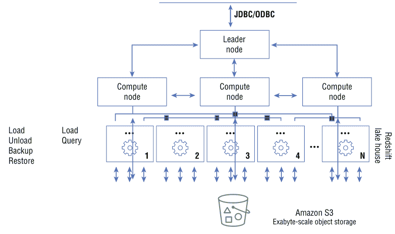

在我撰写本书时，Redshift 架构仍在不断演进。Amazon 最近发布了适用于 Redshift 的 RA3 托管存储，这意味着你现在可以分别为存储和计算付费。RA3 实例配备了大容量、高速 SSD 缓存，并可自动扩展到每个实例 64 TB。在撰写本文时，你可以将集群扩展到高达 8.2 PB 的集群存储，AWS 认为这应该能适用数据仓库中的大多数使用场景。如果你的使用场景需要超过 8.2 PB 的存储，AWS 很期待听到你的反馈。

## Redshift AQUA

在撰写本文时，Amazon 宣布为 Amazon Redshift 发布另一项有趣的功能，名为 Amazon Redshift 高级查询加速器（AQUA）。当你阅读本书时，该功能可能已经可用。

AQUA 是一个新的分布式硬件加速缓存层，为大数据量的分析提供了卓越的性能。它尤其擅长扫描和聚合密集型工作负载，额外的速度可帮助你与数据交互，并改变你分析数据的方式。AQUA 的关键目标是通过使用定制硬件和缓存层上的下推优化来提高查询的性能和可扩展性。Redshift AQUA 的架构如图 4.18 所示。

### 图 4.18 Amazon Redshift AQUA 架构

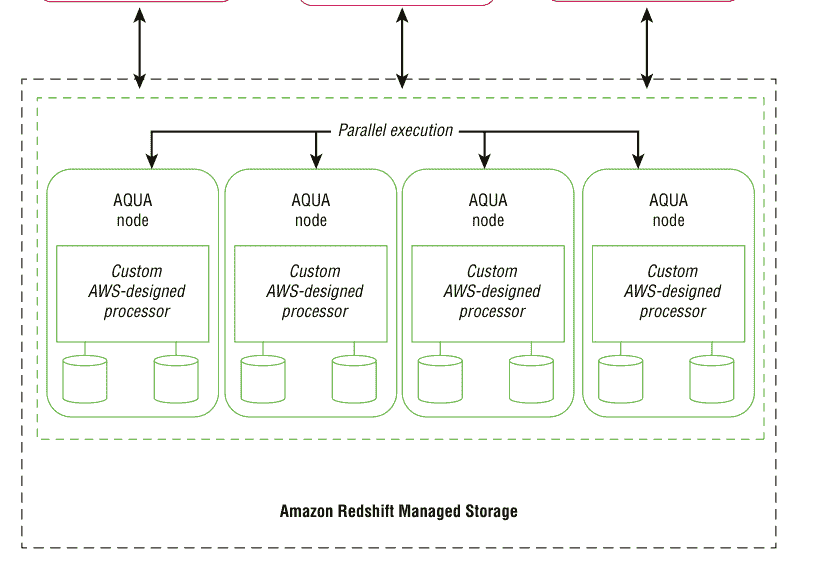

为了满足 AQUA 的性能要求，AWS 利用 Nitro 芯片构建了一个完全定制的节点，以执行硬件加速的压缩、加密、解压和解密。

Amazon 还进一步构建了一款定制实例，其独特架构将数据驱动器与硬件加速组件连接起来，并设计实现了专门用于分析的定制流式多核硬件加速处理器。该节点是从零开始构建的，从 AWS 定制芯片、硬件、物理接口盒、设备驱动程序、运维和执行层，一直到它与你的 Redshift 集群的连接方式，都进行了完整设计。

因此，AWS 能够利用所构建的最快扫描和聚合硬件的速度与优势。Redshift 在访问数据表时向 Redshift 集群添加逻辑来利用这一点，即使用 AQUA 中保存热数据的缓存。Redshift 将所有扫描和聚合操作拆分出来，并在已缓存数据的横向扩展分布式硬件加速层中运行它们。Redshift 与额外的定制硬件聚合和扫描层相结合，使 Redshift 能够提供比传统云数据仓库快 10 倍的性能。Amazon 相信，这将真正彻底改变日益增长的数据量的处理方式。

Redshift 还提供物化视图，这些视图与 AQUA 很好地配合使用，因为物化视图可以处理跨多个表的连接，本质上执行聚合，并接受一个运行大型连接的复杂查询，以增量更新并生成表。

当你对视图执行查询时，基本上是在扫描和聚合数据，这正是 AQUA 的亮点所在。这两者无缝协作，因此 Redshift 可以增量地处理复杂连接，并对结果数据执行硬件加速的扫描和聚合。

## Redshift 可扩展性

可扩展性通常分为两个主要方面：

- 存储可扩展性
- 计算可扩展性

大多数数据仓库环境需要基于存储或计算方面的原因进行扩展，而 Redshift 允许你独立扩展这两者。Redshift 中提供可扩展性的关键功能如下：

- Redshift 集群调整大小
- 并发扩展
- RA3 节点的托管存储

## Redshift 集群调整大小

你可能需要根据计算和存储需求对集群进行扩容或缩容，并可能遇到以下场景：

- 基于相同节点类型调整集群大小（Elastic Resize）
- 将集群调整为不同的节点类型（Classic Resize）

### Elastic Resize

Redshift 提供了 Elastic Resize 选项，可以在多阶段过程中修改现有集群以添加或移除节点。需要理解的重要一点是，添加到集群的节点类型只能与原始集群中的类型相同。例如，如果你的原始集群使用 DC2 节点，则使用 Elastic Resize 选项时，你只能向集群添加 DC2 节点。

### 阶段 1

在集群调整大小过程迁移集群元数据时，集群会暂时不可用。这个阶段较短，完成得相对较快，会话连接会保持，新查询会在队列中等待。

### 阶段 2

会话会重新连接并恢复。Elastic Resize 会在后台将数据重新分配到节点切片（重新分配很重要，因为集群配置更改后切片数量会不同）。此时集群可用于读写操作。

### Classic Resize

调整集群大小的另一个选项是使用 Classic Resize。使用 Classic Resize，可以将 Redshift 集群重新配置为不同的节点数量和实例类型。

- 根据数据大小，可能需要一个小时或更长时间才能完成。
- 涉及将数据从原始 Redshift 集群流式传输到按新配置新建的 Redshift 集群。在调整大小期间，原始 Redshift 集群处于只读模式。

这是在切换实例类型时将使用的方法。

### 并发扩展

Redshift 的并发扩展功能于 2019 年年中全面推出，目的是减少为满足客户临时计算需求高峰而提供服务所需的时间。当客户运行低延迟查询时，集群调整大小并不是理想的选择。并发扩展会为你的集群添加临时集群，以在几秒钟内以一致且快速的性能处理并发请求。

当用户活动突发时，Redshift 集群会在几秒钟内快速自动扩展额外的计算节点，以提供更高的并发性并避免查询在队列中等待。当工作负载压力减弱时，集群会缩减。

Amazon Redshift 允许你选择应使用并发扩展的工作负载。例如，你可以将并发扩展用于对高管报告至关重要的 BI 仪表板，但通过限制不运行高优先级查询的分析师组来避免耗尽积分或支付额外费用。

Amazon Redshift 为最多 97% 的客户免费提供并发扩展。你的主 Redshift 集群每运行 24 小时，即可获得 1 小时的免费额度。获得的积分会在月底过期，任何额外使用量按每秒计费。

### Redshift 托管存储

存储与计算的分离已成为企业分析讨论中一个备受争议的话题。虽然 Redshift 提供了使用 Amazon Redshift Spectrum 处理数据湖中数据的选项，但 AWS 在 re:Invent 2019 上更进一步，宣布推出 Amazon Redshift 托管存储。Amazon Redshift 托管存储几乎可以说是将存储和计算分离开来，因为你需要分别付费。RA3 实例配备了大容量高速 SSD 缓存，并可自动扩展到 64 TB/实例。

使用 Redshift 托管存储时，Redshift 计算节点中的数据块会根据数据温度自动在节点和 S3 之间交换（反之亦然）。数据以 Redshift 块格式存储，并由 Redshift 自动管理。

## Amazon Redshift 集群策略和工作负载管理

Redshift 允许你配置参数组，这些参数组可作为 Amazon Redshift 上某些查询行为（如查询超时、日志记录等）的保障。参数组可以像配置文件一样使用。你可以使用 AWS 控制台、AWS SDK for Java 以及 Amazon Redshift CLI 和 API 来管理参数组。

表 4.13 引用自 Amazon Redshift 文档，概述了这些参数及其默认值。

### 表 4.13 Redshift 参数选项

| 参数名称 | 值 | 更多信息 |
|---|---|---|
| auto_analyze | true | 参见 Amazon Redshift 数据库开发者指南中的 auto_analyze |
| datestyle | ISO, MDY | 参见 Amazon Redshift 数据库开发者指南中的 datestyle |
| enable_user_activity_logging | false | 参见 Amazon Redshift 集群管理指南中的数据库审计日志 |
| extra_float_digits | 0 | 参见 Amazon Redshift 数据库开发者指南中的 extra_float_digits |


# 表 4.13 Redshift 参数选项（续）

| 参数名称 | 值 | 更多信息 |
|---|---|---|
| max_concurrency_scaling_clusters | 1 | max_concurrency_scaling_clusters in the Amazon Redshift Database Developer Guide |
| query_group | default | query_group in the Amazon Redshift Developer Guide |
| require_ssl | false | Configure Security Options for Connections in Amazon Redshift Cluster Management Guide |
| search_path | $user, public | search_path in the Amazon Redshift Database Developer Guide |
| statement_timeout | 0 | statement_timeout in the Amazon Redshift Database Developer Guide |
| wlm_json_configuration | [{"auto_wlm":true}] | Configuring Workload Management in Amazon Redshift Cluster Management Guide |
| use_fips_ssl | false | Enable FIPS-compliant SSL mode only if your system is required to be FIPS-compliant. |

Table source: (amzn.to/36QJ6uZ)

参数组的好处在于它们是一个独立的构件，可以在多个 Redshift 集群之间使用。您可以根据预期的工作负载在一天的不同时间应用不同的参数组，例如用于夜间批处理 ETL 作业的“夜间批处理”参数组，以及白天用于分析作业的“分析”参数组。

Amazon Redshift 还支持工作负载管理（WLM），它允许您通过将集群资源分配给特定队列来优化查询性能。如果您对预期工作负载没有充分的了解，或者您正在运行一个全新项目，您可以使用 Auto WLM（自动 WLM）配合查询优先级，让 Amazon Redshift 管理并发性和内存分配。Auto WLM 确定查询所需的资源量，然后调整并发级别（并行运行的查询数量）。您可以通过其优先级来定义工作负载的重要性，这将对该工作负载给予优先处理。

图 4.19 显示了 Amazon Redshift 中的工作负载管理设置，用户已设置了两个队列。队列 1 已分配 45% 的内存，而队列 2 已分配 35% 的内存。

# 图 4.19 Amazon Redshift 工作负载管理

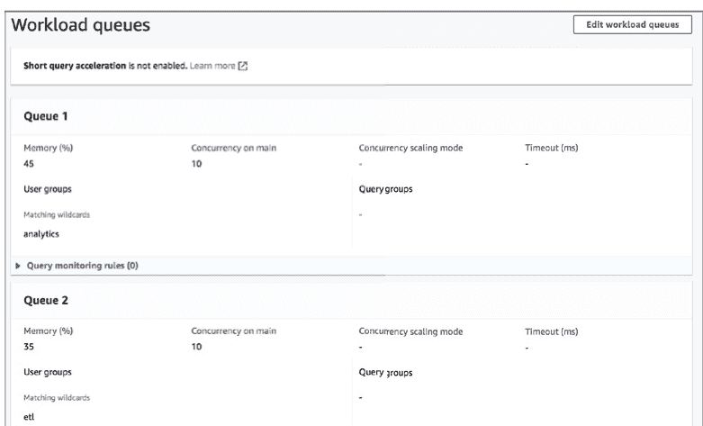

# Amazon Redshift Lakehouse

Redshift Lakehouse 并不是一项 AWS 服务，而是 Amazon Redshift 的一项功能，它允许用户查询驻留在您的数据湖（S3）中的数据，使用户对数据是存储在 Redshift 中还是从数据湖获取变得透明。用户查询表的方式与查询 Redshift 上任何其他表的方式相同，因此它允许通过 Redshift 查询数据湖中可能达到艾字节的数据。

Amazon Redshift Lakehouse 允许在原地查询数据，无需将数据加载到 Redshift 集群中。这在幕后由一支 Amazon Redshift Lakehouse 节点集群提供支持。每个 Redshift 集群切片的 Lakehouse 节点有 10 个的软限制/配额，这意味着拥有 16 个切片的集群可以利用 160 个 Lakehouse 节点。

当用户查询外部表（Redshift 上有元数据但数据在 Redshift Lakehouse 上的表）时，Amazon Redshift 使用 ML 来优化并在 leader 节点上编译查询，并识别计划中可在本地运行的组件以及需要从 Redshift Lakehouse 获取数据的组件。计划被发送到所有计算节点，它们与数据目录协同工作以获取用于分区裁剪的分区信息。如前所述，每个切片有 10 个 Redshift Lakehouse 节点的配额，每个计算节点使用此配额向 Redshift Lakehouse 层发出并行请求。Amazon Redshift Lakehouse 节点将扫描您的 S3 数据

并根据需要进行投影、过滤、连接和聚合，然后将结果发送回 Amazon Redshift，在 Redshift 集群中进行最终聚合并与 Redshift 表进行连接。查询结果随后发送回客户端，可以是 BI 工具或查询编辑器。

图 4.20 描述了查询 Amazon Redshift 和 Amazon Redshift Lakehouse 时查询的生命周期，希望能使概念更清晰一些。

# 图 4.20 查询的生命周期

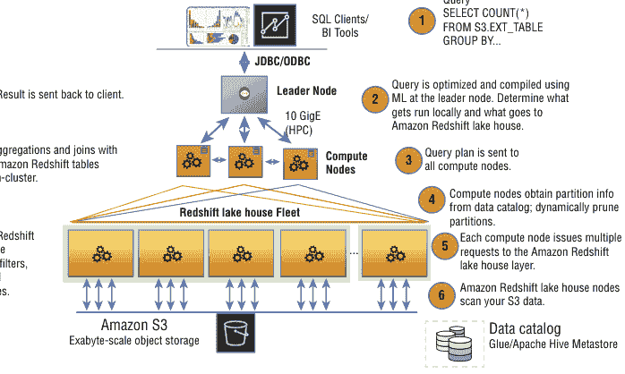

Amazon Redshift Lakehouse 与您现有的 SQL 和 BI 应用无缝集成，并支持以下关键功能，使其成为您分析工具箱中非常有用的工具：

- 支持美国国家标准学会（ANSI）SQL
- 支持数据湖上多种文件格式，包括 Parquet、ORC、JSON
- 能够读取压缩和加密文件
- 能够将优化下推到您的数据湖，而无需将任何数据加载到 Redshift
- 支持分析查询中常用的复杂连接、嵌套查询和窗口函数
- 支持 S3 上的分区数据，包括动态分区裁剪
- 能够利用 Glue Data Catalog 和 Amazon EMR Hive Metastore
- 能够使用 Redshift 的基于成本的优化器
- 对您的数据湖中的数据进行查询并行化以提供更好的性能
- 在多个 Redshift 集群之间共享数据

使用 Amazon Redshift Lakehouse 非常简单。三个步骤的流程如下：

- 1. 设置外部模式。这可以使用 AWS Glue Data Catalog 或 Apache Hive Metastore。

```
CREATE EXTERNAL SCHEMA <schema_name>
```

- 2. 从以下来源注册外部表：

  - Amazon Athena
  - Hive Metastore
  - Amazon Redshift CREATE EXTERNAL TABLE 语法。

```
CREATE EXTERNAL TABLE <table_name>
[PARTITIONED BY <column_name, data_type, ...>]
STORED AS file_format
LOCATION s3_location
[TABLE PROPERTIES property_name=property_value, ...];
```

- 3. 使用以下方式开始查询您的表：

```
<schema_name>.<table_name>
```

# Redshift 中的数据建模

Redshift 是一个完全符合 ACID 和 ANSI 的数据仓库（ACID 代表原子性、一致性、隔离性、持久性）。Redshift 没有索引的概念，但提供了分布键和排序键的概念，让您获得与构建索引相同的性能优势。MPP 数据库中的性能始终取决于数据在集群中的分布情况，Redshift 也不例外，其中分布键、排序键和压缩的选择会显著影响集群的性能。

Redshift 是一个关系型数据库，这意味着您需要在将数据写入 Redshift 之前了解数据的结构。Redshift 中的数据组织在数据库中（建议每个 Redshift 集群有一个数据库）。数据库可以有一个或多个模式（命名空间），其中包含表和其他数据库对象（如存储过程）。表由行和列的表格结构组成。

Redshift 仅支持标量数据类型，这意味着您不能使用 List 或 Map。虽然 Redshift 是为关系型数据构建的，但它确实以 JSON 或 AVRO 的形式支持半结构化数据，并且使用 Redshift Lakehouse，您可以使用 SerDes（序列化/反序列化器）在 Redshift 数据湖上处理多种文件格式。

在 Redshift 中实现最佳性能有五个主要的设计考虑因素。值得庆幸的是，Amazon 现在已自动化了其中大部分功能，这意味着系统会自动执行该工作，或者它会使用 Redshift 控制台中的 Redshift Advisor 为您提供建议以实现它们：

## 排序键

确保存在排序键以促进 WHERE 子句中的过滤。排序键很重要，因为 Amazon Redshift 以排序方式将数据存储在磁盘上。Redshift 查询优化器使用排序顺序来确定您数据的最佳查询计划。例如，如果您经常查询最近的数据，或基于时间范围的数据，您可以选择时间戳列作为排序键。当您使用时间戳作为过滤条件运行查询时，Redshift 可以跳过落在过滤范围之外的整个数据块，从而为您提供最佳性能。您可以使用 Redshift Advisor，它可以推荐合适的排序键。

## 压缩

您可以在 Redshift 中使用压缩来减少查询 I/O，从而提高整体性能。在 Redshift 中，不同的列可以有不同的压缩类型，因为 Redshift 具有列式架构。这使您可以识别最佳的压缩类型和最优性能。您可以手动应用压缩，也可以使用 COPY 命令，该命令将分析数据集并自动应用压缩。在 Redshift 中使用 COPY 命令应用自动压缩是高度推荐的。

## 分布样式

您可以使用分布键来确保数据在集群中均匀分布，并促进最常见的连接类型，从而减少查询执行期间的数据移动。当您将数据加载到 Redshift 表时，Redshift 会根据您在创建表时选择的分布样式将表的行分发到计算节点和切片。我们将在本章后面讨论分布样式。

## 表维护（Vacuum、Analyze）

当您从表中删除特定数据项时，Redshift 并不会删除数据；它只是将其标记为已删除。这意味着随着更多数据的删除，您的集群中会有被删除行占用的空间，这时 Vacuum 操作可以帮助您收回空间。此外，Redshift 上存储的数据以排序顺序存储，这意味着当新行到来时，它们将以未排序的方式存储，除非它们以排序键的增量顺序到达，这对于除事务数据之外的其他数据通常是不可能的。需要 Vacuum sort 来重新对磁盘上的数据进行排序，以提供更好的数据有序性。Redshift 现在会自动运行 VACUUM SORT 和 VACUUM DELETE 以提高整体查询性能。

除了 VACUUM 之外，ANALYZE 有助于更新表统计信息，这有助于优化器为不同的查询计划提供最佳成本评估。表统计信息会提高排序键的有效性，从而提高查询的整体性能。

## 工作负载管理

Redshift 使用 ML 算法来分析查询，然后将它们放置在适当的队列中，在那里它们将被分配适当的资源。这也是自动完成的，但用户可以选择手动覆盖 AutoWLM 设置或手动配置队列。


## 表 4.14 Redshift 数据类型（续）

| Category | Data Type | Description |
|---|---|---|
| DATETIME | DATE | Calendar date (year, month, day) |
|  | TIMESTAMP | Date and time (without time zone) |
|  | TIMESTAMPTZ | Date and time (with time zone) |
| LOGICAL | BOOLEAN | Logical Boolean (true/false) |
| GEOSPATIAL | GEOMETRY | Geospatial data (supports multiple geometric shapes such as point, multipoint, polygon, and more) |

选择正确的数据类型对于性能很重要，因此重要的是使列仅宽到所需程度。例如：你应避免对国家标识符使用 BIGINT，对国家名称使用 CHAR(MAX)，以及对日期使用 CHAR。你应使用 TIMESTAMP 或 DATE 而不是 CHAR，并在你知道字符字符串和域的长度时使用 CHAR 而不是 VARCHAR。这是一个重要的性能优化技巧，并且在考试中可能会被问到。

另一种重要的性能优化技术是将频繁计算的值物化到预聚合列中，或使用物化视图。物化视图提供了一种自动预计算聚合的便捷方式，并能使代码变得更简单。

对于 JSON 等半结构化数据，你应以显式列的形式对来自应用域中你已知有用的属性进行建模。显式存储的列可用于过滤和连接，但 JSON 记录中属于剩余列但未显式提取的列不能用于连接和过滤。Amazon Redshift 提供了各种可用于处理 JSON 列的 JSON 函数：

- IS_VALID_JSON
- IS_VALID_JSON_ARRAY
- JSON_ARRAY_LENGTH
- JSON_EXTRACT_ARRAY_ELEMENT_TEXT
- JSON_EXTRACT_PATH_TEXT

在建模数据时，你应始终记住 Redshift 的列式特性以及它如何影响你的查询。如前所述，Redshift 可以自动配置列压缩设置并使用多种内置压缩算法。

最小化不必要的 I/O，从而为你的查询带来卓越的性能。

Redshift 支持两种类型的排序键：

**Compound Sort Key (Default)** 复合排序键是由一个或多个列组成的键。排序键中列的顺序至关重要，因为它们定义了实际数据如何在磁盘上存储。作为最佳实践，你应按从低基数到高基数的顺序排列列。当对表的查询大多数在特定列子集上进行过滤或连接时，这些排序键是有效的。

**Interleaved Sort Key** 排序键中的每个列都以相同的权重进行排序。当多个查询使用不同的访问路径以及不同的列进行过滤和连接时，这很有用。这应谨慎使用，仅用于特定边缘情况。

以下是使用 Redshift 中的排序键时需要考虑的一些事项：

- 大多数客户将使用复合排序键。交错排序键可能看起来是解决所有问题的良药，但通过实现交错排序键获得的性能提升可能需要以增加的加载和真空时间来抵消。
- 排序键应实际包含 WHERE 子句中最常使用的列。
- 选择排序键时列的顺序很重要。
- 建议在复合排序键中使用四个列或更少。使用更多列将导致边际性能提升，但会增加摄取开销。
- 如果你的表经常被连接，则应将 DIST 键用作排序键中的第一列。
- 在 SORT 键的谓词子句中使用 CAST() 函数将导致全表扫描，并且排序键在查询期间不会被利用。
- 你可以更改排序键，但 Amazon Redshift 需要重新排序底层表中的数据。

## Redshift 中的临时表

Redshift 也支持临时表。你可以按如下方式创建临时表：

```
CREATE TEMPORARY TABLE <TableName> {Table Definition}

CREATE TEMPORARY TABLE <TableName> as {Select Query}

SELECT ... INTO #MYTEMPTAB FROM {TableName}
```

临时表像 Redshift 中的所有其他表一样存储，但其生命周期为会话，并在会话终止时被删除。默认情况下，没有列式压缩，并且表在集群中均匀分布。你可以使用 TEMP 表来替代永久表，并且它们通常可以提供更好的性能，因为它们表现出更快的 I/O（因为它们不会镜像到其他节点）。你可以对临时表执行 COPY 和 UNLOAD。

通常建议在 CREATE 语句中使用临时表时包含列编码，并包含你的用例所需的分布样式。如果你计划将它们作为 ETL 流程的一部分使用，请确保为这些表计算统计信息。

## Redshift 中的物化视图

物化视图包含基于一个或多个基表上的 SQL 查询的预计算结果集。当你创建物化视图时，Redshift 运行关联的 SQL 查询并持久化结果集。物化视图的预计算结果集可随时通过 REFRESH 命令刷新，并且 Redshift 会确定更新物化视图数据的最佳方式（增量或完全刷新）。

物化视图的关键好处包括优化对大型表的复杂、运行时间长、资源密集型查询，例如对包含数百万行的表执行多表连接和聚合的 SELECT 语句。

当查询物化视图时，Redshift 返回预计算结果而无需访问基表，这对于可预测且重复的查询尤其有用，例如 ETL 或 BI 管道，它们对非常大的数据集执行重复的计算阶段。

以下是物化视图的一些关键注意事项：

- 引用 MV 的查询将在主集群上运行（而不是并发扩展集群）。
- MV 可以引用所有 Redshift 对象，除了其他 MV、标准视图（尽管标准视图可以引用 MV）、外部表、系统表或视图，或临时表。
- 某些 SQL 操作需要完全刷新（例如，外连接、数学函数如 RAND、窗口函数等）。
- 当 REFRESH 命令被调用时，基表中的数据更改会反映在 MV 中。截至本文撰写时，Amazon 尚未发布 MV 的自动刷新功能，尽管它是路线图的一部分，预计很快会发布。
- 可以在不影响 MV 的情况下向基表添加列，但如果你要删除或重命名列、重命名 MV，或更改 MV 的 SQL 定义，则必须重新创建 MV。
- 基表上的某些用户发起操作会强制 MV 在下次运行 REFRESH 时完全重新计算（例如，手动调用 vacuum、经典调整大小、alter distkey、alter sortkey 和 truncate）。

## 数据湖的数据建模

如 Redshift Lakehouse 部分所述，你可以在 Redshift 中拥有指向数据湖中数据文件的表。然而，指向数据湖中数据的表和在 Redshift 中持久化数据的表有一些不同的考虑因素。

文件类型、大小和压缩对指向数据湖中数据的表的性能有巨大影响。最佳实践如下：

- 数据湖中的文件数应为 Redshift 切片数的倍数（通用最佳实践）。Redshift Lakehouse 可以自动拆分 Parquet、ORC、文本格式和 Bz2 文件以实现最佳处理。
- 文件大小应在 64 到 512 MB 范围内。
- 文件应大小均匀（尤其是 Redshift Lakehouse 无法自动拆分的文件，如 Avro 和 Gzip），以避免执行倾斜；Lakehouse 查询仅与集群中最慢的节点一样快。
- 使用针对 Redshift Lakehouse（和 Athena！）读取优化的数据湖文件格式。
- ORC 和 Parquet 应用列式编码，与数据在 Redshift 内部的存储方式类似。
- Redshift Lakehouse 也可与 Avro、CSV 和 JSON 数据一起使用，但这些文件在 S3 上的大小 *远* 大于 ORC/Parquet。
- Lakehouse 将基于 S3 上的数据结构执行“分区裁剪”：
  - 这实际上基于 Hive 元存储裁剪，而不是 Redshift Lakehouse 特有的——它也在 EMR、Glue 等中工作。
  - 使用 Glue Data Catalog 分区列。
- 分区应基于以下项目：
  - 经常被过滤的列（通过连接或 WHERE 子句）
  - 业务单元
  - 业务组（用户队列、应用程序名称、业务单元）
  - 日期和时间
- 考虑你的用户如何查询数据：
  - 他们是按月查看，还是当前月份和年份与上一年同期相比？（等等。）
  - 他们是否理解你创建的列？
- 基于日期的分区列具有类型：
  - 包含在单个值中的完整日期可能已格式化或未格式化（*yyyy-mm-dd* 或 *yyyymmdd*）。
  - 格式化的日期只能是字符串。
  - 两种类型的日期都需要考虑排序。（date=dd-mm-yyyy 不能在 order by 子句中使用，但 date=yyyy-mm-dd 可以！）


- Redshift 会在工作负载较低期间在后台自动执行 VACUUM 和 ANALYZE，但 Redshift 用户仍可在添加、删除或修改大量行（> 5%）后，作为工作流程的一部分显式调用 VACUUM 然后执行 ANALYZE。
  - 显式调用 VACUUM 然后执行 ANALYZE 可确保表在下一个工作流程步骤受益之前立即且优先地进行排序、去碎片化和分析。
- 如果相对于整体表大小加载的数据量很小，请禁用 COPY 中的列编码分析（COMPUPDATE）和统计信息更新（STATUPDATE）。
- 在 Amazon Redshift 之外强制执行主键、唯一或外键约束。
- 将工作流/语句包装在显式事务中。
- 考虑使用 DROP TABLE 或 TRUNCATE 而不是 DELETE。
- 当移动表中的所有行时（例如，从源表到暂存表，或反之亦然），请使用更快的 ALTER TABLE APPEND（移动数据而非复制数据）而不是 INSERT INTO SELECT。
- 暂存表：
  - 使用具有 BACKUP NO 选项的临时表或永久表。
  - 通过使用 CREATE TABLE LIKE 或使用 ANALYZE COMPRESSION 将列级压缩添加到 DDL 中，从生产表中镜像压缩设置；此外，在 COPY 命令中关闭自动压缩分析（即 COMPUPDATE OFF）。
  - 如适用，在暂存表和生产表上（在同一键列上）使用 DISTSTYLE KEY 以加快 INSERT INTO SELECT 语句的速度。

## 从其他 AWS 服务加载数据

您可以从其他 AWS 服务（包括但不限于以下）将数据加载到 Redshift：

**Kinesis Data Firehose**  Kinesis Firehose 可以自动将数据加载到 Redshift。它将流数据微批处理到 S3，然后使用 COPY 命令和清单文件将数据加载到 Redshift。您可以指定批大小和加载发生前的秒数。Kinesis Firehose 可以在加载前对数据进行多可用区缓冲，并管理所有压缩和加密。

**Amazon EMR**  您可以从 Amazon EMR（本质上是 HDFS）加载数据。但是，集群需要使用 Redshift 兼容引导操作启动。

```
COPY <table> from 'emr://emr_cluster_id/hdfs_file_path' iam_role "arn"
```

**DynamoDB**  您可以使用 COPY 命令从 DynamoDB 加载数据。但是，COPY 命令会占用您的预置读取容量。

```
COPY <redshift_tablename>
from 'dynamodb://<dynamodb_table_name>' iam_role "arn" readratio
'<integer>';
```

### SSH 端点

您可以通过 SSH 连接的任何端点将数据加载到 Amazon Redshift。此选项对于 SFTP、NAS 或本地远程主机很有用。它需要一个 SSH 清单文件，其中包含 COPY 用于打开 SSH 连接和执行远程命令的信息。

```
COPY <redshift_tablename>
from 's3://ssh_manifest_file' iam_role "arn"
SSH [| optional-parameters];
```

### AWS Lambda

您可以使用 AWS Lambda 通过 aws-lambda-redshift-loader 将数据加载到 Amazon Redshift。连接器可在 GitHub 上获取，地址为 github.com/awslabs/aws-lambda-redshift-loader。如果您计划从 AWS Lambda 将数据加载到 Amazon Redshift，应考虑 AWS Lambda 会话限制。

### 联邦查询

您可以使用联邦查询跨运营数据库、数据仓库和数据湖查询和分析数据。此功能允许您将 Amazon RDS for PostgreSQL 和 Amazon Aurora PostgreSQL 中实时数据的查询与 Amazon Redshift 和 Amazon S3 环境中的查询集成。Redshift 的智能优化器将计算的一部分下推并直接分发到远程运营数据库，以减少网络上传输的数据量。

因此，您可以将实时数据作为业务智能（BI）和报表应用程序的一部分。这使得通过直接查询运营数据库、即时应用转换并将数据加载到目标表而无需复杂的 ETL 管道，可以轻松地将数据摄取到 Redshift。

## 从 Amazon Redshift 卸载数据

构建完整的信息架构通常意味着您偶尔需要从 Redshift 卸载数据。有时可能是因为您想卸载在 Redshift 内部构建但现在托管冷数据的数仓，而在其他时候可能是由于其他应用程序将使用您 Redshift 集群上可用的数据。

您有三种常见的方法可以从 Redshift 卸载数据：

- AWS Glue
- AWS Data Pipeline
- UNLOAD 语句

您可以使用 UNLOAD 命令从 Redshift 提取数据。UNLOAD 基本上是 COPY 语句的逆向操作。UNLOAD 语句将数据从 Amazon Redshift 输出到 S3 中的 CSV 或 Parquet 格式。UNLOAD 的关键语义如下：

- 从 SELECT 语句运行。由于输出通常很大且性能是关注点，因此该语句在所有计算节点上并行运行。如果您想要有序输出，您需要在 SELECT 语句中定义 ORDER BY，并且还要设置 PARALLEL=OFF。
- 加密和压缩会自动处理。
- 生成的文件数大于切片数，通常每个切片多于一个文件。
- 您可以在输出操作中创建清单文件。如果您想将数据移动到另一个集群，这尤其有用。
- 您可以控制写入 S3 的最大文件大小以及是否覆盖输出的覆盖语义。

## Redshift 中的查询优化

Redshift 是一种符合 ACID 和 ANSI SQL 的云数据仓库，使用与 PostgreSQL 类似的语法，同时支持存储过程和自定义 UDF 以及 SQL SELECT 或 Python。典型的 Redshift 查询经过三个主要阶段：

1. 规划 – 用户提交的查询被解析并优化以创建查询计划。
2. 编译 – Redshift 检查其编译缓存以查看是否可以找到查询计划匹配项。如果可以找到查询计划匹配项，则重用现有的编译对象；否则将其转换为子任务，然后将这些子任务单独编译为 C++。
3. 执行 – 编译后的代码由计算节点切片并行执行，然后结果由 leader 节点汇总后发送回请求方。

查询计划是一个基本工具，可帮助您理解和分析复杂查询。它让您了解查询将在集群上实际如何运行。当查询计划被编译时，执行引擎将查询计划转换为步骤、段和流（见图 4.21）：

| 术语 | 定义 |
| --- | --- |
| Step | Step 是在查询执行期间所需的一个单独操作。 |
| Segment | Segment 是需要由单个进程完成的多个步骤的编译。这是可由计算节点单个切片执行的最小编译单元。计算节点切片将并行执行段。 |
| Stream | Stream 是要分发到可用计算节点切片的一组段。您可以有多个段在一个流中，并且段然后并行运行。 |

**图 4.21 流、段和步骤之间的关系**

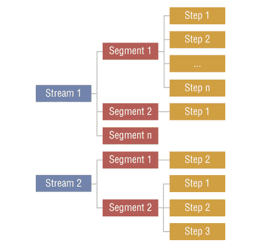

### Redshift 中的 Explain Plans

您可以使用 EXPLAIN 语句生成 explain plans，该语句允许您生成预格式化的输出，每步一行，单列指示步骤。如果您使用 Redshift Query Editor，您可以生成可视化 explain plan。Explain plans 从底部向上读取，并提供以下信息：

- 本地和 Lakehouse 部分步骤的执行顺序
- 步骤预计返回的行数
- 每个步骤在切片间传输的数据量（网络 I/O 成本高昂，应尽可能优化。）
- 步骤的相对成本

您可以使用 STL_EXPLAIN 表查看系统上先前运行的查询生成的 explain plans 的历史趋势。理解 explain plans 的关键组件之一是理解 explain plan 生成期间使用的术语。如前所述，Redshift 是一种 MPP 数据库，其中多个计算节点协同工作以产生高效结果，这意味着网络在数据处理期间成为一个非常重要的组件，尤其是在连接处理期间。在连接的特定步骤中，您可能需要处理未本地存储的数据，因此可能需要从同一节点上的不同切片获取数据，或者在最坏的情况下，需要从不同节点获取数据。由于网络传输是查询将执行的成本最高的操作，因此了解数据如何在节点间移动非常重要。表 4.15 描述了您将在 explain plans 中看到的术语。


## 表4.15 查询处理中的网络传输

| 传输类型 | 描述 |
|---|---|
| DS_DIST_NONE | 这是理想情况，表示连接所需的数据位于同一切片上；这是最高效的选择，因为不会发生网络传输。 |
| DS_DIST_ALL_NONE | 表示连接发生在使用 DISTSTYLE ALL 的表上，同样不会产生网络传输。 |
| DS_DIST_ALL_INNER | 表示“内部”连接表被发送到单个节点，因为该连接表使用了 DISTSTYLE ALL；此连接在单个节点上执行，可能会非常慢。 |
| DS_DIST_INNER (\|OUTER) | 表示在外连接（内表或外表）时哪个表正在被重新分布；如果其中一个表小得多或更新不频繁，可考虑将其改为 DISTSTYLE ALL。 |
| DS_BCAST_INNER | 表示“内部”连接表正在被广播到所有节点。 |
| DS_BCAST_BOTH | 表示连接中的两个表都被广播到所有节点。这是最差的选择。 |

## 编写查询的最佳实践

以下是从 Redshift 中读取数据时的一些最佳实践。建立自己的一套最佳实践并将其作为指导原则非常重要：

-   团队应制定编码标准，包括 SQL 的语法风格。例如，你可能更喜欢 ANSI 连接而不是等值连接，但你应该选择其中一种并保持一致。
-   理想的查询只获取所需的列和感兴趣的行。这通过投影列表和过滤器来实现。
-   充分利用排序键、压缩、分布样式、自动表维护（vacuum、analyze）和工作负载管理。
-   过滤器中的排序列不应使用函数。如果必须应用函数（例如，转换为其他格式），请确保将其物化到单独的列中。
-   确保统计信息是最新的。
-   可以使用 SVL_QUERY_SUMMARY 来评估排序键的有效性。
-   对于 Lakehouse 查询，请确保使用列式编码（Parquet 或 ORC）。

-   HOP – 记录操作并将查询移至其他适当的队列（如果存在）；否则，终止查询。
-   PRIORITY – 更改查询优先级。

## Redshift 中的安全性

Redshift 托管着公司最有价值的资源——数据，因此安全性成为首要任务。对 Amazon Redshift 的访问在四个层面进行控制：

-   **集群管理** – 使用 AWS IAM（身份和访问管理）控制 AWS 用户创建、配置和删除 Amazon Redshift 集群的能力。一旦用户能够通过 IAM 访问 Redshift 集群，他们将通过 JDBC/ODBC 或 Redshift 控制台中的查询编辑器进行连接。
-   **集群连接** – 使用安全组允许其他 AWS 实例连接到 Redshift 集群。
-   **数据库访问** – 对表、视图等数据库对象的访问由 Amazon Redshift 数据库中的用户账户控制。
-   **临时数据库凭据和单点登录** – 利用 IAM 凭据登录数据库，或通过符合 SAML 2.0 的身份提供商使用联合单点登录（SSO）进行登录。

## Redshift 集群 VPC

计算节点驻留在由 Amazon 管理的私有内部 VPC 中，该 VPC 仅可由 Redshift 领导节点访问。领导节点同时位于计算节点的私有/内部 VPC 和客户的 VPC 中，以便允许访问 Redshift 集群并处理计算节点之间的数据分发。高带宽连接、近距离和自定义通信协议为领导节点和计算节点之间提供了私有、高速的网络通信。计算节点与其他 AWS 服务（如 S3、EMR 和 DynamoDB）交互，用于数据摄取、备份等。

图4.22 展示了 Redshift VPC 及其与其他 Amazon Web Services 的交互。

## Redshift 网络拓扑和安全组

集群子网组指示 Redshift 集群可以运行在 VPC 中的哪些子网中；但是，大多数客户会配置多个子网的 Redshift，以便 Redshift 可以选择子网。一个 Amazon Redshift 集群一次只能存在于一个子网/可用区中。

Amazon Redshift 集群默认被锁定，这意味着没有用户可以连接到集群。要授予用户访问集群的权限，必须将安全组与集群关联，打开适当的端口，并接受来自白名单 IP 地址、CIDR 地址段或安全组的传入连接。

## 静态数据加密

Redshift 集群的数据可以存储在 S3 或 Redshift 本地驱动器中，也可以作为备份存储在您的 S3 上。Redshift 可以使用 AWS 提供的 256 位密钥对数据进行加密。密钥管理可以在 Redshift 内部、通过 AWS KMS 或使用您自己的 HSM 来执行。密钥轮换可以通过 API 处理。

S3 上的 Redshift 数据块使用集群的加密密钥进行加密。Redshift 使用基于硬件的加密模块，使 CPU 负载保持在 20% 以下。

基于 KMS 的加密是 Redshift 中静态数据加密的推荐设置，它支持密钥轮换和自带密钥 (bring-your-own-key)。您可以使用健壮的密钥层级进行信封加密。Redshift 支持四层加密密钥层级（见图4.23）：

### 图4.23 Redshift 中的四层加密密钥层级

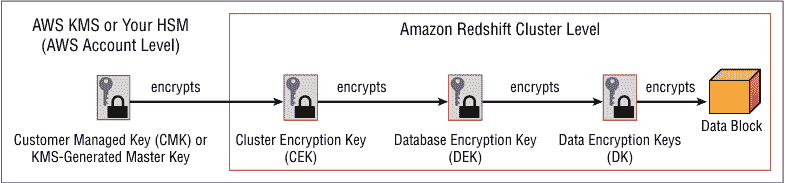

-   主密钥
-   集群加密密钥
-   数据库加密密钥
-   数据加密密钥

## 与 Redshift 的单点登录（SSO）

您可以使用单点登录来利用组织中已有的、AWS 之外的用户身份。

您配置符合 SAML 2.0 的身份提供商（IdP），以允许您的联合用户访问某个 IAM 角色。借助该 IAM 角色，您可以生成临时数据库凭据并登录 Amazon Redshift 数据库。您还可以将 IAM 策略附加到该 IAM 角色，以授予或限制对特定资源的访问，例如 Amazon Redshift 集群、数据库、数据库用户名和用户组名。

## Redshift 中的审计日志

Redshift 提供了三种用于审计数据库级活动的选项，例如哪些用户登录了系统及其相关活动：

-   **审计日志：** 审计日志存储在三个文件中——连接日志、用户日志和用户活动日志——并且必须显式启用。除非您制定了生命周期规则来自动归档或删除文件，否则它们会无限期地存储在 S3 上。由于日志存储在 S3 上，审计日志不受集群重启的影响，您可以独立于 Redshift 集群访问来访问日志。这意味着如果您的审计人员需要访问 Redshift 的审计日志，您可以直接提供日志访问权限，而无需授予他们对 Redshift 集群的访问权限。
-   **系统（STL）表：** Redshift 中有多个系统表，如 SVL_STATEMENTTEXT 和 SVL_CONNECTION_LOG，包含审计信息。超级用户对这些表拥有完全控制权，并且它们会自动在 Redshift 集群的每个节点上可用。默认情况下，日志历史记录会存储 2 到 5 天，具体取决于日志使用情况和磁盘空间可用性。最好保留这些表的备份，并在需要时将其卸载到 S3，以便审计人员访问。
-   **CloudTrail 日志：** CloudTrail 日志用于审计服务级活动，包括请求的成功/失败、请求发起者以及发起时间（日期/时间）。它们会无限期地存储在 S3 上。

## Kinesis Data Analytics

您在第三章“数据存储”中了解了捕获流式数据的重要性；但是，仅捕获数据而不分析和利用这些信息，就像拥有一座信息金矿却不加以利用。Amazon Kinesis Data Analytics 提供了一种分析流式数据、获得可操作的洞察并实时响应业务和客户需求的选项。Amazon Kinesis Data Analytics 的核心目标是降低通常与构建、管理流式应用程序以及将其与其他 AWS 服务集成相关的复杂性。

分析师喜欢 SQL，因为 SQL 是他们与数据交互的首选语言。Kinesis Data Analytics 允许 SQL 用户轻松查询流式数据，或使用模板和交互式 SQL 编辑器构建完整的流式应用程序。适用于 Java 的 Kinesis Data Analytics 允许 Java 开发人员使用开源 Java 库（Apache Flink 框架）和 AWS 集成来构建复杂的流式应用程序，以实时转换和分析数据。

Amazon Kinesis Data Analytics 负责处理流式应用程序随数据规模和数量增长所需的可伸缩性，采用按需付费模式，无最低费用。


## 应用代码

在 SQL 应用中，应用代码基本上是一系列 SQL 语句，用于处理来自输入流的输入并产生输出。您可以针对应用内流编写 SQL 语句并引用表，并且可以选择在这两者之间执行连接。

应用内流本质上是通过您的应用代码处理的无界数据流。虽然按记录级别操作是合理的，但通常会看到数据是按一定时间量处理的，例如最近 5 分钟，或按一定记录数处理，例如最近 50 笔交易。

一个例子可能是金融机构查看过去 24 小时的现金提取数据，以查看用户是否已根据其每日限额从其账户中提取资金。

另一个例子可能是电信公司提供无限通话分钟数，如果您在特定一天内的平均消费为按需订阅的一美元。

Amazon Kinesis Data Analytics 提供了使用窗口化 SQL 查询处理数据的能力，其中流中的数据可以按时间或记录数进行限定。窗口化查询可以是基于时间的时间窗口或基于行的窗口。对于基于时间的窗口，窗口大小可以用时间定义（例如，过去 24 小时）。然而，基于时间的窗口需要在您的数据中有一个随时间递增的时间戳列。对于基于行的窗口，您可以按行数指定窗口大小。

Amazon Kinesis Data Analytics 支持三种窗口类型：

- Staggered windows：交错窗口方法在分析可能在不一致时间到达的数据时很有用。它们可用于解决 tumbling 窗口问题，即记录未落在特定时间限制窗口内。窗口在与分区匹配的第一个事件到达时打开，而不是在固定的时间间隔打开，并且根据窗口的年龄相对于首次遇到记录并打开窗口的时间来关闭。要了解有关交错窗口的更多信息，请访问 AWS 文档 docs.aws.amazon.com/kinesisanalytics/latest/dev/stagger-window-concepts.html。
- Tumbling windows：Tumbling 窗口方法在分析不重叠的时间窗口中的数据时很有用。每个记录在它发生的时间窗口期间仅处理一次。要了解有关 tumbling 窗口的更多信息，请访问 AWS 文档 docs.aws.amazon.com/kinesisanalytics/latest/dev/tumbling-window-concepts.html。
- Sliding windows：滑动窗口技术在基于某些内部变量分析数据时很有用，该变量根据最新时间或最新记录移动。例如，如果您计算过去 5 分钟的平均值，结果每次运行查询时可能都不同，具体取决于运行查询的时间。要了解有关滑动窗口的更多信息，请访问 AWS 文档 docs.aws.amazon.com/kinesisanalytics/latest/dev/sliding-window-concepts.html。

Output 在应用代码中，查询结果进入应用内流。您还可以创建多个应用内流来保存中间结果（充当临时表）或配置应用程序以将数据持久化到应用内输出流。

图 4.25 显示了 Kinesis 应用程序的创建以及选择运行时环境。

## 图 4.25 Kinesis Data Analytics 的工作方式

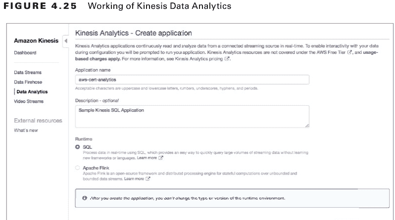

## 什么是 Kinesis Data Analytics for Java？

Kinesis Data Analytics for Java 本质上是托管的 Apache Flink，它是一个分布式引擎和用于有状态处理数据流的框架。Apache Flink 在本书前面有所讨论，但使用过 Apache Flink 并管理过 Flink 集群的人会意识到，运行和管理 Apache Flink 集群很快就会变得相当具有挑战性。Amazon 为您提供了一个选项，可以使用 Amazon Kinesis 运行您的 Apache Flink 应用程序。运行此类应用程序的过程相当简单，可以总结为三个步骤：

- 在您选择的 IDE 中使用 Apache Flink 构建您的应用程序。
- 将您的应用程序代码上传到 Amazon Kinesis。
- 在完全托管的、高可扩展且弹性的服务中运行您的应用程序，无需管理底层基础设施。

当您使用 Amazon Kinesis 运行 Apache Flink 应用程序时，您可以从 Amazon Web Services 中监控、扩展和备份您的应用程序：

**Monitoring Your Application** 您可以使用 CloudWatch 指标和日志以及 AWS 管理控制台中的 Apache Link 作业图来监控您的应用程序。

**Scaling Your Application** 您可以扩展应用程序的资源，例如分配的 KPU（Kinesis 处理单元；1 KPU = 1 vCPU + 4 GB RAM）。它们可以提前预配或根据需要自动扩展。您还可以扩展任务的实例数量。

**Backing Up Your Applications** Amazon Kinesis 会自动备份应用程序状态（默认情况下）。您可以使用 Amazon Kinesis 拍摄的快照将应用程序恢复到之前的时间点。

## 比较批处理服务

AWS 平台为数据处理提供了深度和广度的服务。我们在上一章中查看了 AWS Glue，并在本章中查看了 Amazon EMR。重要的是根据具体需求知道选择哪项服务。表 4.16 突出了这两个服务之间的一些关键差异。

### 表 4.16 比较批处理服务

| 比较标准 | AWS Glue | Amazon EMR |
|---|---|---|
| 摘要描述 | AWS Glue 是一种完全托管的无服务器 ETL 服务，提供托管的 Apache Spark 和 Python shell。 | Amazon EMR 是一种完全托管的 Hadoop 环境，提供许多不同的项目，包括 Hadoop、Spark、HBase |
| 扩展 | 自动扩展 | 自动扩展/EMR 管理扩展 |
| 计算 | 无服务器 | EC2 实例上的 EMR 软件 |
| 支持的项目 | Apache Spark、Python Shell | Apache Hive、Apache Spark、Apache Pig、Apache Mahout、Apache Presto、Apache Hadoop、Apache Livy、Tensorflow、MXNet + 其他 |
| 定价 | DPU（数据处理单元） | EC2 实例成本 + EMR 软件（每个节点） |

### 表 4.16 比较批处理服务（续）

| 比较标准 | AWS Glue | Amazon EMR |
|---|---|---|
| 理想用例 | 无服务器 ETL，管理开销低，通常适用于新工作负载 | 完全托管环境，通常适用于本地 Hadoop 迁移的良好替代方案 |
| 启动时间 | 秒（Glue 2.0） | 分钟 |
| 集群类型 | 瞬态 | 长期运行 + 瞬态 |

## 比较 AWS 上的编排选项

我们在前一章中查看了数据摄取，并在本章中查看了数据处理和分析。这些任务彼此独立存在，并且通常以管道的形式联系在一起，以实现从头到尾的自动化流程。这种端到端自动化流程称为数据编排。AWS 为数据编排提供了许多选项，包括 AWS Glue 工作流和 AWS Data Pipeline，在前一章中提到，以及本节中讨论的 AWS Step Functions。然后我将比较可在 AWS 上使用的各种选项，包括开源领域中非常受欢迎的选项 Apache Airflow。

## AWS Step Functions

AWS Step Functions 在 AWS 上提供完全托管的状态机。它允许您将多个 AWS 服务协调到无服务器工作流中，以便您可以快速轻松地构建和更新您的应用程序。您可以将多个服务（如 Amazon DynamoDB、AWS Glue、Amazon EMR 和 Amazon Sagemaker）拼接成一个具有内置错误处理和重试支持的弹性工作流。AWS Step Functions 还为您提供可视化监控和执行过程的可审计历史记录。

如果您想了解有关 AWS Step Functions 的更多信息，我强烈推荐以下工作坊，完成最多需要三个小时：
step-functions-workshop.go-aws.com/。

## 比较不同的 ETL 编排选项

表 4.17 提供了 AWS 平台上各种 ETL 编排选项的比较。


例如，本章我们介绍了 Amazon EMR，第 2 章“数据收集”中介绍了 AWS Glue。这两项服务都提供了 Apache Spark，这是目前最受欢迎的数据处理框架之一。同样，我们介绍了数据编排服务，而在 AWS 平台上也有许多编排服务。作为一名解决方案架构师，你应该能够根据使用场景指导客户和用户选择合适的技术。

完成后，请在开始下一章“数据可视化”前稍作休息。

## Exam Essentials

**了解数据处理和数据分析。** 数据处理和数据分析是考试中超过三分之一问题的主题，这使得本章非常重要。之所以将这两个主要领域放在同一章中，是因为我认为用于数据处理的许多技术也用于数据分析。

**熟悉相关的 Amazon 服务产品。** 从服务角度来看，我们查看了 Amazon Athena、Apache Presto、Amazon EMR、Apache Hive、Amazon Elasticsearch、Amazon Redshift 和 Kinesis Data Analytics。本章涵盖的内容很多，但仅此是不够的。强烈建议你查阅本章参考部分中建议的博客、文档和研讨会。

## Exercises

完成以下练习时，请参考相关服务的用户指南。

### EXERCISE 4.1: 创建 EMR 集群

请按照以下步骤创建 EMR 集群。

1. 转到 Service ➤ Analytics ➤ EMR。
2. 选择 Create Cluster。
3. 你有两种创建集群的选项：Quick Create 或 Advanced Options（提供更多控制和选择）。选择 Quick Create。
4. 为你的集群命名，例如 wiley-demo-chapter4。
5. 你可以勾选 Logging 选项。这将把所有集群日志记录到 Amazon S3。
6. 选择启动模式。

你有两种启动集群的模式：

- Cluster – 你创建一个长期运行的集群，并从下一步的应用程序列表中选择一组应用程序。
- Step Execution – 使用此选项，EMR 将创建集群，执行添加的步骤，并在步骤完成后终止。

7. 为本练习的目的，我们将选择 Cluster 模式运行。
8. 选择软件配置。选择 EMR Release。截至撰写本文时，最新版本为 emr-5.28.0。

你可以从列表中选择要在启动的集群上配置的应用程序：

- Core Hadoop: Hadoop 2.8.5 with Ganglia 3.7.2, Hive 2.3.6, Hue 4.4.0, Mahout 0.13.0, Pig 0.17.0, and Tez 0.9.2
- HBase: HBase 1.4.10 with Ganglia 3.7.2, Hadoop 2.8.5, Hive 2.3.6, Hue 4.4.0, Phoenix 4.14.3, and ZooKeeper 3.4.14
- Presto: Presto 0.227 with Hadoop 2.8.5 HDFS and Hive 2.3.6 Metastore
- Spark: Spark 2.4.4 on Hadoop 2.8.5 YARN with Ganglia 3.7.2 and Zeppelin 0.8.2

9. 为本练习，我们将选择 Core Hadoop。

你也可以选择 AWS Glue Data Catalog 用于表元数据。这将提供使用外部 Hive metastore 的选项，可与这些应用程序一起使用。

10. 硬件配置：

你必须为集群选择硬件配置，其中包括以下设置：

- Type of an instance
- Number of instances (One of the instances will be a master node, and the remaining will act as core nodes.)

11. 安全与访问配置：

- 你可以选择一个 EC2 密钥对。如果不选择 EC2 密钥对，你将无法通过 SSH 进入主节点。
- 你可以从两个权限级别中选择：
  - Default Permission – 这将使用默认 IAM 角色。如果角色不存在，将自动为你创建，并带有托管策略以实现自动策略更新。
    1. EMR role – EMR_DefaultRole
    2. EC2 instance profile – EMR_EC2_DefaultRole
  - Custom Permission – 你可以选择自定义角色以定制集群的权限。
    1. 选择一个 EMR 角色。
    2. 选择一个 EC2 实例配置文件。

12. 选择 Create Cluster 选项。启动集群大约需要 5–7 分钟。

### EXERCISE 4.2: 入门 - 配置和测试 Elasticsearch 域

请完成以下教程以使用 Amazon Elasticsearch Service 创建和配置测试域：

```
amzn.to/39lh9gt
```

### EXERCISE 4.3: 入门 - 托管 Elasticsearch 索引

在以下实验中，你将使用 Amazon Elasticsearch Service 创建一个域并在 Amazon Elasticsearch 中托管两个索引。然后你将使用 AWS 平台内的各种工具，如 ElastiCache、Logstash 和 Kibana，并了解一个真实世界的示例。

```
search-sa-log-solutions.s3-us-east-2.amazonaws.com/logstash/html/Lab_Guide_ABD326.html
```

```
bit.ly/ElasticSearchLab
```

### EXERCISE 4.4: 构建日志分析解决方案

在本实验中，你将使用 Kinesis Agent、Kinesis Firehose、Kinesis Analytics、Amazon Elasticsearch 和 Kibana 构建日志分析解决方案。完成此练习应需 60 分钟。

```
aws.amazon.com/getting-started/projects/build-log-analytics-solution
```

## Review Questions

1. 你作为一家总部位于西班牙马德里的大型时尚零售商的企业架构师工作。团队希望构建 ETL，并且有需要转换的大型数据集。数据来自多个来源，因此去重也是一个重要因素。在 AWS 上处理数据的最简单方法是什么？

- A. 将数据加载到 Amazon Redshift，并使用 SQL 构建转换。构建自定义去重脚本。
- B. 使用 AWS Glue 使用内置 FindMatches ML Transform 转换数据
- C. 将数据加载到 Amazon EMR，构建 Spark SQL 脚本，并使用自定义去重脚本。
- D. 使用 Amazon Athena 进行转换和去重。

2. 以下哪一项是在 Apache Hadoop 上的分布式数据处理选项，并且直到 Hadoop 2.0 之前一直是主要的处理引擎？

- A. MapReduce
- B. YARN
- C. Hive
- D. ZooKeeper

3. 你作为一家电信公司的顾问工作。数据科学家要求直接访问数据以深入研究数据结构并构建模型。他们对 SQL 有很好的了解。以下哪种工具将为他们提供直接访问数据并减少基础设施和维护开销，同时确保可以提供对 Amazon S3 上数据的访问？你会向他们推荐哪一种？（单选。）

- A. Amazon S3 Select
- B. Amazon Athena
- C. Amazon Redshift
- D. Apache Presto on Amazon EMR

4. 以下哪些文件格式受 Amazon Athena 支持？（三选一。）

- A. Apache Parquet
- B. CSV
- C. DAT
- D. Apache ORC
- E. Apache Avro
- F. TIFF

- C. Apache Pig on Amazon EMR
- D. Amazon Elasticsearch

9. 你希望构建一个数据仓库解决方案，能够灵活地在数据湖和数据仓库之间传输数据。以下哪种方式最具成本效益以满足你的需求？（单选。）

- A. 使用 S3 作为你的数据湖和 Amazon EMR 作为你的数据仓库。
- B. 使用 HDFS 作为你的数据湖和 Amazon Redshift 作为你的数据仓库。
- C. 使用 S3 作为你的数据湖和 Amazon Redshift 作为你的数据仓库。
- D. 使用 HDFS 作为你的数据湖和 Amazon EMR 作为你的数据仓库。

10. 以下哪些关于 Redshift Leader 节点的陈述是正确的？（二选一。）

- A. Redshift 集群可以有一个 Leader 节点。
- B. Redshift 集群可以有多个 Leader 节点。
- C. Redshift Leader 节点应比计算节点具有更多内存。
- D. Redshift Leader 节点与计算节点的规格完全相同。
- E. 你可以自行选择 Leader 节点大小，并且单独计费。
- F. Redshift Leader 节点是自动选择的，并且对用户免费。

## References

### Recommended Workshops

- Data Ingestion and Processing workshop: dataprocessing.wildrydes.com
- Incremental Data Processing on Amazon EMR (Apache Hudi): incremental-data-processing-on-amazonemr.workshop.aws/en
- Serverless Data Lake workshop: incremental-data-processing-on-amazonemr.workshop.aws/en
- Data Engineering 2.0: aws-dataengineering-day.workshop.aws/en
- Amazon Athena workshop: athena-in-action.workshop.aws
- Amazon EMR with Service Catalog: s3.amazonaws.com/kenwalsh testad/cfn/public/sc/bootcamp/emrloft.html
- Realtime Analytics and Serverless DataLake Demos: demostore.cloud
- Streaming Analytics workshop: streaming-analytics.workshop.aws/en


## Amazon Athena 博客

- “使用 Amazon Athena 和 Amazon QuickSight 查询和可视化 AWS 成本和使用数据” – aws.amazon.com/blogs/big-data/query-and-visualize-aws-cost-and-usage-data-using-amazon-athena-and-amazon-quicksight
- “使用 RStudio、H2O 和 Amazon Athena 预测 Billboard 前十名热门歌曲” – aws.amazon.com/blogs/big-data/predict-billboard-top-10-hits-using-rstudio-h2o-and-amazon-athena
- “使用 AWS Glue 和 Amazon QuickSight 可视化 AWS CloudTrail 日志” – aws.amazon.com/blogs/big-data/streamline-aws-cloudtrail-log-visualization-using-aws-glue-and-amazon-quicksight
- “在生产环境中使用 Node.js 与 Amazon Redshift Spectrum、Amazon Athena 和 AWS Glue” – aws.amazon.com/blogs/big-data/using-amazon-redshift-spectrum-amazon-athena-and-aws-glue-with-node-js-in-production
- “在 Amazon EMR 和 Amazon Athena 上使用 Hail 进行基因组分析” – aws.amazon.com/blogs/big-data/genomic-analysis-with-hail-on-amazon-emr-and-amazon-athena
- “Realtor.com 如何使用 AWS CloudTrail 和 Amazon QuickSight 监控 Amazon Athena 使用情况” – aws.amazon.com/blogs/big-data/analyzing-amazon-athena-usage-by-teams-within-a-real-estate-company
- “使用 Amazon Kinesis Data Analytics、AWS Glue 和 Amazon Athena 创建实时点击流会话并运行分析” – aws.amazon.com/blogs/big-data/create-real-time-clickstream-sessions-and-run-analytics-with-amazon-kinesis-data-analytics-aws-glue-and-amazon-athena
- “使用 Amazon Athena 和 Amazon QuickSight 可视化 200 多年的全球气候数据” – aws.amazon.com/blogs/big-data/visualize-over-200-years-of-global-climate-data-using-amazon-athena-and-amazon-quicksight
- “轻松使用 Amazon Athena 查询 AWS 服务日志” – aws.amazon.com/blogs/big-data/easily-query-aws-service-logs-using-amazon-athena
- “使用 Amazon S3 清单、Amazon EMR 和 Amazon Athena 触发现有对象的跨区域复制” – aws.amazon.com/blogs/big-data/trigger-cross-region-replication-of-pre-existing-objects-using-amazon-s3-inventory-amazon-emr-and-amazon-athena
- “使用 Amazon QuickSight ML 洞察检测欺诈性电话” – aws.amazon.com/blogs/big-data/detect-fraudulent-calls-using-amazon-quicksight-ml-insights
- “使用 AWS Glue 提取 Salesforce.com 数据并使用 Amazon Athena 分析” – aws.amazon.com/blogs/big-data/extracting-salesforce-com-data-using-aws-glue-and-analyzing-with-amazon-athena
- “使用 Amazon Athena 工作组分离查询并管理成本” – aws.amazon.com/blogs/big-data/separating-queries-and-managing-costs-using-amazon-athena-workgroups
- “使用 Amazon Athena 和 AWS Storage Gateway 查询本地创建的数据” – aws.amazon.com/blogs/big-data/query-your-data-created-on-premises-using-amazon-athena-and-aws-storage-gateway
- “使用 Amazon ES、Amazon Athena 和 Amazon QuickSight 分析 AWS WAF 日志” – aws.amazon.com/blogs/big-data/analyzing-aws-waf-logs-with-amazon-es-amazon-athena-and-amazon-quicksight
- “使用 MIMIC-III 数据和 Amazon Athena 在没有数据库的情况下进行生物医学信息学” – aws.amazon.com/blogs/big-data/perform-biomedical-informatics-without-a-database-using-mimic-iii-data-and-amazon-athena
- “从中央 AWS Lake Formation 账户访问和管理多个账户的数据” – aws.amazon.com/blogs/big-data/access-and-manage-data-from-multiple-accounts-from-a-central-aws-lake-formation-account
- “使用 Amazon Athena 的联邦查询和用户定义函数简化 ETL 数据管道” – aws.amazon.com/blogs/big-data/simplify-etl-data-pipelines-using-amazon-athenas-federated-queries-and-user-defined-functions
- “使用 Amazon Athena 的新联邦查询查询任何数据源” – aws.amazon.com/blogs/big-data/query-any-data-source-with-amazon-athenas-new-federated-query
- “使用 Amazon Athena 为模型训练准备数据并调用机器学习模型” – aws.amazon.com/blogs/big-data/prepare-data-for-model-training-and-invoke-machine-learning-models-with-amazon-athena
- “将 Amazon Athena 连接到 Apache Hive Metastore 并使用用户定义函数” – aws.amazon.com/blogs/big-data/connect-amazon-athena-to-your-apache-hive-metastore-and-use-user-defined-functions
- “使用 Amazon Athena 中的 CTAS 和 INSERT INTO 语句将数据提取、转换并加载到 S3 数据湖” – aws.amazon.com/blogs/big-data/extract-transform-and-load-data-into-s3-data-lake-using-ctas-and-insert-into-statements-in-amazon-athena
- “使用 ECS、S3、Athena、Lambda 和 AWS Data Exchange 收集和分发高分辨率加密市场数据” – aws.amazon.com/blogs/big-data/collect-and-distribute-high-resolution-crypto-market-data-with-ecs-s3-athena-lambda-and-aws-data-exchange
- “跨账户 AWS Glue 数据目录访问与 Amazon Athena” – aws.amazon.com/blogs/big-data/cross-account-aws-glue-data-catalog-access-with-amazon-athena
- “Siemens 如何构建用于在 Amazon S3 数据湖上进行更新的完全托管调度机制” – aws.amazon.com/blogs/big-data/how-siemens-built-a-fully-managed-scheduling-mechanism-for-consistent-updates-on-amazon-s3-data-lakes

## Amazon EMR 博客

- “将 Power BI 与 Amazon Redshift 集成以实现洞察和分析” – aws.amazon.com/blogs/big-data/integrate-power-bi-with-amazon-redshift-for-insights-and-analytics
- “使用 AWS Glue 和 Amazon Redshift 分析 Amazon S3 支出” – aws.amazon.com/blogs/big-data/analyze-your-amazon-s3-spend-using-aws-glue-and-amazon-redshift
- “使用 Amazon Redshift 的湖仓架构 ETL 和 ELT 设计模式：第 1 部分” – aws.amazon.com/blogs/big-data/etl-and-elt-design-patterns-for-lake-house-architecture-using-amazon-redshift-part-1
- “使用 Amazon Redshift 的湖仓架构 ETL 和 ELT 设计模式：第 2 部分” – aws.amazon.com/blogs/big-data/etl-and-elt-design-patterns-for-lake-house-architecture-using-amazon-redshift-part-2
- “使用 AWS Step Functions 和 AWS Glue 编排基于 Amazon Redshift 的 ETL 工作流” – aws.amazon.com/blogs/big-data/orchestrate-amazon-redshift-based-etl-workflows-with-aws-step-functions-and-aws-glue
- “使用 AWS CloudFormation 自动创建 Amazon Redshift 集群” – aws.amazon.com/blogs/big-data/automate-amazon-redshift-cluster-creation-using-aws-cloudformation
- “将存储过程带到 Amazon Redshift” – aws.amazon.com/blogs/big-data/bringing-your-stored-procedures-to-amazon-redshift
- “使用 AWS Step Functions 为 Amazon Redshift 编排 ETL 流程” – aws.amazon.com/blogs/big-data/orchestrating-an-etl-process-using-aws-step-functions-for-amazon-redshift/
- “Compass 使用 Amazon ES 简化和现代化房屋搜索” – aws.amazon.com/blogs/big-data/simplifying-and-modernizing-home-search-at-compass-with-amazon-es
- “介绍 Amazon EMR 托管扩展 – 自动调整集群大小以降低成本” – aws.amazon.com/blogs/big-data/introducing-amazon-emr-managed-scaling-automatically-resize-clusters-to-lower-cost
- “使用 Amazon EMR 6.0.0 Beta 使用 Docker 运行 Spark 应用程序” – aws.amazon.com/blogs/big-data/run-spark-applications-with-docker-using-amazon-emr-6-0-0-beta
- “在 Amazon EMR 上迁移和部署 Apache Hive 元存储” – aws.amazon.com/blogs/big-data/migrate-and-deploy-your-apache-hive-metastore-on-amazon-emr

## Amazon Elasticsearch 博客

- “使用 Amazon SageMaker 和 Amazon ES 构建视觉搜索应用程序” – aws.amazon.com/blogs/machine-learning/building-a-visual-search-application-with-amazon-sagemaker-and-amazon-es

## Amazon Redshift 参考资料和延伸阅读

- Redshift 架构 – docs.aws.amazon.com/redshift/latest/dg/c_high_level_system_architecture.html
- Redshift 湖仓 – docs.aws.amazon.com/redshift/latest/dg/c-using-spectrum.html
- 节点与切片 – docs.aws.amazon.com/redshift/latest/mgmt/working-with-clusters.html#rs-about-clusters-and-nodes
- VPC – docs.aws.amazon.com/redshift/latest/mgmt/getting-started-cluster-in-vpc.html
- 集群子网组 – docs.aws.amazon.com/redshift/latest/mgmt/working-with-cluster-subnet-groups.html
- 集群安全组 – docs.aws.amazon.com/redshift/latest/mgmt/working-with-security-groups.html
- 集群参数组 – docs.aws.amazon.com/redshift/latest/mgmt/working-with-parameter-groups.html
- 使用 COPY 命令将数据加载到 Redshift – https://docs.aws.amazon.com/redshift/latest/dg/t_Loading_tables_with_the_COPY_command.html
- 从 S3 将数据加载到 Redshift – https://docs.aws.amazon.com/redshift/latest/dg/t_Loading-data-from-S3.html
- 从 Amazon EMR 将数据加载到 Redshift – https://docs.aws.amazon.com/redshift/latest/dg/loading-data-from-emr.html
- 从 Amazon Kinesis Data Firehose 将数据加载到 Amazon Redshift – aws.amazon.com/kinesis/data-firehose/firehose-to-redshift
- Amazon Redshift 数据加载最佳实践 – docs.aws.amazon.com/redshift/latest/dg/c_loading-data-best-practices.html
- 表调优教程 – docs.aws.amazon.com/redshift/latest/dg/tutorial-tuning-tables.html
- 微批加载 – aws.amazon.com/blogs/big-data/best-practices-for-micro-batch-loading-on-amazon-redshift
- 安全概述 – docs.aws.amazon.com/redshift/latest/dg/c_security-overview.html
- 集群访问 – docs.aws.amazon.com/redshift/latest/mgmt/iam-redshift-user-mgmt.html
- 受管用户和权限 – docs.aws.amazon.com/redshift/latest/dg/r_Database_objects.html


## 数据消费者

一个数据平台有多个消费者，每个消费者都需要以略有不同的方式使用数据。

你的分析平台上的数据消费者可以分为以下几类：

- **数据专家**：数据专家是某一类消费者，他们是主题专家，拥有深厚的数据领域知识。他们负责使用各种技术构建新的关键绩效指标（KPI）来衡量业务绩效，包括依赖高级数据可视化来创建 KPI 并将其传达给其他利益相关者。

- **业务用户**：业务用户通常是可视化工具的主要使用者，因为他们使用数据专家开发的 KPI 来引导业务。他们通常在聚合数据层面操作，并经常进行切片和切块分析，包括构建和使用仪表板，以及依赖团队其他成员创建的或基于自助服务方式创建的标准化报告。

- **数据科学家**：数据科学家研究来自源系统的数据集，或数据工程师准备好的数据集，为可以实现的想法寻找证据，并构建新的数据产品。他们热衷于探索数据集，以了解特征之间的相关性以及数据的分布，从而构建机器学习模型。这些数据科学家经常访问原始数据，并需要能够以尽可能原始的形式处理数据集。

- **下游系统**：你的数据平台可能充当信息枢纽，为内部和外部系统提供数据；你的主要角色是集中其他系统的数据流，并为其他系统提供临时或定期的数据馈送。

- **运营应用**：你的运营应用可能直接依赖数据平台来实现智能应用和服务。在大多数情况下，应用将依赖超低延迟的细粒度数据。例如，你的呼叫中心应用试图了解消费者的历史交易或投诉情况，以提供更好的体验。

因此，数据可视化是一个关键组件，有助于各类消费者满足其需求。图 5.1 展示了数据与分析平台中的各类消费者，以及他们通常从中获取数据的服务。

## Amazon QuickSight

*商业智能（BI）*是指用于将来自数据源的数据转换为对业务有意义、有助于衡量和推动关键绩效指标（KPI）的信息所使用的一系列流程、技术、架构模式和最佳实践。BI 通常由各咨询供应商提供的一组软件工具和服务来执行，将原始数据转化为可操作的信息。

市场上有大量的企业 BI 工具，从传统 BI 供应商到新兴 BI 初创公司；但市场明显在转向自助式 BI。这种转变之所以发生，是因为传统 BI 在规模、时间和成本方面的部署都相当昂贵。传统的 BI 部署需要经验丰富的数据工程师准备数据集并构建复杂的后端基础设施，然后才能用于构建报告；然而，当用户只需要快速访问数据以了解模式并基于数据做出决策时，这种流程往往意味着构建过程中的不必要复杂性。传统 BI 的实施周期通常为六到九个月，往往以瀑布模型交付结果；在这种模式下，客户需求因业务需求变化而改变这一典型挑战，往往会导致客户和利益相关者不满。这促使市场转向自助式 BI 的潮流，而 Amazon QuickSight 是最受欢迎的云驱动 BI 服务之一，旨在弥合传统 BI 与日益增长的自助式 BI 需求之间的差距。

Amazon QuickSight 在架构上旨在提供卓越的低延迟性能。以下关键领域使 Amazon QuickSight 有别于其他解决方案：

- *较短的学习曲线：* Amazon QuickSight 的构建初衷是帮助组织内所有角色受益于各种来源产生的大量数据。只需基本的 IT 知识，你就能通过指向数据源来加载数据，并在几分钟内开始构建数据可视化、生成可操作的见解。

- *支持多种数据源：* Amazon QuickSight 的流行源于其支持多种数据源：除各种非原生服务外，还包括 Amazon S3、Amazon Redshift、Amazon RDS、Amazon DynamoDB 和 Amazon Kinesis 等各种 AWS 原生服务。这是自助式 BI 的关键要求，因为业务用户通常喜欢指向某个数据源、加载数据并开始探索，而无需深入研究底层集成的复杂性。

- *内存数据后端：* Amazon QuickSight 由 SPICE（超快速、并行、内存计算）引擎驱动，该引擎允许你对驻留在内存中的数据执行计算，由于减少了从源取回数据的往返次数，因此可以带来更好的性能。

- *创建和共享分析的简单性：* Amazon QuickSight 面向非技术用户构建，允许他们直接与数据交互，构建报告和仪表板并与其他用户共享。Amazon QuickSight 允许各种不同技术水平的数据用户直接处理数据，这一强大设计使其被各种各样的组织广泛采用。

- *可扩展性和成本：* Amazon QuickSight 的无服务器特性让你能够处理各种规模的数据集，而成本仅为各种本地 BI 解决方案的一小部分。

## 入门

Amazon QuickSight 可在 AWS 服务的 Analytics 部分中找到。如果你是 AWS 账户上的第一个 Amazon QuickSight 用户，则可以免费使用 Amazon QuickSight，并获得 1 GB 的 SPICE 容量。当你打开 Amazon QuickSight 时，你会看到一个类似于图 5.2 的屏幕。

如图 5.2 所示，你可以从管理数据集（右上角）开始，包括查看现有数据集、设置权限、复制数据集、共享数据集，或基于特定数据集创建分析。我们将在本章稍后更详细地介绍使用 Amazon QuickSight 进行数据准备。你也可以使用屏幕左上角的“新建分析（New Analysis）”选项开始创建新分析；该选项会带你进入一个新的分析屏幕，让你可以选择分析所基于的数据集。

图 5.2 Amazon QuickSight 概览

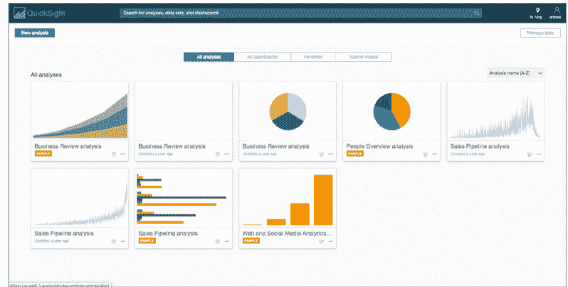

希望这能让你对该服务本身有一个基本的了解。我强烈建议观看下面的一些演示，这些演示展示了 Amazon QuickSight，并让你对不同特性和功能有一个基本了解：

- 使用 Amazon QuickSight 进行数据可视化（AWS re:Invent 2017 - DEM74），2017 年 12 月（youtube.com/watch?v=Ul3J8VX7zmM）
- 使用 Amazon QuickSight 共享你的分析和见解，2017 年 5 月（youtube.com/watch?v=xusKVM5NiCE）
- 在 Amazon QuickSight 中自定义你的可视化，2017 年 5 月（youtube.com/watch?v=UKxP-i5mJno）
- 使用 SQL 将数据导入 Amazon QuickSight，2017 年 5 月（youtube.com/watch?v=x9RUtTzqpr0）
- 从 Amazon QuickSight 访问 Amazon Redshift 数据，2017 年 5 月（youtube.com/watch?v=CRcRS3qos-A）
- 深入探讨 Amazon QuickSight——2017 年 1 月 AWS 在线技术讲座，2017 年 1 月（youtube.com/watch?v=gy1AcdJMsMk）
- 使用 Amazon QuickSight 构建可视化和仪表板（AWS re:Invent 2017 - ABD206），2017 年 12 月（youtube.com/watch?v=dprtTSbcEE）
- 无服务器分析——Amazon Redshift Spectrum、AWS Glue 和 Amazon QuickSight，2017 年 10 月（youtube.com/watch?v=oR6y57zgs）
- 使用 Amazon QuickSight 可视化 Amazon S3 存储管理——2017 年 AWS 在线技术讲座，2017 年 8 月（youtube.com/watch?v=4vmL05KVqTA）
- 使用 Amazon QuickSight 在企业级规模部署业务分析（AWS re:Invent 2017 - ABD311），2017 年 12 月（youtube.com/watch?v=G4Dgzlo3gQI）
- 使用 Amazon QuickSight 分析 AWS 账单数据，2017 年 5 月（youtube.com/watch?v=2JnfuAA-TiU）
- 使用 AWS Glue 应对暗数据挑战（并在 Amazon QuickSight 中将其可视化）——2017 年 AWS 在线技术讲座，2017 年 9 月（youtube.be/o0m2T1gkET?t=1226）
- 无服务器大数据分析——Amazon Athena 和 Amazon QuickSight——2017 年 AWS 在线技术讲座，2017 年 5 月（youtube.com/watch?v=m1HTL_SJHrE）
- 使用 Amazon QuickSight 进行数据可视化（AWS re:Invent 2017 - DEM74），2017 年 12 月（youtube.com/watch?v=Ul3J8VX7zmM）

## 使用数据

来自外部源的数据对于在 Amazon QuickSight 中进行工作至关重要，因此 Amazon QuickSight 支持多种不同的数据源，包括关系数据源、文件数据源、JSON 数据源和软件即服务（SaaS）数据源。


在使用 Amazon QuickSight 处理数据之前，您需要了解一些关键概念。Amazon QuickSight 允许接入数据源，然后根据配置的数据源创建数据集：

-   数据源是数据的来源，例如数据文件、数据库或基于 SaaS 的来源。
-   数据集是您从数据源中提取相关列并进行筛选和其他聚合操作后加载到 SPICE 中的数据。

在撰写本文时，Amazon QuickSight 支持从以下各节列出的数据源创建数据集。

## 文件数据源/JSON 数据源

Amazon QuickSight 支持从常见文件格式加载数据，包括 CSV、TSV、CLF（通用日志格式）、ELF（扩展日志格式）、XLSX（Microsoft Excel 文件）和 JSON 数据文件。Amazon QuickSight 原生支持 JSON 数据，并自动对 JSON 文件和嵌入的 JSON 对象执行架构和类型推断。

## 关系型数据源

Amazon QuickSight 支持以下关系型数据源：

-   Amazon Athena
-   Amazon RDS
-   Amazon Redshift（自动发现）
-   Amazon Redshift（手动连接）
-   MySQL
-   PostgreSQL
-   Microsoft SQL Server
-   Amazon Aurora
-   MariaDB
-   Apache Presto
-   Apache Spark
-   Teradata
-   Snowflake
-   Amazon S3 Analytics
-   Amazon S3
-   AWS IoT Analytics

## 软件即服务（SaaS）数据源

Amazon QuickSight 支持以下 SaaS 数据源：

您可以编辑现有数据库数据源并更新连接信息（例如服务器名称或更新用户凭据）。您还可以编辑现有的 Amazon Athena 数据源并更新数据源名称，但不能编辑 Amazon S3 或 Salesforce 数据源。

您可以根据需要删除数据源。删除基于查询的数据库数据源将使所有关联的数据集不可用。如果您删除的是 Amazon S3、Salesforce 或基于 SPICE 的数据库数据源，则实际上只是删除了数据源，但您可以继续使用关联的数据集。数据源的数据存储在 SPICE 中。但是，由于关联的数据源可能不再存在，您将无法再刷新这些数据集。

除了提供编辑数据集的选项外，Amazon QuickSight 还允许您从现有数据源或新数据源创建数据集。在编辑数据集时，您可以选择字段子集、添加计算字段或通过 SageMaker 扩充数据。您还可以重命名列标题并将筛选器应用于数据集。图 5.5 显示了可用于编辑现有数据集的各种选项。

**图 5.5** 编辑数据集 – Amazon QuickSight

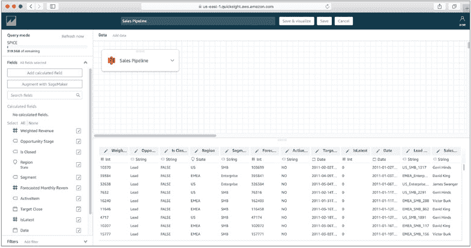

Amazon QuickSight 还允许您复制数据集以创建全新的数据副本，并从源刷新数据集。您还可以更改或替换数据集、与同一 AWS 账户中的其他 Amazon QuickSight 用户共享数据集、验证数据集的权限，或撤销其他用户对数据集的访问权限。

您还可以使用行级安全性来限制对数据集的访问；但是，此功能仅在产品的企业版中可用。

最后，与数据源一样，您可以删除数据集，这将导致所有依赖对象（包括分析）停止工作。强烈建议在删除底层数据集之前，为任何依赖的分析或仪表板替换该数据集。

## 数据分析

创建、获取和准备数据集通常都是为了分析数据。您可以使用 Amazon QuickSight 的各种分析选项，通过可视化和故事来分析数据。Amazon QuickSight 中的分析是相关可视化和故事的容器，所有这些都是为了满足特定的业务目标，或提供衡量业务的一个或一组关键绩效指标的能力。您可以在单个分析中创建最多 20 个可视化。

Amazon QuickSight 允许您创建、保存、重命名和删除分析，此外还可以在分析中使用多个工作表来组织内容。工作表是在单个页面中一起查看的一组可视化。您可以向分析中添加更多工作表，这些工作表可以在分析中独立工作或协同工作。此时，我希望读者打开 Amazon QuickSight 应用程序，探索有关分析创建和管理的功能。如果您以前没有使用过 Amazon QuickSight，我强烈建议您查看本章前面“入门”部分中分享的视频。

在 AWS re:Invent 2017 大会上，Luis Wang（时任 AWS 首席产品经理）与 Randy Carnevale（时任 Transfix 数据科学总监）一起展示了使用 Amazon QuickSight 构建可视化和仪表板的主题。他的演讲可在 (bit.ly/3cGZd7) 观看；他在演讲开始约 20 分钟时开始演示，演示持续约 20 分钟。尽管 Amazon QuickSight 在过去三年中增加了许多新功能，但该演示仍能为您使用 Amazon QuickSight 提供一个很好的起点。

出于各种原因（包括法规遵从性），您可能经常需要导出支持分析的数据。Amazon QuickSight 为您提供了将分析或仪表板中的数据导出为逗号分隔值（CSV）文件的选项。

您可以向分析中添加数据集、替换或编辑现有数据集，或在分析中修改数据集字段。

## 在 Amazon QuickSight 中设置参数

业务用户需要简单的方式来与仪表板交互并将其相互连接。例如，您可能希望可视化显示英格兰东南部而不是所有区域的销售数据的仪表板，并且您可能希望从列表中选择一个值，该值随后会针对该特定区域筛选和更新仪表板。这通常可以通过在 Amazon QuickSight 中使用参数来实现。

因此，参数是命名的变量，可用于包含或传递值，以供操作或对象使用。参数可帮助非技术用户浏览仪表板以及仪表板中的可视化，同时还允许他们连接仪表板或提供向下钻取功能。

参数通过参数控件提供给仪表板的查看者。Amazon QuickSight 允许您设置级联控件，以便在一个控件中的选择可以筛选另一个控件中显示的选项。控件可以通过以下三种方式之一显示：

-   选项列表
-   滑块
-   文本输入区域

控件并不是将值传递给仪表板的唯一方式。您还可以通过仪表板 URL 将值传递给参数，这意味着您可以根据不同的职务角色或管理区域创建自定义 URL。

参数需要通过计算字段、筛选器、仪表板和分析 URL 或操作与您的分析连接。当您在 URL 中使用参数时，您可以在 Amazon QuickSight 中使用参数名称和值来为仪表板或分析中的参数设置默认值。

Amazon QuickSight 可以使用*自定义操作*来启动 URL 或筛选可视化，方法是选择可视化中的数据点或从上下文菜单中选择操作名称。当您将 URL 操作与参数一起使用时，您可以动态地将参数传递或发送到 URL。发送端和接收端的参数必须在名称和数据类型上匹配。所有参数都与 URL 操作兼容。

## 在 Amazon QuickSight 中使用主题

在我的职业生涯中，我有幸与许多公司合作，也遇到过各种组织，这些组织要求按照标准主题准备公司报告。必须反复重新应用设置可能是一项挑战，而且常常导致多个报告或仪表板之间的设置不标准。Amazon QuickSight 将主题提供为可应用于多个分析和仪表板的设置集合，从而使您能够在组织内标准化输出。Amazon QuickSight 包含一些预建主题，但也允许您通过使用主题编辑器添加自己的主题。您可以共享主题，权限级别设置为用户或所有者。任何有权访问该主题的人都可以将其应用于分析和仪表板，或使用“另存为”创建自己的副本。作为主题所有者，您可以编辑主题并与他人共享。

在任何给定的时间点，只能将一个主题应用于一个分析，并且主题的应用对于使用该分析和仪表板的每个人来说都是即时的。

## 共享 Amazon QuickSight 分析

您可以通过发送可共享链接与其他用户共享分析，这有助于在组织内分享您所做的工作。在撰写本文时，分析只能与同一账户中的用户共享，因此，如果您采用多账户策略，您将无法将分析共享给其他账户中的用户。

出于各种合规原因，您可能需要知道哪些用户可以访问您的分析。这可以通过 Amazon QuickSight 中的“管理分析访问”选项来实现。如果您认为某个特定用户或组不再有权查看您创建的分析，您还可以选择撤销对该分析的访问权限。


## Amazon QuickSight 中的故事板

故事板是理解业务运营的重要方式。你也可以使用故事来保存分析的多个迭代版本。一个例子可能是查看过去两年中不同季度收入数字的相同图表。你可以使用客户获取和流失数字以及每用户平均收入，并在过去两年的各个季度中进行比较，以了解业务随时间的变化。你还可以使用场景，它只是分析的一个捕获的迭代版本。场景保留了在创建时分析中存在的可视化内容，包括筛选器和排序顺序。驱动可视化的底层数据不属于场景的一部分。当你播放故事时，可视化将反映数据集中当前的最新数据。每个分析都自带一个名为 Storyboard 1 的默认故事板。你可以通过在应用程序栏中选择 Capture 选项来向故事板添加场景。

## 数据可视化

可视化是数据集的图形表示。一个分析可以包含来自各种数据集的多个不同可视化。可视化可以被创建、编辑和修改，包括可视化类型、更改幕后可视化数据以及对数据应用筛选器等。你最多可以在一个分析中使用 20 个数据集，并且在一个分析中最多可使用 20 个可视化。

你可以通过三种不同方式创建可视化：

- AutoGraph – AutoGraph 是 Amazon QuickSight 的一项功能，可让你向 Amazon QuickSight 寻求帮助，以确定最合适的可视化类型。
- 选择可视化类型 – 你可以选择可视化类型并选择用于填充可视化的字段。
- Amazon QuickSight 建议的可视化 – 如果你不确定你的数据可以帮你回答哪些查询，你可以在工具栏中选择 Suggested 并选择其中一个 Amazon QuickSight 建议的选项。

可视化数据的关键要素是“维度”，你用其来“衡量”你的 KPI。Amazon QuickSight 中的维度具有蓝色图标，而度量具有绿色图标。维度的示例有产品、项目、订单、渠道、订单日期等，而度量的示例是可以用来衡量、比较或针对 KPI 进行聚合的数值。你在构建可视化时通常会使用维度和度量的组合。例如，按获取日期（维度）划分的客户获取数量（度量）可以生成一个可视化，显示一年、季度、月份或一天中不同时间段内正在获取的客户数量。

你可以通过遵循 AWS 文档 amzn.to/2WjS4hI 来了解更多关于创建可视化的信息。你可以复制可视化、重命名可视化、删除可视化、将底层数据导出为 CSV 文件、更改可视化的布局、查看底层数据并应用不同类型的格式（例如标题、图例、标签、样式和条件格式）。一旦你创建了可视化，你可以随时从字段列表窗格中添加或修改可视化中使用的字段，或直接将字段拖放到可视化上。

Amazon QuickSight 还支持所有可视化（除透视表外）的下钻功能，这可以通过构建字段层次结构来实现。例如，你可以将国家、州和城市字段与条形图的 x 轴关联，然后下钻以查看每个层级的数据。考试会询问关于 Amazon QuickSight 下钻功能的可能性。然而，我强烈建议你在以下 AWS 文档页面上了解更多关于添加下钻的信息（因为细节超出了本认证准备书的范围）：amzn.to/38LG6SU。

Amazon QuickSight 还为你的可视化提供使用自定义操作的能力。你可以创建筛选操作和 URL 操作。筛选操作可以帮助你在选择数据点或菜单项时筛选一个或多个可视化。例如，你可以在可视化中选择一个部门，操作会根据选择筛选数据。你可以显示该特定部门的最高销售额表现者、收入数字或任何其他重要指标。筛选操作可以在多个数据集中使用。URL 操作可用于诸如从可视化创建指向另一个 URL 的链接或直接从可视化创建电子邮件等用途。查看仪表板的<|message|> 用户可以使用 URL 操作通过选择数据点（左键单击）或从数据点上下文（右键单击）菜单中选择操作，将数据点发送到其他 URL（仪表板、分析、网站）。强烈建议你在考试前练习向可视化添加自定义操作，以便更清楚地了解创建自定义操作的用途以及 Amazon QuickSight 中的可能性。

最后，Amazon QuickSight 为你的分析提供了多种可视化类型，包括条形图、组合图、圆环图、仪表图、地理空间图（地图）、热力图、KPI、折线图、透视表、散点图、树形图和词云。

考试中最常见的问题之一是为所讨论的场景选择合适的可视化类型。下表是 Amazon QuickSight 中可用可视化类型的快速概述，以及每种最合适的用例。

### 表 5.2 Amazon QuickSight 可视化类型

| 可视化类型 | 描述 | 适用用例 |
|---|---|---|
| AutoGraph | AutoGraph 是 Amazon QuickSight 帮助你选择合适可视化的方法。 | 任何 |
| 条形图 | Amazon QuickSight 提供多种条形图，横向和纵向方向均有，包括单度量、多度量、簇状、堆叠和 100% 堆叠。 | 比较组，跟踪随时间的变化并进行衡量。 |
| 折线图 | Amazon QuickSight 提供多种折线图，包括简单折线图、面积图和堆叠面积线图。 | 比较一个或多个度量或维度随时间的值变化。 |

### 表 5.2 Amazon QuickSight 可视化类型（续）

| 可视化类型 | 描述 | 适用用例 |
|---|---|---|
| 组合图 | Amazon QuickSight 支持簇状和堆叠条形组合图。组合图（通常称为线柱图）对于比较随时间的类别非常有用，这本质上是线图和条形图的优势。 | 比较组，跟踪随时间的变化并进行衡量。 |
| 圆环图 | 圆环图呈甜甜圈形状，表示维度中的值，在美观上非常受欢迎。 | 比较维度中项目的数值，例如总量的百分比。 |
| 仪表图 | 仪表图类似于汽车中的模拟仪表。它们通常用于比较度量，并且是仪表板中各种 KPI 达成情况的良好表示，用绿色、黄色和红色显示各种范围。 | 比较度量中项目的数值。 |
| 地理空间图/地图 | 地理空间图在地图上表示数据值，允许缩放功能。 | 地理数据集，例如美国各州的销售额 |
| 热力图 | 热力图是数据的图形表示，使用颜色编码系统。它们可用于在两个维度的交点处显示度量，并使用颜色编码提供范围的额外视觉表示。 | 颜色编码系统，识别趋势、异常值 |
| 直方图 | Amazon QuickSight 支持直方图，其外观与条形图相似，但各条代表一个箱/桶而不是单个值。 | 理解数据的分布。常被数据科学家和 ML 工程师使用 |
| KPI | 仪表板中最常见的项目之一是 KPI 测量，它实际上是两个值之间的比较，通常是已实现值与目标值之间的比较。Amazon QuickSight 提供 KPI 作为可视化选项，提供数值和达成进度条。 | 仪表板，KPI 测量 |
| 饼图 | 饼图是另一种用于比较给定维度值的图表类型，是显示总量百分比的好方法。 | 构成理解。每个类别的观测数量等 |


| 可视化类型 | 描述 | 适用场景 |
|---|---|---|
| 数据透视图（Pivot charts） | 数据透视图与热力图类似，因为两者都在维度交叉处度量值。然而，数据透视图更擅长分析可视化中的数据，而热力图则用于趋势和离群值。 | 分析可视化中的数据 |
| 散点图（Scatter plot） | 散点图是最常见的可视化之一，用于可视化某个维度的两个或三个度量。气泡出现在某个特定维度两个度量的交叉处，而气泡的大小通常由第三个维度表示。 | 数据中的模式，理解意外的数据缺口或离群值。通常由数据科学家或 ML 工程师使用 |
| 树状图（Tree maps） | 树状图用于可视化某个维度的一个或两个度量。矩形大小表示该项相对于该维度整体所代表的所选度量值。你可以使用矩形颜色来表示该项的另一个度量。 | 最适合研究一个类别以及多个类别中相似性和异常的高级汇总 |
| 词云（Word clouds） | 词云是进行文本分析并确定数据集中一个词与其他词之间关系的良好方式。 | 最适合进行短语或词频分析。用于推文文本和 Facebook 帖子等文本分析，以识别数据中的模式 |

## 机器学习洞察

随着数据量的增长，理解数据并据此采取行动的挑战也在增加。Amazon QuickSight 允许客户回顾检查数据，同时还能使用 Amazon.com 多年来构建的某些机器学习（ML）能力。这些能力包括由机器学习驱动的异常检测，可通过持续分析数十亿个数据点帮助客户发现隐藏的洞察；使用自然语言处理的自动叙事，可通过通俗语言叙述帮助客户讲述其仪表板中的故事；以及仪表板中由机器学习驱动的预测和假设分析。

在撰写本文时，由机器学习驱动的情绪分析和实体提取仍在路线图上，尚未发布。我希望到本书发布时，你能够使用 Amazon QuickSight 来体验这些功能。

异常检测基本上就是检测离群值，它可以帮助你识别导致业务指标发生重大变化的主要驱动因素，例如客户销售额高于预期、客户流失严重，或者移动应用下载量的增加或下降。Amazon QuickSight 使用 Random Cut Forest 算法。

应用于数据的筛选器、已设置的参数、控件和排序顺序。创建仪表板时，为分析提供支持的数据不会被捕获，这意味着仪表板始终反映分析中的当前数据。

仪表板所有者除了可以编辑和共享分析之外，还可以编辑和共享仪表板（参见图 5.7）。共享的仪表板可以嵌入到你的网站或应用程序中，我们将在下一节中进行更详细的介绍。

图 5.7 在 Amazon QuickSight 中共享仪表板

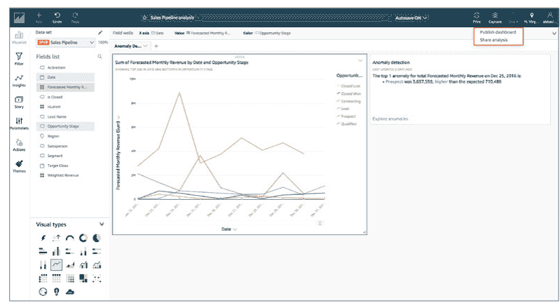

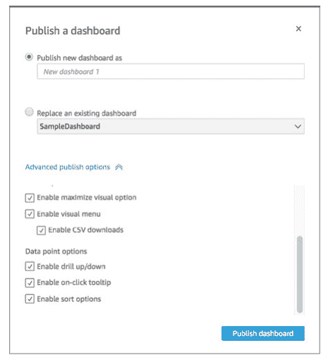

将分析作为仪表板共享，只需选择“共享”选项并将其发布为仪表板即可。这将允许你将其发布为新仪表板或替换现有仪表板，并提供有关仪表板控件、可视化选项和数据点选项的高级选项。例如，对于仪表板选项，你可以选择展开工作表控件、启用临时筛选、启用悬停工具提示，以提供更好的可用性。

对于可视化选项，你可以启用可视化菜单并下载基础数据的 CSV 文件。

对于数据点选项，如果仪表板未提供可钻取的字段层次结构，你可以选择启用向上/向下钻取、启用点击工具提示，并启用排序选项。

你可以复制、删除和共享仪表板，并通过电子邮件按需或按计划以报告形式发送仪表板。共享仪表板的功能仅在 Amazon QuickSight 企业版中可用。要通过电子邮件接收报告，组成员必须满足以下条件：

- 组成员应为 Amazon QuickSight 订阅的成员，并且你应已经与他们共享了仪表板。
- 组成员应已完成注册过程，以激活作为 Amazon QuickSight 读者、作者和管理员的订阅。
- Amazon QuickSight 将计划电子邮件限制为成员少于 5,000 人的组。

在 Amazon QuickSight 企业版中，你可以订阅报告形式的仪表板。要了解更多关于订阅报告的信息，请参阅 amzn.to/2U8WR2T 上的 Amazon QuickSight 文档。

仪表板和分析也可以打印。

## 将 QuickSight 对象嵌入其他应用程序

虽然你可以在账户内为用户提供 Amazon QuickSight 访问权限，但你可能需要将仪表板嵌入到你的 Web 属性或移动应用程序中。这可以帮助你专注于核心产品，而将可扩展性和更快响应时间的繁重工作交给 Amazon QuickSight。用户无需执行面向用户的认证即可获得个性化仪表板，仪表板查看者可以是任何 Amazon QuickSight 用户，例如已通过认证进入你账户的读者、作者或管理员：

- Active Directory（AD）用户或组成员
- 受邀的非联合用户
- 使用 SAML、OpenID Connect 或 IAM Federation 进行联合单点登录认证的 IAM 用户和基于 IAM 角色的会话

嵌入仪表板涉及五个主要步骤：

1. 在 Amazon QuickSight 中创建仪表板。发布仪表板，并与应能查看它的组和用户共享。在允许列表中添加域，包括你将嵌入仪表板的 Web 应用程序的域。
2. 在你的 AWS 账户中，为嵌入式仪表板的查看者设置权限。将查看带有嵌入式仪表板应用程序的用户应能够使用 IAM、AWS Managed Microsoft AD、SAML 或 Web Identity 进行认证。
3. 创建或选择一个 IAM 角色，该角色授予用户成为 Amazon QuickSight 读者以及检索需要嵌入的仪表板的能力。
4. 在应用程序服务器上，使用某个 AWS SDK 对用户进行认证并获取嵌入式仪表板 URL。
5. 将仪表板嵌入到你的应用程序中。你可以使用 Amazon QuickSight Embedding SDK 来简化嵌入过程。Amazon QuickSight 嵌入 SDK 可在以下位置获取：

   - npmjs.com/package/amazon-quicksight-embedding-sdk
   - github.com/awslabs/amazon-quicksight-embedding-sdk

在需要嵌入仪表板的应用程序端，涉及多个步骤。

1. 下载并包含 Amazon QuickSight Embedding SDK。
   a. 在浏览器中使用 Amazon QuickSight Embedding SDK。
   b. 在 Node.js 中安装并使用 Amazon QuickSight Embedding SDK。
2. 配置要嵌入的仪表板。
3. 通过调用 QuickSightEmbedding.embedDashboard(options) 嵌入仪表板。
4. 设置加载回调（可选）。
5. 设置错误回调（可选）。
6. 更新参数值（可选）。

要了解更多关于创建嵌入式仪表板的信息，请访问 Amazon 文档站点上的以下页面：amzn.to/2Qf1nyg。Amazon Web Services 的首席产品经理 Jose Kunnackal 在产品发布时也撰写了一篇关于嵌入仪表板的精彩博客。你可以通过 go.aws/2U7Yzlf 访问他的博客。

从考试的角度来看，你需要了解使用 Amazon QuickSight 嵌入仪表板的可能性，以及在使用户通过网络和移动应用程序访问仪表板时需要考虑的安全方面。

## 管理

在撰写本文时，Amazon 提供两个版本的 Amazon QuickSight：标准版和企业版。差异主要在于个人用户或企业使用 AWS 的方式。表 5.3 对这两个版本进行了比较。


Tableau 提供多种产品，包括数据管理、服务器、桌面、Web 和 Tableau Mobile 版本产品。

您可以按照以下白皮书了解在 AWS 上部署 Tableau 的最佳实践：tabsoft.co/2WiYxJW。

## TIBCO Spotfire

TIBCO Spotfire 是另一种自助式数据分析工具，使组织能够分析大型数据集，利用内存处理来提供更好的性能和更快的响应时间。TIBCO Spotfire 可与 Amazon Redshift 和 Amazon RDS 配合使用，并提供多种可视化选项。

TIBCO Spotfire 的一些关键功能包括智能可视化分析，可提供基于机器学习的推荐和自然语言驱动的分析，以及创建强大仪表板的能力。TIBCO Spotfire 还提供智能数据整理、内置预测分析、实时流分析和位置分析。它可在 AWS 市场的“商业智能和高级分析”部分获取：go.aws/3dfSKLo。

要了解更多关于 TIBCO Spotfire 的信息，可访问 bit.ly/2WjhBI1。

## TIBCO Jaspersoft

TIBCO Jaspersoft 也是一种自助式商业智能（BI）工具，具有报表和分析能力。它提供类似 Amazon QuickSight 的拖放功能。它可与 Amazon Redshift、Amazon EMR 和 Amazon RDS 配合使用，可在市场上获取：go.aws/3d7RDwX。

## Qlik

Qlik 是另一个旨在提供自助式分析的平台，其核心目标是将分析带给组织内的每个用户。Qlik 在 Amazon Web Services 上提供两种产品：Qlik Core (go.aws/2UbYwV7) 和 Qlik Sense Enterprise (go.aws/39XW0J5)。Qlik Core 是一个云开发平台，专为“非 BI”应用而开发，这些应用基于各种数据源的数据生成洞察。Qlik Sense Enterprise 是一个企业级平台，用于构建出色的业务应用并推动可在整个企业共享的洞察，具有更大的功能集。您可以以自带许可（BYOL）模式在 AWS 平台上部署这两种产品。

## Amazon Elasticsearch 上的 Kibana

如第 4 章“数据处理与分析”所述，Amazon 在 AWS 平台上提供 ELK（Elasticsearch、Logstash 和 Kibana）。早期的 Kibana 是为日志分析提供图形用户界面而构建的。然而，借助最新功能，Kibana 提供了数据分析和探索、通过不断增长的各种图表功能进行可视化，以及使用机器学习进行异常检测的界面。

在 Amazon Elasticsearch 服务上，您可以在主域仪表板上找到 Kibana 仪表板的链接。图 5.8 展示了 Amazon Elasticsearch 上的 Kibana 仪表板。

## 图 5.8  Amazon Elasticsearch 上的 Kibana 仪表板

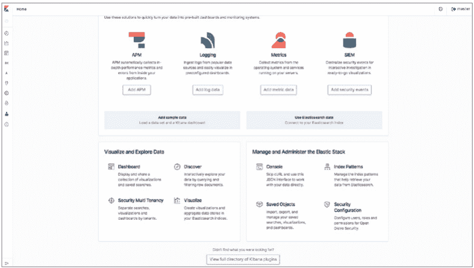

Kibana 提供了多种不同的可视化选项。图 5.9 展示了带有示例电子商务数据的 Kibana 仪表板，其中显示了各种图表控件和一些很酷的图形选项。

## 图 5.9  带有示例电子商务数据的 Kibana 仪表板

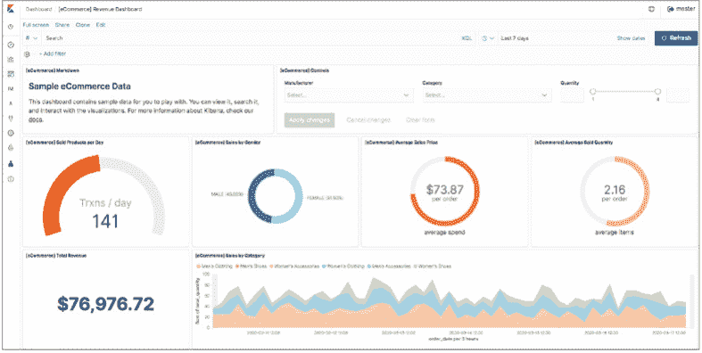

## 预测分析

AWS 数据分析专项认证考试与 AWS 认证大数据专项考试在多个方面有所不同。其中最重要的一点是分析学与高级分析学（也称为机器学习或人工智能）之间的明确区分。AWS 已宣布推出机器学习专项认证以涵盖预测分析主题，包括但不限于对机器学习的理解，以及 AWS 在框架和基础设施层面、服务层面和高级 AI 服务层面围绕机器学习提供的服务。就 AWS 数据分析认证考试而言，您可能会遇到涉及构建机器学习产品的问题，但核心重点将放在我们迄今为止在本书中讨论的分析服务上。

## 什么是预测分析？

我们已经研究了围绕数据采集、数据准备和分析的各种技术，其中大部分重点在于理解过去发生的事件。然而，随着组织的成熟，它们努力理解未来会发生什么以及如何定位自己。

例如，零售商试图预测产品需求并确保维持适当的库存水平，或者大型媒体公司向用户推荐相关且可能被用户喜欢的内容，从而提高收入和客户满意度。

另一个例子是我们如何与 NFL 合作开展 NextGen Stats (NSG)，利用数据向球迷和球员揭示比赛动态的洞察。预测分析的一个例子是 NGS 的传球完成概率指标，该指标整合了 10 多个比赛中的测量值，从特定传球的距离和速度，到接球手与最近防守球员之间的距离，以及四分卫与最近传球冲击者之间的距离。NFL 和媒体合作伙伴可以利用这些洞察来增强转播和在线内容，并在体育场内教育和激励球迷。

业务运营正在通过复杂的需求规划和预测模型得到改善。2017 年，麦肯锡全球研究所发表了一篇题为“人工智能：下一个数字前沿？”的论文，其中提供了一些令人大开眼界的数据，说明 AI 如何解决零售行业的挑战：基于 AI 的需求预测将错误率降低了 30% 至 50%，因产品缺货导致的销售损失降低了高达 65%。此外，自动化的使用使供应链管理更加高效。利用 AI 预测服务收入的来源并优化销售工作，可以将（息税前利润 [EBIT]）提高 13%。

Georgia-Pacific 是 AWS 的客户，使用 Amazon SageMaker（一项托管的 AWS 服务）向机器操作员提供实时反馈，以便更早地检测纸张断裂并保持质量。利用基于原始生产数据构建的机器学习模型，Amazon SageMaker 向机器操作员提供关于最佳机器速度和

这是商业模式画布。商业模式画布在于描述企业如何创造价值、传递价值和获取价值的基本原理。其中，重要合作是指让商业模式有效运作所需的供应商与合作伙伴的网络。关键业务是指为确保商业模式可行，企业必须做的最重要的事情。核心资源是指让商业模式有效运转所必需的最重要因素。价值主张是指为特定客户细分创造价值的系列产品和服务。客户关系是指企业与特定客户细分群体建立的关系类型。渠道通路是指如何沟通、接触其客户细分而传递其价值主张。客户细分是指企业想要接触和服务的不同人群或组织。成本结构是指运营一个商业模式所产生的所有成本。收入来源是指从每个客户群体中获取的现金收入。

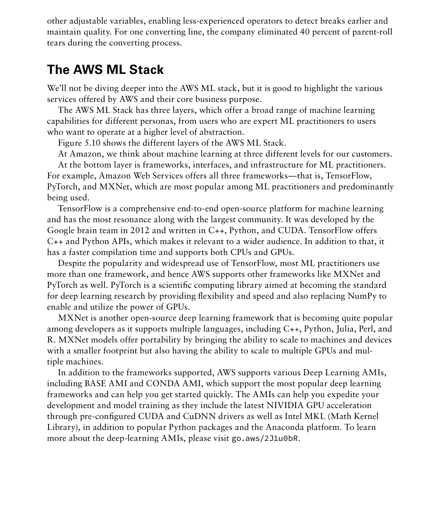

## 重要合作

## 关键业务

## 核心资源

## 价值主张

## 客户关系

## 渠道通路

## 客户细分

## 成本结构

## 收入来源

| 重要合作 | 关键业务 | 核心资源 | 价值主张 | 客户关系 | 渠道通路 | 客户细分 |
|---|---|---|---|---|---|---|
| 合作伙伴网络 | 解决方案 | 核心人才 | 创新价值 | 客户服务 | 销售团队 | 目标用户 |
| 供应商关系 | 运营管理 | 核心技术 | 性能提升 | 客户忠诚 | 电商平台 | 细分市场 |
| 战略联盟 | 市场营销 | 品牌资产 | 定制化服务 | 社区运营 | 社交媒体 | 大众市场 |
| 合资企业 | 售后服务 | 资金支持 | 降低成本 | 自助服务 | 合作伙伴 | 长尾市场 |

| 成本结构 | 收入来源 |
|---|---|
| 人力成本 | 销售收入 |
| 运营成本 | 服务收入 |
| 市场营销费用 | 订阅收入 |
| 技术研发投入 | 广告收入 |

来自 Intel、NVIDIA 或 ARM 的硬件平台。只需单击一下，SageMaker Neo 就会将训练好的模型编译成可执行文件。该编译器使用神经网络来发现并应用所有特定的性能优化，使您的模型在目标硬件平台上最高效地运行。然后可以部署该模型，在云端或边缘开始进行预测。借助 AWS IoT Greengrass，可以将本地计算和机器学习推理能力带到边缘。

该技术栈的顶层由 AI 服务组成，这些服务专注于简单性并提供内置的机器学习模型，您可以直接使用它们来构建应用程序，而无需担心底层模型的开发、训练和部署。它们专注于我们日常生活中涉及的关键服务，例如视觉（Amazon Rekognition）、语音（Amazon Polly 和 Amazon Transcribe）、文本（Amazon Comprehend、Amazon Translate 和 Amazon Textract）、搜索（Amazon Kendra）、聊天机器人（Amazon Lex）、个性化（Amazon Personalize）、预测（Amazon Forecast）、欺诈检测（Amazon Fraud detector）、开发（Amazon CodeGuru）和联络中心（Contact Lens）。

我希望这能让您对 AWS 平台上的各种 AI/ML 服务有一个很好的了解。您可以在 AWS 文档和博客页面上了解更多关于这些主题的信息。我强烈建议观看我们的 AWS re:Invent 视频，以随时了解新版本并深入了解这些服务。

## 总结

本章标志着我们关于可视化讨论的结束，我们研究了 AWS 平台上各种可视化选项，包括 Amazon QuickSight 和 Kibana 等原生选项，以及 Tableau、Qlik、Spotfire 等第三方合作伙伴选项。

我们还简要介绍了 AI/ML 服务，这些服务虽然不直接属于考试范围，但可能会出现在文本中，并且从分析管道的完整性的角度来看，了解它们也很有用。

## 考试要点

数据分析和可视化部分占考试问题的 18%。虽然考试在数据分析和可视化上的比重没有严格区分，但可以肯定地说，可视化是一个重要组成部分，因为考试目标中明确提到了它。AWS 数据分析专项认证考试旨在测试您针对给定场景的可视化解决方案的特征。您通常会发现有多种方法可以针对给定场景进行可视化，在大多数情况下，可能存在多个合理的解决方案；然而，其中会有一个满足给定要求的解决方案，该方案可能是


## 复习题

1. 以下哪项业务分析服务由 AWS 提供？  
A. MicroStrategy  
B. Business Objects  
C. Tableau  
D. QuickSight

2. 您希望了解商品中各种产品的价格与销量之间的相关性。哪种图表技术最适合显示这一点？  
A. 组合图  
B. 环形图  
C. 热力图  
D. 散点图

3. 判断题：Amazon QuickSight 标准版允许您为 Microsoft Active Directory 组中的用户提供访问权限。  
A. 正确  
B. 错误

4. 您最近被一家大型电子商务组织聘用，该组织希望预测其年度销售额以优化库存存储。以下哪项服务将为该组织提供最简单的预测选项，并支持与 S3、Redshift 和 Athena 数据的原生集成？  
A. D3.js  
B. MicroStrategy  
C. Kibana  
D. Amazon QuickSight

5. 一家大型制造组织已开始从装配线上的传感器捕获数据。该组织希望执行运营分析，并基于特定的索引模式构建实时仪表板，同时实现超低延迟。数据可在 Elasticsearch 中获取。以下哪种可视化技术最适合此类组织？  
A. Tableau  
B. EMR Notebooks  
C. Kibana  
D. Amazon QuickSight

- 使用 AWS Glue 应对您的暗数据挑战（并在 Amazon QuickSight 中将其可视化）——2017 AWS 在线技术讲座 – youtu.be/Q0m2TligKtE?t=1226
- 无服务器大数据分析——Amazon Athena 和 Amazon QuickSight——2017 AWS 在线技术讲座 – youtube.com/watch?v=m1HTL_SJHrE
- 使用 Amazon QuickSight 进行数据可视化（AWS re:Invent 2017 - DEM74） – youtube.com/watch?v=UL3J8VX7zmM
- 使用 Amazon QuickSight 将分析嵌入应用程序 – youtube.com/watch?v=8m3iJayTpxI
- 使用 Amazon Redshift、Amazon S3 和 AWS Glue 时的五个数据湖注意事项 – youtube.com/watch?v=U74v0MzUBoI

## 博客文章和参考阅读材料：

- 数据可视化：aws.amazon.com/data-visualization
- “10 visualizations to try in Amazon QuickSight”：aws.amazon.com/blogs/big-data/10-visualizations-to-try-in-amazon-quicksight-with-sample-data
- “Visualizing Sensor Data in Amazon QuickSight”：aws.amazon.com/blogs/compute/visualizing-sensor-data-in-amazon-quicksight
- “Analyze and visualize nested JSON data with Amazon Athena and Amazon QuickSight”：aws.amazon.com/blogs/big-data/analyze-and-visualize-nested-json-data-with-amazon-athena-and-amazon-quicksight

## 研讨会：

- Amazon QuickSight 研讨会 - COVID-19 数据分析 – d3akduqkn9yexq.cloudfront.net
- 使用 Amazon QuickSight 构建高级分析和仪表板 – d3h1oz7s9b419c.cloudfront.net/en/introduction.html
- 从零开始将 Amazon QuickSight 嵌入 Web 应用 – embed-workshop.learnquicksight.online/1.introduction.html


## 简介

安全是 AWS 从第一天起就重视的工作，也是我们的首要任务。我们已经涵盖了从数据摄取、处理、分析到最终可视化的整个分析管道。然而，在考试中，您会遇到一些关于授权、身份验证、合规性和加密的问题，这些本质上涉及安全地访问和使用您的数据与分析服务。考试中大约 18% 的问题将与安全相关，因此其权重与数据收集、数据分析和可视化相同。

在本章中，我们将讨论 AWS 责任共担模型，然后深入探讨 Amazon Web Services 中的身份验证和授权方面，以及它们如何应用于考试中涵盖的各种数据和分析服务。我们将探讨 Amazon S3、Amazon DynamoDB、Amazon Redshift、Amazon Elasticsearch、Amazon EMR、AWS Glue 和 Amazon Kinesis 的安全性。让我们开始吧。

> AWS 数据分析专业认证考试将测试您围绕身份验证和授权的各种安全场景。请务必记住，虽然您可以选择创建 AWS 用户或 AWS 角色来满足特定的安全要求，但安全的一般最佳实践——即限制执行操作所需的权限访问，以及创建角色而不是用户——适用于大多数场景。

## 责任共担模型

构建在 AWS 云上的典型数据平台涉及五到六个不同层，包括全球 AWS 基础设施，如 us-east-1（弗吉尼亚北部）等 AWS 区域、可用区和边缘站点。这是 AWS 为其客户管理的硬件和全球基础设施。在全球基础设施之上，我们还有各种软件组件，例如计算、存储、数据库和网络，这些组件将硬件组件连接在一起。这些层实质上构成了 AWS 运营的云的基础，因此 AWS 对这些组件负责。您会听到*云的安全*这个术语，它指的就是这些组件。图 6.1 中标记为“AWS”的下层指的是 AWS 责任范围内的组件。本质上，这包括数据中心的物理安全以及控制谁能进入数据中心，同时确保有直接需求的人员能够获得物理访问权限，确保存储根据需求进行启用和停用，确保运行 EC2 实例的底层主机的所有访问都具备日志记录和审计机制，为网络基础设施（包括路由器、交换机、负载均衡器、防火墙、布线等）建立入侵检测机制，并确保平台上的实例相互隔离。

作为客户，您将负责客户选择操作的 AWS 云服务。服务的选择将决定客户需要进行的配置类型。例如，如果客户选择运行 Amazon EC2（弹性计算云）实例，该客户将使用 AWS 提供的基础设施，因此负责所有安全配置和管理任务。这可能包括安全补丁、应用程序软件组件以及安全组的配置等。然而，对于抽象服务（如分析服务 S3 和 DynamoDB），AWS 负责运营基础设施、操作系统和平台；客户可以访问这些服务提供的端点来存储和检索数据。但是，客户负责使用这些服务中可用的服务和选项来管理数据。图 6.1 中标记为“客户”的上层是客户责任范围内的组件，这些通常统称为*云中的安全*。

### 图 6.1 AWS 责任共担模型

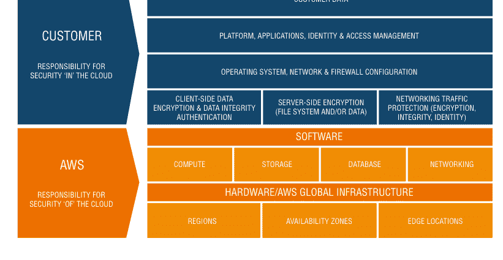

## 合规性与数据隐私

AWS 使用 AWS 最佳实践和您的组织遵循的行业标准，以自动化方式为您提供合规状态的完整视图。

表 6.1 列出了您在 AWS 云上构建数据和分析应用程序时可以使用的 AWS 安全、身份和合规服务。

### 表 6.1 AWS 安全、身份和合规服务

| 服务类别 | 服务名称 | 描述 |
|---|---|---|
| 身份与访问管理 | AWS Identity and Access Management | 管理对 AWS 服务和资源（如计算、存储、分析、数据库、S3 存储桶）的访问。 |
|  | AWS Single Sign-On | 提供集中管理对多个 AWS 账户和业务应用程序访问的能力 |
|  | Amazon Cognito | 快速轻松地为您的 Web 和移动应用程序设置身份管理。可扩展到数百万用户，并支持 Facebook、Google 和 Amazon 等社交身份提供商 |
|  | AWS Directory Service | 用于 Microsoft Active Directory 的 AWS Directory Service |
|  | AWS Resource Access Manager | 与任何 AWS 账户或在您的 AWS 组织内共享资源。您可以共享 AWS Transit Gateway、子网、AWS License Manager 配置和 Amazon Route 53 Resolver 规则资源。 |
| 检测控制 | AWS Security Hub | 跨 AWS 账户的高优先级安全警报和安全态势的综合视图 |
|  | Amazon GuardDuty | Amazon GuardDuty 是一项威胁检测服务，可持续监控恶意活动和未经授权的行为，以保护您的 AWS 账户和工作负载。 |
|  | Amazon Inspector | 一项自动化安全评估服务，通过自动评估应用程序的暴露、漏洞和偏离最佳实践的情况，帮助提高部署在 AWS 上的应用程序的安全性和合规性。 |
|  | Amazon Detective | 通过自动收集日志数据，并利用机器学习、统计学和图论构建关联数据集，从而分析、调查并确定潜在安全问题或可疑活动的根本原因，以实现更高效的安全调查。 |


| 服务类别 | 服务名称 | 描述 |
|---|---|---|
| 基础设施保护 | AWS Shield | AWS Shield 是一种分布式拒绝服务保护服务，通过始终开启的检测和自动内联缓解来保护在 AWS 上运行的应用程序，从而最大限度地减少应用程序停机时间和延迟。 |
|  | AWS Web Application Firewall (WAF) | AWS Web Application Firewall 用于保护你的 Web 应用程序或 API 免受常见的 Web 攻击，从而提高 Web 应用程序的整体可用性。 |
|  | AWS Firewall Manager | AWS Firewall Manager 是一项安全管理服务，允许你在 AWS Organizations 中的账户和应用程序之间集中配置和管理防火墙规则。 |
| 数据保护 | Amazon Macie | Amazon Macie 是一项由机器学习驱动的安全服务，可帮助发现、分类和保护 AWS 中的敏感数据，如 PII 信息或知识产权；它为客户提供仪表板和警报，以了解这些数据被访问或移动的方式。 |
|  | AWS Key Management Service | AWS KMS 使加密密钥的创建、管理和控制更加简单，并且可以与 CloudTrail 集成，为你的监管和合规需求提供日志。 |
|  | AWS CloudHSM | AWS CloudHSM 是一种基于云端的硬件安全模块（HSM），使你能够轻松地在 AWS 云中生成和使用自己的加密密钥。 |
|  | AWS Certificate Manager | AWS Certificate Manager 是一项服务，允许你配置、管理和部署公有和私有 SSL/TLS 证书，用于 AWS 服务和你的内部连接资源。 |
|  | AWS Secrets Manager | AWS Secrets Manager 用于轮换、管理和检索机密，如数据库凭证、API 密钥等；它提供与 Amazon Redshift、Amazon DocumentDB 和 Amazon RDS 的内置集成。 |

主节点的默认托管安全组之一称为 ElasticMapReduce-master，它预先配置了一条允许来自所有来源（IPv4 0.0.0.0/0）的入站 SSH 流量（端口 22）的规则。作为最佳实践，你应该仅将入站流量限制为受信任的来源，因此应指定自定义安全组来实现这一点。

Amazon EMR 为主实例和任务实例提供不同的托管安全组。当你在私有子网中创建集群时，将额外创建一个用于服务访问的托管安全组。Amazon EMR 将使用默认托管安全组，并在需要时创建它们。

默认托管安全组如表 6.4 所述。

| 安全组名称 | 安全组描述 |
|---|---|
| ElasticMapReduce-master | 公有子网中主实例的默认安全组 |
| ElasticMapReduce-slave | 公有子网中核心实例和任务实例的默认安全组 |
| ElasticMapReduce-Master-Private | 私有子网中主实例的默认安全组 |
| ElasticMapReduce-Slave-Private | 私有子网中核心实例和任务实例的默认安全组 |
| ElasticMapReduce-ServiceAccess | 私有子网中服务访问的默认安全组。它没有入站规则，仅允许通过 HTTPS（8443）的出站流量。这些规则允许集群管理器与主节点以及核心节点和任务节点通信。 |

## 附加安全组（可选）

附加安全组是可选的，在需要定义由你提供和管理的自定义访问规则时定义。Amazon EMR 不会在附加安全组中添加或删除规则。

## 私有子网

私有子网与公有子网在以下方面有所不同：

- 提供 VPC 端点的 AWS 服务可以通过该端点访问；但是，不提供端点的服务必须使用 NAT 实例或 Internet 网关。例如，如果你正在使用 EMRFS 功能，则需要具有 Amazon S3 VPC 端点；如果你正在使用 DynamoDB，则需要提供从私有子网到 DynamoDB 的路由。
- 你应该提供到 Amazon EMR 服务日志桶和 S3 中 Amazon Linux 存储库的路由。
- 为了调试，请提供从私有子网到 Amazon SQS 端点的路由。

图 6.3 描述了在私有子网中运行的 Amazon EMR 的示例架构图。

图 6.3 私有子网中的 Amazon EMR

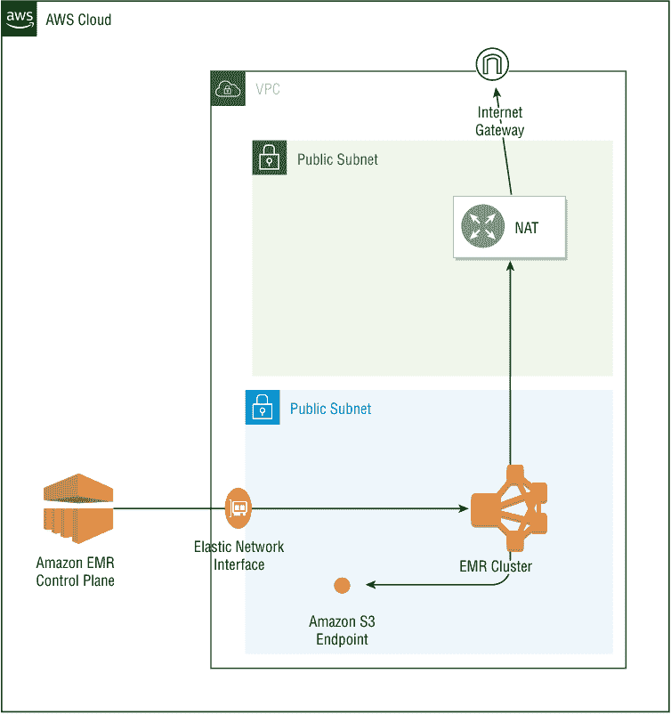

当你打开 EMR 控制台，甚至在创建 EMR 集群之前，你看到的三个与安全相关的关键内容是安全配置、VPC 子网和阻止公共访问（见图 6.4）。

**图 6.4** Amazon EMR 控制台内的安全选项

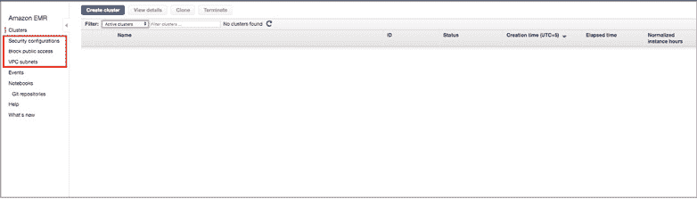

在我们查看 Amazon EMR 集群内的其他安全选项之前，先来看看这些内容。

## 安全配置

Amazon EMR 允许你创建可应用于多个集群的安全配置。配置设置可分为四大类：

- 加密
- 身份验证
- EMRFS 的 IAM 角色
- AWS Lake Formation 集成

让我们更详细地了解每一项。

### 加密

数据加密是必要的，以确保数据仅对经过身份验证和授权的用户可见。EMR 可以通过 EMRFS 处理 S3 上的数据，以及存储在 HDFS 中的数据，也称为*静态数据*。EMR 还需要通过线路传输数据，也称为*传输中数据*。为了保护你的数据免遭窥探，你需要加密静态数据和传输中数据。Amazon EMR 的安全配置选项提供三种数据加密选项：S3 加密、本地磁盘加密和传输中数据加密。

**S3 加密：为 Amazon S3 中的数据启用静态加密**

Amazon S3 的加密模式适用于从 Amazon S3 读取和写入的 EMR 文件系统（EMRFS）对象。你可以在此配置选项中定义服务端加密（SSE）或客户端加密。可用选项如下：

- SSE-S3
- SSE-KMS（你需要提供你的 KMS 客户主密钥以在服务端加密数据。）
- CSE-KMS（你需要提供你的 KMS 客户主密钥以在客户端加密数据。）
- CSE-Custom（你必须提供自定义密钥提供程序位置 [S3 存储桶] 和密钥提供程序类。）

Amazon EMR 的配置选项还允许你为特定存储桶选择加密覆盖。你可以通过指定存储桶名称和要应用于该存储桶的加密模式，为每个存储桶指定不同的加密模式和加密材料。

**本地磁盘加密**

Amazon EMR 有三种类型的本地存储，它们使用各种机制进行加密，并协同工作为你的静态数据提供最佳安全性。

**HDFS 加密**

HDFS 不仅用于间歇性存储，还用于从实例存储卷和附加到实例的 EBS 卷读取和写入数据。当你启用本地磁盘加密时，会激活许多 Hadoop 加密选项：

**安全 Hadoop RPC（远程过程调用）** 此选项控制 `core-site.xml` 中的 Hadoop `.rpc.protection` 设置以激活数据保护，并用于在 Hadoop 服务和客户端之间加密数据。

**HDFS 块数据传输上的数据加密** 此选项允许我们在数据节点上配置数据加密。在 `hdfs-site.xml` 中，`dfs.encrypt.data.transfer` 设置为“true”，并配置为使用 AES-256 加密。

**Amazon EMR 上的透明数据加密** 虽然此配置中的设置不会在 Amazon 中激活透明数据加密，但你可以手动配置。透明加密通过使用 HDFS 加密区域来实现，加密区域是你定义的 HDFS 路径。每个加密区域都有自己的密钥，该密钥存储在通过“hdfs-site”配置分类指定的密钥服务器中。Amazon EMR 默认使用 KMS，但只要你使用实现了 KeyProvider API 操作的不同密钥管理服务，也可以使用它。


## 传输中的数据加密

EMR 提供了多种传输中数据加密机制，这些机制可能因 EMR 版本而异。通过安全配置页面，您可以启用以下特定于应用程序的加密功能：

1. **Hadoop**
   - **加密 Shuffle** – Shuffle 是 MapReduce 中的一个重要概念，需要跨多个节点传输数据。MapReduce 加密 Shuffle（bit.ly/2L5CGPm）允许使用 HTTPS 对 MapReduce Shuffle 进行加密。
   - **Hadoop 中的安全 RPC 调用** – 我们在本章前面已经介绍过。更多详细信息，请访问 Apache Hadoop 文档：bit.ly/3beq4jq。
   - **数据块传输的数据加密** – 我们在上一节中已经介绍过。更多详细信息，请访问 bit.ly/3cb88Yk。

2. **HBase**
   - 如果您正在设置一个已启用 Kerberos 的 EMR（从 EMR 5.10.0 版本起支持），集群内的通信将被加密。这由 `hbase.rpc.protection` 属性定义，对于已启用 Kerberos 的 EMR 集群，该属性设置为 privacy。有关 Amazon EMR 和 Kerberos 的信息，请访问：amzn.to/3bgj85m。

3. **Presto**
   - 我们在前面章节中讨论了 Presto 架构。Presto 节点之间的任何内部通信都使用 SSL/TLS（安全套接字层/传输层安全）——仅限 Amazon EMR 5.6.0 及以上版本。

4. **Tez**
   - 您可以使用 Tez 作为 Hive 查询的运行时，而不是 MapReduce。当 Tez 需要在 Hadoop 节点之间 Shuffle 数据时，Tez Shuffle 处理器使用 TLS。

5. **Spark**
   - 从 EMR 5.9.0 开始，Spark 组件之间的内部 RPC 通信使用 AES-256 加密。早期版本使用 SASL，并以 DIGEST-MD5 作为密码套件。
   - 当使用 Spark 历史服务器和支持 HTTPS 的文件服务器等接口时，所有 HTTP 通信都通过 SSL 加密。

## 身份验证

安全配置还允许您启用 Kerberos 进行身份验证。Kerberos 是一种由 MIT（麻省理工学院）创建的网络身份验证协议，它使用密钥加密技术提供强身份验证，因此密码或其他凭据不会以未加密的形式在网络上传送。

当您启用 Kerberos 身份验证时，Amazon EMR 会为安装在集群上的应用程序、组件和子系统配置 Kerberos，以便它们相互进行身份验证。

Amazon EMR 提供了两种选项：设置一个专用于密钥分发中心（KDC）的集群，或设置一个外部 KDC。在两种情况下，您都可以在控制台中配置票据有效期，默认设置为 24 小时。您还可以设置跨域信任（cross-realm trust），这意味着您允许来自不同 Kerberos 配置的主体（通常是用户）向 EMR 集群上的应用程序组件进行身份验证。设置跨域信任有一些注意事项，文档（amzn.to/2SNZTtw）中有更详细的说明。

## EMRFS 的 IAM 角色

EMRFS 是 EMR 集群推荐的持久存储。当您使用 `s3://mybucket/mydata` 格式请求存储在 Amazon S3 中的数据时，Amazon EMR 将使用 EMRFS 来满足您的请求。默认情况下，Amazon EMR 使用您在创建集群时附加到集群的服务角色中定义的权限策略。这意味着，无论哪个用户或组访问该数据，也无论 Amazon S3 上的位置如何，您都使用相同的角色。

在某些情况下，Amazon EMR 是一个共享集群，多个用户访问集群时需要对底层数据有不同级别的访问权限。您可以使用 EMRFS 的 IAM 角色实现这种细粒度的访问控制。

在安全配置中，您可以在 EMRFS 的 IAM 角色部分指定角色映射，每个角色映射对应一个标识符，该标识符用于确定通过 EMRFS 对 Amazon S3 的访问权限。这些标识符可以是用户、组或指示数据集位置的 Amazon S3 前缀。

## EMRFS 的 IAM 角色如何工作

当您设置了角色映射并使用 EMRFS 向 Amazon S3 发出请求时，如果请求匹配访问依据（用户、组、S3 位置），EMRFS 会让集群的 EC2 实例为特定请求代入相应角色。这实质上允许您从多个 IAM 角色中进行选择，EC2 实例在发出请求时可以代入这些角色。

当通过 EMRFS 发出请求时，EMRFS 会自上而下地评估角色映射，这意味着不仅顺序很重要，而且附加到角色的策略应该限制对 Amazon S3 的权限。如果找不到匹配项，EMRFS 会回退到您在创建集群时定义的原始服务角色。

> 在某些场景下，您需要应用程序用户之间的应用程序级隔离，而不是主机用户之间的主机级隔离。EMRFS 的 IAM 角色提供应用程序级隔离，因此任何可以访问集群的用户都可以绕过隔离来代入任何角色。

## AWS Lake Formation 集成

您还可以将 Amazon EMR 与 AWS Lake Formation 集成，以提供对 AWS Glue Data Catalog 中数据库和表的细粒度列级访问。Amazon Lake Formation 还允许您从符合 SAML 的企业身份系统启用对 EMR 和 Apache Zeppelin 笔记本的联合单点登录。在撰写本书时，该功能处于测试阶段，我们希望当您读到本书时，该功能已经正式发布（GA）。

在启用 Amazon EMR 和 Lake Formation 集成之前，必须满足以下要求：

1. 公司身份应在基于 SAML 的身份提供程序中管理，例如 Active Directory 联合身份验证服务（ADFS）。
2. 您的元数据存储应为 AWS Glue Data Catalog。
3. 您必须使用 Apache Zeppelin 或 EMR 笔记本来访问由 AWS Glue 和 AWS Lake Formation 管理的数据。
4. 您应在 AWS Lake Formation 中定义好权限。

Amazon EMR 和 AWS Lake Formation 支持以下应用程序：

- Apache Spark
- Apache Zeppelin
- Amazon EMR 笔记本

在撰写本书时，尚不支持其他应用程序。要了解更多关于 AWS Lake Formation 集成的信息，请访问 amzn.to/3cqaySV。

## 阻止公共访问

Amazon EMR 通常用作数据湖中数据的主要处理引擎。因此，它是一个关键资源，需要得到保护，以确保只允许相关用户访问。安全最关键的一个方面是阻止公共访问您的资源，这就是为什么 Amazon EMR 直接在控制台上提供此功能。

EMR 控制台允许您在开启（On）和关闭（Off）之间切换该设置，同时还提供为具有特定端口的集群设置端口例外的功能，这些例外将继续允许来自所有公共 IP 地址的入站流量。

当您将该设置切换为开启（On）时，如果某个 EMR 集群的安全设置允许来自所有公共地址（IPv4 0.0.0.0/0 或 IPv6::/0）的所有入站流量，则该集群将被阻止启动。此设置适用于当前区域中启动的所有集群。

## VPC 子网

您可以使用此选项为集群配置私有子网，方法是添加 Amazon S3 端点以访问 Amazon S3，或添加 NAT 实例以访问公共 AWS 服务端点。我们在前面章节中讨论了使用私有子网的详细信息。

**对账户中所有 IAM 用户可见的集群** 此选项允许您让集群对账户中的其他 IAM 用户可见。取消选择此选项意味着只有集群创建者才能在账户中看到该集群。

**权限** 此选项允许您选择 EMR 调用其他 AWS 服务所需的角色，并提供默认权限和自定义权限两种选项。

**默认权限**为 EMR 角色和 EC2 实例配置文件角色提供默认角色。我们在这里看到的新角色是 Auto Scaling 角色，它在快速选项中不可用。该角色允许自动缩放在触发自动缩放规则时添加或删除 EC2 实例。其默认角色是 EMR_AutoScaling_DefaultRole，它有一个名为 AmazonElasticMapReduceforAutoScalingRole 的默认策略，该策略基本上允许您描述 CloudWatch 告警，以及列出和修改实例组。

**自定义权限**为您提供选择自定义角色的选项。

**安全配置** 我们之前讨论了安全配置以及安全配置中可用的选项。默认值为“无”。但是，您可以选择要应用于此 EMR 集群的安全配置。

**EC2 安全组** 我们在本章前面讨论了子网和安全组的作用。提醒一下，安全组基本上是集群节点（主节点、核心节点、任务节点）的防火墙，帮助您控制进出集群的流量。您可以在安全选项的这一部分选择 EMR 托管的安全组和其他安全组。

图6.7展示了高级集群设置期间可用的安全选项。

## EMR 安全摘要

我们已经了解了各种 EMR 安全选项，包括在私有/公共子网中运行 EMR、从 EMR 访问其他服务、安全配置、阻止对服务的公共访问，以及由服务管理的集群。这不仅能让您为运行安全的 EMR 集群做好准备，还能帮助您应对考试中与 EMR 相关的安全问题。最后，我强烈建议您在参加考试之前实际操作这些安全选项并阅读以下博客。

- “保护 Amazon EMR 的最佳实践” – aws.amazon.com/blogs/big-data/best-practices-for-securing-amazon-emr/
- “使用 Block Public Access 配置保护您的集群” – aws.amazon.com/blogs/big-data/secure-your-amazon-emr-cluster-from-unintentional-network-exposure-with-block-public-access-configuration
- “使用 Apache Knox 在 Amazon EMR 中实现周边安全” – aws.amazon.com/blogs/big-data/implement-perimeter-security-in-emr-using-apache-knox


(the AWS account who creates the resources)，拥有对资源的完全访问权限，没有其他主体可以访问该资源。资源所有者有权向他人授予访问权限，这通常通过访问策略（一个 JSON 文档）实现。

访问策略大致可分为两大类，基于资源的策略和用户策略。

## 基于资源的策略

这些是你可附加到资源的策略。基于资源策略的示例包括 ACL 和存储桶策略。

**ACL** 每个存储桶和对象都有一个关联的 ACL，本质上是一个授权列表，标识授予的权限以及授予对象。ACL 可用于向其他 AWS 账户提供基本的读写权限，并使用 AWS S3 特定的 XML 架构。

**存储桶策略** 存储桶策略是一个 JSON 文档，授予其他 AWS 账户或 IAM 用户对存储桶中包含的存储桶和对象的权限。存储桶策略补充 ACL 策略，在某些情况下可替代 ACL 策略。以下是存储桶策略的示例。你可以按如下方式阅读该策略：

- **Effect：** 策略的作用是什么？[Allow/Deny]
- **Principal：** (*) 是一个通配符，表示所有人。
- **Action：** 列出的主体可以执行什么操作？在此情况下，我们提供对对象的读取权限。
- **Resource：** 由于存储桶策略是基于资源策略的示例，你可以看到我们提供了受策略影响的资源名称。

```json
{
  "Version":"2012-10-17",
  "Statement": [
    {
      "Effect":"Allow",
      "Principal": "*",
      "Action":["s3:GetObject"],
      "Resource":["arn:aws:s3:::analyticscertbucket/*"]
    }
  ]
}
```

## 用户策略

附加到账户中 IAM 用户、组和角色上的策略称为 *用户策略*。

以下是用户策略的示例：

```json
{
    "Version": "2012-10-17",
    "Statement": [
        {
            "Sid": "FirstStatement",
            "Effect": "Allow",
            "Action": [
                "s3:PutObject",
                "s3:GetObject",
                "s3:ListBucket",
                "s3:DeleteObject",
                "s3:GetBucketLocation"
            ],
            "Resource": [
                "arn:aws:s3:::analyticscertbucket/*",
                "arn:aws:s3:::analyticscertbucket"
            ]
        },
        {
            "Sid": "SecondStatement",
            "Effect": "Allow",
            "Action": "s3:ListAllMyBuckets",
            "Resource": "*"
        }
    ]
}
```

为了保护 Amazon S3 中的资源，你可以使用基于资源的策略或用户策略，或两者结合。当 Amazon S3 收到请求时，它会评估所有访问策略以确定请求者是否具有必要的权限，并据此授权或拒绝请求。在运行时，Amazon S3 会将所有相关策略（用户策略、存储桶策略、ACL）转换为一组用于评估的策略，然后根据请求所处的上下文进行评估。

**FIGURE 6.8** S3 Block Public Access settings

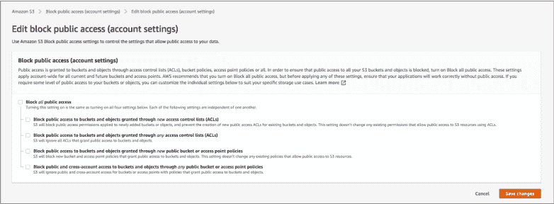

这些设置适用于所有当前和未来的存储桶和访问点在账户级别。虽然强烈建议开启公共访问阻止，但开启此设置后，检查现有应用程序是否仍能正常工作非常重要。欲了解有关阻止对 S3 公共访问的更多信息，请访问 amzn.to/2Wb8W4。

## Amazon S3 中的数据保护

在第 3 章“数据存储”中，我们研究了 Amazon S3 的可靠性以及它提供 11 个 9 的耐久性，其设计可承受多个设施中数据同时丢失，并在默认情况下提供对象版本控制。虽然标准的 GET 请求始终会获取对象的最新版本，但你可以通过指定版本号来检索旧版本。

S3 为静态数据和传输中数据提供加密。这是通过 S3 客户端加密和服务器端加密实现的，并对传输中的数据应用加密。

### 客户端加密

你可以在发送到 Amazon S3 之前在客户端对数据进行加密。这可以通过使用存储在 AWS 上的主密钥，使用 AWS Key Management Service（AWS KMS）或存储在应用程序内的主密钥来实现。Amazon 的 Java、PHP、.NET、Go、Ruby 和 C++ SDK 支持客户端加密。

### 服务器端加密

顾名思义，服务器端加密是对数据在其目标处进行加密，在本例中为 Amazon S3；它本质上保护静态数据。服务器端加密加密对象数据但不加密对象元数据。Amazon S3 在将数据存储在 AWS 数据中心的磁盘上时自动加密你的数据，并在访问数据时自动解密数据。整个过程对用户是透明的，用户有三种互斥的服务器端加密选项，其关键区别在于各种选项之间密钥的管理方式（见表 6.6）。

**FIGURE 6.9** S3 encryption options

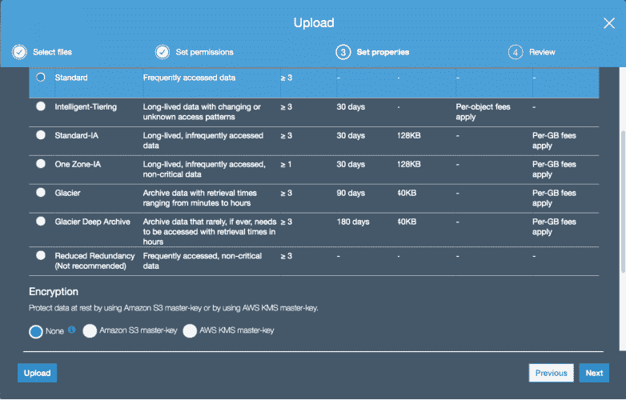

Amazon S3 提供了多种工具来监控你的 Amazon S3 资源是否存在潜在事件。关键工具如下：

**Amazon CloudWatch Alarms** Amazon CloudWatch 允许你监控一段时间内指定的指标。超过指标阈值可能会导致通知发送到 Amazon SNS 或自动扩缩策略。

**AWS CloudTrail Logs** 审计是系统的重要组成部分，出于各种合规原因。AWS CloudTrail 能够实现对 AWS 账户的治理、合规、运营审计和风险审计，并提供 AWS 账户活动事件历史记录，包括通过 AWS 管理控制台、AWS SDK、命令行工具和其他 AWS 服务执行的操作。此历史记录简化了安全分析、资源变更跟踪和故障排除。你可以使用 AWS CloudTrail 的信息来确定对 Amazon S3 发出的请求、请求发出的 IP 地址、谁发出了请求、何时发出以及其他详细信息。从考试角度来看，了解此服务的用法也很重要，因为你会看到某些审计问题。

**AWS S3 Access Logs** 服务器访问日志记录是另一个有用的功能，允许你跟踪对 Amazon S3 存储桶发出的请求。服务器访问日志对于安全审计很有用，并帮助客户了解 Amazon S3 计费，其中数据扫描发挥重要作用。你可以在 AWS 控制台上启用服务器访问日志记录，或以编程方式使用 Amazon S3 API 或 AWS SDK。尽管服务器访问日志记录本身没有费用，但交付到你的存储桶的任何日志文件都会产生通常的存储费用。

**AWS Trusted Advisor** AWS Trusted Advisor 是一个应用程序，它利用 AWS 从为数十万 AWS 客户提供服务中积累的最佳实践。Trusted Advisor 检查你的 AWS 环境并就节省成本、提高系统性能或关闭安全漏洞提出建议。AWS Trusted Advisor 具有以下与 S3 相关的检查，从安全角度来看很有帮助：

- Amazon S3 存储桶的日志记录配置
- 对具有开放访问权限的 Amazon S3 存储桶的安全检查
- 对未启用版本控制或版本控制已暂停的存储桶的容错检查

## Amazon S3 安全最佳实践

现在我们已经研究了 Amazon S3 的一些安全最佳实践，让我们来看一些保护数据的最佳安全实践：

- 启用账户级 Block Public Access。
- 利用访问点来限定应用程序权限。
- 使用 VPC 端点和访问点发送安全流量。
- 使用存储桶策略强制执行 TLS。
- 加密所有内容：SSE-KMS & SSE-S3。
- 启用对象锁定、版本控制、MFA 删除以保护数据。
- 使用 AWS 工具进行监控，例如 AWS CloudTrail 和 AWS Config。

## Amazon Athena 安全

我们在第 4 章“数据处理和分析”中研究了 Amazon Athena，并了解它是如何建立在 Apache Presto 之上以实现临时数据分析的绝佳工具。由于 Amazon Athena 将被数据分析师和数据科学家使用，因此了解它如何保护数据变得非常重要。


## 管理对 Amazon Athena 的访问

Amazon Athena 允许用户执行各种操作，并使用 IAM 来管理对底层资源和操作的访问。本质上，当用户登录 Amazon Athena 时，他们将运行 SQL 查询，这需要以下权限：

- 访问 Amazon Athena API 操作的权限，包括针对 Athena 工作组的操作
- 访问底层存储（主要是 S3，即数据所在位置）的权限
- 访问 AWS Glue Catalog 中元数据层的权限

要执行 Athena API 操作、处理 S3 中的数据以及访问/创建 AWS Glue Data Catalog 中的元数据，您的 IAM 主体需要附加基于身份的策略。这些策略由定义允许或拒绝操作的语句组成。Amazon Athena 提供了两个托管策略，用户无需自行确定 Athena 运行所需的操作；这些策略易于设置，并且会随着服务演进和新功能发布自动更新所需操作。这两个策略如下：

**AmazonAthenaFullAccess** 此策略授予对 Amazon Athena 的完全访问权限，并包含对 AWS Glue、Amazon S3、Amazon SNS 和 Amazon CloudWatch 的权限。您应将其附加到需要此类访问权限的主体。要查看该策略的最新内容，请访问 AWS 文档：amzn.to/2zXz7zP。虽然您始终可以以该策略为参考创建自定义策略，并根据 Amazon Athena 用户的需求微调权限，但建议以 AmazonAthenaFullAccess 为起点，然后根据您的需求允许或拒绝特定权限。

**AWSQuickSightAthenaAccess** 此策略授予 Amazon QuickSight 与 Athena 集成所需的操作权限，因此适用于那些会使用 Amazon QuickSight 显示和可视化来自 Amazon Athena 数据的主体。此策略主要提供 Amazon Athena、AWS Glue 和 Amazon S3 的操作权限。要查看该策略的最新内容，请访问 AWS 文档：amzn.to/2zUvao9。

Athena 还提供了 JDBC 和 ODBC 驱动程序，允许其他应用程序连接并读取 Amazon Athena 中的数据。要通过 JDBC/ODBC 访问 Athena，您需要向应用程序提供 JDBC/ODBC 凭据。您需要确保 IAM 权限策略包含 AWSQuickSightAthenaAccess 托管策略中列出的操作。

Amazon Athena 还需要访问 Amazon S3，这是通过托管策略提供的。如果您的 Athena 用户需要创建表并处理底层数据，他们必须有权访问数据所在的 S3 位置，并具有适当的权限。

如果您将 AWS Glue Data Catalog 用于 Amazon Athena，则可以为 Athena 中使用的数据库和表定义资源级策略。Athena 仅在数据库和表级别提供细粒度控制，而不在每个分区级别提供。此外，如果您的 AWS Glue Data Catalog 位于其他账户中（跨账户访问），在撰写本文时 Athena 尚不支持该选项。

## 对 Athena 工作组的访问

Amazon Athena 工作组是一种资源类型，可用于在同一 AWS 账户下运行的用户、团队和应用程序之间分隔查询执行和查询历史记录。由于工作组是一种资源，您可以使用基于资源的策略来控制对其的访问。

例如，如果您有一个通常进行临时数据分析的名为“adhoc-analysts”的团队，以及另一个通常运行自动报告的名为“automated-reporting”的团队，您可以创建两个工作组，每个团队一个。由于工作组是 IAM 资源，它们有关联的 ARN，可用于与用户关联的 IAM 策略。您可以创建一个代表临时用户团队的 IAM 用户，并将该用户添加到 IAM 组。该组包含一个策略，强制执行这些用户可以执行的操作。您还可以使用 IAM 策略为分析用户设置权限，仅授予用户在“adhoc-users”工作组中工作所需的权限。go.aws/3bTw3pB 上的博客文章提供了设置工作组和基于工作负载限制访问的出色逐步指南。

## 使用 Athena 的联合数据访问

如果您在 AWS 外部使用 Microsoft Active Directory 管理用户凭据，您仍然可以向 Amazon Athena 提供联合访问。可以使用支持 SAML 2.0 的 JDBC 或 ODBC 驱动程序完成身份验证，以访问 ADFS 3.0（Active Directory 联合身份验证服务），并允许客户端应用程序调用 Athena API 操作。此场景有一些先决条件：

1. 在您的组织内将 ADFS 3.0 配置为身份提供者。
2. 在客户端应用程序上安装并配置最新版本的 JDBC 客户端。您的驱动程序应支持联合访问，并且必须与 SAML 2.0 兼容。

图 6.10 中的架构图展示了联合设置的典型架构。

## Amazon Athena 中的数据保护

Athena 是一个数据处理和分析引擎，因此它会处理来自数据源的数据，并可对其进行转换以及生成新的和更新的版本。Amazon Athena 不会修改源数据。

Athena 在从数据源读取数据时采用读时模式（schema-on-read），这意味着模式会在运行时应用于存储在源引擎中的数据。Athena 允许您使用数据定义语言（DDL）语句修改数据目录。

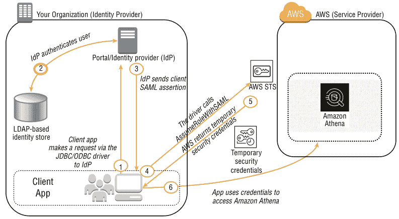

Amazon Athena 内产生的关键产物是查询结果和查询历史记录。查询结果存储在 Amazon S3 中，即工作组定义中指定的默认位置，并且您对保存查询结果和存储查询的存储桶拥有完全控制权。

Athena 会将您的查询历史记录和查询结果保留 45 天，您可以使用 AWS 控制台、Amazon Athena API 和 AWS CLI 查看这些记录。出于合规性原因，建议除了使用 Athena 工作组限制访问之外，还要保存查询结果和查询记录。

## Amazon Athena 中的数据加密

Amazon Athena 允许您处理加密数据、加密的查询结果以及 AWS Glue Data Catalog 中的加密元数据。Amazon Athena 支持将 SSE-S3、SSE-KMS 和 CSE-KMS（使用 AWS KMS 的客户端加密）作为加密选项，但不支持 SSE-C（使用客户提供的密钥的 SSE）或使用客户端主密钥和非对称密钥的客户端加密。

我们在上一节讨论的 Athena 工作组允许您强制加密查询结果。如果您使用 JDBC 或 ODBC 驱动程序连接，则必须为加密类型和 S3 暂存位置配置相应的驱动程序。

由于 Amazon Athena 使用来自各种来源的数据，但主要是 S3，因此它在数据源和 Amazon Athena 之间传输数据时使用传输层安全性（TLS）。TLS 也用于消费 Amazon Athena 数据的应用程序之间，因此所有传输中的数据都已加密。即使您使用 JDBC 或 ODBC 驱动程序，数据也使用 TLS 加密。Amazon Athena 与其他服务之间的所有流量默认使用 HTTPS。

## Amazon Athena 与 AWS Lake Formation

我们在本书前面讨论了 AWS Lake Formation，当时我们讨论了它如何在 Amazon S3 中的数据湖之上提供授权和治理层。Lake Formation 提供了一种简单的方法来管理数据权限，从而实现细粒度访问控制。在撰写本文时，您可以通过将数据集注册到 Amazon Lake Formation 来管理列级权限。

您可以使用 Athena 查询已注册到 Amazon Lake Formation 的数据以及尚未注册的数据。Lake Formation 权限模型仅在您查询已注册到 Amazon Lake Formation 的元数据时才会生效。

以下是一些相关场景：

- 如果您在 Amazon S3 中有数据，但元数据尚未注册到 Amazon Lake Formation，则 Lake Formation 权限不适用。相反，权限由针对 Amazon S3 的 IAM 策略定义。
- 如果您在 Amazon S3 中有数据，并且元数据已注册到 Amazon Lake Formation，则 Lake Formation 权限将适用，并且您可以启用细粒度访问控制（FGAC）。
- 如果您在某个 AWS 存储桶中有 Amazon Athena 结果，则无法将其注册到 AWS Lake Formation。
- 如果您有 Athena 查询历史记录，则不能使用 Lake Formation 权限来控制对此数据的访问，而必须使用 Athena 工作组来控制对查询历史记录的访问。

至此，我们完成了关于 Amazon Athena 安全性的部分。我们涉及了一些关键概念，但绝未涵盖 Amazon Athena 中的端到端安全选项。强烈建议您在参加考试之前，查看 AWS 文档、Amazon Athena 工作组以及本章末尾“补充阅读和参考资料”部分列出的其他安全功能。

## Amazon Redshift 安全性

安全一直是亚马逊自成立第一天起就重视的事情，Amazon Redshift 也不例外。AWS 提供的每项服务都有一套全面的安全功能，可帮助您保护数据。

Amazon Redshift 提供以下功能，帮助您保护数据仓库环境，该环境通常托管您最关键的数据，且通常用于为业务用户提供服务：

- 用于数据保护的端到端加密，包括静态数据加密和传输中数据加密
- 与 IAM 和 SAML 身份提供者集成，实现联合身份验证（SSO）


要使用 Redshift 设置 SSO，您需要以下内容：

- Redshift JDBC/ODBC 驱动程序
- 符合 SAML 2.0 的 IdP，例如：
  - PingFederate
  - Okta
  - Microsoft ADFS
  - Azure AD

步骤如下：

1. 设置 IdP 和联合身份认证
2. 创建用于访问 Amazon Redshift 集群的 IAM 角色
3. 设置数据库访问权限（CREATE GROUP、GRANT 等）
4. 使用 JDBC/ODBC SQL 客户端连接 Amazon Redshift

## Amazon Redshift 中的数据保护

Redshift 作为一项服务，存储着您企业中至关重要的元素：您的企业数据，这些数据经过精心设计，用于服务那些将根据数据集中可用数据做出决策的业务用户，因此必须不惜一切代价加以保护。Redshift 提供了在传输和静态状态下保护数据的选项。让我们看看 Redshift 提供的数据保护选项。

### 传输中的数据加密

默认情况下，所有 Redshift 集群通信都是安全的。Redshift 始终使用硬件加速的 SSL 与其他 AWS 服务（例如用于数据加载的 Amazon S3、Amazon DynamoDB 和 Amazon EMR）通信。

### 静态数据加密

在 Amazon Redshift 中，您可以启用数据库加密来保护静态数据。启用加密后，集群及其快照的数据块和系统元数据都会被加密。您可以在启动集群时启用加密，也可以修改未加密的数据库以开始使用 KMS 加密。当您将数据库的加密方式修改为 KMS 加密时，Amazon Redshift 会自动将您的数据迁移到新的加密集群。

建议使用基于 KMS 的加密，因为它支持密钥轮换和自带密钥。

Amazon Redshift 使用以下加密密钥层级（如图 6.11 所示）来加密 Redshift 数据库中的数据：

- *第 1 层*：主密钥 —— 可以是客户管理密钥（CMK）或 KMS 生成的主密钥，用于加密集群加密密钥。
- *第 2 层*：集群加密密钥用于加密数据库加密密钥。
- *第 3 层*：数据库加密密钥用于加密数据加密密钥。
- *第 4 层*：数据加密密钥用于加密实际数据块。

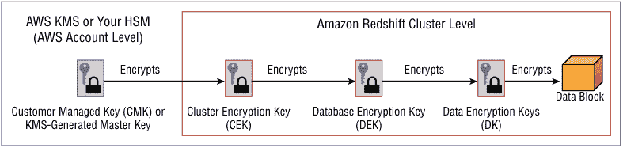

您可以在 AWS 控制台（amzn.to/2WSY1Cm）或通过 Amazon Redshift API 和 AWS CLI（amzn.to/3bVYsQD）在 Amazon Redshift 中配置加密。

## Redshift 审计

到目前为止，您已经很清楚审计对各种服务的重要性。Redshift 提供了两种选项来记录数据库级活动的审计日志，例如哪些用户何时登录：审计日志和系统表。日志存储在 Amazon S3 存储桶中，因此方便负责监控数据库活动的用户访问。

### 审计日志

Amazon Redshift 在以下日志文件中记录信息：

- *连接日志* —— 此日志文件记录所有连接尝试、连接和断开连接。此日志主要用于安全目的。
- *用户日志* —— 此日志文件记录有关数据库用户定义更改的信息。此日志主要用于安全目的。
- *用户活动日志* —— 此日志提供提交到数据库的每个查询。用户活动日志主要用于调试目的，因为它可以帮助您了解发送到数据库的所有查询，包括来自用户和数据库本身的查询。

### 系统表

Amazon Redshift 审计日志也可以作为系统表使用，此处列出：amzn.to/2Xpi3n6。与安全相关的主要系统表如下：

- *SVL_STATEMENT_TEXT* —— 这是一个基于系统表的系统视图，包含系统上正在运行的语句。该视图可供

## Elasticsearch 网络配置

您可以在虚拟私有云（VPC）中启动 Amazon ES 域，也可以使其可公开访问。在 Amazon Elasticsearch 中创建 Elasticsearch 域时会提供这些选项。

### VPC 访问

当您将 Amazon ES 域放置在 VPC 内时，可以在无需 Internet 网关、NAT 设备或 VPN 连接的情况下，启用 Amazon ES 与其他服务之间的安全通信。在 VPC 内设置 ES 域意味着所有流量都将保留在 AWS 云中，因此比可公开访问的 ES 域具有额外一层安全性（见图 6.12）。

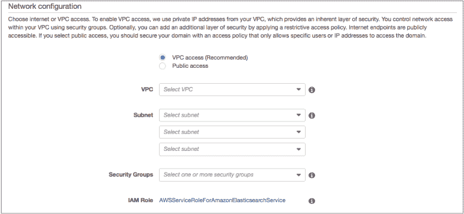

您可以选择将 ES 域配置在多个可用区中，这意味着 Amazon ES 会在您的 VPC 内的一个、两个或三个子网中放置一个端点。此外，Amazon ES 会为您的每个数据节点在 VPC 中放置一个弹性网络接口（ENI）。该 ENI 将从您子网的 IPv4 地址范围中分配一个私有 IP 地址，并分配一个公共 DNS 主机名（域端点）。要访问该服务，您应该使用公共 DNS 服务解析。

VPC 访问的一些限制如下：

- 您必须选择将域启动在 VPC 内，或使用公共端点。
- 您不能在 VPC 中的 ES 域和公共端点之间切换，反之亦然。如果 ES 域创建后需要切换，您必须遵循 ES 迁移流程，通常使用快照，这是一种便捷的数据迁移方式。
- 一旦创建，您无法切换 ES 域的 VPC。
- 您不能将基于 IP 的策略应用于 VPC 内的 ES 域，因为安全组已经强制执行基于 IP 的访问策略。

## 访问 Amazon Elasticsearch 和 Kibana

Amazon Elasticsearch 中的关键资源是 ES 域。Amazon Elasticsearch 提供了多种控制和管理对 ES 域访问的方式。Amazon ES 支持三种类型的策略：

- 基于资源的策略
- 基于身份的策略
- 基于 IP 的策略

### 基于资源的策略

Amazon ES 中的关键资源是 ES 域。您还有域的子资源，例如 Elasticsearch 索引和 API。您可以在创建域时添加基于资源的策略，有时称为域访问策略。该策略指定主体可以对域的子资源执行哪些操作。以下策略授予 analytics-user 对 analytics-cert-domain 的完全访问权限（es:*）。

```json
{
    "Version": "2012-10-17",
    "Statement": [
        {
            "Effect": "Allow",
            "Principal": {
                "AWS": [
                    "arn:aws:iam::987654321098:user/analytics-user"
                ]
            },
            "Action": [
                "es:*"
            ],
            "Resource": "arn:aws:es:us-west-1:123451234501:domain/analytics-cert-domain/*"
        }
    ]
}
```

这里需要注意的要点如下：

1. 将被授予访问权限的主体通过 ARN `arn:aws:iam::987654321098:user/analytics-user` 标识。

2. 允许用户执行的操作是 `es:*`（通配符），这意味着所有 Elasticsearch 操作。

   资源部分至关重要，因为它提到以下内容：

   - a. 授予用户的权限将仅适用于 analytics-cert-domain。
   - b. 资源中的尾部通配符 `/*` 表示此策略适用于域内的子资源（如索引），而不是域本身。

3. 您可以将分析用户进一步限制为特定操作，例如 `es:ESHttpGet`、`es:ESHttpDelete`、`es:ESHttpPost`、`es:ESHttpPut` 和 `es:ESHttpHead`。

注意：如果您的基于资源的访问策略包含 IAM 用户或角色，您必须使用 AWS Signature Version 4（简称 Sigv4）发送签名请求。

### 基于身份的策略

您可以使用 AWS IAM 服务将基于身份的策略附加到用户或角色。基于身份的策略指定谁可以访问服务、他们可以执行哪些操作，以及可以在哪些资源上执行操作。

基于身份的策略附加到主体（用户/角色），因此 JSON 本身不需要指定其附加的主体。以下是通常分配给管理员并授予对 Amazon ES 以及域中存储的所有数据完全访问权限的策略示例：

```json
{
  "Version": "2012-10-17",
  "Statement": [
    {
      "Action": [
        "es:*"
      ],
      "Effect": "Allow",
      "Resource": "*"
    }
  ]
}
```

### 基于 IP 的策略

您还可以将 ES 域的访问限制为特定的 IP 地址或 CIDR 块。基于 IP 的策略实际上是基于资源的策略，使用匿名主体和包含源 IP 的特殊 Condition 元素。


创建基于 IP 的策略的主要目的是允许未签名的请求访问 Amazon ES 域，这样您就可以使用 `curl` 和 Kibana 等客户端，或者通过代理服务器访问该域。

以下示例展示了一个基于 IP 的策略，该策略允许来自特定 IP 范围的所有 HTTP 请求访问 `analytics-cert-domain`：

```json
{
  "Version": "2012-10-17",
  "Statement": [
    {
      "Effect": "Allow",
      "Principal": {
        "AWS": "*"
      },
      "Action": [
        "es:ESHttp*"
      ],
      "Condition": {
        "IpAddress": {
          "aws:SourceIp": [
            "192.168.10.0/24"
          ]
        }
      },
      "Resource": "arn:aws:es:us-west-1:123451234512:domain/analytics-cert-domain/*"
    }
  ]
}
```

从考试角度来看，您需要了解可以使用哪些类型的策略，通过基于资源、基于用户和基于 IP 的策略来限制对 ES 域的访问。

## 创建并签名 Amazon Elasticsearch 请求

所有发送到 Amazon ES 的请求都必须进行签名。如果您的访问策略指定了 IAM 用户或角色，则对 ES API 的请求必须使用 AWS SigV4 进行签名。您可以自行对请求进行签名，也可以使用 *Boto 3* 等 AWS SDK 代您完成请求签名。使用 SDK 对请求进行签名始终是推荐的方法，因为它不仅简化了请求签名过程，还能为您节省大量时间。

图 6.14 公共域示例工作流中的精细访问控制  
（来源：amzn.to/3bZQwh2）

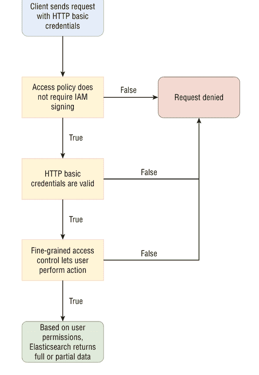

## 静态数据加密

Amazon Elasticsearch 会保护静态数据和传输中的数据，以防止未经授权访问您的数据。加密主要包括以下两个部分：

- **AWS KMS：** 加密密钥的存储和管理
- **AES-256：** 实际执行加密的算法

启用加密后，域中的以下关键元素会进行加密。

## 日志记录和监控

Amazon QuickSight 已与 AWS CloudTrail 集成，这意味着对 AWS 控制台和 AWS QuickSight API 的所有调用都会被记录。

截至本文撰写时，Amazon CloudWatch 尚未获得原生支持。

## 安全最佳实践

以下是 Amazon QuickSight 的安全最佳实践：

- 应通过 HTTPS 或安全 WebSockets（wss://）访问 Amazon QuickSight。
- 访问 AWS 外部的数据源意味着您需要允许 Amazon QuickSight 的 IP 地址范围连接到这些数据源。
- 始终使用 SSL 连接数据库。
- 在可能的情况下，尽量使用 Amazon QuickSight Enterprise 版提供的增强安全功能。
- （仅限 Enterprise 版用户）尽可能使用 VPC 连接来保护与 AWS 数据源之间的通信。使用 DirectConnect 连接本地资源，以建立安全的私有连接。

## Amazon DynamoDB 安全性

我们在第 3 章“数据存储”中介绍了 DynamoDB。接下来，让我们看看 Amazon DynamoDB 的安全模型。

### DynamoDB 中的访问管理

您可以使用 IAM 向 Amazon DynamoDB 资源和 API 操作授予访问权限。为此，首先编写 IAM 策略，该策略是一份明确列出要授予权限的文档。然后，将该策略附加到 IAM 用户、组或角色。例如，名为 Joe 的 IAM 用户可以创建一个 Amazon DynamoDB 表，然后编写 IAM 策略以允许对该表进行只读访问。随后，Joe 可以将该策略应用于其 AWS 账户中选定的 IAM 用户、组或角色。这些接收者将拥有对 Joe 的表的只读访问权限。除了使用 IAM 在资源级别控制访问权限外，您还可以使用精细访问控制在数据库级别控制访问权限。您可以创建允许或拒绝访问数据库中特定项目（行）和属性（列）的权限。

如果您要编写面向大量用户的应用程序，还可以选择使用 Web 身份联合进行身份验证和授权。Web 身份联合不再需要创建单独的 IAM 用户；用户可以登录身份提供商，然后从 AWS Security Token Service（AWS STS）获取临时安全凭证。

### 精细访问控制

精细访问控制是指确定谁可以访问 Amazon DynamoDB 表和索引中的单个数据项目及属性，以及可以对这些项目和属性执行哪些操作。要实现精细访问控制，请编写一个 AWS IAM 策略，指定访问安全凭证的条件及相关权限。然后，将该策略应用于 IAM 用户、组或角色。您的 IAM 策略可以限制对表中单个项目的访问、对这些项目中属性的访问，或者同时限制这两者。您可以通过在 IAM 策略中添加条件元素来配置精细控制。

以下是精细访问控制的一些可能用例：

- 一个根据用户位置显示附近机场航班数据的应用。该应用会显示航空公司名称、到达和出发时间以及航班号；但是，飞行员姓名或乘客数量等属性会受到限制。
- 一个用于游戏的社交网络应用，所有用户保存的游戏数据都存储在同一个表中，但任何用户都无法访问不属于自己的数据项目。
- 一个用于定向广告的应用，用于存储广告展示和点击跟踪数据。该应用只能为当前用户写入数据项目，并且只能为该用户检索定向广告推荐。

### 具有精细访问控制的 IAM 策略

考虑一个移动游戏应用，该应用允许玩家从各种不同的游戏中进行选择并进行游戏。该应用使用名为 `GameScores` 的 DynamoDB 表来跟踪高分和其他用户数据。表中的每个项目都由用户 ID 和用户所玩游戏的名称唯一标识。`GameScores` 表的主键由分区键（`UserId`）和排序键（`GameTitle`）组成。用户只能访问与其用户 ID 相关联的游戏数据。想要玩游戏的用户必须属于名为 `GameRole` 的 IAM 角色，并且该角色附加了安全策略。

除了授予对 `GameScores` 表执行特定 DynamoDB 操作的权限（`Action` 元素）以及对该表的访问权限（`Resource` 元素）外，`Condition` 元素还使用以下 DynamoDB 特有的条件键来限制权限：

- `dynamodb:LeadingKeys`：此条件键允许用户仅访问分区键/值与其用户 ID 匹配的项目。此 ID，即 `${www.amazon.com:user_id}`，是一个替换变量。有关替换变量的更多信息，请参阅“使用 Web 身份联合”（docs.aws.amazon.com/amazondynamodb/latest/developerguide/WIF.html）。
- `dynamodb:Attributes`：此条件键将访问限制在指定的属性范围内，因此只有权限策略中列出的操作才能返回这些属性的值。此外，`StringEqualsIfExists` 子句确保应用始终必须提供要操作的特定属性列表，并且应用无法请求所有属性。

评估 IAM 策略时，结果始终为 true（允许访问）或 false（拒绝访问）。如果 `Condition` 元素的任何部分为 false，则整个策略的评估结果为 false，访问将被拒绝。

如果使用 `dynamodb:Attributes`，则必须指定表的所有主键和索引键属性的名称，以及策略中列出的任何二级索引的键属性名称。否则，DynamoDB 无法使用这些键属性执行请求的操作。

请参阅 DynamoDB 文档中的以下部分，以启用精细访问控制：(https://docs.aws.amazon.com/amazondynamodb/latest/developerguide/specifying-conditions.html)。

### 身份联合

Web 身份联合支持以下身份提供商：

- Login with Amazon
- Facebook
- Google

图 6.15 展示了 Web 身份联合的工作方式。

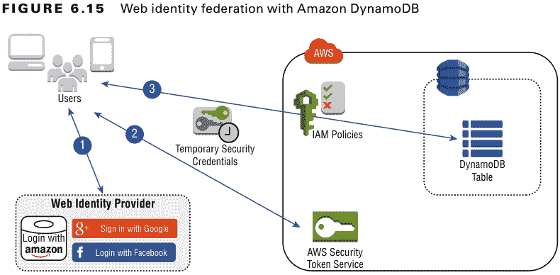


1.  应用程序调用第三方身份提供方来验证用户和应用程序的身份。身份提供方会向应用程序返回一个Web身份令牌。
2.  应用程序调用AWS STS，并将Web身份令牌作为输入传入。AWS STS对应用程序进行授权，并为其提供临时AWS访问凭证。应用程序可以承担一个IAM角色，并根据该角色的安全策略访问AWS资源。
3.  应用程序调用Amazon DynamoDB来访问某个表（例如）。由于应用程序承担了角色，因此它受该角色关联的安全策略约束。策略文档会阻止应用程序访问不属于该用户的数据。

## 如何访问Amazon DynamoDB

Amazon DynamoDB是一项Web服务，它使用HTTP和HTTPS作为传输协议，并使用JavaScript对象表示法（JSON）作为消息序列化格式。访问Amazon DynamoDB主要有三种方式：

-   Amazon DynamoDB API
-   AWS软件开发工具包（SDK）
-   AWS管理控制台

应用程序可以使用DynamoDB API或AWS SDK来访问Amazon DynamoDB。AWS建议您使用AWS SDK，而不是在应用程序中直接向DynamoDB API发出请求。SDK包含的库可以处理请求身份验证、序列化和连接管理。为了进一步简化应用程序开发，SDK还提供了Java和.NET API。

Amazon DynamoDB还提供了一个管理控制台，使您可以处理表和项目。您无需编写任何代码即可创建、更新和删除表。您可以查看表中的所有现有项目，或使用查询来筛选表中的项目。您可以添加新项目或删除项目。

（可选）您可以对一次性操作使用AWS命令行接口（CLI），例如创建表。您还可以在实用程序脚本中嵌入DynamoDB操作。

默认情况下，Amazon DynamoDB的AWS SDK和控制台引用美国西部（俄勒冈）区域。随着Amazon DynamoDB将可用性扩展到新区域，这些区域的新端点也可用于您自己的HTTP请求、AWS SDK和控制台。

## 使用DynamoDB进行数据保护

数据保护是指保护传输中的数据以及静态数据。为保护传输中的数据，您可以使用Amazon DynamoDB SSL加密端点。这些加密端点可从互联网以及Amazon EC2实例内部访问。

此外，Amazon DynamoDB要求对该服务的每个请求都包含有效的HMAC-SHA256签名，否则请求将被拒绝。AWS SDK会自动为您的请求签名；但是，如果您想编写自己的请求，则必须在发送给Amazon DynamoDB的请求头中提供签名。要计算签名，您必须从AWS安全令牌服务请求临时安全凭证。使用这些临时安全凭证为发送给Amazon DynamoDB的请求签名。

为保护静态数据，请在将数据上传到Amazon DynamoDB之前对数据进行加密。这种客户端加密还可以在传输过程中保护您的数据。

您可以使用SDK库对Amazon DynamoDB数据进行加密和签名。

有关更多信息，请参阅java.awsblog.com/post/TxI32GE4IG2SNS/Client-side-Encryption-for-Amazon-DynamoDB。

Amazon DynamoDB时间点恢复（PITR）提供DynamoDB表数据的自动备份。时间点恢复有助于保护您的Amazon DynamoDB表免受意外写入或删除操作的影响。借助时间点恢复，您无需担心创建、维护或调度按需备份。时间点操作不会影响性能或API延迟。

## 使用DynamoDB进行监控和日志记录

AWS提供了多种选项来监控您的Amazon DynamoDB数据库。Amazon DynamoDB与Amazon CloudWatch集成，因此您可以收集和分析性能指标。您可以使用CloudWatch控制台、AWS命令行接口或以编程方式通过CloudWatch API监控这些指标。CloudWatch还允许您在某个指标达到指定阈值时设置警报。

Amazon DynamoDB与CloudTrail集成，CloudTrail是一项服务，可捕获您AWS账户中由DynamoDB发起或代表DynamoDB发起的API调用，并将日志文件传送到您指定的Amazon S3存储桶。CloudTrail捕获从Amazon DynamoDB控制台或DynamoDB API发起的API调用。利用CloudTrail收集的信息，您可以确定向DynamoDB发出了什么请求、请求的来源IP地址、谁发起了请求以及何时发起的请求。您可以根据需要将日志文件保留在存储桶中，也可以定义Amazon S3生命周期规则来自动归档或删除日志文件。默认情况下，您的日志文件使用Amazon S3服务端加密进行加密。

如果您希望在交付新日志文件时快速采取行动，可以让CloudTrail在交付新日志文件时发布Amazon SNS通知。您还可以将来自多个AWS区域和多个AWS账户的Amazon DynamoDB日志文件聚合到单个Amazon S3存储桶中。您还可以使用AWS管理控制台监控表的性能。通过控制台中的CloudWatch指标，您可以监控表吞吐量和其他性能指标。

## 总结

在本章中，我们探讨了不同分析服务的安全方面，以及如何访问这些服务、保护静态和传输中的数据，以及启用联合访问。对于大多数服务，我列出了一些最佳实践。安全是考试中最重要的主题之一，您在该领域的表现可能决定您的成败。更重要的是，当您在生产环境中运行应用程序时，安全是需要从第一天就解决的问题，因此确保正确处理至关重要。

虽然我们讨论了许多不同的服务和选项，但请务必完成后面列出的动手实验。

## 考试要点

安全是AWS平台最重要的组成部分，因此数据安全占所有考试问题的18%。您需要了解分析服务伞下各种服务提供的数据保护机制、设置身份和访问管理、配置活动日志记录和服务使用监控，并确保了解弹性和恢复机制。

安全是AWS平台、分析服务以及AWS数据分析专业认证考试中非常关键的部分。

## 练习/动手实验

以下是您需要自行完成的基本动手实验，以便为考试的安全方面以及您对AWS安全的一般知识做好更充分的准备。

-   保护无服务器工作负载 - github.com/aws-samples/aws-serverless-security-workshop/blob/master/README.md
-   AWS身份：使用Amazon Cognito构建无服务器消费者应用程序 - serverless-idm.awssecworkshops.com
-   AWS安全动手实验 - awssecworkshops.com
-   将安全性加入DevOps - devops.awssecworkshops.com
-   在AWS中扩展威胁检测和响应 - scaling-threat-detection.awssecworkshops.com


