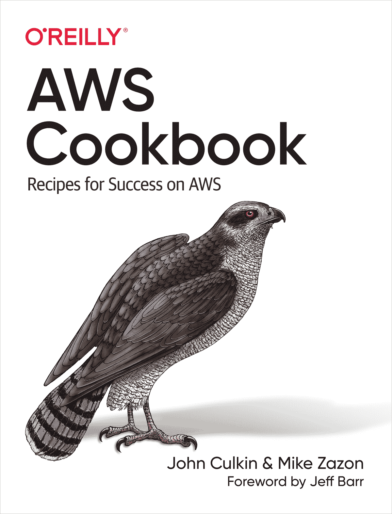

# AWS 秘籍：成功实战指南





## AWS 食谱赞誉

> 官方 AWS 文档中严重缺失的一环：真实感。我们大多数人并非试图通过收集尽可能多的 AWS 服务来赢取积分；我们只是试图在非白板的某个地方完成任务。《AWS 食谱》面向真实用户，提供了一系列实战指南和务实示例，我们都能从中受益。
>
> — Corey Quinn，The Duckbill Group 首席云经济学家

> 书中包含大量典型 AWS 用例的信息，以及易于遵循的参考实现。如果您喜欢以实践驱动、示例为基础、动手操作的方式学习 AWS 概念，我强烈推荐这本书。
>
> — Gaurav Raje，《AWS 上的安全与微服务架构》作者

> 我从未读过一本如此密集地汇聚了 AWS 高阶技巧和窍门的书；这是我五年前就希望拥有的书。如果您日常使用 AWS，这本书必须纳入您的工具箱，不仅因为它包含的内容，更因为它提供的灵感。依我之见，这是最好的 AWS 书籍。
>
> — Adrian Cantrill，AWS 培训师，learn.cantrill.io

> 通过动手实践将 AWS 落地，是云素养与云流利度的分水岭。《AWS 食谱》提供了在云端工作的实用场景，助力个人提升职业生涯。
>
> — Drew Firment，AWS 社区英雄兼 Pluralsight 企业战略主管

ISBN：978-1-492-09260-5

## 献词

献给我的父亲，他教会我电子表格的用途远不止求和列。  
— John

献给我的姑姑 Judy Dunn。感谢您赠送的 Tandy 1000 PC，它点燃了我对计算机编程和技术的迷恋。  
— Mike

## 前言

作为 Amazon Web Services (AWS) 团队的早期成员，我有幸从独特的视角见证了其在规模、丰富度和复杂性上的成长。即使写了数千篇博客文章和数百万字，我几乎每天仍能学到关于 AWS 的新知识和实用技巧。

AWS 拥有两百多项生产服务，且定期推出新服务，这很容易让人感到不知所措。除了数万页的官方 AWS 文档外，博主、AWS 英雄、AWS 合作伙伴等还创作了无数内容——包括博客文章、视频、网络研讨会、概览和代码示例。

虽然深入透彻地理解特定 AWS 服务无可替代，但现实是，您往往只需要解决一个“具体”问题。即使理解了某项服务，记住如何用它解决该问题仍具挑战性——至少对我来说是这样。

这正是本书的用武之地。凭借广泛的主题选择和精心挑选的实战指南，我有信心您能快速找到解决当前需求的方案并迅速付诸实践。您可以解决问题，复习 AWS 该方面的知识，并继续为客户创造价值！

我最喜欢本书的一点是，它不回避任何细节。每个实战指南都假设您从零开始，然后帮您烹制出一份调味恰到好处的解决方案。没有任何侥幸成分，在大多数情况下您可以直接使用这些实战指南。实战指南还涵盖了至关重要的清理阶段，确保您将 AWS 环境恢复原状。

在适当的地方，实战指南会使用 AWS 云开发工具包 (CDK)，并包含所有必要的“活动部件”。CDK 提供双重益处；除了帮助您更快地推进工作外，这些 CDK 元素还能帮助您了解如何将基础设施即代码 (IaC) 付诸实践。

大多数食谱类书籍都设计为供浏览和品味，本书也不例外。您可以随意翻阅、通读整章，或仅使用一两个实战指南。我还建议您通读第 1 章，以确保您的环境已设置就绪。随后，当您面临待解决的问题时，找到合适的实战指南，付诸实践，收获成果。

Jeff Barr  
AWS 副总裁兼首席布道师  
华盛顿州西雅图  
2021 年 11 月

## 序言

> 绝大多数工作负载将迁移至云端。我们才刚刚开始——未来还有更多变革。
>
> — [Andy Jassy](https://oreil.ly/7Ube0)

过去十年间，企业和小型企业对云的采用日益增长，且仍在加速。Gartner 称，2020 年全球基础设施即服务 (IaaS) 公共云服务市场 [增长了 40.7%](https://oreil.ly/bJ5Sb)。云的快速增长导致许多组织对云技能产生 [巨大需求](https://oreil.ly/kstre)。许多 IT 专业人士理解云的基本概念，但希望能更自如地在云端工作。云技能供需之间的这一差距，为个人提升职业生涯提供了重大机遇。


凭借我们合计 20 多年的云经验，我们有幸在许多不同的角色中参与 Amazon Web Services (AWS) 项目。我们已指导数百名开发人员如何以及何时使用 AWS 服务。这使我们能够了解云的常见挑战和容易取得的成果。我们想与您分享这些经验教训，助您在职业发展上更进一步。我们编写这本书是为了分享我们的一些知识，使您能够快速掌握在云中工作的实用技能。我们希望您在未来的许多年里都能将本书作为参考资料。

### 本书适合谁

本书适合各个层次的开发人员、工程师和架构师，从初学者到专家。初学者将学习云概念并熟悉云服务的使用。专家将能够检查用于搭建配方基础的代码，探索新服务，并获得额外的视角。如果琳琅满目的云服务和组合让您感到不知所措，那么本书适合您。本书中的配方旨在提供“Hello, World”级别的概念验证和企业级应用程序组件。这将通过常见用例和指导式场景演练来实现，您可以直接将其应用于当前或未来的工作。这些经过策划且能积累经验的配方旨在揭开服务的神秘面纱，并将立即提供价值，无论您的 AWS 经验水平如何。

### 您将学到什么

除了开拓新的职业机会外，掌握 AWS 的强大功能还将赋予您创建强大系统和应用程序的能力，以解决当今世界许多有趣且极具挑战性的问题。您是否想像 [西门子](https://oreil.ly/Qpyvy) 那样，利用 AWS 机器学习每秒处理 60,000 个网络威胁？或者像 [Capital One](https://oreil.ly/vI0ZY) 那样，减少组织的本地部署占用空间并扩大微服务的使用？如果是，本书中的实际示例将通过提供切实可行的例子，展示如何将 AWS 的构建模块组合在一起，形成解决常见场景的实用解决方案，从而加快您的学习进程。云的按需消费模式、海量容量、先进能力和全球覆盖范围创造了待探索的新可能性。

## 配方

我们将本书分为多章，每章专注于一个技术领域（例如安全、网络、人工智能等）。章节中的配方规模小、独立且易于消化。配方的长度和复杂度各不相同。每个配方都包含问题陈述、解决方案（附带图表）和讨论。问题陈述定义严谨，以避免混淆。解决方案包含所需的准备工作和步骤，引导您完成实现目标所需的工作。在适当的情况下，将提供显式的验证检查。我们还为配方添加了额外挑战，以帮助您在愿意的情况下深化学习。最后，每个配方都以简短的讨论结束，帮助您理解解决方案及其重要性、扩展解决方案的建议，以及将其用于实际影响的方法。

#### 注意

为了降低您的 AWS 账单并保持账户整洁，每个配方都在与本书关联的代码库中提供了清理步骤。

每章都有自己的代码库，位于 [`https://github.com/awscookbook`](https://github.com/awscookbook)。代码库包含便于复制粘贴的准备步骤、所需文件和基础设施即代码。我们还创建了 GitHub 模板用于报告错误和建议新配方。我们鼓励您利用 GitHub 提交问题、创建新配方请求并提交您自己的拉取请求。我们将积极维护章节代码库，更新每个配方 README 文件中的步骤和代码。请务必查看这些内容以获取任何新方法或替代方法。我们期待在 GitHub 上与您互动，提供新的有趣挑战和提示来协助您。

有些配方是“从头构建”，而其他配方包含准备步骤，让您能够与现实世界中常见的场景进行交互。我们提供了代码，使您能够轻松部署先决条件。例如，配方 6.5 假设您是一名容器开发人员，正在创建一个需要现有网络栈的应用程序部署。当存在先决条件时，可以使用代码库中提供的代码通过准备步骤进行“预烘焙”。当配方需要大量准备工作时，您将使用 AWS 云开发工具包 (CDK)，这是一个用于智能定义和声明基础设施的绝佳工具。大多数配方基于 CLI；在适当的情况下，我们使用包含屏幕截图或描述性文本的控制台演练。

#### 注意

在 AWS 上实现类似结果的方法有很多；本书不会穷尽列举。许多因素将决定最适合您用例的整体解决方案。我们选择了配方主题，帮助您了解 AWS 并为您的特定需求做出最佳选择。

您将找到类似以下内容的配方：

*   使用 Amazon Comprehend 从文本中编辑个人身份信息 (PII)
*   自动轮换 Amazon Relational Database Service (RDS) 数据库的密码
*   使用 VPC 可达性分析器验证和排查网络路径

除了配方外，我们还在 附录 中提供了简短的代码行，可快速完成有价值且例行的任务。我们认为这些是值得加入您云工具箱的绝佳小技巧。

#### 警告

AWS 提供 [免费套餐](https://aws.amazon.com/free)，但实施本书中的配方可能会产生费用。我们提供了清理说明，但您需对账户中的任何费用负责。我们建议查看 AWS 开发的 [Well-Architected 实验室](https://www.wellarchitectedlabs.com) 中关于支出意识的内容，并利用 [AWS Budgets 操作](https://oreil.ly/4OVCc) 来控制成本。

## 您需要准备什么

以下是入门要求以及一些寻找帮助的提示：

*   AWS 账户
    *   [设置说明](https://oreil.ly/opuXX)
    *   具有控制台和编程访问权限的 IAM 用户
    *   您的 IAM 用户的管理员权限
*   个人电脑/笔记本电脑
*   软件
    *   Web 浏览器（如 Microsoft Edge、Google Chrome 或 Mozilla Firefox）
    *   带有 `bash` 或 `Zsh` 的终端
    *   `git`
        *   [安装说明](https://github.com/git-guides/install-git)
    *   `brew`（可选，但建议用于安装其他要求）
        *   [安装说明](https://docs.brew.sh/Installation)
    *   代码编辑器（如 VSCodium 或 AWS Cloud9）
        *   建议安装：`brew install --cask vscodium`
    *   AWS CLI 版本 2（2.1.26 或更高版本）
        *   [安装指南](https://oreil.ly/uYhyX)
        *   建议安装：`brew install awscli@2`
    *   `python` 3.7.9（及 `pip`) 或更高版本
        *   示例安装：`brew install python@3.7`
    *   AWS 云开发工具包版本 2.0 或更高版本
        *   [入门指南](https://oreil.ly/OmDu1)
        *   建议安装：`brew install npm` 和 `npm i -g aws-cdk@next`
*   建议：在您的主目录中创建一个名为 `AWSCookbook` 的文件夹。这将允许您在一个位置克隆每章的代码库：

```
AWSCookbook:$ tree -L 1
.
├── AccountManagement
├── ArtificialIntelligence
├── BigData
...
```

### 注意


## 入门指南

本节提供了我们在全书中采用的技术和方法示例，旨在使配方步骤更易于遵循。如果您对这些内容已经很熟悉，可以跳过这些主题。您随时可以返回参考本节。

### 设置

除了安装前文列出的先决条件外，您还需要以下访问权限。

#### AWS 账户设置

您需要一个具有管理权限的用户。某些配方需要创建 AWS Identity and Access Management (IAM) 资源的能力。您可以遵循 AWS 指南来[创建您的第一个 IAM 管理员用户和用户组](https://oreil.ly/moVjA)。

#### CLI 配方的通用工作站设置步骤

我们在 [`github.com/awscookbook`](https://github.com/awscookbook) 创建了一组代码仓库。在您的主目录中（或您选择的任何位置）创建一个名为 `AWSCookbook` 的文件夹并 `cd` 进入该目录：

```
mkdir ~/AWSCookbook && cd ~/AWSCookbook
```

这将为您提供一个位置来检出章节仓库（例如 `Security`）：

```
git clone https://github.com/AWSCookbook/Security
```

在您的终端中设置并导出默认区域：

```
export AWS_REGION=us-east-1
```

> **提示**
>
> AWS 在全球提供许多区域用于云部署。为简单起见，我们将使用 us-east-1 区域。只要服务可用，这些配方在其他区域也完全可以工作。AWS 提供了[区域和服务](https://oreil.ly/I3eVB)列表。

通过解析 `aws sts get-caller-identity` 操作的输出来设置您的 AWS `ACCOUNT_ID`：

```
AWS_ACCOUNT_ID=$(aws sts get-caller-identity \
     --query Account --output text)
```

> **注意**
>
> `aws sts get-caller-identity` 操作“[返回用于调用该操作的 IAM 用户或角色的详细信息](https://oreil.ly/XJMDp)。”

验证 AWS Command Line Interface (AWS CLI) 设置和访问权限：

```
aws ec2 describe-instances
```

如果您没有部署任何 EC2 实例，您应该会看到类似以下的输出：

```
{
  "Reservations": []
}
```

> **注意**
>
> AWS CLI 版本 2 默认会将多行命令输出发送到终端中的 `less`。您可以输入 `q` 退出。如果您想覆盖此行为，可以修改 `~/.aws/config` 文件以[移除此默认功能](https://oreil.ly/SU9gk)。

> **提示**
>
> [AWS CloudShell](https://aws.amazon.com/cloudshell) 是一个基于浏览器的终端，您可以使用它在经过身份验证的 AWS 控制台会话中快速创建终端环境，以运行 AWS CLI 命令。默认情况下，它使用您浏览器会话的身份与 AWS API 进行交互。许多配方可以使用 CloudShell 运行。如果您不想在自己的工作站本地终端环境中创建会话，可以使用 CloudShell 作为您经过身份验证的用户来运行配方步骤、清理命令和其他 AWS CLI 命令。

## 本书使用的技术和方法

接下来的几节将解释并举例说明一些使用 CLI 来帮助您完成配方的方法。

### 查询输出、环境变量和命令替换

有时后续命令依赖于您当前正在运行的命令的输出。AWS CLI 提供了[客户端输出过滤](https://oreil.ly/oV3cx)的能力。有时，我们将通过利用[命令替换](https://oreil.ly/FG9yl)来设置包含这些输出的[环境变量](https://oreil.ly/39qp6)。

我们将结合这三种技术，使您在逐步阅读本书时更加轻松。以下是一个示例：

使用 AWS Security Token Service (AWS STS) 通过 AWS CLI 检索您的 IAM 用户（或角色）Amazon Resource Name (ARN)：

```
aws sts get-caller-identity
```

您应该会看到类似以下的输出：

```
{
  "UserId": "EXAMPLE",
  "Account": "111111111111",
  "Arn": "arn:aws:iam::111111111111:user/UserName"
}
```

查询 ARN 值并将其输出到终端的示例如下：

```
aws sts get-caller-identity --query Arn --output text
```

您应该会看到类似以下的输出：

```
arn:aws:iam::111111111111:user/UserName
```

查询 ARN 值并使用命令替换将其设置为环境变量：

```
PRINCIPAL_ARN=$(aws sts get-caller-identity --query Arn --output text)
```

要检查环境变量的值，例如，您可以将其 `echo` 到终端：

```
echo $PRINCIPAL_ARN
```

您应该会看到类似以下的输出：

```
arn:aws:iam::111111111111:user/UserName
```

> **提示**
>
> 在执行更改操作时（例如 `aws ec2 create-vpc --dry-run --cidr-block 10.10.0.0/16`），使用 `--dry-run` 标志始终是个好主意。

### 替换所提供模板文件中的值

为了尽可能简化您的学习体验，我们在章节代码仓库中提供了模板文件，您可以将它们作为起点，作为您将在配方步骤中运行的某些命令的输入。例如，当您在配方 6.5 中创建 AWS CodeDeploy 配置时，我们提供了包含 `AWS_ACCOUNT_ID`、`PROD_LISTENER_ARN` 和 `TEST_LISTENER_ARN` 占位符的 `codedeploy-template.json`。我们期望您替换这些占位符值并将文件另存为 `codedeploy.json`。

为了进一步简化您的体验，如果您严格遵循步骤并将这些值保存到环境变量中，您可以使用 `sed` 命令来替换这些值。在可能的情况下，我们会为您提供执行此操作的命令，例如来自第 6 章的此示例：

使用 `sed` 命令将值替换为您使用 `helper.py` 脚本导出的环境变量：

```
sed -e "s/AWS_ACCOUNT_ID/${AWS_ACCOUNT_ID}/g" \
     -e "s|PROD_LISTENER_ARN|${PROD_LISTENER_ARN}|g" \
     -e "s|TEST_LISTENER_ARN|${TEST_LISTENER_ARN}|g" \
     codedeploy-template.json > codedeploy.json
```

### 密码

在配方的某些步骤中，您将创建密码并暂时将它们保存为环境变量，以便在后续步骤中使用。完成配方时，请务必按照清理步骤取消设置这些环境变量。我们采用这种方法是为了便于理解。在生产环境中，应使用更安全的方法（例如配方 1.8 中的方法），利用 AWS Secrets Manager。

#### 生成

您可以通过 AWS CLI 使用 AWS Secrets Manager 来[生成密码](https://oreil.ly/7TxP4)，并指定特定要求。来自第 4 章的一个示例如下：

```
ADMIN_PASSWORD=$(aws secretsmanager get-random-password \
     --exclude-punctuation \
     --password-length 41 --require-each-included-type \
     --output text \
     --query RandomPassword)
```

#### 使用和存储

在生产环境中，您应该使用 [AWS Secrets Manager](https://oreil.ly/PUyzf) 或 [AWS Systems Manager Parameter Store](https://oreil.ly/HDMgB)（使用安全字符串），并结合 IAM 策略来控制谁和什么可以访问密钥。为简单起见，配方中使用的某些密码和密钥的策略可能不像您在生产环境中希望的那样从策略角度严格锁定。请务必在实践中始终编写自己的 IAM 策略来控制此行为。

### 随机后缀


## 简介

在处理 Amazon S3 等全球性服务时，我们会生成大量随机后缀。这是必需的，因为 S3 存储桶名称需要在整个 AWS 客户群中全局唯一。可以通过 CLI 使用 Secrets Manager 生成符合命名规范的字符串，并添加此随机元素，以确保所有读者都能使用相同的命令创建资源并跟随操作：

```
RANDOM_STRING=$(aws secretsmanager get-random-password \
     --exclude-punctuation --exclude-uppercase \
     --password-length 6 --require-each-included-type \
     --output text \
     --query RandomPassword)
```

您也可以使用任何其他工具生成随机字符串。可能更倾向于使用某些本地工具。

## AWS Cloud Development Kit 和 helper.py

一个好的起点是 [“AWS CDK 入门”指南](https://oreil.ly/OmDu1)。安装 CDK 2.0 后，如果您是第一次使用 AWS CDK，则需要使用 AWS CDK 工具包，通过您正在使用的区域进行引导：

```
cdk bootstrap aws://$AWS_ACCOUNT_ID/$AWS_REGION
```

我们在全书中按需使用 AWS CDK，使您能够部署一致的场景，该场景与您在配方中看到的问题描述相一致。只要您拥有配方步骤所需的输入变量，也可以选择在您自己的现有环境中执行配方步骤。如果在您的环境中无法工作，您可以启动提供的环境并进行比较。

我们在代码库中包含的 CDK 代码使用 AWS CloudFormation 服务部署资源，并且我们编写了输出变量，供您在配方步骤中使用。我们创建了一个名为 `helper.py` 的 Python 脚本，您可以在终端中运行它，以获取 CloudFormation 输出并设置本地变量，从而使配方步骤更易于遵循——在大多数情况下，甚至可以直接复制粘贴。

在检出 第 4 章 的章节代码库后，为配方部署 CDK 代码的一组示例命令如下所示：

```
cd 401-Creating-an-Aurora-Serverless-DB/cdk-AWS-Cookbook-401/
test -d .venv || python3 -m venv .venv
source .venv/bin/activate
pip install --upgrade pip setuptools wheel
pip install -r requirements.txt
cdk deploy
```

假设您已安装 `python`、`pip` 和 `cdk` 作为先决条件，您可以轻松地从章节代码库的根目录复制并粘贴上述代码，以部署配方解决方案步骤中将要解决的场景。

我们创建的 `helper.py` 工具随后可以在 `cdk deploy` 完成后在终端中运行：

```
python helper.py
```

您应该会看到可以复制并粘贴到终端中的输出，以从 CDK CloudFormation 堆栈输出设置环境变量：

```
$ python helper.py
Copy and paste the commands below into your terminal
ROLE_NAME='cdk-aws-cookbook-108-InstanceSS1PK7LB631QYEF'
INSTANCE_ID='random string here'
```

### 注意

最后，提醒一下，虽然我们在 AWS 工作，但本书表达的观点仅代表我们个人。

系上围裙，让我们开始用 AWS 烹饪吧！

## 本书使用的约定

本书使用以下排版约定：

*斜体*

: 

表示新术语、URL、电子邮件地址、文件名和文件扩展名。

`等宽字体`

: 

用于程序清单，以及在段落中引用程序元素，如变量或函数名、数据库、数据类型、环境变量、语句和关键字。

**`等宽粗体`**

: 

显示用户应原样输入的命令或其他文本。

*`等宽斜体`*

: 

显示应替换为用户提供的值或由上下文确定的值的文本。

### 提示

此元素表示提示或建议。

### 注意

此元素表示一般性说明。

### 警告

此元素表示警告或提示。

## 使用代码示例

PROD：请联系作者，了解他们是否会将代码示例上传到 `oreilly.com` 或他们自己的网站（例如 GitHub）。如果没有代码下载，请删除整个部分。如果有，当您将链接发送给 digidist 时，请告知他们您为 `title_title` 填写的内容（应尽可能接近书名，即 `learning_python_2e`）。此信息将决定 digidist 加载文件的位置。

补充材料（代码示例、练习等）可在 [`https://github.com/awscookbook`](https://github.com/awscookbook) 下载。

如果您有技术问题或在使用代码示例时遇到问题，请发送电子邮件至 *bookquestions@oreilly.com*。

本书旨在帮助您完成工作。通常，如果本书提供了示例代码，您可以在您的程序和文档中使用它。除非您要复制大量代码，否则无需联系我们获取许可。例如，编写一个使用本书中多个代码块的程序不需要许可。销售或分发 O'Reilly 书籍中的示例需要许可。通过引用本书并引用示例代码来回答问题不需要许可。将本书中的大量示例代码合并到您产品的文档中需要许可。

我们感谢但通常不要求署名。署名通常包括标题、作者、出版社和 ISBN。例如：“*AWS Cookbook* by John Culkin and Mike Zazon (O’Reilly). Copyright 2022 Culkins Coffee Shop LLC and Mike Zazon, 978-1-492-09260-5。”

如果您认为您对代码示例的使用超出了合理使用或上述许可范围，请随时通过 *permissions@oreilly.com* 联系我们。

## O'Reilly 在线学习

### 注意

40 多年来，[*O’Reilly Media*](http://oreilly.com) 一直提供技术和商业培训、知识和见解，帮助公司取得成功。

我们独特的专家和创新者网络通过书籍、文章和我们的在线学习平台分享他们的知识和专长。O'Reilly 的在线学习平台为您提供按需访问实时培训课程、深度学习路径、交互式编码环境，以及来自 O'Reilly 和 200 多家其他出版社的大量文本和视频资源。欲了解更多信息，请访问 [`http://oreilly.com`](http://oreilly.com)。

## 如何联系我们

请将关于本书的意见和问题发送给出版社：

- O’Reilly Media, Inc.
- 1005 Gravenstein Highway North
- Sebastopol, CA 95472
- 800-998-9938（美国或加拿大）
- 707-829-0515（国际或本地）
- 707-829-0104（传真）

我们为此书设立了一个网页，其中列出了勘误表、示例和任何附加信息。您可以通过 [`https://oreil.ly/AWS-cookbook`](https://oreil.ly/AWS-cookbook) 访问此页面。

别忘了更新上面的链接。

发送电子邮件至 `bookquestions@oreilly.com` 以发表评论或询问关于本书的技术问题。

有关我们书籍和课程的新闻和信息，请访问 [`http://oreilly.com`](http://oreilly.com)。

在 Facebook 上关注我们：[`http://facebook.com/oreilly`](http://facebook.com/oreilly)

在 Twitter 上关注我们：[`http://twitter.com/oreillymedia`](http://twitter.com/oreillymedia)

在 YouTube 上观看我们：[`http://youtube.com/oreillymedia`](http://youtube.com/oreillymedia)

## 致谢

感谢 *Migrating to AWS, A Manager’s Guide* 的作者 Jeff Armstrong 将我们介绍给 O'Reilly。

我们要感谢帮助本书达到今天水平的技术审阅者。他们敏锐的目光、意见和技术造诣令人钦佩。Jess Males、Gaurav Raje、Jeff Barr、Paul Bayer、Neil Stewart、David Kheyman、Justin Domingus、Justin Garrison、Julian Pittas、Mark Wilkins 和 Virginia Chu——谢谢你们。


感谢 [r/aws](https://www.reddit.com/r/aws) 知识渊博的社区，始终提供宝贵的见解和意见。

感谢我们的制作编辑 Christopher Faucher，让本书以最佳状态发布。也感谢我们的编辑 Virginia Wilson，在疫情期间抽出时间与初次写作的作者合作。您的耐心、建议和指导让我们得以完成本书，并保持了（某种程度上的）理智 :-)
