# 第 1 章 安全

## 1.0 简介

根据 [IBM/Ponemon Institute Report](https://oreil.ly/YayAP) 报告，2021 年数据泄露的平均成本达到 424 万美元的新高。当您选择在云端运行应用程序时，您信任 AWS 提供运行云服务的安全基础设施，以便您专注于自己的创新和增值活动。

但云安全是您与 AWS 之间的 [共同责任](https://oreil.ly/4Sv24)。您负责配置 AWS Identity and Access Management (IAM) 策略、Amazon EC2 安全组和基于主机的防火墙等。换句话说，构成 AWS 云的硬件和软件平台的安全*属于* AWS 的责任。您在 AWS 账户中实施的软件和配置的安全*属于* 您的责任。

当您在 AWS 中部署云资源并应用配置时，了解维护安全环境所需的安全设置至关重要。本章的配方包含专注于安全的最佳实践和用例。由于安全无处不在，您将结合本书中的其他配方和章节使用这些配方。例如，您将在全书中看到使用 AWS Systems Manager Session Manager 连接到 EC2 实例。这些基础安全配方将为您提供在 AWS 上构建安全解决方案所需的工具。

除了本章内容外，还有许多优秀的资源可供您深入了解 AWS 上的安全主题。[“AWS 云安全基础”](https://oreil.ly/7rDIX) 在 2019 年 AWS 安全大会 re:Inforce 上演讲，提供了很好的概述。来自 AWS re:Invent 的更高级演讲 [“加密：它是最好的控制，也是最坏的控制”](https://oreil.ly/qnO16) 详细探讨了加密场景。

**提示**

AWS 发布了用于保护账户的 [最佳实践指南](https://oreil.ly/BZQRt)，所有 AWS 账户持有者都应熟悉这些最佳实践，因为它们在不断发展。

**警告**

本章涵盖重要的安全主题。由于 AWS 安全相关的服务和配置列表持续增长和演变，无法涵盖所有主题。AWS 保持其 [安全、身份和合规最佳实践网页](https://oreil.ly/Us5oz) 为最新。

### 工作站配置

您需要安装一些工具，以准备好本章的配方。

#### 通用设置

按照 “CLI 配方的通用工作站设置步骤” 验证您的配置并设置所需的环境变量。然后，克隆章节代码仓库：

```
git clone https://github.com/AWSCookbook/Security
```

## 1.1 创建并假设用于开发人员访问的 IAM 角色

### 问题

为确保您不总是使用管理权限，您需要在 AWS 账户中创建一个用于开发的 IAM 角色。

### 解决方案

创建一个使用 IAM 策略的角色，该策略将允许稍后假设该角色。将 AWS 托管的 `PowerUserAccess` IAM 策略附加到该角色（请参阅 图 1-1）。

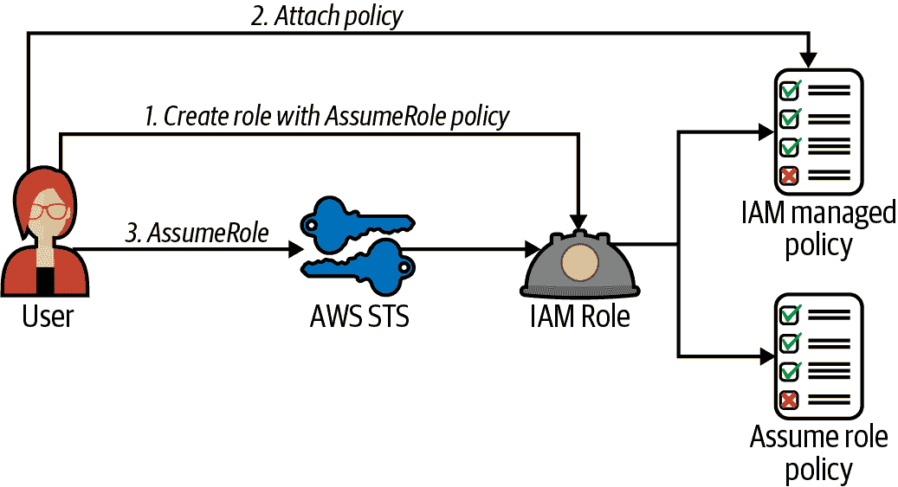

### 步骤

1.  创建一个名为 `assume-role-policy-template.json` 的文件，内容如下。这将允许 IAM 主体假设您接下来将创建的角色（仓库中提供了该文件）：

    ```json
    {
      "Version": "2012-10-17",
      "Statement": [
        {
          "Effect": "Allow",
          "Principal": {
            "AWS": "PRINCIPAL_ARN"
          },
          "Action": "sts:AssumeRole"
        }
      ]
    }
    ```

    **提示**

    如果您使用 IAM 用户，并且删除了并重新创建了该 IAM 用户，由于 IAM 服务缓解权限提升风险的方式，此策略将不再继续生效。有关更多信息，请参阅 IAM 文档中的 [相关说明](https://oreil.ly/wR02t)。

2.  检索您用户的 [ARN](https://oreil.ly/BDayp) 并将其设置为变量：

    ```
    PRINCIPAL_ARN=$(aws sts get-caller-identity --query Arn --output text)
    ```

3.  使用 `sed` 命令替换 `assume-role-policy-template.json` 文件中的 `PRINCIPAL_ARN` 并生成 `assume-role-policy.json` 文件：

    ```
    sed -e "s|PRINCIPAL_ARN|${PRINCIPAL_ARN}|g" \
         assume-role-policy-template.json > assume-role-policy.json
    ```

4.  创建角色并指定假设角色策略文件：

    ```
    ROLE_ARN=$(aws iam create-role --role-name AWSCookbook101Role \
         --assume-role-policy-document file://assume-role-policy.json \
         --output text --query Role.Arn)
    ```

5.  将 AWS 托管的 `PowerUserAccess` 策略附加到角色：

    ```
    aws iam attach-role-policy --role-name AWSCookbook101Role \
         --policy-arn arn:aws:iam::aws:policy/PowerUserAccess
    ```

    **注意**

    AWS 提供了 [常见工作职能的访问策略](https://oreil.ly/iyKFx) 供您参考。这些策略可能是您为特定工作职能委派用户访问账户的良好起点；但是，最好为您的每个访问需求定义最小权限策略。

### 验证检查

假设角色：

```
aws sts assume-role --role-arn $ROLE_ARN \
     --role-session-name AWSCookbook101
```

您应该会看到类似以下的输出：

```json
{
  "Credentials": {
    "AccessKeyId": "<snip>",
    "SecretAccessKey": "<snip>",
    "SessionToken": "<snip>",
    "Expiration": "2021-09-12T23:34:56+00:00"
  },
  "AssumedRoleUser": {
    "AssumedRoleId": "EXAMPLE:AWSCookbook101",
    "Arn": "arn:aws:sts::11111111111:assumed-role/AWSCookbook101Role/AWSCookbook101"
  }
}
```

**提示**

`AssumeRole` API 会从 `AWS Security Token Service` (STS) 向调用者返回一组用于角色会话的临时凭证，前提是该角色的 `AssumeRole` 策略中的权限允许。所有 IAM 角色都有关联的 `AssumeRole` 策略。您可以使用此输出 [为 AWS CLI 配置凭证](https://oreil.ly/F7ril)；将 `AccessKey`、`SecretAccessKey` 和 `SessionToken` 设置为环境变量；还可以在 AWS 控制台中使用 `Switch Role` 功能来假设角色。当您的应用程序需要进行 AWS API 调用时，您所选编程语言的 AWS SDK 会为它们处理此过程。

### 清理

按照 [章节代码仓库](https://github.com/AWSCookbook/Security) 中此配方文件夹中的步骤操作。

### 讨论


将管理员访问权限用于日常开发任务并非安全最佳实践。授予不必要的权限可能导致执行未经授权的操作。将 `PowerUserAccess` AWS 托管策略用于开发目的，比使用 `AdministratorAccess` 更好的起点。随后，您应定义自己的[客户托管策略](https://oreil.ly/hfQ3p)，仅授予您所需的特定操作。例如，如果您需要频繁登录以检查 `EC2` 实例的状态，可以为此目的创建一个只读策略并将其附加到角色。同样，您可以创建一个用于账单访问的角色，并仅用它来访问 AWS 账单控制台。您越多地实践使用[最小权限原则](https://oreil.ly/jMW6h)，安全就越会成为您工作中自然而然的一部分。

您在此示例中使用了 `IAM 用户` 来执行步骤。如果您使用的 AWS 账户利用[联合身份](https://oreil.ly/hmUw3)进行访问（例如，您雇主处的沙箱或开发 AWS 账户），您应使用来自 `AWS STS` 的临时凭证，而不是 `IAM 用户`。这种访问方式使用基于时间的令牌，在一段时间后过期，而不是像访问密钥或密码那样的“长期”凭证。当您在验证步骤中执行 `AssumeRole` 时，您调用了 STS 服务以获取临时凭证。为了协助频繁的 `AssumeRole` 操作，`AWS CLI` 支持[命名配置文件](https://oreil.ly/fZSQ9)，当您在命名配置文件中指定 `role_arn` 参数时，它们可以自动为您的角色承担并刷新临时凭证。

**提示**

您可以在创建的 `AssumeRole` 策略中将多因素认证（`MFA`）作为条件要求。这将仅允许通过 `MFA` 认证的身份来承担该角色。有关要求 `MFA` 进行 `AssumeRole` 的更多信息，请参阅[支持文档](https://oreil.ly/djRQI)。

请参阅示例 9.4 以在发生根用户登录时创建警报。

**提示**

您可以授予对您 AWS 资源的跨账户访问权限。您在此示例的策略中定义的资源将引用您希望委托访问权限的 AWS 账户及该账户中的主体。启用跨账户访问时，您应始终使用 `ExternalID`。有关更多信息，请参阅[跨账户访问官方教程](https://oreil.ly/wwlF4)。

### 挑战

为每个用于工作职能的 AWS 托管策略创建额外的 `IAM 角色`（例如：账单、数据库管理员、网络等）。

## 1.2 基于访问模式生成最小权限 IAM 策略

### 问题

您希望为您的用户实施最小权限访问，并缩小权限范围，仅允许访问您在 AWS 账户中需要使用的服务、资源和操作。

### 解决方案

在 `IAM 控制台` 中使用 `IAM Access Analyzer`，基于您 AWS 账户中的 `CloudTrail` 活动生成 `IAM 策略`，如图 1-2 所示。

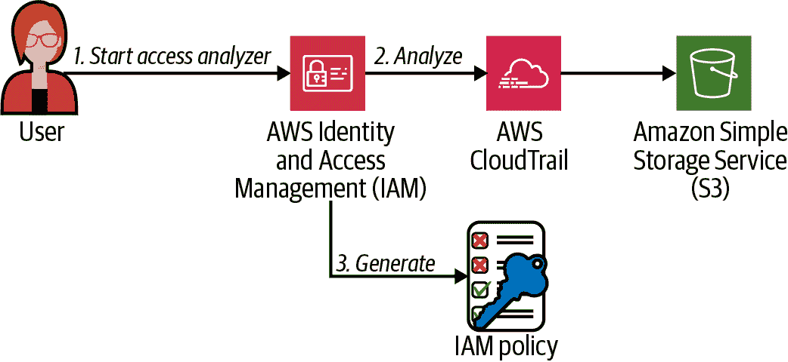

### 先决条件

*   已为您的账户启用 `CloudTrail` 日志记录到配置好的 `S3` 存储桶（请参阅示例 9.3）

### 步骤

1.  导航到 [IAM 控制台](https://console.aws.amazon.com/iam) 并选择您要为其生成策略的 `IAM 角色` 或 `IAM 用户`。

2.  在 `权限选项卡`（查看主体时默认激活的选项卡）上，向下滚动，展开“基于 `CloudTrail 事件` 生成策略”部分，然后点击“`生成策略`”按钮。

    **提示**

    若要快速查看从您的主体访问的 AWS 服务，请点击 `访问顾问选项卡` 并查看服务列表和访问时间。虽然 `IAM 访问顾问` 不如 `Access Analyzer` 强大，但在审核或排查 AWS 账户中的 `IAM 主体` 时会有所帮助。

3.  选择您要评估的 `CloudTrail 事件` 的时间段，选择您的 `CloudTrail 跟踪`，选择您的 `区域`（或选择“所有区域”），并选择“`创建并使用新的服务角色`。” `IAM Access Analyzer` 将为该服务创建一个角色，用于读取您所选跟踪的访问权限。最后，点击“`生成策略`。” 示例请参见图 1-3。

    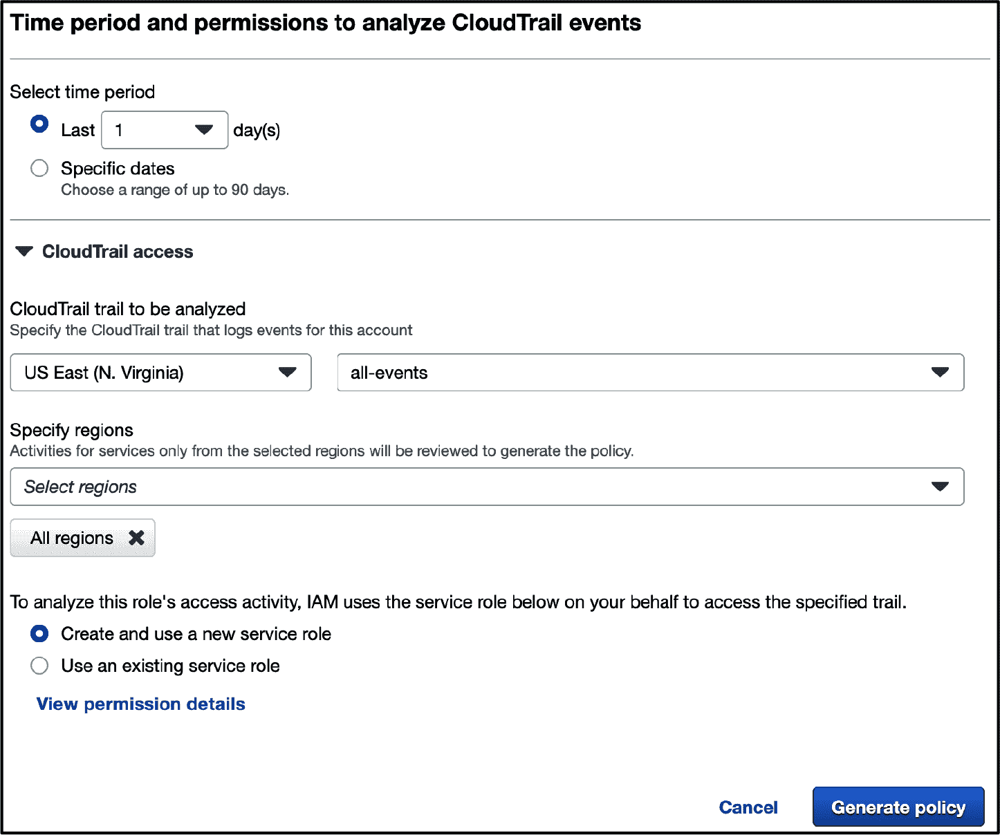

    **注意**

    角色创建最多可能需要 30 秒。角色创建完成后，策略生成将花费一定时间，具体取决于您的 `CloudTrail 跟踪` 中有多少活动。

4.  分析器完成后，滚动到 `权限选项卡` 底部，点击“`查看生成的策略`”，如图 1-4 所示。

    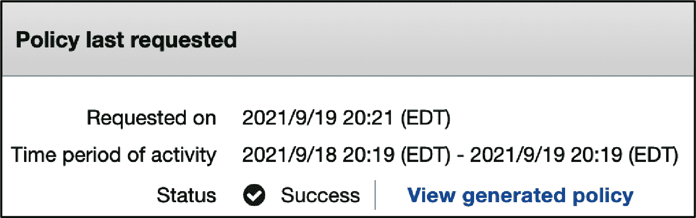

5.  点击下一步，您将看到基于您的 `IAM 主体` 活动生成的 `JSON` 格式策略。如果您愿意，可以在界面中编辑此策略以添加额外权限。再次点击下一步，选择一个名称，即可将此生成的策略部署为 `IAM 策略`。

    您应该会在 `IAM 控制台` 中看到类似如下的生成 `IAM 策略`：

    ```
    {
      "Version": "2012-10-17",
      "Statement": [
        {
          "Effect": "Allow",
          "Action": [
            "access-analyzer:ListPolicyGenerations",
            "cloudtrail:DescribeTrails",
            "cloudtrail:LookupEvents",
            "iam:GetAccountPasswordPolicy",
            "iam:GetAccountSummary",
            "iam:GetServiceLastAccessedDetails",
            "iam:ListAccountAliases",
            "iam:ListGroups",
            "iam:ListMFADevices",
            "iam:ListUsers",
            "s3:ListAllMyBuckets",
            "sts:GetCallerIdentity"
          ],
          "Resource": "*"
        }, ...
    }
    ```

### 验证检查

创建一个新的 `IAM 用户` 或 `IAM 角色` 并将新创建的 `IAM 策略` 附加到它。执行策略授予的操作，以验证该策略是否允许您的 `IAM 主体` 执行您需要的操作。

### 讨论

当您为用户和应用程序制定策略范围时，应始终寻求实施最小权限 `IAM 策略`。通常，您在开始时可能并不确切知道需要哪些权限。借助 `IAM Access Analyzer`，您可以先在开发环境中授予用户和应用程序较大的权限范围，启用 `CloudTrail 日志记录`（示例 9.3），然后在您拥有一段能很好地代表常规活动的时间窗口后运行 `IAM Access Analyzer`（在 `Access Analyzer` 配置中选择此时间段，就像您在步骤 3 中所做的那样）。生成的策略将包含所有必要权限，允许您的应用程序或用户按您选择分析的那段时间内的工作方式运行，帮助您实施[最小权限原则](https://oreil.ly/jMW6h)。

**注意**

您还应了解 `Access Analyzer` 支持的[服务列表](https://oreil.ly/KPEFh)。

### 挑战

对生成的策略使用 `IAM 策略模拟器`（请参阅示例 1.4）以验证该策略是否包含您所需的访问权限。

## 1.3 在您的 AWS 账户中强制执行 IAM 用户密码策略

**注意**

特别感谢 Gaurav Raje 对此示例的贡献。

### 问题

您的安全策略要求您必须为 AWS 账户中的所有用户强制执行密码策略。该密码策略设置 90 天过期，且密码必须由至少 32 个字符组成，包含大小写字母、数字和符号。

### 解决方案


#### 为 IAM 用户设置密码策略

为您 AWS 账户中的 IAM 用户设置密码策略。创建一个 IAM 用户组、一个 IAM 用户，并将该用户添加到用户组中，以验证策略是否正在生效（请参阅图 1-5）。

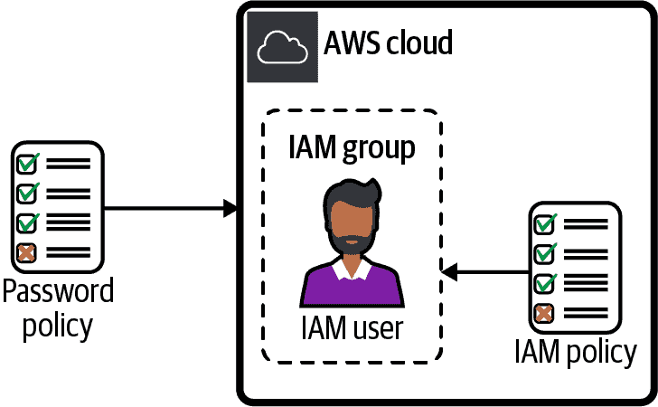

##### 注意

如果您的组织拥有中央用户目录，我们建议使用身份联合通过 [AWS Single Sign-On (SSO)](https://aws.amazon.com/single-sign-on) 访问您的 AWS 账户，而不是创建单独的 IAM 用户和用户组。联合允许您使用身份提供商 (IdP)，您已在其中维护用户和用户组。AWS 发布了一份[指南](https://aws.amazon.com/identity/federation)，解释了可用的联合访问配置。您可以遵循 `Recipe 9.6` 为您的账户启用 AWS SSO，即使您没有可用的 IdP（AWS SSO 默认提供一个可用的目录）。

### 步骤

1.  使用 AWS CLI 设置 IAM 密码策略，要求包含小写字母、大写字母、符号和数字。该策略应指定最小长度为 32 个字符、最长密码使用期限为 90 天，并防止密码重复使用：

    ```
    aws iam update-account-password-policy \
         --minimum-password-length 32 \
         --require-symbols \
         --require-numbers \
         --require-uppercase-characters \
         --require-lowercase-characters \
         --allow-users-to-change-password \
         --max-password-age 90 \
         --password-reuse-prevention true
    ```

2.  创建一个 IAM 用户组：

    ```
    aws iam create-group --group-name AWSCookbook103Group
    ```

    您应该会看到类似如下的输出：

    ```
    {
      "Group": {
        "Path": "/",
        "GroupName": "AWSCookbook103Group",
        "GroupId": "<snip>",
        "Arn": "arn:aws:iam::111111111111:group/AWSCookbook103Group",
        "CreateDate": "2021-11-06T19:26:01+00:00"
      }
    }
    ```

3.  将 `ReadOnlyAccess` 策略附加到用户组：

    ```
    aws iam attach-group-policy --group-name AWSCookbook103Group \
         --policy-arn arn:aws:iam::aws:policy/AWSBillingReadOnlyAccess
    ```

    #### 提示

    最好将策略附加到用户组，而不是直接附加到用户。随着用户数量的增加，使用 IAM 用户组来委派权限以便于管理会更容易。这也有助于满足 [CIS Level 1](https://oreil.ly/i211Q) 等标准的合规要求。

4.  创建一个 IAM 用户：

    ```
    aws iam create-user --user-name awscookbook103user
    ```

    您应该会看到类似如下的输出：

    ```
    {
      "User": {
        "Path": "/",
        "UserName": "awscookbook103user",
        "UserId": "<snip>",
        "Arn": "arn:aws:iam::111111111111:user/awscookbook103user",
        "CreateDate": "2021-11-06T21:01:47+00:00"
      }
    }
    ```

5.  使用 Secrets Manager 生成一个符合您密码策略的密码：

    ```
    RANDOM_STRING=$(aws secretsmanager get-random-password \
    --password-length 32 --require-each-included-type \
    --output text \
    --query RandomPassword)
    ```

6.  为用户创建一个指定密码的登录配置文件：

    ```
    aws iam create-login-profile --user-name awscookbook103user \
         --password $RANDOM_STRING
    ```

    您应该会看到类似如下的输出：

    ```
    {
      "LoginProfile": {
        "UserName": "awscookbook103user",
        "CreateDate": "2021-11-06T21:11:43+00:00",
        "PasswordResetRequired": false
      }
    }
    ```

7.  将用户添加到您为账单只读访问创建的用户组中：

    ```
    aws iam add-user-to-group --group-name AWSCookbook103Group \
         --user-name awscookbook103user
    ```

### 验证检查

验证您设置的密码策略现已生效：

```
aws iam get-account-password-policy
```

您应该会看到类似如下的输出：

```
{
  "PasswordPolicy": {
    "MinimumPasswordLength": 32,
    "RequireSymbols": true,
    "RequireNumbers": true,
    "RequireUppercaseCharacters": true,
    "RequireLowercaseCharacters": true,
    "AllowUsersToChangePassword": true,
    "ExpirePasswords": true,
    "MaxPasswordAge": 90,
    "PasswordReusePrevention": 1
  }
}
```

尝试使用 AWS CLI 创建一个新用户，并使用一个违反密码策略的密码。AWS 将不允许您创建此类用户：

```
aws iam create-user --user-name awscookbook103user2
```

使用 Secrets Manager 生成一个不符合您密码策略的密码：

```
RANDOM_STRING2=$(aws secretsmanager get-random-password \
--password-length 16 --require-each-included-type \
--output text \
--query RandomPassword)
```

为用户创建一个指定该密码的登录配置文件：

```
aws iam create-login-profile --user-name awscookbook103user2 \
--password $RANDOM_STRING2
```

此命令应会失败，并且您应该会看到类似如下的输出：

```
An error occurred (PasswordPolicyViolation) when calling the CreateLoginProfile
operation: Password should have a minimum length of 32
```

### 清理

遵循 [章节代码仓库](https://github.com/AWSCookbook/Security) 中此配方文件夹内的步骤。

### 讨论

对于使用密码登录的用户，AWS 允许管理员对其账户强制执行符合组织安全要求的密码策略。这样，管理员可以确保单个用户不会因选择弱密码或不定期更改密码而危害组织的安全。

#### 提示

建议为 IAM 用户启用多因素认证。您可以为 IAM 用户使用基于软件的虚拟 MFA 设备或硬件设备作为第二因素。AWS 维护着一份受支持[设备](https://aws.amazon.com/iam/features/mfa)的更新列表。

多因素认证是在现有基于密码的安全性之上增加另一层安全防护的绝佳方式。它结合了“您知道的”和“您拥有的”；因此，在您的密码可能泄露给恶意第三方的情况下，他们仍然需要额外的因素才能进行身份验证。

### 挑战

下载[凭证报告](https://oreil.ly/GFTke)以分析您账户中的 IAM 用户及其密码使用期限。

## 1.4 使用 IAM 策略模拟器测试 IAM 策略

### 问题

您有一个想要投入使用的 IAM 策略，但希望先测试其有效性。

### 解决方案

将 IAM 策略附加到 IAM 角色，并使用 IAM 策略模拟器模拟操作，如图 1-6 所示。

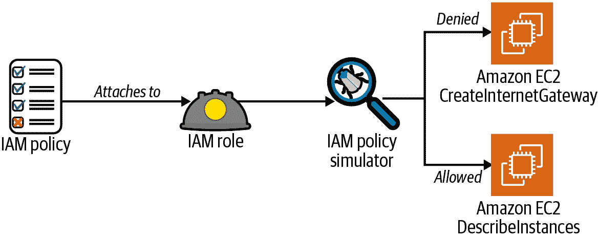

### 步骤

1.  创建一个名为 `assume-role-policy.json` 的文件，内容如下（仓库中提供了该文件）：

    ```
    {
      "Version": "2012-10-17",
      "Statement": [
        {
          "Effect": "Allow",
          "Principal": {
            "Service": "ec2.amazonaws.com"
          },
          "Action": "sts:AssumeRole"
        }
      ]
    }
    ```

2.  使用 `assume-role-policy.json` 文件创建一个 IAM 角色：

    ```
    aws iam create-role --assume-role-policy-document \
         file://assume-role-policy.json --role-name AWSCookbook104IamRole
    ```

    您应该会看到类似如下的输出：

    ```
    {
      "Role": {
      "Path": "/",
      "RoleName": "AWSCookbook104IamRole",
      "RoleId": "<<UniqueID>>",
      "Arn": "arn:aws:iam::111111111111:role/AWSCookbook104IamRole",
      "CreateDate": "2021-09-22T23:37:44+00:00",
      "AssumeRolePolicyDocument": {
        "Version": "2012-10-17",
        "Statement": [
        ...
    ```

3.  将 `AmazonEC2ReadOnlyAccess` 的 IAM 托管策略附加到 IAM 角色：

    ```
    aws iam attach-role-policy --role-name AWSCookbook104IamRole \
         --policy-arn arn:aws:iam::aws:policy/AmazonEC2ReadOnlyAccess
    ```

#### 提示


### 验证检查

您可以在 AWS [文章](https://oreil.ly/EjuR3) 中找到 EC2 的所有操作、资源和条件键的列表。IAM [全局条件上下文键](https://oreil.ly/IUVkw) 在编写细粒度策略时也很有用。

### 验证检查

模拟您正在使用的 IAM 策略的效果，在 EC2 服务上测试几种不同类型的操作。

测试 `ec2:CreateInternetGateway` 操作：

```
aws iam simulate-principal-policy \
     --policy-source-arn arn:aws:iam::$AWS_ACCOUNT_ARN:role/AWSCookbook104IamRole \
     --action-names ec2:CreateInternetGateway
```

您应该会看到类似以下的输出（注意 `EvalDecision`）：

```
{
  "EvaluationResults": [
  {
    "EvalActionName": "ec2:CreateInternetGateway",
    "EvalResourceName": "*",
    "EvalDecision": "implicitDeny",
    "MatchedStatements": [],
    "MissingContextValues": []
  }
  ]
}
```

#### 注意

由于您在此示例中仅将 AWS 托管的 `AmazonEC2ReadOnlyAccess` IAM 策略附加到了角色，您将看到 `CreateInternetGateway` 操作的隐式拒绝。这是预期行为。`AmazonEC2ReadOnlyAccess` 不授予 EC2 服务的任何“创建”功能。

测试 `ec2:DescribeInstances` 操作：

```
aws iam simulate-principal-policy \
     --policy-source-arn arn:aws:iam::$AWS_ACCOUNT_ARN:role/AWSCookbook104IamRole \
     --action-names ec2:DescribeInstances
```

您应该会看到类似以下的输出：

```
{
  "EvaluationResults": [
  {
    "EvalActionName": "ec2:DescribeInstances",
    "EvalResourceName": "*",
    "EvalDecision": "allowed",
    "MatchedStatements": [
      {
      "SourcePolicyId": "AmazonEC2ReadOnlyAccess",
      "SourcePolicyType": "IAM Policy",
      "StartPosition": {
        "Line": 3,
        "Column": 17
      },
      "EndPosition": {
        "Line": 8,
        "Column": 6
      }
      }
    ],
    "MissingContextValues": []
  }
  ]
}
```

#### 注意

`AmazonEC2ReadOnlyAccess` 策略允许对 EC2 服务进行读取操作，因此当您模拟此操作时，`DescribeInstances` 操作会成功。

### 清理

请按照 [章节代码仓库](https://github.com/AWSCookbook/Security) 中此示例文件夹中的步骤操作。

### 讨论

[IAM 策略](https://oreil.ly/uy1uB) 允许您定义管理 AWS 中访问权限的权限。策略可以附加到主体，从而允许您向资源、用户、组和服务授予（或拒绝）权限。作为安全最佳实践，最好始终将策略的范围限定为所需的最小权限集。[IAM 策略模拟器](https://oreil.ly/9qscF) 在设计和管理最小权限的 IAM 策略时非常有帮助。

IAM 策略模拟器还提供了一个 Web 界面，您可以使用它来测试和排查 IAM 策略故障，并了解您定义的策略的净效果。您可以测试所有策略或附加到用户、组和角色的策略子集。

#### 提示

IAM 策略模拟器可以帮助您模拟以下内容的效果：

*   基于身份的策略
*   IAM 权限边界
*   AWS Organizations 服务控制策略 (SCP)
*   基于资源的策略

查看策略模拟器结果后，您可以向策略添加其他语句来解决问题（从故障排除的角度），或者将新创建的策略附加到用户、组和角色，确信策略的净效果正是您所期望的。

#### 注意

为了帮助您轻松从头构建 IAM 策略，AWS 提供了 [AWS 策略生成器](https://oreil.ly/Ny8HI)。

### 挑战

模拟权限边界对 IAM 主体的效果（请参阅 示例 1.5）。

## 1.5 使用权限边界委托 IAM 管理功能

### 问题

您需要授予团队成员部署 Lambda 函数并为其创建 IAM 角色的能力。您需要限制所创建 IAM 角色的有效权限，使其仅允许函数所需的操作。

### 解决方案

创建一个 [权限边界](https://oreil.ly/dtZ7X) 策略，为 Lambda 开发人员创建一个 IAM 角色，创建一个指定边界策略的 IAM 策略，并将该策略附加到您创建的角色。图 1-7 说明了带有权限边界的基于身份的策略的有效权限。

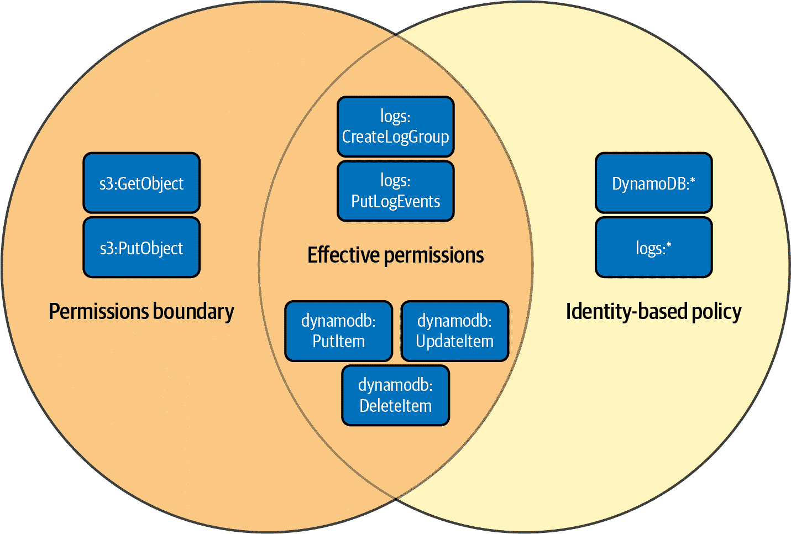

### 前提条件

*   一个具有管理权限的 AWS 账户 IAM 用户或联合身份（请遵循 [创建首个 IAM 管理员用户和用户组的 AWS 指南](https://oreil.ly/2MPmL)）。

### 步骤

1.  创建一个名为 `assume-role-policy-template.json` 的文件，内容如下（仓库中提供了该文件）：

    ```
    {
      "Version": "2012-10-17",
      "Statement": [
        {
          "Effect": "Allow",
          "Principal": {
            "AWS": "PRINCIPAL_ARN"
          },
          "Action": "sts:AssumeRole"
        }
      ]
    }
    ```

2.  检索您用户的 ARN 并将其设置为变量：

    ```
    PRINCIPAL_ARN=$(aws sts get-caller-identity --query Arn --output text)
    ```

3.  使用 `sed` 命令替换仓库中提供的 `assume-role-policy-template.json` 文件中的 `PRINCIPAL_ARN` 并生成 `assume-role-policy.json` 文件：

    ```
    sed -e "s|PRINCIPAL_ARN|${PRINCIPAL_ARN}|g" \
    assume-role-policy-template.json > assume-role-policy.json
    ```

    ###### 注意

    为了演示此示例，您将允许的 IAM 主体设置为您自己的用户（用户 1）。要测试委托访问，您需要将 IAM 主体设置为其他实体。

4.  创建角色并指定假设角色策略文件：

    ```
    ROLE_ARN=$(aws iam create-role --role-name AWSCookbook105Role \
         --assume-role-policy-document file://assume-role-policy.json \
         --output text --query Role.Arn)
    ```

5.  创建一个名为 `boundary-template.json` 的权限边界 JSON 文件，内容如下。这允许特定的 DynamoDB、S3 和 CloudWatch Logs 操作（仓库中提供了该文件）：

    ```
    {
      "Version": "2012-10-17",
      "Statement": [
        {
          "Sid": "CreateLogGroup",
          "Effect": "Allow",
          "Action": "logs:CreateLogGroup",
          "Resource": "arn:aws:logs:*:AWS_ACCOUNT_ID:*"
        },
        {
          "Sid": "CreateLogStreamandEvents",
          "Effect": "Allow",
          "Action": [
            "logs:CreateLogStream",
            "logs:PutLogEvents"
          ],
          "Resource": "arn:aws:logs:*:AWS_ACCOUNT_ID:*"
        }, 
        {
          "Sid": "DynamoDBPermissions",
          "Effect": "Allow",
          "Action": [
            "dynamodb:PutItem",
            "dynamodb:UpdateItem",
            "dynamodb:DeleteItem"
          ],
          "Resource": "arn:aws:dynamodb:*:AWS_ACCOUNT_ID:table/AWSCookbook*"
        },
        {
          "Sid": "S3Permissions",
          "Effect": "Allow",
          "Action": [
            "s3:GetObject",
            "s3:PutObject"
          ],
          "Resource": "arn:aws:s3:::AWSCookbook*/*"
        }
      ]
    }
    ```

6.  使用 `sed` 命令替换 `boundary-policy_template.json` 文件中的 `AWS_ACCOUNT_ID` 并生成 `boundary-policy.json` 文件：

    ```
    sed -e "s|AWS_ACCOUNT_ID|${AWS_ACCOUNT_ID}|g" \
         boundary-policy_template.json > boundary-policy.json
    ```

7.  使用 AWS CLI 创建权限边界策略：

    ```
    aws iam create-policy --policy-name AWSCookbook105PB \
         --policy-document file://boundary-policy.json
    ```

    您应该会看到类似以下的输出：


```
{
  "Policy": {
    "PolicyName": "AWSCookbook105PB",
    "PolicyId": "EXAMPLE",
    "Arn": "arn:aws:iam::111111111111:policy/AWSCookbook105PB",
    "Path": "/",
    "DefaultVersionId": "v1",
    "AttachmentCount": 0,
    "PermissionsBoundaryUsageCount": 0,
    "IsAttachable": true,
    "CreateDate": "2021-09-24T00:36:53+00:00",
    "UpdateDate": "2021-09-24T00:36:53+00:00"
  }
}
```

8. 为该角色创建一个名为 `policy-template.json` 的策略文件（仓库中已提供文件）：

```
{
  "Version": "2012-10-17",
  "Statement": [
    {
      "Sid": "DenyPBDelete",
      "Effect": "Deny",
      "Action": "iam:DeleteRolePermissionsBoundary",
      "Resource": "*"
    },
    {
      "Sid": "IAMRead",
      "Effect": "Allow",
      "Action": [
        "iam:Get*",
        "iam:List*"
      ],
      "Resource": "*"
    },
    {
      "Sid": "IAMPolicies",
      "Effect": "Allow",
      "Action": [
        "iam:CreatePolicy",
        "iam:DeletePolicy",
        "iam:CreatePolicyVersion",
        "iam:DeletePolicyVersion",
        "iam:SetDefaultPolicyVersion"
      ],
      "Resource": "arn:aws:iam::AWS_ACCOUNT_ID:policy/AWSCookbook*"
    },
    {
      "Sid": "IAMRolesWithBoundary",
      "Effect": "Allow",
      "Action": [
        "iam:CreateRole",
        "iam:DeleteRole",
        "iam:PutRolePolicy",
        "iam:DeleteRolePolicy",
        "iam:AttachRolePolicy",
        "iam:DetachRolePolicy"
      ],
      "Resource": [
        "arn:aws:iam::AWS_ACCOUNT_ID:role/AWSCookbook*"
      ],
      "Condition": {
        "StringEquals": {
          "iam:PermissionsBoundary": "arn:aws:iam::AWS_ACCOUNT_ID:policy/AWSCookbook105PB"
        }
      }
    },
    {
      "Sid": "ServerlessFullAccess",
      "Effect": "Allow",
      "Action": [
        "lambda:*",
        "logs:*",
        "dynamodb:*",
        "s3:*"
      ],
      "Resource": "*"
    },
    {
      "Sid": "PassRole",
      "Effect": "Allow",
      "Action": "iam:PassRole",
      "Resource": "arn:aws:iam::AWS_ACCOUNT_ID:role/AWSCookbook*",
      "Condition": {
        "StringLikeIfExists": {
          "iam:PassedToService": "lambda.amazonaws.com"
        }
      }
    },
    {
      "Sid": "ProtectPB",
      "Effect": "Deny",
      "Action": [
        "iam:CreatePolicyVersion",
        "iam:DeletePolicy",
        "iam:DeletePolicyVersion",
        "iam:SetDefaultPolicyVersion"
      ],
      "Resource": [
        "arn:aws:iam::AWS_ACCOUNT_ID:policy/AWSCookbook105PB",
        "arn:aws:iam::AWS_ACCOUNT_ID:policy/AWSCookbook105Policy"
      ]
    }
  ]
}
```

此自定义 IAM 策略包含多个协同工作的语句，它们定义了解决问题所需的特定权限：


: `DenyPBDelete`：显式拒绝从角色中删除权限边界的能力。


: `IAMRead`：允许开发人员拥有只读 IAM 访问权限，以确保 IAM 控制台正常工作。


: `IAMPolicies`：允许创建 IAM 策略，但强制要求命名约定前缀为 `AWSCookbook*`。


: `IAMRolesWithBoundary`：仅允许创建和删除包含所引用权限边界的 IAM 角色。


: `ServerlessFullAccess`：允许开发人员对 AWS Lambda、Amazon DynamoDB、Amazon CloudWatch Logs 和 Amazon S3 服务拥有完全访问权限。


: `PassRole`：允许开发人员将 IAM 角色传递给 Lambda 函数。


: `ProtectPB`：显式拒绝修改绑定其所创建角色的权限边界的能力。

9. 使用 `sed` 命令替换 `policy-template.json` 文件中的 `AWS_ACCOUNT_ID` 并生成 `policy.json` 文件：

```
sed -e "s|AWS_ACCOUNT_ID|${AWS_ACCOUNT_ID}|g" \
     policy-template.json > policy.json
```

10. 创建开发人员访问策略：

```
aws iam create-policy --policy-name AWSCookbook105Policy \
     --policy-document file://policy.json
```

您应该会看到类似以下的输出：

```
{
  "Policy": {
    "PolicyName": "AWSCookbook105Policy",
    "PolicyId": "EXAMPLE",
    "Arn": "arn:aws:iam::11111111111:policy/AWSCookbook105Policy",
    "Path": "/",
    "DefaultVersionId": "v1",
    "AttachmentCount": 0,
    "PermissionsBoundaryUsageCount": 0,
    "IsAttachable": true,
    "CreateDate": "2021-09-24T00:37:13+00:00",
    "UpdateDate": "2021-09-24T00:37:13+00:00"
  }
}
```

11. 将该策略附加到您在第 2 步中创建的角色：

```
aws iam attach-role-policy --policy-arn \
     arn:aws:iam::$AWS_ACCOUNT_ID:policy/AWSCookbook105Policy \
     --role-name AWSCookbook105Role
```

### 验证检查

假设您创建的角色并将输出设置为 AWS CLI 的本地变量：

```
creds=$(aws --output text sts assume-role --role-arn $ROLE_ARN \
     --role-session-name "AWSCookbook105" | \
     grep CREDENTIALS | cut -d " " -f2,4,5)
export AWS_ACCESS_KEY_ID=$(echo $creds | cut -d " " -f2)
export AWS_SECRET_ACCESS_KEY=$(echo $creds | cut -d " " -f4)
export AWS_SESSION_TOKEN=$(echo $creds | cut -d " " -f5)
```

尝试为 Lambda 函数创建一个 IAM 角色，为 Lambda 服务创建一个信任策略 (`lambda-assume-role-policy.json`)：

```
{
  "Version": "2012-10-17",
  "Statement": [
    {
      "Effect": "Allow",
      "Principal": {
        "Service": "lambda.amazonaws.com"
      },
      "Action": "sts:AssumeRole"
    }
  ]
}
```

创建角色，指定权限边界，该边界符合策略中指定的角色命名标准：

```
TEST_ROLE_1=$(aws iam create-role --role-name AWSCookbook105test1 \
     --assume-role-policy-document \
     file://lambda-assume-role-policy.json \
     --permissions-boundary \
     arn:aws:iam::$AWS_ACCOUNT_ID:policy/AWSCookbook105PB \
     --output text --query Role.Arn)
```

将托管策略 `AmazonDynamoDBFullAccess` 附加到该角色：

```
aws iam attach-role-policy --role-name AWSCookbook105test1 \
--policy-arn arn:aws:iam::aws:policy/AmazonDynamoDBFullAccess
```

将托管策略 `CloudWatchFullAccess` 附加到该角色：

```
aws iam attach-role-policy --role-name AWSCookbook105test1 \
--policy-arn arn:aws:iam::aws:policy/CloudWatchFullAccess
```

#### 注意

尽管您将 `AmazonDynamoDBFullAccess` 和 `CloudWatchFullAccess` 附加到了该角色，但该角色的有效权限受限于您在第 3 步中创建的权限边界中的语句。此外，尽管您在边界中定义了 `s3:GetObject` 和 `s3:PutObject`，但您并未在角色策略中定义这些操作，因此在您创建允许这些操作的策略之前，该函数将无法进行这些调用。当您将此角色附加到 Lambda 函数时，Lambda 函数只能执行权限边界和角色策略交集中允许的操作（请参阅 图 1-7）。


现在您可以创建一个 Lambda 函数，指定此角色（`AWSCookbook105test1`）作为执行角色，以验证授予该函数的 DynamoDB 和 CloudWatch Logs 权限。您还可以使用 IAM 策略模拟器测试结果。

您使用了 `AssumeRole` 并设置环境变量来覆盖本地终端的 AWS 配置文件，以执行这些验证检查。为确保您在命令行上恢复到原始的经过身份验证的会话，请执行存储库中 README 文件顶部提供的清理步骤。

### 清理

按照 [章节代码仓库](https://github.com/AWSCookbook/Security) 中此配方文件夹中的步骤操作。

#### 注意

请务必删除您的环境变量，以便您能重新获得未来配方所需的权限：

```bash
unset AWS_ACCESS_KEY_ID
unset AWS_SECRET_ACCESS_KEY
unset AWS_SESSION_TOKEN
```

### 讨论

在您致力于为 AWS 中的用户和应用程序实施最小权限访问模型的过程中，您需要允许开发人员创建 IAM 角色，以便他们的应用程序在需要与其他 AWS 服务交互时可以代入这些角色。例如，需要访问 Amazon DynamoDB 表的 AWS Lambda 函数将需要创建一个角色，以便能够对该表执行操作。随着团队规模扩大，您不必让团队成员每次需要为特定目的创建角色时都来找您，而是可以通过权限边界来授权（并控制）他们，而无需放弃过多的 IAM 访问权限。授予 `iam:CreateRole` 权限的策略中的 `iam:PermissionsBoundary` 条件可确保所创建的角色必须始终包含附加的权限边界。

权限边界充当护栏并限制权限提升。换句话说，它们通过定义所创建角色可以执行的操作，来限制委派管理员创建的 IAM 主体的最大有效权限。如 图 1-7 所示，它们与附加到 IAM 主体（IAM 用户或角色）的权限策略（IAM 策略）协同工作。这避免了向管理员角色授予广泛访问权限的需求，防止了权限提升，并通过允许团队成员快速迭代并为其应用程序创建自己的最小权限角色，帮助您实现最小权限访问。

在此配方中，您可能已经注意到，我们在权限边界策略中引用的角色和策略上使用了 `AWSCookbook*` 命名约定，这确保委派主体可以在此约定内创建角色和策略。这意味着开发人员可以创建资源，仅将*这些*角色传递给服务，并保持标准的命名约定。这是实施权限边界时的理想做法。您可以为不同的团队、应用程序和服务制定命名约定，以便它们可以共存于同一个账户中，但如果必要，可以根据其需求应用不同的边界。

至少，在构建实现权限边界护栏以向非管理员委派 IAM 权限的角色时，您需要牢记以下四点：

1.  允许创建 IAM 客户托管策略：您的用户可以创建他们想要的任何策略；这些策略在附加到 IAM 主体之前不会生效。
2.  允许在必须附加权限边界的条件下创建 IAM 角色：强制团队成员创建的所有角色在角色创建时包含权限边界。
3.  允许附加策略，但仅限于具有权限边界的角色：不要让用户修改他们可能有权访问的现有角色。
4.  允许对您的用户创建角色的 AWS 服务使用 `iam:PassRole`：您的开发人员可能需要为 Amazon EC2 和 AWS Lambda 创建角色，因此请赋予他们仅将自己创建的角色传递给您定义的那些服务的能力。

#### 提示

权限边界是一个强大的高级 IAM 概念，可能难以理解。我们建议查看 Brigid Johnson 在 AWS re:Inforce 2018 上的[演讲](https://oreil.ly/0Smmq)，以通过实际方式了解一些 IAM 策略、角色和权限边界的真实示例。

### 挑战

扩展权限边界，以允许创建的角色发布到 SQS 队列和 SNS 主题，并相应调整角色的策略。

## 1.6 使用 AWS SSM Session Manager 连接到 EC2 实例

### 问题

您在私有子网中有一个 EC2 实例，需要连接到该实例，但不想通过互联网使用 SSH。

### 解决方案

创建一个 IAM 角色，附加 `AmazonSSMManagedInstanceCore` 策略，创建一个 EC2 实例配置文件，将您创建的 IAM 角色附加到实例配置文件，将 EC2 实例配置文件关联到 EC2 实例，最后运行 `aws ssm start-session` 命令连接到实例。这些步骤的逻辑流程如 图 1-8 所示。

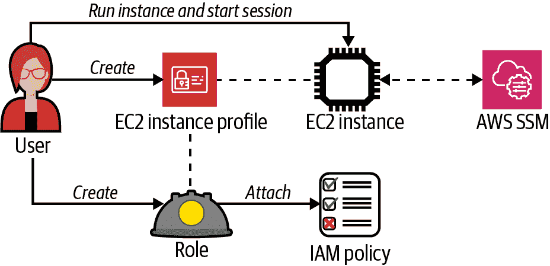

### 先决条件

*   具有隔离或私有子网及关联路由表的 Amazon Virtual Private Cloud (VPC)
*   [AWS Systems Manager 所需的 VPC 端点](https://oreil.ly/qyNJR)
*   安装了 [Session Manager 插件](https://oreil.ly/ejccM) 的 AWS CLI v2

### 准备

按照 [章节代码仓库](https://github.com/AWSCookbook/Security) 中此配方文件夹中的步骤操作。

### 步骤

1.  创建一个名为 `assume-role-policy.json` 的文件，内容如下（仓库中提供了该文件）：

```json
{
  "Version": "2012-10-17",
  "Statement": [
    {
      "Effect": "Allow",
      "Principal": {
        "Service": "ec2.amazonaws.com"
      },
      "Action": "sts:AssumeRole"
    }
  ]
}
```

2.  使用以下命令，根据提供的 `assume-role-policy.json` 文件中的语句创建 IAM 角色：

```bash
ROLE_ARN=$(aws iam create-role --role-name AWSCookbook106SSMRole \
     --assume-role-policy-document file://assume-role-policy.json \
     --output text --query Role.Arn)
```

3.  将 `AmazonSSMManagedInstanceCore` 托管策略附加到角色，以便该角色允许访问 AWS Systems Manager：

```bash
aws iam attach-role-policy --role-name AWSCookbook106SSMRole \
     --policy-arn arn:aws:iam::aws:policy/AmazonSSMManagedInstanceCore
```

4.  创建实例配置文件：

```bash
aws iam create-instance-profile \
     --instance-profile-name AWSCookbook106InstanceProfile
```

您应该会看到类似以下的输出：

```json
{
  "InstanceProfile": {
    "Path": "/",
    "InstanceProfileName": "AWSCookbook106InstanceProfile",
    "InstanceProfileId": "(RandomString",
    "Arn": "arn:aws:iam::111111111111:instance-profile/AWSCookbook106InstanceProfile",
    "CreateDate": "2021-11-28T20:26:23+00:00",
    "Roles": []
  }
}
```

5.  将您创建的角色添加到实例配置文件中：

```bash
aws iam add-role-to-instance-profile \
     --role-name AWSCookbook106SSMRole \
     --instance-profile-name AWSCookbook106InstanceProfile
```

#### 注意

EC2 实例配置文件包含您创建的角色。实例配置文件与实例的关联允许其定义“我是谁”，而角色定义“我被允许做什么”。IAM 要求两者都存在，以允许 EC2 实例使用 IAM 服务与其他 AWS 服务通信。您可以通过运行 `aws iam list-instance-profiles` AWS CLI 命令来获取账户中的实例配置文件列表。

6.  查询 SSM 以获取您所在区域可用的最新 Amazon Linux 2 AMI ID，并将其保存为环境变量：


```
AMI_ID=$(aws ssm get-parameters --names \
     /aws/service/ami-amazon-linux-latest/amzn2-ami-hvm-x86_64-gp2 \
     --query 'Parameters[0].[Value]' --output text)
```

#### 7. 在您的某个子网中启动一个实例，该实例引用您创建的实例配置文件，并使用 `Name` 标签以帮助您在控制台中识别该实例：

```
INSTANCE_ID=$(aws ec2 run-instances --image-id $AMI_ID \
     --count 1 \
     --instance-type t3.nano \
     --iam-instance-profile Name=AWSCookbook106InstanceProfile \
     --subnet-id $SUBNET_1 \
     --security-group-ids $INSTANCE_SG \
     --metadata-options \
HttpTokens=required,HttpPutResponseHopLimit=64,HttpEndpoint=enabled \
     --tag-specifications \
     'ResourceType=instance,Tags=[{Key=Name,Value=AWSCookbook106}]' \
     'ResourceType=volume,Tags=[{Key=Name,Value=AWSCookbook106}]' \
     --query Instances[0].InstanceId \
     --output text)
```

#### 提示

[EC2 实例元数据](https://oreil.ly/DtodI)是一项功能，您可以在 EC2 实例内部使用它，通过实例本身的 HTTP 端点访问有关您的 EC2 实例的信息。这对于通过[用户数据](https://oreil.ly/IMqFC)进行脚本编写和自动化非常有帮助。您应始终使用最新版本的实例元数据。在第 7 步中，您通过指定 `--metadata-options` 标志并提供 `HttpTokens=required` 选项来强制使用 [IMDSv2](https://oreil.ly/KGC4n)，从而实现了这一点。

### 验证检查

确保您的 EC2 实例已向 SSM 注册。使用以下命令检查状态。该命令应返回实例 ID：

```
aws ssm describe-instance-information \
     --filters Key=ResourceType,Values=EC2Instance \
     --query "InstanceInformationList[].InstanceId" --output text
```

使用 SSM Session Manager 连接到 EC2 实例：

```
aws ssm start-session --target $INSTANCE_ID
```

您现在应该已连接到您的实例并看到 bash 提示符。从 bash 提示符运行命令，通过查询元数据服务获取 IMDSv2 令牌并使用该令牌查询与实例关联的实例配置文件的元数据，以验证您已连接到您的 EC2 实例：

```
TOKEN=`curl -X PUT "http://169.254.169.254/latest/api/token" -H "X-aws-ec2-metadata-token-ttl-seconds: 21600"`
curl -H "X-aws-ec2-metadata-token: $TOKEN" http://169.254.169.254/latest/meta-data/iam/info
```

您应该会看到类似以下的输出：

```
{
  "Code" : "Success",
  "LastUpdated" : "2021-09-23T16:03:25Z",
  "InstanceProfileArn" : "arn:aws:iam::111111111111:instance-profile/AWSCookbook106InstanceProfile",
  "InstanceProfileId" : "AIPAZVTINAMEXAMPLE"
}
```

退出 Session Manager 会话：

```
exit
```

### 清理

请按照 [章节代码仓库](https://github.com/AWSCookbook/Security) 中此配方文件夹内的步骤操作。

### 讨论

当您使用 AWS SSM Session Manager 连接到 EC2 实例时，您消除了通过互联网使用 Secure Shell (SSH) 进行实例命令行访问的依赖。一旦为您的实例配置了 Session Manager，您就可以即时连接到 Linux 上的 bash shell 会话或 Windows 系统上的 PowerShell 会话。

#### 警告

SSM 可以记录会话期间的所有命令及其输出。您可以设置首选项，通过以下命令停止记录敏感数据（例如密码）：

```
stty -echo; read passwd; stty echo;
```

有关记录会话活动的更多信息，请参阅 AWS [文章](https://oreil.ly/QJcHr)。

Session Manager 通过 HTTPS（TCP 端口 443）与您正在使用的 AWS 区域内的 AWS Systems Manager (SSM) API 端点进行通信。实例上的代理在启动时向 SSM 服务注册。Session Manager 功能不需要入站安全组规则。我们建议配置 [Session Manager 的 VPC 端点](https://oreil.ly/vNEZQ)，以避免互联网流量和网络地址转换 (NAT) 网关的成本。

以下是 Session Manager 提供的增强安全态势的一些示例：

*   与实例关联的安全组中无需允许面向互联网的 TCP 端口。
*   您可以在私有（或隔离）子网中运行实例，而无需直接将其暴露在互联网上，仍可对其进行管理访问。
*   无需为实例创建、关联和管理 SSH 密钥。
*   无需在实例上管理用户账户和密码。
*   您可以使用 IAM 角色委托管理 EC2 实例的访问权限。

#### 注意

任何提供此类强大功能的工具（如 SSM）都必须经过仔细审计。AWS 提供了关于 [锁定 SSM 用户权限](https://oreil.ly/EQyPf) 的信息，以及关于 [审计会话活动](https://oreil.ly/aHzbf) 的更多信息。

### 挑战

查看会话的日志，并在执行 `rm` 命令时创建警报。

## 1.7 使用 KMS 密钥加密 EBS 卷

### 问题

您需要一个加密密钥，用于加密某个区域中挂载到您的 EC2 实例的 EBS 卷，并且需要每 365 天自动轮换一次该密钥。

### 解决方案

创建一个客户托管 KMS 密钥 (CMK)，启用密钥的年度轮换，为某个区域中的 EC2 服务启用 EBS 卷默认加密，并指定您创建的 KMS 密钥（如图 1-9 所示）。

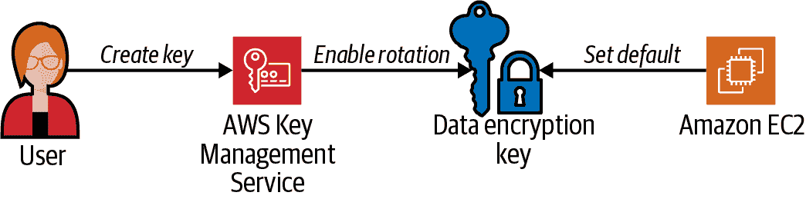

### 步骤

1.  创建一个客户托管 KMS 密钥并将密钥 ARN 存储为本地变量：

    ```
    KMS_KEY_ID=$(aws kms create-key --description "AWSCookbook107Key" \
         --output text --query KeyMetadata.KeyId)
    ```

2.  创建一个密钥别名，以帮助您在其他步骤中引用该密钥：

    ```
    aws kms create-alias --alias-name alias/AWSCookbook107Key \
         --target-key-id $KMS_KEY_ID
    ```

3.  每 365 天启用一次对称密钥材料的自动轮换：

    ```
    aws kms enable-key-rotation --key-id $KMS_KEY_ID
    ```

4.  在当前区域中为 EC2 服务启用默认 EBS 加密：

    ```
    aws ec2 enable-ebs-encryption-by-default
    ```

    您应该会看到类似以下的输出：

    ```
    {
         "EbsEncryptionByDefault": true
    }
    ```

5.  将用于默认 EBS 加密的默认 KMS 密钥更新为您在第 1 步中创建的客户托管密钥：

    ```
    aws ec2 modify-ebs-default-kms-key-id \
         --kms-key-id alias/AWSCookbook107Key
    ```

    您应该会看到类似以下的输出：

    ```
    {
      "KmsKeyId": "arn:aws:kms:us-east-1:111111111111:key/1111111-aaaa-bbbb-222222222"
    }
    ```

### 验证检查

使用 AWS CLI 检索 EC2 服务的默认 EBS 加密状态：

```
aws ec2 get-ebs-encryption-by-default
```

您应该会看到类似以下的输出：

```
{
  "EbsEncryptionByDefault": true
}
```

检索用于默认加密的 KMS 密钥 ID：

```
aws ec2 get-ebs-default-kms-key-id
```

您应该会看到类似以下的输出：

```
{
  "KmsKeyId": "arn:aws:kms:us-east-1:1111111111:key/1111111-aaaa-3333-222222222c64b"
}
```

检查您创建的密钥的自动轮换状态：

```
aws kms get-key-rotation-status --key-id $KMS_KEY_ID
```

您应该会看到类似以下的输出：

```
{
  "KeyRotationEnabled": true
}
```

### 清理

请按照 [章节代码仓库](https://github.com/AWSCookbook/Security) 中此配方文件夹内的步骤操作。

### 讨论


### 1.7 EBS 加密与 KMS

当你面临确保所有新创建的 EBS 卷都已加密的挑战时，`ebs-encryption-by-default` 选项便能解燃眉之急。启用此设置后，你启动的每个 EC2 实例默认都会使用指定的 KMS 密钥对其 EBS 卷进行加密。如果你未指定 KMS 密钥，将会创建并使用一个默认的 AWS 托管 `aws/ebs` KMS 密钥。如果你需要管理密钥的生命周期，或者有要求规定必须由你或你的组织来管理密钥，则应使用客户托管密钥。

KMS 服务上的自动[密钥轮换](https://oreil.ly/ofr4y)简化了你的密钥轮换和密钥生命周期管理方法。

KMS 是一项灵活的服务，可用于实现多种数据加密策略。它支持密钥策略，你可以用它来控制谁有权访问该密钥。这些密钥策略在你现有的 IAM 策略之上增加了一层安全防护。你可以使用 KMS 密钥加密 AWS 账户中静态存储的多种不同类型的数据，例如：

*   Amazon S3
*   Amazon EC2 EBS 卷
*   Amazon RDS 数据库和集群
*   Amazon DynamoDB 表
*   Amazon EFS 卷
*   Amazon FSx 文件共享
*   以及更多

#### 挑战 1

更改 KMS 密钥上的密钥策略，仅允许你的 IAM 主体和 EC2 服务访问。

#### 挑战 2

创建一个 EBS 卷，并使用 `aws ec2 describe-volumes` [命令](https://oreil.ly/UyOQA) 验证其是否已加密。

## 1.8 使用 Secrets Manager 存储、加密和访问密码

## 问题

你需要赋予 EC2 实例安全存储和检索应用程序数据库密码的能力。

## 解决方案

创建一个密码，将其存储在 Secrets Manager 中，创建一个具有访问该凭据权限的 IAM 策略，并授予 EC2 实例配置文件访问该凭据的权限，如图 1-10 所示。

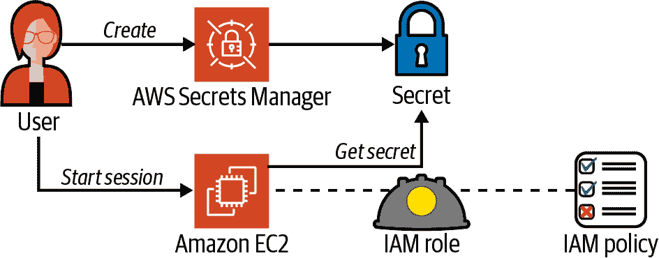

### 先决条件

*   具有隔离子网和关联路由表的 VPC。
*   已部署 EC2 实例。你需要具备连接到该实例以进行测试的能力。

### 准备工作

按照章节代码仓库中本配方文件夹内的步骤操作。

### 步骤

1.  使用 AWS CLI 生成一个随机密码（用作凭据）：

    ```
    RANDOM_STRING=$(aws secretsmanager get-random-password \
         --password-length 32 --require-each-included-type \
         --output text \
         --query RandomPassword)
    ```

2.  将其作为新凭据存储在 Secrets Manager 中：

    ```
    SECRET_ARN=$(aws secretsmanager \
         create-secret --name AWSCookbook108/Secret1 \
         --description "AWSCookbook108 Secret 1" \
         --secret-string $RANDOM_STRING \
         --output text \
         --query ARN)
    ```

3.  创建一个名为 `secret-access-policy-template.json` 的文件，引用你创建的凭据（仓库中提供了该文件）：

    ```json
    {
      "Version": "2012-10-17",
      "Statement": [
        {
          "Effect": "Allow",
          "Action": [
            "secretsmanager:GetResourcePolicy",
            "secretsmanager:GetSecretValue",
            "secretsmanager:DescribeSecret",
            "secretsmanager:ListSecretVersionIds"
          ],
          "Resource": [
            "SECRET_ARN"
          ]
        },
        {
          "Effect": "Allow",
          "Action": "secretsmanager:ListSecrets",
          "Resource": "*"
        }
      ]
    }
    ```

4.  使用 `sed` 命令替换 `secret-access-policy-template.json` 文件中的 `SECRET_ARN` 并生成 `secret-access-policy.json` 文件：

    ```
    sed -e "s|SECRET_ARN|$SECRET_ARN|g" \
         secret-access-policy-template.json > secret-access-policy.json
    ```

5.  创建用于凭据访问的 IAM 策略：

    ```
    aws iam create-policy --policy-name AWSCookbook108SecretAccess \
         --policy-document file://secret-access-policy.json
    ```

    你应该会看到类似如下的输出：

    ```json
    {
      "Policy": {
        "PolicyName": "AWSCookbook108SecretAccess",
        "PolicyId": "(Random String)",
        "Arn": "arn:aws:iam::1111111111:policy/AWSCookbook108SecretAccess",
        "Path": "/",
        "DefaultVersionId": "v1",
        "AttachmentCount": 0,
        "PermissionsBoundaryUsageCount": 0,
        "IsAttachable": true,
        "CreateDate": "2021-11-28T21:25:23+00:00",
        "UpdateDate": "2021-11-28T21:25:23+00:00"
      }
    }
    ```

6.  通过将你创建的 IAM 策略添加到 EC2 实例配置文件当前关联的 IAM 角色中，授予 EC2 实例访问凭据的能力：

    ```
    aws iam attach-role-policy --policy-arn \
         arn:aws:iam::$AWS_ACCOUNT_ID:policy/AWSCookbook108SecretAccess \
         --role-name $ROLE_NAME
    ```

#### 验证检查

连接到 EC2 实例：

```
aws ssm start-session --target $INSTANCE_ID
```

设置并导出你的默认区域：

```
export AWS_DEFAULT_REGION=us-east-1
```

从 EC2 实例中通过 Secrets Manager 检索凭据：

```
aws secretsmanager get-secret-value --secret-id AWSCookbook108/Secret1
```

你应该会看到类似如下的输出：

```json
{
  "Name": "AWSCookbook108/Secret1",
  "VersionId": "<string>",
  "SecretString": "<secret value>",
  "VersionStages": [
    "AWSCURRENT"
  ],
  "CreatedDate": 1638221015.646,
  "ARN": "arn:aws:secretsmanager:us-east-1:111111111111:secret:AWSCookbook108/Secret1-<suffix>"
}
```

退出 Session Manager 会话：

```
exit
```

### 清理

按照[章节代码仓库](https://github.com/AWSCookbook/Security)中本配方文件夹内的步骤操作。

### 讨论

安全地创建、存储和管理 API 密钥和数据库密码等凭据的生命周期，是云中强大安全态势的基本组成部分。你可以使用 Secrets Manager 实施支持你安全策略的凭据管理策略。你可以使用 IAM 策略控制谁有权访问哪些凭据，以确保你管理的凭据仅可被必要的安全主体访问。

由于你的 EC2 实例使用实例配置文件，因此无需在实例上存储任何硬编码的凭据即可让其访问该凭据。访问权限通过附加到实例配置文件的 IAM 策略授予。每当你（或你的应用程序）从 EC2 实例访问该凭据时，都会从 STS 服务获取临时会话凭证，以允许 `get-secret-value` API 调用检索该凭据。当 EC2 实例配置文件附加到你的实例时，AWS CLI 会自动完成此令牌检索过程。你也可以在应用程序中使用 AWS SDK 来实现此功能。

使用 Secrets Manager 的其他一些优势包括：

*   使用你创建和管理的 KMS 密钥对凭据进行加密
*   通过 CloudTrail 审计对凭据的访问
*   使用 Lambda 自动执行凭据轮换
*   授予其他用户、角色以及 EC2 和 Lambda 等服务访问权限
*   将凭据复制到另一个区域，以实现高可用性和灾难恢复

### 挑战

配置 Lambda 函数，使其能够通过 IAM 角色安全地访问该凭据。

# 1.9 阻止 S3 存储桶的公共访问

## 问题

你的组织安全团队发出警报，指出某个 S3 存储桶配置不当，你需要阻止对其的公共访问。

## 解决方案

对你的存储桶应用 Amazon S3 阻止公共访问功能，然后使用 Access Analyzer 检查状态（请参阅图 1-11）。

### 提示

AWS 在一篇关于 [S3 存储的文章](https://oreil.ly/h6Ozf) 中提供了有关什么被视为“公共”的信息。

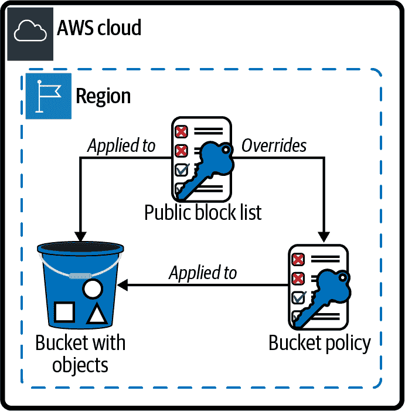

### 先决条件

*   包含公开可用对象的 S3 存储桶

### 准备工作


请按照 [章节代码仓库](https://github.com/AWSCookbook/Security) 中此配方文件夹内的步骤操作。

## 步骤

1.  创建一个访问分析器以用于验证访问权限：

    ```
    ANALYZER_ARN=$(aws accessanalyzer create-analyzer \
         --analyzer-name awscookbook109\
         --type ACCOUNT \
         --output text --query arn)
    ```

2.  使用访问分析器扫描您的 S3 存储桶：

    ```
    aws accessanalyzer start-resource-scan \
         --analyzer-arn $ANALYZER_ARN \
         --resource-arn arn:aws:s3:::awscookbook109-$RANDOM_STRING
    ```

3.  获取访问分析器扫描的结果（扫描结果可能需要约 30 秒才会变得可用）：

    ```
    aws accessanalyzer get-analyzed-resource \
         --analyzer-arn $ANALYZER_ARN \
         --resource-arn arn:aws:s3:::awscookbook109-$RANDOM_STRING
    ```

    您应该会看到类似以下的输出（请注意 `isPublic` 值）：

    ```
    {
      "resource": {
      "actions": [
        "s3:GetObject",
        "s3:GetObjectVersion"
      ],
      "analyzedAt": "2021-06-26T17:42:00.861000+00:00",
      "createdAt": "2021-06-26T17:42:00.861000+00:00",
      "isPublic": true,
      "resourceArn": "arn:aws:s3:::awscookbook109-<<string>>",
      "resourceOwnerAccount": "111111111111",
      "resourceType": "AWS::S3::Bucket",
      "sharedVia": [
        "POLICY"
      ],
      "status": "ACTIVE",
      "updatedAt": "2021-06-26T17:42:00.861000+00:00"
      }
    }
    ```

4.  为您的存储桶设置公共访问阻断：

    ```
    aws s3api put-public-access-block \
         --bucket awscookbook109-$RANDOM_STRING \
         --public-access-block-configuration \
    "BlockPublicAcls=true,IgnorePublicAcls=true,BlockPublicPolicy=true,RestrictPublicBuckets=true"
    ```

    #### 注意

    请参阅 AWS [文章](https://oreil.ly/3jRmO)，了解可用的 `PublicAccessBlock` 配置属性。

### 验证检查

扫描您的 S3 存储桶：

```
aws accessanalyzer start-resource-scan \
     --analyzer-arn $ANALYZER_ARN \
     --resource-arn arn:aws:s3:::awscookbook109-$RANDOM_STRING
```

获取访问分析器扫描的结果：

```
aws accessanalyzer get-analyzed-resource \
     --analyzer-arn $ANALYZER_ARN \
     --resource-arn arn:aws:s3:::awscookbook109-$RANDOM_STRING
```

您应该会看到类似以下的输出：

```
{
  "resource": {
  "analyzedAt": "2021-06-26T17:46:24.906000+00:00",
  "isPublic": false,
  "resourceArn": "arn:aws:s3:::awscookbook109-<<string>>",
  "resourceOwnerAccount": "111111111111",
  "resourceType": "AWS::S3::Bucket"
  }
}
```

## 清理

请按照 [章节代码仓库](https://github.com/AWSCookbook/Security) 中此配方文件夹内的步骤操作。

## 讨论

为确保 AWS 账户中的数据安全，您能做的最好的事情之一就是始终确保对数据应用正确的安全控制。如果您在 S3 存储桶中将对象标记为公共，则互联网上的任何人都可以访问它，因为 S3 使用 HTTP 提供对象服务。用户在云中最常见的安全误配置之一，就是在非预期或非必需的情况下将对象标记为公共。为了防止 S3 对象的误配置，从安全角度来看，为您的存储桶启用 `BlockPublicAccess` 是一项极好的举措。

### 提示

您也可以在账户级别设置公共阻断设置，这将包含您账户中的所有 S3 存储桶：

```
aws s3control put-public-access-block \
    --public-access-block-configuration \
    BlockPublicAcls=true,IgnorePublicAcls=true,BlockPublicPolicy=true,RestrictPublicBuckets=true \
    --account-id $AWS_ACCOUNT_ID
```

您可以通过 HTTP 和 HTTPS 向互联网用户提供 S3 内容，同时保持存储桶私有。内容分发网络 (CDN)（如 Amazon CloudFront）提供了更安全、高效且具成本效益的方式来实现全球静态网站托管，同时仍将 S3 用作对象源。要查看从 S3 存储桶提供静态内容的 CloudFront 配置示例，请参阅 配方 1.10。

## 挑战

在您的 VPC 中部署一个用于 S3 的 VPC 端点，并创建一个存储桶策略，以仅通过此端点限制对您 S3 存储桶的访问。

# 1.10 使用 CloudFront 从 S3 安全地提供 Web 内容

## 问题

您在 S3 中有非公开的 Web 内容，并希望配置 CloudFront 来提供该内容。

## 解决方案

创建一个 CloudFront 分发并将源设置为您的 S3 存储桶。然后配置源访问身份 (OAI)，要求存储桶仅可从 CloudFront 访问（请参阅 图 1-12）。

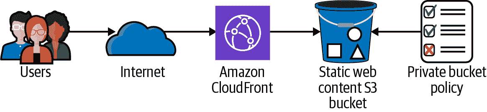

## 先决条件

*   包含静态 Web 内容的 S3 存储桶

## 准备

请按照 [章节代码仓库](https://github.com/AWSCookbook/Security) 中此配方文件夹内的步骤操作。

## 步骤

1.  创建一个 CloudFront OAI 以在 S3 存储桶策略中引用：

    ```
    OAI=$(aws cloudfront create-cloud-front-origin-access-identity \
         --cloud-front-origin-access-identity-config \
         CallerReference="awscookbook",Comment="AWSCookbook OAI" \
         --query CloudFrontOriginAccessIdentity.Id --output text)
    ```

2.  使用 `sed` 命令将 `distribution-config-template.json` 文件中的值替换为您的 CloudFront OAI 和 S3 存储桶名称：

    ```
    sed -e "s/CLOUDFRONT_OAI/${OAI}/g" \
         -e "s|S3_BUCKET_NAME|awscookbook110-$RANDOM_STRING|g" \
         distribution-template.json > distribution.json
    ```

3.  创建一个使用您刚刚创建的分发配置 JSON 文件的 CloudFront 分发：

    ```
    DISTRIBUTION_ID=$(aws cloudfront create-distribution \
         --distribution-config file://distribution.json \
         --query Distribution.Id --output text)
    ```

4.  创建分发需要几分钟时间；使用此命令检查状态。等待直到状态达到 "Deployed"（已部署）：

    ```
    aws cloudfront get-distribution --id $DISTRIBUTION_ID \
        --output text --query Distribution.Status
    ```

5.  通过使用如下存储桶策略，配置 S3 存储桶策略以仅允许来自 CloudFront 的请求（我们已在仓库中提供 `bucket-policy-template.json`）：

    ```
    {
      "Version": "2012-10-17",
      "Id": "PolicyForCloudFrontPrivateContent",
      "Statement": [
        {
          "Effect": "Allow",
          "Principal": {
            "AWS": "arn:aws:iam::cloudfront:user/CloudFront Origin Access Identity CLOUDFRONT_OAI"
          },
          "Action": "s3:GetObject",
          "Resource": "arn:aws:s3:::S3_BUCKET_NAME/*"
        }
      ]
    }
    ```

6.  使用 `sed` 命令将 `bucket-policy-template.json` 文件中的值替换为 CloudFront OAI 和 S3 存储桶名称：

    ```
    sed -e "s/CLOUDFRONT_OAI/${OAI}/g" \
         -e "s|S3_BUCKET_NAME|awscookbook110-$RANDOM_STRING|g" \
         bucket-policy-template.json > bucket-policy.json
    ```

7.  将存储桶策略应用到包含静态 Web 内容的 S3 存储桶：

    ```
    aws s3api put-bucket-policy --bucket awscookbook110-$RANDOM_STRING \
         --policy file://bucket-policy.json
    ```

8.  获取您创建的分发的 `DOMAIN_NAME`：

    ```
    DOMAIN_NAME=$(aws cloudfront get-distribution --id $DISTRIBUTION_ID \
         --query Distribution.DomainName --output text)
    ```

### 验证检查

尝试使用 HTTPS 直接访问 S3 存储桶，以验证存储桶不直接提供内容：

```
curl https://awscookbook110-$RANDOM_STRING.s3.$AWS_REGION.amazonaws.com/index.html
```

您应该会看到类似以下的输出：


```
$ curl https://awscookbook110-$RANDOM_STRING.s3.$AWS_REGION.amazonaws.com/index.html
<?xml version="1.0" encoding="UTF-8"?>
<Error><Code>AccessDenied</Code><Message>Access
Denied</Message><RequestId>0AKQD0EFJC9ZHPCC</RequestId><HostId>gfld4qKp9A93G8ee7VPBFrXBZV1HE3jiOb3bNB54fP
EPTihit/OyFh7hF2Nu4+Muv6JEc0ebLL4=</HostId></Error>
110-Optimizing-S3-with-CloudFront:$
```

使用 `curl` 观察您的 `index.html` 文件是否通过 CloudFront 从私有 S3 存储桶提供服务：

```
curl $DOMAIN_NAME
```

您应该会看到类似以下的输出：

```
$ curl $DOMAIN_NAME
AWSCookbook
$
```

### 清理

请按照 [章节代码仓库](https://github.com/AWSCookbook/Security) 中该配方文件夹内的步骤操作。

### 讨论

此配置允许您保持 S3 存储桶私有，并且仅允许 CloudFront 分发访问存储桶中的对象。您创建了一个[源访问身份](https://oreil.ly/aABzJ)并定义了一个存储桶策略，仅允许 CloudFront 访问您的 S3 内容。这为您提供了坚实的基础，借助 CloudFront 全球 CDN 的额外保护来保障 S3 存储桶的安全。

CDN 提供的针对[分布式拒绝服务 (DDoS) 攻击](https://oreil.ly/mtHSB)的保护值得注意，因为最终用户对您内容的请求会被导向 CloudFront 网络上延迟最低的边缘节点。这也能保护您免受托管在 S3 存储桶中的静态内容遭受 DDoS 攻击所产生的费用，因为通过 CloudFront 提供请求服务通常比直接通过 S3 更便宜。

默认情况下，CloudFront 会在您分发的默认主机名上附带一个 HTTPS 证书，用于保护流量安全。使用 CloudFront，您可以关联自己的自定义域名，从 Amazon Certificate Manager (ACM) 附加自定义证书，将 HTTP 重定向到 HTTPS，强制使用 HTTPS，自定义缓存行为，调用 Lambda 函数 (Lambda@Edge) 等。

### 挑战

为您的 CloudFront 分发添加[地理限制](https://oreil.ly/FMGj0)。
