# 第 2 章 网络

## 2.0 简介

计算机视觉、物联网 (IoT) 和 AI 赋能的聊天机器人等许多令人兴奋的主题占据了头条新闻。这导致传统的核心技术被遗忘。虽然拥有许多触手可及的新功能很棒，但重要的是要意识到，如果没有可靠且安全的连接这一坚实基础，这些技术将无从实现。只有当结果能通过网络可靠地交付和访问时，数据处理才有用。容器是一种极好的应用程序部署方法，但只有当它们联网在一起时，才能为用户提供最佳体验。

AWS 中的网络服务和功能是本书涵盖的几乎所有大型服务的骨干。AWS 拥有许多出色的功能，让您能以您想要的方式、在您想要的位置连接您想要的资源。更好地理解网络将使您对云有更透彻的掌握，从而更自信地使用它。

#### 提示

跟上 AWS 的网络创新需要持续学习。每年在 AWS [re:Invent](https://reinvent.awsevents.com) 上，都会讨论许多网络服务、功能和方法。

建议观看两场来自 AWS re:Invent 的精彩网络演讲：Eric Brandwine 2015 年的[“Another Day, Another Billion Packets”](https://oreil.ly/oB1BN) 和 2019 年的年度演讲[“From One to Many: Evolving VPC Design”](https://oreil.ly/leKi9)。

在本章中，您将了解基本的云网络服务和功能。我们将只关注您在个人账户中切实可行的配方。一些高级操作（例如 AWS Direct Connect 设置）过于依赖外部因素，因此我们将其排除在外，以专注于更易上手的配方和结果。虽然本章中的一些配方可能看起来简单或简短，但它们让我们能够讨论至关重要的主题和概念。

## 工作站配置

遵循“CLI 配方的通用工作站设置步骤”来验证您的配置并设置所需的环境变量。然后，克隆章节代码仓库：

```
git clone https://github.com/AWSCookbook/Networking
```

## 2.1 通过创建 Amazon VPC 在云中定义您的私有虚拟网络

### 问题

您需要一个网络基础来托管云资源。

### 解决方案

您将创建一个 Amazon Virtual Private Cloud (VPC) 并为其配置一个[无类别域间路由 (CIDR) 块](https://oreil.ly/2GrP7)，如图 2-1 所示。

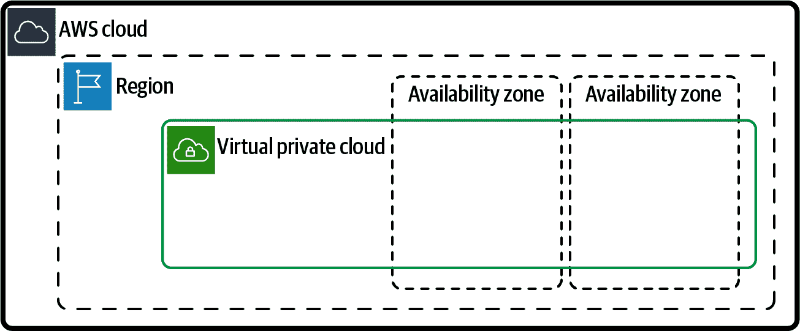

#### 步骤

1.  创建一个具有 `IPv4` CIDR 块的 VPC。我们将使用 `10.10.0.0/16` 作为地址范围，但您可以根据需要进行修改：

    ```
    VPC_ID=$(aws ec2 create-vpc --cidr-block 10.10.0.0/16 \
        --tag-specifications 
    'ResourceType=vpc,Tags=[{Key=Name,Value=AWSCookbook201}]' \
        --output text --query Vpc.VpcId)
    ```

    #### 注意

    创建 VPC 时，[文档](https://oreil.ly/uIfsH) 指出 VPC `IPv4` CIDR 的最大块大小为 `/16` 网络掩码（65,536 个 IP 地址）。最小为 `/28` 网络掩码（16 个 IP 地址）。

#### 验证检查

使用此命令验证 VPC 的状态是否为 `available`：

```
aws ec2 describe-vpcs --vpc-ids $VPC_ID
```

您应该会看到类似以下的输出：

```
{
  "Vpcs": [
  {
    "CidrBlock": "10.10.0.0/16",
    "DhcpOptionsId": "dopt-<<snip>>",
    "State": "available",
    "VpcId": "vpc-<<snip>>",
    "OwnerId": "111111111111",
    "InstanceTenancy": "default",
    "CidrBlockAssociationSet": [
      {
        "AssociationId": "vpc-cidr-assoc-<<snip>>",
        "CidrBlock": "10.10.0.0/16",
        "CidrBlockState": {
        "State": "associated"
        }
      }
    ],
    "IsDefault": false,
<<snip>>
...
```

### 清理

请按照 [章节代码仓库](https://github.com/AWSCookbook/Networking) 中该配方文件夹内的步骤操作。

### 讨论

#### 警告

以下是为您的 VPC 仔细选择 CIDR 块的两个重要原因：

*   一旦 CIDR 块与 VPC 关联，[它就无法修改（尽管可以扩展）](https://oreil.ly/xUB24)。如果您想修改 CIDR 块，则需要删除并重新创建它（以及其中的所有资源）。

*   如果 VPC 通过对等连接（请参阅配方 2.11）或网关（例如 Transit Gateway 和 VPN）连接到其他网络，拥有重叠的 IP 范围将导致不必要的问题。

您可以使用 `aws ec2 associate-vpc-cidr-block` 命令指定额外的 `IPv4` 空间，以向 VPC 添加 `IPv4` 空间。当 IP 空间因使用和规划不足而变得稀缺时，知道您不需要为 VPC 分配大块空间是件好事，特别是如果您不确定是否会用完所有空间时。

以下是将额外的 `IPv4` CIDR 块关联到您的 VPC 的示例：

```
aws ec2 associate-vpc-cidr-block \
    --cidr-block 10.11.0.0/16 \
    --vpc-id $VPC_ID
```

#### 注意

除了 `IPv4`，VPC 还支持 [IPv6](https://oreil.ly/sBL99)。您可以通过指定 `--amazon-provided-ipv6-cidr-block` 选项来配置 Amazon 提供的 `IPv6` CIDR 块。以下是创建带有 `IPv6` CIDR 块的 VPC 的示例：

```
aws ec2 create-vpc --cidr-block 10.10.0.0/16 \
    --amazon-provided-ipv6-cidr-block \
    --tag-specifications
'ResourceType=vpc,Tags=[{Key=Name,Value=AWSCookbook201-IPv6}]'
```


VPC 是 AWS 中的区域级构造。`Region` 是一个地理区域，而 `Availability Zones` 是位于某个区域内的物理数据中心。区域跨越所有可用区（AZ），可用区是隔离的物理数据中心组。每个区域的可用区数量各不相同，但所有区域至少有三个。有关 AWS 区域和可用区的最新信息，请参阅这篇关于 [“区域和可用区”](https://oreil.ly/tJuIg) 的文章。

#### 注

根据 [VPC 用户指南](https://oreil.ly/Z4MTP)，每个 VPC 的 IPv4 CIDR 块初始 [配额](https://oreil.ly/wcJPH) 为 5。这可以提高到 50。每个 VPC 允许的 IPv6 CIDR 块数量为 1。

### 挑战

创建另一个具有不同 CIDR 范围的 VPC。

# 2.2 在 VPC 中使用子网和路由表创建网络层级

## 问题

您拥有一个 VPC，需要创建一个网络布局，由用于分段和冗余的单独 IP 空间组成。

## 解决方案

在您的 VPC 中创建一个路由表。在 VPC 的不同可用区中创建两个子网。将路由表与子网关联（请参阅 图 2-2）。

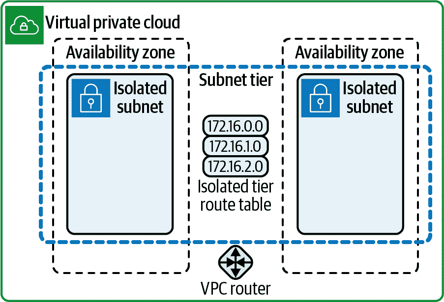

### 前提条件

- `VPC`

### 准备工作

按照 [章节代码仓库](https://github.com/AWSCookbook/Networking) 中此配方文件夹内的步骤操作。

### 步骤

1. 创建一个路由表。这将允许您为与之关联的子网创建自定义流量路由：

```
ROUTE_TABLE_ID=$(aws ec2 create-route-table --vpc-id $VPC_ID \
    --tag-specifications \
'ResourceType=route-table,Tags=[{Key=Name,Value=AWSCookbook202}]' \
    --output text --query RouteTable.RouteTableId)
```

2. 创建两个子网，每个可用区一个。这将为您定义地址空间，以便为您的 VPC 创建资源：

```
SUBNET_ID_1=$(aws ec2 create-subnet --vpc-id $VPC_ID \
    --cidr-block 10.10.0.0/24 --availability-zone ${AWS_REGION}a \
    --tag-specifications \
    'ResourceType=subnet,Tags=[{Key=Name,Value=AWSCookbook202a}]' \
    --output text --query Subnet.SubnetId)

SUBNET_ID_2=$(aws ec2 create-subnet --vpc-id $VPC_ID \
    --cidr-block 10.10.1.0/24 --availability-zone ${AWS_REGION}b \
    --tag-specifications \
    'ResourceType=subnet,Tags=[{Key=Name,Value=AWSCookbook202b}]' \
    --output text --query Subnet.SubnetId)
```

#### 注

在前面的命令中，`--availability-zone` 参数使用您的区域的环境变量，并附加小写的 `a` 或 `b` 字符，以指示要在哪个逻辑可用区（例如 `us-east-1a`）中预配每个子网。AWS 声明这些名称是按账户随机分配的，以便跨可用区平衡资源。

如果您使用多个 AWS 账户，并希望查找某个区域一致的可用区 ID，请运行此命令：

```
aws ec2 describe-availability-zones --region $AWS_REGION
```

3. 将路由表与这两个子网关联：

```
aws ec2 associate-route-table \
    --route-table-id $ROUTE_TABLE_ID --subnet-id $SUBNET_ID_1

aws ec2 associate-route-table \
    --route-table-id $ROUTE_TABLE_ID --subnet-id $SUBNET_ID_2
```

4. 对于步骤 3 中的每个命令，您应该会看到类似如下的输出：

```
{
  "AssociationId": "rtbassoc-<<snip>>",
  "AssociationState": {
  "State": "associated"
  }
}
```

#### 验证检查

检索您创建的子网的配置，并验证它们位于同一个 VPC 但不同的可用区中：

```
aws ec2 describe-subnets --subnet-ids $SUBNET_ID_1
aws ec2 describe-subnets --subnet-ids $SUBNET_ID_2
```

对于每个 `describe-subnets` 命令，您应该会看到类似如下的输出：

```
{
  "Subnets": [
  {
    "AvailabilityZone": "us-east-1a",
    "AvailabilityZoneId": "use1-az6",
    "AvailableIpAddressCount": 251,
    "CidrBlock": "10.10.0.0/24",
    "DefaultForAz": false,
    "MapPublicIpOnLaunch": false,
    "MapCustomerOwnedIpOnLaunch": false,
    "State": "available",
    "SubnetId": "subnet-<<snip>>",
    "VpcId": "vpc-<<snip>>",
    "OwnerId": "111111111111",
    "AssignIpv6AddressOnCreation": false,
    "Ipv6CidrBlockAssociationSet": [],
<<snip>>
...
```

验证您创建的路由表是否与这两个子网关联：

```
aws ec2 describe-route-tables --route-table-ids $ROUTE_TABLE_ID
```

您应该会看到类似如下的输出：

```
{
  "RouteTables": [
  {
    "Associations": [
      {
        "Main": false,
        "RouteTableAssociationId": "rtbassoc-<<snip>>",
        "RouteTableId": "rtb-<<snip>>",
        "SubnetId": "subnet-<<snip>>",
        "AssociationState": {
        "State": "associated"
        }
      },
      {
        "Main": false,
        "RouteTableAssociationId": "rtbassoc-<<snip>>",
        "RouteTableId": "rtb-<<snip>>",
        "SubnetId": "subnet-<<snip>>",
        "AssociationState": {
        "State": "associated"
        }
      }
<<snip>>
...
```

### 清理

按照 [章节代码仓库](https://github.com/AWSCookbook/Networking) 中此配方文件夹内的步骤操作。

## 讨论

在设计子网策略时，您应选择适合当前需求并考虑应用程序未来增长的子网大小。[子网被用于](https://oreil.ly/KULJn) AWS 资源的弹性网络接口（ENI）放置。这意味着特定的 ENI 位于单个可用区内。

#### 提示

您可能会遇到路由重叠的情况。AWS 提供了关于 [如何确定优先级](https://oreil.ly/j1RWe) 的信息。

当您创建子网时，AWS 会保留每个子网 CIDR 块的前四个和最后一个 IP 地址，用于功能和特性。这些地址不可供您使用。[根据文档](https://oreil.ly/qbkcf)，在您的示例中，这些保留地址如下：

| .0 || 网络地址。 |
| --- | --- |
| .1 || 由 AWS 保留用于 VPC 路由器。 |
| .2 || 由 AWS 保留用于 DNS 服务器的 IP 地址。这始终设置为 VPC 网络范围加二。 |
| .3 || 由 AWS 保留供将来使用。 |
| .255 || 网络广播地址。VPC 中不支持广播。 |

#### 注

ENI 从 VPC 内的 AWS 托管 DHCP 服务器接收 IP 地址。DHCP 选项集会自动配置默认值，以便在您定义的子网中分配地址。有关 DHCP 选项集的更多信息，以及如何创建自己的 DHCP 选项集，请参阅此支持 [文档](https://oreil.ly/OsebX)。

在某个区域中创建 VPC 时，最佳实践是将子网分布在该网络层级的各个可用区中。每个区域的可用区数量不同，但大多数至少有三个。实际示例：如果您有一个公共层和一个隔离层，分布在两个可用区中，则总共会有四个子网：2 个层级 × 每层级 2 个子网（每个可用区一个）；请参阅 图 2-3。

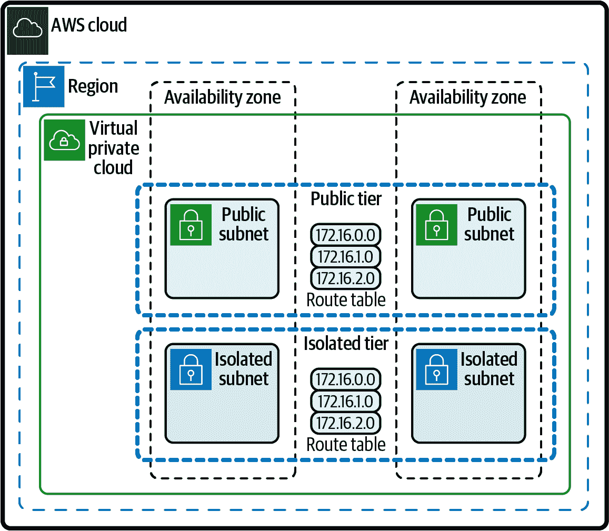

### 挑战

创建第二个路由表并将其与 `$SUBNET_ID_2` 关联。为每个可用区配置路由表是一种常见模式。

# 2.3 使用互联网网关将 VPC 连接到互联网

## 问题


# 为 EC2 实例提供直接互联网访问

## 问题

您在 VPC 的一个子网中有一个现有的 EC2 实例。您需要让该实例能够直接访问互联网上的客户端。

## 解决方案

您将创建一个互联网网关并将其附加到您的 VPC。接下来，您将修改与 EC2 实例所在子网关联的路由表。您将添加一条将来自子网的流量发送到互联网网关的路由。最后，创建一个弹性 IP (EIP) 并将其与实例关联，如图 2-4 所示。

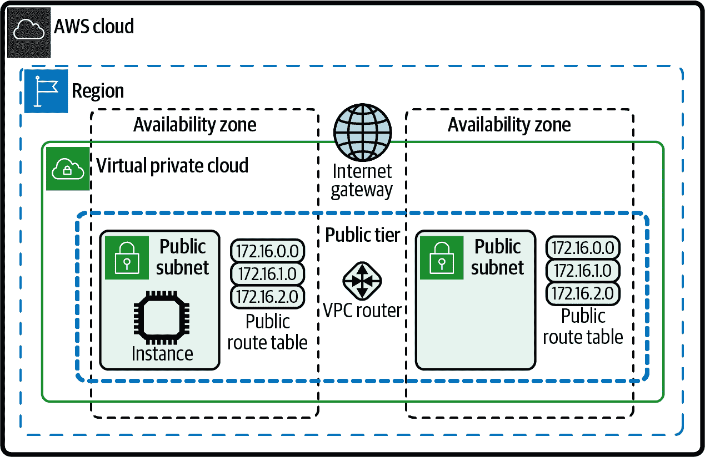

### 先决条件

- 在两个 AZ 中创建了 VPC 和子网以及关联的路由表。
- 已部署 EC2 实例。您需要具备连接到该实例以进行测试的能力。

### 准备

按照[章节代码仓库](https://github.com/AWSCookbook/Networking)中本配方文件夹中的步骤操作。

### 步骤

1. 创建互联网网关 (IGW)：

```
INET_GATEWAY_ID=$(aws ec2 create-internet-gateway \
    --tag-specifications \
'ResourceType=internet-gateway,Tags=[{Key=Name,Value=AWSCookbook202}]' \
    --output text --query InternetGateway.InternetGatewayId)
```

2. 将互联网网关附加到现有 VPC：

```
aws ec2 attach-internet-gateway \
    --internet-gateway-id $INET_GATEWAY_ID --vpc-id $VPC_ID
```

3. 在您 VPC 的每个路由表中，创建一条将默认路由目标设置为互联网网关的路由：

```
aws ec2 create-route --route-table-id $ROUTE_TABLE_ID_1 \
    --destination-cidr-block 0.0.0.0/0 --gateway-id $INET_GATEWAY_ID

aws ec2 create-route --route-table-id $ROUTE_TABLE_ID_2 \
    --destination-cidr-block 0.0.0.0/0 --gateway-id $INET_GATEWAY_ID
```

对于步骤 3 中的每个命令，您应该会看到类似以下的输出：

```
{
  "Return": true
}
```

4. 创建 EIP：

```
ALLOCATION_ID=$(aws ec2 allocate-address --domain vpc \
    --output text --query AllocationId)
```

#### 注意

AWS 将[弹性 IP 地址 (EIP)](https://oreil.ly/FCrvT)定义为“专为动态云计算设计的静态 IPv4 地址。EIP 地址分配给您的 AWS 账户，归您所有，直到您释放它。”

5. 将 EIP 与现有的 EC2 实例关联：

```
aws ec2 associate-address \
    --instance-id $INSTANCE_ID --allocation-id $ALLOCATION_ID
```

您应该会看到类似以下的输出：

```
{
  "AssociationId": "eipassoc-<<snip>>"
}
```

#### 验证检查

使用 SSM Session Manager 连接到 EC2 实例（请参阅配方 1.6）：

```
aws ssm start-session --target $INSTANCE_ID
```

Ping 互联网上的主机以测试互联网连接：

```
ping -c 4 homestarrunner.com
```

您应该会看到类似以下的输出：

```
sh-4.2$ ping -c 4 homestarrunner.com
PING homestarrunner.com (72.10.33.178) 56(84) bytes of data.
64 bytes from homestarrunner.com (72.10.33.178): icmp_seq=1 ttl=49 time=2.12 ms
64 bytes from homestarrunner.com (72.10.33.178): icmp_seq=2 ttl=49 time=2.04 ms
64 bytes from homestarrunner.com (72.10.33.178): icmp_seq=3 ttl=49 time=2.05 ms
64 bytes from homestarrunner.com (72.10.33.178): icmp_seq=4 ttl=49 time=2.08 ms
--- homestarrunner.com ping statistics ---
4 packets transmitted, 4 received, 0% packet loss, time 3002ms
rtt min/avg/max/mdev = 2.045/2.078/2.127/0.045 ms
sh-4.2$
```

#### 提示

公共 IP 不是操作系统配置的一部分。如果您想从实例的[元数据](https://oreil.ly/lmZ1U)中检索公共 IP，可以使用此命令：

```
curl http://169.254.169.254/latest/meta-data/public-ipv4
```

退出 Session Manager 会话：

```
exit
```

### 清理

按照[章节代码仓库](https://github.com/AWSCookbook/Networking)中本配方文件夹中的步骤操作。

### 讨论

您在路由表条目中创建的路由将所有非本地流量发送到提供 VPC 互联网连接的 IGW。因为您使用的是现有的运行中 EC2 实例，所以您需要创建一个弹性 IP 并将其与实例关联。这些步骤使实例能够进行互联网通信，而无需与其交互。有一个[选项可启用](https://oreil.ly/disUG)在子网中新启动的实例自动分配公共 IPv4 地址。但是，如果您使用自动分配，每次实例重启后公共 IP 都会改变。与实例关联的 EIP 在重启后不会改变。

#### 注意

路由表优先考虑最具体的路由。AWS 还允许您创建比默认本地路由更具体的路由。这使您能够创建非常受控的网络流。有关路由优先级的更多信息，请参阅 AWS [讨论](https://oreil.ly/DKpNO)。

与您的实例关联的安全组不允许入站访问。如果您想允许来自互联网的入站访问到公共子网中的实例，您将不得不为此配置安全组入站规则。

具有与 IGW 关联的 `0.0.0.0/0` 路由的子网被视为公共子网。将仅需要来自公共互联网入站访问的实例放置在此类层中被视为安全最佳实践。面向最终用户的负载均衡器通常放置在公共子网中。公共子网不是应用程序服务器或数据库的理想选择。在这些情况下，您可以创建私有层或隔离层，通过适当的路由来满足您的需求，并使用 NAT 网关仅在需要出站互联网访问时将该子网流量导向互联网网关。

### 挑战

在 EC2 实例上安装 Web 服务器，修改安全组，并从您的工作站连接到该实例。有关如何使用负载均衡器为私有子网中的实例配置互联网访问的示例，请参阅配方 2.7。

# 2.4 使用 NAT 网关为私有子网提供出站互联网访问

## 问题

您的 VPC 中有公共子网，它们具有通往互联网网关的路由。您希望利用此设置为私有子网中的实例提供仅出站的互联网访问。

## 解决方案

在其中一个公共子网中创建 NAT 网关。然后创建一个弹性 IP 并将其与 NAT 网关关联。在与私有子网关联的路由表中，添加一条针对互联网绑定流量以 NAT 网关为目标的路由（请参阅图 2-5）。

### 先决条件

- 具有两个 AZ 中的公共子网及关联路由表的 VPC。
- 在两个 AZ 中创建了隔离子网（我们将把这些变为私有子网）及关联路由表。
- 在隔离子网中部署了两个 EC2 实例。您需要具备连接到这些实例以进行测试的能力。

### 准备

按照[章节代码仓库](https://github.com/AWSCookbook/Networking)中本配方文件夹中的步骤操作。

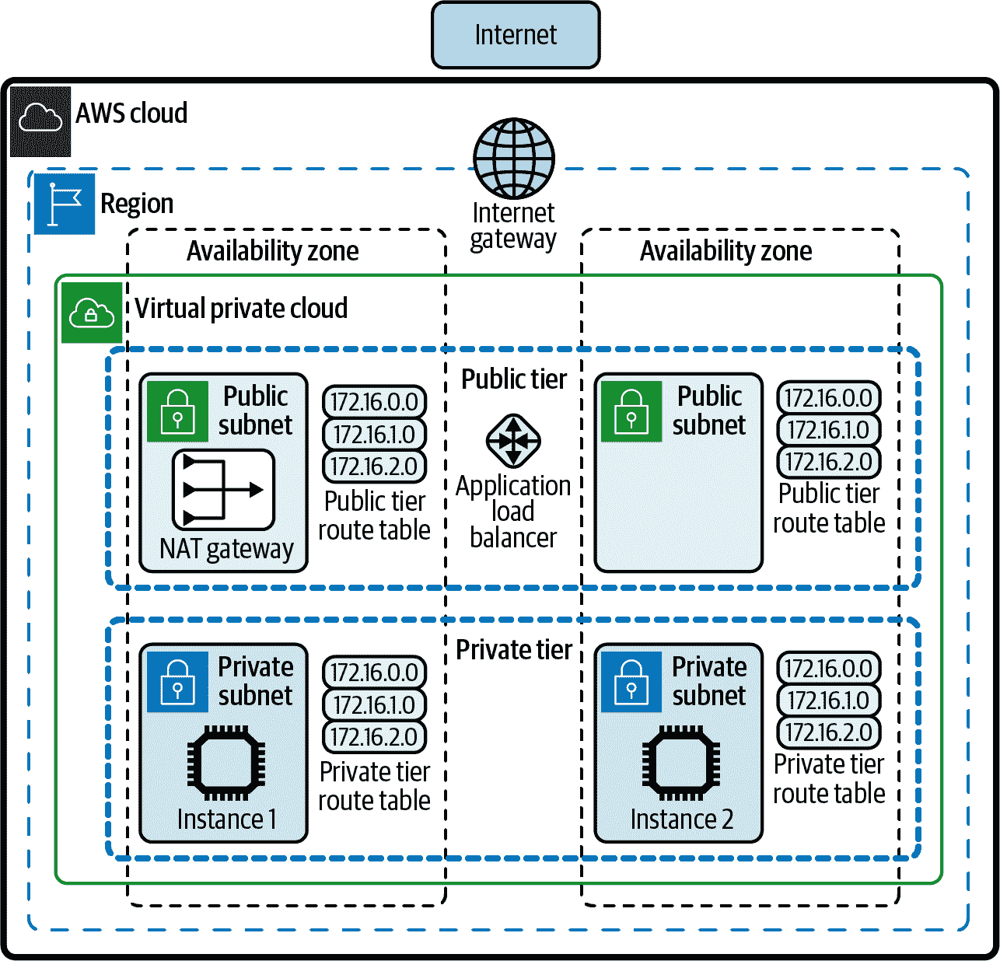

### 步骤

1. 创建一个用于 NAT 网关的弹性 IP：

```
ALLOCATION_ID=$(aws ec2 allocate-address --domain vpc \
    --output text --query AllocationId)
```

2. 在 AZ1 的公共子网中创建 NAT 网关：

```
NAT_GATEWAY_ID=$(aws ec2 create-nat-gateway \
    --subnet-id $VPC_PUBLIC_SUBNET_1 \
    --allocation-id $ALLOCATION_ID \
    --output text --query NatGateway.NatGatewayId)
```

3. 状态变为可用需要片刻时间；检查状态：

```
aws ec2 describe-nat-gateways \
    --nat-gateway-ids $NAT_GATEWAY_ID \
    --output text --query NatGateways[0].State
```


## 4. 为 0.0.0.0/0 添加默认路由

为私有层的两个路由表添加一条目标为 NAT 网关的默认路由（`0.0.0.0/0`）。这条默认路由将所有不匹配更具体路由的流量发送到指定目标：

```bash
aws ec2 create-route --route-table-id $PRIVATE_RT_ID_1 \
    --destination-cidr-block 0.0.0.0/0 \
    --nat-gateway-id $NAT_GATEWAY_ID

aws ec2 create-route --route-table-id $PRIVATE_RT_ID_2 \
    --destination-cidr-block 0.0.0.0/0 \
    --nat-gateway-id $NAT_GATEWAY_ID
```

步骤 4 中的每条命令输出应类似如下：

```json
{
  "Return": true
}
```

### 验证检查

使用 SSM Session Manager 连接到 EC2 实例 1（参见 示例 1.6）：

```bash
aws ssm start-session --target $INSTANCE_ID_1
```

使用 ping 测试互联网访问：

```bash
ping -c 4 homestarrunner.com
```

输出应类似如下：

```text
sh-4.2$ ping -c 4 homestarrunner.com

PING homestarrunner.com (72.10.33.178) 56(84) bytes of data.
64 bytes from homestarrunner.com (72.10.33.178): icmp_seq=1 ttl=47 time=2.95 ms
64 bytes from homestarrunner.com (72.10.33.178): icmp_seq=2 ttl=47 time=2.16 ms
64 bytes from homestarrunner.com (72.10.33.178): icmp_seq=3 ttl=47 time=2.13 ms
64 bytes from homestarrunner.com (72.10.33.178): icmp_seq=4 ttl=47 time=2.13 ms

--- homestarrunner.com ping statistics ---
4 packets transmitted, 4 received, 0% packet loss, time 3003ms
rtt min/avg/max/mdev = 2.134/2.348/2.958/0.356 ms
sh-4.2$
```

退出 Session Manager 会话：

```bash
exit
```

（可选）对 EC2 实例 2 重复验证步骤。

### 清理

按照本示例文件夹中的步骤操作，参考 [章节代码仓库](https://github.com/AWSCookbook/Networking)。

## 讨论

此架构提供了一个允许出站访问但不允许直接入站互联网访问私有子网内资源的子网层级。允许互联网资源入站访问私有子网中运行的服务的一种方法是在公有子网中使用负载均衡器。我们将在 示例 2.7 中详细介绍该类型的配置。

与 NAT 网关关联的 EIP 将成为通过它进行的所有通信的外部 IP 地址。例如，如果供应商需要将您的 IP 添加到允许列表，NAT 网关的 EIP 将作为提供给供应商的“源” IP 地址。只要您在账户中保留该 EIP，它将保持不变。

#### 提示

如果您创建了具有 IPv6 功能的 VPC，也可以创建仅出站互联网网关以允许私有子网的出站互联网访问，详见 AWS [文章](https://oreil.ly/RxlYN)。

#### 注意

如果您有自定义需求或希望对 NAT 实现的出站路由进行更细粒度的控制，可以创建 NAT 实例。有关 NAT 网关和 NAT 实例的对比，请参阅此 [支持文档](https://oreil.ly/roLbq)。

### 挑战

在 AZ2 的公有子网中创建第二个 NAT 网关。然后修改与 AZ2 中私有子网关联的路由表中的默认路由，将目标更改为新创建的 NAT 网关。

# 2.5 通过引用安全组授予动态访问权限

## 问题

您有一个由两个实例组成的应用程序组，需要允许它们之间进行 Secure Shell (SSH) 通信。这需要以一种安全且简便的方式配置，以便未来实例数量增长时仍能适用。

## 解决方案

#### 警告

一个常见的误解是：仅将同一个安全组关联到多个 EC2 实例的 ENI 上，就能允许它们之间通信（参见 图 2-6）。

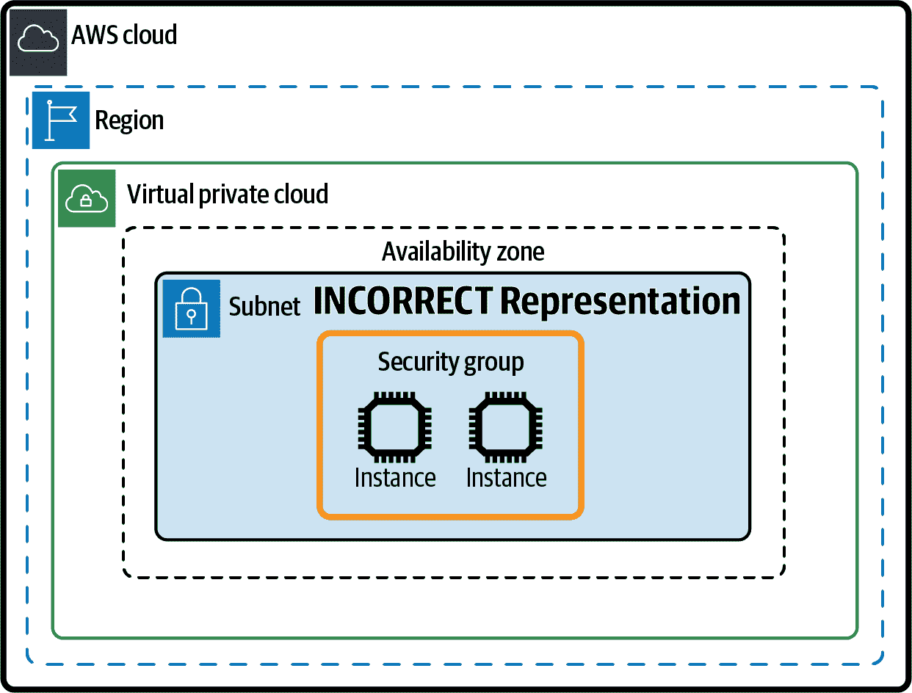

在本示例中，我们将创建一个安全组并将其分别关联到两个 EC2 实例的 ENI。最后，我们将创建一条入站规则，授权该安全组通过 TCP 端口 22 访问自身（参见 图 2-7）。

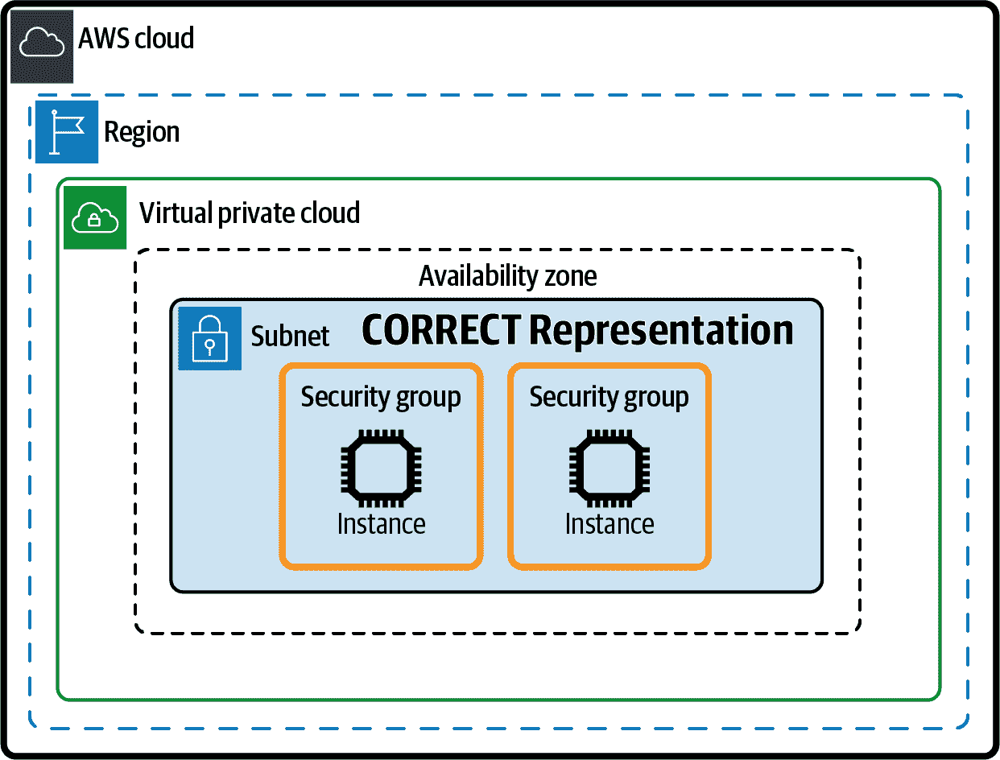

### 前提条件

*   具有子网和关联路由表的 VPC。
*   部署在该子网中的两个 EC2 实例。您需要具备连接到这些实例进行测试的能力。

### 准备工作

按照本示例文件夹中的步骤操作，参考 [章节代码仓库](https://github.com/AWSCookbook/Networking)。

### 步骤

1.  为 EC2 实例创建新安全组：

    ```bash
    SG_ID=$(aws ec2 create-security-group \
        --group-name AWSCookbook205Sg \
        --description "Instance Security Group" --vpc-id $VPC_ID \
        --output text --query GroupId)
    ```

2.  将安全组附加到实例 1 和实例 2：

    ```bash
    aws ec2 modify-instance-attribute --instance-id $INSTANCE_ID_1 \
        --groups $SG_ID

    aws ec2 modify-instance-attribute --instance-id $INSTANCE_ID_2 \
        --groups $SG_ID
    ```

    #### 注意

    您使用了 [`modify-instance-attribute`](https://oreil.ly/GT2KH) 命令将新安全组附加到 EC2 实例的 ENI。要列出与 EC2 实例 ENI 关联的安全组，可以在 EC2 控制台的实例详情“Security”标签下查看，或使用以下命令（将 `$INSTANCE_ID_1` 替换为您自己的实例 ID）：

    ```bash
    aws ec2 describe-security-groups --group-ids \
        $(aws ec2 describe-instances --instance-id $INSTANCE_ID_1 \
        --query "Reservations[].Instances[].SecurityGroups[].GroupId[]" \
        --output text) --output text
    ```

3.  向安全组添加入站规则，允许其自身通过 TCP 端口 22 访问：

    ```bash
    aws ec2 authorize-security-group-ingress \
        --protocol tcp --port 22 \
        --source-group $SG_ID \
        --group-id $SG_ID
    ```

    #### 提示

    您可以且应该为所有安全组规则创建描述，以指示授权的预期功能。

    输出应类似如下：

    ```json
    {
      "Return": true,
      "SecurityGroupRules": [
        {
          "SecurityGroupRuleId": "sgr-<<snip>>",
          "GroupId": "sg-<<snip>>",
          "GroupOwnerId": "111111111111",
          "IsEgress": false,
          "IpProtocol": "tcp",
          "FromPort": 22,
          "ToPort": 22,
          "ReferencedGroupInfo": {
            "GroupId": "sg-<<snip>>"
          }
        }
      ]
    }
    ```

    #### 提示

    这种类型的安全组规则称为 **自引用规则**（self-referencing rule）。它允许从附加了该安全组的 ENI（而非静态 IP 范围）发起的流量访问特定端口。

### 验证检查

列出实例 2 的 IP 地址：

```bash
aws ec2 describe-instances --instance-ids $INSTANCE_ID_2 \
    --output text \
    --query Reservations[0].Instances[0].PrivateIpAddress
```

使用 SSM Session Manager 连接到实例 1（参见 示例 1.6）：

```bash
aws ssm start-session --target $INSTANCE_ID_1
```

安装 `Ncat` 实用程序：

```bash
sudo yum -y install nc
```

测试到实例 2 的 SSH 连接（使用之前列出的实例 2 IP）：

```bash
nc -vz $INSTANCE_IP_2 22
```

输出应类似如下：


## 清理

请按照[章节代码仓库](https://github.com/AWSCookbook/Networking)中该配方文件夹内的步骤操作。

## 讨论

云的按需特性（例如自动扩缩容）提供了弹性的机会。网络安全机制（如安全组引用）适用于此场景。传统上，网络架构师可能会在防火墙配置中授权 CIDR 范围。这种授权类型通常被称为*静态引用*。这种传统做法无法动态扩展，因为您可能会从工作负载中添加或移除实例。

[安全组](https://oreil.ly/rYohM)充当 ENI 的有状态虚拟防火墙。安全组的默认行为是隐式阻止所有入站流量，同时允许所有出站流量。您可以将多个安全组与一个 ENI 关联。每个 ENI 的[初始配额](https://oreil.ly/FR5J1)为 5 个安全组，每个安全组 60 条规则（入站或出站）。

您也可以为授权指定 CIDR 表示法。例如，为了允许从您的纽约分支办公室进行 RDP 访问，您可以使用以下命令：

```
aws ec2 authorize-security-group-ingress \
    --group-id sg-1234567890abcdef0 \
    --ip-permissions
    IpProtocol=tcp,FromPort=3389,ToPort=3389,IpRanges='[{CidrIp=XXX.XXX.XXX.XXX/24,Description="RDP access from NY office"}]'
```

### 警告

请记住，如果存在以下条件，则无法删除安全组：

*   它们当前正附加到 ENI。
*   它们被其他安全组引用（包括它们自己）。

## 挑战

创建第三个 EC2 实例；使用相同的安全组。测试对其的访问以及从其发出的访问。（提示：在代码仓库中。）

# 2.6 使用 VPC 可达性分析器验证和排查网络路径

## 问题

您有两个部署在隔离子网中的 EC2 实例。您需要排查它们之间的 SSH 连接问题。

## 解决方案

您将使用 VPC 可达性分析器创建、分析和描述网络洞察。根据结果，您将向实例 2 的安全组添加一条规则，允许来自实例 1 安全组的 SSH 端口（TCP 端口 22）访问。最后，您将重新运行 VPC 可达性分析器并查看更新后的结果（请参阅图 2-8）。

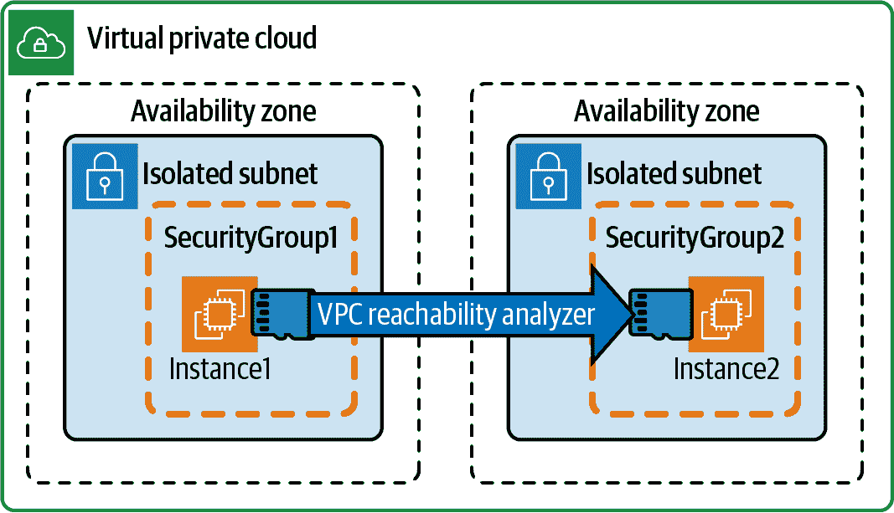

### 先决条件

*   具有两个可用区中隔离子网及关联路由表的 VPC。
*   部署在隔离子网中的两个 EC2 实例。您需要具备连接到这些实例以进行测试的能力。

### 准备工作

请按照[章节代码仓库](https://github.com/AWSCookbook/Networking)中该配方文件夹内的步骤操作。

### 步骤

1.  创建一个网络洞察路径，指定您部署的两个 EC2 实例和 TCP 端口 22：

    ```
    INSIGHTS_PATH_ID=$(aws ec2 create-network-insights-path \
        --source $INSTANCE_ID_1 --destination-port 22 \
        --destination $INSTANCE_ID_2 --protocol tcp \
        --output text --query NetworkInsightsPath.NetworkInsightsPathId)
    ```

2.  使用上一步创建的 `INSIGHTS_PATH_ID` 开始两个实例之间的网络洞察分析：

    ```
    ANALYSIS_ID_1=$(aws ec2 start-network-insights-analysis \
        --network-insights-path-id $INSIGHTS_PATH_ID --output text \
        --query NetworkInsightsAnalysis.NetworkInsightsAnalysisId)
    ```

3.  等待几秒钟直到分析完成运行，然后查看结果：

    ```
    aws ec2 describe-network-insights-analyses \
        --network-insights-analysis-ids $ANALYSIS_ID_1
    ```

    您应该会看到类似以下的输出（请注意 `NetworkPathFound` 和 `ExplanationCode` 字段）：

    ```
    {
      "NetworkInsightsAnalyses": [
        {
          "NetworkInsightsAnalysisId": "nia-<<snip>>",
          "NetworkInsightsAnalysisArn": "arn:aws:ec2:us-east-1:111111111111:network-insights-analysis/nia-<<snip>>",
          "NetworkInsightsPathId": "nip-<<snip>>",
          "StartDate": "2020-12-22T02:12:36.836000+00:00",
          "Status": "succeeded",
          "NetworkPathFound": false,
          "Explanations": [
            {
              "Direction": "ingress",
              "ExplanationCode": "ENI_SG_RULES_MISMATCH",
              "NetworkInterface": {
                "Id": "eni-<<snip>>",
                "Arn": "arn:aws:ec2:us-east-1:11111111111:network-interface/eni-<<snip>>"
              },
    ```

4.  更新附加到实例 2 的安全组。添加一条规则，允许从实例 1 的安全组访问 TCP 端口 22 (SSH)：

    ```
    aws ec2 authorize-security-group-ingress \
        --protocol tcp --port 22 \
        --source-group $INSTANCE_SG_ID_1 \
        --group-id $INSTANCE_SG_ID_2
    ```

    您应该会看到类似以下的输出：

    ```
    {
      "Return": true,
      "SecurityGroupRules": [
      {
        "SecurityGroupRuleId": "sgr-<<snip>>",
        "GroupId": "sg-<<snip>>",
        "GroupOwnerId": "111111111111",
        "IsEgress": false,
        "IpProtocol": "tcp",
        "FromPort": 22,
        "ToPort": 22,
        "ReferencedGroupInfo": {
          "GroupId": "sg-<<snip>>"
        }
      }
      ]
    }
    ```

5.  重新运行网络洞察分析。使用与之前相同的 `INSIGHTS_PATH_ID`：

    ```
    ANALYSIS_ID_2=$(aws ec2 start-network-insights-analysis \
        --network-insights-path-id $INSIGHTS_PATH_ID --output text \
        --query NetworkInsightsAnalysis.NetworkInsightsAnalysisId)
    ```

6.  显示新分析的结果：

    ```
    aws ec2 describe-network-insights-analyses \
        --network-insights-analysis-ids $ANALYSIS_ID_2
    ```

    您应该会看到类似以下的输出（请注意 `NetworkPathFound` 字段）：

    ```
    {
      "NetworkInsightsAnalyses": [
      {
        "NetworkInsightsAnalysisId": "nia-<<snip>>",
        "NetworkInsightsAnalysisArn": "arn:aws:ec2:us-east-1:111111111111:network-insights-analysis/nia-<<snip>>",
        "NetworkInsightsPathId": "nip-<<snip>>",
        "StartDate": "2021-02-21T23:52:15.565000+00:00",
        "Status": "succeeded",
        "NetworkPathFound": true,
        "ForwardPathComponents": [
          {
            "SequenceNumber": 1,
            "Component": {
            "Id": "i-<<snip>>",
    ...
    ```

#### 验证检查

列出实例 2 的 IP 地址：

```
aws ec2 describe-instances --instance-ids $INSTANCE_ID_2 \
    --output text \
    --query Reservations[0].Instances[0].PrivateIpAddress
```

使用 SSM Session Manager 连接到您的 EC2 实例（请参阅配方 1.6）：

```
aws ssm start-session --target $INSTANCE_ID_1
```

安装 *Ncat* 实用程序：

```
sudo yum -y install nc
```

测试到实例 2 的 SSH 连接（使用您之前列出的实例 2 的 IP）：

```
nc -vz $INSTANCE_IP_2 22
```

您应该会看到类似以下的输出：

```
Ncat: Version 7.50 ( https://nmap.org/ncat )
Ncat: Connected to 10.10.0.48:22.
Ncat: 0 bytes sent, 0 bytes received in 0.01 seconds.
sh-4.2$
```

退出 Session Manager 会话：

```
exit
```

### 清理

请按照[章节代码仓库](https://github.com/AWSCookbook/Networking)中该配方文件夹内的步骤操作。

## 讨论


# 2.6 网络洞察路径和 VPC 可达性分析器

网络洞察路径是您要测试的连接的定义。最初，实例之间没有 SSH 连接，因为目标（实例 2）上的安全组不允许访问。在您更新与实例 2 关联的安全组并重新运行分析后，您能够验证连接成功。使用 [VPC 可达性分析器](https://oreil.ly/szPNC) 是一种以“无服务器”方式进行网络故障排除和验证配置的高效功能。它不需要您预置基础设施来分析、验证和排查网络连接。

## 注意

VPC 可达性广泛支持 VPC 内资源的源和目标。有关支持的源和目标的完整列表，请参阅此 [支持文档](https://oreil.ly/boPoh)。

VPC 可达性分析器提供解释代码，用于描述网络路径分析的结果。在本实操中，您观察到代码 `ENI_SG_RULES_MISMATCH`，该代码指示安全组不允许源和目标之间的流量。解释代码的完整列表可在该 [文档](https://oreil.ly/v6o18) 中找到。

## 挑战

向您的 VPC 添加互联网网关，并从实例测试对其的访问。

# 2.7 使用 Application Load Balancer 将 HTTP 流量重定向到 HTTPS

## 问题

您有一个在私有子网中运行的容器化应用程序。互联网上的用户需要访问此应用程序。为了帮助保护应用程序，您希望将所有请求从 HTTP 重定向到 HTTPS。

## 解决方案

创建一个 `Application Load Balancer (ALB)`。接下来，在 ALB 上为端口 80 和 443 创建监听器，为您的容器化应用程序创建目标组，并创建监听器规则。配置监听器规则以将流量发送到您的目标组，如 图 2-9 所示。最后，配置一个操作以使用 HTTP 301 响应代码进行重定向，将端口 80 (HTTP) 重定向到端口 443 (HTTPS)，同时保留请求中的 URL（请参阅 图 2-10）。

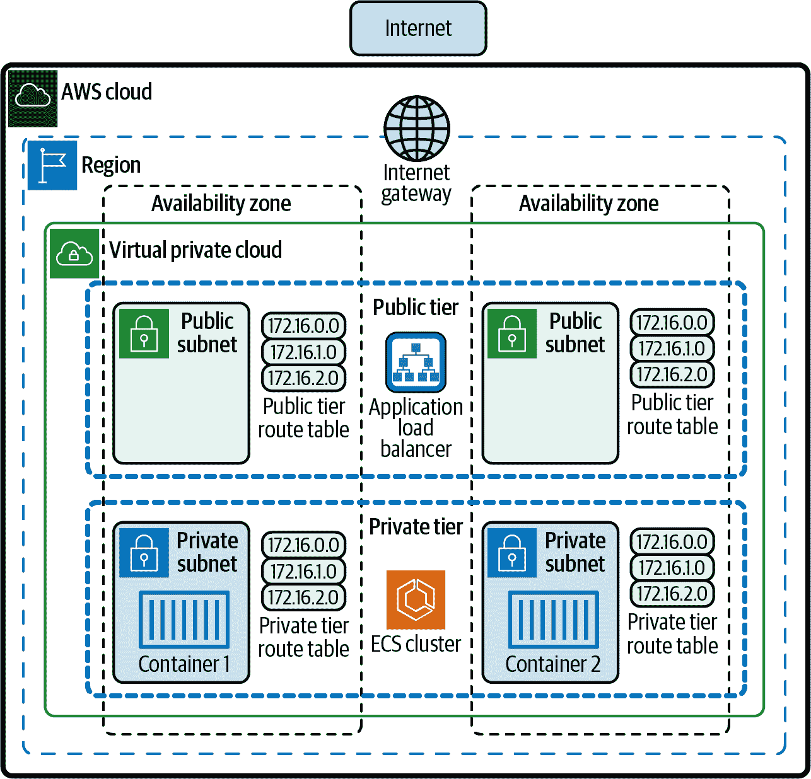
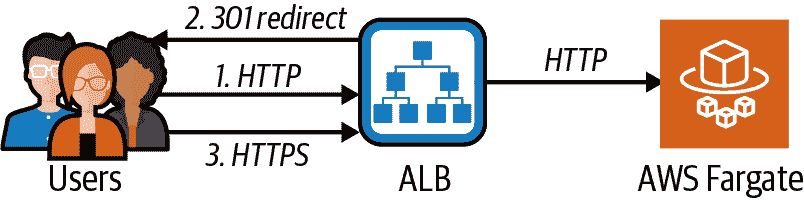

### 先决条件

*   具有两个可用区中公有子网及关联路由表的 VPC。
*   在两个可用区中创建的私有子网及关联路由表。
*   一个 `ECS` 集群和容器定义，在端口 80 上暴露 Web 应用程序。
*   一个在 `ECS` 集群上运行任务的 `Fargate` 服务。
*   `OpenSSL`。（您可以使用 `brew install openssl` 或 `yum install openssl` 来安装它。）

### 准备

遵循 [章节代码仓库](https://github.com/AWSCookbook/Networking) 中本实操文件夹中的步骤。

### 步骤

#### 步骤 1：创建一个用于证书的新私钥

```bash
openssl genrsa 2048 > my-private-key.pem
```

您应该会看到类似以下的输出：

```
Generating RSA private key, 2048 bit long modulus
................................................................+++
.........................................................................+++
e is 65537 (0x10001)
```

#### 步骤 2：使用 OpenSSL CLI 生成自签名证书

```bash
openssl req -new -x509 -nodes -sha256 -days 365 \
    -key my-private-key.pem -outform PEM -out my-certificate.pem
```

您应该会看到类似以下的输出：

```
You are about to be asked to enter information that will be incorporated
into your certificate request.
What you are about to enter is what is called a Distinguished Name or a DN.
There are quite a few fields but you can leave some blank
For some fields there will be a default value,
If you enter '.', the field will be left blank.
-----
Country Name (2 letter code) []:US
State or Province Name (full name) []:Pennsylvania
Locality Name (eg, city) []:Scranton
Organization Name (eg, company) []:AWS Cookbook Inc
Organizational Unit Name (eg, section) []:Cloud Team
Common Name (eg, fully qualified host name) []:mytest.com
Email Address []:you@youremail.com
```

#### 注意

您在本实操中使用的是自签名证书，当您在大多数浏览器中访问负载均衡器 DNS 名称时，这将引发警告。您可以通过使用 [AWS Certificate Manager (ACM)](https://oreil.ly/Sa88c) 为您自己的 DNS 记录生成受信任的证书。

#### 步骤 3：将生成的证书上传到 IAM

```bash
CERT_ARN=$(aws iam upload-server-certificate \
    --server-certificate-name AWSCookbook207 \
    --certificate-body file://my-certificate.pem \
    --private-key file://my-private-key.pem \
    --query ServerCertificateMetadata.Arn --output text)
```

#### 步骤 4：创建一个安全组，供稍后创建的 ALB 使用

```bash
ALB_SG_ID=$(aws ec2 create-security-group --group-name Cookbook207SG \
    --description "ALB Security Group" --vpc-id $VPC_ID \
    --output text --query GroupId)
```

#### 步骤 5：向安全组添加规则，以允许来自互联网的 HTTP 和 HTTPS 流量

```bash
aws ec2 authorize-security-group-ingress \
    --protocol tcp --port 443 \
    --cidr '0.0.0.0/0' \
    --group-id $ALB_SG_ID

aws ec2 authorize-security-group-ingress \
    --protocol tcp --port 80 \
    --cidr '0.0.0.0/0' \
    --group-id $ALB_SG_ID
```

对于步骤 5 中的每个命令，您应该会看到类似以下的输出：

```
{
  "Return": true,
  "SecurityGroupRules": [
  {
    "SecurityGroupRuleId": "sgr-<<snip>>",
    "GroupId": "sg-<<snip>>",
    "GroupOwnerId": "111111111111",
    "IsEgress": false,
    "IpProtocol": "tcp",
    "FromPort": 80,
    "ToPort": 80,
    "CidrIpv4": "0.0.0.0/0"
  }
  ]
}
```

#### 步骤 6：授权容器的安全组，以允许来自 ALB 的入站流量

```bash
aws ec2 authorize-security-group-ingress \
    --protocol tcp --port 80 \
    --source-group $ALB_SG_ID \
    --group-id $APP_SG_ID
```

#### 步骤 7：跨公有子网创建 ALB 并分配之前创建的安全组

```bash
LOAD_BALANCER_ARN=$(aws elbv2 create-load-balancer \
    --name aws-cookbook207-alb \
    --subnets $VPC_PUBLIC_SUBNETS --security-groups $ALB_SG_ID \
    --scheme internet-facing \
    --output text --query LoadBalancers[0].LoadBalancerArn)
```

#### 步骤 8：为负载均衡器创建目标组

```bash
TARGET_GROUP=$(aws elbv2 create-target-group \
    --name aws-cookbook207-tg --vpc-id $VPC_ID \
    --protocol HTTP --port 80 --target-type ip \
    --query "TargetGroups[0].TargetGroupArn" \
    --output text)
```

#### 步骤 9：获取运行您的应用程序的容器的 IP

```bash
TASK_ARN=$(aws ecs list-tasks --cluster $ECS_CLUSTER_NAME \
    --output text --query taskArns)
CONTAINER_IP=$(aws ecs describe-tasks --cluster $ECS_CLUSTER_NAME \
    --task $TASK_ARN --output text \
    --query tasks[0].attachments[0].details[4] | cut -f 2)
```

#### 步骤 10：向目标组注册容器

```bash
aws elbv2 register-targets --targets Id=$CONTAINER_IP \
    --target-group-arn $TARGET_GROUP
```

#### 注意

对于本实操，您将 `ECS` 服务中的 `ECS` 任务的 IP 地址注册到您创建的负载均衡器。您可以选择在创建 `ECS` 服务时直接将 `ECS` 服务与 Application Load Balancer 关联。有关更多信息，请参阅此 [文档](https://oreil.ly/wF1si)。

#### 步骤 11：在 ALB 上创建一个 HTTPS 监听器，使用您导入的证书并将流量转发到您的目标组


## 步骤 12-14

### 12. 为端口 443 上的监听器添加规则

为端口 443 上的监听器添加一条规则，将流量转发到您创建的目标组：

```
HTTPS_LISTENER_ARN=$(aws elbv2 create-listener \
    --load-balancer-arn $LOAD_BALANCER_ARN \
    --protocol HTTPS --port 443 \
    --certificates CertificateArn=$CERT_ARN \
    --default-actions Type=forward,TargetGroupArn=$TARGET_GROUP \
    --output text --query Listeners[0].ListenerArn)
```

您应该会看到类似以下的输出：

```
{
  "Rules": [
  {
    "RuleArn": "arn:aws:elasticloadbalancing:us-east-1:111111111111:listener-rule/app/aws-cookbook207-alb/<<snip>>",
    "Priority": "10",
    "Conditions": [
      {
        "Field": "path-pattern",
        "Values": [
          "/*"
        ],
        "PathPatternConfig": {
        "Values": [
          "/*"
        ]
        }
      }
    ],
    "Actions": [
      {
        "Type": "forward",
    ...
```

### 13. 为所有 HTTP 流量创建重定向响应

为所有 HTTP 流量创建一个重定向响应，向浏览器发送 301 响应，同时为 HTTPS 重定向保留完整 URL：

```
aws elbv2 create-listener --load-balancer-arn $LOAD_BALANCER_ARN \
    --protocol HTTP --port 80 \
    --default-actions \
"Type=redirect,RedirectConfig={Protocol=HTTPS,Port=443,Host='#{host}',Query='#{query}',Path='/#{path}',
StatusCode=HTTP_301}"
```

您应该会看到类似以下的输出：

```
{
  "Listeners": [
  {
    "ListenerArn": "arn:aws:elasticloadbalancing:us-east-1:111111111111:listener/app/aws-cookbook207-alb/<<snip>>",
    "LoadBalancerArn": "arn:aws:elasticloadbalancing:us-east-1:111111111111:loadbalancer/app/aws-cookbook207-alb/<<snip>>",
    "Port": 80,
    "Protocol": "HTTP",
    "DefaultActions": [
      {
        "Type": "redirect",
        "RedirectConfig": {
        "Protocol": "HTTPS",
        "Port": "443",
        "Host": "#{host}",
        "Path": "/#{path}",
        "Query": "#{query}",
        "StatusCode": "HTTP_301"
        }
      }
  ...
```

### 14. 验证目标的健康状况

验证目标的健康状况：

```
aws elbv2 describe-target-health --target-group-arn $TARGET_GROUP \
    --query TargetHealthDescriptions[*].TargetHealth.State
```

您应该会看到类似如下的输出：

```
[
  "healthy"
]
```

## 验证检查

### 获取负载均衡器的 URL

获取负载均衡器的 URL 以便您可以测试它：

```
LOAD_BALANCER_DNS=$(aws elbv2 describe-load-balancers \
    --names aws-cookbook207-alb \
    --output text --query LoadBalancers[0].DNSName)
```

### 显示 URL 并进行测试

在浏览器中显示 URL 并测试它。您应该会注意到最终进入的是一个 HTTPS URL。由于自签名证书，您很可能会收到浏览器的警告：

```
echo $LOAD_BALANCER_DNS
```

或者从命令行测试。

### 通过 HTTP 对负载均衡器 DNS 进行 cURL 测试

通过 HTTP 对 `LOAD_BALANCER_DNS` 进行 `curl` 测试并观察 301 代码：

```
curl -v http://$LOAD_BALANCER_DNS
```

### 对负载均衡器 DNS 进行 cURL 测试并跟随重定向

对 `LOAD_BALANCER_DNS` 进行 `curl` 测试并指定跟随重定向到 HTTPS：

```
curl -vkL http://$LOAD_BALANCER_DNS
```

## 清理

按照此配方文件夹中的步骤操作：[`https://github.com/AWSCookbook/Networking`](https://github.com/AWSCookbook/Networking)。

## 讨论

当您为端口 80 的监听器添加 301 重定向规则时，这允许 ALB 指示客户端跟随重定向到端口 443，以便您的应用程序用户将自动被重定向到 HTTPS。重定向规则还会保留原始请求中的 URL 路径。

应用负载均衡器在 OSI 模型的第 7 层运行。ALB [`文档`](https://oreil.ly/bJZsg) 列出了可用的目标类型：EC2 实例、IP 地址和 Lambda 函数。您可以创建面向互联网的 ALB（当您的 VPC 连接了互联网网关时）以及仅用于内部网络的内部 ALB。ALB 会在您选择的子网中预置具有 IP 地址的弹性网络接口，以与您的服务通信。ALB 会持续对关联目标组的成员运行健康检查，从而使 ALB 能够检测应用程序的健康组件并将流量路由到它们。ALB 也是放在应用程序前面以增强安全性的绝佳层，因为您可以只允许目标通过负载均衡器访问，而不允许客户端直接访问。

AWS 为特定用例提供多种类型的负载均衡器。您应选择最适合您需求的负载均衡器。例如，对于具有静态 IP 地址功能的高性能第 4 层负载均衡，您可以考虑网络负载均衡器；对于网络虚拟设备（NVA），如虚拟防火墙和安全设备，您可以考虑网关负载均衡器。有关 AWS 中可用负载均衡器类型的更多信息和比较，请参阅 [`支持文档`](https://oreil.ly/8G9xc)。

### 挑战

使用新证书更新 SSL 证书。

# 2.8 使用前缀列表简化安全组中 CIDR 的管理

## 问题

您有两个托管在公有子网中的应用程序。这些应用程序托管在具有特定访问要求的实例上。在正常操作期间，这些应用程序需要从另一个区域的虚拟桌面访问。但是，您需要从家庭 PC 访问它们一小段时间以进行测试。

## 解决方案

使用 AWS 提供的 IP 地址范围列表，创建一个包含 us-west-2 中 WorkSpaces 网关 CIDR 范围列表的托管前缀列表，并将其与每个安全组关联。使用您的家庭 IP 更新前缀列表以进行测试，然后可选择将其移除（请参阅 `图 2-11`）。

## 先决条件

*   具有两个可用区中公有子网及关联路由表的 VPC
*   每个公有子网中有两个在端口 80 上运行 Web 服务器的 EC2 实例
*   两个安全组，每个与一个 EC2 实例关联

## 准备

按照 [`章节代码仓库`](https://github.com/AWSCookbook/Networking) 中此配方文件夹内的步骤操作。

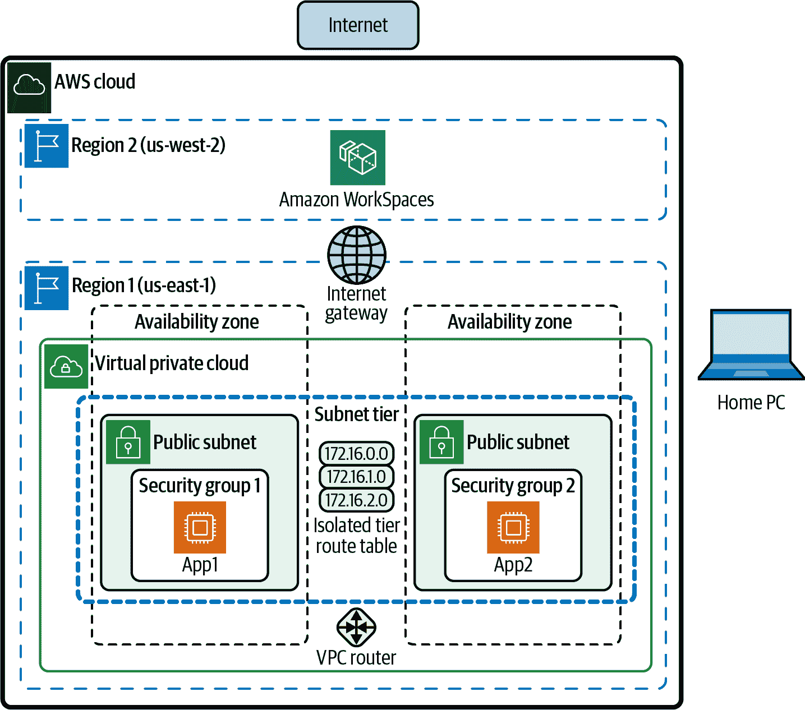

## 步骤

### 1. 下载 AWS IP 地址范围 JSON 文件

下载 AWS IP 地址范围 JSON 文件：

```
curl -o ip-ranges.json https://ip-ranges.amazonaws.com/ip-ranges.json
```

**注意：** 如果您的工作站尚未安装 `jq` 实用程序，则需要安装它；例如，`brew install jq`。

### 2. 生成 us-west-2 中 Amazon WorkSpaces 网关的 CIDR 范围列表

生成 us-west-2 中 Amazon WorkSpaces 网关的 CIDR 范围列表：

```
jq -r '.prefixes[] | select(.region=="us-west-2") | select(.service=="WORKSPACES_GATEWAYS") | .ip_prefix' < ip-ranges.json
```

**提示：** 您可以在他们的 [`文档`](https://oreil.ly/iQrPY) 中找到有关 AWS IP 地址范围的更多信息。

### 3. 使用 IP 范围创建托管前缀列表

使用来自 `ip-ranges.json` 的 Amazon WorkSpaces IP 范围来创建托管前缀列表：

```
PREFIX_LIST_ID=$(aws ec2 create-managed-prefix-list \
    --address-family IPv4 \
    --max-entries 15 \
    --prefix-list-name allowed-us-east-1-cidrs \
    --output text --query "PrefixList.PrefixListId" \
    --entries 
    Cidr=44.234.54.0/23,Description=workspaces-us-west-2-cidr1
Cidr=54.244.46.0/23,Description=workspaces-us-west-2-cidr2)
```

**注意：** 此时，您的工作站不应能够访问任一实例。如果您尝试以下命令之一，将收到“连接超时”错误：

```
curl -m 2 $INSTANCE_IP_1
curl -m 2 $INSTANCE_IP_2
```


4. 获取工作站的公有 IPv4 地址：

```
MY_IP_4=$(curl myip4.com | tr -d ' ')
```

5. 更新托管前缀列表并添加工作站的公有 IPv4 地址（参见图 2-12）：

```
aws ec2 modify-managed-prefix-list \
    --prefix-list-id $PREFIX_LIST_ID \
    --current-version 1 \
    --add-entries Cidr=${MY_IP_4}/32,Description=my-workstation-ip
```

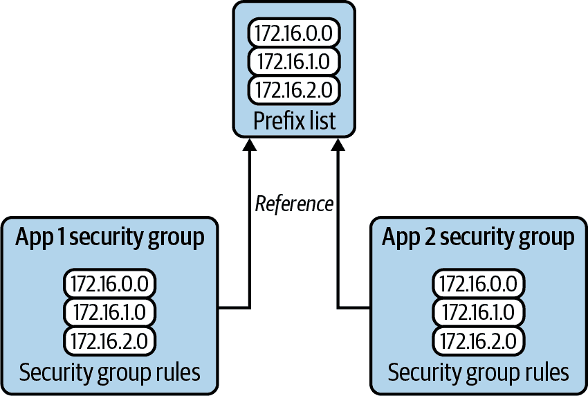

**提示**

S3 有一个 [AWS 托管前缀列表](https://oreil.ly/wcdzB)。

你应该会看到类似如下的输出：

```
{
  "PrefixList": {
    "PrefixListId": "pl-013217b85144872d2",
    "AddressFamily": "IPv4",
    "State": "modify-in-progress",
    "PrefixListArn": "arn:aws:ec2:us-east-1:111111111111:prefix-list/pl-013217b85144872d2",
    "PrefixListName": "allowed-us-east-1-cidrs",
    "MaxEntries": 10,
    "Version": 1,
    "OwnerId": "111111111111"
  }
}
```

6. 为每个应用程序的安全组添加一条入站规则，允许从前缀列表访问 TCP 端口 80：

```
aws ec2 authorize-security-group-ingress \
    --group-id $INSTANCE_SG_1 --ip-permissions \
IpProtocol=tcp,FromPort=80,ToPort=80,PrefixListIds="[{Description=http-from-prefix-list,PrefixListId=$PREFIX_LIST_ID}]"

aws ec2 authorize-security-group-ingress \
    --group-id $INSTANCE_SG_2 --ip-permissions \
IpProtocol=tcp,FromPort=80,ToPort=80,PrefixListIds="[{Description=http-from-prefix-list,PrefixListId=$PREFIX_LIST_ID}]"
```

**提示**

找出托管列表的使用位置。此命令有助于审核前缀列表在整个 AWS 环境中的使用情况：

```
aws ec2 get-managed-prefix-list-associations \
    --prefix-list-id $PREFIX_LIST_ID
```

### 验证检查

从工作站的 PC 测试对两个实例的访问：

```
curl -m 2 $INSTANCE_IP_1

curl -m 2 $INSTANCE_IP_2
```

### 清理

按照 [章节代码仓库](https://github.com/AWSCookbook/Networking) 中此配方文件夹内的步骤操作。

## 讨论

如果你需要更新允许入站通信到实例的 CIDR 块列表，只需更新前缀列表，而不必更新安全组。如果你需要在许多安全组中使用此类授权，这有助于减少维护开销；你只需在单一位置更新前缀列表，而不必修改每个需要此网络安全配置的安全组授权。你也可以将前缀列表用于出站安全组授权。

前缀列表可以与路由表关联；它们对于黑洞流量（禁止访问特定的 IP 地址和 CIDR 块列表）也很有用，并且还可以简化路由表配置。例如，你可以维护一个分支机构 CIDR 范围的前缀列表，并用它们来实现路由和安全组授权，从而简化网络流量和安全配置的管理。将前缀列表与路由关联的示例如下：

```
aws ec2 create-route --route-table-id $Sub1RouteTableID \
    --destination-prefix-list-id $PREFIX_LIST_ID \
    --instance-id $INSTANCE_ID
```

前缀列表还提供了强大的[版本控制机制](https://oreil.ly/KgSne)，允许你快速回滚到之前已知的工作状态。例如，如果你更新了前缀列表并发现该更改破坏了某些现有功能，你可以回滚到前缀列表的先前版本以恢复先前的功能，同时调查错误的根本原因。如果你决定出于某种原因回滚到先前版本，首先描述前缀列表以获取当前版本号：

```
aws ec2 describe-prefix-lists --prefix-list-ids $PREFIX_LIST_ID
```

### 挑战

恢复前缀列表的活动版本，以便移除工作站 IP，使你无法再访问任一应用程序。（提示：在代码仓库中。）

# 2.9 使用 VPC 端点控制来自 VPC 的 S3 网络访问

## 问题

VPC 内的资源应仅能访问特定的 S3 存储桶。此外，出于安全原因并降低带宽成本，此 S3 流量不应遍历互联网。

## 解决方案

你将为 S3 创建一个网关 VPC 端点，将其与路由表关联，并自定义其策略文档（参见图 2-13）。

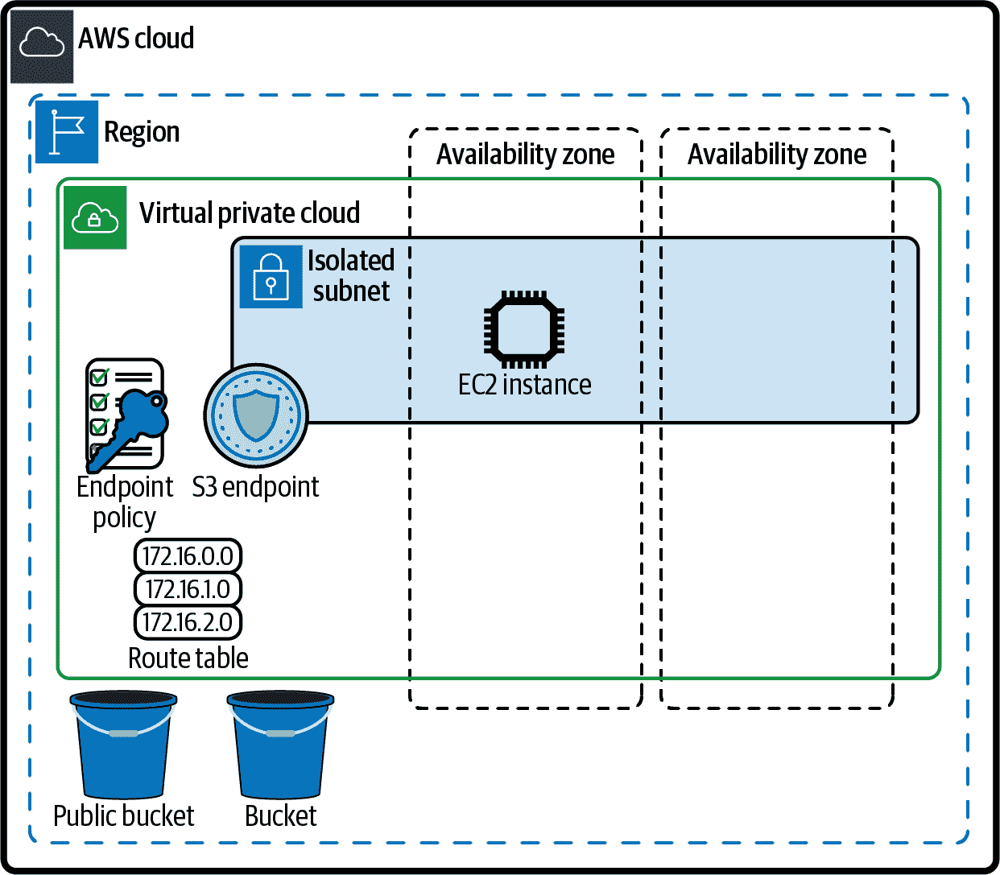

### 前提条件

* 具有两个可用区中隔离子网及关联路由表的 VPC
* 公有子网中可用于测试访问的一个 EC2 实例
* 一个你想要限制访问的现有 S3 存储桶

### 准备

按照 [章节代码仓库](https://github.com/AWSCookbook/Networking) 中此配方文件夹内的步骤操作。

### 步骤

1. 在 VPC 中创建一个网关端点，并将该端点与隔离路由表关联：

```
END_POINT_ID=$(aws ec2 create-vpc-endpoint \
    --vpc-id $VPC_ID \
    --service-name com.amazonaws.$AWS_REGION.s3 \
    --route-table-ids $RT_ID_1 $RT_ID_2 \
    --query VpcEndpoint.VpcEndpointId --output text)
```

2. 创建一个名为 `policy.json` 的模板端点策略文件，内容如下（代码仓库中已包含）。这用于将访问权限限制为仅限准备步骤中创建的 S3 存储桶：

```
{
  "Statement": [
    {
      "Sid": "RestrictToOneBucket",
      "Principal": "*",
      "Action": [
        "s3:GetObject",
        "s3:PutObject"
      ],
      "Effect": "Allow",
      "Resource": ["arn:aws:s3:::S3BucketName",
                   "arn:aws:s3:::S3BucketName/*"]
    }
  ]
}
```

3. 在 `policy-template.json` 文件中插入你的 `S3_BUCKET_NAME`：

```
sed -e "s/S3BucketName/${BUCKET_NAME}/g" \
    policy-template.json > policy.json
```

4. 修改端点的策略文档。端点策略限制或约束可通过 VPC 端点访问的资源：

```
aws ec2 modify-vpc-endpoint \
    --policy-document file://policy.json \
    --vpc-endpoint-id $END_POINT_ID
```

### 验证检查

输出 S3 存储桶的名称，以便在连接到 EC2 实例时可以引用它：

```
echo $BUCKET_NAME
```

使用 SSM Session Manager 连接到 EC2 实例（参见配方 1.6）：

```
aws ssm start-session --target $INSTANCE_ID
```

通过从实例元数据获取值来设置区域：

```
export AWS_DEFAULT_REGION=$(curl \
--silent http://169.254.169.254/latest/dynamic/instance-identity/document \
| awk -F'"' ' /region/ {print $4}')
```

检索允许的 S3 存储桶名称：

```
BUCKET=$(aws ssm get-parameters \
    --names "Cookbook209S3Bucket" \
     --query "Parameters[*].Value" --output text)
```

通过尝试从 S3 存储桶复制文件来测试访问：

```
aws s3 cp s3://${BUCKET_NAME}/test_file /home/ssm-user/
```

你应该会看到类似如下的输出：

```
download: s3://cdk-aws-cookbook-209-awscookbookrecipe20979239201-115xoj77fgxoh/test_file to ./test_file
```

**注意**

以下命令尝试列出一个公有 S3 存储桶。然而，由于我们配置的端点策略，预期这将会失败。

尝试列出与 OpenStreetMap 基金会公共数据集计划相关的*公有* S3 存储桶的内容：

```
aws s3 ls s3://osm-pds/
```

你应该会看到类似如下的输出：

```
An error occurred (AccessDenied) when calling the ListObjectsV2 operation: Access Denied
```

退出 Session Manager 会话：

```
exit
```

### 清理


请按照[章节代码仓库](https://github.com/AWSCookbook/Networking)中本配方文件夹内的步骤操作。

## 讨论

使用终端节点策略是一项有用的安全实现，可限制对 S3 存储桶的访问。这不仅适用于您账户拥有的 S3 存储桶，也适用于 AWS 上全球所有的 S3 存储桶。

### 提示

最近，AWS [宣布支持 S3 接口终端节点](https://oreil.ly/mBBsN)。但值得注意的是，虽然这些终端节点非常适合某些用例（例如，当您想使用安全组控制流量时），但由于与接口终端节点相关的[成本](https://oreil.ly/1WUGl)，它们并不适合解决此问题。

根据 [VPC 用户指南](https://oreil.ly/LAWFo)，`Gateway VPC 终端节点` 免费，并在您的 VPC 路由表中使用，以将发往 AWS 服务的流量保留在 AWS 主干网络内，而不遍历公共网络。这使您能够创建不需要互联网网关的 VPC，用于那些不需要互联网网关但需要访问 S3 和 DynamoDB 等其他 AWS 服务的应用程序。所有发往这些服务的流量将由路由表定向到 VPC 终端节点，而不是公共互联网路由，因为 VPC 终端节点路由表条目比默认的 `0.0.0.0/0` 路由更具体。

`S3 VPC 终端节点策略` 利用 `JSON` 策略文档，可以根据您的需求进行任意细粒度的控制。您可以使用条件、源 IP 地址、`VPC 终端节点 ID`、`S3 存储桶名称` 等。有关可用策略元素的更多信息，请参阅支持[文档](https://oreil.ly/M8q8J)。

### 挑战

修改 S3 存储桶的存储桶策略，仅允许从您创建的 VPC 终端节点进行访问。有关这方面的提示，请查看 [S3 用户指南](https://oreil.ly/tEajj)。

# 2.10 使用 Transit Gateway 启用跨 VPC 传递连接

## 问题

您需要在所有 VPC 之间实现传递路由，并从共享服务 VPC 向其他 VPC 共享互联网出口，以减少必须部署的 `NAT` 网关数量。

## 解决方案

部署 AWS Transit Gateway (`TGW`) 并为所有 VPC 配置 Transit Gateway VPC 附件。更新每个 VPC 的 VPC 路由表，将所有非本地流量发送到 Transit Gateway，并在共享服务 VPC 中启用 `NAT` 网关共享，供所有辐射 VPC 使用（请参阅图 2-14）。

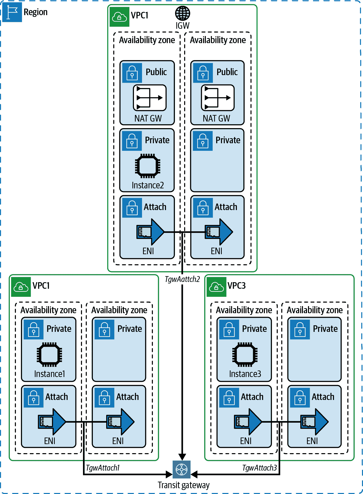

### 警告

默认的初始 VPC 配额为 [每个区域每个账户五个](https://oreil.ly/T4WD8)。此解决方案将部署三个 VPC。如果您已经拥有两个以上的 VPC，可以从四个选项中选择：部署到不同的区域、删除不再需要的现有 VPC、使用测试账户，或[申请提高配额](https://oreil.ly/cFRs5)。

### 前提条件

*   同一区域中的三个 VPC，包含私有和隔离子网层级
*   互联网网关附加到一个 VPC（在我们的示例中为 `VPC2`）
    *   `NAT` 网关部署在公有子网中

### 准备工作

请按照[章节代码仓库](https://github.com/AWSCookbook/Networking)中本配方文件夹内的步骤操作。

### 步骤

1.  创建 Transit Gateway：

    ```
    TGW_ID=$(aws ec2 create-transit-gateway \
        --description AWSCookbook210 \
        --options=AmazonSideAsn=65010,AutoAcceptSharedAttachments=enable,DefaultRouteTableAssociation=enable,\
        DefaultRouteTablePropagation=enable,VpnEcmpSupport=enable,DnsSupport=enable \
        --output text --query TransitGateway.TransitGatewayId)
    ```

2.  等待 Transit Gateway 的状态变为 available。这可能需要几分钟：

    ```
    aws ec2 describe-transit-gateways \
        --transit-gateway-ids $TGW_ID \
        --output text --query TransitGateways[0].State
    ```

3.  为 `VPC1` 创建 Transit Gateway 附件：

    ```
    TGW_ATTACH_1=$(aws ec2 create-transit-gateway-vpc-attachment \
        --transit-gateway-id $TGW_ID \
        --vpc-id $VPC_ID_1 \
        --subnet-ids $ATTACHMENT_SUBNETS_VPC_1 \
        --query TransitGatewayVpcAttachment.TransitGatewayAttachmentId \
        --output text)
    ```

4.  为 `VPC2` 创建 Transit Gateway 附件：

    ```
    TGW_ATTACH_2=$(aws ec2 create-transit-gateway-vpc-attachment \
        --transit-gateway-id $TGW_ID \
        --vpc-id $VPC_ID_2 \
        --subnet-ids $ATTACHMENT_SUBNETS_VPC_2 \
        --query TransitGatewayVpcAttachment.TransitGatewayAttachmentId \
        --output text)
    ```

5.  为 `VPC3` 创建 Transit Gateway 附件：

    ```
    TGW_ATTACH_3=$(aws ec2 create-transit-gateway-vpc-attachment \
        --transit-gateway-id $TGW_ID \
        --vpc-id $VPC_ID_3 \
        --subnet-ids $ATTACHMENT_SUBNETS_VPC_3 \
        --query TransitGatewayVpcAttachment.TransitGatewayAttachmentId \
        --output text)
    ```

6.  在 VPC 1 和 VPC 3 的所有私有子网中添加路由，目标为 `0.0.0.0/0`，指向 `TGW`。这通过 `VPC2` 中的 `NAT` 网关实现了统一的互联网出口，并启用了到其他 VPC 的传递路由：

    ```
    aws ec2 create-route --route-table-id $VPC_1_RT_ID_1 \
        --destination-cidr-block 0.0.0.0/0 \
        --transit-gateway-id $TGW_ID
    
    aws ec2 create-route --route-table-id $VPC_1_RT_ID_2 \
        --destination-cidr-block 0.0.0.0/0 \
        --transit-gateway-id $TGW_ID
    
    aws ec2 create-route --route-table-id $VPC_3_RT_ID_1 \
        --destination-cidr-block 0.0.0.0/0 \
        --transit-gateway-id $TGW_ID
    
    aws ec2 create-route --route-table-id $VPC_3_RT_ID_2 \
        --destination-cidr-block 0.0.0.0/0 \
        --transit-gateway-id $TGW_ID
    ```

7.  现在在与 `VPC2` 私有子网关联的路由表中添加一条指向 `10.10.0.0/24` [超网](https://oreil.ly/AVrM7) 的路由，将其目标指向 Transit Gateway。这比已存在的 `0.0.0.0/0` 目标更具体，因此在路由决策中具有更高优先级。这会将发往 VPC 1、2 和 3 的流量定向到 `TGW`：

    ```
    aws ec2 create-route --route-table-id $VPC_2_RT_ID_1 \
        --destination-cidr-block 10.10.0.0/24 \
        --transit-gateway-id $TGW_ID
    
    aws ec2 create-route --route-table-id $VPC_2_RT_ID_2 \
        --destination-cidr-block 10.10.0.0/24 \
        --transit-gateway-id $TGW_ID
    ```

8.  查询正在使用的 `NAT` 网关；我们需要它们为互联网流量添加路由：

    ```
    NAT_GW_ID_1=$(aws ec2 describe-nat-gateways \
        --filter "Name=subnet-id,Values=$VPC_2_PUBLIC_SUBNET_ID_1" \
        --output text --query NatGateways[*].NatGatewayId)
    
    NAT_GW_ID_2=$(aws ec2 describe-nat-gateways \
        --filter "Name=subnet-id,Values=$VPC_2_PUBLIC_SUBNET_ID_2" \
        --output text --query NatGateways[*].NatGatewayId)
    ```

9.  为 `VPC2` 中的附件子网添加路由，将互联网流量定向到 `NAT` 网关：

    ```
    aws ec2 create-route --route-table-id $VPC_2_ATTACH_RT_ID_1 \
        --destination-cidr-block 0.0.0.0/0 \
        --nat-gateway-id $NAT_GW_ID_1
    
    aws ec2 create-route --route-table-id $VPC_2_ATTACH_RT_ID_2 \
        --destination-cidr-block 0.0.0.0/0 \
        --nat-gateway-id $NAT_GW_ID_2
    ```

10. 向与 `VPC2` 中公有子网关联的路由表添加静态路由。这启用了回到 `TGW` 的通信，以允许与所有附加的 VPC 共享 `NAT` 网关：

     ```
     aws ec2 create-route --route-table-id $VPC_2_PUBLIC_RT_ID_1 \
         --destination-cidr-block 10.10.0.0/24 \
         --transit-gateway-id $TGW_ID
     
     aws ec2 create-route --route-table-id $VPC_2_PUBLIC_RT_ID_2 \
         --destination-cidr-block 10.10.0.0/24 \
         --transit-gateway-id $TGW_ID
     ```

11. 为 `VPC2` 中的私有子网添加静态路由，以允许从 `VPC2` 私有子网回到 `TGW` 附件的通信：


```
aws ec2 create-route --route-table-id $VPC_2_RT_ID_1 \
    --destination-cidr-block 10.10.0.0/24 \
    --transit-gateway-id $TGW_ID

aws ec2 create-route --route-table-id $VPC_2_RT_ID_2 \
    --destination-cidr-block 10.10.0.0/24 \
    --transit-gateway-id $TGW_ID
```

12. 获取传输网关路由表 ID：

```
TRAN_GW_RT=$(aws ec2 describe-transit-gateways \
    --transit-gateway-ids $TGW_ID --output text \
    --query TransitGateways[0].Options.AssociationDefaultRouteTableId)
```

13. 在传输网关路由表中为 VPC2（包含 NAT 网关）添加一条静态路由，以通过此路径发送所有互联网流量：

```
aws ec2 create-transit-gateway-route \
  --destination-cidr-block 0.0.0.0/0 \
  --transit-gateway-route-table-id $TRAN_GW_RT \
  --transit-gateway-attachment-id $TGW_ATTACH_2
```

### 验证检查

确保您的 EC2 实例 1 已向 SSM 注册。要检查状态，请使用以下命令，该命令应返回实例 ID：

```
aws ssm describe-instance-information \
    --filters Key=ResourceType,Values=EC2Instance \
    --query "InstanceInformationList[].InstanceId" --output text
```

使用 SSM Session Manager 连接到您的 EC2 实例：

```
aws ssm start-session --target $INSTANCE_ID_1
```

测试互联网访问：

```
ping -c 4 aws.amazon.com
```

您应该会看到类似以下的输出：

```
PING dr49lng3n1n2s.cloudfront.net (99.86.187.73) 56(84) bytes of data.
64 bytes from server-99-86-187-73.iad79.r.cloudfront.net (99.86.187.73): icmp_seq=1 ttl=238 time=3.44 ms
64 bytes from server-99-86-187-73.iad79.r.cloudfront.net (99.86.187.73): icmp_seq=2 ttl=238 time=1.41 ms
64 bytes from server-99-86-187-73.iad79.r.cloudfront.net (99.86.187.73): icmp_seq=3 ttl=238 time=1.43 ms
64 bytes from server-99-86-187-73.iad79.r.cloudfront.net (99.86.187.73): icmp_seq=4 ttl=238 time=1.44 ms

--- dr49lng3n1n2s.cloudfront.net ping statistics ---
4 packets transmitted, 4 received, 0% packet loss, time 3004ms
rtt min/avg/max/mdev = 1.411/1.934/3.449/0.875 ms
sh-4.2$
```

退出 Session Manager 会话：

```
exit
```

### 挑战 1

您可以通过修改路由表来限制哪些 VPC 可以通过 VPC2 中的 NAT 网关访问互联网。尝试为 VPC3 添加一条更具体的 `10.10.0.0/24` 路由，而不是 `0.0.0.0/0` 目标，以查看如何自定义互联网出口共享。

### 挑战 2

您可能不希望允许 VPC1 和 VPC3 相互通信。尝试添加一个新的传输网关路由表，并更新附件以实现此目的。

### 挑战 3

在该解决方案中，您在 `10.10.0.0/24` 超网中部署了三个 VPC，每个 VPC 的子网大小为 `/26`。还有空间容纳一个额外的 `/26` 子网。尝试添加一个具有 `/26` CIDR、子网和路由表的额外 VPC；然后将其附加到传输网关。

## 清理

按照 [章节代码仓库](https://github.com/AWSCookbook/Networking) 中此配方文件夹内的步骤操作。

## 讨论

[传输网关](https://oreil.ly/VKW2V) 允许您快速为 AWS 中的网络实现多 VPC *中心辐射型* 网络拓扑。您可能不得不使用许多对等连接来实现类似结果，或者在 [传输 VPC 架构](https://oreil.ly/LUxIm) 中的实例上使用第三方软件。传输网关还支持 [传输网关跨区域对等连接](https://oreil.ly/kD1pI) 和 [通过资源访问管理器 (RAM) 进行跨账户共享](https://oreil.ly/qovsS)。

当您将 VPC 附加到传输网关时，您在每个 AZ 中使用了子网以实现弹性。您还为 VPC 附件使用了专用的“附件”子网。您可以将传输网关附加到 VPC 内的任何子网。为这些附件使用专用子网使您能够灵活地粒度化定义您选择路由到 TGW 的子网。也就是说，如果您附加了私有子网，它将始终拥有通往 TGW 的路由；根据您的用例，这可能并非预期行为。在您的案例中，您为私有子网配置了路由，将所有流量发送到传输网关，从而实现了 NAT 网关和互联网网关的共享；与必须部署多个 NAT 网关（例如每个 VPC 一个）相比，这节省了成本。

您可以将本地网络或任何虚拟网络直接连接到传输网关，因为它 [充当所有 AWS 网络流量的中心枢纽](https://oreil.ly/13s7R)。您可以将 IPsec VPN、Direct Connect (DX) 和第三方网络设备连接到传输网关，以将您的 AWS 网络扩展到非 AWS 网络。这还允许您通过将一个 VPN 连接和/或 Direct Connect 连接直接连接到传输网关来整合这些连接，从而访问某个区域中的所有 VPC。[传输网关支持边界网关协议 (BGP)](https://oreil.ly/pbqwP)，可通过这些类型的网络扩展实现双向动态路由更新。

### 挑战

创建第四个 VPC 并将 TGW 附加到其中的子网。允许其使用现有的 NAT 网关访问互联网。

# 2.11 将两个 VPC 对等连接在一起以实现 VPC 间网络通信

## 问题

您需要以简单且经济高效的方式，使位于不同 VPC 中的两个实例能够相互通信。

## 解决方案

在两个 VPC 之间请求对等连接，接受对等连接，更新每个 VPC 子网的路由表，最后测试从一个实例到另一个实例的连接（请参阅 图 2-15）。

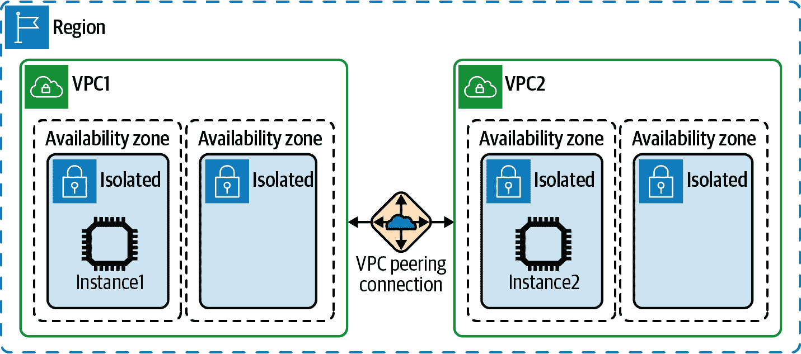

### 前提条件

*   两个 VPC，每个 VPC 在两个 AZ 中都有隔离的子网和关联的路由表
*   在每个 VPC 中，有一个可供测试访问的 EC2 实例

### 准备工作

按照 [章节代码仓库](https://github.com/AWSCookbook/Networking) 中此配方文件夹内的步骤操作。

### 步骤

1.  创建 VPC 对等连接以将 VPC1 连接到 VPC2：

    ```
    VPC_PEERING_CONNECTION_ID=$(aws ec2 create-vpc-peering-connection \
        --vpc-id $VPC_ID_1 --peer-vpc-id $VPC_ID_2 --output text \
        --query VpcPeeringConnection.VpcPeeringConnectionId)
    ```

2.  接受对等连接：

    ```
    aws ec2 accept-vpc-peering-connection \
        --vpc-peering-connection-id $VPC_PEERING_CONNECTION_ID
    ```

    #### 注意

    VPC 对等连接可以在一个 AWS 账户与另一个不同的 AWS 账户之间建立。如果您选择跨 AWS 账户对等连接 VPC，则需要确保您具有 [正确的 IAM 配置](https://oreil.ly/pWmDE)，以便在每个账户中创建和接受对等连接。

3.  在与每个子网关联的路由表中，添加一条路由，将目标为对等 VPC CIDR 范围的流量导向 `VPC_PEERING_CONNECTION_ID`：

    ```
    aws ec2 create-route --route-table-id $VPC_SUBNET_RT_ID_1 \
        --destination-cidr-block $VPC_CIDR_2 \
        --vpc-peering-connection-id $VPC_PEERING_CONNECTION_ID
    
    aws ec2 create-route --route-table-id $VPC_SUBNET_RT_ID_2 \
        --destination-cidr-block $VPC_CIDR_1 \
        --vpc-peering-connection-id $VPC_PEERING_CONNECTION_ID
    ```

4.  向实例 2 的安全组添加一条入站规则，允许来自实例 1 安全组的 ICMPv4 访问：

    ```
    aws ec2 authorize-security-group-ingress \
        --protocol icmp --port -1 \
        --source-group $INSTANCE_SG_1 \
        --group-id $INSTANCE_SG_2
    ```

#### 验证检查

获取实例 2 的 IP：

```
aws ec2 describe-instances --instance-ids $INSTANCE_ID_2\
    --output text \
    --query Reservations[0].Instances[0].PrivateIpAddress
```

确保您的 EC2 实例 1 已向 SSM 注册。使用此命令检查状态：

```
aws ssm describe-instance-information \
    --filters Key=ResourceType,Values=EC2Instance \
    --query "InstanceInformationList[].InstanceId" --output text
```


使用 SSM Session Manager 连接到您的 EC2 实例：

```
aws ssm start-session --target $INSTANCE_ID_1
```

从实例 1 ping 实例 2：

```
ping -c 4 <<INSTANCE_IP_2>>

Output:
PING 10.20.0.242 (10.20.0.242) 56(84) bytes of data.
64 bytes from 10.20.0.242: icmp_seq=1 ttl=255 time=0.232 ms
64 bytes from 10.20.0.242: icmp_seq=2 ttl=255 time=0.300 ms
64 bytes from 10.20.0.242: icmp_seq=3 ttl=255 time=0.186 ms
64 bytes from 10.20.0.242: icmp_seq=4 ttl=255 time=0.183 ms

--- 10.20.0.242 ping statistics ---
4 packets transmitted, 4 received, 0% packet loss, time 3059ms
rtt min/avg/max/mdev = 0.183/0.225/0.300/0.048 ms
```

退出 Session Manager 会话：

```
exit
```

#### 提示

您可以在 VPC 控制台中搜索安全组 ID，以显示引用其他安全组的所有安全组。您也可以运行 `aws ec2 describe-security-group-references` CLI 命令来实现此目的。这有助于深入了解哪些安全组引用了其他安全组。您可以引用由其他 AWS [账户拥有但不位于其他区域](https://oreil.ly/BxIDv) 的对等 VPC 中的安全组。

### 清理

按照 [章节代码仓库](https://github.com/AWSCookbook/Networking) 中此配方文件夹内的步骤操作。

## 讨论

VPC 对等连接是非传递的。每个 VPC 都需要与其需要通信的每个其他 VPC 建立对等连接。[这种类型的连接非常理想](https://oreil.ly/0sJeK)，当您有一个托管共享服务的 VPC，其他 VPC 需要访问它，而不需要“辐射” VPC 之间相互通信时。

除了对等连接外，您还需要配置与 VPC 子网关联的路由表，将目标为对等 VPC CIDR 的流量发送到对等连接 (PCX)。换句话说，要使 `VPC1` 能够与 `VPC2` 通信，目标路由必须存在于 `VPC1` 中，返回路由也必须存在于 `VPC2` 中。

如果您向此配方添加第三个 VPC，并且需要所有 VPC 能够相互通信，则需要将该第三个 VPC 与前两个 VPC 建立对等连接，并相应更新所有 VPC 路由表，以允许所有 VPC 相互通信。随着您继续向这样的网络架构添加更多 VPC，您可能会注意到所需的对等连接数量和路由表更新数量开始呈指数级增长。因此，传输网关是使用传输网关路由表进行传递性 VPC 通信的更好选择。

如果需要，您可以跨账户使用 VPC 对等连接，并且还可以 [在对等 VPC 中引用安全组](https://oreil.ly/53awx)，方式类似于在单个 VPC 内引用安全组。这使您在使用 [VPC 对等连接](https://oreil.ly/ce4M8) 时，能够在整个 AWS 环境中使用相同类型的策略来管理安全组。

#### 警告

将 VPC 连接在一起 [要求 CIDR 范围不重叠](https://oreil.ly/3j1KN)，以便路由正常工作。VPC 路由表必须包含一条特定路由，将目标为对等 VPC 的流量指向对等连接。

### 挑战

VPC 对等连接可以 [跨 AWS 区域建立](https://oreil.ly/PAKmf)。将另一个区域中的 VPC 连接到您在配方所用区域中部署的 VPC。
