# 第 3 章 存储

## 3.0 简介

许多行业高度重视云数据存储技术，以帮助满足不断增长的数据需求。有许多数据存储选项可供选择，以满足您的需求，规模看似无限。即使云中有许多新的存储选项，Amazon S3 仍然是许多用例强大且基础的构建块。令人惊讶的是，它 [发布已超过 15 年](https://oreil.ly/nfIGt)。随着时间的推移，添加了许多功能并推出了新的存储服务。有多种存储选项可用于满足安全要求（例如，密钥管理服务 [KMS] 加密），同时降低成本（例如，S3 Intelligent-Tiering）。确保数据安全且可用是所有开发人员和架构师面临的挑战。

AWS 上可用的存储服务允许与其他 AWS 服务集成，为与许多 AWS 服务集成的开发人员和应用程序架构师提供方式。这些服务还可用于替换您在本地环境中运行和操作的 [传统存储系统](https://oreil.ly/qSEnc)。例如：

*   S3 可用于在对象操作（如上传）时自动调用 Lambda 函数。
*   EFS 可与 EC2 配合使用，以替换由网络文件系统 (NFS) 服务器提供的现有共享文件系统。
*   [FSx for Windows](https://aws.amazon.com/fsx/windows) 可用于替换 EC2 工作负载的基于 Windows 的文件服务器。
*   EBS 通过提供块设备来替换光纤通道和 Internet 小型计算机系统接口 (iSCSI) 目标，并提供多种吞吐量选项以满足性能要求。

在本章中，您将使用其中一些服务，以便开始构建智能、可扩展且安全的系统，这些系统有可能将成本和运营开销降至最低。

### 工作站配置

遵循 “CLI 配方的通用工作站设置步骤” 来验证您的配置并设置所需的环境变量。然后，克隆章节代码仓库：

```
git clone https://github.com/AWSCookbook/Storage
```

## 3.1 使用 S3 生命周期策略降低存储成本

### 问题

您需要将不常访问的对象转移到更具成本效益的存储层，而不影响性能或增加运营开销。

### 解决方案

创建一个 S3 生命周期规则，在预定义的 30 天时间段后将对象转移到 S3 低频访问 (IA) 存储类。然后将此生命周期策略应用到您的 S3 存储桶（请参阅 图 3-1）。

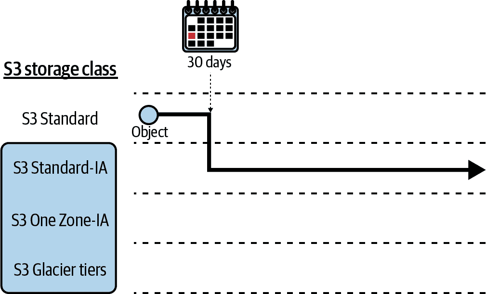

#### 先决条件

*   一个 S3 存储桶

#### 准备

按照 [章节代码仓库](https://github.com/AWSCookbook/Storage) 中此配方文件夹内的步骤操作。

#### 步骤

1.  创建一个 `lifecycle-rule.json` 文件（仓库中已提供），用作您将应用到 S3 存储桶的生命周期策略：

```
{
  "Rules": [
    {
      "ID": "Move all objects to Infrequent Access",
      "Prefix": "",
      "Status": "Enabled",
      "Transitions": [
        {
          "Date": "2015-11-10T00:00:00.000Z",
          "Days": 30, 
          "StorageClass": "INFREQUENTLY_ACCESSED"
        }
      ]
    }
  ]
}
```

2.  应用生命周期规则配置：

```
aws s3api put-bucket-lifecycle-configuration \
    --bucket awscookbook301-$RANDOM_STRING \
    --lifecycle-configuration file://lifecycle-rule.json
```

##### 注意

生命周期规则有助于自动将存储桶中的部分或所有对象转移到不同的存储类（前缀、标签和对象名称均可用作生命周期规则的过滤器）。有关生命周期规则功能的完整列表，请参阅 [文档](https://oreil.ly/2sUzK)。

#### 验证检查

获取存储桶的生命周期配置：

```
aws s3api get-bucket-lifecycle-configuration \
    --bucket awscookbook301-$RANDOM_STRING
```

(可选) 将对象复制到存储桶：

```
aws s3 cp book_cover.png s3://awscookbook301-$RANDOM_STRING
```

检查对象的存储类：

```
aws s3api list-objects-v2 --bucket awscookbook301-$RANDOM_STRING
```

您应该会看到类似以下的输出：


# 3.2 使用 S3 Intelligent-Tiering 归档策略自动归档 S3 对象

## 问题

您需要自动将不常访问的对象转换到不同的归档存储类，而不影响性能或增加运维开销。

## 解决方案

创建一项策略，根据访问模式自动将超过 90 天的 `S3` 对象归档到 `S3 Glacier` 归档存储。将其应用到您的 `S3` 存储桶，如图 3-2 所示。

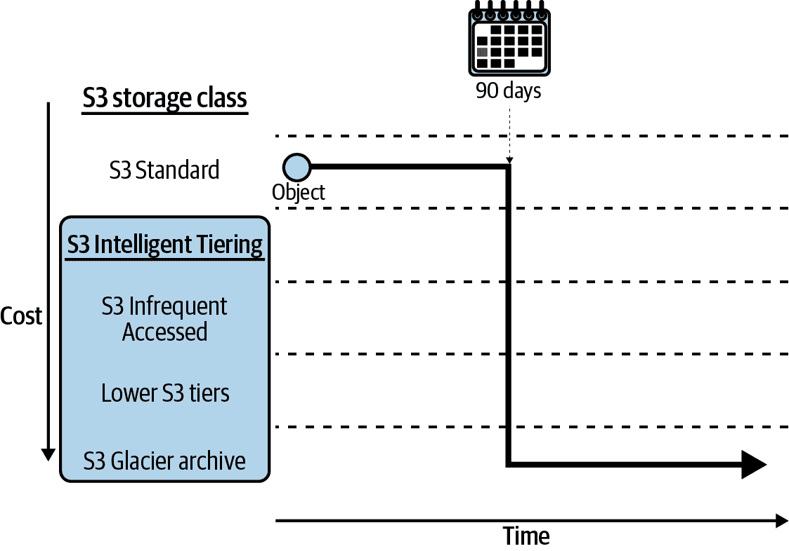

### 先决条件

*   一个 `S3` 存储桶

### 准备工作

按照[章节代码仓库](https://github.com/AWSCookbook/Storage)中本配方文件夹内的步骤操作。

### 步骤

1.  创建一个名为 `tiering.json` 的文件用于配置（仓库中已提供该文件）：

    ```json
    {
      "Id": "awscookbook302",
      "Status": "Enabled",
      "Tierings": [
        {
          "Days": 90,
          "AccessTier": "ARCHIVE_ACCESS"
        }
      ]
    }
    ```

2.  应用 Intelligent-Tiering 配置：

    ```
    aws s3api put-bucket-intelligent-tiering-configuration \
        --bucket awscookbook302-$RANDOM_STRING \
        --id awscookbook302 \
        --intelligent-tiering-configuration "$(cat tiering.json)"
    ```

    #### 警告

    请确保您的用例和应用程序能够支持与 `S3 Glacier` 归档存储层相关的增加的检索时间。您可以配置应用程序使用 `S3 Glacier` 归档支持的加快检索机制来缩短检索时间，但这会增加成本。有关归档时间完整列表及如何配置加快访问的信息，请参阅[支持文档](https://oreil.ly/tru0v)。

#### 验证检查

获取存储桶的 Intelligent-Tiering 配置：

```
aws s3api get-bucket-intelligent-tiering-configuration \
    --bucket awscookbook302-$RANDOM_STRING \
    --id awscookbook302
```

将对象复制到存储桶：

```
aws s3 cp ./book_cover.png s3://awscookbook302-$RANDOM_STRING
```

检查对象的存储类别：

```
aws s3api list-objects-v2 --bucket awscookbook302-$RANDOM_STRING
```

### 清理

按照[章节代码仓库](https://github.com/AWSCookbook/Networking)中本配方文件夹内的步骤操作。

## 讨论

`S3 Intelligent-Tiering` 归档提供了一种自动机制，将“冷”（不常访问）对象转换到 [`S3 Glacier` 归档](https://aws.amazon.com/s3/glacier)。您可以定义对象转换到归档存储所需的时间长度（90 到 730 天之间）。此功能有助于满足您可能因合规性而需要的长期保留要求。`S3 Intelligent-Tiering` 中可用的存储层级直接映射到 `S3` 层级：

`频繁访问`
:   针对频繁访问进行优化（`S3 Standard`）

`不频繁访问`
:   针对不频繁访问进行优化（`S3 Standard-IA`）

`归档访问`
:   归档用途（`S3 Glacier`）

`深度归档访问`
:   长期保留用途（`S3 Glacier Deep Archive`）

此归档配置独立于您应用于对象的主要 `S3 Intelligent-Tiering` 分层配置，因为这是一个特定于存储桶的配置。在上一道配方中，您配置了一个生命周期规则，将存储桶内的所有对象转换到 `S3 Intelligent-Tiering` 存储层。本配方增加了额外配置，根据您的设置将对象转换到 `S3` 归档层。您可以单独使用这些方法，也可以同时使用，以满足您的需求。

#### 注意

`S3` 层级是针对对象的，这与 `Intelligent-Tiering` 归档针对存储桶不同。如果您希望在配置中包含或排除对象，可以筛选归档配置，使其仅应用于特定前缀、对象标签和对象名称。有关更多信息，请参阅[支持文档](https://oreil.ly/WIpqW)。

### 挑战 1

配置 `Intelligent-Tiering` 归档，将超过一年的对象发送到 `Glacier Deep Archive` 层。

### 挑战 2

配置 `Intelligent-Tiering` 归档以使用对象级标签，并配置一个带有与您的配置匹配的标签的对象。

# 3.3 复制 S3 存储桶以满足恢复点目标

## 问题

您公司的数据安全策略要求在同一区域内复制对象，以满足 15 分钟的恢复点目标。

## 解决方案

首先，创建启用了版本控制的源和目标 `S3` 存储桶。然后创建一个 `IAM` 角色并附加一个 `IAM` 策略，允许 `S3` 将对象从源存储桶复制到目标存储桶。最后，创建一个引用该 `IAM` 角色的 `S3` 复制策略，并将该策略应用到源存储桶，如图 3-3 所示。

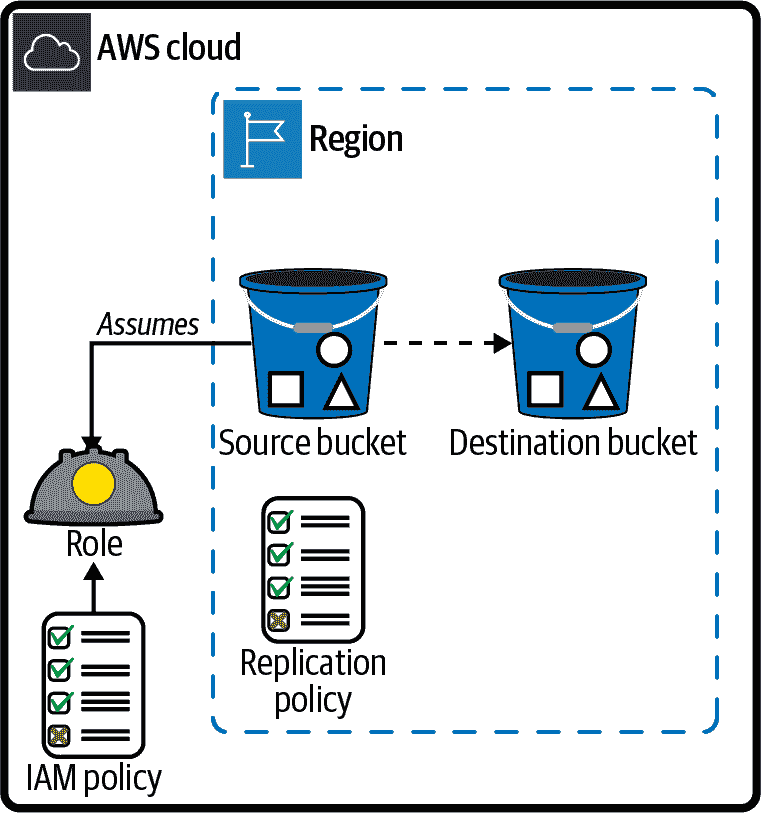

### 先决条件

*   一个启用了版本控制的 `S3` 存储桶，您将把它用作源存储桶

### 准备工作

按照[章节代码仓库](https://github.com/AWSCookbook/Networking)中本配方文件夹内的步骤操作。

### 步骤

1.  创建目标 `S3` 存储桶：

    ```
    aws s3api create-bucket --bucket awscookbook303-dst-$RANDOM_STRING
    ```

2.  为目标 `S3` 存储桶启用版本控制：

    ```
    aws s3api put-bucket-versioning \
        --bucket awscookbook303-dst-$RANDOM_STRING \
        --versioning-configuration Status=Enabled
    ```

3.  创建一个名为 `s3-assume-role-policy.json` 的文件，内容如下（仓库中已提供该文件）：

    ```json
    {
      "Version": "2012-10-17",
      "Statement": [
        {
          "Effect": "Allow",
          "Principal": {
            "Service": "s3.amazonaws.com"
          },
          "Action": "sts:AssumeRole"
        }
      ]
    }
    ```


4.  使用提供的 `assume-role-policy.json` 文件中的语句创建 IAM 角色，使用以下命令：

```
ROLE_ARN=$(aws iam create-role --role-name AWSCookbook303S3Role \
    --assume-role-policy-document file://s3-assume-role-policy.json \
    --output text --query Role.Arn)
```

5.  创建一个名为 `s3-perms-policy-template.json` 的文件，包含以下内容（存储库中提供了该文件），以允许 S3 复制访问您的源存储桶和目标存储桶：

```
{
  "Version":"2012-10-17",
  "Statement":[
  {
    "Effect":"Allow",
    "Action":[
    "s3:GetObjectVersionForReplication",
    "s3:GetObjectVersionAcl",
    "s3:GetObjectVersionTagging"
    ],
    "Resource":[
    "arn:aws:s3:::SRCBUCKET/*"
    ]
  },
  {
    "Effect":"Allow",
    "Action":[
    "s3:ListBucket",
    "s3:GetReplicationConfiguration"
    ],
    "Resource":[
         "arn:aws:s3:::SRCBUCKET"
         ]
    },
    {
    "Effect":"Allow",
    "Action":[
    "s3:ReplicateObject",
    "s3:ReplicateDelete",
    "s3:ReplicateTags",
    "s3:GetObjectVersionTagging"
    ],
    "Resource":"arn:aws:s3:::DSTBUCKET/*"
  }
  ]
}
```

6.  替换文件中的 `DSTBUCKET` 和 `SRCBUCKET` 值，并另存为 `s3-perms-policy.json`：

```
sed -e "s/DSTBUCKET/awscookbook303-dst-${RANDOM_STRING}/g" \
    -e "s|SRCBUCKET|awscookbook303-src-${RANDOM_STRING}|g" \
    s3-perms-policy-template.json > s3-perms-policy.json
```

7.  将策略附加到刚创建的角色：

```
aws iam put-role-policy \
    --role-name AWSCookbook303S3Role \
    --policy-document file://s3-perms-policy.json \
    --policy-name S3ReplicationPolicy
```

8.  创建一个名为 `s3-replication-template.json` 的文件，包含以下内容，以配置 15 分钟的复制时间到您的目标存储桶：

```
{
  "Rules": [
  {
    "Status": "Enabled",
    "Filter": {
      "Prefix": ""
    },
    "Destination": {
      "Bucket": "arn:aws:s3:::DSTBUCKET",
      "Metrics": {
        "Status": "Enabled",
        "EventThreshold": {
        "Minutes": 15
        }
      },
      "ReplicationTime": {
        "Status": "Enabled",
        "Time": {
        "Minutes": 15
        }
      }
    },
    "DeleteMarkerReplication": {
      "Status": "Disabled"
    },
    "Priority": 1
  }
  ],
  "Role": "ROLEARN"
}
```

9.  替换文件中的 `DSTBUCKET` 和 `ROLEARN` 值，并另存为 `s3-replication.json`：

```
sed -e "s|ROLEARN|${ROLE_ARN}|g" \
    -e "s|DSTBUCKET|awscookbook303-dst-${RANDOM_STRING}|g" \
    s3-replication-template.json > s3-replication.json
```

10.  为源 S3 存储桶配置复制策略：

```
aws s3api put-bucket-replication \
    --replication-configuration file://s3-replication.json \
    --bucket awscookbook303-src-${RANDOM_STRING}
```

## 验证检查

查看源存储桶的复制配置：

```
aws s3api get-bucket-replication \
    --bucket awscookbook303-src-${RANDOM_STRING}
```

将对象复制到源存储桶：

```
aws s3 cp ./book_cover.png s3://awscookbook303-src-$RANDOM_STRING
```

查看您上传到源存储桶的文件的复制状态：

```
aws s3api head-object --bucket awscookbook303-src-${RANDOM_STRING} \
    --key book_cover.png
```

您应该会看到类似以下的输出：

```
{
  "AcceptRanges": "bytes",
  "LastModified": "2021-06-20T00:17:25+00:00",
  "ContentLength": 255549,
  "ETag": "\"d<<>>d\"",
  "VersionId": "I<>>X",
  "ContentType": "image/png",
  "Metadata": {},
  "ReplicationStatus": "PENDING"
}
```

15 分钟后查看复制状态，并确认 `ReplicationStatus` 为 `COMPLETED`，类似如下：

```
{
  "AcceptRanges":"bytes",
  "ContentType":"image/png",
  "LastModified":"2021-06-20T00:17:41+00:00",
  "ContentLength":255549,
  "ReplicationStatus":"COMPLETED",
  "VersionId":"I<>>X",
  "ETag":\"d<<>>d\"",
  "Metadata":{}
}
```

### 提示

您还可以在 AWS 控制台中查看[复制指标](https://oreil.ly/jlcu1)。

## 清理

按照[章节代码仓库](https://github.com/AWSCookbook/Storage)中本配方文件夹中的步骤操作。

## 讨论

如果您是工程师、开发人员或架构师，在 AWS 上工作，您很有可能最终会使用 S3。您可能需要为应用程序在 S3 上实现某种复制；S3 提供[两种类型的复制](https://oreil.ly/oxTcA)以满足您的特定需求：同区域复制 (SRR) 和跨区域复制 (CRR)。复制时间是 S3 复制时间控制 (S3 RTC) 的可配置参数，并有文档记录可满足 15 分钟的恢复点目标 (RPO)，并由[服务等级协议 (SLA)](https://aws.amazon.com/s3/sla-rtc) 提供支持。

SRR 使用 IAM 角色、源存储桶和目标存储桶，以及引用该角色和存储桶的复制配置。您在本配方中使用 SRR 配置单向复制；您可以使用 SRR 促进多种用例：

*   日志聚合到中央存储桶以建立索引
*   生产环境和测试环境之间的数据复制
*   在保留对象元数据的同时实现数据冗余
*   围绕数据主权和合规要求设计冗余
*   备份和归档目的

CRR 使用类似的 IAM 角色、源存储桶和目标存储桶，以及引用该角色和存储桶的复制配置。您可以使用 CRR 扩展 SRR 所能实现的可能性：

*   满足跨区域数据存储和归档的要求
*   将相似数据集置于更接近您的区域计算和访问需求的位置，以减少延迟

#### 注意

启用版本控制的 S3 存储桶会为您删除的对象添加标记。如果您选择，两种类型的 S3 复制都能将删除标记复制到目标存储桶。有关更多信息，请参阅[支持文档](https://oreil.ly/2sIL5)。

## 挑战 1

在另一个区域创建一个 S3 存储桶，并将源存储桶也复制到那里。

## 挑战 2

您可以使用筛选器复制特定路径和前缀。应用筛选器，以便仅复制特定前缀（例如 `protected/`）下的对象。

# 3.4 使用 Storage Lens 观察 S3 存储和访问指标

## 问题

您需要深入了解 S3 存储桶的使用模式。

## 解决方案

配置 S3 Storage Lens 以提供关于您的 S3 使用情况的可观测性和分析，如图 3-4 所示。

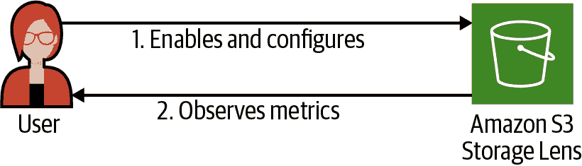

### 先决条件

*   S3 存储桶

### 准备

按照[章节代码仓库](https://github.com/AWSCookbook/Storage)中本配方文件夹中的步骤操作。

### 步骤

#### 注意

根据[文档](https://oreil.ly/Je1u0)：您不能使用账户的 `root` 用户凭证查看 Amazon S3 Storage Lens 仪表板。

1.  从 S3 控制台，在左侧导航窗格中选择 S3 Storage Lens。

2.  点击“创建仪表板”。

#### 注意

所有 AWS 账户都有一个关联的默认仪表板，显示通过 S3 Storage Lens 可用的免费指标。启用高级指标可让您更深入地了解 S3 使用情况，并提供可采取行动的成本节约建议以优化成本。您可以使用默认仪表板和/或创建自己的仪表板。其余步骤将向您展示如何创建自己的仪表板。

3.  为您的仪表板命名，如图 3-5 所示。

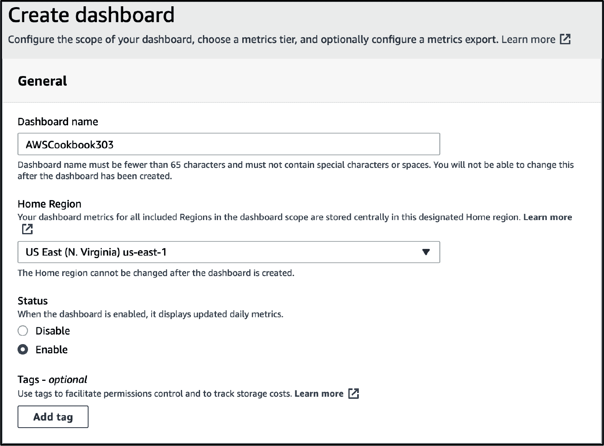


4. 对于“仪表板范围”，包含所有存储桶和区域（使用默认值）（请参阅图 3-6）。

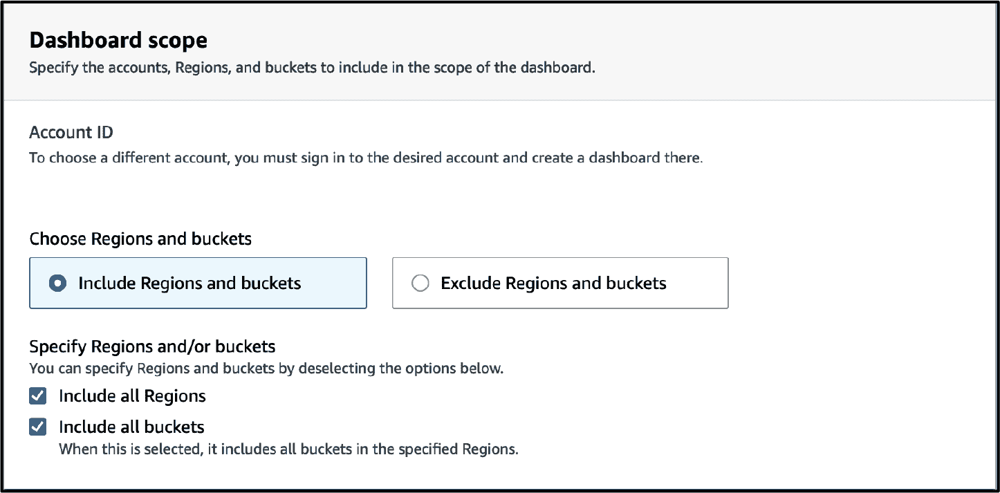

5. 启用“高级指标和建议”，保留默认值，如图 3-7 所示。

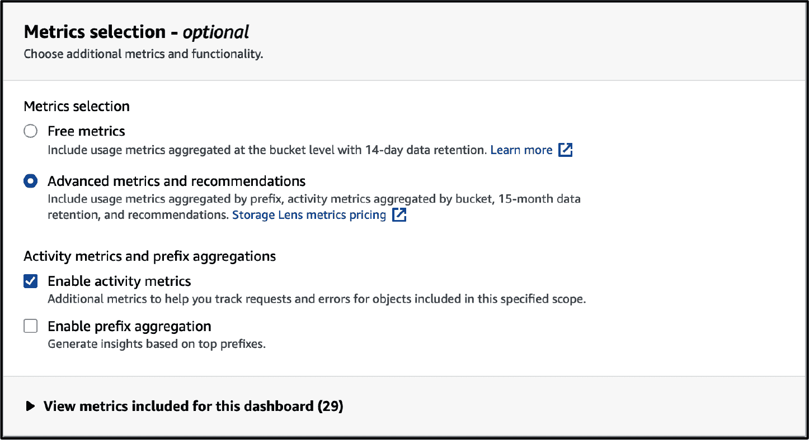

6. 对于导出设置，选择默认值（不导出）。

#### 提示

您可以启用自动导出，以定期将指标导出为 CSV 和 Apache Parquet 格式，并将其发送到您选择的 S3 存储桶，以运行您自己的报表和可视化。

7. 单击“创建仪表板”，然后从仪表板选择中查看您的仪表板。

#### 注意

高级指标可能需要长达 48 小时才能开始针对您的使用和访问模式进行累积。在此期间，您可以查看与您账户中所有存储桶的 S3 使用情况相关的免费指标的默认仪表板。

## 验证检查

打开 Storage Lens 并查看您配置的仪表板。您应该会看到与您的 S3 使用情况相对应的指标。示例显示在图 3-8 中。

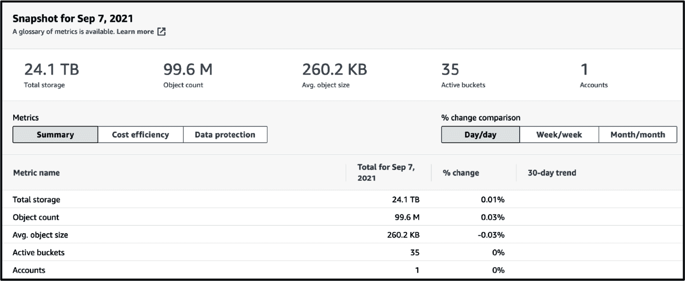

#### 提示

您可以从仪表板深入查看“成本效率”和“数据保护”指标。一段时间后，您将能够查看历史数据，从而采取行动将对象移动到满足您的数据访问模式和可用性要求的存储层级。

## 清理

请按照[章节代码仓库](https://github.com/AWSCookbook/Storage)中此配方文件夹中的步骤操作。

## 讨论

S3 是最早的 AWS 服务之一，因此许多客户已经使用 S3 很长时间了。随着客户存储使用量呈指数级增长，分析存储内容的能力成为一种明确且渴望的能力。S3 Storage Lens 让您能够“洞察”您的 AWS 账户的 S3 使用情况。分析存储桶使用情况、观察存储成本和发现异常（例如，未删除的分段上传片段）只是 S3 Storage Lens 提供的众多用例中的几个。

借助 Storage Lens，您可以通过由强大分析引擎支持的可视化仪表板发现对象的存储位置，从而进行调整以优化成本而不影响性能。您还可以在仪表板上启用[高级指标](https://oreil.ly/6XLUt)，以获得对 S3 存储桶的更深入见解和节省成本的建议。

#### 注意

S3 Storage Lens 使用指标帮助您直观地了解使用情况和活动。有免费指标可用，也有提供使用建议的高级指标。有关不同指标类型及其相关成本的更多信息，请参阅[支持文档](https://oreil.ly/HQcLH)。

### 挑战 1

使用 Storage Lens 的发现来观察指标并设置警报，以持续监控您的使用情况。

### 挑战 2

创建一个新的 Storage Lens 配置，仅查看特定存储桶。

# 3.5 使用 S3 访问点配置特定于应用程序的 S3 存储桶访问权限

## 问题

您有一个 S3 存储桶和两个应用程序。您需要授予其中一个应用程序读/写访问权限，另一个应用程序只读访问权限。您不想使用 S3 存储桶策略，因为您预计将来需要添加具有细粒度安全要求的其他应用程序。

## 解决方案

创建两个 S3 访问点，并应用一个策略，向其中一个访问点授予 `S3:PutObject` 和 `S3:GetObject` 操作权限，向另一个访问点授予 `S3:GetObject` 权限。然后，配置您的应用程序以使用相应的访问点 DNS 名称（请参阅图 3-9）。

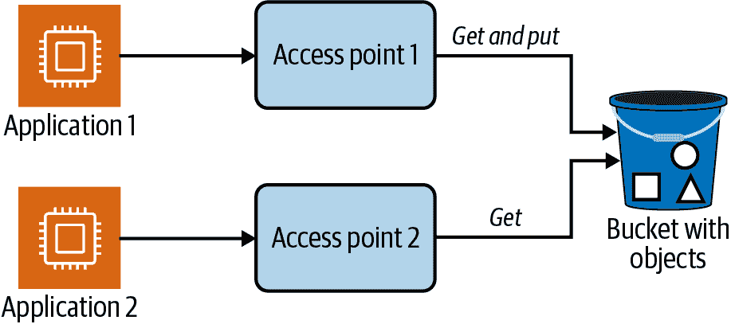

### 先决条件

* 在两个可用区中创建了具有隔离子网和关联路由表的 VPC。
* 已部署两个 EC2 实例。您需要具备连接以测试访问的能力。
* S3 存储桶。

### 准备工作

请按照[章节代码仓库](https://github.com/AWSCookbook/Storage)中此配方文件夹中的步骤操作。

### 步骤

1. 在您的 VPC 中，为应用程序 1 创建一个访问点：

```
aws s3control create-access-point --name cookbook305-app-1 \
    --account-id $AWS_ACCOUNT_ID \
    --bucket $BUCKET_NAME --vpc-configuration VpcId=$VPC_ID
```

2. 在您的 VPC 中，为应用程序 2 创建一个访问点：

```
aws s3control create-access-point --name cookbook305-app-2 \
    --account-id $AWS_ACCOUNT_ID \
    --bucket $BUCKET_NAME --vpc-configuration VpcId=$VPC_ID
```

3. 创建一个名为 `app-1-policy-template.json` 的文件，包含应用程序 1 读/写的访问点策略，内容如下（仓库中提供了该文件）：

```
{
  "Version":"2012-10-17",
  "Statement": [
  {
    "Effect": "Allow",
    "Principal": {
      "AWS": "EC2_INSTANCE_PROFILE"
    },
    "Action": [ACTIONS],
    "Resource": "arn:aws:s3:AWS_REGION:AWS_ACCOUNT_ID:accesspoint/ACCESS_POINT_NAME/object/*"
  }]
}
```

4. 使用 `sed` 命令将 `app-policy-template.json` 中的值替换为应用程序 1 的 `EC2_INSTANCE_PROFILE`、`AWS_REGION`、`AWS_ACCOUNT_ID`、`ACCESS_POINT_NAME` 和 `ACTIONS` 值：

```
sed -e "s/AWS_REGION/${AWS_REGION}/g" \
    -e "s|EC2_INSTANCE_PROFILE|${INSTANCE_ROLE_1}|g" \
    -e "s|AWS_ACCOUNT_ID|${AWS_ACCOUNT_ID}|g" \
    -e "s|ACCESS_POINT_NAME|cookbook305-app-1|g" \
    -e "s|ACTIONS|\"s3:GetObject\",\"s3:PutObject\"|g" \
    app-policy-template.json > app-1-policy.json
```

5. 将您创建的策略应用于应用程序 1 的访问点：

```
aws s3control put-access-point-policy --account-id $AWS_ACCOUNT_ID \
    --name cookbook305-app-1 --policy file://app-1-policy.json
```

#### 注意

您可以以类似的方式将特定访问点与 AWS SDK 和 CLI 结合使用。例如，对于 SDK 用法，存储桶名称变为：`https://[access_point_name]-[accountID].s3-accesspoint.[region].amazonaws.com` 用于 URL，`arn:aws:s3:[region]:[accountID]:[access_point_name]` 用作 CLI 用法的“存储桶名称”。

以下是一个 CLI 示例：

```
aws s3api get-object --key object.zip \
    --bucket \
    arn:aws:s3:us-east-1:111111111111:access_point_name object.zip
```

6. 使用 `sed` 命令将 `app-policy-template.json` 中的值替换为应用程序 2 的 `EC2_INSTANCE_PROFILE`、`AWS_REGION`、`AWS_ACCOUNT_ID`、`ACCESS_POINT_NAME` 和 `ACTIONS` 值：

```
sed -e "s/AWS_REGION/${AWS_REGION}/g" \
    -e "s|EC2_INSTANCE_PROFILE|${INSTANCE_ROLE_2}|g" \
    -e "s|AWS_ACCOUNT_ID|${AWS_ACCOUNT_ID}|g" \
    -e "s|ACCESS_POINT_NAME|cookbook305-app-2|g" \
    -e "s|ACTIONS|\"s3:GetObject\"|g" \
    app-policy-template.json > app-2-policy.json
```

7. 将您创建的策略应用于应用程序 2 的访问点：

```
aws s3control put-access-point-policy --account-id $AWS_ACCOUNT_ID \
    --name cookbook305-app-2 --policy file://app-2-policy.json
```

8. 按照[修改存储桶策略的指南](https://oreil.ly/kqXrN)操作，以便将控制权委托给访问点。

#### 验证检查

使用 SSM Session Manager 连接到 EC2 实例 1（请参阅配方 1.6）：

```
aws ssm start-session --target $INSTANCE_ID_1
```

从实例的元数据中设置您的 AWS 账户 ID：

```
export AWS_ACCOUNT_ID=$(curl --silent http://169.254.169.254/latest/dynamic/instance-identity/document \
| awk -F'"' ' /accountId/ {print $4}')
```

通过从实例的元数据中获取值来设置区域：


```
export AWS_DEFAULT_REGION=$(curl --silent http://169.254.169.254/latest/dynamic/instance-identity/document \
| awk -F'"' ' /region/ {print $4}')
```

尝试从应用程序 1 的 S3 访问点获取对象：

```
aws s3api get-object --key Recipe305Test.txt \
    --bucket arn:aws:s3:$AWS_DEFAULT_REGION:$AWS_ACCOUNT_ID:accesspoint/cookbook305-app-1 \
    /tmp/Recipe305Test.txt
```

向应用程序 1 的 S3 访问点写入对象：

```
aws s3api put-object \
    --bucket arn:aws:s3:$AWS_DEFAULT_REGION:$AWS_ACCOUNT_ID:accesspoint/cookbook305-app-1 \
--key motd.txt --body /etc/motd
```

#### 注意

这两条命令适用于应用程序 1，因为您为此访问点配置了读/写访问权限。

从 EC2 实例 1 断开连接：

```
exit
```

使用 SSM Session Manager 连接到 EC2 实例 2（请参阅食谱 1.6）：

```
aws ssm start-session --target $INSTANCE_ID_2
```

从实例的元数据中设置您的 AWS 账户 ID：

```
export AWS_ACCOUNT_ID=$(curl --silent http://169.254.169.254/latest/dynamic/instance-identity/document \
| awk -F'"' ' /accountId/ {print $4}')
```

通过从实例的元数据中获取值来设置区域：

```
export AWS_DEFAULT_REGION=$(curl --silent http://169.254.169.254/latest/dynamic/instance-identity/document \
| awk -F'"' ' /region/ {print $4}')
```

尝试从 S3 存储桶获取对象：

```
aws s3api get-object --key Recipe305Test.txt \
    --bucket \
arn:aws:s3:$AWS_DEFAULT_REGION:$AWS_ACCOUNT_ID:accesspoint/cookbook305-app-2 \
    /tmp/Recipe305Test.txt
```

尝试向 S3 存储桶放入对象：

```
aws s3api put-object \
    --bucket arn:aws:s3:$AWS_DEFAULT_REGION:$AWS_ACCOUNT_ID:accesspoint/cookbook305-app-2 \
--key motd2.txt --body /etc/motd
```

#### 注意

对于应用程序 2，第一条命令有效，第二条命令失败，因为您为此访问点配置了只读访问权限。

从 EC2 实例 2 断开连接：

```
exit
```

### 清理

按照[章节代码仓库](https://github.com/AWSCookbook/Storage)中此食谱文件夹内的步骤操作。

## 讨论

S3 访问点允许您向特定主体授予细粒度访问权限，并且它们比 S3 存储桶策略更易于管理。在此食谱中，您创建了两个具有不同允许操作类型的访问点，并使用访问点 IAM 策略将访问点与特定角色关联。您验证了当 EC2 实例与 CLI 和 S3 访问点一起使用时，仅授予了特定操作。

为了帮助您满足安全要求，访问点使用 [IAM 策略](https://oreil.ly/T6Wdq) 的方式与您用于其他 AWS 服务的方式类似。您还可以在访问点上配置 S3 阻止公共访问，以确保永远不会意外向您的 S3 存储桶授予公共访问权限（请参阅食谱 1.9）。S3 访问点没有额外费用。

### 挑战

配置第三个访问点，并仅指定对特定对象或前缀的访问权限。

# 3.6 将 Amazon S3 存储桶密钥与 KMS 结合使用以加密对象

## 问题

您需要使用密钥管理服务 (KMS) 客户托管密钥 (CMK) 对静态 S3 对象进行加密，并确保存储桶中的所有对象都以具有成本效益的方式使用 KMS 密钥进行加密。

## 解决方案

创建一个 KMS 客户托管密钥，配置您的 S3 存储桶以使用引用您的 AWS KMS CMK 的 S3 存储桶密钥，并配置一个 S3 存储桶策略，要求对所有 `S3:PutObject` 操作使用 KMS（请参阅图 3-10）。

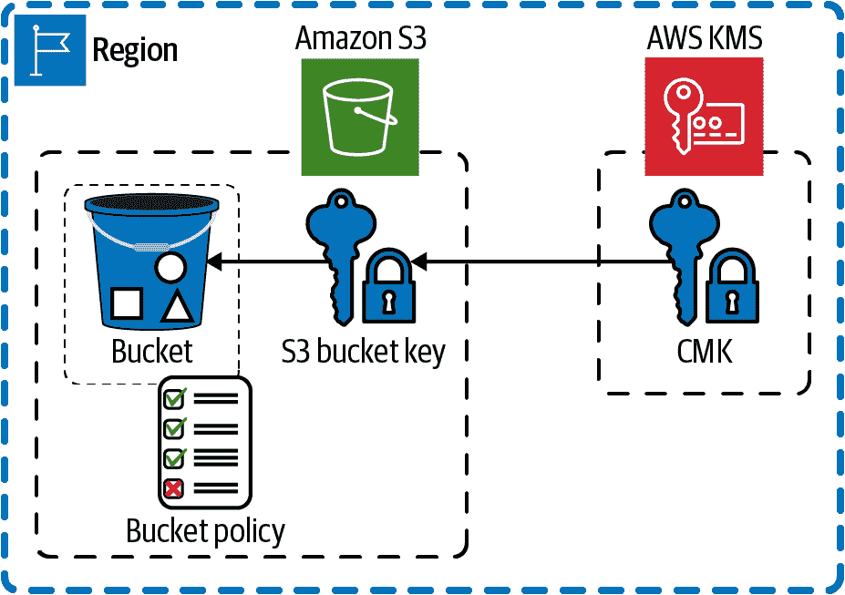

### 先决条件

*   一个 S3 存储桶

### 准备

按照[章节代码仓库](https://github.com/AWSCookbook/Storage)中此食谱文件夹内的步骤操作。

### 步骤

1.  创建一个用于您的 S3 存储桶的 KMS 密钥，并将密钥 ID 存储在环境变量中：

    ```
    KEY_ID=$(aws kms create-key \
        --tags TagKey=Name,TagValue=AWSCookbook306Key \
        --description "AWSCookbook S3 CMK" \
        --query KeyMetadata.KeyId \
        --output text)
    ```

2.  创建一个别名以引用您的密钥：

    ```
    aws kms create-alias \
        --alias-name alias/awscookbook306 \
        --target-key-id $KEY_ID
    ```

3.  配置 S3 存储桶以使用指定您的 KMS 密钥 ID 的 S3 存储桶密钥：

    ```
    aws s3api put-bucket-encryption \
        --bucket awscookbook306-$RANDOM_STRING \
        --server-side-encryption-configuration '{
           "Rules": [
             {
               "ApplyServerSideEncryptionByDefault": {
                 "SSEAlgorithm": "aws:kms",
                 "KMSMasterKeyID": "${KEY_ID}"
             },
             "BucketKeyEnabled": true
           }
         ]
       }'
    ```

4.  为存储桶创建一个存储桶策略模板，以强制加密所有对象：

    ```
    {
      "Version":"2012-10-17",
      "Id":"PutObjectPolicy",
      "Statement":[{
        "Sid":"DenyUnEncryptedObjectUploads",
        "Effect":"Deny",
        "Principal":"*",
        "Action":"s3:PutObject",
        "Resource":"arn:aws:s3:::BUCKET_NAME/*",
        "Condition":{
          "StringNotEquals":{
            "s3:x-amz-server-side-encryption":"aws:kms"
            }
          }
        }
      ]
    }
    ```

5.  使用 `sed` 命令将 `bucket-policy-template.json` 中的值替换为您的 `BUCKET_NAME`：

    ```
    sed -e "s|BUCKET_NAME|awscookbook306-${RANDOM_STRING}|g" \
        bucket-policy-template.json > bucket-policy.json
    ```

6.  应用存储桶策略以强制对所有上传进行加密：

    ```
    aws s3api put-bucket-policy --bucket awscookbook306-$RANDOM_STRING \
        --policy file://bucket-policy.json
    ```

#### 验证检查

从命令行上传一个带加密的对象到 S3 存储桶。您将看到成功上传：

```
aws s3 cp ./book_cover.png s3://awscookbook306-$RANDOM_STRING \
    --sse aws:kms --sse-kms-key-id $KEY_ID
```

现在，上传一个不带加密的对象到 S3 存储桶。您会注意到在命令行收到 `KMS.NotFoundException` 错误。这表明您配置的存储桶策略正常工作：

```
aws s3 cp ./book_cover.png s3://awscookbook306-$RANDOM_STRING
```

### 清理

按照[章节代码仓库](https://github.com/AWSCookbook/Storage)中此食谱文件夹内的步骤操作。

## 讨论

当对您的 S3 存储桶应用加密时，您可以选择使用 AWS 托管 CMK，该密钥由 Amazon S3 在您的 AWS 账户中创建并为您管理。与客户托管 CMK 一样，您的 AWS 托管 CMK 对您的 AWS 账户和区域是唯一的。只有 Amazon S3 有权代表您使用此 CMK。您可以从 AWS KMS 控制台创建、轮换和禁用可审计的客户托管 CMK。[S3 文档](https://oreil.ly/oGBG0) 提供了 S3 支持的加密类型之间差异的全面解释。

当您加密数据时，您的数据受到保护，但您必须保护您的加密密键。[*信封加密*](https://oreil.ly/gK0o0) 是用数据密钥加密明文数据，然后在另一个密钥下加密数据密钥的做法，如图 3-11 所示。

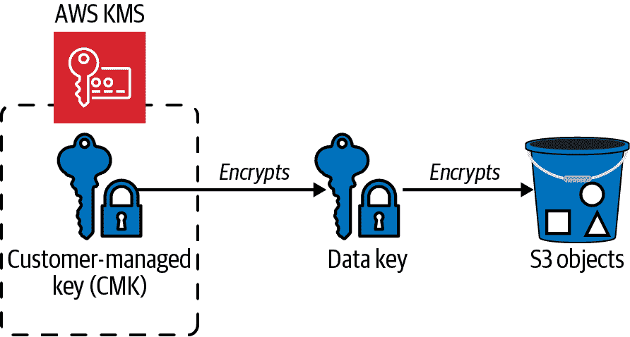

### 挑战

为了验证您可以在不影响数据的情况下轮换密钥，请将一个对象放入您的存储桶，触发 KMS CMK 的轮换，然后从 S3 存储桶中取回该对象并确认它可以正确解密（请参阅此 AWS 文章获取[提示](https://oreil.ly/RVAFZ)）。

# 3.7 使用 AWS Backup 创建并将 EC2 备份恢复到另一个区域

## 问题

您需要创建一个实例的备份，并在另一个[区域](https://oreil.ly/j3pWr)中恢复它。

## 解决方案


使用 AWS Backup 为您的 EC2 实例创建按需备份，并通过 AWS 控制台从保管库还原备份，如 图 3-12 所示。

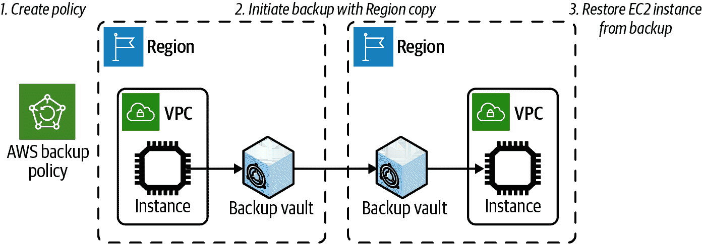

### 先决条件

*   在两个 AZ 中创建了具有隔离子网的 VPC 以及关联的路由表
*   已部署 EC2 实例

### 准备工作

按照 [章节代码仓库](https://github.com/AWSCookbook/Storage) 中此配方文件夹内的步骤操作。

### 步骤

1.  导航到 AWS Backup 控制台，从左侧导航窗格中选择“受保护资源”。

2.  单击“创建按需备份”，选择您的 EC2 实例，保留默认设置，然后单击“创建按需备份”（请参阅 图 3-13）。

    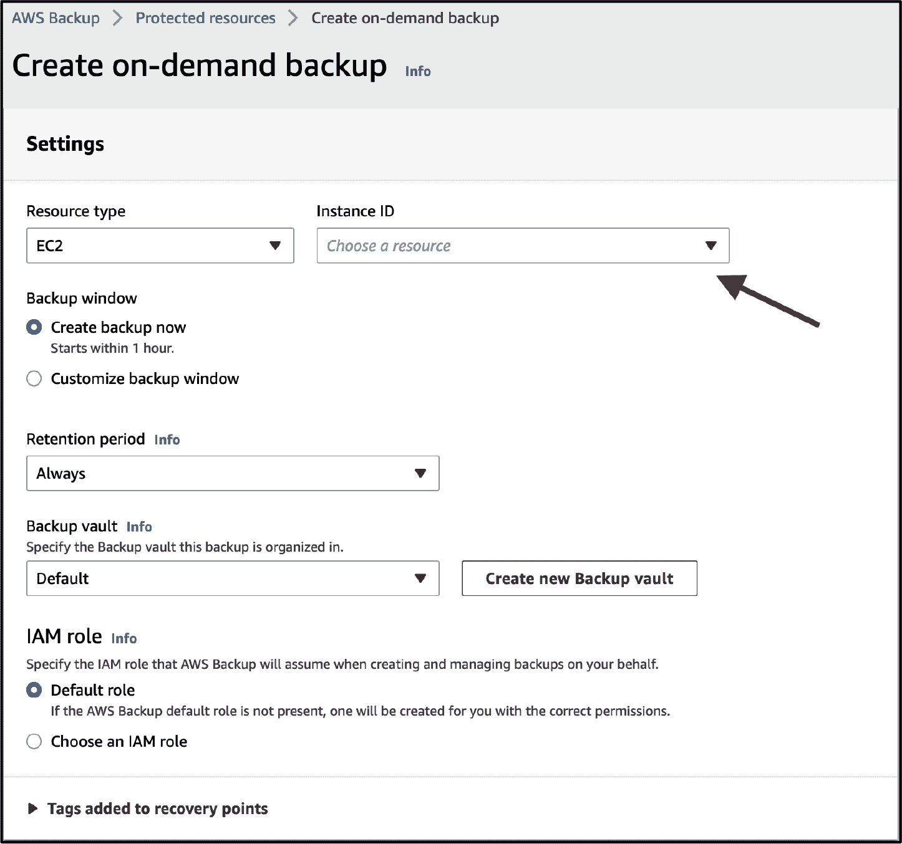

    **注意**

    AWS Backup 将创建一个用于其目的的角色，该角色使用 AWS Backup 托管策略来执行备份所需的操作。如果需要，您也可以创建自己的自定义角色。有关更多信息，请参阅此 AWS [文档](https://oreil.ly/WirFO)。

    备份在备份作业视图中开始，如 图 3-14 所示。

    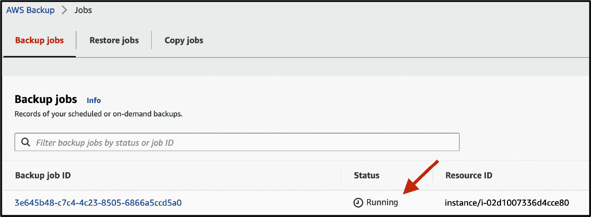

3.  等待备份在您的账户中完成（这可能需要片刻才能达到 图 3-15 中显示的“已完成”状态）。

    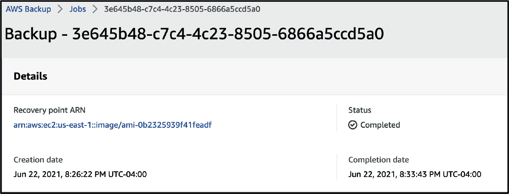

4.  选择当前区域的默认备份保管库，查看您刚完成的镜像备份。

5.  单击您刚创建的备份恢复点，然后选择“复制”，如 图 3-16 所示。

    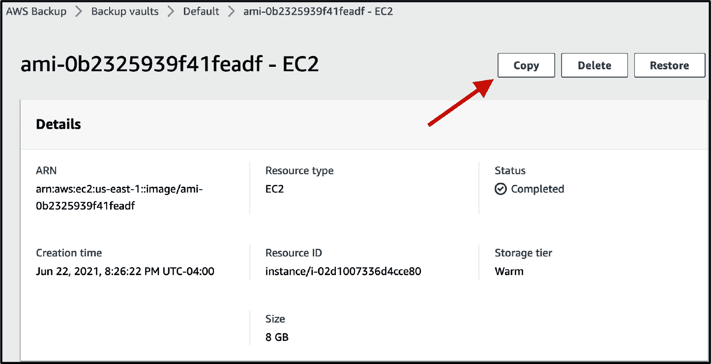

6.  选择目标区域，保留所有默认设置，然后单击“复制”（如 图 3-17 所示）。您将看到复制作业进入“运行中”状态，如 图 3-18 所示。

    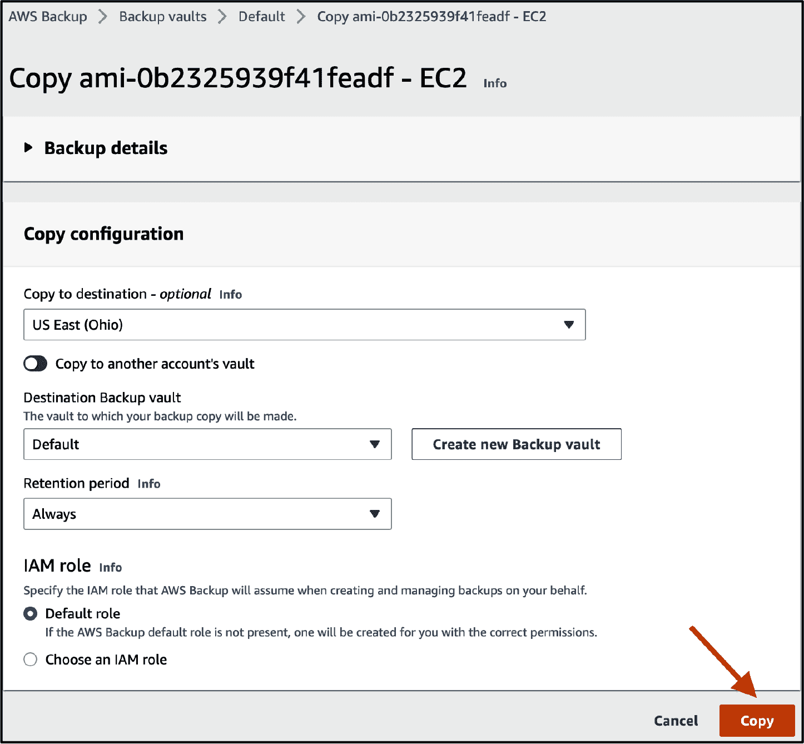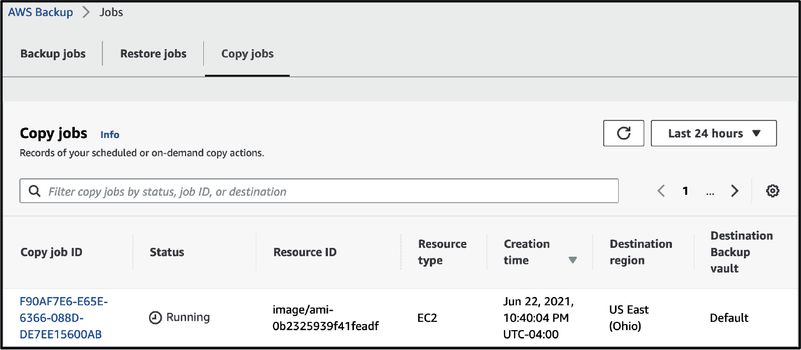

7.  复制作业在几分钟后完成后，在 AWS 控制台中，从下拉区域选择器（AWS 控制台右上角）中选择目标区域。

8.  选择您的默认备份保管库，然后选择要还原的备份，如 图 3-19 所示。

    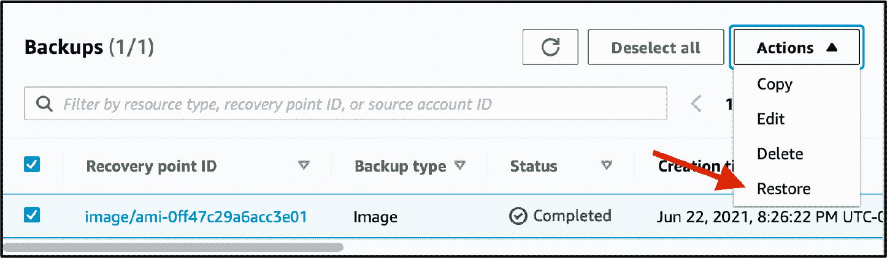

9.  在“网络设置”下，选择用于还原的实例类型和 VPC，然后单击“还原备份”。输入示例如 图 3-20 所示。

    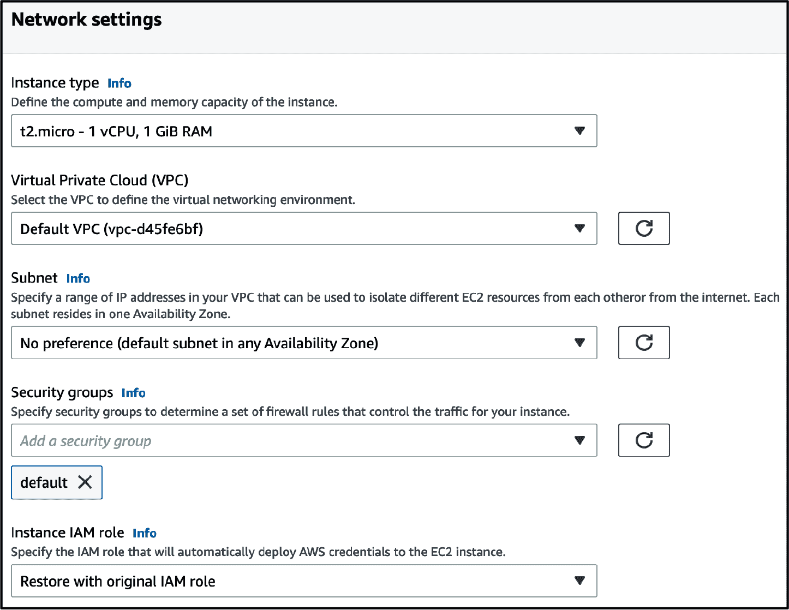

10. 您可以在控制台的“作业”部分下的“还原作业”选项卡中监控还原进度，如 图 3-21 所示。

     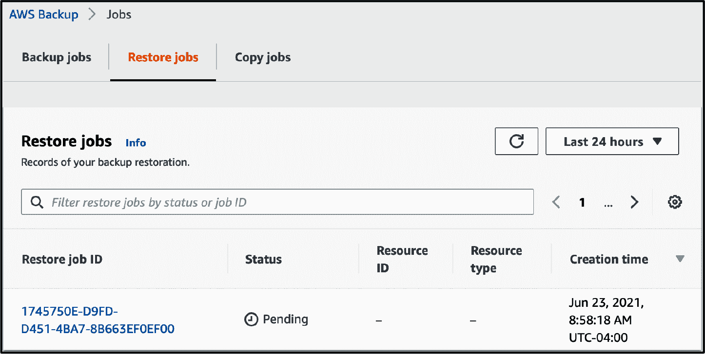

#### 验证检查

浏览到 EC2 控制台，查看目标区域中正在运行的实例。此 EC2 实例是您原始实例的副本。

### 清理

按照 [章节代码仓库](https://github.com/AWSCookbook/Storage) 中此配方文件夹内的步骤操作。

## 讨论

[AWS Backup](https://aws.amazon.com/backup/faqs) 让您能够从单一位置管理和监控您使用的各 AWS 服务中的备份。您可以备份 [多种 AWS 服务](https://oreil.ly/KHpPB)，并为您使用的 AWS 服务中的云资源设置备份策略。您还可以在账户内跨区域复制备份（或复制到其他 AWS 账户），这正是您在本配方中探索的内容。如果您使用 EC2 服务运行带有您想要保护的持久数据的实例，则 [EBS 快照](https://oreil.ly/BYWAl) 是 AWS 备份策略的重要组成部分。您可以手动创建 EBS 卷快照、编写自己的自动化脚本、使用 [Data Lifecycle Manager](https://oreil.ly/eXbT7) 进行自动化，或使用 AWS Backup。

当您使用 AWS Backup 备份 EC2 实例时，该服务会将备份存储在您选择的 [备份保管库](https://oreil.ly/OnzyN) 中（如果您没有保管库，将创建一个默认备份保管库），处理构建 Amazon Machine Image (AMI) 的过程，该镜像包含所有配置参数、已备份的附加 EBS 卷和元数据。该服务将整个包存储在备份保管库中。这使您只需启动由 AWS Backup 服务生成的 AMI 即可创建 EC2 实例，从而减少了从主区域或您选择的另一区域中的备份还原实例所涉及的恢复时间目标 (RTO)。

### 挑战

使用 [备份计划](https://oreil.ly/uguyM) 配置 EC2 实例的每周自动备份计划，将备份的实例复制到另一区域中的保管库。

# 3.8 从 EBS 快照还原文件

## 问题

您需要从账户中某个卷创建的 EBS 快照还原文件。

## 解决方案

从快照创建卷，从 EC2 实例挂载该卷，然后将文件复制到实例卷中（请参阅 图 3-22）。

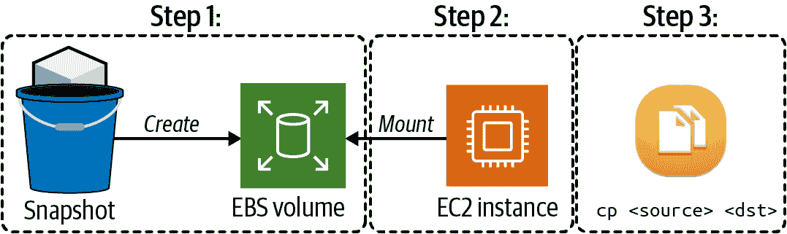

### 先决条件

*   在两个 AZ 中创建了具有隔离子网的 VPC 以及关联的路由表。
*   已部署 EC2 实例。您需要具备连接以挂载 EBS 快照并还原文件的能力。

### 准备工作

按照 [章节代码仓库](https://github.com/AWSCookbook/Storage) 中此配方文件夹内的步骤操作。

### 步骤

1.  找到附加到 EC2 实例的 EBS 卷：

    ```
    ORIG_VOLUME_ID=$(aws ec2 describe-volumes \
        --filters Name=attachment.instance-id,Values=$INSTANCE_ID \
        --output text \
        --query Volumes[0].Attachments[0].VolumeId)
    ```

2.  对 EBS 卷创建快照（这将花费片刻时间完成）：

    ```
    SNAPSHOT_ID=$(aws ec2 create-snapshot \
        --volume-id $ORIG_VOLUME_ID \
        --output text --query SnapshotId)
    ```

3.  从快照创建卷，并将 `VOLUME_ID` 保存为环境变量：

    ```
    SNAP_VOLUME_ID=$(aws ec2 create-volume \
        --snapshot-id $SNAPSHOT_ID \
        --size 8 \
        --volume-type gp2 \
        --availability-zone us-east-1a \
        --output text --query VolumeId)
    ```

#### 验证检查

将卷作为 `/dev/sdf` 挂载到 EC2 实例：

```
aws ec2 attach-volume --volume-id $SNAP_VOLUME_ID \
    --instance-id $INSTANCE_ID --device /dev/sdf
```

等待直到卷的状态变为“已挂载”：

```
aws ec2 describe-volumes \
    --volume-ids $SNAP_VOLUME_ID
```

使用 SSM Session Manager 连接到 EC2 实例（请参阅 配方 1.6）：

```
aws ssm start-session --target $INSTANCE_ID
```

运行 `lsblk` 命令查看卷，并记下您挂载的卷名称（您将在后续步骤中使用此卷名称来挂载卷）：

```
lsblk
```

您应该会看到类似如下的输出：

```
NAME          MAJ:MIN RM SIZE RO TYPE MOUNTPOINT
nvme0n1       259:0    0   8G  0 disk
├─nvme0n1p1   259:1    0   8G  0 part /
└─nvme0n1p128 259:2    0   1M  0 part
nvme1n1       259:3    0   8G  0 disk
├─nvme1n1p1   259:4    0   8G  0 part
└─nvme1n1p128 259:5    0   1M  0 part
```

创建一个文件夹以挂载附加的磁盘：

```
sudo mkdir /mnt/restore
```

将您挂载的卷挂载到您创建的文件夹：

```
sudo mount -t xfs -o nouuid /dev/nvme1n1p1 /mnt/restore
```

**注意**


## 3.9 使用 DataSync 在 EFS 和 S3 之间复制数据

### 问题

您需要将文件从 `Amazon S3` 复制到 `Amazon EFS`。

### 解决方案

配置 `AWS DataSync`，将 `S3` 作为源，`EFS` 作为目标；然后创建一个 `DataSync` 任务并启动复制任务，如图 3-23 所示。

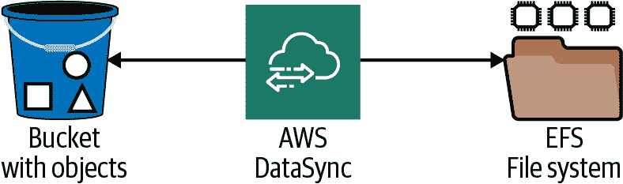

### 先决条件

*   一个 `S3` 存储桶和 `EFS` 文件系统。
*   在两个 `AZ` 中创建了隔离子网并关联了路由表的 `VPC`。
*   部署了挂载 `EFS` 文件系统的 `EC2` 实例。您需要具备连接到它以进行测试的能力。

### 准备工作

按照[章节代码仓库](https://github.com/AWSCookbook/Storage)中本配方文件夹内的步骤操作。

### 步骤

1.  使用提供的 `assume-role-policy.json` 文件中的语句，通过以下命令创建一个 `IAM` 角色：

    ```
    S3_ROLE_ARN=$(aws iam create-role --role-name AWSCookbookS3LocationRole \
        --assume-role-policy-document file://assume-role-policy.json \
        --output text --query Role.Arn)
    ```

2.  将 `AmazonS3ReadOnlyAccess` `IAM` 托管策略附加到 `IAM` 角色：

    ```
    aws iam attach-role-policy --role-name AWSCookbookS3LocationRole \
        --policy-arn arn:aws:iam::aws:policy/AmazonS3ReadOnlyAccess
    ```

3.  创建一个 `DataSync` `S3` 位置：

    ```
    S3_LOCATION_ARN=$(aws datasync create-location-s3 \
        --s3-bucket-arn $BUCKET_ARN \
        --s3-config BucketAccessRoleArn=$S3_ROLE_ARN \
        --output text --query LocationArn)
    ```

4.  使用提供的 `assume-role-policy.json` 文件中的语句，通过以下命令创建一个 `IAM` 角色：

    ```
    EFS_ROLE_ARN=$(aws iam create-role --role-name AWSCookbookEFSLocationRole \
        --assume-role-policy-document file://assume-role-policy.json \
        --output text --query Role.Arn)
    ```

5.  将 `AmazonElasticFileSystemClientReadWriteAccess` `IAM` 托管策略附加到 `IAM` 角色：

    ```
    aws iam attach-role-policy --role-name AWSCookbookEFSLocationRole \
        --policy-arn arn:aws:iam::aws:policy/AmazonElasticFileSystemClientFullAccess
    ```

6.  获取 `EFS` 文件系统的 `ARN`：

    ```
    EFS_FILE_SYSTEM_ARN=$(aws efs describe-file-systems \
        --file-system-id $EFS_ID \
        --output text --query FileSystems[0].FileSystemArn)
    ```

7.  获取子网的 `ARN`：

    ```
    SUBNET_ARN=$(aws ec2 describe-subnets \
        --subnet-ids $ISOLATED_SUBNET_1 \
        --output text --query Subnets[0].SubnetArn)
    ```

8.  获取安全组的 `ARN`：

    ```
    SG_ARN=arn:aws:ec2:$AWS_REGION:$AWS_ACCOUNT_ID:security-group/$EFS_SG
    ```

9.  创建一个 `DataSync` `EFS` 位置：

    ```
    EFS_LOCATION_ARN=$(aws datasync create-location-efs \
        --efs-filesystem-arn $EFS_FILE_SYSTEM_ARN \
        --ec2-config SubnetArn=$SUBNET_ARN,SecurityGroupArns=[$SG_ARN] \
        --output text)
    ```

10. 创建一个 `DataSync` 任务：

    ```
    TASK_ARN=$(aws datasync create-task \
        --source-location-arn $S3_LOCATION_ARN \
        --destination-location-arn $EFS_LOCATION_ARN \
        --output text --query TaskArn)
    ```

11. 执行任务：

    ```
    aws datasync start-task-execution \
        --task-arn $TASK_ARN
    ```

12. 等待几秒钟确保任务已完成：

    ```
    aws datasync list-task-executions \
        --task-arn $TASK_ARN
    ```

#### 验证检查

确保您的 `EC2` 实例 1 已向 `SSM` 注册。使用此命令检查状态。此命令应返回实例 ID：

```
aws ssm describe-instance-information \
    --filters Key=ResourceType,Values=EC2Instance \
    --query "InstanceInformationList[].InstanceId" --output text
```

使用 `SSM Session Manager` 连接到您的 `EC2` 实例：

```
aws ssm start-session --target $INSTANCE_ID
```

`EC2` 实例在 `/mnt/efs` 处挂载了 `EFS` 卷。您可以浏览到该目录并查看 `S3-Test-Content.txt` 文件已从您的 `S3` 存储桶复制到您的 `EFS` 卷中，如示例输出所示：

```
sh-4.2$ cd /mnt/efs

sh-4.2$ ls

sh-4.2$ ls -al

total 12
drwxr-xr-x 3 nfsnobody nfsnobody 6144 Jan  1  1970 .
drwxr-xr-x 3 root      root        17 Sep 10 02:07 ..
drwx------ 2 root      root      6144 Sep 10 03:27 .aws-datasync
-rwxr-xr-x 1 nfsnobody nfsnobody   30 Jan  1  1970 S3-Test-Content.txt
```

退出 `Session Manager` 会话：

```
exit
```

### 清理

按照[章节代码仓库](https://github.com/AWSCookbook/Storage)中本配方文件夹内的步骤操作。

### 讨论

您可以使用 [AWS DataSync](https://aws.amazon.com/datasync) 执行按需和持续/自动化的文件同步任务，跨多种 `AWS` 服务。`DataSync` 会保留复制项目的元数据，并在同步任务期间检查文件完整性，支持在需要时重试。如果您是希望在各种源和目标之间移动数据，而无需预置任何基础设施或编写自己的脚本来完成相同任务的开发人员或云工程师，这非常有用。在本配方中，您用它来同步托管在您的 `AWS` 账户中的 `S3` 和 `EFS` 之间的数据，但如果您有 `VPN` 连接、`Direct Connect`，或者使用 `VPC` 对等连接或传输网关，也可以用它来同步您的非 `AWS` 服务器之间或其他 `AWS` 账户之间的数据。

#### 注意

在撰写本文时，您可以设置的最小自动同步计划间隔为一小时。您可以在[用户文档](https://oreil.ly/dVnun)中找到关于 `DataSync` 的其他详细信息。

与许多 `AWS` 服务一样，`DataSync` 使用 `IAM` 角色代表您对 `S3` 和 `EFS` 执行操作。您授予了 `DataSync` 与 `S3` 和 `EFS` 交互的能力。`DataSync` 在您的 `VPC` 中预置网络接口以连接到您的 `EFS` 文件共享，并使用 `AWS` API 与 `S3` 交互。它使用 `TLS` 加密传输中的流量，如果您的安全性和合规性要求强制要求静态加密，还支持使用 `KMS` 进行静态加密。

### 挑战 1

根据您创建的快照[创建一个 AMI](https://oreil.ly/8KFje)，并从新创建的 `AMI` 启动一个新实例。


## 设置一个排除特定文件夹中文件名的 DataSync 任务（例如 `private-folder`）

### 挑战 2

设置一个计划的 DataSync 任务，按小时计划将数据从 S3 复制到 EFS。
