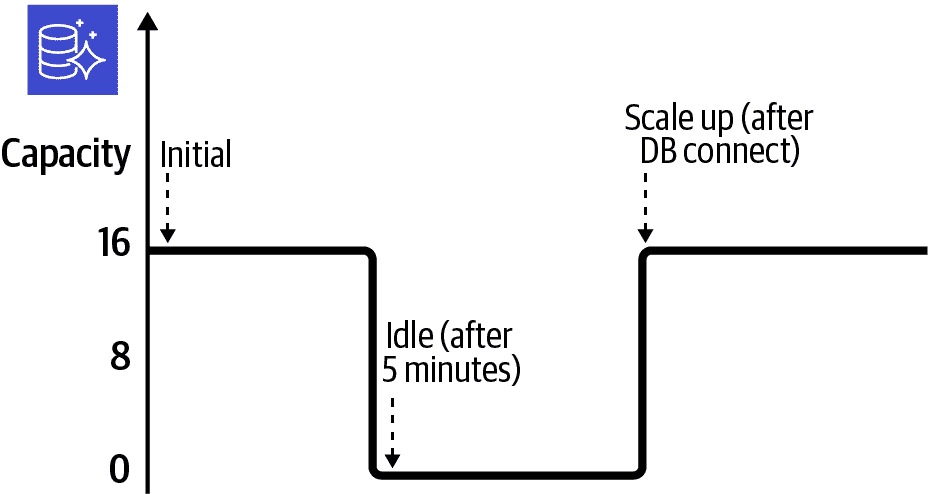
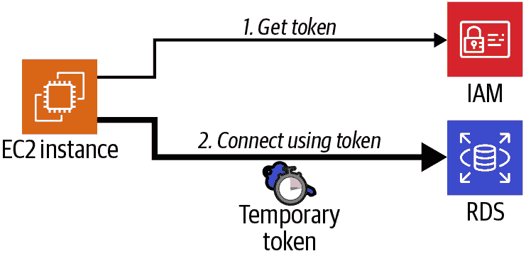
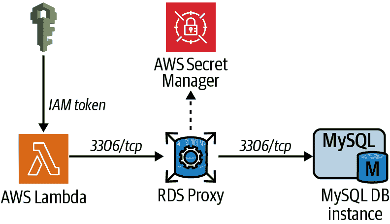
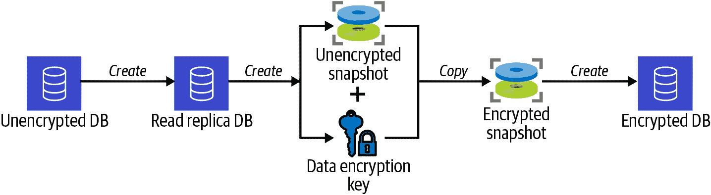
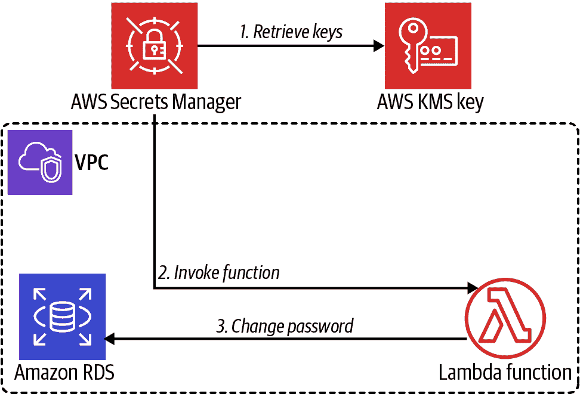
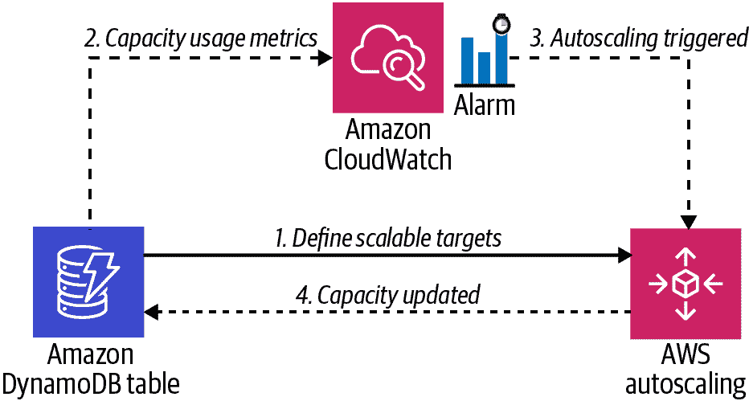
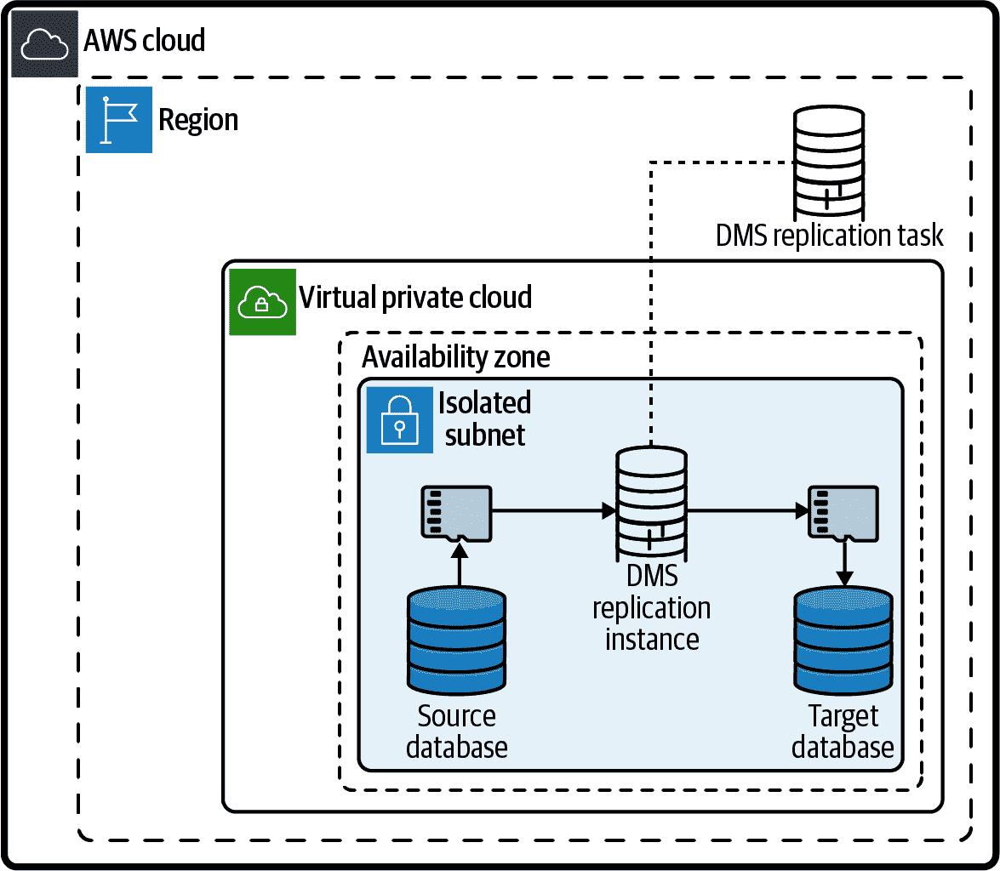
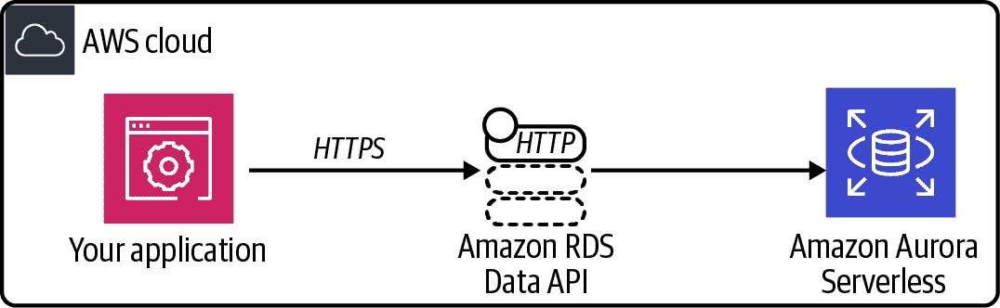
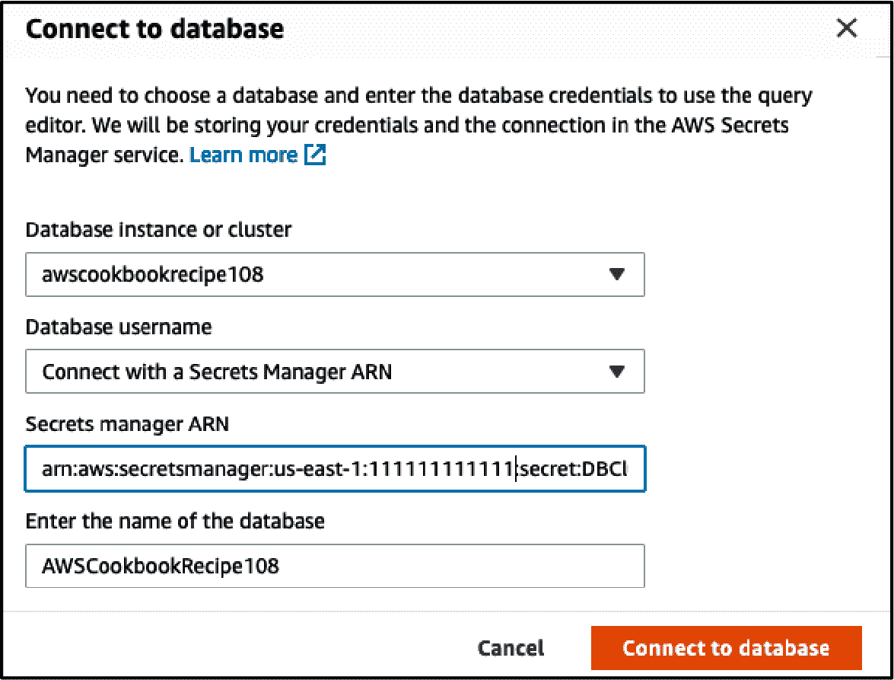
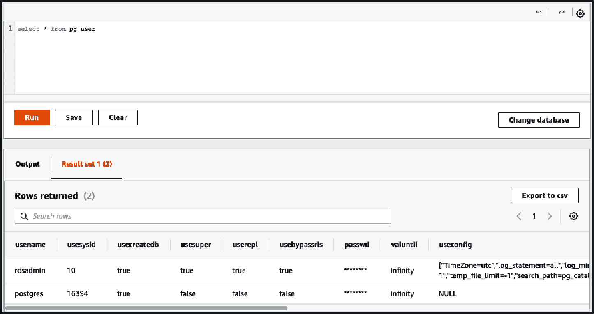

# 第 4 章 数据库

## 4.0 简介

您在 AWS 上使用数据库时有无数选择。在 EC2 上安装和运行数据库为您提供了最多的数据库引擎和自定义配置选择，但也带来了诸如修补、备份、配置高可用性、复制和性能调优等挑战。正如其[产品页面](https://oreil.ly/wLQPC)所述，AWS 提供托管数据库服务，帮助解决这些挑战，并涵盖广泛的数据库类型（关系型、键值/NoSQL、内存型、文档型、宽列型、图型、时间序列、账本型）。在选择数据库类型和数据模型时，您必须牢记速度、容量和访问模式。

AWS 上的托管数据库服务与许多服务集成，从安全、运维和开发的角度为您提供额外功能。在本章中，您将探索 Amazon Relational Database Service (RDS)、Amazon DynamoDB 的 NoSQL 用法，以及大规模迁移、保护和运维这些数据库类型的方法。例如，您将学习如何将 Secrets Manager 与 RDS 数据库集成以自动轮换数据库用户密码。您还将学习如何利用 IAM 身份验证完全消除应用程序对数据库密码的依赖，转而通过 IAM 权限授予 RDS 访问权限。您将探索 DynamoDB 的自动扩展，并了解为什么这从成本和性能角度很重要。

> **注意**
>
> 有人认为 [Route 53 是一个数据库](https://oreil.ly/Da83G)，但我们不同意 :-)

> **注意**
>
> 过去某些数据库引擎曾对副本配置、默认根用户名、主表等使用特定术语。我们已尽力在整章（及全书）中尽可能使用包容性术语。我们支持在商业和开源数据库引擎中使用包容性术语的运动。

## 工作站配置

遵循“CLI 配方的通用工作站设置步骤”以验证您的配置并设置所需的环境变量。然后，克隆章节代码仓库：

```bash
git clone https://github.com/AWSCookbook/Databases
```

> **警告**
>
> 在本章的某些步骤中，您将创建密码并暂时将它们保存为环境变量以在后续步骤中使用。完成配方后，请务必按照清理步骤取消设置环境变量。我们采用这种方法是为了便于理解。在生产环境中应使用更安全的方法（例如配方 1.8 中使用的方法）。

## 4.1 创建 Amazon Aurora Serverless PostgreSQL 数据库

### 问题

您有一个接收不可预测请求的 Web 应用程序，这些请求需要存储在关系数据库中。您需要一种能够随使用量扩展且具有成本效益的数据库解决方案。您希望构建一个运维开销低且必须与现有的 PostgreSQL 支持的应用程序兼容的解决方案。

### 解决方案

配置并创建一个具有复杂密码的 Aurora Serverless 数据库集群。然后，应用自定义的扩展配置并在不活动后启用自动暂停。响应策略的扩展活动如图 4-1 所示。



#### 先决条件

*   在两个 AZ 中创建了隔离子网并关联了路由表的 VPC。
*   已部署 EC2 实例。您需要能够连接到它以进行测试。

#### 准备工作

遵循[章节代码仓库](https://github.com/AWSCookbook/Databases)中此配方文件夹内的步骤。

#### 步骤

1.  使用 AWS Secrets Manager 生成复杂密码：

    ```bash
    ADMIN_PASSWORD=$(aws secretsmanager get-random-password \
        --exclude-punctuation \
        --password-length 41 --require-each-included-type \
        --output text \
        --query RandomPassword)
    ```

    > **注意**
    >
    > 我们从创建的密码中排除了标点字符，因为 PostgreSQL 不支持它们。请参阅“Amazon RDS 中的命名约束”[表](https://oreil.ly/z0LvJ)。

2.  创建一个数据库子网组，指定用于集群的 VPC 子网。数据库子网组简化了 RDS 弹性网络接口 (ENI) 的放置：

    ```bash
    aws rds create-db-subnet-group \
        --db-subnet-group-name awscookbook401subnetgroup \
        --db-subnet-group-description "AWSCookbook401 subnet group" \
        --subnet-ids $SUBNET_ID_1 $SUBNET_ID_2
    ```

    您应该会看到类似以下的输出：

    ```json
    {
      "DBSubnetGroup": {
      "DBSubnetGroupName": "awscookbook402subnetgroup",
      "DBSubnetGroupDescription": "AWSCookbook401 subnet group",
      "VpcId": "vpc-<<VPCID>>",
      "SubnetGroupStatus": "Complete",
      "Subnets": [
        {
        "SubnetIdentifier": "subnet-<<SUBNETID>>",
        "SubnetAvailabilityZone": {
          "Name": "us-east-1b"
        },
        "SubnetOutpost": {},
        "SubnetStatus": "Active"
        },
    ...
    ```

3.  为数据库创建一个 VPC 安全组：

    ```bash
    DB_SECURITY_GROUP_ID=$(aws ec2 create-security-group \
        --group-name AWSCookbook401sg \
        --description "Aurora Serverless Security Group" \
        --vpc-id $VPC_ID --output text --query GroupId)
    ```

4.  创建一个数据库集群，指定 `engine-mode` 为 `serverless`：

    ```bash
    aws rds create-db-cluster \
        --db-cluster-identifier awscookbook401dbcluster \
        --engine aurora-postgresql \
        --engine-mode serverless \
        --engine-version 10.14 \
        --master-username dbadmin \
        --master-user-password $ADMIN_PASSWORD \
        --db-subnet-group-name awscookbook401subnetgroup \
        --vpc-security-group-ids $DB_SECURITY_GROUP_ID
    ```

    您应该会看到类似以下的输出：

    ```json
    {
      "DBCluster": {
      "AllocatedStorage": 1,
      "AvailabilityZones": [
        "us-east-1f",
        "us-east-1b",
        "us-east-1a"
      ],
      "BackupRetentionPeriod": 1,
      "DBClusterIdentifier": "awscookbook401dbcluster",
      "DBClusterParameterGroup": "default.aurora-postgresql10",
      "DBSubnetGroup": "awscookbook401subnetgroup",
      "Status": "creating",
    ...
    ```

5.  等待状态变为 available；这将花费片刻时间：

    ```bash
    aws rds describe-db-clusters \
        --db-cluster-identifier awscookbook401dbcluster \
        --output text --query DBClusters[0].Status
    ```

6.  修改数据库以使用新的自动扩展容量目标（最小 8，最大 16）自动扩展，并在不活动五分钟后启用 `AutoPause`：

    ```bash
    aws rds modify-db-cluster \
        --db-cluster-identifier awscookbook401dbcluster --scaling-configuration \
        MinCapacity=8,MaxCapacity=16,SecondsUntilAutoPause=300,TimeoutAction='ForceApplyCapacityChange',AutoPause=true
    ```

    您应该会看到类似于步骤 4 的输出。

    > **注意**
    >
    > 实际上，您可能想要使用不同的 `AutoPause` 值。要确定适合您用例的值，请评估您的性能需求和 [Aurora 定价](https://oreil.ly/o6mAP)。

    至少等待五分钟，观察数据库容量已缩减至 0：

    ```bash
    aws rds describe-db-clusters \
        --db-cluster-identifier awscookbook401dbcluster \
        --output text --query DBClusters[0].Capacity
    ```

    > **注意**


`AutoPause` 功能会在不活动后自动将集群的容量设置为 0。当数据库活动恢复时（例如查询或连接），容量值会自动设置为您配置的最小扩展容量值。

7. 授予 EC2 实例的安全组访问默认 PostgreSQL 端口的权限：

```
aws ec2 authorize-security-group-ingress \
    --protocol tcp --port 5432 \
    --source-group $INSTANCE_SG \
    --group-id $DB_SECURITY_GROUP_ID
```

您应该会看到类似以下的输出：

```
{
  "Return": true,
  "SecurityGroupRules": [
    {
      "SecurityGroupRuleId": "sgr-<<ID>>",
      "GroupId": "sg-<<ID>>",
      "GroupOwnerId": "111111111111",
      "IsEgress": false,
      "IpProtocol": "tcp",
      "FromPort": 5432,
      "ToPort": 5432,
      "ReferencedGroupInfo": {
        "GroupId": "sg-<<ID>>"
      }
    }
  ]
}
```

## 验证检查

列出 RDS 集群的端点：

```
aws rds describe-db-clusters \
    --db-cluster-identifier awscookbook401dbcluster \
    --output text --query DBClusters[0].Endpoint
```

您应该会看到类似以下的内容：

```
awscookbook401dbcluster.cluster-<<unique>>.us-east-1.rds.amazonaws.com
```

检索 RDS 集群的密码：

```
echo $ADMIN_PASSWORD
```

使用 SSM Session Manager 连接到 EC2 实例（请参阅 食谱 1.6）：

```
aws ssm start-session --target $INSTANCE_ID
```

安装 PostgreSQL 软件包，以便您可以使用 `psql` 命令连接到数据库：

```
sudo yum -y install postgresql
```

连接到数据库。这可能需要片刻时间，因为数据库容量正在从 0 扩展。您需要复制并粘贴密码（之前已输出）：

```
psql -h $HOST_NAME -U dbadmin -W -d postgres
```

以下是使用 `psql` 命令连接到数据库的示例：

```
sh-4.2$ psql -h awscookbook401dbcluster.cluster-<<unique>>.us-east-1.rds.amazonaws.com -U dbadmin -W -d postgres
Password for user dbadmin:(粘贴密码)
```

退出 psql：

```
\q
```

退出 Session Manager 会话：

```
exit
```

再次检查集群的容量，观察数据库已扩展到您配置的最小值：

```
aws rds describe-db-clusters \
    --db-cluster-identifier awscookbook401dbcluster \
    --output text --query DBClusters[0].Capacity
```

## 清理

按照 [章节代码仓库](https://github.com/AWSCookbook/Databases) 中此食谱文件夹中的步骤操作。

### 提示

删除 RDS 集群的默认行为是将最终快照作为安全机制。我们选择通过添加 `--skip-final-snapshot` 选项来跳过此行为，以确保您不会因在 AWS 账户中存储快照而产生任何费用。在实际场景中，您可能希望保留快照一段时间，以防需要从快照重新创建现有数据库。

## 讨论

集群将自动扩展容量以满足您的使用需求。设置 `MaxCapacity=16` 可限制容量的上限，以防止失控的使用和意外成本。当未检测到连接或活动时，集群会将其容量设置为 0。当达到 `SecondsUntilAutoPause` 值时会触发此操作。

当您为集群启用 `AutoPause=true` 时，在空闲期间您仅需为底层存储付费。默认（也是最小）“不活动期”为五分钟。连接到已暂停的集群将导致容量扩展到 `MinCapacity`。

### 警告

并非所有数据库引擎和版本都可用于无服务器引擎。撰写本文时，[Aurora 常见问题](https://oreil.ly/P5A2B) 指出 Aurora Serverless 目前适用于兼容 MySQL 5.6 的 Aurora 和兼容 PostgreSQL 10.7+ 的 Aurora。

[用户指南](https://oreil.ly/MJpCb) 指出 Aurora Serverless 扩展以容量单位 (CU) 衡量，对应于为您的集群保留的计算和内存。此功能非常适合从开发到基于批处理的工作负载，以及流量不可预测且与潜在过度配置相关成本是一个问题的生产工作负载等许多工作负载和用例。由于无需计算基线使用模式，您可以快速开始开发，集群将自动响应应用程序所需的需求。

如果您当前在 Amazon RDS 上使用“预置”容量类型的集群并希望开始使用 Aurora Serverless，您可以对当前数据库进行快照，并从 AWS 控制台或命令行恢复它以执行迁移。如果您当前的数据库不在 RDS 上，您可以使用数据库引擎的转储和恢复功能，或使用 AWS Database Migration Service (AWS DMS) 迁移到 RDS。

### 注意

撰写本文时，Amazon Aurora Serverless v2 处于 [预览](https://oreil.ly/TVurx) 阶段。

[用户指南](https://oreil.ly/GMEVT) 提到 Aurora Serverless 进一步构建在现有的 Aurora 平台之上，该平台将数据库的底层存储以六种方式跨三个可用区进行复制。虽然这种复制对弹性有益，但您仍应为数据库使用自动备份以防范操作错误。Aurora Serverless 默认启用了自动备份，如有需要，备份保留期可增加到 35 天。

### 注意

根据 [文档](https://oreil.ly/Wq91f)，如果您的数据库集群空闲超过七天，将使用快照对其进行备份。如果发生这种情况，当有连接请求时，数据库集群将被恢复。

## 挑战

将数据库集群的最大容量更改为 64，空闲时间更改为 10 分钟。

## 另请参阅

食谱 4.2

食谱 4.7

# 4.2 将 IAM 身份验证与 RDS 数据库配合使用

## 问题

您有一台使用密码连接到数据库的服务器，希望改为使用轮换的临时凭证。

## 解决方案

首先，您将为数据库启用 IAM 身份验证。然后，您将为 EC2 实例配置 IAM 权限。最后，在数据库上创建一个新用户，检索 IAM 身份验证令牌，并验证连接（请参阅 图 4-2）。



### 先决条件

*   在两个 AZ 中创建了具有隔离子网的 VPC 以及关联的路由表。
*   一个 RDS MySQL 实例。
*   已部署 EC2 实例。您需要能够连接到它以配置 MySQL 和测试。

### 准备

按照 [章节代码仓库](https://github.com/AWSCookbook/Databases) 中此食谱文件夹中的步骤操作。

### 步骤

1. 在 RDS 数据库实例上启用 IAM 数据库身份验证：

```
aws rds modify-db-instance \
    --db-instance-identifier $RDS_DATABASE_ID \
    --enable-iam-database-authentication \
    --apply-immediately
```

您应该会看到类似以下的输出：

```
{
  "DBInstance": {
    "DBInstanceIdentifier": "awscookbookrecipe402",
    "DBInstanceClass": "db.m5.large",
    "Engine": "mysql",
    "DBInstanceStatus": "available",
    "MasterUsername": "admin",
    "DBName": "AWSCookbookRecipe402",
    "Endpoint": {
      "Address": "awscookbookrecipe402.<<ID>>.us-east-1.rds.amazonaws.com",
      "Port": 3306,
      "HostedZoneId": "<<ID>>"
    },
    ...
  }
}
```

#### 警告

IAM 数据库身份验证仅适用于此 AWS [文章](https://oreil.ly/jUIQ0) 中列出的数据库引擎。

2. 检索 RDS 数据库实例资源 ID：


```
DB_RESOURCE_ID=$(aws rds describe-db-instances \
    --query \
    'DBInstances[?DBName==`AWSCookbookRecipe402`].DbiResourceId' \
    --output text)
```

3. 创建一个名为 `policy.json` 的文件，内容如下（仓库中提供了 `policy-template.json` 文件）：

```
{
  "Version": "2012-10-17",
  "Statement": [
    {
      "Effect": "Allow",
      "Action": [
        "rds-db:connect"
      ],
      "Resource": [
        "arn:aws:rds-db:AWS_REGION:AWS_ACCOUNT_ID:dbuser:DBResourceId/db_user"
      ]
    }
  ]
}
```

**注意**

在前面的示例中，`db_user` 必须与数据库中我们想要允许连接的用户名称匹配。

4. 使用您已设置的环境变量，通过 `sed` 命令替换模板文件中的值：

```
sed -e "s/AWS_ACCOUNT_ID/${AWS_ACCOUNT_ID}/g" \
    -e "s|AWS_REGION|${AWS_REGION}|g" \
    -e "s|DBResourceId|${DB_RESOURCE_ID}|g" \
    policy-template.json > policy.json
```

5. 使用刚创建的文件创建 IAM 策略：

```
aws iam create-policy --policy-name AWSCookbook402EC2RDSPolicy \
    --policy-document file://policy.json
```

您应该会看到类似以下的输出：

```
{
  "Policy": {
  "PolicyName": "AWSCookbook402EC2RDSPolicy",
  "PolicyId": "<<ID>>",
  "Arn": "arn:aws:iam::111111111111:policy/AWSCookbook402EC2RDSPolicy",
  "Path": "/",
  "DefaultVersionId": "v1",
  "AttachmentCount": 0,
  "PermissionsBoundaryUsageCount": 0,
  "IsAttachable": true,
  "CreateDate": "2021-09-21T21:18:54+00:00",
  "UpdateDate": "2021-09-21T21:18:54+00:00"
  }
}
```

6. 将 IAM 策略 `AWSCookbook402EC2RDSPolicy` 附加到 EC2 实例正在使用的 IAM 角色：

```
aws iam attach-role-policy --role-name $INSTANCE_ROLE_NAME \
    --policy-arn arn:aws:iam::$AWS_ACCOUNT_ID:policy/AWSCookbook402EC2RDSPolicy
```

7. 从 Secrets Manager 检索 RDS 管理员密码：

```
RDS_ADMIN_PASSWORD=$(aws secretsmanager get-secret-value \
    --secret-id $RDS_SECRET_ARN \
    --query SecretString | jq -r | jq .password | tr -d '"')
```

8. 输出文本，以便稍后连接到 EC2 实例时使用。

列出 RDS 集群的端点：

```
echo $RDS_ENDPOINT
```

您应该会看到类似以下的输出：

```
awscookbookrecipe402.<<unique>>.us-east-1.rds.amazonaws.com
```

列出 RDS 集群的密码：

```
echo $RDS_ADMIN_PASSWORD
```

9. 使用 SSM Session Manager 连接到 EC2 实例（请参阅 食谱 1.6）：

```
aws ssm start-session --target $INSTANCE_ID
```

10. 安装 MySQL：

```
sudo yum -y install mysql
```

11. 连接到数据库。您需要复制并粘贴密码和主机名（在步骤 7 和 8 中输出）：

```
mysql -u admin -p$DB_ADMIN_PASSWORD -h $RDS_ENDPOINT
```

您应该会看到类似以下的输出：

```
Welcome to the MariaDB monitor. Commands end with ; or \g.
Your MySQL connection id is 18
Server version: 8.0.23 Source distribution
Copyright (c) 2000, 2018, Oracle, MariaDB Corporation Ab and others.
Type 'help;' or '\h' for help. Type '\c' to clear the current input statement.
MySQL [(none)]>
```

**注意**

在第 11 步的 `mysql` 命令中，`-p` 标志和密码的第一个字符之间没有空格。

12. 创建一个新的数据库用户以关联 IAM 身份验证：

```
CREATE USER db_user@'%' IDENTIFIED WITH AWSAuthenticationPlugin as 'RDS';
GRANT SELECT ON *.* TO 'db_user'@'%';
```

对于步骤 12 中的两条命令，您应该会看到类似以下的输出：

```
Query OK, 0 rows affected (0.01 sec)
```

13. 现在，退出 `mysql` 提示符：

```
quit
```

### 验证检查

仍在 EC2 实例上，从 `rds-downloads` S3 存储桶下载 [Amazon 提供的](https://oreil.ly/2T2v5) RDS 根 CA（证书颁发机构）文件：

```
sudo wget https://s3.amazonaws.com/rds-downloads/rds-ca-2019-root.pem
```

通过从实例的元数据中获取值来设置区域：

```
export AWS_DEFAULT_REGION=$(curl --silent http://169.254.169.254/latest/dynamic/instance-identity/document \
| awk -F'"' ' /region/ {print $4}')
```

生成 RDS 身份验证令牌并将其保存为变量。您需要复制并粘贴主机名（在步骤 8 中输出）：

```
TOKEN="$(aws rds generate-db-auth-token --hostname $RDS_ENDPOINT --port 3306 --username db_user)"
```

使用 RDS 身份验证令牌通过新的 `db_user` 连接到数据库。您需要复制并粘贴主机名（在步骤 8 中输出）：

```
mysql --host=$RDS_ENDPOINT --port=3306 \
    --ssl-ca=rds-ca-2019-root.pem \
--user=db_user --password=$TOKEN
```

在 `mysql` 提示符下运行 SELECT 查询，以验证此用户具有您应用的 `SELECT *.*` 授权：

```
SELECT user FROM mysql.user;
```

您应该会看到类似以下的输出：

```
MySQL [(none)]> SELECT user FROM mysql.user;
+------------------+
| user             |
+------------------+
| admin            |
| db_user          |
| mysql.infoschema |
| mysql.session    |
| mysql.sys        |
| rdsadmin         |
+------------------+
6 rows in set (0.00 sec)
```

退出 `mysql` 提示符：

```
quit
```

退出 Session Manager 会话：

```
exit
```

### 清理

按照 [章节代码仓库](https://github.com/AWSCookbook/Databases) 中此食谱文件夹中的步骤操作。

### 讨论

您没有在 MySQL 连接字符串中使用密码，而是检索并使用了与 EC2 实例的 IAM 角色关联的令牌。[IAM 文档](https://oreil.ly/ahOrb) 指出该令牌持续 15 分钟。如果您在此 EC2 实例上安装应用程序，代码可以使用 AWS SDK 定期刷新此令牌。无需为数据库用户轮换密码，因为旧令牌将在 15 分钟后失效。

您可以创建多个与特定授权关联的数据库用户，以允许您的应用程序维护对数据库的不同访问级别。授权发生在数据库内部，而非 IAM 权限内。IAM 控制特定用户的 `db-connect` 操作。此 IAM 操作允许检索身份验证令牌。该用户名通过在数据库中使用与 `policy.json` 文件中相同的用户名，从 IAM 映射到 GRANT：

```
{
  "Version": "2012-10-17",
  "Statement": [
    {
      "Effect": "Allow",
      "Action": [
        "rds-db:connect"
      ],
      "Resource": [
        "arn:aws:rds-db:AWS_REGION::dbuser:DBResourceId/db_user"
      ]
    }
  ]
}
```

在本食谱中，您还通过在数据库连接命令中指定下载到 EC2 实例的 SSL 证书包，启用了传输中加密。这会加密您的应用程序与数据库之间的连接。这是一种良好的安全实践，且通常是许多合规标准的要求。您用于通过 IAM 身份验证令牌连接的连接字符串将 SSL 证书指定为连接参数之一。证书颁发机构包可 [从 AWS 下载](https://oreil.ly/TJBbg) 并在您的应用程序中使用。

### 挑战

尝试使用 IAM 身份验证从 Lambda 函数连接到数据库。我们在仓库中提供了 `lambda_function.py` 文件供您入门。

## 4.3 利用 RDS Proxy 实现从 Lambda 进行数据库连接

### 问题


你有一个正在访问关系型数据库的无服务器函数，需要实现连接池以尽量减少数据库连接数量并提高性能。

## 解决方案

创建一个 RDS Proxy，将其与你的 RDS MySQL 数据库关联，并配置 Lambda 连接到该代理，而不是直接访问数据库（请参阅图 4-3）。



### 先决条件

* 在两个可用区中创建了隔离子网并关联了路由表的 VPC
* 一个 RDS MySQL 实例
* 一个你希望连接到 RDS 数据库的 Lambda 函数

### 准备工作

请遵循 [章节代码仓库](https://github.com/AWSCookbook/Databases) 中该配方文件夹内的步骤。

### 步骤

1. 创建一个名为 `assume-role-policy.json` 的文件，内容如下（仓库中已提供该文件）：

```
{
  "Version": "2012-10-17",
  "Statement": [
    {
      "Effect": "Allow",
      "Principal": {
        "Service": "rds.amazonaws.com"
      },
      "Action": "sts:AssumeRole"
    }
  ]
}
```

2. 使用 `assume-role-policy.json` 文件为 RDS Proxy 创建一个 IAM 角色：

```
aws iam create-role --assume-role-policy-document \
    file://assume-role-policy.json --role-name AWSCookbook403RDSProxy
```

你应该会看到类似如下的输出：

```
{
  "Role": {
  "Path": "/",
  "RoleName": "AWSCookbook403RDSProxy",
  "RoleId": "<<ID>>",
  "Arn": "arn:aws:iam::111111111111:role/AWSCookbook403RDSProxy",
  "CreateDate": "2021-09-21T22:33:57+00:00",
  "AssumeRolePolicyDocument": {
    "Version": "2012-10-17",
    "Statement": [
    {
      "Effect": "Allow",
      "Principal": {
        "Service": "rds.amazonaws.com"
      },
      "Action": "sts:AssumeRole"
    }
    ]
  }
  }
}
```

3. 创建一个供 RDS Proxy 使用的安全组：

```
RDS_PROXY_SG_ID=$(aws ec2 create-security-group \
    --group-name AWSCookbook403RDSProxySG \
    --description "Lambda Security Group" --vpc-id $VPC_ID \
    --output text --query GroupId)
```

4. 创建 RDS Proxy。这将花费片刻时间：

```
RDS_PROXY_ENDPOINT_ARN=$(aws rds create-db-proxy \
    --db-proxy-name $DB_NAME \
    --engine-family MYSQL \
    --auth '{
            "AuthScheme": "SECRETS",
            "SecretArn": "'"$RDS_SECRET_ARN"'",
            "IAMAuth": "REQUIRED"
          }' \
    --role-arn arn:aws:iam::$AWS_ACCOUNT_ID:role/AWSCookbook403RDSProxy \
    --vpc-subnet-ids $ISOLATED_SUBNETS \
    --vpc-security-group-ids $RDS_PROXY_SG_ID \
    --require-tls --output text \
    --query DBProxy.DBProxyArn)
```

等待 RDS Proxy 变为可用状态：

```
aws rds describe-db-proxies \
    --db-proxy-name $DB_NAME \
    --query DBProxies[0].Status \
    --output text
```

5. 获取 `RDS_PROXY_ENDPOINT`：

```
RDS_PROXY_ENDPOINT=$(aws rds describe-db-proxies \
    --db-proxy-name $DB_NAME \
    --query DBProxies[0].Endpoint \
    --output text)
```

6. 接下来，你需要一个允许 Lambda 函数生成 IAM 认证令牌的 IAM 策略。创建一个名为 `template-policy.json` 的文件，内容如下（仓库中已提供该文件）：

```
{
  "Version": "2012-10-17",
  "Statement": [
    {
      "Effect": "Allow",
      "Action": [
        "rds-db:connect"
      ],
      "Resource": [
        "arn:aws:rds-db:AWS_REGION:AWS_ACCOUNT_ID:dbuser:RDSProxyID/admin"
      ]
    }
  ]
}
```

7. 从 RDS Proxy 端点 ARN 中分离出 Proxy ID。后续步骤配置 IAM 策略时需要用到 Proxy ID：

```
RDS_PROXY_ID=$(echo $RDS_PROXY_ENDPOINT_ARN | awk -F: '{ print $7} ')
```

8. 使用 `sed` 命令结合你已设置的环境变量，替换模板文件中的值：

```
sed -e "s/AWS_ACCOUNT_ID/${AWS_ACCOUNT_ID}/g" \
    -e "s|AWS_REGION|${AWS_REGION}|g" \
    -e "s|RDSProxyID|${RDS_PROXY_ID}|g" \
policy-template.json > policy.json
```

9. 使用刚创建的文件创建 IAM 策略：

```
aws iam create-policy --policy-name AWSCookbook403RdsIamPolicy \
    --policy-document file://policy.json
```

你应该会看到类似如下的输出：

```
{
  "Policy": {
  "PolicyName": "AWSCookbook403RdsIamPolicy",
  "PolicyId": "<<Id>>",
  "Arn": "arn:aws:iam::111111111111:policy/AWSCookbook403RdsIamPolicy",
  "Path": "/",
  "DefaultVersionId": "v1",
  "AttachmentCount": 0,
  "PermissionsBoundaryUsageCount": 0,
  "IsAttachable": true,
  "CreateDate": "2021-09-21T22:50:24+00:00",
  "UpdateDate": "2021-09-21T22:50:24+00:00"
  }
}
```

10. 将该策略附加到 DBAppFunction Lambda 函数的角色上：

```
aws iam attach-role-policy --role-name $DB_APP_FUNCTION_ROLE_NAME \
    --policy-arn arn:aws:iam::$AWS_ACCOUNT_ID:policy/AWSCookbook403RdsIamPolicy
```

使用此命令检查代理何时进入可用状态，然后继续：

```
aws rds describe-db-proxies --db-proxy-name $DB_NAME \
    --query DBProxies[0].Status \
    --output text
```

11. 将 `SecretsManagerReadWrite` 策略附加到 RDS Proxy 的角色：

```
aws iam attach-role-policy --role-name AWSCookbook403RDSProxy \
    --policy-arn arn:aws:iam::aws:policy/SecretsManagerReadWrite
```

#### 提示

在生产场景中，你应该将此权限范围缩小到应用程序所需访问的最小机密资源，而不是授予 `SecretsManagerReadWrite`，后者允许对所有机密进行读/写操作。

12. 向 RDS 实例的安全组添加一条入站规则，允许来自 RDS Proxy 安全组的 TCP 端口 3306（MySQL 引擎的默认 TCP 端口）访问：

```
aws ec2 authorize-security-group-ingress \
    --protocol tcp --port 3306 \
    --source-group $RDS_PROXY_SG_ID \
    --group-id $RDS_SECURITY_GROUP
```

你应该会看到类似如下的输出：

```
{
  "Return": true,
  "SecurityGroupRules": [
  {
    "SecurityGroupRuleId": "sgr-<<ID>>",
    "GroupId": "sg-<<ID>>",
    "GroupOwnerId": "111111111111",
    "IsEgress": false,
    "IpProtocol": "tcp",
    "FromPort": 3306,
    "ToPort": 3306,
    "ReferencedGroupInfo": {
    "GroupId": "sg-<<ID>>"
    }
  }
  ]
}
```

#### 注意

安全组可以引用其他安全组。由于 VPC 内的动态 IP 地址，这被认为是在不过度开放安全组的情况下授予访问权限的最佳方式。更多信息请参阅配方 2.5。

13. 向 RDS Proxy 注册目标：

```
aws rds register-db-proxy-targets \
    --db-proxy-name $DB_NAME \
    --db-instance-identifiers $RDS_DATABASE_ID
```

你应该会看到类似如下的输出：

```
{
  "DBProxyTargets": [
  {
    "Endpoint": "awscookbook403db.<<ID>>.us-east-1.rds.amazonaws.com",
    "RdsResourceId": "awscookbook403db",
    "Port": 3306,
    "Type": "RDS_INSTANCE",
    "TargetHealth": {
    "State": "REGISTERING"
    }
  }
  ]
}
```

使用此命令检查目标注册的状态。等待状态变为 AVAILABLE：


## 4.3 将 RDS Proxy 与 Lambda 结合使用

### 步骤

13. 验证 RDS Proxy 目标健康状态：

```bash
aws rds describe-db-proxy-targets \
    --db-proxy-name awscookbookrecipe403 \
    --query Targets[0].TargetHealth.State \
    --output text
```

14. 向 RDS Proxy 安全组添加一条入站规则，允许来自 Lambda 应用函数安全组的 TCP 端口 3306 访问：

```bash
aws ec2 authorize-security-group-ingress \
    --protocol tcp --port 3306 \
    --source-group $DB_APP_FUNCTION_SG_ID \
    --group-id $RDS_PROXY_SG_ID
```

您应该会看到类似如下的输出：

```json
{
  "Return": true,
  "SecurityGroupRules": [
    {
      "SecurityGroupRuleId": "sgr-<<ID>>",
      "GroupId": "sg-<<ID>>",
      "GroupOwnerId": "111111111111",
      "IsEgress": false,
      "IpProtocol": "tcp",
      "FromPort": 3306,
      "ToPort": 3306,
      "ReferencedGroupInfo": {
        "GroupId": "sg-<<ID>>"
      }
    }
  ]
}
```

15. 修改 Lambda 函数，使其使用 RDS Proxy 端点作为 `DB_HOST`，而不是直接连接到数据库：

```bash
aws lambda update-function-configuration \
    --function-name $DB_APP_FUNCTION_NAME \
    --environment Variables={DB_HOST=$RDS_PROXY_ENDPOINT}
```

您应该会看到类似如下的输出：

```json
{
  "FunctionName": "cdk-aws-cookbook-403-LambdaApp<<ID>>",
  "FunctionArn": "arn:aws:lambda:us-east-1:111111111111:function:cdk-aws-cookbook-403-LambdaApp<<ID>>",
  "Runtime": "python3.8",
  "Role": "arn:aws:iam::111111111111:role/cdk-aws-cookbook-403-LambdaAppServiceRole<<ID>>",
  "Handler": "lambda_function.lambda_handler",
  "CodeSize": 665,
  "Description": "",
  "Timeout": 600,
  "MemorySize": 1024,
  ...
}
```

### 验证检查

运行以下命令以验证该函数能否通过 RDS Proxy 连接到 RDS：

```bash
aws lambda invoke \
    --function-name $DB_APP_FUNCTION_NAME \
    response.json && cat response.json
```

您应该会看到类似如下的输出：

```json
{
  "StatusCode": 200,
  "ExecutedVersion": "$LATEST"
}
"Successfully connected to RDS via RDS Proxy!"
```

### 清理

按照 [章节代码仓库](https://github.com/AWSCookbook/Databases) 中该配方文件夹内的步骤进行操作。

### 讨论

当将 Lambda 与 RDS 结合使用时，连接池是一个重要的考量因素。根据您的应用程序，函数可能会以高并发和高频率执行，导致到数据库的原始连接数量增加并影响性能。通过使用 RDS Proxy 管理到数据库的连接，可以减少到实际数据库所需的连接数。此设置可提高性能和效率。

如果不使用 RDS Proxy，Lambda 函数每次被调用时可能都会建立一个新的数据库连接。此行为取决于执行环境、[运行时](https://oreil.ly/tkrh5)（Python、NodeJS、Go 等）以及您在函数代码中实例化数据库连接的方式。在函数并发量大的情况下，这可能会导致大量 TCP 连接涌向您的数据库，从而降低数据库性能并增加延迟。根据[文档](https://oreil.ly/7zUhZ)，RDS Proxy 通过将来自 Lambda 的连接作为“池”进行管理，帮助管理这些连接，因此随着并发增加，RDS Proxy 仅按需增加到数据库的实际连接，将 TCP 开销卸载给 RDS Proxy。

当您在数据库连接字符串中包含 AWS 提供的证书包时，RDS Proxy 支持传输中的 SSL 加密。RDS Proxy 支持 MySQL 和 PostgreSQL RDS 数据库。有关所有受支持的数据库引擎和版本的完整列表，请参阅此支持[文档](https://oreil.ly/7zUhZ)。

### 提示

您还可以通过在应用程序中利用 RDS Data API 来高效地处理短期数据库连接，RDS Data API 利用 Amazon RDS 暴露的 REST API。有关 RDS Data API 的示例，请参阅配方 4.8。

### 挑战

为 RDS Proxy 启用增强日志记录。这对于调试非常有用。

## 4.4 加密现有 Amazon RDS for MySQL 数据库的存储

### 问题

您需要加密现有数据库的存储。

### 解决方案

创建现有数据库的只读副本，对只读副本创建快照，将快照复制为加密快照，然后将加密快照恢复到一个新的加密数据库，如图 4-4 所示。



### 前提条件

- 在两个可用区中创建了隔离子网并关联了路由表的 VPC
- 具有 RDS 子网组的 RDS MySQL 实例

### 准备工作

按照 [章节代码仓库](https://github.com/AWSCookbook/Databases) 中该配方文件夹内的步骤进行操作。

### 步骤

1. 验证数据库的存储未加密：

```bash
aws rds describe-db-instances \
    --db-instance-identifier $RDS_DATABASE_ID \
    --query DBInstances[0].StorageEncrypted
```

您应该会看到输出 `false`。

2. 创建一个 KMS 密钥，稍后用于加密数据库快照。将密钥 ID 存储在环境变量中：

```bash
KEY_ID=$(aws kms create-key \
    --tags TagKey=Name,TagValue=AWSCookbook404RDS \
    --description "AWSCookbook RDS Key" \
    --query KeyMetadata.KeyId \
    --output text)
```

3. 创建别名以便轻松引用您创建的密钥：

```bash
aws kms create-alias \
    --alias-name alias/awscookbook404 \
    --target-key-id $KEY_ID
```

4. 为您现有的未加密数据库创建一个只读副本：

```bash
aws rds create-db-instance-read-replica \
    --db-instance-identifier awscookbook404db-rep \
    --source-db-instance-identifier $RDS_DATABASE_ID \
    --max-allocated-storage 10
```

您应该会看到类似如下的输出：

```json
{
  "DBInstance": {
    "DBInstanceIdentifier": "awscookbook404db-rep",
    "DBInstanceClass": "db.m5.large",
    "Engine": "mysql",
    "DBInstanceStatus": "creating",
    "MasterUsername": "admin",
    "DBName": "AWSCookbookRecipe404",
    "AllocatedStorage": 8,
    "PreferredBackupWindow": "05:51-06:21",
    "BackupRetentionPeriod": 0,
    "DBSecurityGroups": [],
    ...
  }
}
```

> **注意**
>
> 通过创建只读副本，您允许从副本创建快照，因此不会影响主数据库的性能。

等待 `DBInstanceStatus` 变为“available”：

```bash
aws rds describe-db-instances \
    --db-instance-identifier awscookbook404db-rep \
    --output text --query DBInstances[0].DBInstanceStatus
```

5. 对您的只读副本创建一个未加密快照：

```bash
aws rds create-db-snapshot \
    --db-instance-identifier awscookbook404db-rep \
    --db-snapshot-identifier awscookbook404-snapshot
```

您应该会看到类似如下的输出：

```json
{
  "DBSnapshot": {
    "DBSnapshotIdentifier": "awscookbook404-snapshot",
    "DBInstanceIdentifier": "awscookbook404db-rep",
    "Engine": "mysql",
    "AllocatedStorage": 8,
    "Status": "creating",
    "Port": 3306,
    "AvailabilityZone": "us-east-1b",
    "VpcId": "vpc-<<ID>>",
    "InstanceCreateTime": "2021-09-21T22:46:07.785000+00:00",
    ...
  }
}
```

等待快照的 `Status` 变为可用：

```bash
aws rds describe-db-snapshots \
    --db-snapshot-identifier awscookbook404-snapshot \
    --output text --query DBSnapshots[0].Status
```

6. 在指定您的 KMS 密钥的同时，将未加密快照复制到一个新的加密快照：


```
aws rds copy-db-snapshot \
    --copy-tags \
    --source-db-snapshot-identifier awscookbook404-snapshot \
    --target-db-snapshot-identifier awscookbook404-snapshot-enc \
    --kms-key-id alias/awscookbook404
```

您应该会看到类似以下的输出：

```
{
  "DBSnapshot": {
    "DBSnapshotIdentifier": "awscookbook404-snapshot-enc",
    "DBInstanceIdentifier": "awscookbook404db-rep",
    "Engine": "mysql",
    "AllocatedStorage": 8,
    "Status": "creating",
    "Port": 3306,
    "AvailabilityZone": "us-east-1b",
    "VpcId": "vpc-<<ID>>",
    "InstanceCreateTime": "2021-09-21T22:46:07.785000+00:00",
    "MasterUsername": "admin",
    ...
  }
}
```

#### 提示

在 `copy-snapshot` 命令中指定 KMS 密钥会对复制的快照进行加密。将加密快照还原到新数据库会生成一个加密数据库。

等待加密快照的 `Status` 变为可用：

```
aws rds describe-db-snapshots \
    --db-snapshot-identifier awscookbook404-snapshot-enc \
    --output text --query DBSnapshots[0].Status
```

### 将加密快照还原到新的 RDS 实例

```
aws rds restore-db-instance-from-db-snapshot \
    --db-subnet-group-name $RDS_SUBNET_GROUP \
    --db-instance-identifier awscookbook404db-enc \
    --db-snapshot-identifier awscookbook404-snapshot-enc
```

您应该会看到类似以下的输出：

```
{
  "DBInstance": {
    "DBInstanceIdentifier": "awscookbook404db-enc",
    "DBInstanceClass": "db.m5.large",
    "Engine": "mysql",
    "DBInstanceStatus": "creating",
    "MasterUsername": "admin",
    "DBName": "AWSCookbookRecipe404",
    "AllocatedStorage": 8,
    ...
  }
}
```

#### 验证检查

等待 `DBInstanceStatus` 变为可用：

```
aws rds describe-db-instances \
    --db-instance-identifier awscookbook404db-enc \
    --output text --query DBInstances[0].DBInstanceStatus
```

验证存储现在已加密：

```
aws rds describe-db-instances \
    --db-instance-identifier awscookbook404db-enc \
    --query DBInstances[0].StorageEncrypted
```

您应该会看到输出 `true`。

### 清理

按照[章节代码仓库](https://github.com/AWSCookbook/Databases)中本配方文件夹中的步骤操作。

## 讨论

完成这些步骤后，您需要重新配置应用程序以指向新的数据库端点主机名。为了以最小的停机时间执行此操作，您可以配置一个指向数据库端点的 [Route 53 DNS 记录](https://oreil.ly/SFZuW)。您的应用程序将被配置为使用该 DNS 记录。然后，通过使用新数据库端点 DNS 更新 DNS 记录，将数据库流量切换到新的加密数据库。

静态加密是 [AWS 共享责任模型](https://oreil.ly/n6Cz3) 中留给最终用户的一种安全方法，通常为了达到或保持符合监管标准而需要。您创建的加密快照也可以自动复制到另一个区域，以及导出到 S3 用于归档/备份目的。

### 挑战

从头创建一个最初具有加密存储的 RDS 数据库，并使用 AWS DMS 将数据从现有数据库迁移到新数据库，如配方 4.7 所示。

# 4.5 自动轮换 RDS 数据库密码

## 问题

您希望为数据库用户实现自动密码轮换。

## 解决方案

创建一个密码并将其放入 AWS Secrets Manager。为包含密码的密钥配置轮换间隔。最后，使用 AWS 提供的代码创建一个 Lambda 函数，并配置该函数执行密码轮换。此配置允许密码轮换自动化按图 4-5 所示执行。



### 先决条件

*   在两个 AZ 中创建了具有关联路由表的隔离子网的 VPC。
*   已部署 MySQL RDS 实例和 EC2 实例。您需要具备连接到这些实例以进行测试的能力。

### 准备

按照[章节代码仓库](https://github.com/AWSCookbook/Databases)中本配方文件夹中的步骤操作。

### 步骤

1.  使用 AWS Secrets Manager 生成一个符合 RDS 要求的密码：

    ```
    RDS_ADMIN_PASSWORD=$(aws secretsmanager get-random-password \
        --exclude-punctuation \
        --password-length 41 --require-each-included-type \
        --output text --query RandomPassword)
    ```

    #### 提示

    您可以调用 [Secrets Manager GetRandomPassword](https://oreil.ly/7DAG9) API 方法生成随机字符串，用于除密码生成之外的各种用途。

2.  将 RDS 数据库的管理员密码更改为刚创建的密码：

    ```
    aws rds modify-db-instance \
        --db-instance-identifier $RDS_DATABASE_ID \
        --master-user-password $RDS_ADMIN_PASSWORD \
        --apply-immediately
    ```

    您应该会看到类似以下的输出：

    ```
    {
      "DBInstance": {
        "DBInstanceIdentifier": "awscookbook405db",
        "DBInstanceClass": "db.m5.large",
        "Engine": "mysql",
        "DBInstanceStatus": "available",
        "MasterUsername": "admin",
        "DBName": "AWSCookbookRecipe405",
        ...
      }
    }
    ```

3.  创建一个名为 `rdscreds-template.json` 的文件，内容如下（仓库中提供了该文件）：

    ```
    {
      "username": "admin",
      "password": "PASSWORD",
      "engine": "mysql",
      "host": "HOST",
      "port": 3306,
      "dbname": "DBNAME",
      "dbInstanceIdentifier": "DBIDENTIFIER"
    }
    ```

4.  使用 `sed` 修改 `rdscreds-template.json` 中的值以创建 `rdscreds.json`：

    ```
    sed -e "s/AWS_ACCOUNT_ID/${AWS_ACCOUNT_ID}/g" \
        -e "s|PASSWORD|${RDS_ADMIN_PASSWORD}|g" \
        -e "s|HOST|${RdsEndpoint}|g" \
        -e "s|DBNAME|${DbName}|g" \
        -e "s|DBIDENTIFIER|${RdsDatabaseId}|g" \
        rdscreds-template.json > rdscreds.json
    ```

5.  从 [AWS Samples GitHub 仓库](https://oreil.ly/H5kgh) 下载轮换 Lambda 函数的代码：

    ```
    wget https://raw.githubusercontent.com/aws-samples/aws-secrets-manager-rotation-
    lambdas/master/SecretsManagerRDSMySQLRotationSingleUser/lambda_function.py
    ```

    #### 注意

    AWS 在[这篇文章](https://oreil.ly/IdYkf)中提供了不同数据库轮换场景的信息和模板。

6.  压缩包含代码的文件：

    ```
    zip lambda_function.zip lambda_function.py
    ```

    您应该会看到类似以下的输出：

    ```
      adding: lambda_function.py (deflated 76%)
    ```

7.  为 Lambda 函数创建一个新的安全组：

    ```
    LAMBDA_SG_ID=$(aws ec2 create-security-group \
        --group-name AWSCookbook405LambdaSG \
        --description "Lambda Security Group" --vpc-id $VPC_ID \
        --output text --query GroupId)
    ```

8.  向 RDS 实例的安全组添加一条入站规则，允许从 Lambda 的安全组通过 TCP 端口 3306 进行访问：

    ```
    aws ec2 authorize-security-group-ingress \
        --protocol tcp --port 3306 \
        --source-group $LAMBDA_SG_ID \
        --group-id $RDS_SECURITY_GROUP
    ```

    您应该会看到类似以下的输出：

    ```
    {
      "Return": true,
      "SecurityGroupRules": [
        {
          "SecurityGroupRuleId": "sgr-<<ID>>",
          "GroupId": "sg-<<ID>>",
          "GroupOwnerId": "111111111111",
          "IsEgress": false,
          "IpProtocol": "tcp",
          "FromPort": 3306,
          "ToPort": 3306,
          "ReferencedGroupInfo": {
            "GroupId": "sg-<<ID>>"
          }
        }
      ]
    }
    ```


## 步骤

9. 创建一个名为 `assume-role-policy.json` 的文件，内容如下（该文件已在代码库中提供）：

```json
{
  "Version": "2012-10-17",
  "Statement": [
    {
      "Effect": "Allow",
      "Principal": {
        "Service": "lambda.amazonaws.com"
      },
      "Action": "sts:AssumeRole"
    }
  ]
}
```

10. 使用提供的 `assume-role-policy.json` 文件中的语句，通过以下命令创建 IAM 角色：

```bash
aws iam create-role --role-name AWSCookbook405Lambda \
    --assume-role-policy-document file://assume-role-policy.json
```

你应该会看到类似如下的输出：

```json
{
  "Role": {
    "Path": "/",
    "RoleName": "AWSCookbook405Lambda",
    "RoleId": "<<ID>>",
    "Arn": "arn:aws:iam::111111111111:role/AWSCookbook405Lambda",
    "CreateDate": "2021-09-21T23:01:57+00:00",
    "AssumeRolePolicyDocument": {
      "Version": "2012-10-17",
      "Statement": 
...
```

11. 将 `AWSLambdaVPCAccess` 的 IAM 托管策略附加到 IAM 角色：

```bash
aws iam attach-role-policy --role-name AWSCookbook405Lambda \
    --policy-arn arn:aws:iam::aws:policy/service-role/AWSLambdaVPCAccessExecutionRole
```

12. 将 `SecretsManagerReadWrite` 的 IAM 托管策略附加到 IAM 角色：

```bash
aws iam attach-role-policy --role-name AWSCookbook405Lambda \
    --policy-arn arn:aws:iam::aws:policy/SecretsManagerReadWrite
```

**提示**

与用于轮换密码的 Lambda 函数关联的 IAM 角色使用了 `SecretsManagerReadWrite` 托管策略。在生产场景中，你需要缩小其范围，以限制 Lambda 函数可交互的机密范围。

13. 使用代码创建用于执行机密轮换的 Lambda 函数：

```bash
LAMBDA_ROTATE_ARN=$(aws lambda create-function \
    --function-name AWSCookbook405Lambda \
    --runtime python3.8 \
    --package-type "Zip" \
    --zip-file fileb://lambda_function.zip \
    --handler lambda_function.lambda_handler --publish \
    --environment Variables={SECRETS_MANAGER_ENDPOINT=https://secretsmanager.$AWS_REGION.amazonaws.com} \
    --layers $PyMysqlLambdaLayerArn \
    --role \
    arn:aws:iam::$AWS_ACCOUNT_ID:role/AWSCookbook405Lambda \
    --output text --query FunctionArn \
    --vpc-config SubnetIds=${ISOLATED_SUBNETS},SecurityGroupIds=$LAMBDA_SG_ID)
```

使用此命令确定 Lambda 函数何时进入 Active 状态：

```bash
aws lambda get-function --function-name $LAMBDA_ROTATE_ARN \
    --output text --query Configuration.State
```

14. 向 Lambda 函数添加权限，以便 Secrets Manager 可以调用它：

```bash
aws lambda add-permission --function-name $LAMBDA_ROTATE_ARN \
    --action lambda:InvokeFunction --statement-id secretsmanager \
    --principal secretsmanager.amazonaws.com
```

你应该会看到类似如下的输出：

```json
{
  "Statement": "{\"Sid\":\"secretsmanager\",\"Effect\":\"Allow\",\"Principal\":{\"Service\":\"secretsmanager.amazonaws.com\"},\"Action\":\"lambda:InvokeFunction\",\"Resource\":\"arn:aws:lambda:us-east-1:111111111111:function:AWSCookbook405Lambda\"}"
}
```

15. 设置一个唯一后缀用于机密名称，以确保如果需要，你可以重用此模式进行额外的自动密码轮换：

```bash
AWSCookbook405SecretName=AWSCookbook405Secret-$(aws secretsmanager \
    get-random-password \
    --exclude-punctuation \
    --password-length 6 --require-each-included-type \
    --output text \
    --query RandomPassword)
```

16. 在 Secrets Manager 中创建一个机密以存储你的管理员密码：

```bash
aws secretsmanager create-secret --name $AWSCookbook405SecretName \
    --description "My database secret created with the CLI" \
    --secret-string file://rdscreds.json
```

你应该会看到类似如下的输出：

```json
{
  "ARN": "arn:aws:secretsmanager:us-east-1:1111111111111:secret:AWSCookbook405Secret-T4tErs-AlJcLn",
  "Name": "AWSCookbook405Secret-<<Random>>",
  "VersionId": "<<ID>>"
}
```

17. 设置每 30 天自动轮换一次，并指定用于为刚创建的机密执行轮换的 Lambda 函数：

```bash
aws secretsmanager rotate-secret \
    --secret-id $AWSCookbook405SecretName \
    --rotation-rules AutomaticallyAfterDays=30 \
    --rotation-lambda-arn $LAMBDA_ROTATE_ARN
```

你应该会看到类似如下的输出：

```json
{
  "ARN": "arn:aws:secretsmanager:us-east-1:1111111111111:secret:AWSCookbook405Secret-<<unique>>",
  "Name": "AWSCookbook405Secret-<<unique>>",
  "VersionId": "<<ID>>"
}
```

**注意**

`rotate-secret` 命令会触发密码的初始轮换。你将在下一步中再次触发密码轮换，以演示如何按需执行轮换。

18. 对机密执行另一次轮换：

```bash
aws secretsmanager rotate-secret --secret-id $AWSCookbook405SecretName
```

你应该会看到类似于步骤 17 的输出。请注意，`VersionId` 将与上一个命令不同，表明机密已被轮换。

## 验证检查

从 Secrets Manager 检索 RDS 管理员密码：

```bash
RDS_ADMIN_PASSWORD=$(aws secretsmanager get-secret-value --secret-id $AWSCookbook405SecretName --query SecretString | jq -r | jq .password | tr -d '"')
```

列出 RDS 集群的终端节点：

```bash
echo $RDS_ENDPOINT
```

检索你的 RDS 集群的密码：

```bash
echo $RDS_ADMIN_PASSWORD
```

使用 SSM Session Manager 连接到 EC2 实例（请参阅 [食谱 1.6）：

```bash
aws ssm start-session --target $INSTANCE_ID
```

安装 MySQL 客户端：

```bash
sudo yum -y install mysql
```

连接到数据库以验证最新轮换的密码是否有效。你需要复制并粘贴密码（之前已输出）：

```bash
mysql -u admin -p$password -h $hostname
```

在 `mysql.user` 表上运行 SELECT 语句以验证管理员权限：

```sql
SELECT user FROM mysql.user;
```

你应该会看到类似如下的输出：

```
+------------------+
| user             |
+------------------+
| admin            |
| mysql.infoschema |
| mysql.session    |
| mysql.sys        |
| rdsadmin         |
+------------------+
5 rows in set (0.00 sec)
```

退出 `mysql` 提示符：

```bash
quit
```

退出 Session Manager 会话：

```bash
exit
```

## 清理

请遵循本食谱文件夹中 [章节代码库](https://github.com/AWSCookbook/Databases) 的步骤。

## 讨论

AWS 提供的 Lambda 函数将轮换后的密码存储在 Secrets Manager 中。然后，你可以配置应用程序直接从 Secrets Manager 检索机密；或者，你配置的用于更新 Secrets Manager 值的 Lambda 函数也可以将密码存储在你选择的安全位置。你需要授予 Lambda 与所选安全位置交互的额外权限，并添加一些代码以将新值存储在那里。在你已在数据库中创建用户后，通过遵循相同的步骤，此方法也可应用于轮换非管理员数据库用户账户的密码。


您部署的 Lambda 函数基于 Python，并连接到兼容 MySQL 引擎的数据库。Lambda 运行时环境默认不包含此库，因此您使用 `aws lambda create-function` 命令指定了一个 Lambda 层。此层是必需的，以便 `PyMySQL` 库在 Lambda 运行时环境中可供函数使用，并且它作为准备步骤的一部分在您运行 `cdk deploy` 时为您部署。

### 挑战

创建另一个 Lambda 函数和一个单独的 IAM 角色。授予此新函数访问同一密钥的权限。

## 另请参阅

食谱 5.2

# 4.6 自动扩展 DynamoDB 表预置容量

## 问题

您有一个预置吞吐量较低的 DynamoDB 数据库表。您意识到应用程序负载是可变的，可能需要根据传入应用程序负载的变化来扩大或缩小预置吞吐量。

## 解决方案

通过使用 AWS 应用程序自动扩展为 DynamoDB 表的读写容量设置扩展目标和扩展策略，来配置读写扩展，如 图 4-6 所示。



### 先决条件

*   一个 DynamoDB 表

### 准备工作

按照 [章节代码仓库](https://github.com/AWSCookbook/Databases) 中此食谱文件夹中的步骤操作。

### 步骤

1.  在章节仓库中导航到此食谱的目录：

    ```
    cd 406-Auto-Scaling-DynamoDB
    ```

2.  为 DynamoDB 表注册一个 `ReadCapacityUnits` 扩展目标：

    ```
    aws application-autoscaling register-scalable-target \
        --service-namespace dynamodb \
        --resource-id "table/AWSCookbook406" \
        --scalable-dimension "dynamodb:table:ReadCapacityUnits" \
        --min-capacity 5 \
        --max-capacity 10
    ```

3.  为 DynamoDB 表注册一个 `WriteCapacityUnits` 扩展目标：

    ```
    aws application-autoscaling register-scalable-target \
        --service-namespace dynamodb \
        --resource-id "table/AWSCookbook406" \
        --scalable-dimension "dynamodb:table:WriteCapacityUnits" \
        --min-capacity 5 \
        --max-capacity 10
    ```

4.  创建一个用于读容量扩展的扩展策略 JSON 文件（仓库中提供了 `read-policy.json`）：

    ```
    {
      "PredefinedMetricSpecification": {
        "PredefinedMetricType": "DynamoDBReadCapacityUtilization"
      },
      "ScaleOutCooldown": 60,
      "ScaleInCooldown": 60,
      "TargetValue": 50.0
    }
    ```

5.  创建一个用于写容量扩展的扩展策略 JSON 文件（仓库中提供了 `write-policy.json` 文件）：

    ```
    {
      "PredefinedMetricSpecification": {
        "PredefinedMetricType": "DynamoDBWriteCapacityUtilization"
      },
      "ScaleOutCooldown": 60,
      "ScaleInCooldown": 60,
      "TargetValue": 50.0
    }
    ```

    #### 注意

    [DynamoDB 预置容量](https://oreil.ly/gWTDb) 使用容量单位来定义表的读写容量。您设置的目标值根据当前使用情况定义何时扩展。扩展冷却参数以秒为单位定义在发生扩展操作后等待多久再次扩展。有关更多信息，请参阅自动扩展 `TargetTrackingScalingPolicyConfiguration` 的 [API 参考](https://oreil.ly/cWtJI)。

6.  使用 `read-policy.json` 文件将读扩展策略应用到表：

    ```
    aws application-autoscaling put-scaling-policy \
        --service-namespace dynamodb \
        --resource-id "table/AWSCookbook406" \
        --scalable-dimension "dynamodb:table:ReadCapacityUnits" \
        --policy-name "AWSCookbookReadScaling" \
        --policy-type "TargetTrackingScaling" \
        --target-tracking-scaling-policy-configuration \
        file://read-policy.json
    ```

7.  使用 `write-policy.json` 文件将写扩展策略应用到表：

    ```
    aws application-autoscaling put-scaling-policy \
        --service-namespace dynamodb \
        --resource-id "table/AWSCookbook406" \
        --scalable-dimension "dynamodb:table:WriteCapacityUnits" \
        --policy-name "AWSCookbookWriteScaling" \
        --policy-type "TargetTrackingScaling" \
        --target-tracking-scaling-policy-configuration \
        file://write-policy.json
    ```

#### 验证检查

您可以在 DynamoDB 控制台中选择该表，并在“附加设置”选项卡下查看表的自动扩展配置。

### 清理

按照 [章节代码仓库](https://github.com/AWSCookbook/Databases) 中此食谱文件夹中的步骤操作。

## 讨论

#### 提示

这些步骤将为您的 DynamoDB 表独立自动扩展读写容量，这有助于您为应用程序的特定需求实现最低的运营成本模型。

DynamoDB 允许两种容量模式：`provisioned`（预置）和 `on-demand`（按需）。使用预置容量模式时，您可以选择每秒的数据读写数量。[定价指南](https://oreil.ly/QtLJP) 指出，您将根据指定的容量单位付费。相反，使用按需容量模式时，您需为应用程序在表上执行的数据读写请求付费。通常，对于事务特别繁重的应用程序，使用按需模式可能比预置模式产生更高的成本。

为表选择预置容量时，您需要了解应用程序和使用模式。如果设置的容量过低，您将遇到数据库性能缓慢的问题，应用程序可能会进入错误和等待状态，因为当达到这些限制时，DynamoDB API 会向您的应用程序返回 `ThrottlingException` 和 `ProvisionedThroughputExceededException` 响应。如果设置的容量过高，您就是在为不需要的容量付费。启用自动扩展允许您通过设置扩展目标来定义最小和最大目标值，同时也允许您定义自动扩展触发器何时生效以进行扩容，以及何时开始缩减容量。这使您能够在利用 DynamoDB 服务的同时针对成本和性能进行优化。要查看为表配置的可扩展目标列表，可以使用以下命令：

```
aws application-autoscaling describe-scalable-targets \
    --service-namespace dynamodb \
    --resource-id "table/AWSCookbook406"
```

有关 DynamoDB 容量及其测量方式的更多信息，请参阅此支持 [文档](https://oreil.ly/uAFIs)。

### 挑战

创建一个监控 DynamoDB 表性能的 Lambda 函数，然后相应地修改自动扩展目标的最小值和最大值。

# 4.7 使用 AWS DMS 将数据库迁移到 Amazon RDS

## 问题

您需要将数据从源数据库移动到目标数据库。

## 解决方案

配置 VPC 安全组和 IAM 权限以允许 AWS 数据库迁移服务 (DMS) 连接到数据库。然后，配置源数据库和目标数据库的 DMS 端点。接下来，配置 DMS 复制任务。最后，启动复制任务。解决方案的架构图如 图 4-7 所示。



### 准备工作

按照 [章节代码仓库](https://github.com/AWSCookbook/Databases) 中此食谱文件夹中的步骤操作。

### 步骤

1.  为复制实例创建一个安全组：

    ```
    DMS_SG_ID=$(aws ec2 create-security-group \
        --group-name AWSCookbook407DMSSG \
        --description "DMS Security Group" --vpc-id $VPC_ID \
        --output text --query GroupId)
    ```


## 2. 授予 DMS 安全组通过 TCP 端口 3306 访问源数据库和目标数据库的权限

```
aws ec2 authorize-security-group-ingress \
    --protocol tcp --port 3306 \
    --source-group $DMS_SG_ID \
    --group-id $SOURCE_RDS_SECURITY_GROUP
aws ec2 authorize-security-group-ingress \
    --protocol tcp --port 3306 \
    --source-group $DMS_SG_ID \
    --group-id $TARGET_RDS_SECURITY_GROUP
```

## 3. 使用提供的 `assume-role-policy.json` 为 DMS 创建角色

```
aws iam create-role --role-name dms-vpc-role \
    --assume-role-policy-document file://assume-role-policy.json
```

### 警告

DMS 服务需要一个具有特定名称和特定策略的 IAM 角色。您之前运行的命令满足此要求。如果您之前使用过 DMS，您的账户中可能已经存在此角色。如果是这种情况，该命令会导致错误，您可以放心地继续执行后续步骤。

## 4. 将托管 DMS 策略附加到角色

```
aws iam attach-role-policy --role-name dms-vpc-role --policy-arn \
arn:aws:iam::aws:policy/service-role/AmazonDMSVPCManagementRole
```

## 5. 为复制实例创建复制子网组

```
REP_SUBNET_GROUP=$(aws dms create-replication-subnet-group \
    --replication-subnet-group-identifier awscookbook407 \
    --replication-subnet-group-description "AWSCookbook407" \
    --subnet-ids $ISOLATED_SUBNETS \
    --query ReplicationSubnetGroup.ReplicationSubnetGroupIdentifier \
    --output text)
```

## 6. 创建复制实例并将 ARN 保存到变量中

```
REP_INSTANCE_ARN=$(aws dms create-replication-instance \
    --replication-instance-identifier awscookbook407 \
    --no-publicly-accessible \
    --replication-instance-class dms.t2.medium \
    --vpc-security-group-ids $DMS_SG_ID \
    --replication-subnet-group-identifier $REP_SUBNET_GROUP \
    --allocated-storage 8 \
    --query ReplicationInstance.ReplicationInstanceArn \
    --output text)
```

等待 `ReplicationInstanceStatus` 变为 available；使用以下命令检查状态：

```
aws dms describe-replication-instances \
    --filter=Name=replication-instance-id,Values=awscookbook407 \
    --query ReplicationInstances[0].ReplicationInstanceStatus
```

### 警告

本示例使用了 `dms.t2.medium` 复制实例规格。您应选择适合处理您将要迁移的数据量的实例规格。DMS 并行传输表，因此对于大量数据，您将需要更大的实例规格。有关更多信息，请参阅关于 DMS 最佳实践的这份[用户指南文档](https://oreil.ly/vzBOB)。

## 7. 从 Secrets Manager 检索源数据库和目标数据库的管理员密码并保存到环境变量中

```
RDS_SOURCE_PASSWORD=$(aws secretsmanager get-secret-value --secret-id $RDS_SOURCE_SECRET_NAME --query
SecretString --output text | jq .password | tr -d '"')

RDS_TARGET_PASSWORD=$(aws secretsmanager get-secret-value --secret-id $RDS_TARGET_SECRET_NAME --query
SecretString --output text | jq .password | tr -d '"')
```

## 8. 为 DMS 创建源端点并将 ARN 保存到变量中

```
SOURCE_ENDPOINT_ARN=$(aws dms create-endpoint \
    --endpoint-identifier awscookbook407source \
    --endpoint-type source --engine-name mysql \
    --username admin --password $RDS_SOURCE_PASSWORD \
    --server-name $SOURCE_RDS_ENDPOINT --port 3306 \
    --query Endpoint.EndpointArn --output text)
```

## 9. 为 DMS 创建目标端点并将 ARN 保存到变量中

```
TARGET_ENDPOINT_ARN=$(aws dms create-endpoint \
    --endpoint-identifier awscookbook407target \
    --endpoint-type target --engine-name mysql \
    --username admin --password $RDS_TARGET_PASSWORD \
    --server-name $TARGET_RDS_ENDPOINT --port 3306 \
    --query Endpoint.EndpointArn --output text)
```

## 10. 创建复制任务

```
REPLICATION_TASK_ARN=$(aws dms create-replication-task \
    --replication-task-identifier awscookbook-task \
    --source-endpoint-arn $SOURCE_ENDPOINT_ARN \
    --target-endpoint-arn $TARGET_ENDPOINT_ARN \
    --replication-instance-arn $REP_INSTANCE_ARN \
    --migration-type full-load \
    --table-mappings file://table-mapping-all.json \
    --query ReplicationTask.ReplicationTaskArn --output text)
```

等待状态变为 ready。要检查复制任务的状态，请使用以下命令：

```
aws dms describe-replication-tasks \
    --filters "Name=replication-task-arn,Values=$REPLICATION_TASK_ARN" \
    --query "ReplicationTasks[0].Status"
```

## 11. 启动复制任务

```
aws dms start-replication-task \
    --replication-task-arn $REPLICATION_TASK_ARN \
    --start-replication-task-type start-replication
```

### 验证检查

监控复制任务的进度：

```
aws dms describe-replication-tasks
```

使用 AWS 控制台或 `aws dms describe-replication-tasks` 操作来验证您的表是否已迁移：

```
aws dms describe-replication-tasks \
    --query ReplicationTasks[0].ReplicationTaskStats
```

您也可以在 DMS 控制台中查看复制任务的状态。

### 清理

请遵循此配方文件夹中 [章节代码仓库](https://github.com/AWSCookbook/Databases) 的步骤。

### 讨论

### 提示

您也可以运行 `full-load-and-cdc` 以持续将源数据库上的变更复制到目标数据库，从而在您切换到新数据库时将应用程序停机时间降至最低。

DMS 自带功能，可从复制实例测试源端点和目标端点。在使用 DMS 时，这是一个方便的功能，可在开始运行复制任务之前验证配置是否正确。可以通过 DMS 控制台或命令行使用以下命令，测试从复制实例到您配置的两个端点的连接性：

```
aws dms test-connection \
    --replication-instance-arn $rep_instance_arn \
    --endpoint-arn $source_endpoint_arn

aws dms test-connection \
    --replication-instance-arn $rep_instance_arn \
    --endpoint-arn $target_endpoint_arn
```

`test-connection` 操作需要片刻才能完成。您可以使用以下命令检查操作的状态和结果：

```
aws dms describe-connections --filter \
"Name=endpoint-arn,Values=$source_endpoint_arn,$target_endpoint_arn"
```

DMS 服务支持 VPC 内、另一个 AWS 账户中或托管在非 AWS 环境中的[多种源](https://oreil.ly/TowD5)和[目标](https://oreil.ly/8vggA)数据库。如果您的源和目标是不同类型的数据库，该服务还可以通过使用 `table-mappings.json` 文件中的额外配置来为您转换数据。例如，Oracle 数据库中某列的数据类型可能与 PostgreSQL 数据库中等效类型的格式不同。[AWS Schema Conversion Tool](https://oreil.ly/Tnt1a) (SCT) 可以帮助识别这些必要的转换，并生成用于 DMS 的配置文件。

### 挑战

启用全量加载和[持续复制](https://oreil.ly/h8bPq)，以持续地将数据从一个数据库复制到另一个数据库。

# 4.8 使用 RDS Data API 为 Aurora Serverless 启用 REST 访问

## 问题

您有一个 PostgreSQL 数据库，希望连接到它，而无需让应用程序管理持久数据库连接。

## 解决方案


首先，为您的数据库启用 Data API 并为您的 EC2 实例配置 IAM 权限。然后，从 CLI 和 RDS 控制台进行测试。这允许您的应用程序连接到 Aurora Serverless 数据库，如 图 4-8 所示。



## 先决条件

*   在两个 AZ 中创建了具有隔离子网的 VPC 以及关联的路由表。
*   已部署 PostgreSQL RDS 实例和 EC2 实例。您需要具备连接到这些实例以进行测试的能力。

## 准备工作

按照 [章节代码仓库](https://github.com/AWSCookbook/Databases) 中此配方文件夹内的步骤操作。

## 步骤

1.  在 Aurora Serverless 集群上启用 Data API：

    ```
    aws rds modify-db-cluster \
        --db-cluster-identifier $CLUSTER_IDENTIFIER \
        --enable-http-endpoint \
        --apply-immediately
    ```

2.  确保 `HttpEndpointEnabled` 设置为 `true`：

    ```
    aws rds describe-db-clusters \
        --db-cluster-identifier $CLUSTER_IDENTIFIER \
        --query DBClusters[0].HttpEndpointEnabled
    ```

3.  从 CLI 测试一条命令：

    ```
    aws rds-data execute-statement \
        --secret-arn "$SECRET_ARN" \
        --resource-arn "$CLUSTER_ARN" \
        --database "$DATABASE_NAME" \
        --sql "select * from pg_user" \
        --output json
    ```

    （可选）您也可以使用 Amazon RDS 查询编辑器通过 AWS 控制台测试访问。首先从终端运行这两条命令，以便复制并粘贴这些值：

    ```
    echo $SECRET_ARN
    echo $DATABASE_NAME
    ```

4.  使用管理员权限登录 AWS 控制台并转到 RDS 控制台。在左侧边栏菜单中，单击“查询编辑器”。填写值并选择“连接到数据库”，如 图 4-9 所示。

    

5.  运行相同的查询并在查询编辑器下方查看结果（请参阅 图 4-10）：

    ```
    SELECT * from pg_user;
    ```

    

6.  配置 EC2 实例以将 Data API 与数据库集群配合使用。创建一个名为 `policy-template.json` 的文件，内容如下（仓库中提供了该文件）：

    ```
    {
      "Version": "2012-10-17",
      "Statement": [
      {
        "Action": [
        "rds-data:BatchExecuteStatement",
        "rds-data:BeginTransaction",
        "rds-data:CommitTransaction",
        "rds-data:ExecuteStatement",
        "rds-data:RollbackTransaction"
        ],
        "Resource": "*",
        "Effect": "Allow"
      },
      {
        "Action": [
        "secretsmanager:GetSecretValue",
        "secretsmanager:DescribeSecret"
        ],
        "Resource": "SecretArn",
        "Effect": "Allow"
      }
      ]
    }
    ```

7.  使用您设置的环境变量，通过 `sed` 命令替换模板文件中的值：

    ```
    sed -e "s/SecretArn/${SECRET_ARN}/g" \
        policy-template.json > policy.json
    ```

8.  使用刚创建的文件创建 IAM 策略：

    ```
    aws iam create-policy --policy-name AWSCookbook408RDSDataPolicy \
        --policy-document file://policy.json
    ```

9.  将 `AWSCookbook408RDSDataPolicy` 的 IAM 策略附加到 EC2 实例的 IAM 角色：

    ```
    aws iam attach-role-policy --role-name $INSTANCE_ROLE_NAME \
        --policy-arn arn:aws:iam::$AWS_ACCOUNT_ID:policy/AWSCookbook408RDSDataPolicy
    ```

### 验证检查

创建并填充一些 SSM 参数以存储值，以便从 EC2 实例检索它们：

```
aws ssm put-parameter \
    --name "Cookbook408DatabaseName" \
    --type "String" \
    --value $DATABASE_NAME 

aws ssm put-parameter \
    --name "Cookbook408ClusterArn" \
    --type "String" \
    --value $CLUSTER_ARN

aws ssm put-parameter \
    --name "Cookbook408SecretArn" \
    --type "String" \
    --value $SECRET_ARN
```

使用 SSM Session Manager 连接到 EC2 实例（请参阅 配方 1.6）：

```
aws ssm start-session --target $INSTANCE_ID
```

设置区域：

```
export AWS_DEFAULT_REGION=us-east-1
```

检索 SSM 参数值并将它们设置为环境变量：

```
DatabaseName=$(aws ssm get-parameters \
    --names "Cookbook408DatabaseName" \
       --query "Parameters[*].Value" --output text)

SecretArn=$(aws ssm get-parameters \
    --names "Cookbook408SecretArn" \
       --query "Parameters[*].Value" --output text)

ClusterArn=$(aws ssm get-parameters \
    --names "Cookbook408ClusterArn" \
       --query "Parameters[*].Value" --output text)
```

对数据库运行查询：

```
aws rds-data execute-statement \
    --secret-arn "$SecretArn" \
    --resource-arn "$ClusterArn" \
    --database "$DatabaseName" \
    --sql "select * from pg_user" \
    --output json
```

退出 Session Manager 会话：

```
exit
```

## 清理

按照 [章节代码仓库](https://github.com/AWSCookbook/Databases) 中此配方文件夹内的步骤操作。

## 讨论

Data API 为 Aurora 提供了一个 HTTPS 端点，并使用 IAM 身份验证，允许您的应用程序通过 HTTPS 在数据库上执行 SQL 语句，而不是使用传统的 TCP 数据库连接。

#### 提示

根据 [Aurora 用户指南](https://oreil.ly/wvADq)，对 Data API 的所有调用都是同步的，查询的默认超时时间为 45 秒。如果您的查询时间超过 45 秒，可以使用 `continueAfterTimeout` 参数来处理长时间运行的查询。

与其他使用 IAM 身份验证的 AWS 服务 API 一样，使用 Data API 执行的所有活动都会被 CloudTrail 记录，以确保存在审计跟踪，这有助于满足您的安全和审计要求。您可以通过将 IAM 策略与应用程序的角色关联来控制和委派对 Data API 端点的访问。例如，如果您想授予应用程序仅使用 Data API 从数据库读取的能力，可以编写一个省略 `rds-data:CommitTransaction` 和 `rds-data:RollbackTransaction` 权限的策略。

RDS 控制台中的查询编辑器提供了一种基于 Web 的方式，用于对数据库执行 SQL 查询。这是一种方便的机制，供开发人员和 DBA 快速完成特定任务。您在本配方中分配给 EC2 实例的相同权限，需要通过 IAM 角色授予您的开发人员和 DBA。

## 挑战

创建并部署一个 Lambda 函数，使其拥有访问您预配置的 RDS Data API 的权限。
