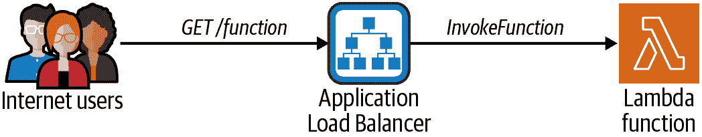
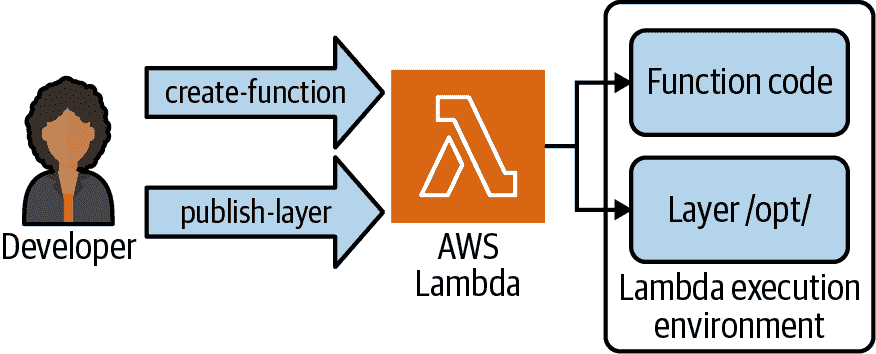
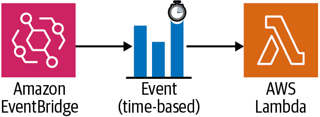
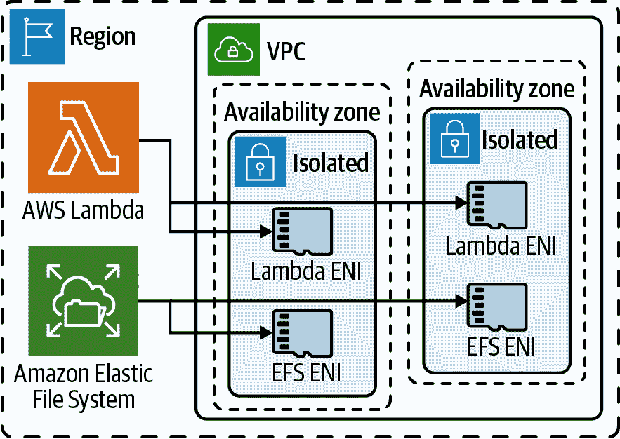
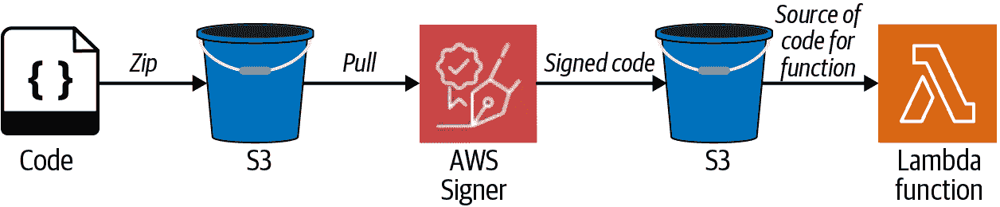
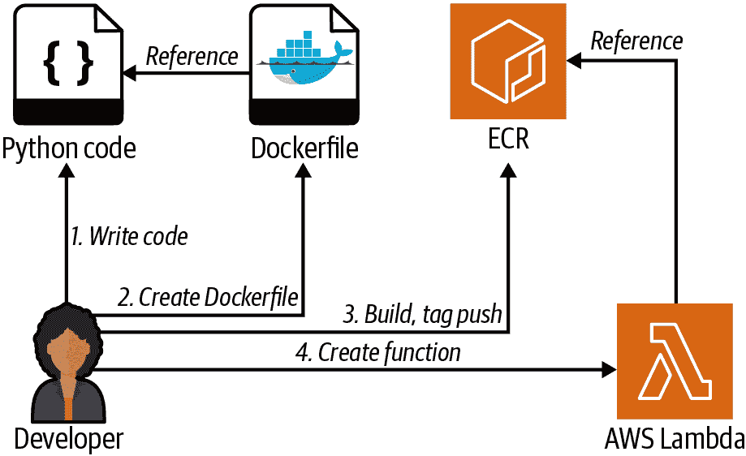
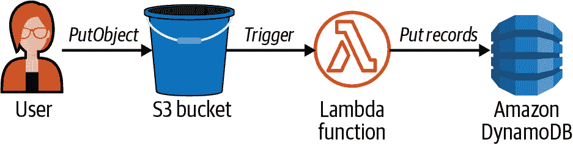
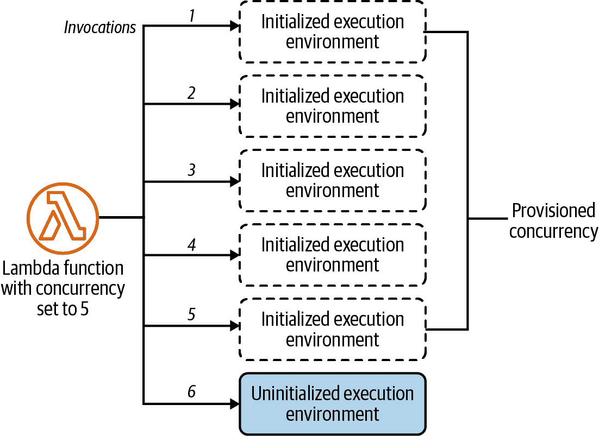
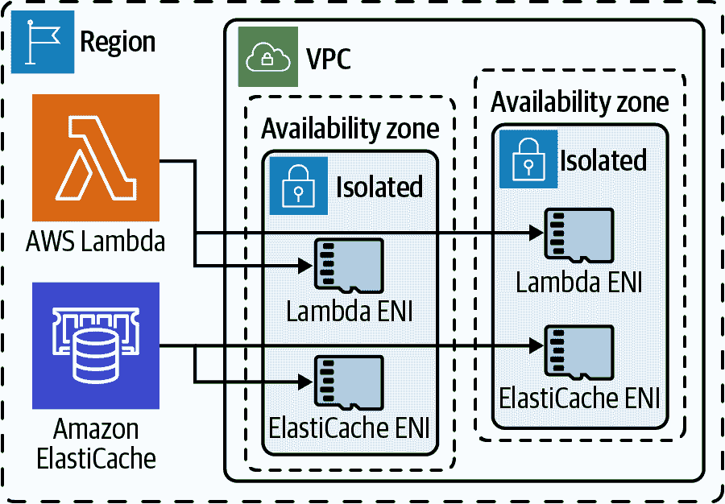

# 第 5 章 无服务器

## 5.0 简介

技术行业术语*无服务器*有时会导致困惑，因为服务器确实涉及与此执行模型相关的云服务。优势在于最终用户无需担心管理底层基础设施和平台。云提供商（在本例中为 AWS）负责所有管理、操作系统更新、可用性、容量等。

就 [AWS 上可用的“无服务器”服务](https://oreil.ly/5CIjp) 而言，有许多选项可供利用这些优势。以下是一些示例：

*   AWS Lambda 和 Amazon Fargate 用于计算
*   Amazon EventBridge、Amazon SNS、Amazon SQS 和 Amazon API Gateway 用于应用程序集成
*   Amazon S3、Amazon DynamoDB 和 Amazon Aurora Serverless 用于数据存储

AWS 上无服务器的主要优势如下：

**成本节约**：您只需为所用内容付费。

**可扩展性**：根据需要扩展；缩减以节省成本。

**减少管理**：无需部署服务器或管理系统。

**灵活性**：AWS Lambda 支持多种编程语言。


本章中的示例将帮助您探索多项归属于“Serverless（无服务器）”范畴的 AWS 服务。您将有机会通过挑战来扩展解决方案，并获得一些引领无服务器行业趋势的新服务的实践经验。

## 工作站配置

请遵循“CLI 配方的通用工作站设置步骤”来验证您的配置并设置所需的环境变量。然后，克隆本章代码仓库：

```
git clone https://github.com/AWSCookbook/Serverless
```

## 章节先决条件

### Lambda 函数执行的 IAM 角色

创建一个名为 `assume-role-policy.json` 的文件，内容如下（该文件已在章节仓库根目录下提供）：

```
{
  "Version": "2012-10-17",
  "Statement": [
    {
      "Effect": "Allow",
      "Principal": {
        "Service": "lambda.amazonaws.com"
      },
      "Action": "sts:AssumeRole"
    }
  ]
}
```

> **注意**
>
> 当您在 AWS Management Console 中创建 Lambda 函数并为执行角色选择“Create a new role from AWS policy templates”时，会自动创建一个类似的角色。

使用 `assume-role-policy.json` 文件中的语句创建 IAM 角色：

```
aws iam create-role --role-name AWSCookbookLambdaRole \
    --assume-role-policy-document file://assume-role-policy.json
```

将 `AWSLambdaBasicExecutionRole` IAM 托管策略附加到该 IAM 角色：

```
aws iam attach-role-policy --role-name AWSCookbookLambdaRole \
    --policy-arn arn:aws:iam::aws:policy/service-role/AWSLambdaBasicExecutionRole
```

## 5.1 配置 ALB 以调用 Lambda 函数

### 问题

您有一项需求：整个 Web 应用程序必须通过负载均衡器暴露在互联网上。您的应用程序架构包含无服务器函数。您需要某个函数能够响应特定 URL 路径的 HTTP 请求。

### 解决方案

授予 Elastic Load Balancing 服务调用 Lambda 函数的权限；然后创建一个 Lambda 函数。创建一个 ALB 目标组；然后将 Lambda 函数注册到该目标组。将目标组与 ALB 上的监听器关联。最后，添加一条监听器规则，将 `/function` 路径的流量导向 Lambda 函数（参见图 5-1）。



### 先决条件

*   具有两个可用区中公有子网及关联路由表的 VPC
*   一个 Application Load Balancer，包含以下内容：
    *   一个允许来自全球的 80 端口流量的关联安全组
    *   一个 80 端口的监听器
*   允许 Lambda 函数执行的 IAM 角色（在章节先决条件中提供）

### 准备工作

请遵循本示例文件夹中 [章节代码仓库](https://github.com/AWSCookbook/Serverless) 的步骤。

### 步骤

1.  压缩仓库中本示例目录下提供的函数代码。此代码将用于 Lambda 函数。您可以根据需要修改此代码，但我们已为您提供了可用的代码。例如，使用以下命令压缩代码：

    ```
    zip lambda_function.zip lambda_function.py
    ```

2.  创建一个响应 HTTP 请求的 Lambda 函数：

    ```
    LAMBDA_ARN=$(aws lambda create-function \
        --function-name AWSCookbook501Lambda \
        --runtime python3.8 \
        --package-type "Zip" \
        --zip-file fileb://lambda_function.zip \
        --handler lambda_function.lambda_handler --publish \
        --role \
        arn:aws:iam::$AWS_ACCOUNT_ID:role/AWSCookbookLambdaRole \
        --output text --query FunctionArn)
    ```

3.  创建一个目标类型设置为 `lambda` 的 ALB 目标组：

    ```
    TARGET_GROUP_ARN=$(aws elbv2 create-target-group \
        --name awscookbook501tg \
        --target-type lambda --output text \
        --query TargetGroups[0].TargetGroupArn)
    ```

4.  使用 `add-permission` 命令授予 Elastic Load Balancing 服务调用您的 Lambda 函数的权限：

    ```
    aws lambda add-permission \
        --function-name $LAMBDA_ARN \
        --statement-id load-balancer \
        --principal elasticloadbalancing.amazonaws.com \
        --action lambda:InvokeFunction \
        --source-arn $TARGET_GROUP_ARN
    ```

5.  使用 `register-targets` 命令将 Lambda 函数注册为目标：

    ```
    aws elbv2 register-targets \
        --target-group-arn $TARGET_GROUP_ARN \
        --targets Id=$LAMBDA_ARN
    ```

6.  修改 ALB 上 80 端口的监听器；然后创建一条规则，将目标为 `/function` 路径的流量转发到您的目标组：

    ```
    RULE_ARN=$(aws elbv2 create-rule \
        --listener-arn $LISTENER_ARN --priority 10 \
        --conditions Field=path-pattern,Values='/function' \
        --actions Type=forward,TargetGroupArn=$TARGET_GROUP_ARN \
        --output text --query Rules[0].RuleArn)
    ```

#### 验证检查

测试调用以验证请求 `/function` 时是否会调用 Lambda 函数：

```
curl -v $LOAD_BALANCER_DNS/function
```

### 清理

请遵循本示例文件夹中 [章节代码仓库](https://github.com/AWSCookbook/Serverless) 的步骤。

## 讨论

开发人员和软件架构师可以利用 Lambda 函数为大型系统中的某类事件提供编程式响应。这种计算类型最常用于函数负责一小单元工作时。AWS 于 2018 年增加了 [Application Load Balancers 调用 Lambda 函数](https://oreil.ly/R15DP) 的功能。

当最终用户请求 ALB 上的特定 URL 路径（由开发人员配置）时，ALB 可将请求传递给 Lambda 函数以处理响应。ALB 随后接收函数的输出，并将结果作为 HTTP 响应返回给最终用户。ALB 可为单个负载均衡器配置多个路径和目标，将部分流量发送给特定目标（Lambda 函数、容器、EC2 实例等）。ALB 还支持[使用标头值路由到 Lambda 函数](https://oreil.ly/ljYBe)。这种简单的架构具有极高的成本效益和可扩展性。

这种灵活性允许单个 ALB 处理应用程序的所有流量，并在构建需要通过 HTTP/HTTPS 暴露的系统时提供良好的构建模块。

### 挑战 1

添加一个响应 ALB 上另一路径的 Fargate 任务。

### 挑战 2

尝试使用 [Amazon API Gateway](https://aws.amazon.com/api-gateway) 在 Lambda 函数前进行代理。

## 5.2 使用 Lambda 层打包库

### 问题

您有使用外部库的 Python 代码，需要将其包含在无服务器函数部署中。

### 解决方案

创建一个文件夹并使用 `pip` 将 Python 包安装到该文件夹。然后，将该文件夹压缩为 `.zip` 文件，并使用该文件创建一个 Lambda 层供您的函数使用（参见图 5-2）。



### 先决条件

*   允许 Lambda 函数执行的 IAM 角色（在章节先决条件中提供）

### 步骤

1.  在本章仓库的根目录下，`cd` 到 `502-Packaging-Libraries-with-Lambda-Layers` 目录并执行后续步骤：

    ```
    cd 502-Packaging-Libraries-with-Lambda-Layers/
    ```

2.  压缩仓库中提供的 `lambda_function.py`：

    ```
    zip lambda_function.zip lambda_function.py
    ```

    您应该会看到类似以下的输出：

    ```
    updating: lambda_function.py (deflated 49%)
    ```

3.  创建一个我们将向其添加层的 Lambda 函数：


```
LAMBDA_ARN=$(aws lambda create-function \
    --function-name AWSCookbook502Lambda \
    --runtime python3.8 \
    --package-type "Zip" \
    --zip-file fileb://lambda_function.zip \
    --handler lambda_function.lambda_handler --publish \
    --role \
    arn:aws:iam::$AWS_ACCOUNT_ID:role/AWSCookbookLambdaRole \
    --output text --query FunctionArn)
```

4. 创建一个用于存放层内容的目录：

```
mkdir python
```

5. 使用 `pip` 将最新的 `requests` 模块安装到该目录：

```
pip install requests --target="./python"
```

您应该会看到类似以下的输出：

```
Collecting requests
  Using cached requests-2.26.0-py2.py3-none-any.whl (62 kB)
Collecting certifi>=2017.4.17
  Using cached certifi-2021.5.30-py2.py3-none-any.whl (145 kB)
Collecting idna<4,>=2.5
  Using cached idna-3.2-py3-none-any.whl (59 kB)
Collecting urllib3<1.27,>=1.21.1
  Using cached urllib3-1.26.7-py2.py3-none-any.whl (138 kB)
Collecting charset-normalizer~=2.0.0
  Using cached charset_normalizer-2.0.6-py3-none-any.whl (37 kB)
Installing collected packages: urllib3, idna, charset-normalizer, certifi, requests
Successfully installed certifi-2021.5.30 charset-normalizer-2.0.6 idna-3.2 requests-2.26.0 urllib3-1.26.7
```

6. 压缩该目录的内容：

```
zip -r requests-layer.zip ./python
```

您应该会看到类似以下的输出：

```
  adding: python/ (stored 0%)
  adding: python/bin/ (stored 0%)
  adding: python/bin/normalizer (deflated 28%)
  adding: python/requests-2.26.0.dist-info/ (stored 0%)
  adding: python/requests-2.26.0.dist-info/RECORD (deflated 55%)
  adding: python/requests-2.26.0.dist-info/LICENSE (deflated 65%)
  adding: python/requests-2.26.0.dist-info/WHEEL (deflated 14%)
  adding: python/requests-2.26.0.dist-info/top_level.txt (stored 0%)
  adding: python/requests-2.26.0.dist-info/REQUESTED (stored 0%)
  adding: python/requests-2.26.0.dist-info/INSTALLER (stored 0%)
  adding: python/requests-2.26.0.dist-info/METADATA (deflated 58%)
```

#### 注意

Lambda 层需要特定的文件夹结构。当您使用 `pip` 将 `requests` 模块安装到目录中的 Python 文件夹时，会创建此文件夹结构：

```
$ tree -L 1 python/
python/
├── bin
├── certifi
├── certifi-2020.12.5.dist-info
├── chardet
├── chardet-4.0.0.dist-info
├── idna
├── idna-2.10.dist-info
├── requests
├── requests-2.25.1.dist-info
├── urllib3
└── urllib3-1.26.4.dist-info

11 directories, 0 files
```

7. 发布层并设置一个环境变量以在后续步骤中使用：

```
LAYER_VERSION_ARN=$(aws lambda publish-layer-version \
    --layer-name AWSCookbook502RequestsLayer \
    --description "Requests layer" \
    --license-info "MIT" \
    --zip-file fileb://requests-layer.zip \
    --compatible-runtimes python3.8 \
    --output text --query LayerVersionArn)
```

8. 更新 Lambda 以使用您创建的层：

```
aws lambda update-function-configuration \
    --function-name AWSCookbook502Lambda \
    --layers $LAYER_VERSION_ARN
```

您应该会看到类似以下的输出：

```
{
  "FunctionName": "AWSCookbook502Lambda",
  "FunctionArn": "arn:aws:lambda:us-east-1:111111111111:function:AWSCookbook502Lambda",
  "Runtime": "python3.8",
  "Role": "arn:aws:iam::111111111111:role/AWSCookbookLambdaRole",
  "Handler": "lambda_function.lambda_handler",
  "CodeSize": 691,
  "Description": "",
  "Timeout": 3,
  "MemorySize": 128,
...
```

### 验证检查

测试 Lambda：

```
aws lambda invoke \
    --function-name AWSCookbook502Lambda \
    response.json && cat response.json
```

### 清理

按照 [章节代码仓库](https://github.com/AWSCookbook/Serverless) 中此配方文件夹内的步骤操作。

## 讨论

Lambda 层可用于扩展默认 Lambda 运行时中可用的包，也可用于为您的函数提供自定义运行时。默认运行时与 Amazon Linux 相关联。自定义运行时可以在 Amazon Linux 之上开发，以支持您自己的编程语言需求。请参阅此 [教程](https://oreil.ly/XTWHX) 以发布自定义运行时。

在本配方中，您将 Python `requests` 模块打包为一个层，并部署了一个使用该模块的 Python 函数。层可被多个函数使用、与其他 AWS 账户共享，还可以进行版本控制，以便您部署和测试层的新版本，而不会影响正在为您的函数使用的现有版本。

### 挑战

创建另一个使用相同层的 Lambda 函数。

# 5.3 按计划调用 Lambda 函数

## 问题

您需要每分钟运行一次无服务器函数。

## 解决方案

向您的 Lambda 函数添加权限，以允许 EventBridge 服务调用该函数。然后配置一个 EventBridge 规则，使用针对一分钟的计划表达式，将您的函数作为目标（请参见图 5-3）。



### 先决条件

*   您想要触发的 Lambda 函数
*   允许 Lambda 函数执行的 IAM 角色（在章节先决条件中提供）

### 准备

按照 [章节代码仓库](https://github.com/AWSCookbook/Serverless) 中此配方文件夹内的步骤操作。

### 步骤

1. 创建一个具有每分钟速率的计划表达式的事件规则：

```
RULE_ARN=$(aws events put-rule --name "EveryMinuteEvent" \
    --schedule-expression "rate(1 minute)")
```

#### 注意

定义基于时间的事件规则时，您可以对计划表达式使用速率表达式和 [Cron 格式](https://crontab.guru)。您创建的规则的 Cron 表达式语法如下所示：

```
RULE_ARN=$(aws events put-rule --name "EveryMinuteEvent" \
--schedule-expression "cron(* * * * ? *)")
```

有关计划表达式的更多信息，请参阅此 [支持文档](https://oreil.ly/K7e8Z)。

2. 向 Lambda 函数添加权限，以便 EventBridge 服务可以调用它：

```
aws lambda add-permission --function-name $LAMBDA_ARN \
    --action lambda:InvokeFunction --statement-id events \
    --principal events.amazonaws.com
```

您应该会看到类似以下的输出：

```
{
  "Statement": "{\"Sid\":\"events\",\"Effect\":\"Allow\",\"Principal\":{\"Service\":\"events.amazonaws.com\"},\"Action\":\"lambda:InvokeFunction\",\"Resource\":\"arn:aws:lambda:us-east-1:111111111111:function:AWSCookbook503Lambda\"}"
}
```

3. 将您的 Lambda 函数作为目标添加到您创建的规则中：

```
aws events put-targets --rule EveryMinuteEvent \
    --targets "Id"="1","Arn"="$LAMBDA_ARN"
```

您应该会看到类似以下的输出：

```
{
  "FailedEntryCount": 0,
  "FailedEntries": []
}
```

#### 注意

有许多可用的目标选项。有关最新列表，请查看 [文档](https://oreil.ly/Rggow)。

#### 验证检查

跟踪 CloudWatch Logs 日志组，以观察函数每 60 秒被调用一次：

```
aws logs tail "/aws/lambda/AWSCookbook503Lambda" --follow --since 10s
```

#### 注意

您可能需要等待片刻以创建日志组。如果日志组不存在，您将收到以下错误：

```
An error occurred (ResourceNotFoundException) when calling the FilterLogEvents operation: The specified log group does not exist.
```

您应该会看到类似以下的输出：


```
$ aws logs tail "/aws/lambda/AWSCookbook503Lambda" --follow --since 10s
2021-06-12T21:17:30.605000+00:00 2021/06/12/[$LATEST]4d1335bf8b0846938cb585871db38374 START RequestId:
685481eb-9279-4007-854c-f99289bf9609 Version: $LATEST
2021-06-12T21:17:30.607000+00:00 2021/06/12/[$LATEST]4d1335bf8b0846938cb585871db38374 AWS Cookbook Lambda
function run at 2021-06-12 21:17:30.607500
2021-06-12T21:17:30.608000+00:00 2021/06/12/[$LATEST]4d1335bf8b0846938cb585871db38374 END RequestId:
685481eb-9279-4007-854c-f99289bf9609
2021-06-12T21:17:30.608000+00:00 2021/06/12/[$LATEST]4d1335bf8b0846938cb585871db38374 REPORT RequestId:
685481eb-9279-4007-854c-f99289bf9609    Duration: 0.94 ms    Billed Duration: 1 ms    Memory Size: 128 MB
Max Memory Used: 51 MB
...
```

您可以按 `Ctrl-C` 退出 tail 会话。

###### 注意

请注意，后续运行会从您将 Lambda 函数添加为事件规则目标的时间开始，以一分钟为增量进行。

### 清理

按照 [章节代码仓库](https://github.com/AWSCookbook/Serverless) 中本配方文件夹内的步骤操作。

## 讨论

您可能希望按计划运行函数的原因有很多：

*   检查股票价格
*   检查天气
*   启动计划进程
*   安排 EC2 启动和停止

无需预置资源即可按计划运行无服务器函数，这使得成本和管理开销能够降至最低。无需更新服务器，且在空闲时也无需为其付费。

### 挑战

暂停然后启用事件规则。提示如下：

```
aws events disable-rule --name "EveryMinuteEvent"
aws events enable-rule --name "EveryMinuteEvent"
```

###### 注意

EventBridge 以前称为 [Amazon CloudWatch Events](https://oreil.ly/K4ElM)。EventBridge 现在是安排事件的首选方式，并使用与 CloudWatch Events 相同的 API。

当您需要让一项 AWS 服务与另一项 AWS 服务交互时，您需要显式授予权限。在此情况下，需要授予 EventBridge 权限以使用 `aws lambda add-permission` 命令调用 Lambda 函数。

# 5.4 配置 Lambda 函数以访问 EFS 文件系统

## 问题

您有一个现有的网络共享，服务器可以访问它，但您希望能够使用无服务器函数处理其上的文件。

## 解决方案

您将创建一个 Lambda 函数并将 EFS 文件系统挂载到它上（请参阅 图 5-4）。



### 先决条件

*   具有两个可用区中隔离子网及关联路由表的 VPC
*   包含您想要访问的内容的 EFS 文件系统
*   允许 Lambda 函数执行的 IAM 角色（在章节先决条件中提供）

### 准备工作

按照 [章节代码仓库](https://github.com/AWSCookbook/Serverless) 中本配方文件夹内的步骤操作。

### 步骤

1. 为 Lambda 函数创建一个新的安全组：

    ```
    LAMBDA_SG_ID=$(aws ec2 create-security-group \
        --group-name AWSCookbook504LambdaSG \
        --description "Lambda Security Group" --vpc-id $VPC_ID \
        --output text --query GroupId)
    ```

2. 向 EFS 文件系统的安全组添加一条入站规则，允许来自 Lambda 函数安全组的 TCP 端口 2049 访问：

    ```
    aws ec2 authorize-security-group-ingress \
        --protocol tcp --port 2049 \
        --source-group $LAMBDA_SG_ID \
        --group-id $EFS_SECURITY_GROUP
    ```

    您应该会看到类似以下的输出：

    ```json
    {
      "Return": true,
      "SecurityGroupRules": [
        {
          "SecurityGroupRuleId": "sgr-0f837d0b090ba38de",
          "GroupId": "sg-0867c2c4ca6f4ab83",
          "GroupOwnerId": "611652777867",
          "IsEgress": false,
          "IpProtocol": "tcp",
          "FromPort": 2049,
          "ToPort": 2049,
          "ReferencedGroupInfo": {
            "GroupId": "sg-0c71fc94eb6cd1ae3"
          }
        }
      ]
    }
    ```

3. 使用提供的 `assume-role-policy.json` 文件中的语句，通过此命令创建 IAM 角色：

    ```
    aws iam create-role --role-name AWSCookbook504Role \
        --assume-role-policy-document file://assume-role-policy.json
    ```

4. 您需要赋予 Lambda 函数在 VPC 中执行的能力，因此将 `AWSLambdaVPCAccessExecutionRole` 的 IAM 托管策略附加到 IAM 角色：

    ```
    aws iam attach-role-policy --role-name AWSCookbook504Role \
        --policy-arn arn:aws:iam::aws:policy/service-role/AWSLambdaVPCAccessExecutionRole
    ```

5. 将仓库中提供的 `lambda_function.py` 压缩成 zip 文件：

    ```
    zip lambda_function.zip lambda_function.py
    ```

6. 创建一个 Lambda 函数，指定 EFS 文件系统的 `ACCESS_POINT_ARN`：

    ```
    LAMBDA_ARN=$(aws lambda create-function \
        --function-name AWSCookbook504Lambda \
        --runtime python3.8 \
        --package-type "Zip" \
        --zip-file fileb://lambda_function.zip \
        --handler lambda_function.lambda_handler --publish \
        --role \
        arn:aws:iam::$AWS_ACCOUNT_ID:role/AWSCookbook504Role \
        --file-system-configs Arn="$ACCESS_POINT_ARN",LocalMountPath="/mnt/efs" \
        --output text --query FunctionArn \
        --vpc-config SubnetIds=${ISOLATED_SUBNETS},SecurityGroupIds=${LAMBDA_SG_ID})
    ```

7. 使用此命令确定 Lambda 函数何时进入活动状态（这可能需要片刻）：

    ```
    aws lambda get-function --function-name $LAMBDA_ARN \
        --output text --query Configuration.State
    ```

#### 验证检查

执行 Lambda 函数以显示文件内容：

```
aws lambda invoke \
    --function-name $LAMBDA_ARN \
    response.json && cat response.json
```

### 清理

按照 [章节代码仓库](https://github.com/AWSCookbook/Serverless) 中本配方文件夹内的步骤操作。

## 讨论

作为开发人员或软件架构师，当您将无服务器计算连接到无服务器持久存储（包括文件系统和数据库）时，您开始看到无服务器技术的优势。在应用程序中使用这些类型的服务时，计算和存储的运维开销会大幅降低。您可以按需预置和扩展存储，同时依靠 AWS 为您管理底层基础设施。虽然许多应用程序将使用对象式存储服务（如 Amazon S3），但其他应用程序更适合某种更传统的文件式存储服务。正如本配方所示，结合 Lambda 和 EFS 可以轻松解决此问题。

通过将 Amazon EFS 与 AWS Lambda 集成，您可以构建如下解决方案：

*   应用程序的持久存储
*   维护活动
*   事件驱动通知
*   事件驱动文件处理

这些服务的全托管性质和按使用付费特性，允许设计、构建、部署和运行具有成本效益的现代应用程序架构。

### 挑战 1

创建另一个有权访问同一 EFS 文件系统的 Lambda 函数。

### 挑战 2

创建一个按计划间隔运行的 Lambda 函数，以检测过去 30 天内是否有任何文件发生了更改。

## 另请参阅

配方 5.9

# 5.5 使用 AWS Signer 在 Lambda 中运行受信任的代码

## 问题

您需要确保部署在您环境中的无服务器函数正在运行来自受信任源的代码。您需要验证代码的完整性，并确信代码在签名后未被修改。

## 解决方案


## 5.5 Lambda 的代码签名

创建签名配置文件，然后使用 `AWS Signer` 为您的代码启动签名作业。最后，部署一个引用您的签名配置并使用已签名代码的 `Lambda` 函数（请参阅图 5-5）。



### 先决条件

*   启用了版本控制且已复制源代码的 S3 存储桶
*   供 `AWS Signer` 用作目标的 S3 存储桶
*   允许 `Lambda` 函数执行的 IAM 角色（在章节先决条件中提供）

### 准备工作

遵循 [章节代码仓库](https://github.com/AWSCookbook/Serverless) 中此配方文件夹内的步骤。

### 步骤

1.  获取您将要使用的 S3 中对象的版本。这是要在 `Lambda` 函数中使用的代码的 zip 包。启动签名作业时您将需要此信息：

    ```
    OBJ_VER_ID=$(aws s3api list-object-versions \
        --bucket awscookbook505-src-$RANDOM_STRING \
        --prefix lambda_function.zip \
        --output text --query Versions[0].VersionId)
    ```

2.  创建签名配置文件：

    ```
    SIGNING_PROFILE_ARN=$(aws signer put-signing-profile \
        --profile-name AWSCookbook505_$RANDOM_STRING \
        --platform AWSLambda-SHA384-ECDSA \
        --output text --query arn)
    ```

    ###### 注意

    您可以通过运行以下命令找到可用签名平台的列表：

    ```
    aws signer list-signing-platforms
    ```

3.  创建一个引用签名配置文件的 `Lambda` 代码签名配置：

    ```
    CODE_SIGNING_CONFIG_ARN=$(aws lambda create-code-signing-config \
        --allowed-publishers SigningProfileVersionArns=$SIGNING_PROFILE_ARN \
        --output text --query CodeSigningConfig.CodeSigningConfigArn)
    ```

4.  启动签名作业：

    ```
    SIGNING_JOB_ID=$(aws signer start-signing-job \
        --source 's3={bucketName=awscookbook505-src-'"${RANDOM_STRING}"',key=lambda_function.zip,version='"$OBJ_VER_ID"'}' \
        --destination 's3={bucketName=awscookbook505-dst-'"${RANDOM_STRING}"',prefix=signed-}' \
        --profile-name AWSCookbook505_$RANDOM_STRING \
        --output text --query jobId)
    ```

    等待片刻，然后验证签名作业是否成功：

    ```
    aws signer list-signing-jobs --status Succeeded
    ```

    您应该会看到类似以下的输出：

    ```
    {
      "jobs": [
      {
        "jobId": "efd392ae-2503-4c78-963f-8f40a58d770f",
        "source": {
        "s3": {
          "bucketName": "awscookbook505-src-<<unique>>",
          "key": "lambda_function.zip",
          "version": "o.MffnpzjBmaBR1yzvoti0AnluovMtMf"
        }
        },
        "signedObject": {
        "s3": {
          "bucketName": "awscookbook505-dst-<<unique>>",
          "key": "signed-efd392ae-2503-4c78-963f-8f40a58d770f.zip"
        }
        },
        "signingMaterial": {},
        "createdAt": "2021-06-13T11:52:51-04:00",
        "status": "Succeeded",
    ...
    ```

5.  检索生成的已签名代码的 S3 对象键：

    ```
    OBJECT_KEY=$(aws s3api list-objects-v2 \
        --bucket awscookbook505-dst-$RANDOM_STRING \
        --prefix 'signed-' \
        --output text --query Contents[0].Key)
    ```

6.  创建一个使用已签名代码的 `Lambda` 函数：

    ```
    LAMBDA_ARN=$(aws lambda create-function \
        --function-name AWSCookbook505Lambda \
        --runtime python3.8 \
        --package-type "Zip" \
        --code S3Bucket=awscookbook505-dst-$RANDOM_STRING,S3Key=$OBJECT_KEY \
        --code-signing-config-arn $CODE_SIGNING_CONFIG_ARN \
        --handler lambda_function.lambda_handler --publish \
        --role \
        arn:aws:iam::$AWS_ACCOUNT_ID:role/AWSCookbookLambdaRole \
        --output text --query FunctionArn)
    ```

7.  使用此命令确定 `Lambda` 函数何时进入活动状态：

    ```
    aws lambda get-function --function-name $LAMBDA_ARN \
        --output text --query Configuration.State
    ```

#### 验证检查

在控制台中查看您的 `Lambda` 函数。请注意，您无法编辑代码。您将看到消息：“您的函数包含已签名代码，无法内联编辑。”

### 清理

遵循 [章节代码仓库](https://github.com/AWSCookbook/Serverless) 中此配方文件夹内的步骤。

## 讨论

注重安全的管理员和应用程序开发人员可以使用此方法，通过强制执行仅允许在给定环境中部署受信任代码的规则，来实施 DevSecOps 策略。通过使用 `AWS Signer`，您可以确保在环境中仅运行受信任的代码。这有助于满足合规要求，并提高应用程序的安全态势。

通过使用 `AWS Signer` 生成的数字签名，您的代码将根据加密指纹进行验证，并且可以应用强制策略来限制代码的部署和执行。这种功能为您的安全和合规治理从“被动”控制向“预防性”控制的战略转变铺平了道路。

### 挑战 1

修改源代码，对其进行签名，并更新 `Lambda` 函数。

### 挑战 2

您可以将 `CodeSigningPolicies` 从 `Warn` 更改为 `Enforce`——如果签名验证检查不成功，这将阻止部署。部署一个利用此功能的函数，以确保您在环境中仅运行已签名的代码：

```
"CodeSigningPolicies": {
             "UntrustedArtifactOnDeployment": "Warn"
    },
```

## 5.6 将 Lambda 代码打包在容器镜像中

### 问题

您希望使用现有的基于容器的开发流程和工具来打包无服务器代码。

### 解决方案

创建一个 `Docker` 镜像并将其推送到 `Amazon Elastic Container Registry (ECR)` 存储库。创建一个 `package-type` 为 `Image` 且代码引用 `ECR` 中镜像 URL 的 `Lambda` 函数（请参阅图 5-6）。



### 先决条件

*   `ECR` 存储库
*   允许 `Lambda` 函数执行的 IAM 角色（在章节先决条件中提供）
*   已安装 `Docker`

### 准备工作

遵循 [章节代码仓库](https://github.com/AWSCookbook/Serverless) 中此配方文件夹内的步骤。

### 步骤

1.  获取 `ECR` 登录信息并传递给 `Docker`：

    ```
    aws ecr get-login-password | docker login --username AWS \
        --password-stdin $AWS_ACCOUNT_ID.dkr.ecr.$AWS_REGION.amazonaws.com
    ```

    您应该会看到类似以下的输出：

    ```
    Login Succeeded
    ```

2.  创建一个名为 `app.py` 的文件，包含您想要在 `Lambda` 中执行的以下代码（仓库中提供了该文件）：

    ```
    import sys
    def handler(event, context):
        return 'Hello from the AWS Cookbook ' + sys.version + '!'
    ```

3.  创建一个名为 `Dockerfile` 的文件，包含以下内容，该内容基于 `AWS` 提供的基础镜像构建并引用您的 `Python` 代码（仓库中提供了该文件）：

    ```
    FROM public.ecr.aws/lambda/python:3.8
    
    COPY app.py   ./
    CMD ["app.handler"]
    ```

4.  在存在 `Dockerfile` 和 `app.py` 文件的文件夹中，构建容器镜像。该过程将需要几分钟才能完成：

    ```
    docker build -t aws-cookbook506-image .
    ```

    您应该会看到类似以下的输出：

    ```
    [+] Building 19.1s (4/6)
     => [internal] load build definition from Dockerfile
        0.0s
     => => transferring dockerfile: 36B
        0.0s
     => [internal] load .dockerignore
        0.0s
     => => transferring context: 2B 
        0.0s
     => [internal] load metadata for public.ecr.aws/lambda/python:3.8
        2.2s
     => [internal] load build context 
        0.0s
    ...
    ```

5.  为镜像添加一个额外的标签，以便将其推送到 `ECR`：


```
docker tag \
    aws-cookbook506-image:latest \
    $AWS_ACCOUNT_ID.dkr.ecr.$AWS_REGION.amazonaws.com/aws-cookbook-506repo:latest
```

6. 将镜像推送到 ECR 存储库。该过程应在几分钟内完成：

```
docker push \
    $AWS_ACCOUNT_ID.dkr.ecr.$AWS_REGION.amazonaws.com/aws-cookbook-506repo:latest
```

您应该会看到类似以下的输出：

```
The push refers to repository [111111111111.dkr.ecr.us-east-1.amazonaws.com/aws-cookbook-506repo]
5efc5a3f50dd: Pushed
a1f8e0568112: Pushing [=====>                               ]    10.3MB/98.4MB
bcf453d1de13: Pushing [>                                    ]  3.244MB/201.2MB
f6ae2f36d5d7: Pushing [==============================>      ]  4.998MB/8.204MB
5959c8f9752b: Pushed
3e5452c20c48: Pushed
9c4b6b04eac3: Pushing [>
```

7. 通过指定 `--code` 值为 Docker 镜像的 `ImageUri`，使用 Docker 镜像创建 Lambda 函数：

```
LAMBDA_ARN=$(aws lambda create-function \
    --function-name AWSCookbook506Lambda \
    --package-type "Image" \
    --code ImageUri=$AWS_ACCOUNT_ID.dkr.ecr.$AWS_REGION.amazonaws.com/aws-cookbook-506repo:latest \
    --role \
    arn:aws:iam::$AWS_ACCOUNT_ID:role/AWSCookbookLambdaRole \
    --output text --query FunctionArn)
```

### 注意

创建使用容器镜像的函数时，`--runtime` 和 `--handler` 参数既非必需也不受支持。

使用此命令确定 Lambda 函数何时进入活动状态：

```
aws lambda get-function --function-name $LAMBDA_ARN \
    --output text --query Configuration.State
```

## 验证检查

在 AWS 控制台中，导航到 **Lambda→函数** 菜单。请注意，您的函数的“包类型”为 `Image`。

调用函数并查看响应：

```
aws lambda invoke \
    --function-name $LAMBDA_ARN response.json && cat response.json
```

您应该会看到类似以下的输出：

```
{
  "StatusCode": 200,
  "ExecutedVersion": "$LATEST"
}
"Hello from the AWS Cookbook 3.8.8 (default, Mar 8 2021, 20:13:42) \n[GCC 7.3.1 20180712 (Red Hat 7.3.1-12)]!"
```

## 清理

按照 [章节代码仓库](https://github.com/AWSCookbook/Serverless) 中此配方文件夹中的步骤操作。

## 讨论

如果您的应用程序代码打包在容器镜像中，AWS Lambda 提供了将函数代码打包在容器镜像内的能力。这允许与您可能已经在使用的现有构建、测试、打包和部署管道保持一致。您可以为函数打包高达 10 GB 大小的应用程序代码。您可以使用 AWS 提供的基础镜像或创建自己的镜像，只要您包含 Lambda 运行时环境所需的 [运行时接口客户端](https://oreil.ly/N4wd7) 即可。

您可以将容器镜像存储在 Amazon ECR 上，并且您的函数必须与存储容器镜像的 ECR 存储库位于同一账户中。

## 挑战

更新应用程序代码，创建新镜像，将其推送到 ECR，并更新 Lambda 函数。

# 5.7 使用 Lambda 自动将 CSV 从 S3 导入 DynamoDB

## 问题

当文件上传到 S3 时，您需要将数据从 S3 加载到 DynamoDB。

## 解决方案

使用 Lambda 函数将 S3 数据加载到 DynamoDB，并配置 S3 通知，指定在 `S3:PutObject` 事件上触发 Lambda 函数（请参见 图 5-7）。



### 步骤

1. 在章节仓库中导航到此配方的目录：

```
cd 507-Importing-CSV-to-DynamoDB-from-S3
```

2. 创建 DynamoDB 表：

```
aws dynamodb create-table \
    --table-name 'AWSCookbook507' \
    --attribute-definitions 'AttributeName=UserID,AttributeType=S' \
    --key-schema 'AttributeName=UserID,KeyType=HASH' \
    --sse-specification 'Enabled=true,SSEType=KMS' \
    --provisioned-throughput \
    'ReadCapacityUnits=5,WriteCapacityUnits=5'
```

3. 设置一个唯一后缀用于 S3 存储桶名称：

```
RANDOM_STRING=$(aws secretsmanager get-random-password \
    --exclude-punctuation --exclude-uppercase \
    --password-length 6 --require-each-included-type \
    --output text \
    --query RandomPassword)
```

4. 创建 S3 存储桶：

```
aws s3api create-bucket --bucket awscookbook507-$RANDOM_STRING
```

5. 创建一个允许使用 S3 和 DynamoDB 的 Lambda 函数角色（仓库中提供了文件）：

```
aws iam create-role --role-name AWSCookbook507Lambda \
    --assume-role-policy-document file://assume-role-policy.json
```

6. 将 `AmazonS3ReadOnlyAccess` 的 IAM 托管策略附加到 IAM 角色：

```
aws iam attach-role-policy --role-name AWSCookbook507Lambda \
    --policy-arn arn:aws:iam::aws:policy/AmazonS3ReadOnlyAccess
```

7. 将 `AmazonDynamoDBFullAccess` 的 IAM 托管策略附加到 IAM 角色：

```
aws iam attach-role-policy --role-name AWSCookbook507Lambda \
    --policy-arn arn:aws:iam::aws:policy/AmazonDynamoDBFullAccess
```

### 注意

最好将 Lambda 函数权限限定在特定的 DynamoDB 表资源上，而不是使用 `AmazonDynamoDBFullAccess`（此处为简单起见使用了它）。有关如何创建更严格范围权限的详细信息，请参见 配方 1.2。

8. 将 `AWSLambdaBasicExecutionRole` IAM 托管策略附加到 IAM 角色：

```
aws iam attach-role-policy --role-name AWSCookbook507Lambda \
    --policy-arn arn:aws:iam::aws:policy/service-role/AWSLambdaBasicExecutionRole
```

9. 压缩函数代码：

```
zip lambda_function.zip lambda_function.py
```

10. 使用提供的代码并指定代码创建 Lambda 函数：

```
LAMBDA_ARN=$(aws lambda create-function \
    --function-name AWSCookbook507Lambda \
    --runtime python3.8 \
    --package-type "Zip" \
    --zip-file fileb://lambda_function.zip \
    --handler lambda_function.lambda_handler --publish \
    --environment Variables={bucket=awscookbook507-$RANDOM_STRING} \
    --role \
    arn:aws:iam::$AWS_ACCOUNT_ID:role/AWSCookbook507Lambda \
    --output text --query FunctionArn)
```

11. 授予 S3 服务调用 Lambda 函数的权限：

```
aws lambda add-permission --function-name $LAMBDA_ARN \
    --action lambda:InvokeFunction --statement-id s3invoke \
    --principal s3.amazonaws.com
```

12. 创建 `notification-template.json` 文件，用作当您的文件 (`sample_data.csv`) 上传时自动触发 Lambda 函数的事件定义。仓库中提供了一个可用的文件：

```
{
  "LambdaFunctionConfigurations": [
    {
      "Id": "awscookbook507event",
      "LambdaFunctionArn": "LAMBDA_ARN",
      "Events": [
        "s3:ObjectCreated:*"
      ],
      "Filter": {
        "Key": {
          "FilterRules": [
            {
              "Name": "prefix",
              "Value": "sample_data.csv"
            }
          ]
        }
      }
    }
  ]
}
```

13. 您可以使用 `sed` 命令将提供的 `notification-template.json` 文件中的值替换为您创建的环境变量：

```
sed -e "s/LAMBDA_ARN/${LAMBDA_ARN}/g" \
    notification-template.json > notification.json
```

14. 配置 S3 存储桶通知设置以触发 Lambda 函数（单行配置）。`NotificationConfiguration→LambdaConfigurations→Lambda ARN:`


```
aws s3api put-bucket-notification-configuration \
    --bucket awscookbook507-$RANDOM_STRING \
    --notification-configuration file://notification.json
```

15. 上传文件到 S3 以触发导入：

```
aws s3 cp ./sample_data.csv s3://awscookbook507-$RANDOM_STRING
```

### 验证检查

在 DynamoDB 控制台查看结果，或使用此 CLI 命令扫描表：

```
aws dynamodb scan --table-name AWSCookbook507
```

### 注意

DynamoDB 的一大特性是它提供了 AWS API 端点，以便您的应用程序通过 AWS SDK 轻松进行 CRUD 操作。

### 清理

按照 [章节代码仓库](https://github.com/AWSCookbook/Serverless) 中此配方文件夹内的步骤操作。

### 讨论

您可以将 AWS Lambda 和 Amazon DynamoDB 结合使用，以构建具有大规模可扩展数据库持久性的应用程序，同时将所需的运营开销降至最低。希望构建应用程序而无需担心服务器基础设施的软件架构师和开发人员可能会发现将这两项服务结合使用很有用。

### 警告

在撰写本文时，Lambda 函数[会在 900 秒后超时](https://oreil.ly/MnJNV)。这可能会导致大型 CSV 文件出现问题，或者 DynamoDB 表没有足够的写入容量。

事件驱动应用程序也是在 AWS 上构建现代云原生应用程序的一个重要概念。当您创建 `notification.json` 文件时，您指定了 Lambda 函数和 S3 存储桶，以及一个用于监视上传的键模式，以便在对象被放入存储桶时触发 Lambda 函数。使用事件驱动架构有助于最大限度地降低运行应用程序相关的成本和复杂性，因为函数逻辑仅在需要时运行。

### 挑战 1

向 `sample_data.csv` 文件添加一些新数据，从存储桶中删除该文件，然后重新上传该文件以触发新的导入。请注意，现有数据将保留，新数据将被添加。

### 挑战 2

更改 S3 通知和 Lambda 函数，以允许在解决方案中使用其他文件名。

### 挑战 3

为您的 Lambda 函数创建一个细粒度的 IAM 策略，将函数授予的 DynamoDB 表访问权限缩小到最小范围。

## 5.8 使用预置并发减少 Lambda 启动时间

### 问题

您需要确保对无服务器函数的预定数量（五次）调用尽可能快。您需要消除与冷启动相关的任何延迟。

### 解决方案

创建一个 Lambda 函数并将函数并发设置为 5（请参阅图 5-8）。



#### 先决条件

*   允许 Lambda 函数执行的 IAM 角色（在章节先决条件中提供）

#### 步骤

1.  创建一个名为 `lambda_function.py` 的文件，内容如下（仓库中提供了该文件）：

```
from datetime import datetime
import time

def lambda_handler(event, context):
    time.sleep(5)
    print('AWS Cookbook Function run at {}'.format(str(datetime.now())))
```

2.  压缩函数代码：

```
zip lambda_function.zip lambda_function.py
```

3.  创建 Lambda 函数：

```
aws lambda create-function \
    --function-name AWSCookbook508Lambda \
    --runtime python3.8 \
    --package-type "Zip" \
    --zip-file fileb://lambda_function.zip \
    --handler lambda_function.lambda_handler --publish \
    --timeout 20 \
    --role \
    arn:aws:iam::$AWS_ACCOUNT_ID:role/AWSCookbookLambdaRole
```

4.  使用此命令确定 Lambda 函数何时进入活动状态：

```
aws lambda get-function --function-name AWSCookbook509Lambda \
    --output text --query Configuration.State
```

#### 注意

[Lambda 函数别名](https://oreil.ly/8vXHA)允许您引用函数的特定版本。每个 Lambda 函数可以有一个或多个别名。初始别名名为 `LATEST`。

5.  为 Lambda 函数配置预置并发：

```
aws lambda put-provisioned-concurrency-config \
    --function-name AWSCookbook508Lambda \
    --qualifier LATEST \
    --provisioned-concurrent-executions 5
```

#### 验证检查

连续调用该函数六次以查看限制被触发：

```
aws lambda invoke --function-name AWSCookbook508Lambda response.json &
aws lambda invoke --function-name AWSCookbook508Lambda response.json
```

#### 注意

您部署的 Lambda 函数需要并行运行，以演示预置并发功能的能力。您可能需要编写一个简单的脚本，并行多次运行此命令，以证明已启用预置并发。

#### 清理

按照 [章节代码仓库](https://github.com/AWSCookbook/Serverless) 中此配方文件夹内的步骤操作。

### 讨论

您的代码执行环境预配由 Lambda 服务为您处理。这是它作为 AWS 上的全托管服务的一个优势。由于执行环境是按需预配的，因此需要少量时间为您预配此环境。这被称为 `cold start`（冷启动）。Lambda 会在一段时间内保持您的执行环境已预配（或“热”状态），以便在您的函数再次被调用时能够快速启动。当您需要函数快速响应并实现更高并发时，可以避免冷启动，并使用预置并发来保持多个执行环境副本处于“热”状态。

一些开发人员和软件架构师需要构建具有以毫秒为单位的时间敏感型需求的解决方案，用于基于微服务的应用程序。当您使用 Lambda 预置并发时，可以将函数被调用时所需的启动时间降至最低。

#### 挑战 1

在 Lambda 函数前配置 API Gateway，并使用 [bees with machine guns](https://oreil.ly/EmxSn) 或 [ApacheBench](https://oreil.ly/3i7WV) 等工具模拟用户负载。

#### 挑战 2

配置应用程序自动扩展，根据时间和/或性能指标（例如响应时间）修改 Lambda 函数的预置并发。

## 5.9 使用 Lambda 访问 VPC 资源

### 问题

您需要一个无服务器函数来访问在 VPC 中拥有端点的 ElastiCache 集群。

### 解决方案

创建一个具有 Redis 客户端连接和打包的 Lambda 函数，并指定 VPC 子网和安全组。然后创建 ElastiCache 子网组和 ElastiCache 集群。调用 Lambda 并将集群端点传递给函数进行测试（请参阅图 5-9）。



#### 先决条件

*   允许 Lambda 函数执行的 IAM 角色（在章节先决条件中提供）

#### 准备

按照 [章节代码仓库](https://github.com/AWSCookbook/Serverless) 中此配方文件夹内的步骤操作。

#### 步骤

1.  您需要赋予 Lambda 函数在 VPC 中执行的能力，因此请将 `AWSLambdaVPCAccess` 的 IAM 托管策略附加到 IAM 角色（在章节先决条件中创建）：

```
aws iam attach-role-policy --role-name AWSCookbookLambdaRole \
    --policy-arn arn:aws:iam::aws:policy/service-role/AWSLambdaVPCAccessExecutionRole
```

2.  从 Python 包索引 (PyPI) 将 Redis Python 包安装到当前目录：

```
pip install redis -t .
```

3.  压缩函数代码：

```
zip -r lambda_function.zip lambda_function.py redis*
```

4.  为 Lambda 创建安全组：


```
LAMBDA_SG_ID=$(aws ec2 create-security-group \
    --group-name Cookbook509LambdaSG \
    --description "Lambda Security Group" --vpc-id $VPC_ID \
    --output text --query GroupId)
```

5. 创建一个响应 HTTP 请求的 Lambda 函数：

```
LAMBDA_ARN=$(aws lambda create-function \
    --function-name AWSCookbook509Lambda \
    --runtime python3.8 \
    --package-type "Zip" \
    --zip-file fileb://lambda_function.zip \
    --handler lambda_function.lambda_handler --publish \
    --role arn:aws:iam::$AWS_ACCOUNT_ID:role/AWSCookbookLambdaRole \
    --output text --query FunctionArn \
    --vpc-config SubnetIds=${TRIMMED_ISOLATED_SUBNETS},SecurityGroupIds=${LAMBDA_SG_ID})
```

6. 创建 ElastiCache 子网组：

```
aws elasticache create-cache-subnet-group \
    --cache-subnet-group-name "AWSCookbook509CacheSG" \
    --cache-subnet-group-description "AWSCookbook509CacheSG" \
    --subnet-ids $ISOLATED_SUBNETS
```

7. 创建一个具有一个节点的 ElastiCache Redis 集群：

```
aws elasticache create-cache-cluster \
    --cache-cluster-id "AWSCookbook509CacheCluster" \
    --cache-subnet-group-name AWSCookbook509CacheSG \
    --engine redis \
    --cache-node-type cache.t3.micro \
    --num-cache-nodes 1
```

等待缓存集群变为可用状态。

8. 调用函数并查看响应，将 `HOSTNAME` 替换为您的集群主机名：

```
aws lambda invoke \
    --cli-binary-format raw-in-base64-out \
    --function-name $LAMBDA_ARN \
    --payload '{ "hostname": "HOSTNAME" }' \
    response.json && cat response.json
```

### 清理

按照本配方文件夹中 [章节代码仓库](https://github.com/AWSCookbook/Serverless) 的步骤操作。

## 讨论

默认情况下，Lambda 函数无法访问您在 AWS 环境中可能已预配的任何 VPC。但是，Lambda 确实支持通过在您的 VPC 中预配网络接口来实现 VPC 连接。ElastiCache 需要在您的 VPC 中具有网络接口的计算节点，因此您需要在 VPC 内配置 Lambda，以允许其访问您预配的 ElastiCache 节点。

当执行环境被关闭并重新启动时调用函数，您的函数使用的计算内存不是持久的。如果您的应用程序需要访问内存持久性（例如，在 HTTP 会话中），您可以使用 Amazon ElastiCache 服务来实现用于会话存储和键/值存储的 `redis` 或 `memcached`。这些常见解决方案实现了用于快速读/写的内存缓存，并允许您随应用程序水平扩展，同时保持应用程序所需的内存持久性。

### 挑战 1

配置您的 Lambda 函数以读取和写入 Amazon ElastiCache for Redis 的其他值。
