# 第 6 章 容器

## 6.0 简介

简单来说，容器将应用程序代码、二进制文件、配置文件和库打包在一起，形成一个称为容器镜像的单一包。通过这种方式将所有内容打包在一起，您可以控制并一致地开发、测试和运行应用程序。您可以快速开始打包和测试在本地构建的容器，同时确保无论在何处运行，都存在完全相同的运行时环境。这通常会减少构建并向广大受众提供产品所需的时间，并确保每次部署时的一致性。

容器是完全“自包含”的环境，它们利用运行它们的主机（您的笔记本电脑、壁橱里的服务器或云）上的底层计算和内存能力。多个容器可以同时在同一主机上运行而不会冲突。您也可以运行多个容器，并打算让它们相互通信。想象一下，您有一个作为容器运行的前端 Web 应用程序，它访问一个作为容器运行的网站后端，您可能想要同时运行它们的多个实例以处理更多流量。同时运行多个容器并确保它们始终可用可能会带来一些挑战，这就是为什么您需要容器编排器的帮助。流行的编排器有多种形式，但您可能听说过一些常见的，如 Kubernetes 和 Docker Swarm。

您在 AWS 上运行容器有多种选择，例如 Amazon Elastic Container Service (Amazon ECS) 和 Amazon Elastic Kubernetes Service (Amazon EKS) 作为容器编排器，以及 Amazon Elastic Cloud Compute (Amazon EC2) 用于具有自定义要求的部署。提到的两种 AWS 容器编排器服务（Amazon ECS 和 Amazon EKS）都可以在 Amazon EC2 或完全托管的 AWS Fargate 计算引擎上运行工作负载。换句话说，您可以选择控制负责在 Amazon ECS 和 Amazon EKS 上运行容器的底层 EC2 实例（或实例），从而允许对主机进行一定程度的自定义，或者您可以使用 Fargate，它由 AWS 完全托管——您无需担心实例管理。您甚至可以使用 ECS Anywhere 和 EKS Anywhere 在自己的数据中心内使用 ECS 和 EKS。AWS 在 [其网站](https://aws.amazon.com/containers) 上提供了所有最新容器服务的综合列表。

一些 AWS 服务（AWS CodeDeploy、AWS CodePipeline 和 Amazon Elastic Container Registry）可以帮助简化开发生命周期并为您的工作流提供自动化。这些服务与 Amazon ECS 和 Amazon EKS 集成良好。一些提供网络功能的 AWS 服务示例包括 Amazon Virtual Private Cloud、AWS Elastic Load Balancing、AWS Cloud Map 和 Amazon Route 53。您可以使用 Amazon CloudWatch 和 [Amazon Managed Service for Prometheus](https://aws.amazon.com/prometheus) 来解决日志记录和监控问题。细粒度的安全功能可由 AWS Identity and Access Management (IAM) 和 AWS Key Management System (KMS) 提供。通过遵循本章中的配方，您将看到这些服务中的一些如何结合以满足您的需求。

## 工作站配置

按照 “CLI 配方的通用工作站设置步骤” 验证您的配置并设置所需的环境变量。然后，克隆章节代码仓库：

```
git clone https://github.com/AWSCookbook/Containers
```

## 章节先决条件

### Docker 安装和验证

推荐 **MacOS** 和 **Windows** 用户使用 [Docker Desktop](https://oreil.ly/Wfv89)；推荐 **Linux** 用户使用 [Docker Linux Engine](https://oreil.ly/taxpH)。在以下配方中，您将使用 Docker 在您的特定平台上创建一致的工作环境。请务必为您的操作系统安装最新稳定版本的 Docker。

**MacOS**

1. 按照 Docker Desktop 的说明操作：[`https://docs.docker.com/docker-for-mac/install`](https://docs.docker.com/docker-for-mac/install)。
2. 安装后运行 Docker Desktop 应用程序。

**Windows**

1. 按照 Docker Desktop 的说明操作：[`https://docs.docker.com/desktop/windows/install`](https://docs.docker.com/desktop/windows/install)。
2. 安装后运行 Docker Desktop 应用程序。

**Linux**

1. 按照 Docker Desktop 的说明操作：[`https://docs.docker.com/engine/install`](https://docs.docker.com/engine/install)。
2. 在您的发行版上启动 Docker 守护进程：

使用以下命令验证工作站上 Docker 的安装：

```
docker --version
```

您应该会看到类似以下的输出：

```
Docker version 19.03.13, build 4484c46d9d
```

运行 `docker images` 命令列出本地机器上的镜像：


```
REPOSITORY    TAG         IMAGE ID            CREATED             SIZE
```

# 6.1 构建、标记并推送容器镜像到 Amazon ECR

## 问题

您需要一个存储库来存放已构建和标记的容器镜像。

## 解决方案

首先，您将在 Amazon ECR 中创建一个存储库。接下来，您将创建一个 `Dockerfile` 并使用它来构建 Docker 镜像。最后，您将给容器镜像打上两个标签，并将它们都推送到新创建的 ECR 存储库中。此过程如图 6-1 所示。

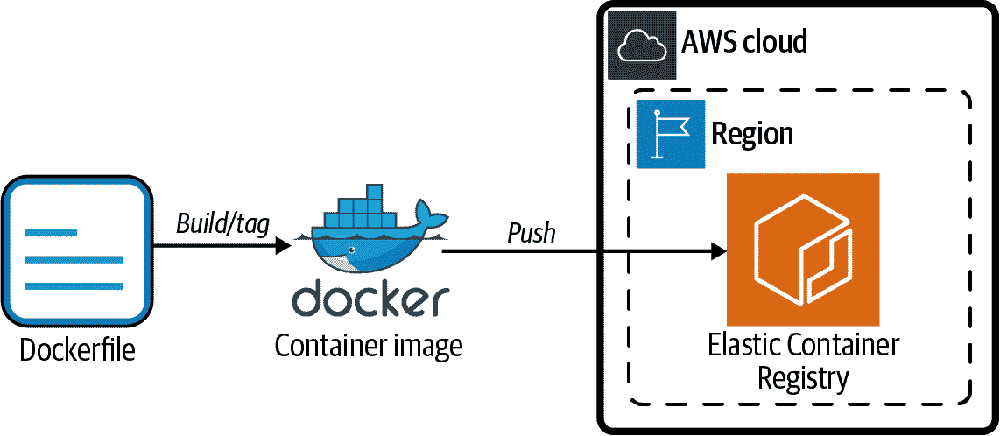

### 步骤

1. 登录 AWS 管理控制台并搜索 Elastic Container Registry。点击“创建存储库”按钮。

   为您的存储库命名，保留所有默认设置（如图 6-2 所示），向下滚动，再次点击“创建存储库”以完成操作。

   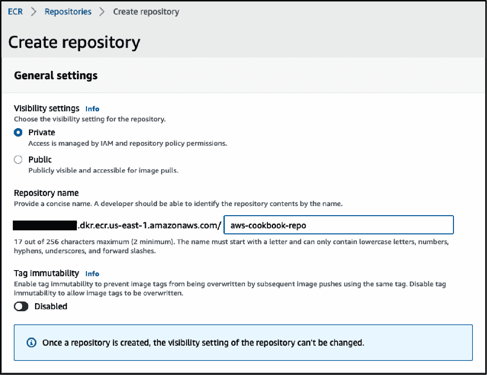

   您现在在 Amazon ECR 上拥有了一个可用于存储容器镜像的存储库。ECR 控制台的示例见图 6-3。

   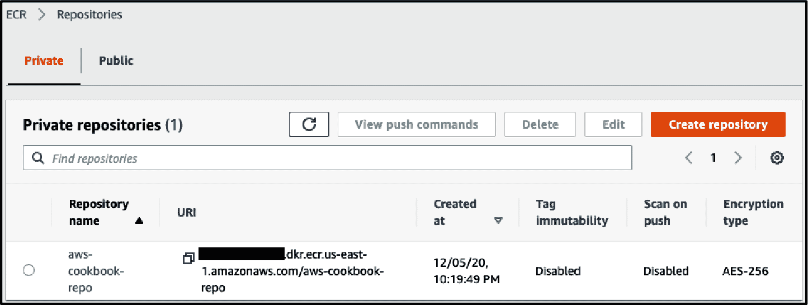

   或者，您也可以通过命令行创建 ECR 存储库：

   ```
   REPO=aws-cookbook-repo && \
   	aws ecr create-repository --repository-name $REPO
   ```

   您应该会看到类似如下的输出：

   ```
   {
     "repository": {
     "repositoryArn": "arn:aws:ecr:us-east-1:111111111111:repository/aws-cookbook-repo",
     "registryId": "1111111111111",
     "repositoryName": "aws-cookbook-repo",
     "repositoryUri": "611652777867.dkr.ecr.us-east-1.amazonaws.com/aws-cookbook-repo",
     "createdAt": "2021-10-02T19:57:56-04:00",
     "imageTagMutability": "MUTABLE",
     "imageScanningConfiguration": {
       "scanOnPush": false
     },
     "encryptionConfiguration": {
       "encryptionType": "AES256"
     }
     }
   }
   ```

2. 创建一个简单的 `Dockerfile`：

   ```
   echo FROM nginx:latest > Dockerfile
   ```

   #### 注意

   此命令创建一个 [`Dockerfile`](https://oreil.ly/VCCb7)，其中包含一行指令，指示 Docker 引擎使用 `nginx:latest` 镜像作为基础镜像。由于您在 `Dockerfile` 中仅使用基础镜像而没有其他行，因此生成的镜像与 `nginx:latest` 镜像完全相同。您可以通过使用 `COPY` 和 `ADD` `Dockerfile` 指令在此镜像中包含一些 HTML 文件。

3. 构建并标记镜像。此步骤可能需要片刻时间，因为它会下载并合并镜像层：

   ```
   docker build . -t \
   	$AWS_ACCOUNT_ID.dkr.ecr.$AWS_REGION.amazonaws.com/aws-cookbook-repo:latest
   ```

4. 添加一个额外的标签：

   ```
   docker tag \
   	$AWS_ACCOUNT_ID.dkr.ecr.$AWS_REGION.amazonaws.com/aws-cookbook-repo:latest \
   	$AWS_ACCOUNT_ID.dkr.ecr.$AWS_REGION.amazonaws.com/aws-cookbook-repo:1.0
   ```

5. 获取 Docker 登录信息：

   ```
   aws ecr get-login-password | docker login --username AWS \
   	--password-stdin $AWS_ACCOUNT_ID.dkr.ecr.us-east-1.amazonaws.com
   ```

   以下是输出：

   ```
   Login Succeeded
   ```

   #### 注意

   每次对私有存储库执行操作时，都需要提供授权令牌。令牌的有效期为 12 小时，因此您运行的命令需要在命令行上按该间隔手动刷新。为了帮助您自动获取授权令牌，您可以使用 `ECR Docker Credential Helper`，可从 [awslabs GitHub 存储库](https://oreil.ly/xI0xD) 获取。

6. 将每个镜像标签推送到 Amazon ECR：

   ```
   docker push \
   	$AWS_ACCOUNT_ID.dkr.ecr.$AWS_REGION.amazonaws.com/aws-cookbook-repo:latest
   	
   docker push \
   	$AWS_ACCOUNT_ID.dkr.ecr.$AWS_REGION.amazonaws.com/aws-cookbook-repo:1.0
   ```

   #### 注意

   在第二次推送时，您将看到镜像层上传显示“Layer already exists”（层已存在）。这是因为镜像因第一次推送而已存在于 ECR 存储库中，但此步骤仍然是添加额外标签所必需的。

#### 验证检查

现在您可以从控制台在 Amazon ECR 中查看这两个已标记的镜像，如图 6-4 所示。

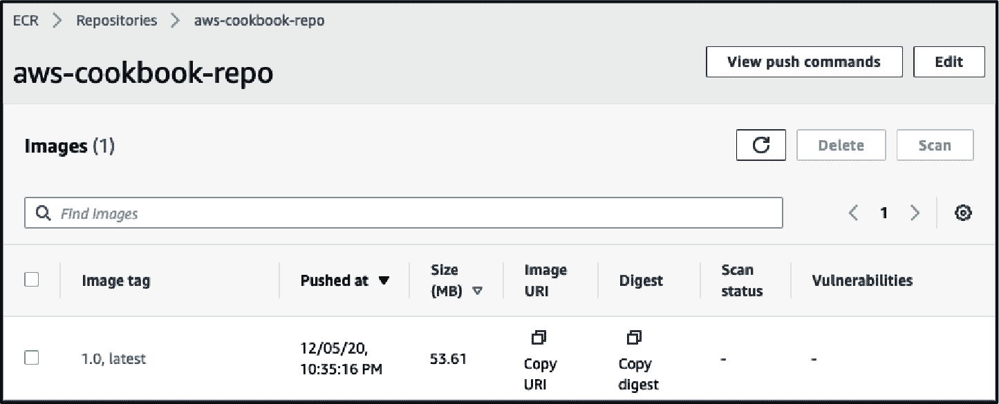

或者，您可以使用 AWS CLI 列出镜像：

```
aws ecr list-images --repository-name aws-cookbook-repo
```

您应该会看到类似如下的输出：

```
{
  "imageIds": [
    {
      "imageDigest": "sha256:99d0a53e3718cef59443558607d1e100b325d6a2b678cd2a48b05e5e22ffeb49",
      "imageTag": "1.0"
    },
    {
      "imageDigest": "sha256:99d0a53e3718cef59443558607d1e100b325d6a2b678cd2a48b05e5e22ffeb49",
      "imageTag": "latest"
    }
  ]
}
```

### 清理

按照 [章节代码存储库](https://github.com/AWSCookbook/Containers) 中此配方文件夹内的步骤操作。

## 讨论

拥有一个容器镜像存储库是应用程序开发过程的重要基础组件。一个由您控制的私有容器镜像存储库是提高应用程序开发过程安全性的最佳实践。您可以授予其他 AWS 账户、IAM 实体和 AWS 服务访问 Amazon ECR 的权限。现在您已经知道如何创建 ECR 存储库，您将能够存储容器镜像并将它们与 AWS 服务配合使用。

#### 注意

Amazon ECR 支持流行的 [Docker Image Manifest V2, Schema 2](https://oreil.ly/FeYVY) 和最近的 [Open Container Initiative (OCI)](https://oreil.ly/tzgdd) 镜像。它可以在拉取时在这些格式之间进行转换。提供对 Manifest V2, Schema 1 的传统支持，并且 Amazon ECR 在与旧版 Docker 客户端交互时可以即时转换。对于当今使用的大多数 Docker 客户端版本，体验应该是无缝的。

容器标记允许您对容器镜像进行版本控制和跟踪。您可以给一个镜像应用多个标签，这有助于您实施版本控制策略和部署流程。例如，您可能在开发环境中始终引用标记为“latest”的镜像，但生产环境可以锁定到特定的版本标签。`Docker CLI` 将标记的镜像推送到存储库，并且标签可用于拉取操作。

### 挑战

修改 `Dockerfile`，构建一个新镜像，用新版本号标记它，并将其推送到 ECR。

# 6.2 推送到 Amazon ECR 时扫描镜像的安全漏洞

## 问题

您希望每次推送到存储库时，自动扫描容器镜像的安全漏洞。

## 解决方案

在 Amazon ECR 的存储库上启用自动镜像扫描，推送一个镜像，并观察扫描结果，如图 6-5 所示。

### 先决条件

*   ECR 存储库

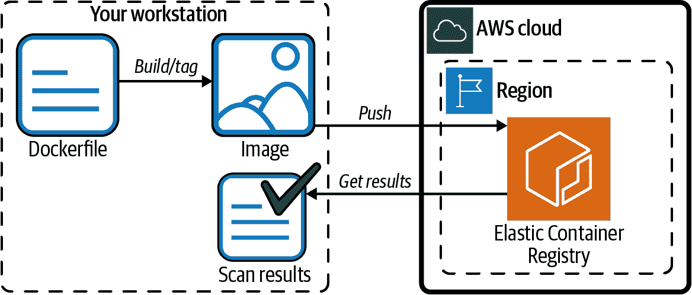

### 准备

按照 [章节代码存储库](https://github.com/AWSCookbook/Containers) 中此配方文件夹内的步骤操作。

### 步骤

1. 您将不再从 `Dockerfile` 构建新的容器镜像（就像您在配方 6.1 中所做的那样），而是要拉取一个旧的 NGINX 容器镜像：

   ```
   docker pull nginx:1.14.1
   ```

2. 在命令行上，将扫描配置应用到您创建的存储库：

   ```
   REPO=aws-cookbook-repo && \
   	aws ecr put-image-scanning-configuration \
   	--repository-name $REPO \
   	--image-scanning-configuration scanOnPush=true
   ```

3. 获取 Docker 登录信息：

   ```
   aws ecr get-login-password | docker login --username AWS \
   	--password-stdin $AWS_ACCOUNT_ID.dkr.ecr.$AWS_REGION.amazonaws.com
   ```

4. 给镜像打上标签，以便将其推送到 ECR 存储库：


```
docker tag nginx:1.14.1 \
    $AWS_ACCOUNT_ID.dkr.ecr.$AWS_REGION.amazonaws.com/aws-cookbook-repo:old
```

5. 推送镜像：

```
docker push \
    $AWS_ACCOUNT_ID.dkr.ecr.$AWS_REGION.amazonaws.com/aws-cookbook-repo:old
```

### 验证检查

推送完成后不久，您可以检查镜像安全扫描的 JSON 格式结果：

```
aws ecr describe-image-scan-findings \
    --repository-name aws-cookbook-repo --image-id imageTag=old
```

您应该会看到类似以下的输出：

```
{
  "imageScanFindings": {
    "findings": [
      {
        "name": "CVE-2019-3462",
        "description": "Incorrect sanitation of the 302 redirect field in HTTP transport method of apt versions 1.4.8 and earlier can lead to content injection by a MITM attacker, potentially leading to remote code execution on the target machine.",
        "uri": "https://security-tracker.debian.org/tracker/CVE-2019-3462",
        "severity": "CRITICAL",
        "attributes": [
          {
            "key": "package_version",
            "value": "1.4.8"
          },
```

### 清理

请遵循 [章节代码仓库](https://github.com/AWSCookbook/Containers) 中本配方文件夹内的步骤操作。

#### 提示

Amazon ECR 内置了一种安全机制，不允许您删除包含镜像的仓库。如果仓库不为空且 `delete-repository` 命令失败，您可以通过向 `delete-repository` 命令添加 `--force` 来绕过此检查。

## 讨论

开源 [Clair 项目](https://github.com/quay/clair) 的 [通用漏洞披露 (CVE)](https://cve.mitre.org) 数据库被 Amazon ECR 用于 [漏洞扫描](https://oreil.ly/ZSiob)。您将获得一个通用漏洞评分系统 (CVSS) 分数，以指示所检测到的任何漏洞的严重程度。这有助于您检测并修复容器镜像中的漏洞。您可以通过使用 Amazon EventBridge 和 Amazon Simple Notification Service (Amazon SNS) 来配置针对镜像中新发现漏洞的警报。

#### 警告

扫描功能不会持续扫描您的镜像，因此定期推送镜像版本（或触发手动扫描）非常重要。

您可以随时使用本配方最后一步中使用的命令来检索镜像的上一次扫描结果。此外，您可以将这些命令用作自动化 CI/CD 流程的一部分，该流程可在部署前验证镜像是否具有特定的 CVSS 分数。

### 挑战 1

通过使用最新的 NGINX 容器镜像更新镜像来修复漏洞。

### 挑战 2

配置一个 SNS 主题，以便在您的仓库中检测到漏洞时向您发送电子邮件。

# 6.3 使用 Amazon Lightsail 部署容器

## 问题

您需要快速部署基于容器的应用程序并通过互联网安全地访问它。

## 解决方案

部署一个在端口 80 上监听的普通 NGINX 容器到 [Lightsail](https://oreil.ly/SaZCa)。Lightsail 提供了一种快速将应用程序部署到 AWS 的方式。工作流程如 图 6-6 所示。

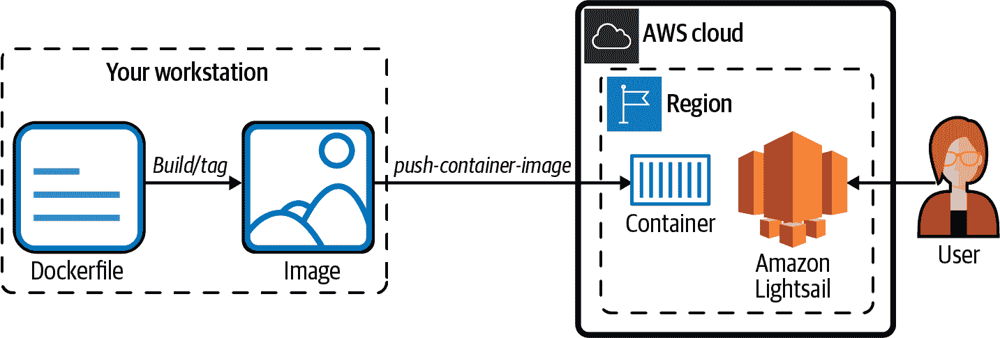

### 先决条件

*   除了 Docker Desktop 和 `AWS CLI`（版本 2）之外，您还需要为 `AWS CLI` 安装 [Lightsail 控制插件 (`lightsailctl`)](https://oreil.ly/Tn2B9)。

### 准备

请遵循 [章节代码仓库](https://github.com/AWSCookbook/Containers) 中本配方文件夹内的步骤操作。

### 步骤

#### 注意

Lightsail 提供多种电源规格，每种规格的价格取决于您的容器所需的计算能力。本示例中我们选择了 nano。电源规格列表及相关费用请参阅 Lightsail [定价指南](https://oreil.ly/DSPNv)。

1.  安装好 `lightsailctl` 后，创建一个新的容器服务，并为其指定名称、电源参数和规模参数：

    ```
    aws lightsail create-container-service \
        --service-name awscookbook --power nano --scale 1
    ```

    您应该会看到类似以下的输出：

    ```
    {
      "containerService": {
        "containerServiceName": "awscookbook",
        "arn": "arn:aws:lightsail:us-east-1:111111111111:ContainerService/124633d7-b625-48b2-b066-5826012904d5",
        "createdAt": "2020-11-15T10:10:55-05:00",
        "location": {
          "availabilityZone": "all",
          "regionName": "us-east-1"
        },
        "resourceType": "ContainerService",
        "tags": [],
        "power": "nano",
        "powerId": "nano-1",
        "state": "PENDING",
        "scale": 1,
        "isDisabled": false,
        "principalArn": "",
        "privateDomainName": "awscookbook.service.local",
        "url": "https://awscookbook.<<unique-id>>.us-east-1.cs.amazonlightsail.com/"
      }
    }
    ```

2.  拉取一个在 80/TCP 端口监听的普通 NGINX 容器镜像以供使用。

    ```
    docker pull nginx
    ```

    使用以下命令确保您的容器服务状态已进入 READY 状态（这可能需要几分钟）：

    ```
    aws lightsail get-container-services --service-name awscookbook
    ```

3.  当容器服务就绪后，将容器镜像推送到 Lightsail：

    ```
    aws lightsail push-container-image --service-name awscookbook \
        --label awscookbook --image nginx
    ```

    您应该会看到类似以下的输出：

    ```
    7b5417cae114: Pushed
    Image "nginx" registered.
    Refer to this image as ":awscookbook.awscookbook.1" in deployments.
    ```

    #### 注意

    您可以指定公共镜像仓库，或将自己的镜像推送到 Amazon Lightsail 中的容器服务。您的 Lightsail 镜像保留在 Lightsail 服务内，而不是使用私有 Amazon ECR 位置。有关更多信息，请参阅 [Lightsail 镜像位置文档](https://oreil.ly/Hi4Ny)。

4.  现在，您将把推送的镜像与您为部署而创建的容器服务关联起来。创建一个包含以下内容的文件，并将其保存为 `lightsail.json`（文件已在 [代码仓库](https://github.com/AWSCookbook/Containers) 中提供）：

    ```
    {
      "serviceName": "awscookbook",
      "containers": {
         "awscookbook": {
            "image": ":awscookbook.awscookbook.1",
            "ports": {
               "80": "HTTP"
            }
         }
      },
      "publicEndpoint": {
         "containerName": "awscookbook",
         "containerPort": 80
      }
    }
    ```

5.  创建部署：

    ```
    aws lightsail create-container-service-deployment \
        --service-name awscookbook --cli-input-json file://lightsail.json
    ```

    再次查看您的容器服务并等待 ACTIVE 状态。这可能需要几分钟：

    ```
    aws lightsail get-container-services --service-name awscookbook
    ```

    请记下输出末尾的端点 URL。

### 验证检查

现在，在浏览器中访问该端点 URL，或在命令行上使用 `curl`（例如 `url: https://awscookbook.un94eb3cd7hgk.us-east-1.cs.amazonlightsail.com`）：

```
curl <<URL endpoint>>
```

您应该会看到类似以下的输出：

```
...
<h1>Welcome to nginx!</h1>
...
```

### 清理

请遵循 [章节代码仓库](https://github.com/AWSCookbook/Containers) 中本配方文件夹内的步骤操作。

## 讨论


Lightsail 管理 TLS 证书、负载均衡器、计算和存储。如果您的应用程序需要，它还可以将 MySQL 和 PostgreSQL 数据库作为部署的一部分进行管理。Lightsail 会对您的应用程序执行例行健康检查，并将自动替换您部署的、可能因某些原因变得无响应的容器。更改 `lightsail create-container-service` 命令中的 power 和 scale 参数将允许您为繁重的工作负载创建服务。

使用此配方，您可以部署任何常见的基于容器的应用程序（例如 Wordpress），并在短时间内让它在互联网上提供服务。您甚至可以将 [自定义域名别名](https://oreil.ly/rB5Xf) 指向您的 Lightsail 部署，以获得利于 SEO 的 URL。

#### 挑战

扩展您的服务，使其能够处理更多流量。

# 6.4 使用 AWS Copilot 部署容器

## 问题

您需要一种方法来使用现有的 `Dockerfile`，在私有网络中利用最佳实践快速部署和管理负载均衡的 Web 服务。

## 解决方案

从 `Dockerfile` 开始，您可以使用 [AWS Copilot](https://oreil.ly/zH8YD) 快速部署应用程序，其架构如 图 6-7 所示。

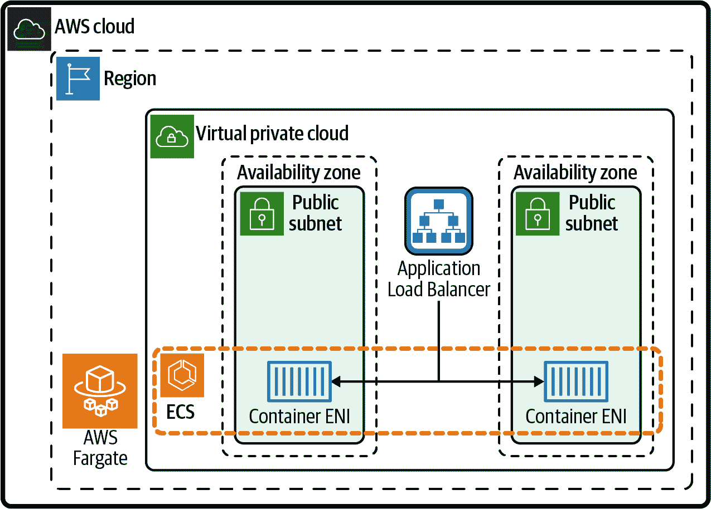

### 先决条件

*   [AWS Copilot CLI](https://oreil.ly/PvZlD)

### 准备工作

按照 [章节代码仓库](https://github.com/AWSCookbook/Containers) 中此配方文件夹内的步骤操作。

### 步骤

1.  Copilot 需要一个 ECS 服务关联角色，以允许 Amazon ECS 代表您执行操作。该角色可能已存在于您的 AWS 账户中。要查看是否已有此角色，请发出以下命令：

    ```
    aws iam list-roles --path-prefix /aws-service-role/ecs.amazonaws.com/
    ```

    (如果显示了该角色，您可以跳过以下角色创建步骤。)

    如果不存在，请创建 ECS 服务关联角色：

    ```
    aws iam create-service-linked-role --aws-service-name ecs.amazonaws.com
    ```

    ###### 注意

    IAM 服务关联角色允许 AWS 服务代表您安全地与其他 AWS 服务交互。请参阅 AWS [文章](https://oreil.ly/CwzCZ) 了解如何使用这些角色。

2.  `cd` 到本章 [代码仓库](https://github.com/AWSCookbook/Containers) 中此配方的目录：

    ```
    cd 604-Deploy-Container-With-Copilot-CLI
    ```

    ###### 注意

    您可以为此配方提供自己的 `Dockerfile` 和内容。如果您选择使用自己的容器，请确保容器监听 80/TCP 端口。或者使用 `copilot init` 命令配置备用端口。

3.  现在使用 AWS Copilot 将示例 NGINX `Dockerfile` 部署到 Amazon ECS：

    ```
    copilot init --app web --name nginx --type 'Load Balanced Web Service' \
        --dockerfile './Dockerfile' --port 80 --deploy
    ```

    ###### 注意

    如果您不为 `copilot init` 命令指定任何参数，它将引导您浏览部署选项菜单。

    部署将花费片刻时间。您可以在终端中观察部署进度。

#### 验证检查

部署完成后，使用此命令获取已部署服务的信息：

```
copilot svc show
```

### 清理

按照 [章节代码仓库](https://github.com/AWSCookbook/Containers) 中此配方文件夹内的步骤操作。

## 讨论

###### 提示

Copilot 提供了一个命令行界面，简化了向 Amazon ECS、AWS Fargate 和 AWS App Runner 的部署。它有助于简化您的开发工作流和部署生命周期。

`copilot init` 命令在当前工作目录中创建了一个名为 `copilot` 的目录。您可以通过使用与您的应用程序关联的 `manifest.yml` 来查看和自定义配置。

###### 注意

测试环境是默认创建的环境。您可以使用 `copilot env init` 命令添加额外的环境以满足您的需求，并使环境相互隔离。

Copilot 根据许多最佳实践配置了在 Amazon ECS 上托管容器所需的所有资源。示例包括部署到多个可用区、使用子网层级来分割流量、以及使用 AWS KMS 进行加密。

AWS Copilot 命令也可以嵌入到您的 CI/CD 流水线中以执行自动化部署。事实上，Copilot 可以通过 `copilot pipeline` 命令为您编排 CI/CD 流水线的创建和管理。有关所有当前支持的功能和示例，请访问 [AWS Copilot 主页](https://aws.github.io/copilot-cli)。

#### 挑战

重新配置您的负载均衡 Web 服务，使其部署到 [AWS App Runner](https://oreil.ly/BvUTg) 而不是 Amazon ECS。

# 6.5 使用蓝/绿部署更新容器

## 问题

您希望将部署策略用于基于容器的应用程序，以便在不给客户造成停机的情况下将应用程序更新到最新版本，同时如果部署不成功，还能轻松回滚。

## 解决方案

使用 AWS CodeDeploy 通过蓝/绿策略编排您的应用程序部署到 Amazon ECS，如 图 6-8 所示。

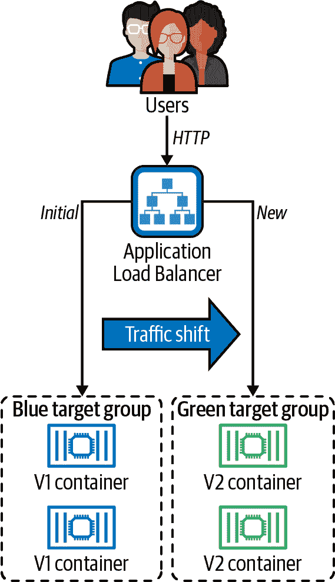

### 准备工作

按照 [章节代码仓库](https://github.com/AWSCookbook/Containers) 中此配方文件夹内的步骤操作。

### 步骤

1.  CDK 堆栈部署完成后，打开 Web 浏览器并访问 CDK 输出显示的 TCP 端口 8080 上的 `LOAD_BALANCER_DNS` 地址。您将看到正在运行的“Blue”应用程序：

    ```
    例如：
    firefox $LOAD_BALANCER_DNS:8080
    或
    open http://$LOAD_BALANCER_DNS:8080
    ```

2.  使用提供的 `assume-role-policy.json` 文件中的语句创建一个 IAM 角色，使用此命令：

    ```
    aws iam create-role --role-name ecsCodeDeployRole \
        --assume-role-policy-document file://assume-role-policy.json
    ```

3.  将 `CodeDeployRoleForECS` 的 IAM 托管策略附加到 IAM 角色：

    ```
    aws iam attach-role-policy --role-name ecsCodeDeployRole \
        --policy-arn arn:aws:iam::aws:policy/AWSCodeDeployRoleForECS
    ```

4.  创建一个新的 ALB 目标组，以便与 CodeDeploy 一起用作“Green”目标组：

    ```
    aws elbv2 create-target-group --name "GreenTG" --port 80 \
        --protocol HTTP --vpc-id $VPC_ID --target-type ip
    ```

5.  创建 CodeDeploy 应用程序：

    ```
    aws deploy create-application --application-name awscookbook-605 \
        --compute-platform ECS
    ```

    ###### 注意

    CodeDeploy 需要一些配置。我们在 [代码仓库](https://github.com/AWSCookbook/Containers) 的此配方目录中为您提供了一个模板文件 (`codedeploy-template.json`)。

6.  使用 `sed` 命令将值替换为您使用 `helper.py` 脚本导出的环境变量：

    ```
    sed -e "s/AWS_ACCOUNT_ID/${AWS_ACCOUNT_ID}/g" \
        -e "s|PROD_LISTENER_ARN|${PROD_LISTENER_ARN}|g" \
        -e "s|TEST_LISTENER_ARN|${TEST_LISTENER_ARN}|g" \
        codedeploy-template.json > codedeploy.json
    ```

    ###### 提示

    `sed`（即 *stream editor*，流编辑器的缩写）是一个很棒的工具，可用于文本查找和替换操作，以及在终端会话和脚本中进行其他类型的文本操作。在本例中，`sed` 用于将模板文件中的值替换为从 `cdk deploy` 输出并设置为环境变量的值。

7.  现在，创建一个部署组：

    ```
    aws deploy create-deployment-group --cli-input-json file://codedeploy.json
    ```

    `AppSpec-template.yaml` 包含有关您将要更新的应用程序的信息。CDK 预先预置了一个您可以使用的任务定义。


## 验证检查

替换任务开始服务 100% 的流量后，您可以访问之前观察 Blue 应用程序运行的同一 URL，该 URL 现已替换为 Green 版本的应用程序。

### 提示

您可能需要刷新浏览器或清除缓存才能看到更新后的 Green 应用程序。

## 清理

按照 [章节代码仓库](https://github.com/AWSCookbook/Containers) 中此配方文件夹内的步骤操作。

## 讨论

CodeDeploy 提供[多种部署策略](https://oreil.ly/18B4u)——金丝雀发布、AllAtOnce、蓝/绿部署等——您也可以创建自己的自定义部署策略。您可以自定义策略，以定义更长的切换窗口等待期，或定义在流量切换发生前必须满足的其他条件。在默认的蓝/绿部署策略中，CodeDeploy 会在将所有流量路由到新版本的同时，保持您的应用程序先前版本运行五分钟。如果您发现新版本表现不正常，可以快速将流量路由回原始版本，因为它仍在单独的 AWS Application Load Balancer 目标组中运行。

CodeDeploy 使用 ALB 目标组来管理哪个应用程序被视为“生产环境”。当您使用 AWS CDK 部署初始堆栈时，V1 Blue 容器已注册到与 ALB 上端口 8080 关联的目标组。在您启动新版本部署后，CodeDeploy 会启动一个全新的 ECS 服务版本，将其与您创建的 Green 目标组关联，然后平滑地将所有流量转移到 Green 目标组。最终结果是 Green V2 容器现在在 ALB 的端口 8080 上提供服务。之前的目标组现在已准备好执行下一次蓝/绿部署。

这是一个常用于 CI/CD 的模式。您的先前版本可以通过无缝回滚快速重新激活。如果不需要回滚，初始版本 (V1) 将被终止，您可以在下次部署时重复该过程，将 V3 放入 Blue 目标组，并在准备就绪时将流量切换到它。使用此策略有助于您将新应用程序版本对用户的影响降至最低，同时支持更频繁的部署。

### 提示

部署条件允许您定义部署成功标准。您可以将自定义部署策略与部署条件相结合，将自动化测试构建到 CodeDeploy 流程中。这将允许您确保在流量发送到新部署之前，所有测试均已运行并通过。

## 挑战

触发回滚到原始 V1 容器部署并观察结果。

# 6.6 在 Amazon ECS 上自动扩展容器工作负载

## 问题

您需要部署一个容器化服务，该服务在流量高峰期能够横向扩展以满足需求。

## 解决方案

为 ECS 服务配置 CloudWatch 警报和扩展策略，以便在 CPU 负载增加时服务添加更多容器，如图 6-10 所示。

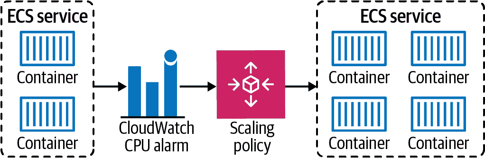

### 准备工作

按照 [章节代码仓库](https://github.com/AWSCookbook/Containers) 中此配方文件夹内的步骤操作。

### 步骤

1.  使用 `curl` 命令（或您的 Web 浏览器）通过互联网访问 ECS 服务 URL，以验证部署是否成功：

    ```
    curl -v -m 3 $LOAD_BALANCER_DNS
    ```

2.  使用详细模式 (`-v`) 和 3 秒超时 (`-m 3`)，以确保您看到完整的连接过程并设置了超时。以下是示例命令和输出：

    ```
    curl -v -m 3 http://AWSCookbook.us-east-1.elb.amazonaws.com:80/
    *   Trying 1.2.3.4...
    * TCP_NODELAY set
    * Connected to AWSCookbook.us-east-1.elb.amazonaws.com (1.2.3.4) port 80<
    > GET / HTTP/1.1
    > Host: AWSCookbook.us-east-1.elb.amazonaws.com:80
    > User-Agent: curl/7.64.1
    > Accept: */*
    >
    < HTTP/1.1 200
    < Content-Type: application/json
    < Content-Length: 318
    < Connection: keep-alive
    <
    {
    
    "URL":"http://awscookbookloadtestloadbalancer-36821611.us-east-1.elb.amazonaws.com:80/",
      "ContainerLocalAddress":"10.192.2.179:8080",
      "ProcessingTimeTotalMilliseconds":"0",
      "LoadBalancerPrivateIP":"10.192.2.241",
      "ContainerHostname":"ip-10-192-2-179.ec2.internal",
      "CurrentTime":"1605724705176"
    }
    Closing connection 0
    ```

    ### 提示

    连续多次运行此相同的 `curl` 命令，您会注意到 `ContainerHostname` 和 `ContainerLocalAddress` 在两个地址之间交替。这表明 Amazon ECS 正在按照 ECS 服务的定义，在两个预期始终运行的容器之间进行负载均衡。

3.  您需要为自动扩展触发器创建一个执行角色；此文件在 [代码仓库](https://github.com/AWSCookbook/Containers) 的此解决方案目录中提供：

    ```
    aws iam create-role --role-name AWSCookbook606ECS \
        --assume-role-policy-document file://task-execution-assume-role.json
    ```

4.  附加自动扩展的托管策略：

    ```
    aws iam attach-role-policy --role-name AWSCookbook606ECS --policy-arn arn:aws:iam::aws:policy/service-role/AmazonEC2ContainerServiceAutoscaleRole
    ```

5.  注册自动扩展目标：

    ```
    aws application-autoscaling register-scalable-target \
        --service-namespace ecs \
        --scalable-dimension ecs:service:DesiredCount \
        --resource-id service/$ECS_CLUSTER_NAME/AWSCookbook606 \
        --min-capacity 2 \
        --max-capacity 4
    ```

6.  使用指定 50% 平均 CPU 目标的示例配置文件，为自动扩展目标设置自动扩展策略：

    ```
    aws application-autoscaling put-scaling-policy --service-namespace ecs \
        --scalable-dimension ecs:service:DesiredCount \
        --resource-id service/$ECS_CLUSTER_NAME/AWSCookbook606 \
        --policy-name cpu50-awscookbook-606 --policy-type TargetTrackingScaling \
        --target-tracking-scaling-policy-configuration file://scaling-policy.json
    ```

7.  现在，要触发容器内模拟高 CPU 负载的进程，请运行相同的 `curl` 命令，并在服务 URL 末尾追加 `cpu`：

    ```
    curl -v -m 3 $LOAD_BALANCER_DNS/cpu
    ```

    该命令将在三秒后超时，表明访问该 URL 导致容器正在运行 CPU 密集型进程（您使用 CDK 部署的 ECS 服务运行我们提供的 CPU 负载生成器以模拟高 CPU 使用率）。以下是示例命令和输出：


# 6.6 ECS 服务自动扩缩容

```
curl -v -m 3 http://AWSCookbookLoadtestLoadBalancer-36821611.us-east-1.elb.amazonaws.com:80/cpu
*   Trying 52.4.148.24...
* TCP_NODELAY set
* Connected to AWSCookbookLoadtestLoadBalancer-36821611.us-east-1.elb.amazonaws.com (52.4.148.245) port 80 (#0)
> GET /cpu HTTP/1.1
> Host: AWSCookbookLoadtestLoadBalancer-36821611.us-east-1.elb.amazonaws.com:80
> User-Agent: curl/7.64.1
> Accept: */*
>
* Operation timed out after 3002 milliseconds with 0 bytes received
* Closing connection 0
curl: (28) Operation timed out after 3002 milliseconds with 0 bytes received
```

## 验证检查

等待约五分钟。然后登录 AWS 控制台，找到 Elastic Container Service，进入 Clusters 页面，选择已部署的集群，并选择 ECS 服务。验证 Desired Count（期望数量）是否已增加到 4，即您配置的最大扩缩容值。您可以点击 Tasks 选项卡，查看当前正在为您的服务运行的四个容器任务。

点击 Metrics 选项卡查看服务的 CPU 使用率。您将扩缩容目标设置为 50% 以触发自动扩缩容操作，由于 CPU 使用率过高，向服务中添加了两个额外的容器。示例指标图如 图 6-11 所示。

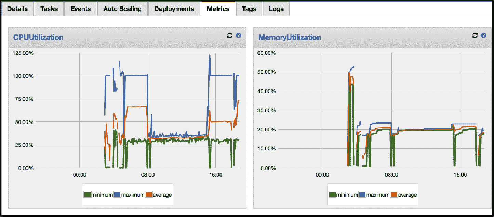

## 清理

按照 [章节代码仓库](https://github.com/AWSCookbook/Containers) 中本配方文件夹内的步骤操作。

## 讨论

自动扩缩容是一项重要的机制，实施它可以节省在 AWS 服务上运行应用程序的相关成本。它允许您的应用程序在负载可能增加时按需自行预置资源，并在应用程序可能处于空闲状态时自行移除资源。请注意，每当您让 AWS 服务代表您执行此类操作时，都必须通过 IAM 专门授予服务执行这些功能的权限。

为这类操作提供指标的底层数据包含在 CloudWatch 指标服务中。有许多数据点和指标可用于配置自动扩缩容；下面列出了一些最常见的指标：

*   网络 I/O
*   CPU 使用率
*   内存使用量
*   事务数量

在本配方中，您监控 ECS 服务上的 CPU 使用率指标。您将指标设置为 50%，并通过向 ECS 服务的 HTTP 端点发起 `curl` 调用来触发 CPU 负载。扩缩容指标取决于您运行的应用程序类型以及用于构建它们的技术。作为最佳实践，您应该在一段时间内观察应用程序指标以建立基线，然后再选择指标来实施自动扩缩容。

## 挑战

将提供的示例 CPU 负载应用程序替换为您自己的容器化应用程序，并配置目标扩缩容策略以满足您的需求。

# 6.7 响应事件启动 Fargate 容器任务

## 问题

您需要启动一个容器任务来处理传入的文件。

## 解决方案

使用 Amazon EventBridge 在文件上传到 S3 后触发 Fargate 上 ECS 容器任务的启动，如 图 6-12 所示。

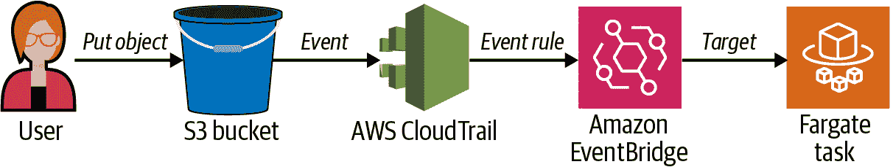

### 准备工作

按照 [章节代码仓库](https://github.com/AWSCookbook/Containers) 中本配方文件夹内的步骤操作。

### 步骤

1.  配置 CloudTrail 以记录 S3 存储桶上的事件：

    ```
    aws cloudtrail put-event-selectors --trail-name $CLOUD_TRAIL_ARN --event-selectors "[{ \"ReadWriteType\": \"WriteOnly\", \"IncludeManagementEvents\":false, \"DataResources\": [{ \"Type\": \"AWS::S3::Object\", \"Values\": [\"arn:aws:s3:::$BUCKET_NAME/input/\"] }], \"ExcludeManagementEventSources\": [] }]"
    ```

    现在创建一个名为 `policy1.json` 的承担角色策略 JSON 语句，以便在下一步中使用（该文件已在仓库中提供）：

    ```
    {
      "Version": "2012-10-17",
      "Statement": [
        {
          "Effect": "Allow",
          "Principal": {
            "Service": "events.amazonaws.com"
          },
          "Action": "sts:AssumeRole"
        }
      ]
    }
    ```

2.  创建角色并指定 `policy1.json` 文件：

    ```
    aws iam create-role --role-name AWSCookbook607RuleRole \
        --assume-role-policy-document file://policy1.json
    ```

3.  您还需要一个名为 `policy2.json` 的策略文档，内容如下（该文件已在仓库中提供）：

    ```
    {
      "Version": "2012-10-17",
      "Statement": [
        {
          "Effect": "Allow",
          "Action": [
            "ecs:RunTask"
          ],
          "Resource": [
            "arn:aws:ecs:*:*:task-definition/*"
          ]
        },
        {
          "Effect": "Allow",
          "Action": "iam:PassRole",
          "Resource": [
            "*"
          ],
          "Condition": {
            "StringLike": {
              "iam:PassedToService": "ecs-tasks.amazonaws.com"
            }
          }
        }
      ]
    }
    ```

4.  现在将刚创建的 IAM 策略 JSON 附加到 IAM 角色：

    ```
    aws iam put-role-policy --role-name AWSCookbook607RuleRole \
        --policy-name ECSRunTaskPermissionsForEvents \
        --policy-document file://policy2.json
    ```

5.  创建一个 EventBridge 规则以监控 S3 存储桶的文件上传：

    ```
    aws events put-rule --name "AWSCookbookRule" --role-arn "arn:aws:iam::$AWS_ACCOUNT_ID:role/AWSCookbook607RuleRole" --event-pattern "{\"source\":[\"aws.s3\"],\"detail-type\":[\"AWS API Call via CloudTrail\"],\"detail\":{\"eventSource\":[\"s3.amazonaws.com\"],\"eventName\":[\"CopyObject\",\"PutObject\",\"CompleteMultipartUpload\"],\"requestParameters\":{\"bucketName\":[\"$BUCKET_NAME\"]}}}"
    ```

6.  修改 `targets-template.json` 中的值并创建 `targets.json` 以供使用：

    ```
    sed -e "s|AWS_ACCOUNT_ID|${AWS_ACCOUNT_ID}|g" \
        -e "s|AWS_REGION|${AWS_REGION}|g" \
        -e "s|ECSClusterARN|${ECS_CLUSTER_ARN}|g" \
        -e "s|TaskDefinitionARN|${TASK_DEFINITION_ARN}|g" \
        -e "s|VPCPrivateSubnets|${VPC_PRIVATE_SUBNETS}|g" \
        -e "s|VPCDefaultSecurityGroup|${VPC_DEFAULT_SECURITY_GROUP}|g" \
        targets-template.json > targets.json
    ```

7.  创建一个规则目标，指定 ECS 集群、ECS 任务定义、IAM 角色和网络参数。这指定了规则将触发的内容；在本例中，是在 Fargate 上启动容器：

    ```
    aws events put-targets --rule AWSCookbookRule \
        --targets file://targets.json
    ```

    您应该会看到类似以下的输出：

    ```
    {
      "FailedEntryCount": 0,
      "FailedEntries": []
    }
    ```

8.  检查 S3 存储桶以验证其在我们填充数据前为空：

    ```
    aws s3 ls s3://$BUCKET_NAME/
    ```

9.  将提供的 `maze.jpg` 文件复制到 S3 存储桶。这将触发 ECS 任务，启动一个包含 [Python 库](https://pypi.org/project/mazesolver) 的容器来处理该文件：

    ```
    aws s3 cp maze.jpg s3://$BUCKET_NAME/input/maze.jpg
    ```

    这将触发一个 ECS 任务来处理图像文件。快速使用 `ecs list-tasks` 命令检查任务。该任务将运行约两到三分钟：

    ```
    aws ecs list-tasks --cluster $ECS_CLUSTER_ARN
    ```

    您应该会看到类似以下的输出：

    ```
    {
      "taskArns": [
        "arn:aws:ecs:us-east-1:111111111111:task/cdk-aws-cookbook-607-AWSCookbookEcsCluster46494E6E-MX7kvtp1sYWZ/d86f16af55da56b5ca4874d6029"
      ]
    }
    ```

## 验证检查

几分钟后，观察 S3 存储桶中创建的输出目录：

```
aws s3 ls s3://$BUCKET_NAME/output/
```

下载并查看输出文件：

```
aws s3 cp s3://$BUCKET_NAME/output/output.jpg ./output.jpg
```


使用您选择的文件查看器打开 `output.jpg` 以查看已处理的文件。

## 清理

按照 [章节代码仓库](https://github.com/AWSCookbook/Containers) 中此配方文件夹内的步骤操作。

## 讨论

事件驱动架构是云中应用程序和流程设计的重要方法。这种设计允许移除长期运行的应用程序工作负载，转而采用无服务器架构，后者具有更强的弹性，且在需要时能轻松扩展以应对使用高峰。当应用程序中没有事件需要处理时，您通常不需要为计算资源支付太多费用（甚至完全不需要），因此在选择应用程序架构时，潜在的成本节省也是一个考虑因素。

### 注意

在事件驱动架构中，通常会将 Lambda 函数与 S3 配合使用，但对于这种长时间运行的数据处理作业和计算作业，Fargate 是更好的选择，因为其运行时间基本上是无限的，而 Lambda 函数的最大运行时间受到限制。

Amazon ECS 可以运行任务和服务。服务由任务组成，通常是长期运行的，因为服务会保持一组特定的任务持续运行。任务可以是短暂的；容器可能启动、处理一些数据，然后在任务完成后正常退出。这正是您在本解决方案中所实现的：响应发出新对象信号的 S3 事件启动了一个任务，容器读取该对象、处理文件，然后退出。

## 挑战

虽然 EventBridge 是一个强大的解决方案，可用于编排多种类型的事件驱动解决方案，但您也可以使用 S3 触发器实现类似的功能。尝试部署并配置一个可直接由 S3 事件调用的 Lambda 函数。[此处有提示。](https://oreil.ly/rfTno)

# 6.8 捕获在 Amazon ECS 上运行的容器的日志

## 问题

您有一个在容器中运行的应用程序，并希望检查应用程序日志。

## 解决方案

将容器的日志发送到 Amazon CloudWatch。通过在 ECS 任务定义中指定 `awslogs` 驱动程序，并提供允许容器写入 CloudWatch 日志的 IAM 角色，您可以将容器日志流式传输到 Amazon CloudWatch 中的某个位置。此配置和过程的高级视图如 图 6-13 所示。

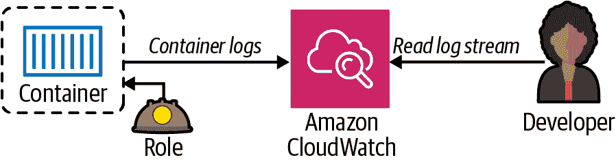

### 准备工作

按照 [章节代码仓库](https://github.com/AWSCookbook/Containers) 中此配方文件夹内的步骤操作。

### 步骤

1.  创建一个名为 `task-execution-assume-role.json` 的文件，内容如下。该文件在代码仓库中此配方目录的根目录下提供。

    ```
    {
      "Version": "2012-10-17",
      "Statement": [
        {
          "Sid": "",
          "Effect": "Allow",
          "Principal": {
            "Service": "ecs-tasks.amazonaws.com"
          },
          "Action": "sts:AssumeRole"
        }
      ]
    }
    ```

2.  使用前一个文件中的语句创建 IAM 角色：

    ```
    aws iam create-role --role-name AWSCookbook608ECS \
        --assume-role-policy-document file://task-execution-assume-role.json
    ```

3.  将用于 ECS 任务执行的 AWS 托管 IAM 策略附加到刚创建的 IAM 角色：

    ```
    aws iam attach-role-policy --role-name AWSCookbook608ECS --policy-arn arn:aws:iam::aws:policy/service-
    role/AmazonECSTaskExecutionRolePolicy
    ```

4.  在 CloudWatch 中创建日志组：

    ```
    aws logs create-log-group --log-group-name AWSCookbook608ECS
    ```

5.  创建一个名为 `taskdef.json` 的文件，内容如下（代码仓库中此配方的目录下提供了一个文件）：

    ```
    {
      "networkMode": "awsvpc",
      "containerDefinitions": [
        {
          "portMappings": [
            {
              "hostPort": 80,
              "containerPort": 80,
              "protocol": "tcp"
            }
          ],
          "essential": true,
          "entryPoint": [
            "sh",
            "-c"
          ],
          "logConfiguration": {
            "logDriver": "awslogs",
            "options": {
              "awslogs-group": "AWSCookbook608ECS",
              "awslogs-region": "us-east-1",
              "awslogs-stream-prefix": "LogStream"
            }
          },
          "name": "awscookbook608",
          "image": "httpd:2.4",
          "command": [
            "/bin/sh -c \"echo 'Hello AWS Cookbook Reader, this container is running on ECS!' >
    /usr/local/apache2/htdocs/index.html && httpd-foreground\""
          ]
        }
      ],
      "family": "awscookbook608",
      "requiresCompatibilities": [
        "FARGATE"
      ],
      "cpu": "256",
      "memory": "512"
    }
    ```

6.  现在您已有 IAM 角色和 ECS 任务定义配置，需要使用该配置创建 ECS 任务并关联 IAM 角色：

    ```
    aws ecs register-task-definition --execution-role-arn \
        "arn:aws:iam::$AWS_ACCOUNT_ID:role/AWSCookbook608ECS" \
        --cli-input-json file://taskdef.json
    ```

7.  在您之前在本配方中使用 AWS CDK 创建的 ECS 集群上运行 ECS 任务：

    ```
    aws ecs run-task --cluster $ECS_CLUSTER_NAME \
        --launch-type FARGATE --network-configuration
    "awsvpcConfiguration={subnets=[$VPC_PUBLIC_SUBNETS],securityGroups=[$VPC_DEFAULT_SECURITY_GROUP],assign
    PublicIp=ENABLED}" --task-definition awscookbook608
    ```

#### 验证检查

检查任务状态以确保任务正在运行。首先，查找任务的 Amazon 资源名称 (ARN)：

```
TASK_ARNS=$(aws ecs list-tasks --cluster $ECS_CLUSTER_NAME \
    --output text --query taskArns)
```

然后使用任务 ARN 通过 `describe-tasks` 命令输出来检查 RUNNING 状态：

```
aws ecs describe-tasks --cluster $ECS_CLUSTER_NAME --tasks $TASK_ARNS
```

任务达到 RUNNING 状态后（大约 15 秒），使用以下命令查看日志：

```
aws logs describe-log-streams --log-group-name AWSCookbook608ECS
```

您应该会看到类似如下的输出：

```
{
  "logStreams": [
    {
      "logStreamName": "LogStream/webserver/97635dab942e48d1bab11dbe88c8e5c3",
      "creationTime": 1605584764184,
      "firstEventTimestamp": 1605584765067,
      "lastEventTimestamp": 1605584765067,
      "lastIngestionTime": 1605584894363,
      "uploadSequenceToken": "49612420096740389364147985468451499506623702081936625922",
      "arn": "arn:aws:logs:us-east-1:111111111111:log-group:AWSCookbook608ECS:log-stream:LogStream/webserver/97635dab942e48d1bab11dbe88c8e5c3",
      "storedBytes": 0
    }
  ]
}
```

记下输出中的 `logStreamName`，然后运行 `get-log-events` 命令：

```
aws logs get-log-events --log-group-name AWSCookbook608ECS \
    --log-stream-name `<<logStreamName>>`
```

您应该会看到类似如下的输出：

```
{
  "events": [
    {
      "timestamp": 1605590555566,
      "message": "[Tue Nov 17 05:22:35.566054 2020] [mpm_event:notice] [pid 7:tid 140297116308608] AH00489: Apache/2.4.46 (Unix) configured -- resuming normal operations",
      "ingestionTime": 1605590559713
    },
    {
      "timestamp": 1605590555566,
      "message": "[Tue Nov 17 05:22:35.566213 2020] [core:notice] [pid 7:tid 140297116308608] AH00094: Command line: 'httpd -D FOREGROUND'",
      "ingestionTime": 1605590559713
    }
 ],
 "nextForwardToken": "f/35805865872844590178623550035180924397996026459535048705",
 "nextBackwardToken": "b/35805865872844590178623550035180924397996026459535048704"
}
```

### 清理

按照 [章节代码仓库](https://github.com/AWSCookbook/Containers) 中此配方文件夹内的步骤操作。

## 讨论


您使用了 `awslogs` 驱动程序和一个 IAM 角色，这允许正在运行的任务写入 `CloudWatch` 日志组。在 AWS 上使用容器时，这是一种常见模式，因为您很可能需要日志输出来排查和调试应用程序。由于这是一种常见模式，此配置由 `Copilot` 等工具处理，但当直接使用 `Amazon ECS` 时（如定义和运行任务），开发人员必须了解此配置。

`PID 1` 的[进程输出](https://oreil.ly/XY2UF)到 `/dev/stdout` 和 `/dev/stderr` 会被 `awslogs` 驱动程序捕获。换句话说，容器中的第一个进程是唯一记录到这些流的进程。请确保您想要查看日志的应用程序在容器内以 `PID 1` 运行。

为了使大多数 AWS 服务相互通信，您必须为它们分配一个角色，该角色允许通信所需的权限级别。从容器 ECS 任务配置日志记录到 `CloudWatch` 时也是如此；容器必须关联一个角色，该角色允许通过 [`awslogs logConfiguration` 驱动程序](https://oreil.ly/OrzrZ) 进行 `CloudWatchLogs` 操作：

```
{
  "Version": "2012-10-17",
  "Statement": [
    {
      "Effect": "Allow",
      "Action": [
        "logs:CreateLogGroup",
        "logs:CreateLogStream",
        "logs:PutLogEvents",
        "logs:DescribeLogStreams"
      ],
      "Resource": [
        "arn:aws:logs:*:*:*"
      ]
    }
  ]
}
```

`CloudWatch` 日志为许多 AWS 服务提供了一个集中式日志解决方案。运行多个容器时，能够快速定位日志以进行调试非常重要。

### 挑战

您可以 [`tail`](https://oreil.ly/kFrGf) 日志流的日志，以更实时地查看应用程序生成的日志。这有助于您的开发和故障排查活动。尝试在生成一些输出以供观察时，使用 `aws logs tail` 命令配合您的日志流。
