# 第 7 章 大数据

## 7.0 简介

数据有时被称为“[新黄金](https://oreil.ly/6EDB0)”。随着可用的数据科学工具不断改进，许多公司每天都在以新的、令人兴奋的方式利用数据。现在，您可以使用现代分析工具快速挖掘大量历史数据以获取洞察和模式。您可能还不知道需要对数据运行哪些查询和分析，但明天您可能会面临一个挑战，该挑战可以通过使用新兴技术进行历史数据分析来解决。随着更便宜的数据存储的出现，许多组织和个人选择保留数据而不是丢弃数据，以便运行历史分析以获得业务洞察、发现趋势、训练 AI/ML 模型，并准备好实施未来可以使用这些数据的技术。

除了您可能随时间收集的数据量之外，您收集的数据类型和结构也更加多样，速度也越来越快。想象一下，您可能会部署 `IoT` 设备来收集传感器数据，随着您随着时间的推移继续部署这些设备，您需要一种可扩展的方式来捕获和存储数据。这些可以是结构化、半结构化和非结构化数据，随着新数据源的摄入，其模式可能难以预测。您需要工具来转换和分析您的多样化数据。

Francis Jayakumar 在 AWS re:Invent 2020 上发表了一个信息丰富且简洁的演示“[AWS 上的数据湖和分析简介](https://oreil.ly/WcmSj)”，提供了 AWS 上可用的大数据和分析的高层介绍。本章本可以包含大量内容——足以填满另一本书——但我们将专注于发送数据到 `S3`、发现 `S3` 上的数据以及转换数据的基础配方，为您提供在 AWS 上处理数据的示例。

### 工作站配置

您需要安装一些东西，以准备好本章的配方。

#### 通用设置

按照 “CLI 配方的通用工作站设置步骤” 验证您的配置并设置所需的环境变量。然后，克隆章节代码仓库：

```
git clone https://github.com/awscookbook/BigData
```

## 7.1 使用 Kinesis 流摄取流式数据

### 问题

您需要一种为应用程序摄取流式数据的方法。

### 解决方案

创建一个 `Kinesis` 流，并通过使用 `AWS CLI` 向流中放入一条记录来验证其是否正常工作，如图 7-1 所示。

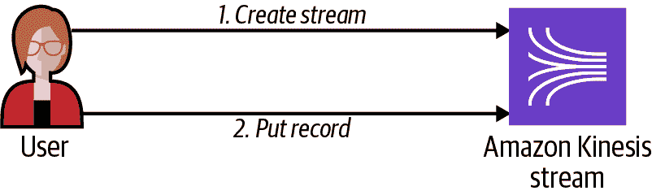

#### 步骤

1.  创建 Kinesis 流：

    ```
    aws kinesis create-stream --stream-name AWSCookbook701 --shard-count 1
    ```

    ##### 注意

    [分片](https://oreil.ly/XKI0q) 是理解 Kinesis 流的重要概念，当您扩展流以处理更大速度的传入流式数据时。每个分片每秒最多支持五次读取事务，最大总数据读取速率为 2 MB/秒。对于写入，每个分片每秒最多支持 1,000 条记录，最大总数据写入速率为 1 MB/秒（包括分区键）。如果您需要处理更多数据，可以随时对流重新分片。

2.  确认您的流处于 `ACTIVE` 状态：

    ```
    aws kinesis describe-stream-summary --stream-name AWSCookbook701
    ```

    您应该看到类似以下的输出：

    ```
    {
      "StreamDescriptionSummary": {
        "StreamName": "AWSCookbook701",
        "StreamARN": "arn:aws:kinesis:us-east-1:111111111:stream/AWSCookbook701",
        "StreamStatus": "ACTIVE",
        "RetentionPeriodHours": 24,
        "StreamCreationTimestamp": "2021-10-12T17:12:06-04:00",
        "EnhancedMonitoring": [
          {
            "ShardLevelMetrics": []
          }
        ],
        "EncryptionType": "NONE",
        "OpenShardCount": 1,
        "ConsumerCount": 0
      }
    }
    ```

#### 验证检查

向 Kinesis 流放入一条记录：

```
aws kinesis put-record --stream-name AWSCookbook701 \
     --partition-key 111 \
     --cli-binary-format raw-in-base64-out \
     --data={\"Data\":\"1\"}
```

您应该看到类似以下的输出：

```
{
  "ShardId": "shardId-000000000000",
  "SequenceNumber": "49622914081337086513355510347442886426455090590105206786"
}
```

从 Kinesis 流获取记录。[获取分片迭代器](https://oreil.ly/dFx8m) 并运行 `get-records` 命令：

```
SHARD_ITERATOR=$(aws kinesis get-shard-iterator \
     --shard-id shardId-000000000000 \
     --shard-iterator-type TRIM_HORIZON \
     --stream-name AWSCookbook701 \
     --query 'ShardIterator' \
     --output text)
aws kinesis get-records --shard-iterator $SHARD_ITERATOR \
     --query Records[0].Data --output text | base64 --decode
```

您应该看到类似以下的输出：

```
{"Data":"1"}
```

##### 注意

您发布到流中的数据是 base64 编码的。您查询命令输出中 JSON 对象内的数据元素，并将输出通过管道传给 `base64 --decode`，以验证记录就是您发布的内容。

### 清理

按照 [章节代码仓库](https://github.com/AWSCookbook/BigData) 中此配方文件夹中的步骤操作。

### 讨论

流式数据可以来自各种来源。向流中放入记录的来源称为[生产者](https://oreil.ly/ze6Wd)。从流中获取记录的实体称为[消费者](https://oreil.ly/dzRG2)。在流式数据的情况下，您处理的是实时信息，您可能需要立即采取行动，或将其存储以供稍后使用（请参阅配方 7.2）。以下是一些常见的生产者示例供您参考：


*   实时金融市场数据
*   物联网和传感器数据
*   来自 Web 和移动应用程序的最终用户点击流活动

您可以在应用程序中使用 Kinesis Producer Library (KPL) 和 Kinesis Client Library (KCL) 以满足您的特定需求。从 Kinesis 数据流消费数据时，您可以将应用程序配置为从数据流读取记录并做出响应，直接从数据流调用 Lambda 函数，甚至直接在 Kinesis 服务中使用 [Kinesis Data Analytics](https://oreil.ly/lyR4E) 应用程序（由 Apache Flink 提供支持）。

**注意**

Kinesis 服务将自动扩展以满足您的需求，但您需要了解 [配额和限制](https://oreil.ly/f7kq3)，以确保您的分片配置不会超出容量。

### 挑战

自动触发 Lambda 函数以处理传入的 Kinesis 数据。

# 7.2 使用 Amazon Kinesis Data Firehose 将流式数据传输到 Amazon S3

## 问题

您需要将传入的流式数据传送到对象存储。

## 解决方案

创建一个 S3 存储桶，创建一个 Kinesis 数据流，并配置 Kinesis Data Firehose 将数据流数据传送到 S3 存储桶。流程如 图 7-2 所示。

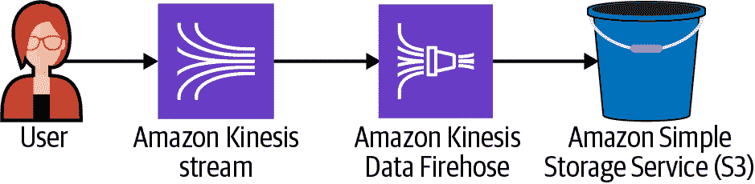

### 先决条件

*   Kinesis 数据流
*   包含 CSV 文件的 S3 存储桶

### 准备

按照 [章节代码仓库](https://github.com/AWSCookbook/BigData) 中此配方文件夹内的步骤操作。

### 步骤

1.  打开 [Kinesis Data Firehose 控制台](https://oreil.ly/GG8yA) 并点击“创建传输流”按钮；选择 Amazon Kinesis Data Streams 作为源，选择 Amazon S3 作为目标，如 图 7-3 所示。

    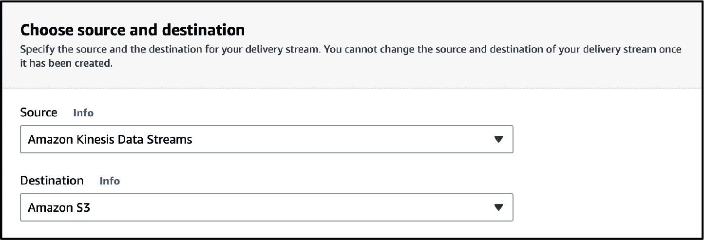

2.  对于源设置，选择您在准备步骤中创建的 Kinesis 数据流，如 图 7-4 所示。

    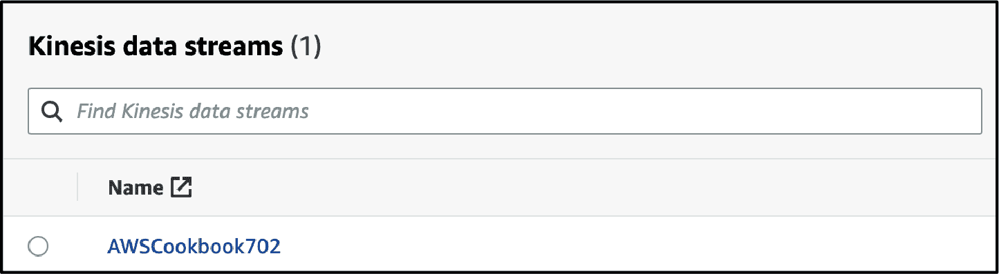

3.  对于“转换和转换记录”选项，保留默认值（已禁用）。对于目标设置，浏览并选择您在准备步骤中创建的 S3 存储桶，如 图 7-5 所示，并保留其他选项的默认值（禁用分区且无前缀）。

    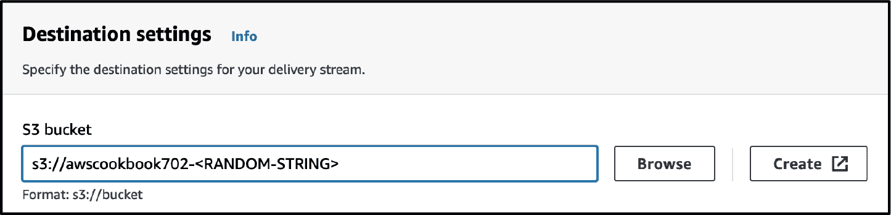

4.  在“高级设置”部分，确认已选中“创建或更新 IAM 角色”。这将创建一个 Kinesis 可用于访问数据流和 S3 存储桶的 IAM 角色，如 图 7-6 所示。

    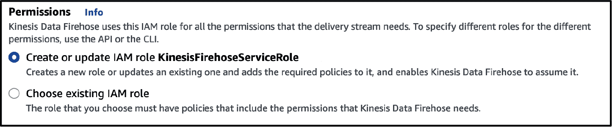

#### 验证检查

您可以从 Kinesis 控制台内部测试向数据流的传输。点击左侧导航菜单中的“传输流”链接，选择您创建的数据流，展开“使用演示数据测试”部分，然后点击“开始发送演示数据”按钮。这将启动向您的数据流发送示例数据，以便您验证数据是否成功到达您的 S3 存储桶。示例见 图 7-7。

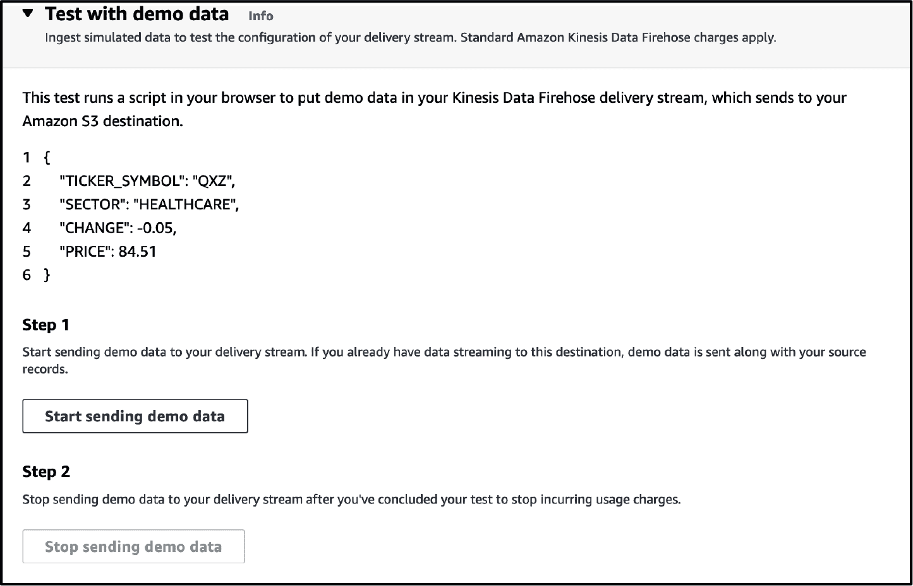

几分钟后，您将在 S3 存储桶中看到文件夹结构和文件出现，类似于 图 7-8。

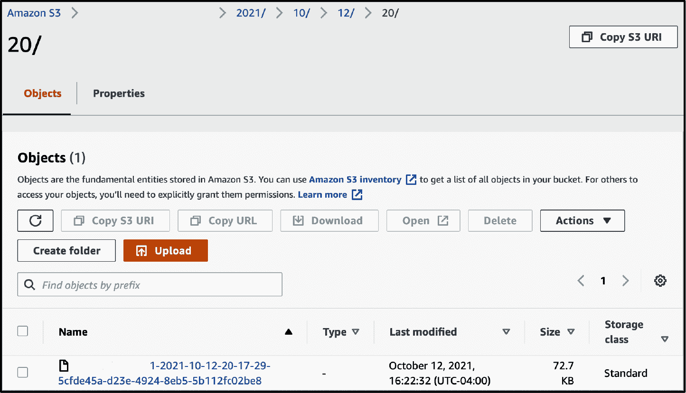

如果您下载并检查该文件，将看到类似以下的输出：

```
{"CHANGE":3.95,"PRICE":79.75,"TICKER_SYMBOL":"SLW","SECTOR":"ENERGY"}
{"CHANGE":7.27,"PRICE":96.37,"TICKER_SYMBOL":"ALY","SECTOR":"ENERGY"}
{"CHANGE":-5,"PRICE":81.74,"TICKER_SYMBOL":"QXZ","SECTOR":"HEALTHCARE"}
{"CHANGE":-0.6,"PRICE":98.4,"TICKER_SYMBOL":"NFLX","SECTOR":"TECHNOLOGY"}
{"CHANGE":-0.46,"PRICE":18.92,"TICKER_SYMBOL":"PLM","SECTOR":"FINANCIAL"}
{"CHANGE":4.09,"PRICE":100.46,"TICKER_SYMBOL":"ALY","SECTOR":"ENERGY"}
{"CHANGE":2.06,"PRICE":32.34,"TICKER_SYMBOL":"PPL","SECTOR":"HEALTHCARE"}
{"CHANGE":-2.99,"PRICE":38.98,"TICKER_SYMBOL":"KFU","SECTOR":"ENERGY"}
```

### 清理

按照 [章节代码仓库](https://github.com/AWSCookbook/BigData) 中此配方文件夹内的步骤操作。

## 讨论

当您开始从各种来源摄取数据时，您的应用程序可能会实时消费流式数据或对其做出反应。在某些情况下，您可能希望将数据流中的数据存储起来，以便稍后查询或处理。您可以使用 Kinesis Data Firehose 将数据传送到对象存储 (S3)、Amazon Redshift、OpenSearch 以及许多第三方端点。如果您必须支持从数据流向多个传输位置传送数据，还可以将多个传输流连接到单个生产者数据流。

**注意**

Kinesis Data Firehose 会自动扩展以处理您需要传送的数据量，这意味着如果您的数据流开始接收大量数据，您无需配置或预置额外资源。有关 Kinesis Data Firehose 功能和能力的更多信息，请参阅 Kinesis Data Firehose 的 [AWS 文档](https://oreil.ly/9h2Bc)。

如果您需要在数据通过 Firehose 到达目标之前对其进行转换，可以配置转换。转换将在您的流式数据排队时自动调用 Lambda 函数（有关缓冲区大小信息，请参阅此 Firehose [文章](https://oreil.ly/PW0LN)）。当您必须在传输前调整记录的架构、即时清理数据以进行长期存储（例如，删除个人身份信息），或在传输前将数据与其他来源联合时，这非常有用。您调用的转换 Lambda 函数必须遵循 Kinesis Data Firehose API 指定的约定。要查看一些 Lambda 函数示例，请访问 [AWS Serverless Application Repository](https://oreil.ly/q7noh) 并搜索“firehose”。

### 挑战

配置带有转换的 Firehose 传输，以在传输前从流式数据中移除某个字段。

# 7.3 使用 AWS Glue 爬网程序自动发现元数据

## 问题

您在对象存储上有 CSV 数据文件，并希望发现这些文件的架构和元数据，以便在进一步的分析和查询操作中使用。

## 解决方案

创建一个 AWS Glue 数据库，按照爬网程序配置向导配置一个爬网程序来扫描您的 S3 存储桶数据，运行爬网程序，并检查生成的表，如 图 7-9 所示。

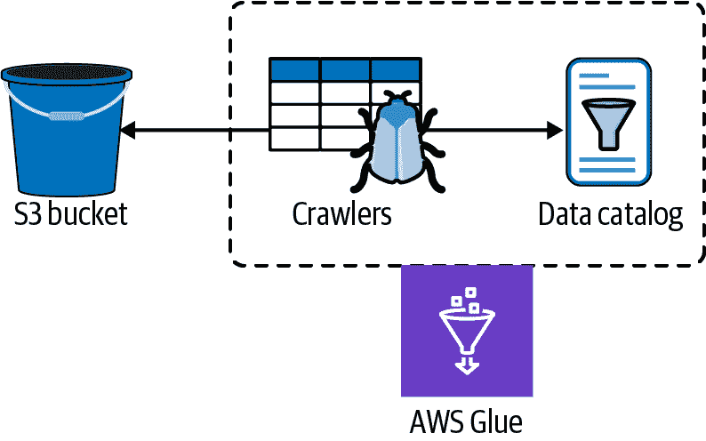

### 先决条件

*   一个 S3 存储桶

### 准备

按照 [章节代码仓库](https://github.com/AWSCookbook/BigData) 中此配方文件夹内的步骤操作。

### 步骤

1.  登录 AWS 控制台并导航到 AWS Glue 控制台，从左侧导航菜单中选择“数据库”并选择“添加数据库”，如 图 7-10 所示。

    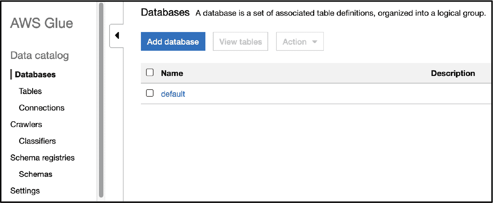

2.  为您的数据库指定一个名称（例如 `awscookbook703`）并点击“创建”。示例对话框如 图 7-11 所示。

    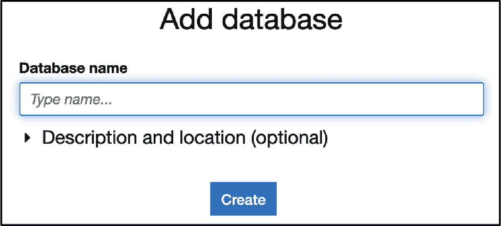

3.  从左侧导航菜单中选择“表”并选择“添加表” → “使用爬网程序添加表”，如 图 7-12 所示。

    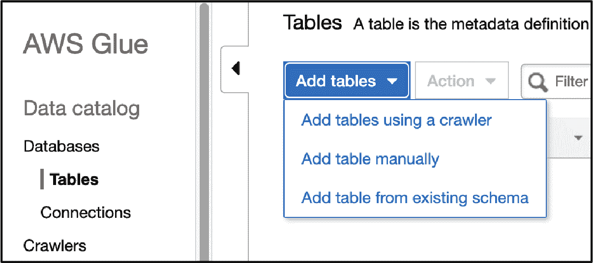

4.  按照“添加爬网程序”向导操作。对于爬网程序源类型，选择“数据存储”，爬取所有文件夹，将 S3 作为“数据存储”（不定义连接），在“包含路径”中选择您的 S3 存储桶和“data”文件夹，并且不选择样本大小。选择创建 IAM 角色，并以后缀 `AWSCookbook703` 结尾。对于频率，选择“按需运行”，并选择您在第 2 步中创建的数据库。在“查看所有步骤”页面确认配置并点击“完成”。示例查看页面如 图 7-13 所示。

    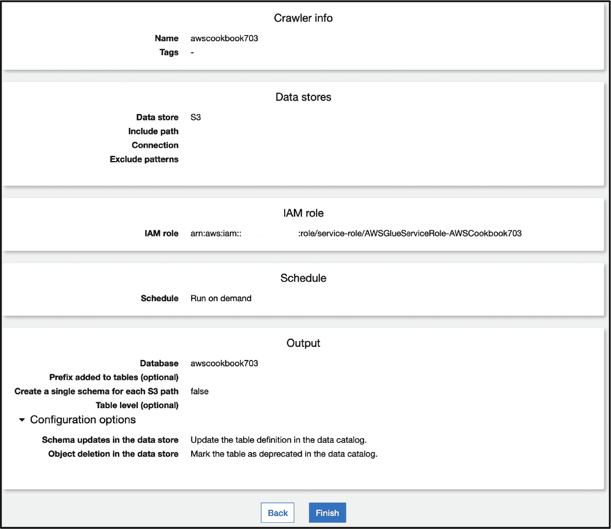


5. 从左侧导航菜单中选择“Crawlers”（爬行程序）。选择您在第 4 步中创建的爬行程序，然后单击“Run crawler”（运行爬行程序），如图 7-14 所示。

#### 注意

Glue 爬行程序运行需要片刻时间。完成后，您可以查看发现的架构和元数据的表属性。

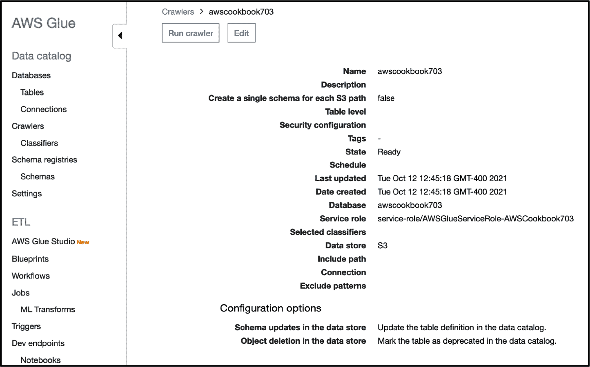

### 验证检查

验证您创建的爬行程序配置；您可以使用 AWS CLI 或 Glue 控制台。注意 `LastCrawl` 状态为 `SUCCEEDED`：

```
aws glue get-crawler --name awscookbook703
```

您应该会看到类似如下的输出：

```
{
  "Crawler": {
    "Name": "awscookbook703",
    "Role": "service-role/AWSGlueServiceRole-AWSCookbook703",
    "Targets": {
      "S3Targets": [
        {
          "Path": "s3://awscookbook704-<RANDOM_STRING>/data",
          "Exclusions": []
        }
      ],
      "JdbcTargets": [],
      "MongoDBTargets": [],
      "DynamoDBTargets": [],
      "CatalogTargets": []
    },
    "DatabaseName": "awscookbook703",
    "Classifiers": [],
    "RecrawlPolicy": {
      "RecrawlBehavior": "CRAWL_EVERYTHING"
    },
    "SchemaChangePolicy": {
      "UpdateBehavior": "UPDATE_IN_DATABASE",
      "DeleteBehavior": "DEPRECATE_IN_DATABASE"
    },
    "LineageConfiguration": {
      "CrawlerLineageSettings": "DISABLE"
    },
    "State": "READY",
    "CrawlElapsedTime": 0,
    "CreationTime": "2021-10-12T12:45:18-04:00",
    "LastUpdated": "2021-10-12T12:45:18-04:00",
    "LastCrawl": {
      "Status": "SUCCEEDED",
      "LogGroup": "/aws-glue/crawlers",
      "LogStream": "awscookbook703",
      "MessagePrefix": "16e867b7-e972-4ceb-b318-8e78370949d8",
      "StartTime": "2021-10-12T12:54:19-04:00"
    },
    "Version": 1
  }
}
```

#### 提示

AWS Glue 爬行程序将其运行信息记录到 Amazon CloudWatch 日志中。如果您需要调试爬行程序的活动，可以检查 `/aws-glue/crawlers` 日志组中的日志。

在 Glue 控制台中，选择已创建的表并单击“View properties”（查看属性）。您也可以运行 AWS CLI 命令以输出 JSON：

```
aws glue get-table --database-name awscookbook703 --name data
```

JSON 属性应类似于如下内容：

```
{
  "StorageDescriptor": {
    "cols": {
      "FieldSchema": [
        {
          "name": "title",
          "type": "string",
          "comment": ""
        },
        {
          "name": "other titles",
          "type": "string",
          "comment": ""
        },
        {
          "name": "bl record id",
          "type": "bigint",
          "comment": ""
        }...<SNIP>...
      ]
    },
    "location": "s3://awscookbook703-<RANDOM_STRING>/data/",
    "inputFormat": "org.apache.hadoop.mapred.TextInputFormat",
    "outputFormat": "org.apache.hadoop.hive.ql.io.HiveIgnoreKeyTextOutputFormat",
    "compressed": "false",
    "numBuckets": "-1",
    "SerDeInfo": {
      "name": "",
      "serializationLib": "org.apache.hadoop.hive.serde2.lazy.LazySimpleSerDe",
      "parameters": {
        "field.delim": ","
      }
    },
    "bucketCols": [],
    "sortCols": [],
    "parameters": {
      "skip.header.line.count": "1",
      "sizeKey": "43017100",
      "objectCount": "1",
      "UPDATED_BY_CRAWLER": "awscookbook703",
      "CrawlerSchemaSerializerVersion": "1.0",
      "recordCount": "79367",
      "averageRecordSize": "542",
      "CrawlerSchemaDeserializerVersion": "1.0",
      "compressionType": "none",
      "classification": "csv",
      "columnsOrdered": "true",
      "areColumnsQuoted": "false",
      "delimiter": ",",
      "typeOfData": "file"
    },
    "SkewedInfo": {},
    "storedAsSubDirectories": "false"
  },
  "parameters": {
    "skip.header.line.count": "1",
    "sizeKey": "43017100",
    "objectCount": "1",
    "UPDATED_BY_CRAWLER": "awscookbook703",
    "CrawlerSchemaSerializerVersion": "1.0",
    "recordCount": "79367",
    "averageRecordSize": "542",
    "CrawlerSchemaDeserializerVersion": "1.0",
    "compressionType": "none",
    "classification": "csv",
    "columnsOrdered": "true",
    "areColumnsQuoted": "false",
    "delimiter": ",",
    "typeOfData": "file"
  }
}
```

### 清理

按照[章节代码仓库](https://github.com/AWSCookbook/BigData)中此配方文件夹内的步骤操作。

## 讨论

当您开始从各种来源摄取并存储大量数据到 S3 等对象存储时，您可能希望在不加载到中间数据库的情况下临时就地查询数据。由于您并不总是知道数据的架构或元数据，因此您需要了解关于它的一些基本信息，例如数据驻留在何处、文件和分区的样子、是结构化还是非结构化数据、数据大小，以及最重要的是数据的架构。AWS Glue 服务的一个特定功能 Glue 爬行程序允许您发现存储中各种数据的元数据。[爬行程序](https://oreil.ly/49nom)连接到您的数据源（在本例中为 S3 存储桶），扫描源中的对象，并使用与您的数据架构关联的表填充 Glue Data Catalog 数据库。

#### 注意

除了 S3 存储桶源之外，您还可以使用爬行程序扫描 Java Database Connectivity (JDBC) 数据存储和 DynamoDB 表。对于 JDBC 表，您需要定义一个[连接](https://oreil.ly/Gasxy)，以允许 Glue 使用网络连接连接到您的 JDBC 源。

### 挑战

配置您的爬行程序按间隔运行，以便自动更新您的表和元数据。

# 7.4 使用 Amazon Athena 查询 S3 上的文件

## 问题

您需要在对象存储上存储的 CSV 文件上运行 SQL 查询，而无需对它们建立索引。

## 解决方案

配置 Amazon Athena 结果 S3 存储桶位置，在 Athena 编辑器中创建 Data Catalog 数据库和表，并在 S3 存储桶中的数据上运行 SQL 查询，如图 7-15 所示。

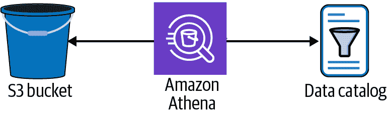

### 先决条件

*   包含数据的 CSV 文件的 S3 存储桶

### 准备工作

按照[章节代码仓库](https://github.com/AWSCookbook/BigData)中此配方文件夹内的步骤操作。

### 步骤

1.  登录 AWS 控制台并转到 Athena 控制台；您应该会看到类似于图 7-16 的内容。

    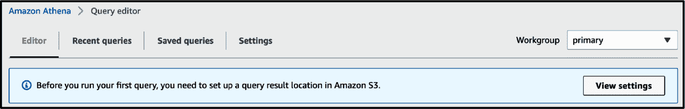

2.  在查询编辑器中，单击“Settings”（设置）选项卡，并使用您创建的 S3 存储桶和前缀配置“Query result location”（查询结果位置）：`s3://bucket/folder/object/`。单击“Manage”（管理），选择存储桶，然后单击“Choose”（选择）。作为一种选项，您可以对结果进行加密。有关示例，请参阅图 7-17。

    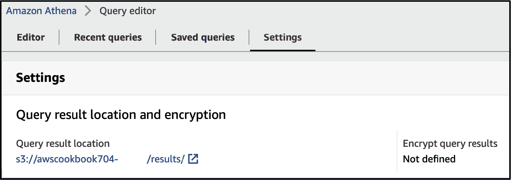

3.  回到“Editor”（编辑器）选项卡，运行以下 SQL 语句以创建 Data Catalog 数据库：

    ```
    CREATE DATABASE `awscookbook704db`
    ```

    您应该会看到类似于图 7-18 的输出。

    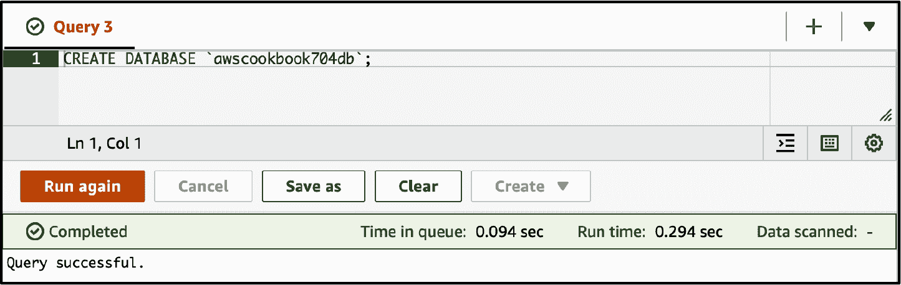

4.  在查询编辑器中运行一条新语句，以在数据库中创建一个引用数据的 S3 存储桶位置和数据架构的表。请务必将 `BUCKET_NAME` 替换为您创建的存储桶名称：


## 7.4 在 Athena 中创建外部表

```sql
CREATE EXTERNAL TABLE IF NOT EXISTS default.`awscookbook704table`(
  `title` string, 
  `other titles` string, 
  `bl record id` bigint, 
  `type of resource` string, 
  `content type` string, 
  `material type` string, 
  `bnb number` string, 
  `isbn` string, 
  `name` string, 
  `dates associated with name` string, 
  `type of name` string, 
  `role` string, 
  `all names` string, 
  `series title` string, 
  `number within series` string, 
  `country of publication` string, 
  `place of publication` string, 
  `publisher` string, 
  `date of publication` string, 
  `edition` string, 
  `physical description` string, 
  `dewey classification` string, 
  `bl shelfmark` string, 
  `topics` string, 
  `genre` string, 
  `languages` string, 
  `notes` string)
ROW FORMAT SERDE 'org.apache.hadoop.hive.serde2.lazy.LazySimpleSerDe' 
WITH SERDEPROPERTIES (
  'serialization.format' = ',',
  'field.delim' = ','
) LOCATION 's3://BUCKET_NAME/data/'
TBLPROPERTIES ('has_encrypted_data'='false');
```

#### 提示

您可以使用 AWS Glue 爬虫来抓取 S3 上的数据，并自动保持数据库、表和元数据的最新状态。有关使用此示例数据集配置 Glue 爬虫的示例，请参阅配方 7.3。

### 验证检查

打开查询编辑器并运行查询，以列出 `title` 为 “Marvel universe” 的行：

```sql
SELECT * FROM `awscookbook704table` WHERE `title`='"Marvel universe"' LIMIT 100
```

您应该会看到类似于图 7-19 的输出。

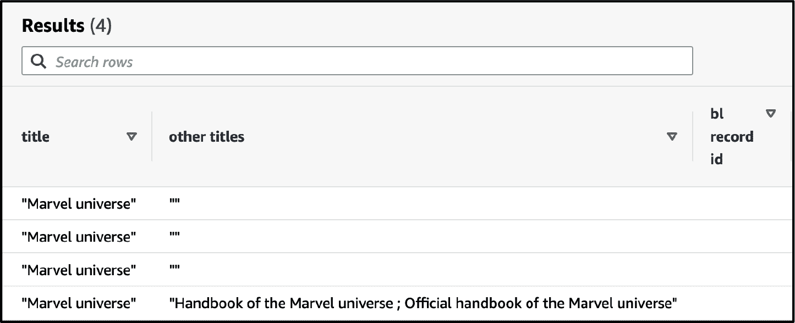

运行 SQL 查询，为示例数据集选择前 100 行：

```sql
SELECT * FROM `awscookbook704table` LIMIT 100;
```

### 清理

按照[章节代码仓库](https://github.com/AWSCookbook/BigData)中此配方文件夹中的步骤操作。

## 讨论

过去，您可能不得不使用提取、转换、加载 (ETL) 进程来促进按需查询大量数据。如果数据量巨大，此过程可能需要数小时，甚至数天。在大数据世界中，数据量只会随着时间的推移而增加，并且当您最初开始摄取数据时，您可能不知道需要查询什么。这使得表架构设计变得具有挑战性。很有可能，当您从各种来源摄取和收集数据时，您将把数据存储在对象存储中。这就是*数据湖*概念的实现。能够就地查询数据湖中的基于文本的数据是一个强大的概念，您可以使用 Amazon Athena 来实现。您可以使用标准 SQL 直接针对对象存储 (Amazon S3) 上的数据运行查询。

Athena 要求在运行查询之前了解有关数据的一些基本信息。这包括元数据、架构和数据位置。理解[表、数据库和数据目录](https://oreil.ly/wLxfa)的概念非常重要，以便您可以配置 Athena 服务以满足您的需求。正如您在配方 7.3 中所见，Glue 服务可以抓取您的数据以发现这些信息并保持其最新状态，以便您在数据存储在数据湖中时随时准备好针对数据运行查询。您可以在 Athena 服务中使用 Glue 数据目录，而不是定义自己的架构，从而节省时间。

#### 提示

当您开始增加将 S3 用作中央数据存储库（换句话说，数据湖）的使用时，您可能需要将多个服务结合使用，并开始应用特定级别的权限，以允许其他团队成员与数据交互并对其进行管理。[AWS Lake Formation](https://oreil.ly/wStEx) 是一项托管服务，它将 S3、Glue 和 Athena 等服务与强大的权限引擎结合在一起，以满足您的需求。

#### 注意

Athena 服务将自动为您扩展，并行运行大型数据集的查询，因此您无需担心预配任何资源。有关更多信息，请参阅 Athena [文档](https://oreil.ly/hWrqZ)。

### 挑战

配置 Athena 以使用带有 Glue 爬虫的 Glue 数据目录，用于 S3 上没有预定义架构的源数据集。

## 7.5 使用 AWS Glue DataBrew 转换数据

### 问题

您有存储在 CSV 中的数据，并且需要在进一步处理之前将某列中的所有字符转换为大写。

### 解决方案

从 Glue DataBrew 中的示例项目开始，使用示例 CSV 数据集。等待会话启动，然后对示例集的 `name` 列应用大写格式操作。检查结果（请参阅图 7-20）。

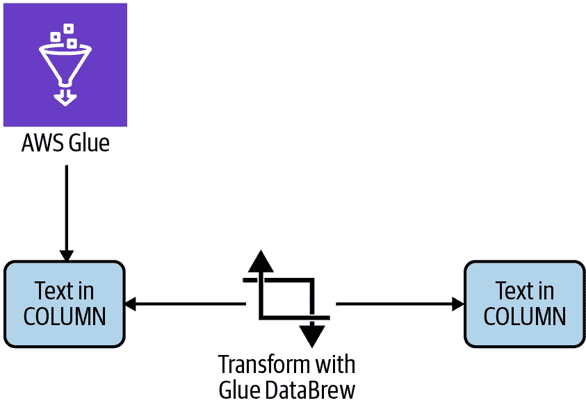

#### 步骤

1.  在 AWS 控制台中，搜索并导航到 AWS Glue DataBrew 控制台。

2.  单击“创建示例项目”，选择“2020 年婴儿热门名字”，创建一个新的 IAM 角色，输入您选择的角色后缀，然后单击“创建项目”，如图 7-21 所示。您的会话将花费片刻时间准备，状态指示器应类似于图 7-22。

    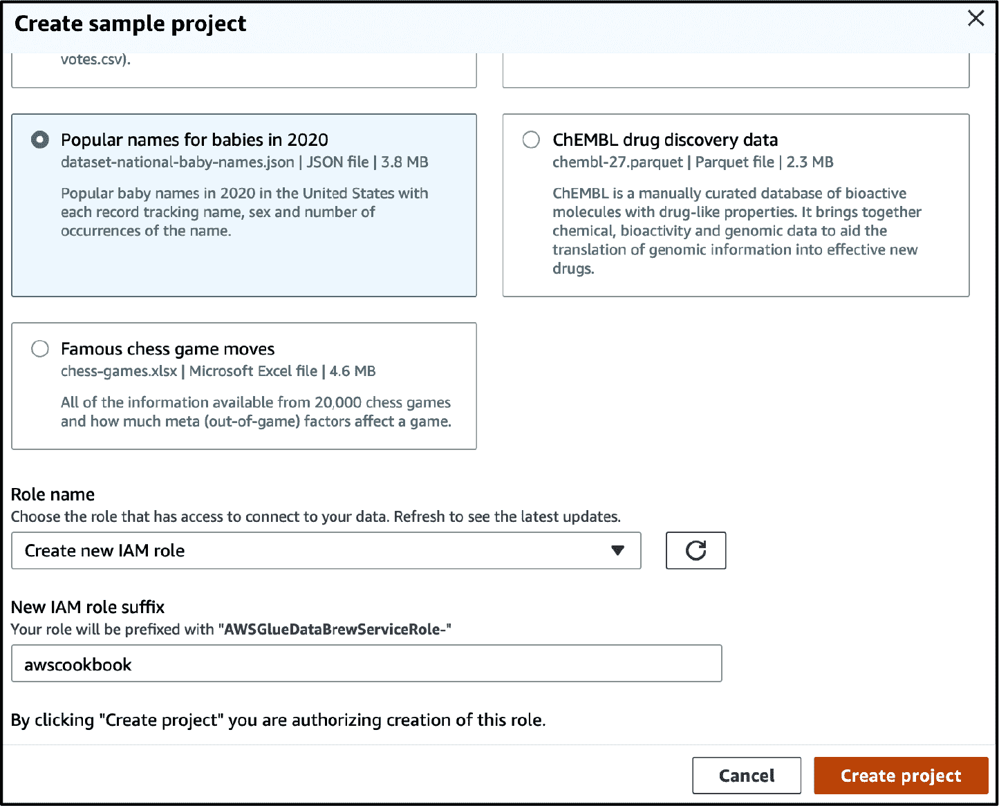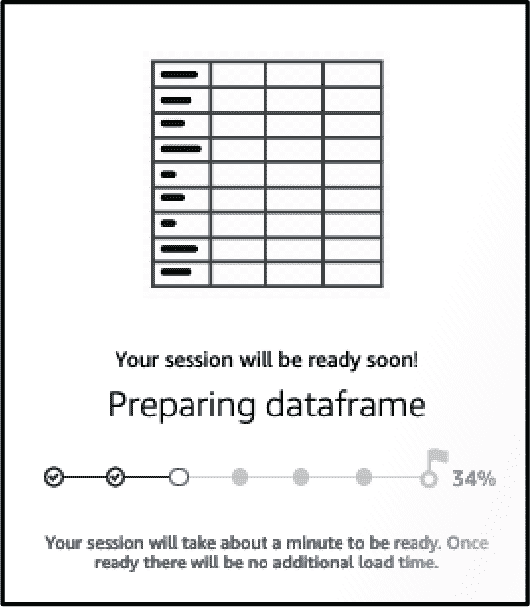

3.  当您的会话准备就绪后，单击菜单中的 **FORMAT**。然后从下拉菜单中选择“更改为大写”，如图 7-23 所示。

    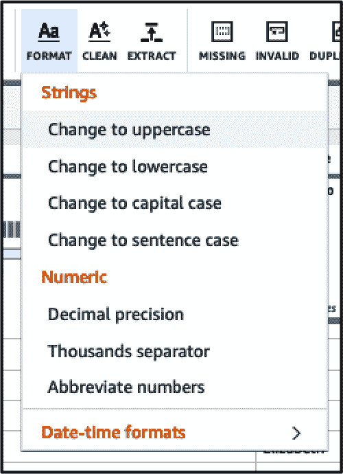

4.  在右侧菜单中，将“源列”设置为“name”，然后单击 **Apply**，如图 7-24 所示。

    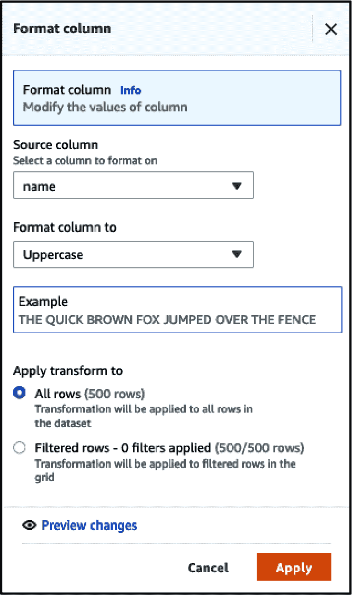

#### 验证检查

查看更新后的 `name` 列，如图 7-25 所示。

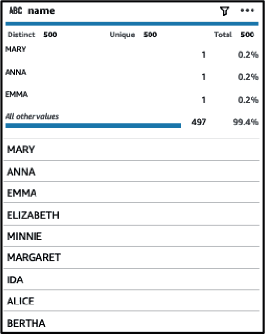

从右上角的 **ACTIONS** 菜单中，选择 **Download CSV**，如图 7-26 所示。

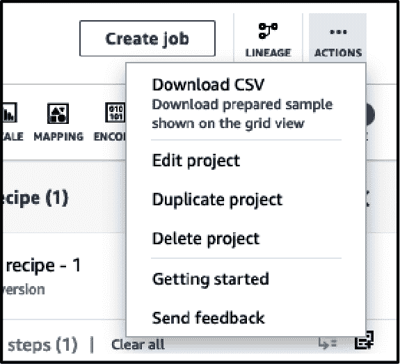

### 清理

按照[章节代码仓库](https://github.com/AWSCookbook/BigData)中此配方文件夹中的步骤操作。

## 讨论

在处理来自各种来源的大量异构数据时，您会发现需要以各种方式操作数据以满足您的用例。过去，您必须使用脚本、复杂的 ETL 作业或第三方工具以编程方式完成此任务。您可以使用 AWS DataBrew 来简化格式化、清理和从数据中提取信息的任务。您可以使用可视化界面在 DataBrew 服务中执行复杂的连接和拆分，并运行自定义函数。

DataBrew 是[低代码开发平台](https://oreil.ly/GKEer) (LCDP) 的一个示例，它使您能够快速实现原本需要更复杂的开发平台知识才能实现的结果。您可以在 Web 浏览器中使用 Glue DataBrew 以可视化方式设计[配方作业](https://oreil.ly/fNFFY)来处理数据、预览结果并自动化数据处理工作流。保存配方作业后，您可以通过为传入数据设置 S3 触发器，让 DataBrew 处理数据并将其交付回 S3、Glue 数据目录或 JDBC 数据源，从而将自动化引入工作流。

### 挑战

上传您自己的数据集。从 DataBrew 控制台创建一个作业，将其配置为将结果交付到 S3，以便您可以按需或通过触发器自动使用该作业。
