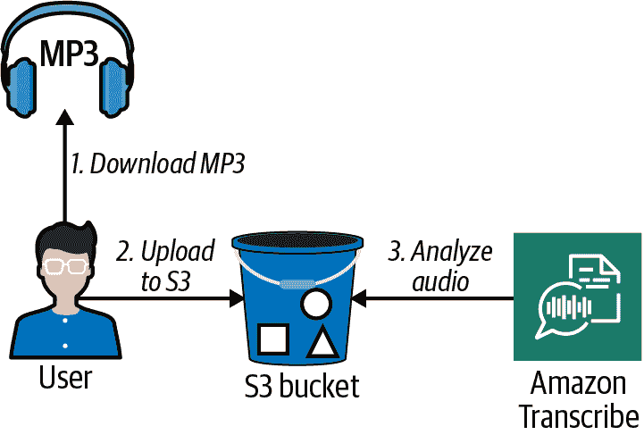
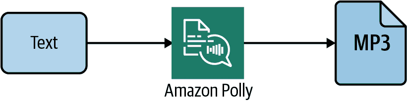
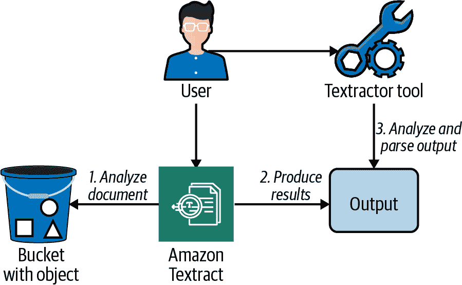
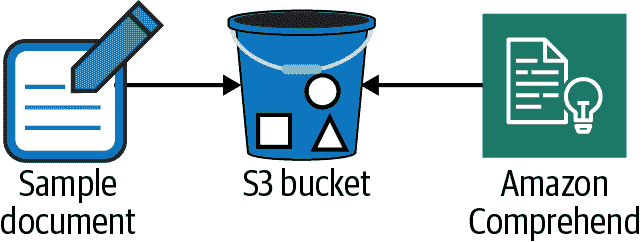
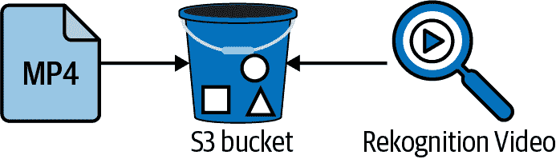
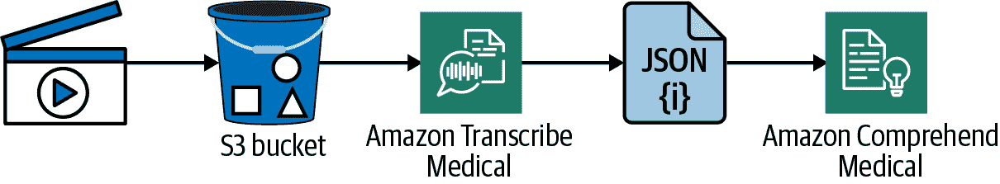
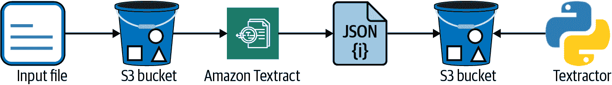

# 第 8 章 AI/ML

## 8.0 简介


机器学习（ML）和人工智能（AI）是当今最热门的两大话题。云计算提供的规模和改进的算法使计算机像人类一样思考（即“提供推理”）的能力得以快速进步。许多需要人工干预的琐碎枯燥的任务现在可以因 AI 而实现自动化。

AI 和 ML 可能会迅速变得复杂。关于它们各自已有大量文献。本章的实战指南将让你探索 AWS 提供的一些易于实现的 AI 服务，并开始构建自己的模型。在学习这些实战指南时，请尝试思考社会中还有哪些问题领域能很好地利用这些技术。从供应链预测性维护到歌曲推荐，机会无处不在。

我们本可以写 100 页关于这个主题的内容，但这些实战指南非常适合入门，你可以以此为基础进行迭代。如果你想深入了解，我们建议你查看 Chris Fregly 和 Antje Barth 合著的[*AWS 上的数据科学*](https://learning.oreilly.com/library/view/data-science-on/9781492079385)（O’Reilly, 2021）。

## 工作站配置

按照“CLI 实战指南的通用工作站设置步骤”验证你的配置并设置所需的环境变量。然后，克隆章节代码仓库：

```
git clone https://github.com/AWSCookbook/ArtificialIntelligence
```

## 8.1 转录播客

### 问题

你需要创建基于 MP3 的音频（如播客）的文本转录。

### 解决方案

使用 Amazon Transcribe 生成英语转录并将结果保存到 S3 存储桶（参见图 8-1）。



#### 先决条件

*   S3 存储桶
*   `jq` CLI JSON 处理器

#### 准备工作

按照[章节代码仓库](https://github.com/AWSCookbook/ArtificialIntelligence)中本实战指南文件夹中的步骤操作。

#### 步骤

1.  下载 MP3 格式的播客以上传到 S3 存储桶：

    ```
    curl https://d1le29qyzha1u4.cloudfront.net/AWS_Podcast_Episode_453.mp3 \
        -o podcast.mp3
    ```

    你应该会看到类似以下的输出：

    ```
      % Total % Received % Xferd  Average Speed   Time     Time   Time  Current
                                 Dload  Upload   Total   Spent    Left  Speed
    100 29.8M  100 29.8M    0    0  4613k   0  0:00:06  0:00:06 --:--:-- 5003k
    ```

    ##### 注意

    你可以在[文档](https://oreil.ly/eo3LQ)中找到 Amazon Transcribe 支持的文件格式列表。

2.  将下载的播客复制到你的 S3 存储桶：

    ```
    aws s3 cp ./podcast.mp3 s3://awscookbook801-$RANDOM_STRING
    ```

    你应该会看到类似以下的输出：

    ```
    upload: ./podcast.mp3 to s3://awscookbook801-<<unique>>/podcast.mp3
    ```

3.  使用`aws` CLI 启动 Transcribe 转录作业：

    ```
    aws transcribe start-transcription-job \
        --language-code 'en-US' \
        --media-format 'mp3' \
        --transcription-job-name 'awscookbook-801' \
        --media MediaFileUri=s3://awscookbook801-${RANDOM_STRING}/podcast.mp3 \
        --output-bucket-name "awscookbook801-${RANDOM_STRING}"
    ```

    你应该会看到类似以下的输出：

    ```
    {
      "TranscriptionJob": {
        "TranscriptionJobName": "awscookbook-801",
        "TranscriptionJobStatus": "IN_PROGRESS",
        "LanguageCode": "en-US",
        "MediaFormat": "mp3",
        "Media": {
          "MediaFileUri": "s3://awscookbook801-<<unique>>/podcast.mp3"
        },
        "StartTime": "2021-09-21T22:02:13.312000-04:00",
        "CreationTime": "2021-09-21T22:02:13.273000-04:00"
      }
    }
    ```

    使用`aws` CLI 检查转录作业的状态。等待直到转录作业状态变为 COMPLETED。这应该需要几分钟：

    ```
    aws transcribe get-transcription-job \
        --transcription-job-name awscookbook-801 \
        --output text \
        --query TranscriptionJob.TranscriptionJobStatus
    ```

##### 验证检查

在终端中显示 Transcribe 转录作业的结果：

```
aws s3 cp s3://awscookbook801-$RANDOM_STRING/awscookbook-801.json - \
    | jq '.results.transcripts[0].transcript' --raw-output
```

你应该会看到类似以下的输出：

```
This is episode 453 of the US podcast released on June 11, 2021 podcast confirmed. Welcome to the official AWS podcast. Yeah. Mhm. Hello everyone and welcome back to another episode of a W. S. Launch.
I'm Nicky, I'm your host. And today I am joined by Nathan Peck
...
```

#### 清理

按照[章节代码仓库](https://github.com/AWSCookbook/ArtificialIntelligence)中本实战指南文件夹中的步骤操作。

### 讨论

转录音频是让语音录音能够以不同方式大规模处理和分析的绝佳途径。无需收集大量数据集和训练自己的 AI 模型，就能轻松转录音频文件，这将节省你的时间并开启许多可能性。将音频转换为文本还能让你轻松执行自然语言处理（NLP），从媒体内容中获取更多见解。

使用 Transcribe 时请注意以下几点：

*   [是否支持该语言](https://oreil.ly/8NYOB)？
*   是否需要在录音中[识别说话人](https://oreil.ly/E38Ch)？
*   是否需要[支持流式音频](https://oreil.ly/uhrAr)？

#### 挑战

使用 EventBridge 自动化该流程，以便在新对象上传到你的 S3 存储桶时触发。

## 8.2 将文本转换为语音

### 问题

你需要从产品的文本描述生成音频文件。该音频将用于广告，因此必须尽可能拟人化且高质量。

### 解决方案

你将使用 Amazon Polly 的神经引擎从提供的文本生成 MP3（参见图 8-2）。



#### 步骤

1.  创建指定文本的初始音频文件：

    ```
    aws polly synthesize-speech \
        --output-format mp3 \
        --voice-id Joanna \
        --text 'Acme products are of the very highest quality and lowest price.' \
        products.mp3
    ```

    你应该会看到类似以下的输出：

    ```
    {
      "ContentType": "audio/mpeg",
      "RequestCharacters": "63"
    }
    ```

2.  收听 MP3。以下是在 macOS CLI 上的示例：

    ```
    afplay products.mp3
    ```

3.  切换到神经引擎：

    ```
    aws polly synthesize-speech \
        --output-format mp3 \
        --voice-id Joanna \
        --engine neural \
        --text 'Acme products are of the very highest quality and lowest price.' \
        products-neural.mp3
    ```

    你将看到与步骤 2 类似的输出。

4.  收听 MP3。以下是在 macOS CLI 上的示例：

    ```
    afplay products-neural.mp3
    ```

5.  添加一些[SSML 标签](https://oreil.ly/sdAQe)以修改语速：

    ```
    aws polly synthesize-speech \
        --output-format mp3 \
        --voice-id Joanna \
        --engine neural \
        --text-type ssml \
        --text '<speak>Acme products are of the very highest quality and <prosody rate="slow">lowest price</prosody></speak>' \
        products-neural-ssml.mp3
    ```

    你将看到与步骤 2 和 3 类似的输出。

6.  收听 MP3。以下是在 macOS CLI 上的示例：

    ```
    afplay products-neural-ssml.mp3
    ```

    ##### 注意

    Polly 支持的 SSML 标签列表见此[文章](https://oreil.ly/q148r)。

### 讨论


拥有从文本轻松生成逼真音频的能力，可以实现许多创意用途。您不再需要配音演员坐下来排练录音。现在您可以轻松地将音频集成到您的应用程序中。这可以从多方面改善客户的体验。

使用 Polly 创建音频时，您应该尝试不同的语音和 SSML 标签（您甚至可能想要[创建自己的语音](https://oreil.ly/vsIzj)）。Polly 的许多语音可用于[创建 Amazon Alexa 技能](https://oreil.ly/A0xXZ)。

### 挑战

为 Polly 创建一个[发音词典](https://oreil.ly/TQrQS)以供使用。

# 8.3 表单数据的计算机视觉分析

## 问题

您有一份文档，需要从中提取响应，以便对其进行数字化处理。

## 解决方案

您将安装并使用 AWS 提供的 [Textractor](https://oreil.ly/zPgXy) 工具，以利用 Amazon Textract 的表单功能。这将从表单中提取值并将它们与其键关联（例如，姓名）。请参阅图 8-3。



### 先决条件

*   S3 存储桶

### 准备工作

按照 [章节代码仓库](https://github.com/AWSCookbook/ArtificialIntelligence) 中此配方文件夹内的步骤操作。

### 步骤

1.  在 第 8 章 仓库的根目录下，`cd` 到 `803-Computer-Vision-Analysis-of-Handwritten-Form-Data/` 目录并执行后续步骤：

    ```
    cd 803-Computer-Vision-Analysis-of-Handwritten-Form-Data/
    ```

2.  将提供的 `registration_form.png` 文件（或您自己的文件）复制到您创建的 S3 存储桶中：

    ```
    aws s3 cp ./registration_form.png s3://awscookbook803-$RANDOM_STRING
    ```

    您应该会看到类似以下的输出：

    ```
    upload: ./registration_form.png to s3://awscookbook803-<<unique>>/registration_form.png
    ```

3.  使用 Textract 分析文档并将输出重定向到文件：

    ```
    aws textract analyze-document \
        --document '{"S3Object":{"Bucket":"'"awscookbook803-${RANDOM_STRING}"'",
    "Name":"registration_form.png"}}' \
        --feature-types '["FORMS"]' > output.json
    ```

4.  从 GitHub 上的 `aws-samples` 仓库获取 Textractor 工具：

    ```
    wget https://github.com/aws-samples/amazon-textract-textractor/blob/master/zip/textractor.zip?raw=true -O textractor.zip
    ```

    ###### 提示

    GitHub 上提供了许多很棒的 [AWS 示例和工具](https://github.com/aws-samples)。这里是经常查看新想法和方法的好地方。

5.  解压归档文件：

    ```
    unzip textractor.zip
    ```

6.  创建 Python 虚拟环境（如果您还没有创建）：

    ```
    test -d .venv || python3 -m venv .venv
    ```

7.  激活新创建的 Python 虚拟环境：

    ```
    source .venv/bin/activate
    ```

8.  安装 Textractor 所需的 Python 模块：

    ```
    pip install -r requirements.txt
    ```

    您应该会看到类似以下的输出：

    ```
    Collecting tabulate
      Downloading tabulate-0.8.9-py3-none-any.whl (25 kB)
    Installing collected packages: tabulate
    Successfully installed tabulate-0.8.9
    ```

9.  安装 `boto3` 模块：

    ```
    pip install boto3
    ```

10. 使用该工具分析注册表单并解析输出：

     ```
     python textractor.py \
         --documents s3://awscookbook803-${RANDOM_STRING}/registration_form.png \
         --text --forms
     ```

     您应该会看到类似以下的输出：

     ```
     ************************************************************
     Total input documents: 1
     ************************************************************
     
     Textracting Document # 1: registration_form.png
     ===================================================
     Calling Textract...
     Received Textract response...
     Generating output...
     Total Pages in Document: 1
     registration_form.png textracted successfully.
     
     ************************************************************
     Successfully textracted documents: 1
     ************************************************************
     ```

#### 验证检查

查看提取的表单数据和置信度值：

```
cat registration_form-png-page-1-forms.csv | column -t -s,
```

您应该会看到类似以下的输出：

```
Key                     KeyConfidence  Value                          ValueConfidence
Average Score           97.0           285                                       97.0
Name:                   96.5           Elwood Blues                              96.5
Date                    94.5           2/9/2021                                  94.5
Team Name:              92.0           The Blues Brothers                        92.0
Years of Experience     91.5           10                                        91.5
E-mail Address:         91.0           thebluesbrothers@theawscookbook.com       91.0
Signature               90.5           Elwood Blues                              90.5
Date                    89.0           2/9/2021                                  89.0
Number of Team Members  81.0           2                                         81.0
```

### 清理

按照 [章节代码仓库](https://github.com/AWSCookbook/ArtificialIntelligence) 中此配方文件夹内的步骤操作。

## 讨论

自动化文档处理为组织开辟了许多创新和提高效率的新途径。您无需手动解读文档中的字段和表格，即可使用 Textract 等工具将其数字化并加快处理速度。现在您能够将数据值和字段相互关联，从而能够有效地进行后续处理。

### 挑战

打印出仓库中提供的空白表单。手写填写回复。拍摄/扫描文档并使用 Textract 进行分析。

# 8.4 使用 Comprehend 从文本中编辑 PII

## 问题

您有一份包含潜在个人身份信息 (PII) 的文档。您希望在对文档进行进一步处理之前移除 PII。

## 解决方案

创建示例数据并将其存储在 S3 存储桶中。启动 Amazon Comprehend 作业以检测和编辑 PII 实体。最后，查看结果（请参阅图 8-4）。



### 先决条件

*   包含待分析文件和输出路径的 S3 存储桶

### 准备工作

按照 [章节代码仓库](https://github.com/AWSCookbook/ArtificialIntelligence) 中此配方文件夹内的步骤操作。

### 步骤

1.  创建一个名为 `assume-role-policy.json` 的文件，内容如下（仓库中提供了该文件）：

    ```
    {
      "Version": "2012-10-17",
      "Statement": [
      {
        "Effect": "Allow",
        "Principal": {
          "Service": "comprehend.amazonaws.com"
        },
        "Action": "sts:AssumeRole"
      }
      ]
    }
    ```

2.  为 Comprehend 作业创建一个角色，用于从 S3 读取和写入数据：

    ```
    aws iam create-role --role-name AWSCookbook804Comprehend \
        --assume-role-policy-document file://assume-role-policy.json
    ```

    您应该会看到类似以下的输出：

    ```
    {
      "Role": {
      "Path": "/",
      "RoleName": "AWSCookbook804Comprehend",
      "RoleId": "<<RoldID>>",
      "Arn": "arn:aws:iam::111111111111:role/AWSCookbook804Comprehend",
      "CreateDate": "2021-09-22T13:12:22+00:00",
      "AssumeRolePolicyDocument": {
        "Version": "2012-10-17",
        "Statement": [
          {
    ...
    ```

3.  将 `AmazonS3FullAccess` 的 IAM 托管策略附加到 IAM 角色：

    ```
    aws iam attach-role-policy --role-name AWSCookbook804Comprehend \
        --policy-arn arn:aws:iam::aws:policy/AmazonS3FullAccess
    ```


# 8.4 检测 PII 实体

## 步骤

### 4. 使用 [Faker](https://faker.readthedocs.io) 创建示例 PII 数据（或手动创建）：

```
pip install faker
faker -r=10 profile > sample_data.txt
```

### 5. 将示例数据复制到存储桶（仓库中提供了文件）

```
aws s3 cp ./sample_data.txt s3://awscookbook804-$RANDOM_STRING
```

您应该会看到类似以下的输出：

```
upload: ./sample_data.txt to s3://awscookbook804-<<unique>>/sample_data.txt
```

### 6. 使用 Comprehend 创建 `start-pii-entities-detection-job`：

```
JOB_ID=$(aws comprehend start-pii-entities-detection-job \
    --input-data-config S3Uri="s3://awscookbook804-$RANDOM_STRING/sample_data.txt" \
    --output-data-config S3Uri="s3://awscookbook804-$RANDOM_STRING/redacted_output/" \
    --mode "ONLY_REDACTION" \
    --redaction-config
PiiEntityTypes="BANK_ACCOUNT_NUMBER","BANK_ROUTING","CREDIT_DEBIT_NUMBER", "CREDIT_DEBIT_CVV",
"CREDIT_DEBIT_EXPIRY","PIN","EMAIL","ADDRESS","NAME","PHONE","SSN",MaskMode="REPLACE_WITH_PII_ENTITY_TYPE" \
    --data-access-role-arn "arn:aws:iam::${AWS_ACCOUNT_ID}:role/AWSCookbook804Comprehend" \
    --job-name "aws cookbook 804" \
    --language-code "en" \
    --output text --query JobId)
```

###### 提示

您也可以使用 [`detect-pii-entities`](https://oreil.ly/pdrQC) 命令（如果您对文档中 PII 数据的位置感兴趣）。如果您需要以特定方式处理 PII，这会很有帮助。

### 7. 监控作业直到其状态变为 COMPLETED；这将需要几分钟：

```
aws comprehend describe-pii-entities-detection-job \
    --job-id $JOB_ID
```

您应该会看到类似以下的输出：

```
{
  "PiiEntitiesDetectionJobProperties": {
  "JobId": "<<hash>>",
  "JobName": "aws cookbook 804",
  "JobStatus": "COMPLETED",
  "SubmitTime": "2021-06-29T18:35:14.701000-04:00",
  "EndTime": "2021-06-29T18:43:21.200000-04:00",
  "InputDataConfig": {
    "S3Uri": "s3://awscookbook804-<<string>>/sample_data.txt",
    "InputFormat": "ONE_DOC_PER_LINE"
  },
  "OutputDataConfig": {
    "S3Uri": "s3://awscookbook804-<<string>>/redacted_output/<<Account Id>>-PII-<<hash>>/output/"
  },
```

## 验证检查

作业完成后，获取 S3 中输出数据的位置：

```
S3_LOCATION=$(aws comprehend describe-pii-entities-detection-job \
    --job-id $JOB_ID --output text \
    --query PiiEntitiesDetectionJobProperties.OutputDataConfig.S3Uri)
```

从 S3 获取输出文件：

```
aws s3 cp ${S3_LOCATION}sample_data.txt.out .
```

您应该会看到类似以下的输出：

```
download: s3://awscookbook804-<<unique>>/redacted_output/111111111111-PII-cb5991dd58105db185a4cc1906e38411/output/sample_data.txt.out to ./sample_data.txt.out
```

查看输出：

```
cat sample_data.txt.out
```

您应该会看到类似以下的输出。请注意 PII 已被遮盖：

```
{'job': 'Arts development officer', 'company': 'Vance Group', 'ssn': '[SSN]', 'residence':
'[ADDRESS]\[ADDRESS]', 'current_location': (Decimal('77.6093685'), Decimal('-90.497660')), 'blood_group':
'O-', 'website': ['http://cook.com/', 'http://washington.biz/', 'http://owens.net/',
'http://www.benson.com/'], 'username': 'rrobinson', 'name': '[NAME]', 'sex': 'M', 'address':
'[ADDRESS]\[ADDRESS]', 'mail': '[EMAIL]', 'birthdate': datetime.date(1989, 10, 27)}
```

## 清理

按照 [章节代码仓库](https://github.com/AWSCookbook/ArtificialIntelligence) 中此配方文件夹内的步骤操作。

## 讨论

PII 与许多您在职业生涯中可能遇到的安全和合规标准密切相关。通常，如果您负责处理客户的 PII，则需要实施安全机制以确保该数据的安全。此外，您可能需要检测和分析您存储的 PII 类型。虽然 [Amazon Macie](https://aws.amazon.com/macie) 可以在您的 S3 存储桶或数据湖中大规模执行此操作，但您可能希望在应用程序中检测 PII 以实现自己的检查和工作流程。例如，您可能让用户填写表单并提交，然后检测他们是否意外泄露了您不允许存储的特定类型 PII，并拒绝上传。

您可以利用 Amazon Comprehend 为您检测此类信息。当您使用 Comprehend 时，预定义的特征检测由使用大型数据集训练的检测模型提供支持，以确保高质量的结果。

## 挑战

使用 Comprehend 标记 PII 的类型，而不仅仅是遮盖它。（这篇[文章](https://oreil.ly/u3kJq)提供了提示。）

# 8.5 检测视频中的文本

## 问题

您有一个视频，并希望从中提取场景中的任何文本以进行分析。

## 解决方案

将视频文件上传到 S3，并在 Amazon Rekognition Video 中启动文本检测作业（请参阅图 8-5）。



## 先决条件

*   S3 存储桶

## 准备

按照 [章节代码仓库](https://github.com/AWSCookbook/ArtificialIntelligence) 中此配方文件夹内的步骤操作。

## 步骤

### 1. 将提供的 `sample_movie.mp4` 文件复制到您创建的 S3 存储桶：

```
aws s3 cp ./sample_movie.mp4 s3://awscookbook805-$RANDOM_STRING
```

您应该会看到类似以下的输出：

```
upload: ./sample_movie.mp4 to s3://awscookbook805-utonl0/sample_movie.mp4
```

###### 注意

关于支持的视频格式，[Amazon Rekognition 常见问题解答](https://aws.amazon.com/rekognition/faqs) 指出：“Amazon Rekognition Video 支持 MPEG-4 (.mp4) 或 MOV 格式的 H.264 文件。如果您的视频文件使用不同的编解码器，可以使用 [AWS Elemental MediaConvert](https://aws.amazon.com/mediaconvert) 将其转码为 H.264。”

### 2. 开始文本检测作业：

```
JOB_ID=$(aws rekognition start-text-detection \
    --video '{"S3Object":{"Bucket":"'"awscookbook805-$RANDOM_STRING"'","Name":"sample_movie.mp4"}}' \
    --output text --query JobId)
```

等待 `JobStatus` 从 `IN_PROGRESS` 变为 `SUCCEEDED`，然后将显示结果：

```
aws rekognition get-text-detection \
    --job-id $JOB_ID
```

您应该会看到类似以下的文本：

```
{
  "JobStatus": "SUCCEEDED",
  "VideoMetadata": {
  "Codec": "h264",
  "DurationMillis": 10051,
  "Format": "QuickTime / MOV",
  "FrameRate": 30.046607971191406,
  "FrameHeight": 240,
  "FrameWidth": 320,
  "ColorRange": "LIMITED"
  },
...
```

## 验证检查

再次运行命令，使用此查询获取 `DetectedText` 值：

```
aws rekognition get-text-detection \
    --job-id $JOB_ID \
    --query 'TextDetections[*].TextDetection.DetectedText'
```

您应该会看到类似以下的文本：

```
[
  "COPYRIGHT, 1901",
  "THOMAB A. EDISON.",
  "PATENTED AuOUST 31ST. 1897",
  "COPYRIGHT,",
  "1901",
  "THOMAB",
  "A.",
  "EDISON.",
  "PATENTED",
  "AuOUST",
  "31ST.",
  "1897",
```

## 清理

按照 [章节代码仓库](https://github.com/AWSCookbook/ArtificialIntelligence) 中此配方文件夹内的步骤操作。

## 讨论

您使用 Rekognition 检测视频文件中的文本，并将输出保存到 Rekognition 服务中可访问的报告中。文本检测作业的输出包含检测到的文本的时间标记、检测到的文本本身以及其他特征。您还可以检测图像中的文本，对大量文件运行批处理作业，以及在视频和图像中[检测其他特征](https://oreil.ly/Y3pzt)。这项全托管服务让您无需训练自己的模型即可使用可靠的检测模型。

###### 提示


Rekognition 支持 `Custom Labels`，这是该服务的一项功能，允许您训练特定模型以识别视频和图像中特定于您需求的特定特征。您可以完全在 `Rekognition` 服务内部实现这一点，以实现端到端的实现。有关更多信息，请参阅 [支持文档](https://oreil.ly/TDARq)。

您可以通过使用 `AWS SDK` 将 `Rekognition` 直接集成到您的应用程序或硬件中，以获得可靠的特征和文本检测机制。

## 挑战

配置文本检测作业，以便在使用 `EventBridge` 将文件上传到特定的 `S3` 存储桶时自动启动。

# 8.6 使用 Amazon Transcribe Medical 和 Comprehend Medical 进行医生口述分析

## 问题

您需要构建一个能够识别医疗专业人员口述音频文件的解决方案。该解决方案需要能够对受保护的健康信息 (`PHI`) 等内容进行分类，以便进一步分析。

## 解决方案

使用 `Amazon Transcribe Medical` 分析您的音频文件。然后，使用 `Amazon Comprehend Medical` 在医疗背景下生成医生语音的分析（请参阅 图 8-6）。



### 先决条件

* 包含医学术语的语音（人工或计算机生成）音频文件

### 准备

按照 [章节代码仓库](https://github.com/AWSCookbook/ArtificialIntelligence) 中此配方文件夹中的步骤操作。

### 步骤

1. 创建一个名为 `awscookbook806-template.json` 的 JSON 文件，其中包含指定医生专业、语言、`S3` 存储桶和口述音频文件的参数（仓库中提供了该文件）：

```
{
  "MedicalTranscriptionJobName": "aws-cookbook-806",
  "LanguageCode": "en-US",
  "Specialty": "PRIMARYCARE",
  "Type": "DICTATION",
  "OutputBucketName": "awscookbook806-RANDOM_STRING",
  "Media": {
    "MediaFileUri": "s3://awscookbook806-RANDOM_STRING/dictation.mp3"
  }
}
```

2. 使用 `sed` 命令将 `awscookbook806-template.json` 文件中的值替换为您的 `S3` 存储桶的 `RANDOM_STRING` 值：

```
sed -e "s/RANDOM_STRING/${RANDOM_STRING}/g" \
    awscookbook806-template.json > awscookbook806.json
```

3. 使用您创建的 JSON 文件启动医疗转录作业：

```
aws transcribe start-medical-transcription-job \
    --cli-input-json file://awscookbook806.json
```

您应该会看到类似以下的输出：

```
{
  "MedicalTranscriptionJob": {
    "MedicalTranscriptionJobName": "aws-cookbook-806",
    "TranscriptionJobStatus": "IN_PROGRESS",
    "LanguageCode": "en-US",
    "Media": {
      "MediaFileUri": "s3://awscookbook806-<<unique>>/dictation.mp3"
    },
    "StartTime": "2021-07-14T20:24:58.012000-04:00",
    "CreationTime": "2021-07-14T20:24:57.979000-04:00",
    "Specialty": "PRIMARYCARE",
    "Type": "DICTATION"
  }
}
```

检查 Transcribe Medical 作业的状态。等待直到其变为 `COMPLETED`：

```
aws transcribe get-medical-transcription-job \
    --medical-transcription-job-name aws-cookbook-806 \
    --output text \
    --query MedicalTranscriptionJob.TranscriptionJobStatus
```

4. 通过从 `S3` 下载文件来获取上一个作业的输出：

```
aws s3 cp s3://awscookbook806-${RANDOM_STRING}/medical/aws-cookbook-806.json \
    ./aws-cookbook-806.json
```

您应该会看到类似以下的输出：

```
download: s3://awscookbook806-<<unique>>/medical/aws-cookbook-806.json to ./aws-cookbook-806.json
```

5. 显示从下载文件中转录的语音：

```
cat aws-cookbook-806.json | jq .results.transcripts
```

您应该会看到类似以下的输出：

```
[
  {
    "transcript": "patient jane doe experiencing symptoms of headache, administered 200 mg ibuprofen twice daily."
  }
]
```

#### 注意

您下载的生成 JSON 文件包含每个转录单词的时间标记。您可以在应用程序中使用此信息以提供额外的上下文和功能。

#### 验证检查

使用 `Comprehend Medical` 检测实体 API 启动实体检测作业。这将显示医疗状况和 `PHI` 等内容的位置：

```
aws comprehendmedical detect-entities-v2 \
    --text "$(cat aws-cookbook-806.json | jq .results.transcripts[0].transcript | tr -d '"')"
```

您应该会看到类似以下的输出：

```
{
  "Entities": [
    {
      "Id": 4,
      "BeginOffset": 8,
      "EndOffset": 12,
      "Score": 0.8507962226867676,
      "Text": "jane",
      "Category": "PROTECTED_HEALTH_INFORMATION",
      "Type": "NAME",
      "Traits": []
    },
...
```

### 清理

按照 [章节代码仓库](https://github.com/AWSCookbook/ArtificialIntelligence) 中此配方文件夹中的步骤操作。

## 讨论

您能够使用 `Amazon Transcribe Medical` 和 `Amazon Comprehend Medical` 接收医生的口述音频文件，将其转换为文本，然后检测音频文件中的医疗上下文实体。最终结果提供了患者数据、症状以及药物和剂量信息，这对于为患者和医疗专业人员构建医疗应用程序非常有用。`Comprehend Medical` 还为多种类型的 `PHI` 提供批量分析和特征检测，并能区分口述与患者/医生对话。随着远程医疗的出现，这些强大的功能可用于为使用基于应用程序的医疗服务从医疗专业人员那里获得医疗服务的患者提供即时转录。

#### 注意

您用于该解决方案的这两项服务均符合 `HIPAA` 标准。您可以放心地使用这些服务构建需要符合 `HIPAA` 合规性的医疗用例解决方案。有关符合合规标准的 `AWS` 服务的更多信息，请参阅“服务范围”[网页](https://oreil.ly/DJi29)。

### 挑战

使用 `EventBridge` 自动化处理上传到您的 `S3` 存储桶的新对象。

# 8.7 确定图像中文本的位置

## 问题

您需要确定文本 “AWS” 出现在图像的哪个象限中。

## 解决方案

我们将使用 `Textract` 分析来自 `S3` 存储桶的图像，然后解析输出以计算文本的位置（请参阅 图 8-7）。



### 先决条件

* `S3` 存储桶

### 准备

按照 [章节代码仓库](https://github.com/AWSCookbook/ArtificialIntelligence) 中此配方文件夹中的步骤操作。

### 步骤

1. 将提供的 `book_cover.png` 文件复制到您创建的 `S3` 存储桶中：

```
aws s3 cp ./book_cover.png s3://awscookbook807-$RANDOM_STRING
```

您应该会看到类似以下的输出：

```
upload: ./book_cover.png to s3://awscookbook807-<<unique>>/book_cover.png
```

2. 使用 `Textract` 分析文件并将结果输出到名为 `output.json` 的文件中：

```
aws textract analyze-document \
    --document '{"S3Object":{"Bucket":"'"awscookbook807-$RANDOM_STRING"'","Name":"book_cover.png"}}' \
    --feature-types '["TABLES","FORMS"]' > output.json
```

#### 验证检查

检查 `Practical` 文本的 `BoundingBox` 值以找到位置：

```
jq '.Blocks[] | select(.Text == "Practical") | select(.BlockType == "WORD") | .Geometry.BoundingBox' output.json
```

如果左侧和顶部值均小于 0.5，则单词 `Practical` 位于页面的左上角（请参阅 图 8-8）。

您应该会看到类似以下的输出：


```json
{
  "Width": 0.15338942408561707,
  "Height": 0.03961481899023056,
  "Left": 0.06334125995635986,
  "Top": 0.39024031162261963
}
```


### 注意

根据 [Textract 开发者指南](https://oreil.ly/Xh9Bk)，每个 `BoundingBox` 属性的值在 0 和 1 之间。该值是相对于整体图像宽度（适用于 `left` 和 `width`）或高度（适用于 `height` 和 `top`）的比率。例如，如果输入图像为 700 × 200 像素，边界框的左上角坐标为 (350,50) 像素，则 API 返回 `left` 值为 0.5 (350/700)，`top` 值为 0.25 (50/200)。

### 清理

请按照 [章节代码仓库](https://github.com/AWSCookbook/ArtificialIntelligence) 中该配方文件夹内的步骤操作。

## 讨论

您过去可能曾使用传统的光学字符识别 (OCR) 软件，在扫描纸质文档时利用 OCR 输出获取基于文本的内容输出。[Amazon Textract](https://aws.amazon.com/textract) 利用机器学习模型更进一步，实现了更准确的文本识别，并提供了可用于应用程序的额外特征和上下文信息。通过使用本配方，您能够确定图像中文本字符串的位置。您可以在 Textract 中使用类似功能，将图像（或扫描表单）中的特定文本部分转发给不同团队进行人工审核，或自动将表单的特定部分发送给应用程序中的不同微服务进行处理或持久化。应用程序开发人员在使用 Textract 之前无需训练模型；Textract 预先使用许多数据集进行了训练，可提供 [高度准确](https://oreil.ly/X07aq) 的字符识别。

### 挑战

确定图像中两个不同单词的位置，并计算它们之间的距离。
