# 第 9 章 账户管理

## 9.0 简介

虽然前几章侧重于在 AWS 账户 *内部* 部署和配置资源，但我们想提供一些配方，展示在整个账户层面可以做什么。

随着您继续扩大 AWS 使用规模，您会发现拥有可用的工具和服务来减轻管理负担非常有用，尤其是当您开始向环境中添加额外的 AWS 账户时。我们看到越来越多的人选择使用 AWS 账户作为其特定应用程序的“容器”。一些公司为公司内部的业务单元提供生产和非生产工作负载的单独账户；一些甚至设置“共享服务”账户，为公司内部的业务单元提供内部服务，以跨其可能管理的许多账户共享通用资源。您的 AWS 账户 [跨区域](https://oreil.ly/INVpe)，可为您提供全球能力，如 图 9-1 所示。

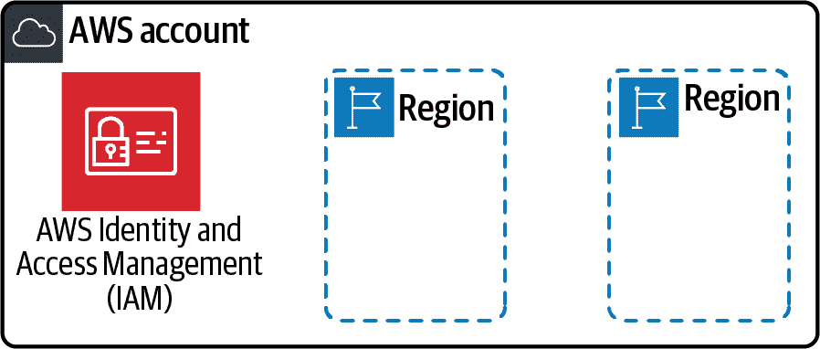

我们喜欢将 AWS 提供的工具和服务视为构建块，您可以使用它们自定义云环境以满足特定需求。其中一些可在账户层面使用，随着您扩展规模（即添加额外团队成员或额外 AWS 账户），它们能为您提供对环境的更多管理能力。您可以通过使用 [AWS Organizations](https://aws.amazon.com/organizations) 组织和合并多个账户的账单，并通过 [AWS Single Sign-On](https://aws.amazon.com/single-sign-on) 提供集中式访问管理，这两者您都将在本章的配方中探索，此外还有一些配方可帮助您在账户层面配置和维护安全环境。

### 提示

您应始终关注 [AWS 指导性指南](https://aws.amazon.com/prescriptive-guidance) 网站，以获取关于账户级功能和建议的最新指导。

### 工作站配置

#### 通用设置

请遵循 “CLI 配方的通用工作站设置步骤” 来验证您的配置并设置所需的环境变量。然后，克隆章节代码仓库：

```
git clone https://github.com/AWSCookbook/AccountManagement
```

## 9.1 使用 EC2 全局视图进行账户资源分析

### 问题

您获得了一个客户的 AWS 账户。您需要导出一个 CSV 文件，其中包含 AWS 账户跨所有区域内所有已预置的计算实例、磁盘卷和网络资源。

### 解决方案

在 AWS 控制台中导航至 EC2 全局视图。导出账户中资源的 CSV 文件（请参阅 图 9-2）。

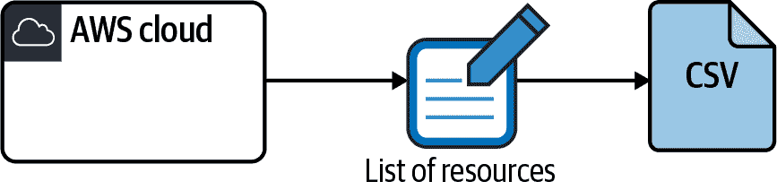

#### 先决条件

*   已部署资源的 AWS 账户

#### 步骤

1.  在 AWS 控制台中搜索并单击 EC2 全局视图，如 图 9-3 所示。

    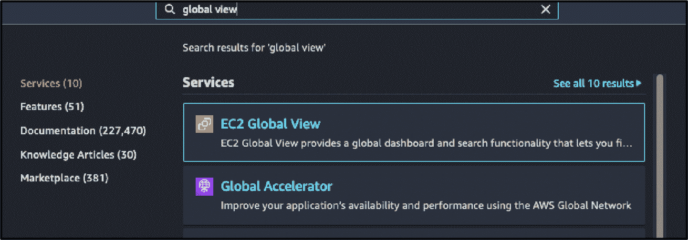

2.  导航至“全局搜索”菜单并单击“下载 CSV”（请参阅 图 9-4）。

    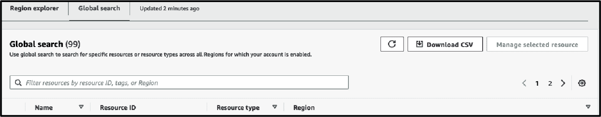

##### 验证检查

在工作站上使用您喜欢的编辑器打开下载的 CSV 文件。从那里，您应该能够浏览 AWS 账户中的资源。

### 讨论

作为工作的一部分，您可能经常需要在新的 AWS 账户中工作。如果您处于实验室环境或黑客马拉松中，使用全局视图是了解 AWS 账户包含内容的好方法。在开始对账户进行更改之前，了解跨所有区域已部署的内容非常重要。掌握这些知识将使您能够确保不会错误地导致任何中断。

虽然您应该使用 [AWS Config](https://aws.amazon.com/config) 等工具和 AWS 账单控制台分别检查 AWS 账户中资源的配置并关注账单，但了解您可以轻松生成 EC2 和 VPC 资源列表也是很好的。在不同时间进行常规 CSV 导出可用于提供某个时间点的快照。

#### 挑战

使用全局搜索功能列出所有默认 VPC 安全组。然后您可以仔细检查入站规则中多余的权限。

## 9.2 使用标签编辑器一次性修改多个资源的标签

### 问题

您需要向 AWS 账户中尚不存在该标签的多个资源添加标签。

### 解决方案

在 AWS 控制台中启动标签编辑器。查找所有具有 `Environment` 键但值不存在的资源。添加标签（请参阅 图 9-5）。

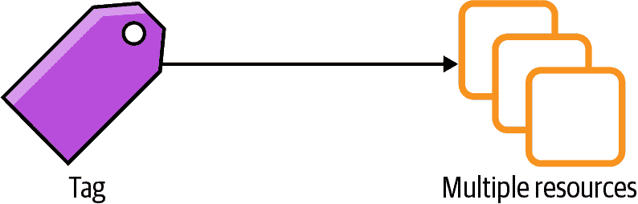

#### 先决条件

*   已部署并打标签的资源的 AWS 账户

#### 步骤

1.  在 AWS 控制台中搜索标签编辑器，然后单击“资源组和标签编辑器”，如 图 9-6 所示。

    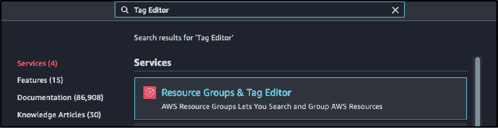

2.  在左侧菜单中，在“标记”标题下单击“标签编辑器”（请参阅 图 9-7）。

    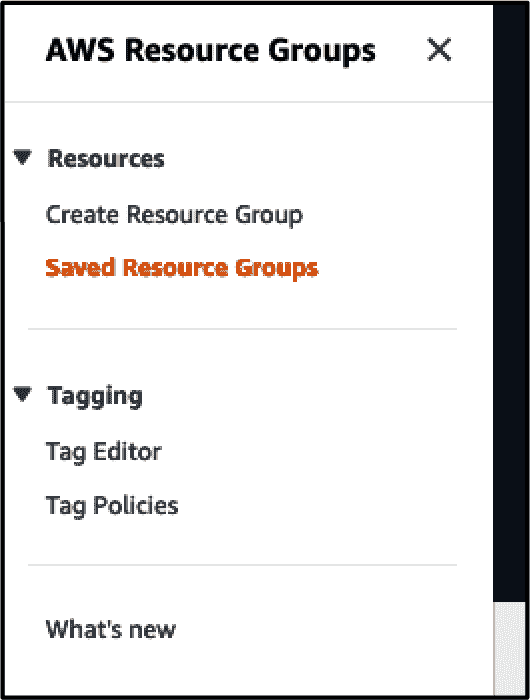

3.  将“资源类型”设置为“所有支持的资源类型”，输入标签键 `Environment`，使用下拉菜单为值选择“（未标记）”，然后单击“搜索资源”（请参阅 图 9-8）。

    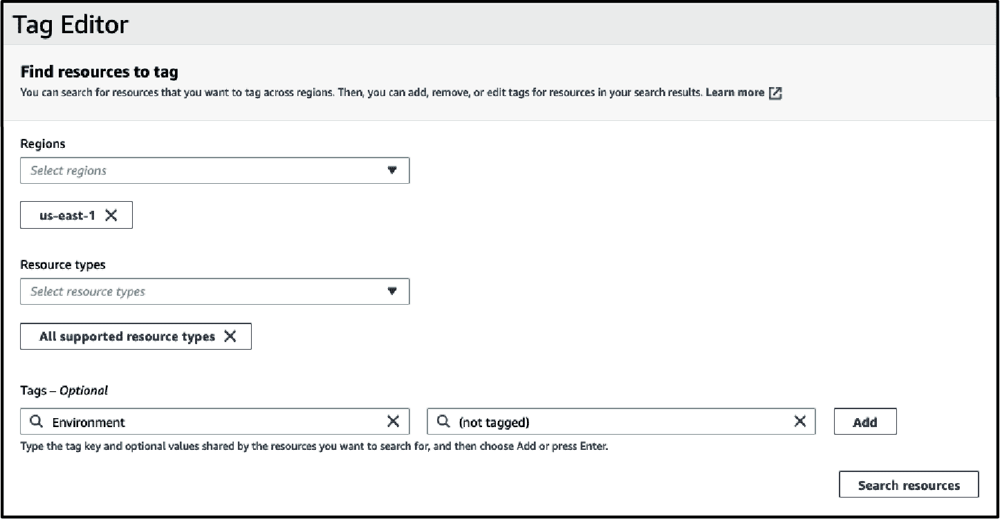

4.  等待片刻让搜索完成。然后查看结果，选择您想要打标签的资源，并单击“管理所选资源的标签”（请参阅 图 9-9）。

    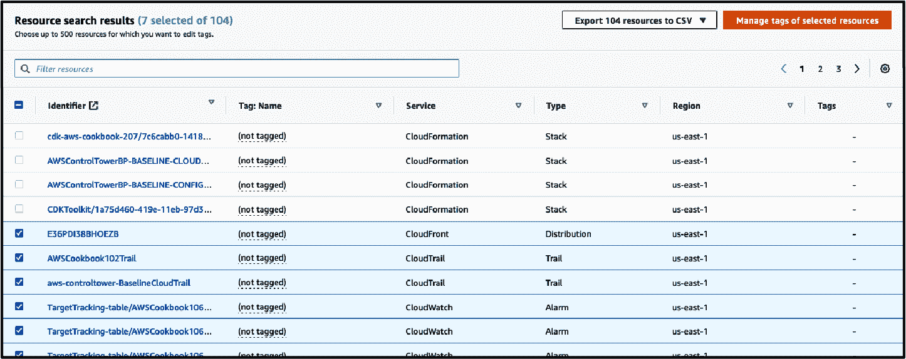


5. 输入名为 `Environment` 的“标签键”，输入“标签值” `Dev`，然后点击“查看并应用标签更改”（请参见图 9-10）。

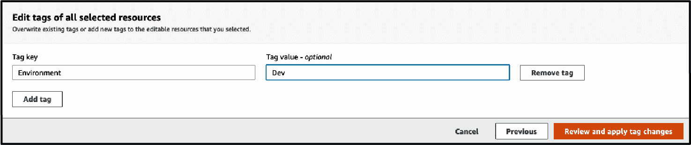

6. 在弹出窗口中，通过点击“将更改应用于所有选定项”来确认您的选择（请参见图 9-11）。

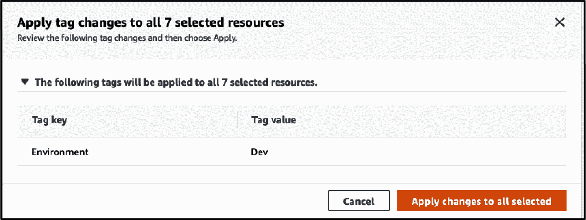

### 验证检查

使用 CLI 确认所有 EC2 实例都具有 Environment 标签：

```
aws ec2 describe-instances \
  --output text \
  --query 'Reservations[].Instances[?!not_null(Tags[?Key == `Environment`].Value)] | [].[InstanceId]'
```

您应该看不到任何输出。您也可以重复步骤 3 以确认所有资源现在都有 Environment 标签。

## 讨论

标签由键和值组成，可在创建时应用于许多资源，也可在创建后应用于几乎所有资源。您应尽早在云之旅中实施自己的标签策略。这可确保您识别在 AWS 账户生命周期内部署的不断增长的资源数量。标签可用于审核、账单、计划更新、委派对具有特定标签的资源的访问等。

[成本分配标签](https://oreil.ly/YvgIT)可帮助您理解 AWS 账单，准确查看哪些资源导致了账单的特定部分。除了成本分配报告外，您还可以在 AWS 账单控制台中通过 Cost Explorer 按标签以交互方式筛选，以分析和可视化您的成本。

标签编辑器可帮助您搜索并对 AWS 资源中的标签执行批量更新。假设您可能部署了许多资源但忘记给它们全部打标签，或者您过去未使用标签但想开始使用。您可以在标签编辑器中批量选择许多资源（跨所有区域或在选定的一组区域内），并执行这些更新，以减轻实施标签策略的负担。

虽然这不是详尽的列表，但以下是一些适合作为标签基线一部分的优秀标签：

`CreatedBy`

: 创建资源的用户或身份

`Application`

: 该资源所属的服务或应用程序

`CostCenter`

: 有助于账单识别，并帮助为共享 AWS 账户使用实现成本分摊模型

`CreationDate`

: 资源创建日期

`Contact`

: 团队或个人的电子邮件地址，以防资源出现任何问题（也有助于配置自动警报）

`MaintenanceWindow`

: 用于定义资源允许不可用的时间窗口，以防打补丁、更新或维护

`DeletionDate`

: 对开发或沙箱环境很有用，这样您就知道何时可以安全地删除资源

### 挑战

将一组基线标签应用到您的 AWS 资源，并通过启用 [AWS Organizations](https://oreil.ly/Dg3I6) 开始使用[标签策略](https://oreil.ly/7UePx)强制执行这些标签。

# 9.3 为您的 AWS 账户启用 CloudTrail 日志记录

## 问题

您刚设置好 AWS 账户，并希望保留账户中所有区域所有活动的审核日志。

## 解决方案

配置一个具有存储桶策略的 S3 存储桶，允许 CloudTrail 写入事件。为账户中的所有区域启用 CloudTrail，并配置 CloudTrail 将所有审核事件记录到 S3 存储桶，如图 9-12 所示。

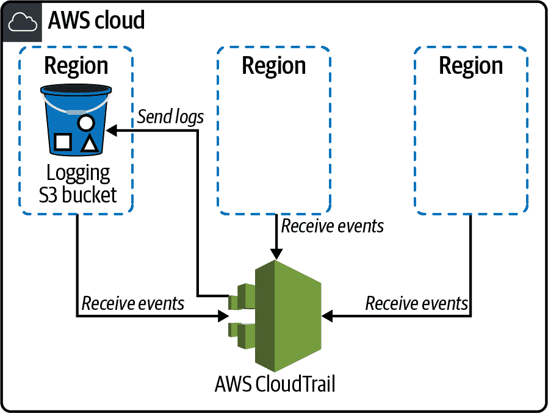

### 先决条件

* 用于日志记录的 S3 存储桶

### 准备工作

按照[章节代码仓库](https://github.com/AWSCookbook/BigData)中此配方文件夹内的步骤操作。

### 步骤

1. 创建一个名为 `cloudtrail-s3policy-template.json` 的文件（仓库中提供了该文件）：

```
{
  "Version": "2012-10-17",
  "Statement": [
    {
      "Sid": "S3CloudTrail",
      "Effect": "Allow",
      "Principal": {"Service": "cloudtrail.amazonaws.com"},
      "Action": "s3:GetBucketAcl",
      "Resource": "arn:aws:s3:::BUCKET_NAME"
    },
    {
      "Sid": "S3CloudTrail",
      "Effect": "Allow",
      "Principal": {"Service": "cloudtrail.amazonaws.com"},
      "Action": "s3:PutObject",
      "Resource": "arn:aws:s3:::BUCKET_NAME/AWSLogs/AWS_ACCOUNT_ID/*",
      "Condition": {"StringEquals": {"s3:x-amz-acl": "bucket-owner-full-control"}}
    }
  ]
}
```

2. 将 `cloudtrail-s3policy-template.json` 文件中的值替换为您部署中的值。以下是使用 `sed` 快速完成此操作的方法：

```
sed -e "s/BUCKET_NAME/awscookbook903-$RANDOM_STRING/g" \
     -e "s|AWS_ACCOUNT_ID|${AWS_ACCOUNT_ID}|g" \
     cloudtrail-s3policy-template.json > cloudtrail-s3policy.json
```

3. 将 S3 存储桶策略添加到您的 S3 存储桶：

```
aws s3api put-bucket-policy \
     --bucket awscookbook903-$RANDOM_STRING \
     --policy file://cloudtrail-s3policy.json
```

4. 为所有 AWS 区域启用 CloudTrail 并配置 S3 存储桶以将日志发送到以下位置：

```
aws cloudtrail create-trail --name AWSCookbook903Trail \
     --s3-bucket-name awscookbook903-$RANDOM_STRING \
     --is-multi-region-trail
```

5. 启动 CloudTrail 跟踪的日志记录：

```
aws cloudtrail start-logging --name AWSCookbook903Trail
```

#### 注意

有关 CloudTrail 日志记录所需的 [S3 存储桶策略](https://oreil.ly/jhcXQ) 的更多信息，请参阅 AWS 文档。

#### 验证检查

描述跟踪：

```
aws cloudtrail describe-trails --trail-name-list AWSCookbook903Trail
```

您应该会看到类似以下的输出：

```
{
  "trailList": [
  {
    "Name": "AWSCookbook903Trail",
    "S3BucketName": "awscookbook903-<<string>>",
    "IncludeGlobalServiceEvents": true,
    "IsMultiRegionTrail": true,
    "HomeRegion": "us-east-1",
    "TrailARN": "arn:aws:cloudtrail:us-east-1:<<Account Id>>:trail/AWSCookbook903Trail",
    "LogFileValidationEnabled": false,
    "HasCustomEventSelectors": false,
    "HasInsightSelectors": false,
    "IsOrganizationTrail": false
  }
  ]
}
```

获取跟踪状态：

```
aws cloudtrail get-trail-status --name AWSCookbook903Trail
```

您应该会看到类似以下的输出：

```
{
  "IsLogging": true,
  "StartLoggingTime": "2021-06-28T21:22:56.308000-04:00",
  "LatestDeliveryAttemptTime": "",
  "LatestNotificationAttemptTime": "",
  "LatestNotificationAttemptSucceeded": "",
  "LatestDeliveryAttemptSucceeded": "",
  "TimeLoggingStarted": "2021-06-29T01:22:56Z",
  "TimeLoggingStopped": ""
}
```

### 清理

按照[章节代码仓库](https://github.com/AWSCookbook/Security)中此配方文件夹内的步骤操作。

## 讨论

您可以使用 CloudTrail 记录并持续监控 AWS 账户中的所有事件。具体而言，事件是指针对 AWS API 的所有 API 活动。这些包括您（和所有经过身份验证的实体）在控制台中执行的操作、通过命令行执行的操作、来自应用程序的 API 活动，以及其他 AWS 服务执行的操作（自动操作，如自动扩缩、EventBridge 触发器、复制等）。

#### 提示

如果您在寻找特定事件，可以使用 Amazon Athena 就地查询 S3 上的日志，并且可以使用 [Amazon OpenSearch](https://oreil.ly/gdkRW) 为日志建索引，以对历史数据执行复杂查询。


你应该从安全角度使用 CloudTrail，但也可以从应用程序调试的角度使用它。假设你有一个事件驱动的应用程序，当你向 `S3` 存储桶上传文件时会触发 `Lambda` 函数（请参阅 Recipe 5.7）。如果 `Lambda` 函数调用的 `IAM` 策略不正确，你将能在 `CloudTrail` 日志中看到 `Deny`（拒绝）。这对构建和设计由 Amazon `EventBridge` 驱动的事件驱动应用程序的应用程序开发人员和架构师很有帮助。

#### 挑战

如果你拥有包含多个账户的 AWS Organization，请配置一个[组织跟踪](https://oreil.ly/4qAbK)。（请参阅 Recipe 9.6 以设置 AWS Organization。）

# 9.4 设置根用户登录的电子邮件告警

## 问题

当根用户登录 AWS 账户时，你希望收到电子邮件通知。

## 解决方案

创建一个 `SNS` 主题并订阅它。然后创建一个 Amazon `EventBridge` 规则，该规则包含一个用于搜索根用户登录并触发 `SNS` 主题的模式，如 图 9-13 所示。

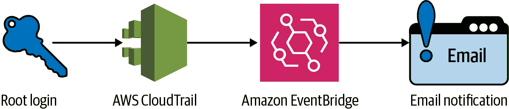

### 先决条件

*   启用了 `CloudTrail` 的 AWS 账户（请参阅 Recipe 9.3）

### 步骤

1.  创建一个 `SNS` 主题：

    ```
    TOPIC_ARN=$(aws sns create-topic \
         --name root-login-notify-topic \
         --output text --query TopicArn)
    ```

2.  订阅 `SNS` 主题。这会向你指定的地址发送一封确认邮件：

    ```
    aws sns subscribe \
         --topic-arn $TOPIC_ARN \
         --protocol email \
         --notification-endpoint your-email@example.com
    ```

3.  在收件箱中找到 AWS 发送的确认邮件，然后点击“确认订阅”。

在本章仓库的根目录下，`cd` 到 `904-Setting-Up-Email-Alerts-for-Root-Login` 目录并执行后续步骤。

4.  现在创建一个名为 `assume-role-policy.json` 的假设角色策略 JSON 语句，以便在下一步中使用（该文件已在仓库中提供）：

    ```
    {
      "Version": "2012-10-17",
      "Statement": [
        {
          "Effect": "Allow",
          "Principal": {
            "Service": "events.amazonaws.com"
          },
          "Action": "sts:AssumeRole"
        }
      ]
    }
    ```

5.  创建角色并指定 `assume-role-policy.json` 文件：

    ```
    aws iam create-role --role-name AWSCookbook904RuleRole \
         --assume-role-policy-document \
         file://assume-role-policy.json
    ```

6.  现在将托管的 `AmazonSNSFullAccess` `IAM` 策略附加到 `IAM` 角色：

    ```
    aws iam attach-role-policy \
         --policy-arn arn:aws:iam::aws:policy/AmazonSNSFullAccess \
         --role-name AWSCookbook904RuleRole
    ```

7.  为 AWS 控制台登录事件创建一个名为 `event-pattern.json` 的文件（该文件已在仓库中提供）：

    ```
    {
      "detail-type": [
      "AWS API Call via CloudTrail",
      "AWS Console Sign In via CloudTrail"
      ],
      "detail": {
      "userIdentity": {
        "type": [
          "Root"
        ]
      }
      }
    }
    ```

8.  创建一个 `EventBridge` 规则，用于监控跟踪中的根用户登录活动：

    ```
    aws events put-rule --name "AWSCookbook904Rule" \
         --role-arn "arn:aws:iam::$AWS_ACCOUNT_ID:role/AWSCookbook904RuleRole" --event-pattern file://event-pattern.json
    ```

9.  将 `EventBridge` 规则的目标设置为你的 `SNS` 主题：

    ```
    aws events put-targets --rule AWSCookbook904Rule \
         --targets "Id"="1","Arn"="$TOPIC_ARN"
    ```

#### 验证检查

使用根账户登录你的 AWS 账户，等待几分钟，然后检查邮箱中来自 `SNS` 的消息。

### 清理

按照 [章节代码仓库](https://github.com/AWSCookbook/Security) 中此 Recipe 文件夹内的步骤操作。

## 讨论

设置根用户登录告警是一种检测机制，你可以将其分层纳入安全策略，以便了解账户内的异常活动。这是一种具有成本效益的解决方案，用于监控 AWS 账户是否存在通过根用户的非预期访问。由于根用户是最强大、权限最高的身份（且应仅用于特定的非频繁任务），因此了解何时访问了它非常重要。

> **注意**
>
> 在某些情况下，需要根用户在 AWS 账户中执行特定的特权操作和任务。有关需要根用户的操作列表，请参阅 AWS [支持文档](https://oreil.ly/NvidX)。

### 挑战

添加另一个 `EventBridge` 规则，当根用户密码更改时通知同一个 `SNS` 主题（这是一个[提示](https://oreil.ly/vzvwz)）。

# 9.5 为根用户设置多因素认证

## 问题

你需要为 AWS 账户的根用户启用多因素认证。

## 解决方案

使用根用户凭证登录你的 AWS 账户。导航到 `IAM` 控制台，使用兼容 `U2F` 的硬件设备或符合[基于时间的一次性密码 (TOTP)](https://oreil.ly/TtQtd) 标准的虚拟设备启用多因素认证（请参阅 图 9-14）。

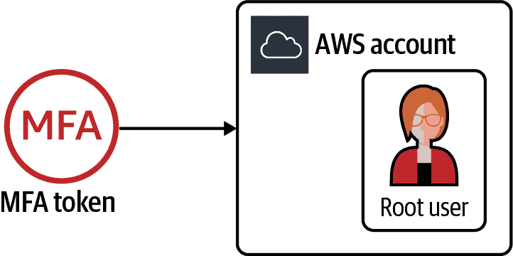

### 步骤

1.  使用与根用户关联的电子邮件地址登录 [AWS 控制台](https://console.aws.amazon.com)。你可以通过输入根用户电子邮件地址后显示的“忘记密码”链接来重置根用户的密码；单击“下一步”。你应该看到的登录对话框如 图 9-15 所示。

    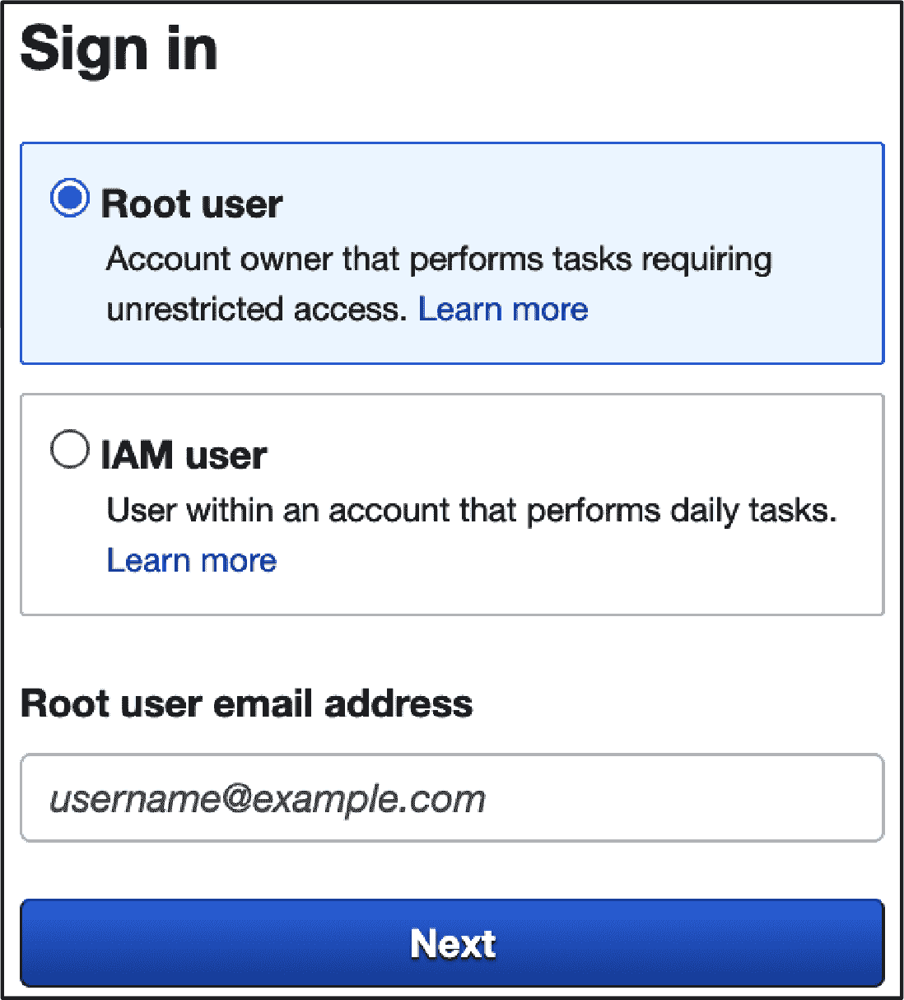

    > **提示**
    >
    > 由于你将不频繁使用根用户登录，一旦启用 `MFA`，你就不需要存储该用户的密码。每次需要访问账户时，你都可以[重置密码](https://oreil.ly/ar0H9)；请注意保护与根用户关联的邮箱的访问安全。

2.  登录 AWS 控制台后，从用户界面右上角选择[我的安全凭证](https://oreil.ly/z5xsh)，如 图 9-16 所示。

    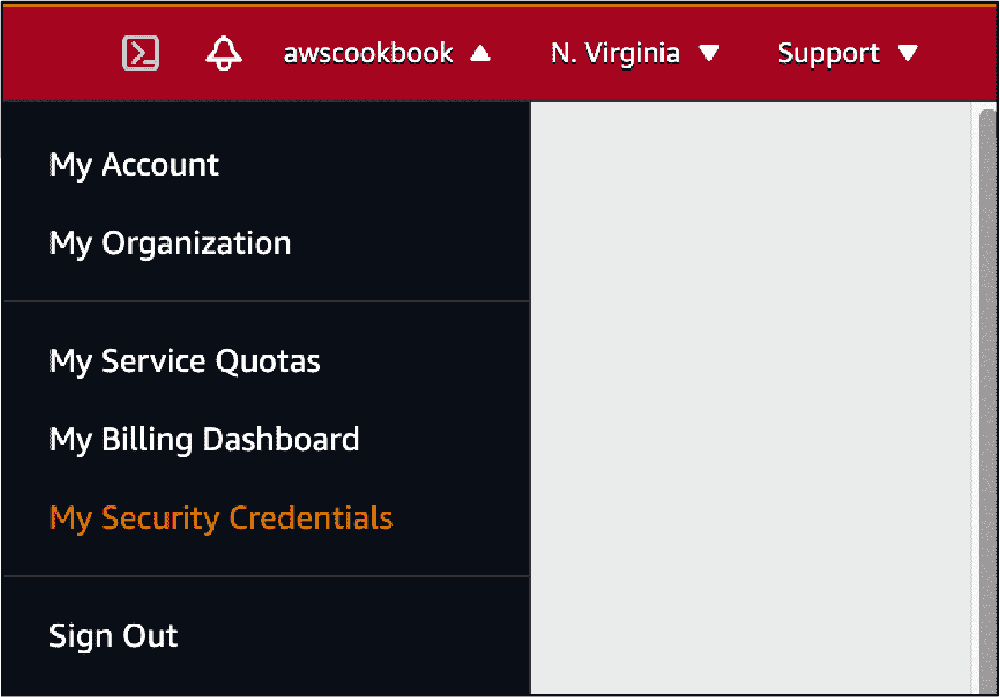

3.  在 `IAM` 控制台的“您的安全凭证”页面上展开“多因素认证”面板，然后单击“激活 MFA”按钮。选择你将使用的[设备类型](https://oreil.ly/VVL9g)，然后单击“继续”（请参阅 图 9-17）。

    > **警告**
    >
    > 如果你使用基于软件的密码管理器实用程序来存储虚拟 `MFA` 设备信息，请勿将根用户密码存储在同一个密码管理器中。如果你的密码管理器实用程序或保管库遭到破解，你的第二因子和密码组合在一起就能访问你的 AWS 账户。同样，你的电子邮件账户密码信息也不应与虚拟 `MFA` 设备存储在同一位置，因为只要有权访问与根用户关联的邮箱，就能成功完成根用户密码重置过程。

    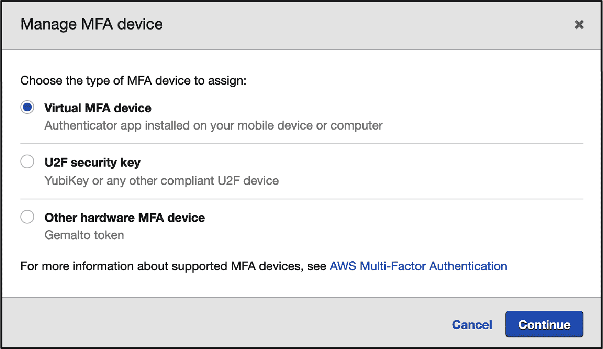

4.  按照提示显示一个 `QR` 码以便用虚拟设备扫描，或者插入硬件令牌并按照提示操作。输入代码后，你将看到一个指示 `MFA` 设置已完成的窗口（请参阅 图 9-18）。

    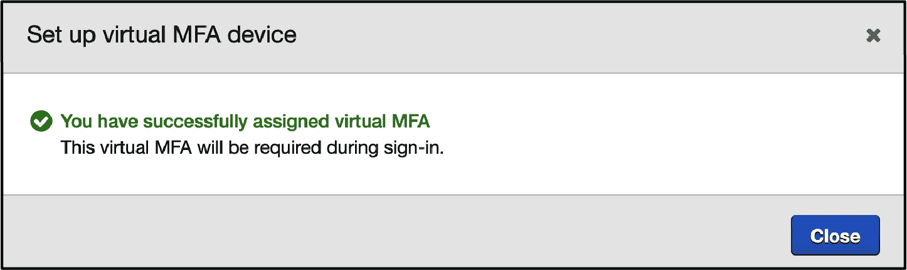

    > **提示**
    >
    > 你可以打印显示的 `QR` 码副本，并将其保存在物理安全的位置作为备份，以防你失去对虚拟 `MFA` 设备的访问权限。

#### 验证检查


Sign out of your AWS account and sign back in as the root user. Enter the code generated by the virtual device (or insert the hardware token) and complete the sign-in process.

### 清理

You should always have MFA enabled for the root user. If you want to disable the MFA device associated with the root user, follow the steps in [Deactivating a Device](https://oreil.ly/pvpVw).

## 讨论

The [Root User](https://oreil.ly/qNtiE) is the highest-privileged identity in an AWS account. The username is the email address you configured when you first created the AWS account, and password reset requests can be initiated from the AWS Console or by contacting AWS Support. If your email account is compromised, a malicious actor could request a reset of your root account password and gain access to your account. The root user should always be protected by a second factor of authentication to prevent unauthorized account access. Because the root user is only needed on [rare occasions](https://oreil.ly/Em4TW), you should never use it for daily tasks.

#### 提示

You need to enable IAM user and role access to the Billing Console. You can do this by following the AWS [steps](https://oreil.ly/DVPbZ), further reducing reliance on the root user for tasks.

Configuring IAM users (or setting up federated access with ADFS and IAM, SAML and IAM, or AWS Single Sign-On) is critical; do not log in to the AWS account with the root user for daily use. [AWS recommends creating an administrative IAM user immediately after opening an AWS account](https://oreil.ly/MuSdE), which should be one of the first things you do after enabling MFA for the root user. For a scalable approach, you can follow Recipe 9.6 to enable and use AWS Single Sign-On for your own (and delegated) access needs.

### 挑战

Configure MFA protection for other IAM roles in your account (using trust policies) (this is a [hint](https://oreil.ly/e8YMQ)).

# 9.6 Setting Up AWS Organizations and AWS Single Sign-On

## 问题

You need a scalable way to centrally manage usernames and passwords to access your AWS accounts.

## 解决方案

Enable AWS Organizations, configure AWS Single Sign-On, create groups, create permission sets, and create a user for yourself in the AWS SSO directory, as shown in Figure 9-19.

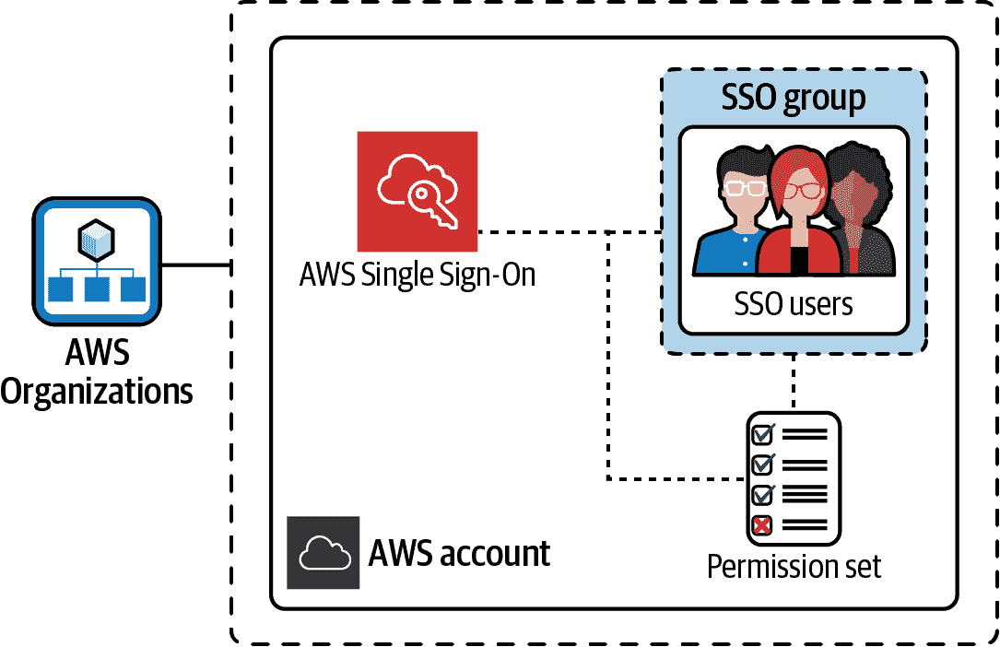

### 步骤

1.  Navigate to [AWS Organizations](https://console.aws.amazon.com/organizations) in the AWS Console and click "Create organization".

    #### Tip

    AWS Organizations provides many features that enable you to use multiple AWS accounts at scale. For more information, see the [AWS Organizations Documentation](https://oreil.ly/Wdaa4).

2.  Organization creation will trigger an email sent to the email address associated with your account's root user. Confirm the organization creation by clicking the "Verify your email address" button.

3.  Navigate to the [AWS SSO Console](https://console.aws.amazon.com/singlesignon) in your Region and click the "Enable SSO" button.

    #### Note

    The initial configuration of AWS SSO uses a local directory for your users. You can federate to an existing user directory, such as Active Directory or a SAML provider. For information on configuring federation, the [AWS SSO User Guide](https://oreil.ly/PeusI) provides details.

4.  Go to the "Groups" section of the SSO Console and click "Create group". Enter the desired group name and click "Create", as shown in Figure 9-20.

    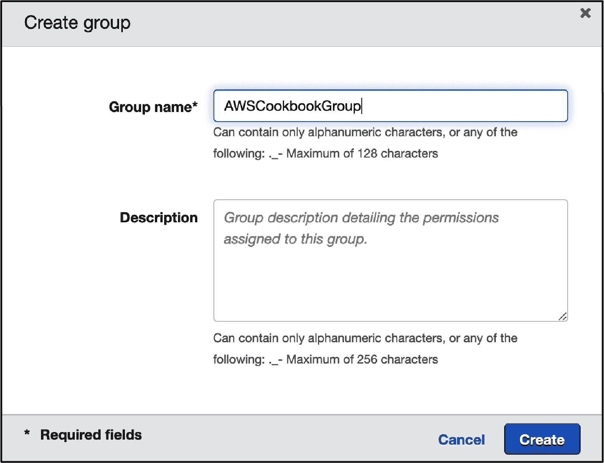

5.  Go to the "Users" section of the SSO Console and select "Add user". Fill in the required information in the fields, add the user to the group you created, and select "Create". You can have the AWS SSO Console generate an initial password for you, or send an email to the address provided in the required "Email address" field. On the second page of the "Add user" wizard, assign the user to the group you created in Step 4 (see Figure 9-21).

    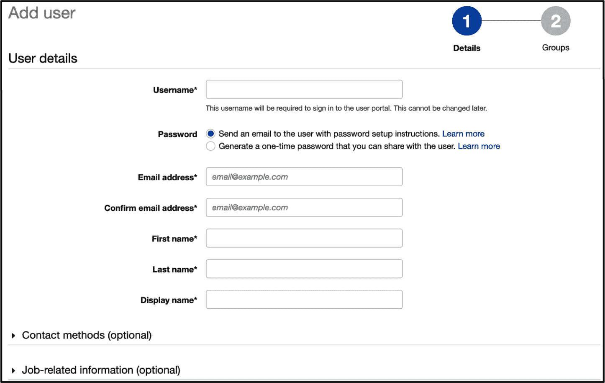

6.  Go to the "AWS Accounts" section of the SSO Console (in the left navigation menu of the console), select the "Permission Sets" tab, and then select "Create permission set". Select the "Use an existing job function policy" option and choose `PowerUserAccess` (see Figure 9-22).

    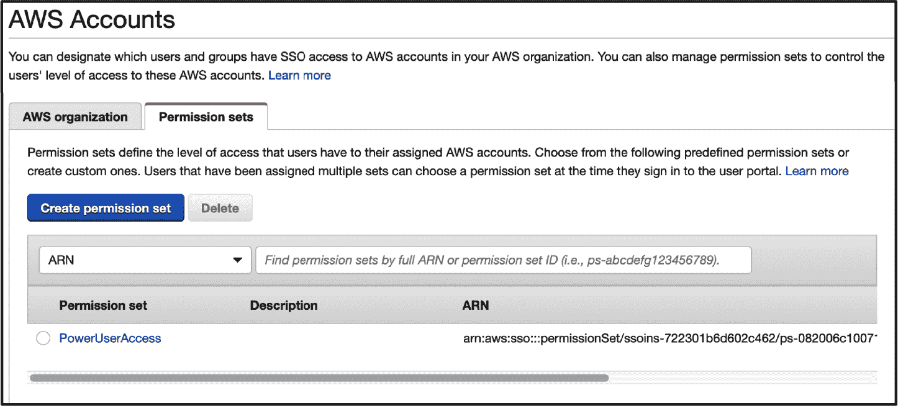

7.  To assign the permission set to the group you created for the AWS account, click the "AWS Accounts" link in the left navigation menu, select the "AWS Organization" tab, select your AWS Account from the list of accounts, and click "Assign users". Click the "Groups" tab and select the group you added the user to in Step 4, as shown in Figure 9-23. Click "Next: Permission Sets".

    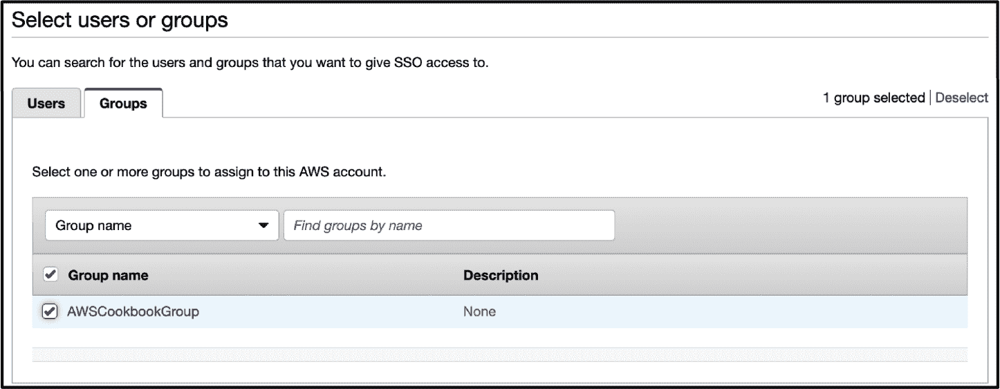

8.  Select the permission set you created in Step 6 and click "Finish" (see Figure 9-24).

    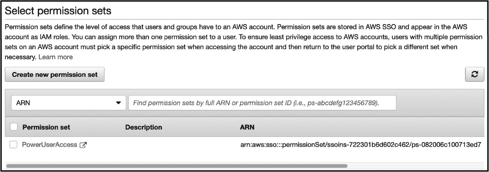

    #### Note

    After clicking "Finish", members of the group can access the specified AWS Account with the permissions of the `PowerUserAccess` IAM policy. AWS SSO provisions a role in your AWS Account that can be assumed for this purpose. Do not modify this role via IAM in the AWS Account, or the Permission Set will not work via AWS SSO.

#### 验证检查

Go to the URL provided on the AWS SSO Console Dashboard page and sign in with the username and password of the user you created in Step 5. Select "Management Console" or "Command Line or Programmatic Access" to get `PowerUserAccess` permissions to the AWS Account.

#### 提示

A default URL is generated when AWS SSO is first enabled. You can create a custom URL for your own purposes by clicking the "Customize" link next to the default URL in the SSO Console.

### 清理

Go to the AWS SSO Console, select "Settings" from the left navigation menu. Scroll to the bottom of the Settings page and select "Delete AWS SSO Configuration". Confirm the deletion by checking the box and clicking "Delete AWS SSO".

Go to AWS Organizations, select your Organization, open the Organization's Settings, and then select "Delete Organization". You will need to verify the Organization ID and confirm the deletion of the Organization via the email address associated with the AWS Account Root User.

## 讨论

When you enable AWS Organizations, the account you initially created the Organization with is called the [Management Account](https://oreil.ly/UTrvA). While you enabled AWS Organizations to use AWS Single Sign-On in this Recipe, it is primarily used for governance, organization, and management of AWS Accounts at scale. Some Account Management features you may be interested in include, but are not limited to:

*   Consolidated billing across multiple AWS Accounts
*   Managing grouped accounts using [Organizational Units](https://oreil.ly/ZLn6v) (OUs)
*   Applying [Service Control Policies](https://oreil.ly/DeR3h) (SCPs) to individual Accounts or OUs
*   [Centrally managing policies](https://oreil.ly/4s2Nx) for tagging and backup across all Accounts in the Organization
*   Sharing resources across accounts using [Resource Access Manager](https://oreil.ly/eiNlp) (RAM)


# AWS Organizations 和 AWS SSO

AWS Organizations 和 AWS SSO 可免费启用，并提供了一种可扩展的方式，让你开始管理 AWS 账户和用户对整个 AWS 环境的访问。作为一项[最佳实践](https://oreil.ly/rZ02g)，仅将管理账户用于管理功能（而不运行工作负载）是你应该采用的模式。创建作为你 AWS 组织成员的特定 AWS 账户，用于生产和非生产工作负载，有助于你隔离工作负载、减小影响范围、委托访问、管理账单等。

## 提示

这些概念开始定义[*着陆区*](https://oreil.ly/X9vg1)的概念。你可以使用[AWS Control Tower](https://oreil.ly/DzWXI)来配置一个完全托管的着陆区，而无需自行构建。当你计划将 AWS 使用规模扩展到仅几个账户之外时，使用 Control Tower 具有优势。

## AWS 单点登录

AWS 单点登录提供了一种安全且可扩展的方式来管理用户对 AWS 账户的访问。你可以集成外部身份提供商 (IdP)，或使用 AWS SSO 内置的目录，具体取决于你需要管理多少用户以及是否已有外部用户目录。

当你成功通过 AWS SSO 进行身份验证时，系统会显示由[权限集](https://oreil.ly/t3wOC)定义的访问级别供你选择。权限集使用 IAM 策略定义，SSO 利用它来管理一个角色，你可以在成功登录后承担该角色。AWS 在 SSO 中提供了与常见工作职能相符的权限集，但你也可以通过编写 IAM 策略语句并将其保存为权限集来创建自己的自定义权限集。一旦你选择进入账户的访问级别，就会创建一个临时会话。你可以在 AWS 控制台中使用该会话，或者通过命令行配合[`temporary access key ID`、`secret access key` 和 `session token variables`](https://oreil.ly/Uz8BT)使用，又或是[使用 AWS CLI v2 从命令行通过 SSO 进行身份验证](https://oreil.ly/qLcUl)。你可以在 AWS SSO 控制台中[调整会话持续时间的长度](https://oreil.ly/nXfAi)。

## 安全

围绕 AWS 环境访问的安全性应是你的首要任务，随着用户和账户数量以及委托访问级别的扩大，这会变成一个挑战。AWS SSO 为你提供了一种大规模实施 AWS 环境安全性的机制。由于你通过 AWS SSO 使用账户发起的会话是临时的，因此无需创建长期有效的[IAM 访问密钥](https://oreil.ly/bk0L7)在命令行环境中使用，这减少了一个需要轮换和管理的密钥。你还可以将多因素认证与 AWS SSO 结合使用，并要求登录时进行 MFA 验证。

### 挑战 1

将 AWS SSO 连接到[外部身份提供商](https://oreil.ly/Ra2r6)，以适配现有的 IdP，如 Active Directory 或 Okta。

### 挑战 2

应用[服务控制策略](https://oreil.ly/6KWR4) (SCP) 以限制你在 AWS 账户中可使用的区域。
