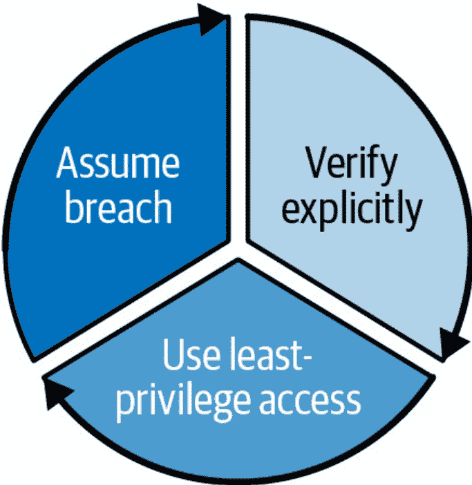

## 第 1 章。了解机密计算和信任

“数据是新石油”这一说法在当今的数字世界中再贴切不过了。近年来，云计算已得到广泛采用，而人工智能 (AI) 特别是在生成式 AI 等领域取得了重大进展，数据已成为最有价值的资产之一。对于许多企业来说，数据是关键的差异化因素，因为它为它们提供了竞争优势，并且在许多情况下，它能让新兴企业等后起之秀挑战现有的霸权。

然而，随着数据对企业变得越来越重要，这也带来了一个挑战：如何在对数据进行计算的同时确保数据受到保护？此外，如何确定执行计算的代码未被篡改？机密计算通过提供基于硬件、经过验证的可信执行环境 (TEE) 的保证来应对这些挑战，这些环境提供数据完整性和机密性以及代码完整性。这样一来，即使数据和代码在多租户云环境中运行，也能实现高度信任。

TEE 隔离内存中的数据。Azure 使用的 TEE 使用由底层 CPU 固件管理的密钥对内存中的数据进行加密。固件还可防止拥有该内存的 TEE 外部运行的任何软件篡改内存中的数据。TEE 可以帮助防止云运营商和恶意第三方未授权访问内存中的数据，在某些情况下，还可以帮助防止来自内部威胁（例如失控的租户管理员）的未授权访问内存中的数据。除了使云中内存中的数据更安全之外，机密计算还可以启用全新一类多方隐私保护应用程序，

被称为机密清洁室。

本章旨在让读者了解机密计算，首先从机密计算联盟（CCC）发布的定义入手，阐述其关键特性，并概述其如何帮助完成数据保护生命周期。接着，本章探讨了厂商特定的机密计算技术如何让你通过选择合适的内存隔离级别来确定 TEE 的大小以及其可应对的威胁类型。最后，本章阐明了机密计算与零信任原则的一致性。

在后续章节中，本报告将涵盖机密计算的各种用例、Azure 机密计算产品组合以及 Azure 上机密计算的未来发展方向。

### 机密计算概览

本节讨论 CCC 确立的机密计算定义、机密计算的关键特性，以及机密计算如何帮助完成数据保护生命周期。

### 机密计算定义

术语 *机密计算* 由 CCC 定义为“在基于硬件、可证明的可信执行环境（TEE）中执行计算，以保护使用中的数据”。该定义旨在涵盖并适用于广泛的计算模型，包括公有云、私有云（本地）和混合云，以及边缘计算、物联网（IoT）设备、移动设备，甚至运营技术（OT）等。此外，它是厂商中立的，因为它不与特定的处理器类型或技术相关联。

### 机密计算的关键特性

机密计算的关键特性包括硬件信任根、内存保护和证明。

### 硬件信任根

硬件信任根确保数据加密使用的密钥源自在 CPU 制造时即记录在 CPU 硅片本身中的全球唯一主密钥。该主密钥无法从 CPU 导出，因此 CPU 硬件之外无法访问。用于加密内存中数据的密钥由运行在底层 TEE 硬件上的固件生成，同样超出 CPU 硬件范围之外无法访问。这使得 TEE 之外的所有软件都不可信。如果内存加密由云服务提供商的主机操作系统或虚拟机监控程序（hypervisor）中的软件管理，将违反机密计算的一项关键原则。

### 内存保护

内存保护确保数据在写入内存时始终是加密的，使用的密钥由运行在底层 TEE 硬件上的固件生成，云运营商无法访问。只有拥有该内存的 TEE 内软件才能对其进行写入或读取，从而防止未经授权的访问或修改。内存保护支持以下功能：

### 数据和代码机密性

这确保未经授权的实体无法查看或访问驻留在 TEE 内存中的数据或代码。这在实际上消除了泄露敏感数据（如个人数据或知识产权（IP），例如开发成本高达数百万美元的 AI 模型）的风险。

### 数据和代码完整性

这确保未经授权的实体无法添加、修改或删除驻留在 TEE 内存中的数据或代码。这一点至关重要，因为计算过程中必须保证数据和代码的完整性；否则，计算结果不可信。

### 证明

证明是建立对 TEE 硬件和软件组件信任的关键方法。成功的证明可确保：

- TEE 硬件的有效性和可信度。这确认 TEE 确实基于预期的硬件（制造商、版本、固件等），并且相关的内存保护功能已启用。
- TEE 内运行的软件的有效性和可信度。这确认软件具有有效的身份（版本、运行时属性等），且未被篡改。

### 数据保护生命周期中的机密计算

安全的主要目标之一是保护数据免受未经授权的访问，这类威胁来源众多，包括不法管理员、不法数据中心运营商以及黑客和企业间谍等外部威胁。数据保护的需求主要体现在三种状态下：数据静止、传输中和使用中。虽然保护静止数据和传输中数据的技术（如加密）已随时间成熟，但保护计算过程中使用中的数据却证明要困难得多。例如，传输中数据可以通过 [TLS 协议]() 进行保护，而静止数据可以通过成熟的加密方法进行保护，例如 [FIPS-140]() 中规定的方法。

然而，随着云计算的广泛采用，保护内存中使用中数据的需求急剧增加，从而导致了包括机密计算在内的各种技术的出现。[图 1-1]() 说明了机密计算如何帮助填补整体数据保护生命周期中的空白。

现有加密
机密计算

静止数据
在 blob 存储、数据库等中存储非活动数据时对其进行加密。

传输中数据
对在不受信任的公共或私有网络之间流动的数据进行加密。

使用中数据
保护/加密正在使用、位于 RAM 中以及正在计算过程中的数据。

图 1-1. 数据保护生命周期中的机密计算

简而言之，机密计算的主要目标是使用基于硬件、可证明的 TEE 来保护计算过程中使用中的数据。我们将在下一节讨论为什么证明对机密计算至关重要。目前，让我们先来看看 TEE 的一些关键特性及其在机密计算中发挥的作用。

### 注意

请注意，有几种技术可用于保护计算过程中使用中的数据，成熟度各不相同，包括但不限于同态加密（HE）、安全多方计算（SMPC）和零知识证明（ZKP）。有关隐私增强技术的更多资源，请参见附录 B。

### 内存隔离级别

CCC 对机密计算的定义是厂商中立的，并未规定 TEE 受保护内存中包含或排除的内容（该内存使用单个 CPU 生成的密钥进行加密）。CPU 厂商提供的不同机密计算实现为 TEE 增加了一个新维度：内存隔离级别。

目前，CPU 厂商提供三级 TEE 内存隔离：虚拟机级别、容器组级别和代码级别（细化到代码片段级别）。每个级别都由底层 CPU 固件分配唯一的内存加密密钥。表 1-1 总结了这三种隔离级别。

### 表 1-1. TEE 内存隔离级别

| 隔离级别 | 技术 | 迁移便捷性 | 防御云运营商和恶意第三方 | 防御威胁 |
| :--- | :--- | :--- | :--- | :--- |
| 虚拟机 | Intel® TDX,a AMD® SEV-SNPb | 原样迁移（Lift and shift） | 是 | 不是 b |
| 容器组 | AMD® SEV-SNP | 原样迁移（Lift and shift） | 是 | 是 |
| 应用程序代码 | Intel® SGXc | 需要重构代码 | 是 | 是 |

a Intel® 信任域扩展（TDX）
b 第 3 代 AMD® EPYC™ 处理器，支持安全加密虚拟化 - 安全嵌套分页（SNP）

请注意，尽管虚拟机级别的隔离支持现有工作负载的原样迁移（Lift and shift），但默认情况下，它并不保护虚拟机（VM）内部的任何代码或数据免受内部威胁（例如拥有管理员权限的不法或失职用户）的影响。同样需要注意的是，尽管代码级别的隔离在 TEE 中提供了最小的代码基，但这种隔离级别的代价是需要重构代码才能使用开源 SDK 进行实现。出于此原因，容器组级别的隔离在更轻松地保护云原生工作负载免受甚至内部威胁方面具有巨大潜力。

### 机密计算与零信任

“零信任”一词最早由 Forrester 于 2009 年提出，尽管其根源可以追溯到“去边界化”概念，如《国防信息系统局（DISA）黑芯》和《杰里科论坛戒律》等出版物中所述。近年来，零信任获得了广泛支持。其重要性在于它已成为美国（及其他国家）国家网络安全战略的组成部分，如备忘录 M-22-09《推动美国政府迈向零信任网络安全原则》中所述。零信任安全背后的理念是，不能仅凭边界来推断“安全”。相反，我们应采纳一种深植于“永不信任、始终验证”心态的安全方法。本节讨论了零信任的三个关键原则，以及硬件信任根、证明和 TEE 大小在应对这些原则方面的重要性。

### 零信任原则

要了解零信任及其指导原则，让我们来看看 NIST 提供的定义：“零信任（ZT）提供了一套概念和理念，旨在将在被视为已被攻破的网络环境中，强制执行信息系统和服务中准确的、按请求最小特权访问决策所带来的不确定性降至最低。”

此定义可浓缩为图 1-2，该图突出了三项关键的零信任原则。

图 1-2. 零信任原则

让我们简要回顾一下每一项原则。

### 显式验证

这一原则表明，授权决策必须始终基于访问请求的完整上下文，并且每次提出请求时都应强制执行。

完整上下文包括用户或工作负载标识、地理位置、设备合规状态、请求的终端或服务、数据分类以及用于检测异常行为的历史访问模式等属性。

显式验证作为零信任的关键原则，与通常采用的基于边界的安全方法有显著不同。基于边界的安全方法安全态度相对宽松，允许实体访问边界内的资源（例如，应用程序、服务等），而无需在每次提出请求时都验证请求的完整上下文。

本质上，显式验证原则通过要求每次提出访问请求时都对所有请求进行显式审查，从而实现更高的安全态势。

### 使用最小特权访问

最小特权访问原则强调应用即时访问和恰好足够访问（JIT/JEA）等安全技术，以确保在授予访问权限时，仅限于所需范围。

这通过将访问权限和访问时长限制在完成任务所需的绝对最小值，来缩小攻击面。

除了 JIT/JEA 之外，还应实施自适应的机器学习风险策略，以确保最小特权访问在整个环境中始终得到一致执行。

### 假设已发生泄露

假设已发生泄露原则专注于在假设对手已经存在于环境中的前提下，运行和保护组织资源。

这种思维会导致诸如“默认拒绝”等安全措施，并对所有用户、设备、数据流和访问请求持续进行彻底审查。

假设已发生泄露还强调了记录、检查和持续监控任何配置更改、资源访问以及网络流量以查找可疑行为的必要性。

### 零信任中硬件信任根的重要性

硬件信任根是任何机密计算平台安全的基石。

根据 NIST，信任根是“一个被隐式信任的起点”。

硬件信任根通常是专门设计的高度防篡改硅芯片或一组芯片。

芯片生产后，它们是不可替代的，因此在部署到现场后，其可信性实际上无法被破坏（虽然这并不意味着不可能）。

这种信任源于这样一个事实：硅芯片首先使用加密方法对自身进行度量，并提供未被篡改的保证，这些保证可以随时进行验证。

其基本理念是，在引导过程链中更下游的任何其他组件执行之前，硬件芯片首先在根级别建立信任，依此类推。

当组织在私有云中维护专属数据中心时，他们控制硬件基础设施并承担管理服务器的责任。

但是，当组织采用公有云时，他们对云运营商在基础设施管理和数据中心运营方面的依赖会增加。

TEE 的硬件信任根有助于确保客户数据即使在公有云中使用时也能保持私密。

正如其名称所示，硬件信任根由芯片制造商提供的硬件而非云运营商提供的软件建立。

这提供了关注点分离，有助于防范各种类型的威胁，包括当云运营商在数据在内存中使用时访问数据时可能产生的威胁。

这是因为用于加密内存中数据的密钥由 CPU 固件生成，云运营商无法获取。

此外，证明过程通过防止工作负载在未启用内存保护的硬件上执行，有助于确保数据和代码的完整性和机密性。

以这种方式，硬件信任根结合证明过程，促进了显式验证和假设已发生泄露等零信任原则的实施。

组织可以始终假设任何人（包括云运营商）都可能被攻破，并通过显式验证 TEE 及其中运行的代码，仍然保持高安全态势。

这种解耦消除了对托管基础设施的云运营商的信任需求，是实施零信任的重要一步。

对信任根的验证确认硬件是真实的，并且已配置为支持 TEE。

它还确认在 TEE 中运行的代码未被篡改。

这是通过证明过程实现的，该过程将在下一部分讨论。

### 零信任中证明的重要性

证明是组织实施零信任、将机密工作负载迁移到云端并享受云可扩展性和性能优势的关键推动因素。

如果没有证明，他们必须依赖云运营商的承诺，相信已有隐私防护措施来防止数据在使用过程中被未授权访问。

证明消除了组织隐式信任 TEE 硬件及其中运行代码的需求。

它通过明确请求加密证据来提供验证机制，这些证据证明 TEE 本身的有效性（例如，它是具有所需属性的有效基于硬件的 TEE）以及代码未被更改（例如，代码哈希）。

此外，证明还促进了显式验证和假设已发生泄露等零信任原则的实施。

组织可以假设任何人（包括云运营商）都可能被攻破，并通过显式验证 TEE 及其中运行的代码，仍然保持高安全态势。

### 内存隔离级别与零信任

在设计安全系统时，减少 TEE 中的代码大小是可取的，因为它减少了恶意行为者可利用的攻击面。

此外，当它将来宾操作系统（VM 中的操作系统）从 TEE 中移除时，如代码级别和容器级别隔离的情况，可以帮助防范内部威胁。

以这种方式，在 TEE 中代码量方面，少即是多。

作为 TEE 一部分的任何组件也必须能够通过加密方法使用证明过程来提供关于其真实性的保证——即其在部署时的度量符合预期；否则，系统中依赖它的其他组件不会“信任”它。

在机密计算中，必须使用之前描述的硬件信任根和证明概念，将信任建立到硅/CPU 制造商层面。

这些功能允许你显式验证 TEE 组件的状态，以及所有从 TEE 访问和访问 TEE 的操作都遵循最小特权访问原则。

各种厂商特定技术通过在不同级别（如虚拟机级别、容器组级别和代码级别）提供内存隔离，使得可以减少 TEE 中的内容（甚至减少到仅几行代码）。

因此，更多软件可以移到 TEE 之外，并且即使被攻破，也不会影响 TEE 中的数据。

图 1-3 突出说明了假设已发生泄露、显式验证和使用最小特权访问这三项零信任原则如何与机密计算的关键特性保持一致，以及内存隔离级别在确定可被攻破内容方面的重要性。

### 假设已遭入侵
- 由运营数据中心的云供应商
- 由其他租户（由于云的多租户特性）

### 显式验证
- 尝试访问加密内存的软件的身份
- TEE 硬件和软件的真实性和状态

### 使用最小权限访问
- 内存只能由最初写入它的 VM、容器组或代码段读取和写入
- 由公司自己的管理员（通过使用容器级别或代码级别内存隔离）

图 1-3. 机密计算如何应对零信任原则以及内存隔离级别在降低内部威胁方面的作用

机密计算使组织能够在数据和代码使用过程中防止未经授权的访问。硬件信任根和证明作为机密计算的基石，使组织能够在充分利用公有云的同时实施零信任，因为它们有能力验证云环境。在下一章中，您将了解 Azure 机密计算（ACC）平台，包括其各种功能和支持服务，这些功能和服务使组织能够在 Azure 上运行各种机密工作负载。
