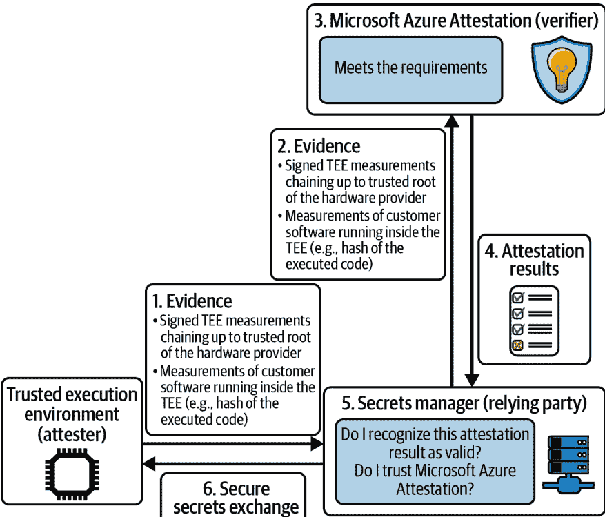
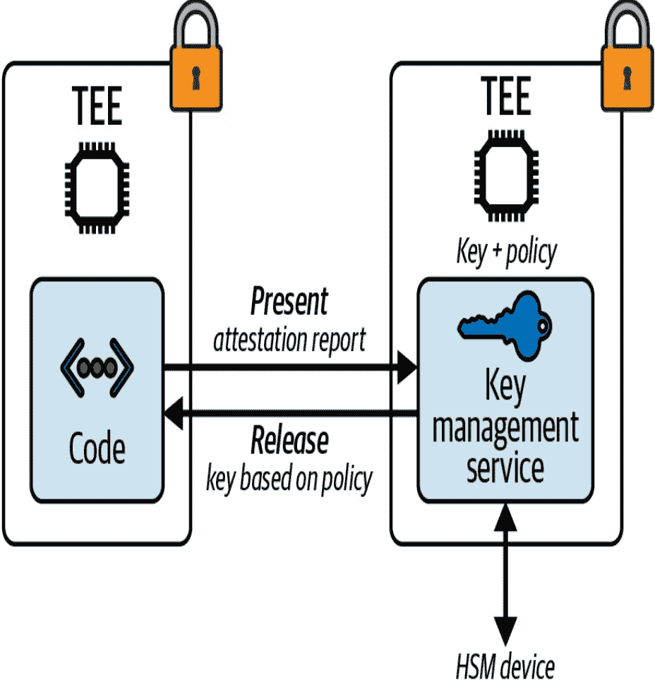
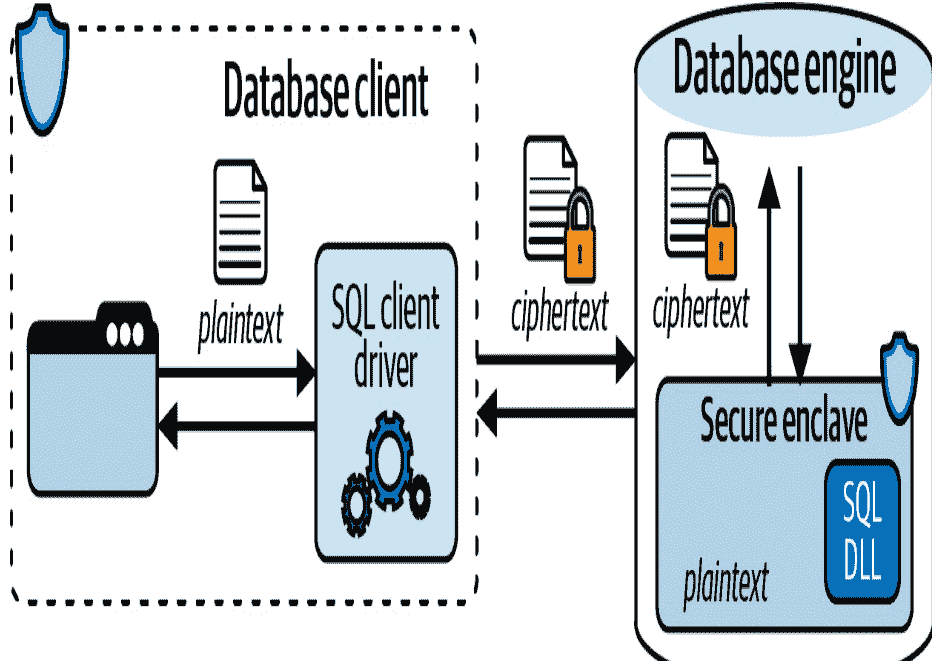

## 第 3 章。Azure 机密计算产品组合

Azure 机密计算 (ACC) 由一系列产品和支持服务组成，这些产品和服务使客户能够根据第 1 章中概述的定义和原则，在使用过程中保护敏感数据。该产品组合包括虚拟机 (VM)、基于容器的平台即服务 (PaaS) 以及其他 PaaS 和软件即服务 (SaaS)。截至 2023 年 11 月的产品组合如图 3-1 所示。

本章按如下方式对 ACC 产品组合进行分组：

- 虚拟机，支持 VM 级别和代码级别隔离
- 基于容器的 PaaS，支持 VM 级别、代码级别和容器组级别隔离
- 支持的服务和功能，例如证明、受信任启动以及使用客户托管密钥的 OS 磁盘加密
- 其他启用 ACC 的 SaaS 和 PaaS

| 类别 | 列 2 | 列 3 | 列 4 | 列 5 | 列 6 |
| :--- | :--- | :--- | :--- | :--- | :--- |
| 虚拟机 | AMD [1] DCa/EcA AMD SEV-SNP 虚拟机 | Intel [1] DCsv2/DCsv3/DCdsV3 Intel SGX 虚拟机 | NVIDIA [3] 带 NVIDIA H100 GPU 的 NCCv5 机密虚拟机 | Intel [2] DCesv5 Intel TDX 虚拟机 | |
| 基于容器的 PaaS | [1] AKS 上的 Intel SGX 应用安全区节点 | [1] 机密 VM AKS 工作节点 | [1] | [2] AKS 上的机密容器 | |
| 其他 PaaS/SaaS | [1] 机密 VM 上的 SQL IaaS | [1] 始终使用安全区加密的 SQL IaaS | [1] 机密 VM 上的 AVD | [2] 机密 VM 上的 Azure Data Explorer | [1] 机密 VM 上的 Azure Data Explorer |
| | [1] 托管 HSM | [1] Microsoft Azure 证明 | [1] Azure 机密分类账 | [2] Azure 托管 CCF | |

### ACC 虚拟机

ACC 虚拟机是希望将现有 VM 工作负载迁移到 Azure 的客户的构建基块。它们包括机密虚拟机、带有应用安全区的虚拟机以及带有机密 GPU 的机密虚拟机。

### 机密虚拟机

机密虚拟机提供强大的安全性和保密性，以及硬件强制执行的边界，以满足最严格的安全要求。机密虚拟机特别适用于客户迁移现有工作负载并寻求在不修改代码的情况下将应用程序“提升并移位”的场景，同时确保平台防止未经授权的实体读取或更新 VM 的状态。机密虚拟机可以与使用客户托管密钥加密的磁盘配对，帮助确保客户随时控制对其数据的访问。作为受信任启动的一部分，安全启动功能也在所有机密虚拟机中默认启用，以提供额外的完整性和保护。

图 3-2 说明了机密虚拟机如何防止虚拟机监控程序读取或修改 VM 状态（即，虚拟机监控程序位于 TEE 之外）。

机密虚拟机
应用程序 (app)
1. 证明
2. 执行

加密内存
(保密性和完整性)

虚拟机监控程序

CPU BIOS、设备驱动程序, ...

硬件

图 3-2. 机密虚拟机

请阅读文章“DCasv5 和 ECasv5 系列机密虚拟机”以获取更多详细信息。

### 带有应用安全区的虚拟机

带有应用安全区 (app enclave) 的虚拟机使用 Intel 软件防护扩展 (SGX) 技术支持代码级别隔离。在创建应用安全区时，识别应用程序的哪个部分在安全区内运行非常重要。安全区将该部分代码与应用程序的其余部分隔离开来。安全区初始化代码并将其加载到内存后，不受信任的组件无法读取或修改该代码，该代码由底层 SGX 固件生成的唯一密钥加密。应用安全区如图 3-3 所示。

应用程序 (app)

安全区

应用程序的受信任部分

应用程序的不受信任部分

1. 划分应用程序
2. 创建安全区
3. 证明
4. CallTrusted()
7. 业务逻辑

5. 执行
6. 返回

调用桥

硬件

OS、VMM、BIOS, ...

请阅读文章“应用安全区开发”以获取更多详细信息。

### 带有机密 GPU 的机密虚拟机

Microsoft Azure 提供了基于采用 SEV-SNP 技术的 AMD CPU 和使用机密计算的 NVIDIA® H100 Tensor Core GPU 的带有机密 GPU 的机密虚拟机的预览版。

带有机密 GPU 的机密虚拟机的目标是在 Azure 中建立一个安全环境，用于运行受益于 GPU 加速的机器学习工作负载，并增加一层安全性，以确保虚拟机在受信任环境中启动和运行。用于模型的数据以及模型本身的代码保持加密状态，而 VM 则利用 GPU 的增强性能来运行机器学习和基于 AI 的应用程序。

请阅读文章“宣布推出带有 NVIDIA H100 Tensor Core GPU 的 Azure 机密虚拟机预览版”以获取更多详细信息。

### ACC 基于容器的 PaaS

Azure 当前提供四种机密容器 PaaS。有些具有 VM 级别内存隔离 (适用于 AKS 的机密 VM 节点池)，有些具有代码级别内存隔离 (适用于 AKS 的带应用安全区 VM 节点池)，有些具有容器组级别内存隔离 (ACI 上的机密容器和 AKS 上的机密容器)。表 3-1 按内存隔离级别汇总了此类 ACC 容器服务的分类。

表 3-1. 按内存隔离级别划分的 ACC 容器服务

| 内存隔离级别 | 服务 |
|---|---|
| 虚拟机 | 适用于 AKS 的机密 VM 节点池 |
| 代码 | 适用于 AKS 的带应用安全区 VM 节点池 |
| 容器组 | ACI 上的机密容器，AKS 上的机密容器 |

### 适用于 Azure Kubernetes Service (AKS) 的机密 VM 节点池

机密节点池利用具有基于硬件的可信执行环境 (TEE) 的 VM。它们通过拒绝虚拟机监控程序和其他主机管理代码访问 VM 内存和状态，以及防止云操作员访问，为 AKS 提供纵深防御功能。这些功能使高度敏感的容器工作负载能够在无需重构代码的情况下迁移到 AKS，同时保持 VM 级别内存隔离。

请阅读文章“使用 AMD SEV-SNP 机密虚拟机在 AKS 上支持机密 VM 节点池”以获取更多详细信息。

### 适用于 Azure Kubernetes Service (AKS) 的带应用安全区 VM 节点池

带应用安全区 VM 节点池能够在 AKS 内以一种方式执行容器化应用程序，该方式保护安全区中的代码不受操作员或其他租户以及客户自身租户管理员的访问。这是因为内存隔离发生在代码级别。

请阅读文章“Azure Kubernetes Service 上基于 Intel SGX 的机密计算节点的应用安全区支持”以获取更多详细信息。

### 适用于 Azure Container Instance (ACI) 的机密容器

ACI 上的机密容器提供容器组级别内存隔离，CPU 为每个容器组生成一个唯一的加密密钥。机密容器利用 AMD SEV-SNP 处理器的嵌套虚拟化功能，其中每个机密容器组在其自身的第 2 层实用工具 VM 内运行，该 VM 由在基础 VM 的来宾 OS 上运行的虚拟机监控程序创建。因此，它不仅防止云操作员和其他云租户访问，还防止客户自身租户管理员访问，从而也保护容器组的内存免受内部威胁。由于 ACI 是“无服务器”产品，支持这些容器组的基础设施对客户隐藏并由 Azure 管理。Microsoft 提供了一个开源的“边车”容器映像，可以将其包含在机密容器组中，以便与依赖方（例如密钥管理服务）交换机密信息。

请阅读文章“Azure 容器实例上的机密容器”以获取更多详细信息。

### 适用于 Azure Kubernetes Service (AKS) 的机密容器

AKS 上的机密容器提供 Pod 级别内存隔离，每个 Pod 都有由 CPU 生成的独特加密密钥。机密容器利用 AMD SEV-SNP 处理器的嵌套虚拟化功能，其中每个 Pod 在由在基础 VM 的来宾 OS 上运行的虚拟机监控程序创建的其自身第 2 层实用工具 VM 内运行。因此，它们不仅防止云操作员和其他云租户访问，还防止客户自身租户管理员访问。因此，它们也保护 Pod 的内存免受内部威胁。这些功能使高度敏感的容器工作负载能够在无需重构代码的情况下迁移到 AKS，同时利用 Pod 级别隔离。Microsoft 提供了一个开源的“边车”容器映像，可以将其包含在机密 Pod 中，以便与依赖方（例如密钥管理服务）交换机密信息。

请阅读文章“公共预览版：AKS 上的机密容器”以获取更多详细信息。

### ACC 的支持服务和功能

Azure 提供多种功能和服务，用于支持 TEE 证明以及 Azure 防御纵深策略的其他方面。所有这些功能均可与 ACC VM 一起使用，而其中一些功能对机密容器和其他 PaaS 也有用。与证明相关的服务和功能包括 Microsoft Azure 证明服务、适用于机密 VM 的来宾证明功能以及安全密钥释放。支持防御纵深其他方面的其他服务和功能包括受信启动、使用客户托管密钥的机密磁盘加密以及 Azure Key Vault 托管 HSM（硬件安全模块）服务。

### Microsoft Azure 证明

Microsoft Azure 证明是一项服务，用于验证硬件平台及其运行的软件是否符合预期的证据的可信度。该服务支持对受信任平台模块 (TPM) 支持的平台进行证明，以及对 TEE 状态进行证明。这为依赖方（例如密钥管理器）提供保证，即在释放密钥和处理敏感工作负载之前，预定软件正在受信任硬件上执行。

证明可以遵循以下两种模式之一：

- 在护照模型中，TEE 中的应用程序（证明者）将证据直接传递给验证者（Azure 证明或第三方证明服务），并在从依赖方请求密钥之前接收来自验证者的验证结果（图 3-4）。
- 在背景调查模型中，TEE 中的应用程序首先通过将证据传递给依赖方来从该方请求密钥，并让依赖方在将密钥释放到 TEE 之前验证证据是否可信（图 3-5）。

受信任执行环境（证明者）

- 1. 证据
  - 与硬件提供商受信任根链接的签名 TEE 测量值
  - TEE 内运行的客户软件的测量值（例如，已执行代码的哈希值）
- 2. 验证者
  满足要求。
- 3. 证明结果
- 4. 证明结果
- 6. 安全密钥交换
- 5. 密钥管理器（依赖方）
  我是否认为此证明结果有效？
  我是否信任 Microsoft Azure 证明？

图 3-4. TEE 证明的护照模型

图 3-5. TEE 证明的背景调查模型

有关 Azure 证明的更多信息，请阅读“Microsoft Azure 证明：用例”。

### 来宾证明

Azure 来宾证明软件是 Azure 上机密 VM 的证明支持工具。它允许用户设计基于 VM 的应用程序，以便在交换密钥和处理敏感数据之前验证底层硬件和来宾操作系统的状态。它可以加载到 VM 的 OS 磁盘上，以提供基于加密的证明，证明 VM 正在运行于具有所需隔离级别和完整性的基于硬件的 TEE 中。来宾证明软件还可以为依赖方（例如密钥管理服务）提供证据，证明 TEE 硬件和 TEE 内的软件均符合预期，然后才允许交换密钥。（有关更多详细信息，请参阅下一节。）

有关更多详细信息，请阅读文章“什么是机密 VM 的来宾证明？”。

### 安全密钥释放

安全密钥释放 (SKR) 的目标是确保密钥在其生命周期内保持加密状态，并且仅发布到授权的代码/应用程序。SKR 使密钥能够从密钥管理服务转移到已证明的 TEE，例如安全 enclave、基于 VM 的 TEE 或机密容器组。SKR 为数据解密/加密密钥增加了额外的访问保护层，仅允许 TEE 访问密钥。对这些密钥的访问由密钥发行前定义的 SKR 策略控制。安全密钥释放的高级别流程如图 3-6 所示，其中在 TEE 中运行的代码通过出示证明报告来请求密钥，而 AKV 等密钥管理服务根据预定义的密钥释放策略发布密钥。

图 3-6. 安全密钥释放

有关更多信息，请阅读文章“安全密钥释放功能与 AKV 和 Azure 机密计算 (ACC)”。

### 第 2 代 VM 的受信启动

Azure 受信启动通过启用虚拟受信任平台模块 (vTPM) 来保护 Azure 托管的虚拟机（第 2 代）免受 rootkit 和 bootkit 攻击，从而提高其安全性。vTPM 是遵循 TPM 2.0 规范的硬件受信任平台模块的虚拟化版本。vTPM 通过验证虚拟机整个启动链（UEFI、启动加载程序、操作系统、系统和驱动程序）的完整性来实现证明。受信启动利用 vTPM 执行基于云的远程证明，用于平台运行状况评估和基于信任的决策。作为运行状况检查，受信启动可以加密验证虚拟机是否已成功启动。

有关更多详细信息，请阅读文章“Azure 虚拟机的受信启动”。

### 使用客户托管密钥的磁盘加密

Azure 托管磁盘（OS 磁盘和数据磁盘）支持使用客户托管密钥的磁盘加密。它允许客户使用自己的密钥加密单个磁盘。对于客户托管密钥，此密钥用于保护并限制对用于保护数据的加密密钥的访问。客户可以将其托管密钥存储在 Azure Key Vault 或 Azure Key Vault 托管 HSM 中。

通过使用自己的密钥，客户可以完全控制密钥，这为某些行业提供了满足合规性和监管要求所需的灵活性。

有关更多详细信息，请阅读文章“Azure 磁盘存储的服务器端加密：客户托管密钥”。

### 托管 HSM

Azure Key Vault 托管硬件安全模块 (MHSM) 是一种单租户、基于云的、FIPS 140-2 第 3 级验证的密钥管理服务，可确保对客户拥有的密钥提供最高级别的保护。这种“密钥主权”意味着客户组织对谁可以访问密钥和更改密钥管理策略，以及哪些 Azure 服务消耗这些密钥拥有完全且排他性的控制权。

客户做出这些决定后，通过技术手段防止 Microsoft 人员更改这些决定。托管 HSM 服务利用 Azure 机密计算的功能，在基于 Intel Software Guard Extensions (SGX) 构建的 TEE 中运行。Intel SGX 利用应用程序 enclave 内的基于硬件的隔离来提供针对内部和外部威胁的增强安全措施，以在数据处于活动使用状态时保护数据。即使使用调试器，也无法查看应用程序 enclave 内部的数据或代码。如果不受信任的代码尝试更改应用程序 enclave 内存中的内容，Intel SGX 会禁用该环境并拒绝该操作。这些独特功能可帮助您保护加密密钥材料，防止其作为明文被访问或可见。托管 HSM 的功能包括：

- 单租户且完全托管。
- FIPS 140-2 第 3 级验证。
- 高可用性且支持区域恢复。
- 每个 HSM 池包含多个 HSM 分区，这些分区跨越多个数据中心中多个机架上的三台服务器。在发生硬件故障的情况下，HSM 的成员分区将自动迁移到健康硬件上。
- 每个 HSM 实例使用单独的客户特定安全域，以加密方式隔离每个客户的 HSM。

有关更多详细信息，请阅读文章“什么是 Azure Key Vault 托管 HSM？”。

### 其他 ACC PaaS 和 SaaS

本节讨论 Azure 中所有其他支持机密计算的 PaaS 和 SaaS 服务。

### Azure 机密分类账 (ACL)

Microsoft Azure 的机密分类账 (ACL) 是一项高度安全的服务，用于提供防篡改分类账，用于安全的审计日志记录和管理敏感数据记录。它仅在硬件支持的安全隔区中运行，这是一种经过广泛监控且与世隔绝的运行时环境，可防止潜在攻击。除了不可变性、抗篡改和仅追加操作之外，ACL 还提供独特的数据完整性优势。这些功能可保证所有记录的完整性，非常适合关键元数据记录不得修改的场景，例如用于法规合规和存档目的。

例如，ACL 通过充当时间点事实来源来保护数据库和应用程序，该来源在验证场景中提供加密证明。它还可作为审计跟踪或需要保持完整并选择性地与特定人员共享的记录的存储库。分类账中记录的数据保持不可变、隐私增强，并受到组织甚至云提供商内部内部人员威胁的保护。请阅读文章“Microsoft Azure 机密分类账”了解更多详细信息。您还可以了解 Microsoft 如何使用 Azure 机密分类账保护其自身的硬件供应链。

### 机密联盟框架 (CCF) 的托管版本

机密联盟框架 (CCF) 是一个开源框架，用于开发高可用有状态服务，这些服务利用集中式计算来提高可用性和性能，同时提供去中心化的信任。它使多方能够在机密数据上执行可审计的计算，而无需相互信任或信任特权操作员。

Azure 托管机密联盟框架 (Azure Managed CCF) 有助于在整个生命周期内在 Azure 的托管环境中托管 CCF。除了 CCF 功能之外，Azure Managed CCF 还提供可扩展性、高可用性、自动代码升级和灾难恢复等云优势。

使用 Azure Managed CCF，客户可以构建需要对数据和多方可能需要的信息进行可编程机密性的机密应用程序。通常，成员将就网络的宪章达成一致并设置治理和业务事务规则，业务事务将基于已定义的内容进行。如果治理发生影响业务规则的变更，联盟需要批准这些变更。

请阅读 [此博客文章]() 了解更多详细信息。

### 带安全隔区的 Always Encrypted

Azure SQL Database 中的带安全隔区的 Always Encrypted 启用了原位加密和丰富的机密查询，包括模式匹配、范围比较和排序。如图 3-7 所示，Always Encrypted 的工作原理是在应用程序端的客户端驱动程序内部加密查询参数并解密查询结果。在数据库引擎内，只有安全隔区可以访问明文数据，从而加强了对数据机密性的保护，防止客户组织中的流氓 DBA、云操作员和恶意软件。

图 3-7。带安全隔区的 Always Encrypted

有关更多详细信息，请参阅“带安全隔区的 Always Encrypted 文档”。

### 带机密 VM 选项的 PaaS

表 3-2 列出了支持机密 VM 选项的各种 Azure 服务。

表 3-2。各种 Azure 服务的机密 VM 支持

| 功能 | 说明 |
|---|---|
| Azure 虚拟桌面的机密 VM 支持 | Azure 虚拟桌面中的机密 VM 支持，可通过保护使用中的数据来帮助提高数据隐私和安全性。有关更多信息，请阅读文章“宣布 Azure 虚拟桌面中机密 VM 正式发布”。 |
| Azure Databricks 的机密 VM 支持 | Azure Databricks 的机密 VM 支持，适用于其群集驱动程序节点和群集工作器节点。有关更多信息，请阅读“宣布 Azure Databricks 上基于 AMD 的机密 VM 正式发布”。 |
| Azure 数据资源管理器的机密 VM 支持 | Azure 数据资源管理器的机密 VM 选项，通过允许 ADX 工作负载在基于硬件且经过认证的 TEE 中执行来增强安全性。有关更多信息，请阅读“Azure 数据资源管理器的机密 VM 选项：公共预览版发布”。 |
