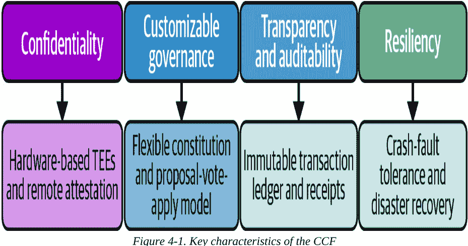

## 第 4 章。未来之路

在本最终章中，您将了解 Microsoft 对机密计算的愿景、其对社区进步的贡献、客户和合作伙伴案例研究的参考资料，以及有助于深入了解 Azure 机密计算的有用资源。

### Microsoft 对机密计算的愿景

信任是组织拥抱云计算的关键因素，而机密计算在建立信任方面至关重要，该信任通过加密保证支持，确保数据在使用过程中始终受到保护，防止未经授权的访问。Microsoft 已将为客户提供 Azure 中一流的安全和隐私功能而不牺牲性能列为首要任务。Microsoft 于 2017 年 9 月提供了其首个机密计算产品/服务（带应用程序隔区的 VM）的预览版，以帮助客户在 Azure 云中处理数据和代码时保障其机密性和完整性。

2018 年，Microsoft 在 MIT 许可下发布了 Open Enclave SDK，旨在围绕隔区抽象提供一致的 API 表面，实现 Intel SGX 和 Arm TrustZone 等 TEE 类型之间的可移植性以及架构自由。该 SDK 最终被纳入 CCC 项目。Microsoft Research 不仅在开发改进 Microsoft 平台上机密计算能力的尖端算法方面发挥了关键作用，还将这些算法共享到研究出版物和开源项目中，以造福全球社区。

### 创新

Microsoft 的 Azure Research 团队一直在开展开创性研究，以识别在公共云以及私有云和混合云环境中部署的应用程序和工作负载中保护隐私的方法。这项研究开发了内存标记、恶意软件遏制和数据干净室方面的尖端技术，这些技术已被行业内多种硬件和软件产品实现。这些创新还催生了许多开源项目：

- 机密联盟框架 (CCF) 是一个开源框架，用于构建一类新的安全、高可用且高性能的应用程序，这些应用程序专注于多方计算和数据。
- Verona 项目是一种研究型编程语言，开发目的是探索并发所有权的概念。Microsoft 正在提供一种无缝集成所有权的新并发模型。
- snmalloc 是一种高性能分配器。它可以直接在项目中作为仅头文件的 C++ 库使用，适用于 Elf 平台（例如 Linux、BSD），以及 Rust。
- Revizor 是一种面向安全的模糊测试器，用于检测 CPU 中的信息泄露，例如来自 Spectre 和 Meltdown 的泄露。
- 隐私估计是一个库，用于在机器学习训练管道遭受成员推理攻击时统计地估计其隐私性。

此外，该团队的研发直接为多个 Microsoft 产品做出了贡献，包括：

- Azure 容器实例上的机密容器
- Azure 机密分类账
- Azure 托管机密联盟框架 (基于 CCF)
- 带 GPU 的机密计算
- Azure SQL Always Encrypted

### 机密联盟框架 (CCF)

Microsoft Research 开发了 CCF，用于构建专注于多方计算和数据的安全、高可用且高性能的应用程序。它结合了 TEE 和灵活的去中心化治理，以实现可扩展且高性能的机密应用程序，并以不可变分类账作为审计目的的支撑。图 4-1 显示了 CCF 的关键特征。

基本 CCF 网络由三个节点组成，所有节点在 TEE 内运行相同的应用程序。用户和成员进行的所有交易都存储在复制的加密分类账中，您可以从中提取可用于审计的收据。客户端使用 JavaScript/TypeScript 等现代语言与 CCF 交互，连接通过 TLS 进行保护。

Microsoft 还发布了 Azure 托管机密联盟框架服务，该服务为客户提供使用 CCF 构建自己的多方应用程序的功能，并使用 ACC。

有关 CCF 的更多详细信息，请访问 https://ccf.microsoft.com。

### 机密计算联盟 (CCC)

CCC 将硬件供应商、云提供商和软件开发人员聚集在一起，以加快 TEE 技术和标准的采用。Microsoft 在 2019 年成为 CCC 的创始成员，并一直是活跃的

自成立以来一直是会员。CCC 已成长为汇聚多样化市场领先供应商的平台，这些供应商正在推动转型。该联盟还在 Linux 基金会下制定跨行业标准，通过广泛关注开源社区和项目，推动保密计算的采用。

有关 CCC 的更多信息，请访问 https://confidentialcomputing.io。

## 资源

Azure 保密计算已被来自各个领域的多种客户和合作伙伴使用。下一部分中介绍的案例研究将向您展示 ACC 如何在不同场景下帮助保护云规模数据。本部分最后列出了有用的资源，有助于深入了解 ACC 的各种功能。

## 客户和合作伙伴案例研究

以下是客户和合作伙伴在实际场景中使用 ACC 保护使用中数据免受未经授权访问的几个示例。

有关更多详细信息，请访问 Microsoft 客户案例网站。

- Signal 是一款免费、开源的私密消息传递应用程序，旨在保护消息和用户数据的隐私。它将 ACC 作为其云解决方案之一，使用安全 Enclave 托管后端服务。

- 加拿大皇家银行 (RBC) 通过提供可信赖的大规模现代金融服务，为数百万客户创造价值。结合数据和数字分析，使 RBC 能够通过试点的虚拟干净室 (VCR) 将数据转化为个性化报价。VCR 是一个基于 ACC 构建的隐私保护多方数据共享和集体洞察生成平台，依赖于 Intel SGX 安全 Enclave 技术。

- Leidos 是一家专注于解决医疗保健领域最具挑战性问题的科学、工程和技术组织。共享和汇总真实世界的患者数据和证据是推动更好医疗保健结果的关键。同时，需要维护患者隐私和医疗记录安全。Leidos 已采用基于 Intel SGX 的 Microsoft Azure 保密计算来加速临床试验并获得新洞察，从而改善患者结果并解决隐私问题。

- BeeKeeperAI 使用 ACC 创建基于 Intel SGX 的安全数据 Enclave。在 Enclave 内部，加密 AI 对加密数据集进行计算，使解决方案的所有方面都保留在符合 HIPAA 的云环境中。

- Fireblocks 是一家区块链基础设施提供商，旨在创建一个生态系统，以降低处理数字资产和加密货币的复杂性并提供更高级别的安全性。Fireblocks 使用 ACC 和 Intel SGX 来重新定义数字资产行业，处理超过 4 万亿美元的资产，同时获得最高国际安全认证，并为各类组织在区块链网络上创造新机会。

- Decentriq 是一家瑞士公司，提供面向保密数据协作的企业级 SaaS 平台。Decentriq 不仅让数据协作更加简单，而且在许多情况下还使用 ACC 来允许多个群体汇聚在一起使用敏感数据。自迁移到云并借助 Azure 加速其保密计算之旅以来，Decentriq 已使敏感数据集的协作高度可扩展，并帮助客户达到新里程碑，包括使数字广告的点击率翻倍。

- Swift 是金融消息传递服务领域的领先基础设施提供商，已与超过 11,500 家机构合作，推动发现和拦截欺诈交易的新方式。它已与 Microsoft 合作，在打击金融犯罪方面进一步创新。Swift 和 Microsoft 正在使用联邦学习技术，以及 Azure Machine Learning 和 ACC，为事务数据构建异常检测模型，无需从安全位置复制或移动数据。

- Carbon Asset Solutions 的目标是帮助地球摆脱有害的大气二氧化碳。它需要捕获并加密精确碳测量数据，在碳信贷流程的两端都防止数据篡改，同时着眼于长期的全球可扩展性。通过使用 ACC，Carbon Asset Solutions 正在努力解决地球上最关键的环境问题之一。

## 就绪性

以下是更多资源，可深入了解 ACC 的功能：

- Azure 保密计算官方博客
- Microsoft 零信任原则
- Microsoft Learn 课程：“使用 Azure 虚拟机进行保密计算简介”

以下是会议环节和其他培训视频：

- Microsoft Build 2023 会议
- Open for AI：安全数据协作路径——规模与多样性
- AMD + Azure：出色的性能和最新安全功能
- 设计安全的 Azure SQL 数据库解决方案
- 利用 NVIDIA AI 和 Microsoft Azure 发挥生成式 AI 的潜力
- Microsoft Secure 2023 会议
- Azure 保密计算和零信任
- 安全数据共享和隐私保护计算
- 信任您的硬件和软件：Microsoft Azure 证明
- 开放保密计算会议 2023
- 行业观点：保密计算的影响与未来
- CTO 小组讨论：与 Intel、Azure、AMD 和 NVIDIA 的保密计算影响
- 其他
- Learn Live：使用 Azure 虚拟机进行保密计算简介
- Azure 保密计算与保密 VM 和 AKS 节点：Azure Friday
- 如何使用 Azure 保密 VM 来宾证明
- Azure 保密计算合作伙伴
- DCasv5 和 ECasv5 系列保密 VM

本报告探讨了保密计算的基本原理、其在保护使用中数据隐私方面的作用，以及它如何与零信任原则保持一致。它还概述了 Microsoft ACC 如何将保密计算引入 Azure 云。ACC 通过提供由加密证明支持的保证，使组织能够在云中部署高度敏感的工作负载，确保其工作负载（包括数据和代码）在使用时不会被任何未经授权的方（包括 Microsoft）访问。这通过在使用 ACC 功能（如证明）时消除任何隐式信任，从而实现纵深防御并遵守零信任原则，这些功能可确保硬件和软件未被篡改。此外，此策略使组织能够完成数据安全的整个三位一体：静态数据、传输中数据和使用中数据的保护。它帮助组织以“始终假设已发生泄露”的思维方式运营，这是零信任的基本原则。
