# CHAPTER 2

## Arduino Nano 33 IoT Board Development

本章重点介绍如何构建 Arduino Nano 33 IoT 程序。我们使用 Arduino Sketch 来构建 Arduino 程序。此软件适用于 Windows、macOS 和 Linux。然后，我们通过 Arduino 程序探索如何访问 Arduino Nano 33 IoT 板上的输入/输出外设。

在本章中，你将学习：

- 如何使用 Sketch 编写 Arduino 程序
- 如何访问数字 I/O
- 如何访问模拟 I/O
- 如何绘制模拟传感器模拟
- 如何构建串行通信
- 如何访问 PWM
- 如何访问 SPI
- 如何扫描 I2C 地址
- 如何基于 I2C 读取传感器设备

### Introduction

我们可以说 Arduino 是一个平台，因为 Arduino 公司提供硬件和软件。要为 Arduino Nano 33 IoT 板构建程序，我们可以使用 Arduino Sketch。此程序使用 C/C++ 方言作为其语言风格。

在本章中，我们学习如何为 Arduino Nano 33 IoT 构建程序。这是各种 Arduino 型号之一。Arduino Nano 33 IoT 板使用 WiFi 和蓝牙模块连接到网络。WiFi 是人们用来访问互联网的常见网络。蓝牙是无线个人局域网的一部分，可实现与短距离内其他设备的通信。

我们使用 Arduino 软件来构建 Arduino 程序。此工具使用 Sketch 程序，该程序使用 C++ 方言。在下一节中，我们开始学习 Sketch 编程。

### Basic Sketch Programming

在本节中，我们学习 Sketch 编程语言。技术上，Sketch 使用 C++ 方言，因此如果你有 C++ 编程语言经验，可以跳过本节。

### Main Program

Arduino 程序有一个主程序来持续执行任务。当我们使用 Arduino 软件创建程序时，我们有两个函数的骨架代码：setup() 和 loop()。你可以查看完整的代码如下。

```
void setup() {
  // put your setup code here, to run once:
}
```

由于 Sketch 程序采用自 C++，我们将 ; 放在代码行的末尾。否则，在编译代码时我们会得到错误。例如，我们使用 int 和 char 数据类型声明变量如下：

```
int a;
int b = 10;
char c;
char d = 'A';
```

我们可以在声明变量时设置初始值。例如，我们设置 int b = 10。

**Table 2-1. Data Types on the Sketch Program**

| array | float | void |
| bool | int | String() |
| Boolean | long | unsigned char |
| Byte | short | unsigned int |
| char | size_t | unsigned long |
| double | string | word |

作为演示，我们为 Arduino Nano 33 IoT 创建一个项目。打开 Arduino 软件并编写这些代码。

```
void setup() {
  int a = 10;
  int b = 5;
```

```
// initialize serial communication
Serial.begin(115200);
while (!Serial) {
    ;
}

int c = a + b;
int d = a * b;

// print
Serial.print("C= ");
Serial.println(c);

Serial.print("d= ");
Serial.println(d);
}
void loop() {
}
```


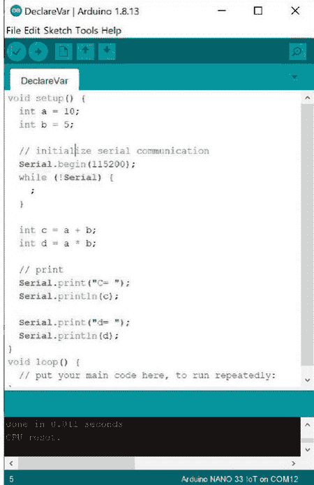

**图 2-1. 声明变量**

图 2-1 显示了上述代码。要打印消息，我们使用 Serial.print() 和 Serial.println() 函数。我们可以使用 Serial.print() 在不换行 "\r\n" 的情况下打印消息。否则，我们可以使用 Serial.println() 打印带换行的消息。

所有使用 Serial 库打印的消息都将显示在串行通信通道上。现在我们可以保存此程序。然后，编译并上传到 Arduino Nano 33 IoT 板。

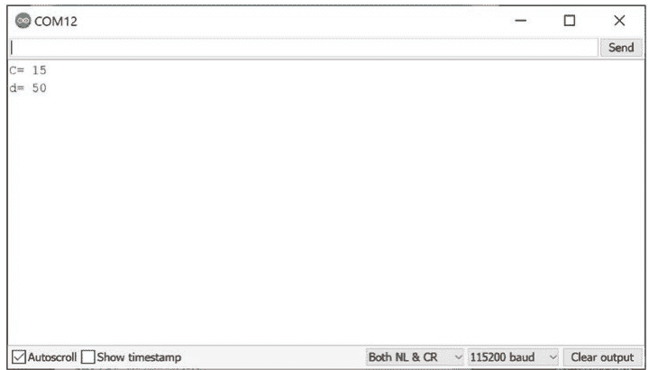

**图 2-3. Serial Monitor 工具上的程序输出**

如果您在 Serial Monitor 工具上看不到输出消息，可以点击 Arduino Nano 33 IoT 板上的 RESET 按钮。您可以在 micro USB 连接器旁边找到此按钮。您可以在图 2-4 中看到 RESET 按钮的位置。

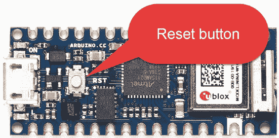

**图 2-4. 在 Arduino Nano 33 IoT 上点击 RESET 按钮**

在 loop() 函数中，我们什么都不做。所有代码都在 setup() 函数中运行。这就是你可能看不到程序输出的原因，因为我们看到它太晚了。

```cpp
void loop() {
}
```

### 运算符

Sketch 程序采用 C++ 运算符。我们可以声明算术运算符来执行数学运算。我们可以使用以下算术运算符：

- % （余数）
- * （乘法）
- + （加法）
- - （减法）
- / （除法）
- = （赋值运算符）

对于布尔运算符，我们实现 && 用于逻辑与，|| 用于逻辑或，! 用于逻辑非。

### 条件语句

我们可以执行基于动作的条件。例如，如果光传感器获得低强度值，我们想打开一盏灯。在 Sketch 中，我们使用 if 和 switch 语法实现条件语句。带有 if 的条件语句可以如下声明：

```cpp
if(<conditional>) {
  // do something
} else {
  // do something
}
```

我们可以将条件值放在 <conditional> 上，例如应用布尔和算术运算符。作为演示，我们可以在 Arduino Nano 33 IoT 上创建一个 Sketch 程序。你编写这个完整程序。

```cpp
long num_a;
long num_b;

void setup() {
  // initialize serial communication
  Serial.begin(115200);
  while (!Serial) {
    ;
  }
}

void loop() {
  num_a = random(100);
  num_b = random(100);

  // print
  Serial.print("num_a: ");
  Serial.print(num_a);
  Serial.print(", num_b: ");
  Serial.println(num_b);

  if(num_a > num_b) {
    Serial.println("num_a > num_b");
  }else {
    Serial.println("num_a <= num_b");
  }

  delay(2000);
}
```

将此程序保存为 conditional。现在你可以编译并上传此程序到 Arduino Nano 33 IoT 板。打开 Serial Monitor 工具即可看到此程序输出。图 2-5 显示了我对条件程序的程序输出。

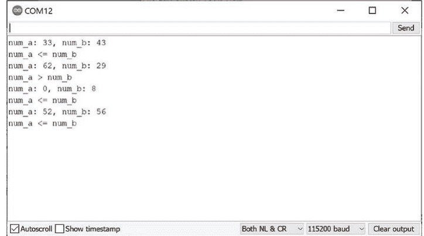

**图 2-5. 条件 if 程序的程序输出**

它是如何工作的？

此程序在 loop() 函数上为 num_a 和 num_b 变量生成随机值。

```cpp
void loop() {
    num_a = random(100);
    num_b = random(100);
}
```

接下来，我们使用 Serial 对象在串行终端上打印这些随机值。我们可以调用 Serial.print() 和 Serial.println() 函数。

```cpp
// print
Serial.print("num_a: ");
Serial.print(num_a);
Serial.print(", num_b: ");
Serial.println(num_b);
```

最后，我们使用条件-if 语句评估 num_a 和 num_b 上的值。我们检查 num_a 值是否大于 num_b。然后，我们在串行终端上打印结果。

```cpp
if(num_a > num_b) {
    Serial.println("num_a > num_b");
}else {
    Serial.println("num_a <= num_b");
}
```

下一个演示是使用 switch 语句实现条件。在一般情况下，我们可以如下声明 switch 语句。

```cpp
switch(value) {
              case val1: <code>
                                      break;
              case val2: <code>
break;
case val3: <code>
    break;
}
```

对于演示，我们构建一个程序使用 switch 语句评估 num_a 值。我们设置一个最大值为 5 的随机值。打开 Arduino 软件并编写此完整程序。

```cpp
long num_a;

void setup() {
    // initialize serial communication
    Serial.begin(115200);
    while (!Serial) {
        ;
    }
}
void loop() {
    num_a = random(5);

    // print
    Serial.print("num_a: ");
    Serial.println(num_a);
    switch(num_a) {
        case 0:
            Serial.println("num_a value is 0");
            break;
        case 1:
            Serial.println("num_a value is 1");
            break;
        case 2:
            Serial.println("num_a value is 2");
            break;
        case 3:
            Serial.println("num_a value is 3");
            break;
        case 4:
            Serial.println("num_a value is 4");
            break;
    }
    delay(2000);
}
```

将此程序保存为 ConditionalSwitch。你可以编译并上传此程序到 Arduino Nano 33 IoT。要查看程序输出，你可以打开 Serial Monitor 工具。你可以在图 2-6 中看到我的程序输出。

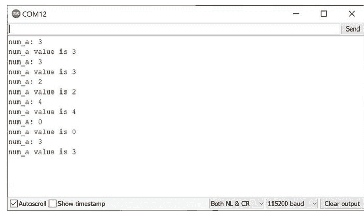

**图 2-6. switch 程序上的程序输出**

它是如何工作的？

此程序开始在 loop() 函数上生成随机值。结果存储在 num_a 变量中。然后，我们将此值打印到串行终端。

```cpp
void loop() {
    num_a = random(5);

    // print
    Serial.print("num_a: ");
    Serial.println(num_a);
}
```

接下来，我们使用 switch 语句评估 num_a 变量。我们检查 num_a 的值为：0、1、2、3 和 4。我们在每个 switch-case 语句上打印消息。

```cpp
switch(num_a) {
    case 0:
        Serial.println("num_a value is 0");
        break;
    case 1:
        Serial.println("num_a value is 1");
        break;
    case 2:
        Serial.println("num_a value is 2");
        break;
    case 3:
        Serial.println("num_a value is 3");
        break;
    case 4:
        Serial.println("num_a value is 4");
        break;
}
```

你已经学习了使用 if 和 switch 的条件语句。在我看来，如果选项在 5 以下，你可以使用 switch 语句；否则，你可以使用带运算符的 if 语句。

### 循环

循环任务在你需要连续执行相同任务时很有用。在 Sketch 程序中，我们可以使用 for、while 和 do..while 语句实现循环任务。我们可以如下声明 for 语句。

```cpp
for(start;conditional;increment/decrement) {
    <codes>
}
```

对于 while 语句，我们可以如下实现。

```cpp
while(selection) {
    <codes>
}
```

我们也可以使用 do..while 进行循环。你可以先运行第一步代码，然后我们选择一个 while 语句。

```cpp
do {
    <codes>
} while(selection);
```

现在我们可以构建一个 Sketch 程序，使用 for、while 和 do..while 语句实现循环。使用 Arduino 软件编写此完整程序。

```cpp
void setup() {
  // initialize serial communication
  Serial.begin(115200);
  while (!Serial) {
    ;
  }
}

void loop() {
    long val = random(15);
    int i;

    // print
    Serial.print("val: ");
    Serial.println(val);

    // looping
    Serial.println("Looping: for");
    for(i=0;i<val;i++){
        Serial.print(i);
        Serial.print(" ");
    }
    Serial.println();

    Serial.println("Looping: while");
    int start = 0;
    while(start < val) {
        Serial.print(start);
        Serial.print(" ");

        start++;
    }
    Serial.println();

    Serial.println("Looping: do..while");
    start = 0;
    do {
        Serial.print(start);
        Serial.print(" ");
        start++;
    }while(start < val);
    Serial.println();

    delay(3000);
}
```

你可以将此程序保存为 Looping。你可以编译并上传此程序到 Arduino Nano 33 IoT 板。上传程序到 Arduino Nano 33 IoT 板后，你可以打开 Serial Monitor 工具查看程序输出。你可以在图 2-7 中看到我的程序输出。

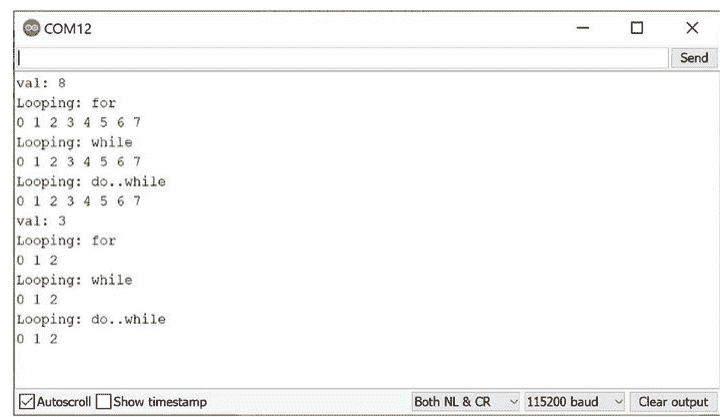

**图 2-7. 循环的程序输出**

它是如何工作的？

我们为循环程序设置一个随机值。

```cpp
void loop() {
  long val = random(15);
  int i;
```


start++;
}while(start < val);
Serial.println();

### Break and Continue

当我们执行循环时，我们可能想要退出循环或跳过循环中的某一步骤。在 Sketch 程序中，我们可以使用 break 和 continue 语句。

为了演示，我们创建 Sketch 程序来从 0 循环到一个随机值。当循环迭代达到 5 时，我们使用 continue 语句跳过此步骤。然后，当我们达到迭代值大于 10 时，使用 break 语句退出循环。

现在我们可以打开 Arduino 软件。我们可以编写此完整的 break 和 continue 实现程序。

```
void setup() {
  // initialize serial communication
  Serial.begin(115200);
  while (!Serial) {
    ;
  }
}
```

```
void loop() {
  long val = random(6, 15);
  int i;

  // print
  Serial.print("val: ");
  Serial.println(val);
```

```
// looping
Serial.println("Looping: for");
for(i=0;i<val;i++){
    if(i==5)
        continue;

    if(i>10)
        break;

    Serial.print(i);
    Serial.print(" ");
}
Serial.println();

delay(3000);
}
```

将此程序保存为 BreakContinue。编译并将此程序上传到 Arduino Nano 33 IoT。上传程序后，我们可以使用 Serial Monitor 工具查看程序输出。你可以在图 2-8 中看到我的程序输出。

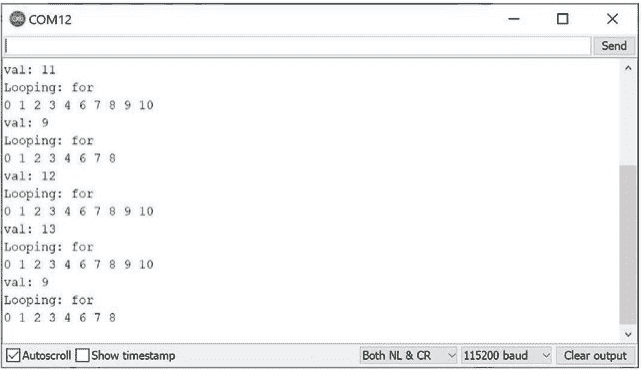

图 2-8. 在 Sketch 程序上应用 break 和 continue

```
void loop() {
    state = digitalRead(pushButton);
    digitalWrite(led,state);
    delay(300);
}
```

将此程序保存为 ButtonLed。你可以编译并将此程序上传到 Arduino Nano 33 IoT。上传后，你可以通过点击一个推按钮进行测试。你应该会看到 Arduino Nano 33 IoT 上点亮的 LED。

它是如何工作的？

此程序首先为 LED 和推按钮引脚初始化值。

```
int led = 13;
int pushButton = 7;
int state = 0;

void setup() {
    pinMode(led, OUTPUT);
    pinMode(pushButton, INPUT);
}
```

然后，在 loop() 函数中，我们使用 digitalRead() 函数读取推按钮状态。状态值将被传递给 digitalWrite() 函数以打开/关闭 LED。

```
void loop() {
    state = digitalRead(pushButton);
    digitalWrite(led,state);
    delay(300);
}
```

现在我们已经学习了数字 I/O，我们将在下一节学习模拟 I/O。

## Analog I/O

Arduino Nano 33 IoT 提供模拟 I/O 以使我们能够与传感器和执行器设备进行交互。我们可以看到标有 Ax 的模拟 I/O 引脚，其中 x 是模拟引脚号。你可以在 Arduino Nano 33 IoT 背面看到这些标签。

你可以在图 2-9 中看到这些引脚。Arduino Nano 33 IoT 有八个模拟输入（ADC）和一个模拟输入（DAC）。对于 ADC 模型，Arduino Nano 33 IoT 提供 8 位、10 位和 12 位的 ADC 分辨率。此外，DAC 模型具有 10 位分辨率。

对于我们的演示，我们使用模拟传感器 TMP36。它是一个温度传感器。你也可以使用 TMP36 模块，如 Linksprite 的热模块，https://www.linksprite.com/wiki/index.php?title=Thermal_Module。你可以按图 2-11 所示进行接线。你可以按以下方式构建接线：
- TMP36 模块 VCC 连接到 Arduino 3.3V
- TMP36 模块 GND 连接到 Arduino GND
- TMP36 模块 SIG 连接到 Arduino 模拟 A0

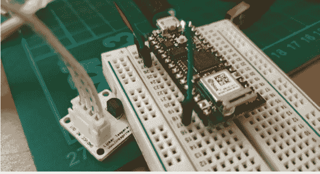

**图 2-11。** *模拟传感器与 Arduino Nano 33 IoT 的接线*

# CHAPTER 2 ARDUINO NANO 33 IOT BOARD DEVELOPMENT

现在我们可以编写 Arduino 程序来从 TMP36 模块读取模拟传感器。我们读取传感器数据然后在串行终端上显示。你可以开始打开 Arduino 软件并编写此完整程序。

```
```cpp
void setup() {
  Serial.begin(115200);
  while (!Serial) {
    ;
  }
}

void loop() {
  int reading = analogRead(A0);

  float voltage = reading * 3.3;
  voltage /= 1024.0;

  Serial.print(voltage); Serial.println(" volts");

  float tempC = (voltage - 0.5) * 100 ;

  Serial.print(tempC);
  Serial.println(" degrees C");
  delay(3000);
}
```
```

将此程序保存为 AnalogSensor。现在你可以编译并将此程序上传到 Arduino Nano 33 IoT。打开 Serial Monitor 工具以查看程序输出。图 2-12 显示了 AnalogSensor 程序的我的程序输出。

它是如何工作的？

### Plotting Analog Sensor

我们也可以在绘图工具上绘制模拟输入。此工具在 Arduino 软件上可用。对于我们的演示，我们使用 SparkFun Electret Microphone Breakout 作为模拟源。你可以在链接 https://www.sparkfun.com/products/12758 上找到此模块。

现在我们可以将 SparkFun Electret Microphone Breakout 连接到 Arduino Nano 33 IoT。你可以按以下方式构建接线：
- SparkFun Electret Microphone Breakout 模块 VCC 连接到 Arduino 3.3V。
- SparkFun Electret Microphone Breakout 模块 GND 连接到 Arduino GND。
- SparkFun Electret Microphone Breakout 模块 SIG 连接到 Arduino A0。

你可以在图 2-13 中看到我的硬件接线。

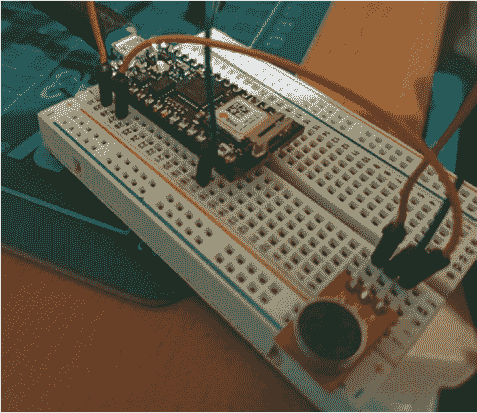

*图 2-13.* Arduino 与 SparkFun Electret Microphone Breakout 的接线

现在我们可以编写 Arduino 程序来绘制传感器数据。打开 Arduino 软件并编写此完整程序。

```
void setup() {
  Serial.begin(115200);
  while (!Serial) {
    ;
  }
}

void loop() {
  int val = analogRead(A0);
  Serial.println(val);
  delay(300);
}
```

将此程序保存为 AnalogPlotting。现在你可以编译并将此程序上传到 Arduino Nano 33 IoT。在 Arduino 软件上打开 Serial Plotter 工具，并点击菜单 Tools ▶ Serial Plotter，如图 2-14 所示。

#### 图 2-14. 打开 Serial Plotter 工具

在你点击 Serial Plotter 后，你将获得如图 2-15 所示的对话框。对 SparkFun Electret Microphone Breakout 发出噪音，以便我们在绘图工具上获得各种信号。由于我们使用 delay(300)，绘图仪每 300 ms 更新其图表。

#### 图 2-15. 绘制传感器数据

它是如何工作的？

此程序工作非常简单。首先，我们通过调用 analogRead() 读取模拟传感器。

```
void loop() {
  int val = analogRead(A0);
```

然后，我们使用 Serial 对象的 println() 打印到串行终端。

```
Serial.println(val);
delay(300);
```

这使得 Serial Plotter 工具显示一个图表。

### Serial Communication

串行通信是在通信信道上一次一位、顺序发送数据的过程。在 Arduino Nano 33 IoT 中，我们可以使用 Serial 对象实现串行通信。我们已经在之前的项目中使用了此 Serial 对象来使用 Serial Monitor 工具显示程序输出。

我们可以通过调用 Serial 对象的 print() 和 println() 将数据写入串行通信。关于 Serial 对象的更多信息，你可以阅读 https://www.arduino.cc/reference/en/language/functions/communication/serial/。

对于演示，我们构建一个闪烁程序。每个 LED 状态都写入串行终端。我们使用波特率 115200。你可以打开 Arduino 软件并编写此完整程序。

```
int led = 13;

void setup() {
    Serial.begin(115200);
    pinMode(led, OUTPUT);
}

void loop() {
    Serial.println("LED: HIGH");
    digitalWrite(led, HIGH);
    delay(1000);
    Serial.println("LED: LOW");
    digitalWrite(led, LOW);
    delay(1000);
}
```

将此程序保存为 SerialDemo。现在你可以编译并将此程序上传到 Arduino Nano 33 IoT。打开 Serial Monitor 工具以查看程序输出。图 2-16 显示了 SerialDemo 程序的我的程序输出。

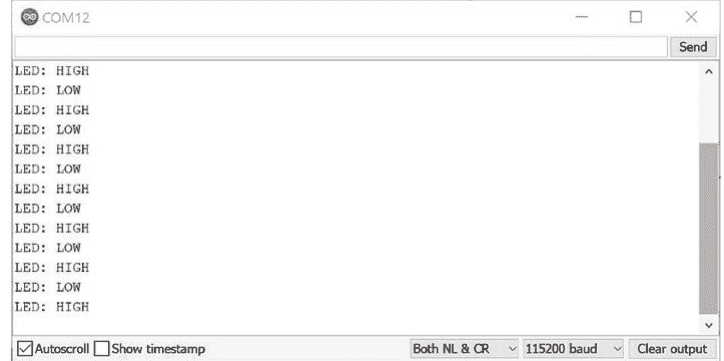

图 2-16. SerialDemo 程序的程序输出

### Pulse Width Modulation

脉宽调制（PWM）是一种控制模拟输出的方法。技术上，它不是“真正的”模拟输出。微控制器单元（MCU）可以通过操纵占空比来产生脉冲。Arduino Nano 33 IoT 在数字引脚上有一个 PWM 引脚。你可以在数字引脚上看到“~”符号作为 PWM 引脚。你可以看到图 2-9 显示了一个数字引脚例如 D2 ~。通常，Arduino Nano 33 IoT 在 2、3、5、6、9、10、11、12、16/A2、17/A3 和 19/A5 上有 11 个 PWM 引脚。

对于我们的演示，我们使用 RGB LED。此 LED 有四个引脚。三个引脚是红、绿和蓝引脚。剩余的可能是地（GND）或电压共集电极（VCC），取决于 RGB 阴极或阳极模型。

我们可以按图 2-17 所示实现我们的演示接线。你可以按如下方式进行接线：
- RGB 红色引脚连接到 Arduino 数字引脚 12。
- RGB 绿色引脚连接到 Arduino 数字引脚 11。
- RGB 蓝色引脚连接到 Arduino 数字引脚 10。
- RGB GND 引脚连接到 Arduino 数字引脚 GND。


# 第 2 章    ARDUINO NANO 33 IOT 板开发

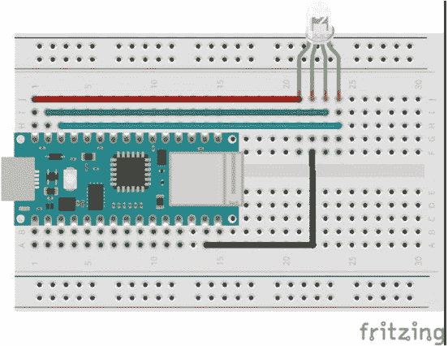

#### *图 2-17.*  *Arduino 与 RGB LED 的接线*

现在我们创建 Arduino 程序来用 RGB LED 生成一些颜色。我们将制作红色、绿色、蓝色、黄色、紫色和青色。你可以打开 Arduino 软件并编写此完整程序。

```cpp
int redPin = 12;
int greenPin = 11;
int bluePin = 10;

void setup()
{
    pinMode(redPin, OUTPUT);
    pinMode(greenPin, OUTPUT);
    pinMode(bluePin, OUTPUT);
    Serial.begin(115200);
}
```

```cpp
void loop()
{
    setColor(255, 0, 0);   // red
    Serial.println("red");
    delay(1000);
    setColor(0, 255, 0);   // green
    Serial.println("green");
    delay(1000);
    setColor(0, 0, 255);   // blue
    Serial.println("blue");
    delay(1000);
    setColor(255, 255, 0);   // yellow
    Serial.println("yellow");
    delay(1000);
    setColor(80, 0, 80);   // purple
    Serial.println("purple");
    delay(1000);
    setColor(0, 255, 255);   // aqua
    Serial.println("aqua");
    delay(1000);
}

void setColor(int red, int green, int blue)
{
    analogWrite(redPin, red);
    analogWrite(greenPin, green);
    analogWrite(bluePin, blue);
}
```

# 第 2 章　ARDUINO NANO 33 IOT 板开发

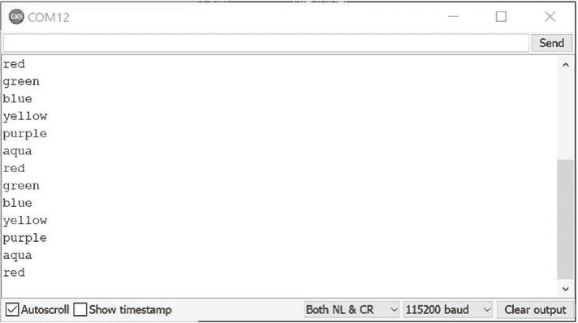

**图 2-18.** *RGB 应用的程序输出*

将此程序保存为 test_rgb_arduino。现在你可以编译并将此程序上传到 Arduino Nano 33 IoT。你应该能在 RGB LED 上看到一些颜色。你也可以打开串行监视器工具来查看程序输出。图 2-18 显示了我对 test_rgb_arduino 程序的程序输出。

它是如何工作的？

我们为 PWM 引脚初始化数字引脚。我们使用 OUTPUT 模式调用 pinMode()。我们还以波特率 115200 配置串行。

```cpp
int redPin = 12;
int greenPin = 11;
int bluePin = 10;

void setup()
{
    pinMode(redPin, OUTPUT);
    pinMode(greenPin, OUTPUT);
```

```cpp
pinMode(bluePin, OUTPUT);
Serial.begin(115200);
}
```

我们还定义了 setColor() 函数来通过组合红、绿、蓝颜色值生成一种颜色。我们调用 analogWrite() 来写入 PWM 数据。

```cpp
void setColor(int red, int green, int blue)
{
    analogWrite(redPin, red);
    analogWrite(greenPin, green);
    analogWrite(bluePin, blue);
}
```

接下来，我们在 loop() 函数上生成一些颜色。例如，我们希望设置 red = 255，green = 0，blue = 0。这些示例用于生成红色、绿色和蓝色的颜色。

```cpp
void loop()
{
    setColor(255, 0, 0);   // red
    Serial.println("red");
    delay(1000);
    setColor(0, 255, 0);   // green
    Serial.println("green");
    delay(1000);
    setColor(0, 0, 255);   // blue
    Serial.println("blue");
    delay(1000);
}
```

我们还通过为红、绿、蓝插入值来生成黄色、紫色和青色。

```
setColor(255, 255, 0);  // yellow
Serial.println("yellow");
delay(1000);
setColor(80, 0, 80);  // purple
Serial.println("purple");
delay(1000);
setColor(0, 255, 255);  // aqua
Serial.println("aqua");
delay(1000);
```

你可以通过组合红、绿、蓝的值来练习生成新的颜色。我们只能设置 0 到 255 的值。

### 串行外设接口

串行通信以异步模式工作，因此对串行通信没有控制。这意味着我们无法保证发送的数据会被接收方接收。串行外设接口（SPI）是一种同步串行通信接口规范，但 SPI 有四根线来控制数据，例如主出/从入（MOSI）、主入/从出（MISO）、串行时钟信号（SCLK）和从设备选择（SS）。

Arduino Nano 33 IoT 具有一个 SPI 接口，其 SPI 引脚如下：

- MOSI 在数字引脚 11 上
- MISO 在数字引脚 12 上
- SCLK 在数字引脚 13 上

你可以在 Arduino Nano 33 IoT 上连接任何基于 SPI 接口的传感器或执行器。对于我们的演示，我们仅使用跳线将 MISO 引脚连接到 MOSI 引脚。你可以将数字引脚 12 连接到数字引脚 11。图 2-19 显示了我 SPI 演示的接线。

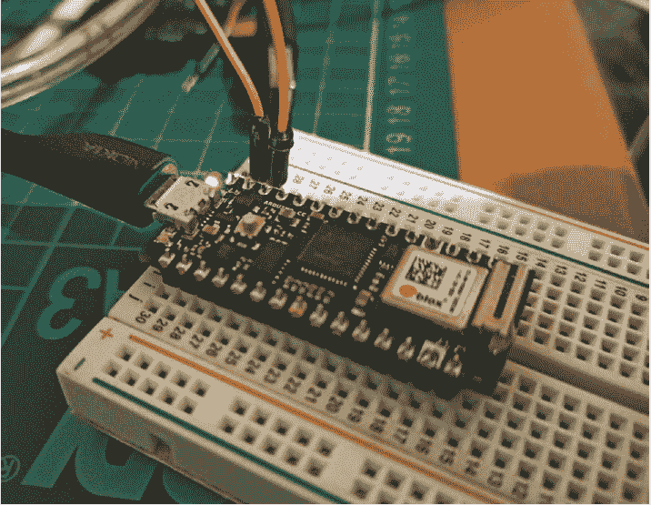

**图 2-19.** 连接 Arduino SPI 的 MISO 和 MISO 引脚

要在 Arduino Nano 33 IoT 上访问 SPI 接口，我们可以使用 SPI 库。你可以在此链接 https://www.arduino.cc/en/Reference/SPI 获取有关此库的详细信息。

现在我们可以构建 Arduino 程序。我们的程序将向 SPI 发送数据并从 SPI 接收数据。打开 Arduino 软件然后编写此完整程序。

```cpp
#include <SPI.h>

byte sendData,recvData;
void setup() {
  SPI.begin();
```

它是如何工作的？

我们在 setup() 函数上初始化 SPI 和串行接口。

```cpp
#include <SPI.h>

byte sendData,recvData;
void setup() {
  SPI.begin();
  Serial.begin(9600);
  randomSeed(80);
}
```

要通过 SPI 发送和接收数据，我们可以使用 SPI.transfer() 函数。我们在 loop() 函数上使用随机值发送数据。

```cpp
void loop() {
  sendData = random(50, 100);
  recvData = SPI.transfer(sendData);
```

然后，我们在串行终端上打印发送数据和接收数据。

```
Serial.print("Send=");
Serial.println(sendData,DEC);
Serial.print("Recv=");
Serial.println(recvData,DEC);
```

你已完成 SPI 演示。你可以通过应用传感器或执行器设备来练习更多 SPI。

### 内部集成电路（I2C）

内部集成电路（I2C）协议是一种旨在允许多个“从”模块/设备（芯片）与一个或多个“主”芯片通信的协议。此协议以异步模式工作。
为了与其他设备/模块通信，I2C 协议为所有“从”设备定义 I2C 地址。

I2C 接口有两个引脚：串行数据（SDA）和串行时钟（SCL）。对于数据传输，I2C 接口使用 SDA 引脚。SCL 引脚用于时钟。Arduino Nano 33 IoT 板的 I2C 引脚为 A4 作为 SDA 和 A5 作为 SCL。

对于我们的演示，我们使用基于 I2C 接口的传感器模块。I2C 接口使用设备地址，因此 Arduino Nano 33 IoT 板可以通过打开到 I2C 地址的连接来访问数据。来自基于传感器模块的 I2C 的每个模拟传感器都将连接到 I2C 地址。

为了测试，我使用了一个带传感器和执行器设备的 PCF8591 AD/DA 转换器模块。此传感器模块可在图 2-21 中看到。PCF8591 AD/DA 模块使用 PCF8591 芯片，该芯片由四个模拟输入和 AD 转换器组成。PCF8591 芯片还具有带 DA 转换器的模拟输出。有关 PCF8591 芯片的更多信息，你可以阅读此链接 https://www.nxp.com/products/interfaces/ic-spi-serial-interface-devices/ic-dacs-and-adcs/8-bit-a-d-and-d-a-converter:PCF8591。

你可以在像 Aliexpress 这样的在线商店找到该芯片。你可能可以在当地商店获得此模块。

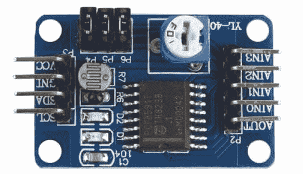

图 2-21. PCF8591 ADC DAC AD/DA 模块

根据 PCF8591 AD/DA 转换器模块的数据表文档，此模块使用 I2C 地址 0x48。PCF8591 AD/DA 转换器模块还由以下三个传感器组成：

- 热敏电阻：使用通道 0
- 光敏电阻：使用通道 1
- 电位器：使用通道 3

现在将 PCF8591 AD/DA 转换器模块连接到 Arduino Nano 33 IoT 板，接线如下：

- PCF8591 AD/DA 模块 SDA 连接到 Arduino A4 引脚。
- PCF8591 AD/DA 模块 SCL 连接到 Arduino A5 引脚。
- PCF8591 AD/DA 模块 VCC 连接到 Arduino 3.3V。
- PCF8591 AD/DA 模块 GND 连接到 Arduino GND 引脚。

图 2-22 显示了我 PCF8591 AD/DA 转换器模块和 Arduino Nano 33 IoT 的接线。当我们将 3.3V 插入模块时，你应该看到一个点亮的 LED。


# 第2章 Arduino Nano 33 IoT 板开发

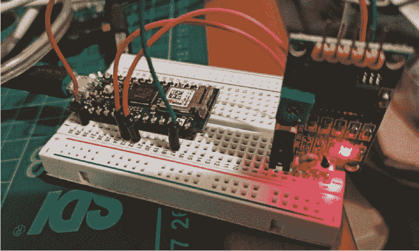

**图 2-22.** *将 PCF8591 ADC DAC AD/DA 模块与 Arduino Nano 33 IoT 进行接线*

我们已完成此演示的接线。接下来，我们将实现以下两个项目演示：

- I2C 扫描应用程序
- I2C 传感器应用程序

接下来，我们在 Arduino Nano 33 IoT 板上构建一个扫描 I2C 地址的应用程序。

### 扫描 I2C 地址

每个基于设备/模块的 I2C 都在 MCU 上拥有一个 I2C 地址。在本节中，我们希望扫描连接到 Arduino Nano 33 IoT 的所有设备。我们在 Arduino Nano 33 IoT 内部还拥有两个基于设备的内部 I2C 传感器。

要访问 Arduino 板上的 I2C，我们可以使用 Wire 库。我们可以通过插入 wire.h 库来包含我们的程序。有关 Wire 库的更多信息，我们可以阅读 Arduino 官方网站上的内容 (https://www.arduino.cc/en/Reference/Wire)。

对于我们的演示，我们使用来自 PCF8591 AD/DA 转换器模块的接线演示（见图 2-22）。打开 Arduino 软件并编写此完整程序。

```
#include <Wire.h>

void setup() {
    Serial.begin(115200);
    Wire.begin();
    Serial.println("\nI2C Scanner");
}

void loop() {
    byte error, address;
    int nDevices;

    Serial.println("Scanning...");

    nDevices = 0;
    for(address = 1; address < 127; address++) {
        Wire.beginTransmission(address);
        error = Wire.endTransmission();

        if (error == 0) {
            Serial.print("I2C device found at address 0x");
            if (address < 16)
                Serial.print("0");
            Serial.println(address, HEX);

            nDevices++;
        }
```

```
else if (error == 4) {
    Serial.print("Unknown error at address 0x");
    if (address < 16)
        Serial.print("0");
    Serial.println(address, HEX);
}
}
if (nDevices == 0)
    Serial.println("No I2C devices found");
else
    Serial.println("done");

delay(5000);
}
```

将此程序保存为 i2c_scanner。现在您可以将此程序编译并上传到 Arduino Nano 33 IoT。我们可以使用串行监视器查看程序输出。

图 2-23 显示了我对 i2c_scanner 的程序输出。您可以看到有三个 I2C 地址。0x48 是我们的 PCF8591 AD/DA 转换器模块。两个 I2C 地址 0x60 和 0x6A 是 Arduino Nano 33 IoT 内部的 I2C 传感器。

然后我们使用 `Wire.beginTransmission()` 打开 I2C 接口。
接下来，我们通过调用 `Wire.endTransmission()` 关闭传输。

```
nDevices = 0;
for(address = 1; address < 127; address++) {
    Wire.beginTransmission(address);
    error = Wire.endTransmission();
```

我们检查错误值 error。如果没有错误，则意味着当前地址上有一个 I2C 设备。我们使用 `Serial.println()` 以 HEX 模式将 I2C 地址打印到串行终端。

```
if (error == 0) {
    Serial.print("I2C device found at address 0x");
    if (address < 16)
        Serial.print("0");
    Serial.println(address, HEX);

    nDevices++;
}
```

否则，我们检查错误代码。如果 error = 4，我们在此地址上打印未知错误。

```
else if (error == 4) {
    Serial.print("Unknown error at address 0x");
    if (address < 16)
        Serial.print("0");
    Serial.println(address, HEX);
}
```

最后，我们从串行终端打印 I2C 接口的发现结果。

```
```cpp
if (nDevices == 0)
    Serial.println("No I2C devices found");
else
    Serial.println("done");
```
```

此程序可用于检查连接到 Arduino Nano 33 IoT 的 I2C 设备列表。

### 读取基于传感器的 I2C 地址

在本节中，我们从 I2C 设备读取传感器数据。我们已在图 [2-22](#) 中配置了硬件接线。PCF8591 AD/DA 转换器模块具有三个传感器：热敏电阻、光伏电池和电位器。每个传感器在 0x00、0x01 和 0x03 上都有一个通道地址，分别对应。

让我们开始构建 Arduino 程序以通过 I2C 接口访问传感器设备。我们将使用图 [2-22](#) 中的硬件接线。您可以打开 Arduino 软件并编写此完整程序。

```
```cpp
#include "Wire.h"
#define PCF8591 0x48 // I2C bus address
#define PCF8591_ADC_CH0 0x00 // thermistor
#define PCF8591_ADC_CH1 0x01 // photo-voltaic cell
#define PCF8591_ADC_CH2 0x02
#define PCF8591_ADC_CH3 0x03 // potentiometer
byte ADC1, ADC2, ADC3;

void setup()
{
    Wire.begin();
    Serial.begin(9600);
```
```

```
```cpp
}
void loop()
{
    // read thermistor
    Wire.beginTransmission(PCF8591);
    Wire.write((byte)PCF8591_ADC_CH0);
    Wire.endTransmission();
    delay(100);
    Wire.requestFrom(PCF8591, 2);
    delay(100);
    ADC1=Wire.read();
    ADC1=Wire.read();

    Serial.print("Thermistor=");
    Serial.println(ADC1);

    // read photo-voltaic cell
    Wire.beginTransmission(PCF8591);
    Wire.write(PCF8591_ADC_CH1);
    Wire.endTransmission();
    delay(100);
    Wire.requestFrom(PCF8591, 2);
    delay(100);
    ADC2=Wire.read();
    ADC2=Wire.read();

    Serial.print("Photo-voltaic cell=");
    Serial.println(ADC2);

    // potentiometer
    Wire.beginTransmission(PCF8591);
    Wire.write(PCF8591_ADC_CH3);
    Wire.endTransmission();
```

```
delay(100);
Wire.requestFrom(PCF8591, 2);
delay(100);
ADC3=Wire.read();
ADC3=Wire.read();

Serial.print("potentiometer=");
Serial.println(ADC3);

delay(500);
}
```

将此程序保存为 I2CSensor。现在您可以将此程序编译并上传到 Arduino Nano 33 IoT。在 Arduino 软件上打开串行监视器工具。您应该会看到来自 I2C 协议的传感器数据。图 2-24 显示了我对 I2CSensor 的程序输出。

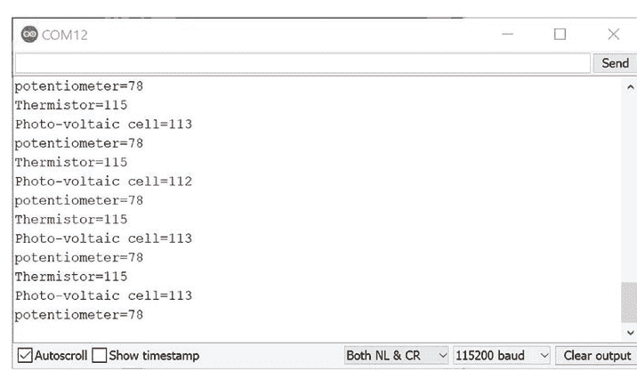

图 2-24. 通过 I2C 读取传感器的程序输出

### 它是如何工作的？

首先，我们初始化 I2C、串行和 PCF8591 AD/DA 转换器模块。我们定义 I2C 地址通道。这是在 setup() 函数中完成的。

```
```cpp
#include "Wire.h"
#define PCF8591 0x48 // I2C bus address
#define PCF8591_ADC_CH0 0x00 // thermistor
#define PCF8591_ADC_CH1 0x01 // photo-voltaic cell
#define PCF8591_ADC_CH2 0x02
#define PCF8591_ADC_CH3 0x03 // potentiometer
byte ADC1, ADC2, ADC3;

void setup()
{
  Wire.begin();
  Serial.begin(9600);
}
```
```

我们可以在 loop() 函数中读取传感器数据。要读取热敏电阻数据，我们使用传递 PCF8591 的 Wire.beginTransmission() 打开 I2C。然后，使用 Wire.write() 选择热敏电阻的通道，值为 PCF8591_ADC_CH0。我们通过调用 Wire.endTransmission() 关闭传输。我们使用 Wire.requestFrom() 函数读取 2 字节的传感器数据。

```
```cpp
void loop()
{
  // read thermistor
  Wire.beginTransmission(PCF8591);
  Wire.write((byte)PCF8591_ADC_CH0);
  Wire.endTransmission();
  delay(100);
```
```

```
Wire.requestFrom(PCF8591, 2);
delay(100);
ADC1=Wire.read();
ADC1=Wire.read();
```

我们设置 delay(100) 以等待模块完成我们的请求。我们使用 Wire.read() 函数按字节读取数据。接下来，我们在串行终端上打印热敏电阻数据。

```
Serial.print("Thermistor=");
Serial.println(ADC1);
```

使用相同的方法，我们可以通过更改通道值为 PCF8591_ADC_CH1 来读取光伏电池。之后，我们读取传感器数据并将结果打印到串行终端。

```
// read photo-voltaic cell
Wire.beginTransmission(PCF8591);
Wire.write(PCF8591_ADC_CH1);
Wire.endTransmission();
delay(100);
Wire.requestFrom(PCF8591, 2);
delay(100);
ADC2=Wire.read();
ADC2=Wire.read();
```

```
Serial.print("Photo-voltaic cell=");
Serial.println(ADC2);
```

我们还从 PCF8591 AD/DA 转换器模块读取电位器。打开 I2C 接口并选择 PCF8591_ADC_CH3 的通道。然后，我们可以读取传感器数据并在串行终端上打印它。
