# 第3章

## IMU 传感器：
加速度计和
陀螺仪

Arduino Nano 33 IoT 板具有一个内部传感器，即惯性测量单元（IMU）。该 IMU 传感器由 LSM6DS3 构建。在本章中，我们将探讨如何访问 Arduino Nano 33 IoT 上的 IMU 传感器。

您将在本章中学习以下主题：

- 设置 LSM6DS3 传感器
- 访问加速度计传感器
- 访问陀螺仪传感器
- 绘制传感器数据

### 简介

Arduino Nano 33 IoT 具有一个可直接访问的内部传感器。该传感器是基于 LSM6DS3 的 IMU。该模块由加速度计和陀螺仪传感器组成。该传感器通过内部集成电路（I2C）接口连接到 Arduino Nano 33 IoT。有关更多信息


information about technical documentation of LSM6DS3, we can read the detailed datasheet document at this link, https://content.arduino.cc/assets/st_imu_lsm6ds3_datasheet.pdf. You can see the LSM6DS3 chip on Arduino Nano 33 IoT board in Figure 3-1.

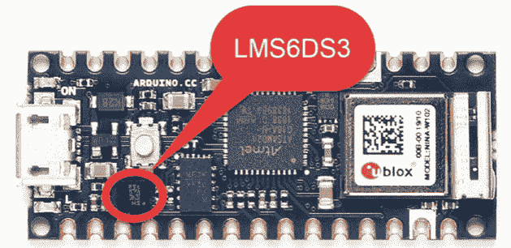

Figure 3-1. LSM6DS3 chip on Arduino Nano 33 IoT

In Chapter 2, we learned about the I2C interface. We also perform a scan of the I2C address. You can run the i2c_scanner program from Chapter 2. Figure 3-2 shows a list of I2C addresses of I2C devices. The IMU sensor runs on 0x6A and 0x6B I2C addresses.

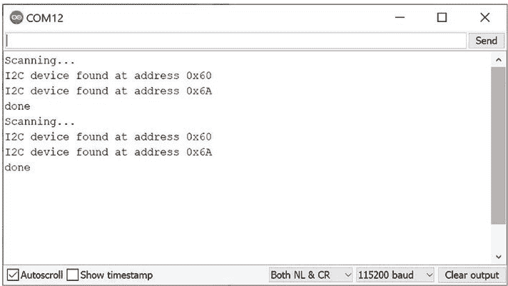

Figure 3-2. A list I2C addresses from sensor device-based I2C interface

In this chapter, we will explore the IMU sensor, LSM6DS3, on Arduino Nano 33 IoT. We access accelerator and gyroscope sensors from the Arduino program.

### Set Up LSM6DS3 Library

To access the IMU sensor-based LSM6DS3 chip on Arduino Nano 33 IoT, we need to install the Arduino LSM6DS3 library. This library can be used to access the IMU sensor for accelerator and gyroscope sensors. We will use this library in this chapter. Details about the LSM6DS3 library can be read at this link, https://www.arduino.cc/en/Reference/ArduinoLSM6DS3.

To install the Arduino LSM6DS3 library, you can open Arduino software. Then, click the menu Sketch ▶ Include Library ▶ Manage Libraries, as shown in Figure 3-3.

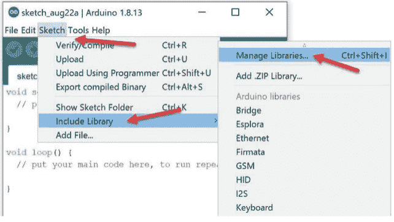

Figure 3-3. Opening the Manage Libraries menu in Arduino software

After we click the Manage Libraries menu, we will obtain a Library Manager dialog, as shown in Figure 3-4. You can type arduino_lsm6ds3 in the search textbox. Then, you should see a list of libraries. You should also see the Arduino_LSM6DS3 library. In Figure 3-4 you can see the Arduino_LSM6DS3 library that is noted by a red arrow.

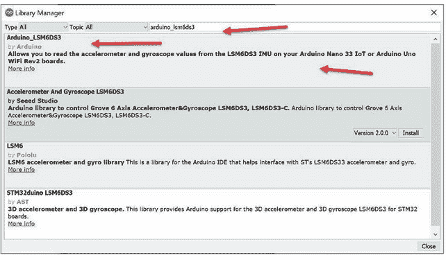

Figure 3-4. Installing the Arduino LSM6DS3 library

Click the Install button after you click the Arduino_LSM6DS3 library. Make sure your computer is connected to the Internet. After completing installation, we can access the IMU sensor on Arduino Nano 33 IoT.

### Working with an Accelerometer

The IMU sensor in Arduino Nano 33 IoT has an accelerometer sensor. This sensor measures acceleration on x, y, and z coordinates. The sensor value ranges from -4 to 4. We will use the Arduino LSM6DS3 library to access the IMU accelerometer sensor.

In general, we can start to use the LSM6DS3 library by calling `IMU.begin()`. Then, we can read the sensor value by calling the `IMU.readAcceleration()` function.

For the demo, we read the IMU accelerometer on the Arduino Nano 33 IoT board. Then, we print the measurement result on the serial terminal. You can open Arduino software and write this complete program.

```
#include <Arduino_LSM6DS3.h>

void setup() {
  Serial.begin(115200);
  while (!Serial);

  if (!IMU.begin()) {
    Serial.println("Failed to initialize IMU!");

    while (1);
  }

  Serial.print("Accelerometer sample rate = ");
  Serial.print(IMU.accelerationSampleRate());
  Serial.println(" Hz");
  Serial.println();
}
```

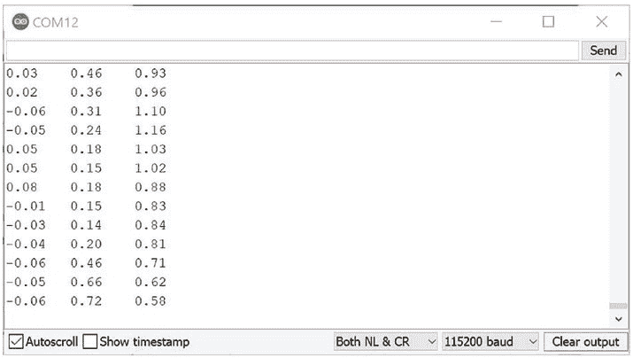

Figure 3-5. Program output from reading the IMU accelerometer

How does it work?

First, we include the Arduino LSM6DS3 library in the Arduino program.

```
#include <Arduino_LSM6DS3.h>
```

We initialize the IMU sensor and the Serial object on the setup() function.

```
void setup() {
  Serial.begin(115200);
  while (!Serial);

  if (!IMU.begin()) {
    Serial.println("Failed to initialize IMU!");

    while (1);
  }
}
```

We also can print the current accelerometer sample rate by calling the IMU.accelerationSampleRate() function on the serial terminal.

```
Serial.print("Accelerometer sample rate = ");
Serial.print(IMU.accelerationSampleRate());
Serial.println(" Hz");
Serial.println();
Serial.println("Acceleration in G's");
Serial.println("X\tY\tZ");
```

On the loop() function, we read the accelerometer sensor. We should check whether there is available accelerometer sensor data by calling the IMU.accelerationAvailable() function. If it’s available for sensor data, we can read the sensor data using the IMU.readAcceleration() function.

```
void loop() {
    float x, y, z;

    if (IMU.accelerationAvailable()) {
        IMU.readAcceleration(x, y, z);
```

Then, we print the sensor data on the serial terminal.

```
Serial.print(x);
Serial.print('\t');
Serial.print(y);
Serial.print('\t');
Serial.println(z);
```

### Working with Gyroscope

Gyroscope is a sensor to measure orientation and angular velocity. Arduino Nano 33 IoT has a built-in gyroscope sensor over the IMU LSM6DS3 sensor chip. We can access this sensor using the Arduino LSM6DS3 library.

Save this program as SimpleGyroscope. Now you can compile and upload this program into Arduino Nano 33 IoT. We can see the program output using the Serial Monitor. Change your board orientation to see the change values on the Serial Monitor tool.

Figure 3-6 shows my program output for the SimpleGyroscope program. You can see gyroscope values for x, y, and z.

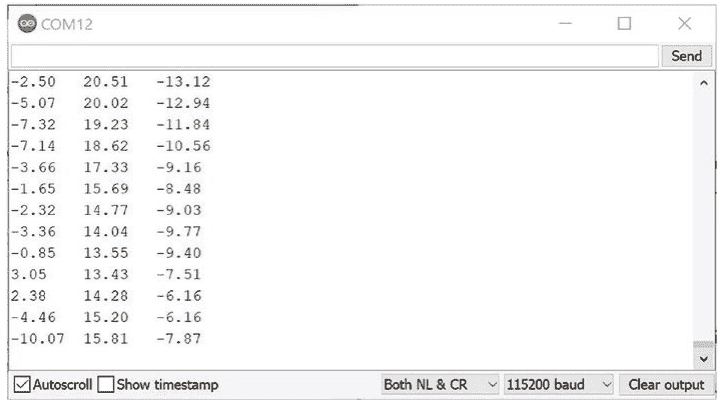

Figure 3-6. Program output from reading the gyroscope sensor

How does it work?

First, we include the Arduino LSM6DS3 library in the Arduino program.

```
#include <Arduino_LSM6DS3.h>
```

We initialize the IMU sensor to enable work with the gyroscope sensor and the Serial object on the setup() function.

```
void setup() {
  Serial.begin(115200);
  while (!Serial);
}
```

```
if (!IMU.begin()) {
    Serial.println("Failed to initialize IMU!");
    while (1);
}
```

We also can print the current gyroscope sample rate by calling the IMU.gyroscopeSampleRate() function on the serial terminal.

```
Serial.print("Gyroscope sample rate = ");
Serial.print(IMU.gyroscopeSampleRate());
Serial.println(" Hz");
Serial.println();
Serial.println("Gyroscope in degrees/second");
Serial.println("X\tY\tZ");
```

On the loop() function, we read the gyroscope sensor. We should check whether there is available gyroscope sensor data by calling the IMU.gyroscopeAvailable() function. If it’s available for the Gyroscope sensor data, we can read sensor data using the IMU.readGyroscope() function.

```
void loop() {
    float x, y, z;
    if (IMU.gyroscopeAvailable()) {
    IMU.readGyroscope(x, y, z);
```

Then, we print the sensor data on the serial terminal.

```
Serial.print(x);
Serial.print('\t');
Serial.print(y);
Serial.print('\t');
Serial.println(z);
```

This is the end of the project. You can practice by applying the IMU sensor in your projects.

### Plotting Sensor Data

We can read sensor data from built-in sensor devices on Arduino Nano 33 IoT. In this section, we will plot our sensor using the Serial Plotter tool from Arduino. For testing, we will use previous projects that read the Gyroscope sensor.

You can open Arduino software. We initialize our Gyroscope sensor and serial communication on the setup() function. We set serial baudrate 115200 and initialize Gyroscope by calling the IMU.begin() function.

```
#include <Arduino_LSM6DS3.h>

void setup() {
  Serial.begin(115200);
  while (!Serial);

  if (!IMU.begin()) {
    Serial.println("Failed to initialize IMU!");

    while (1);
  }
}
```

On the loop() function, we read the Gyroscope sensor using IMU.readGyroscope(). First, we should check availability of sensor data by calling the IMU.gyroscopeAvailable() function. We store the Gyroscope sensor to x, y, and z variables.

```
void loop() {
  float x, y, z;

  if (IMU.gyroscopeAvailable()) {
    IMU.readGyroscope(x, y, z);
```

### Displaying Sensor Data with Organic Light-Emitting Diode I2C Display

In this section, we want to display sensor data on an organic light-emitting diode (OLED) display. There are two interface models on OLED display: serial peripheral interface (SPI) and I2C. In this demo, we will use the OLED I2C display. You can buy any OLED I2C display module in a local electronic store. You can probably find it on Aliexpress or Alibaba.

For this demo, I use the OLED I2C display with 0.96 inch or 128 x 64 pixels. You can see my OLED I2C display in Figure 3-8.

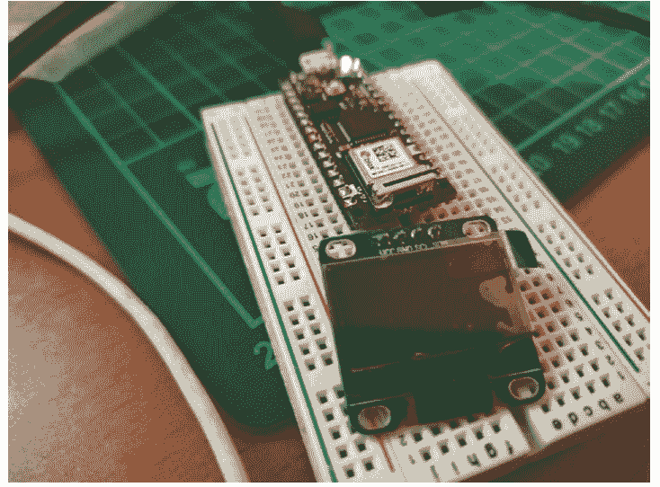

Figure 3-8. OLED 0.96-inch I2C display

You can use any display size for the OLED I2C display. Next, we will wire the OLED I2C display for Arduino Nano 33 IoT.

# CHAPTER 3 | IMU SENSOR: ACCELEROMETER AND GYROSCOPE


### 为Arduino Nano 33 IoT和OLED I2C显示屏接线

我们使用带有I2C接口的OLED显示屏，因此可以通过I2C引脚将这款OLED显示屏连接到Arduino Nano 33 IoT。你可以在图3-9中看到我的接线方式。可以按照以下步骤进行接线：

- OLED I2C显示模块的串行数据连接到Arduino的A4引脚。
- OLED I2C显示模块的串行时钟连接到Arduino的A5引脚。
- OLED I2C显示模块的电源公共端（VCC）连接到Arduino的3.3V。
- OLED I2C显示模块的地（GND）连接到Arduino的GND引脚。

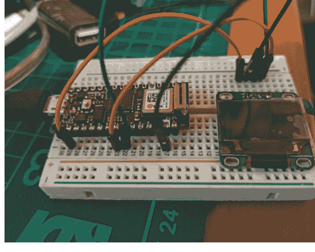

图3-9. 在Arduino Nano 33 IoT上连接OLED I2C显示屏

接下来，我们可以为OLED I2C显示屏编写Arduino程序。

### 检查OLED I2C显示屏的I2C地址

在完成Arduino Nano 33 IoT与OLED I2C显示屏之间的接线后，我们可以使用第2章中的i2c_scanner程序来检查设备的I2C地址。我们想要知道OLED I2C显示屏的I2C地址。

将i2c_scanner程序加载到Arduino软件中。然后编译并上传该程序到Arduino Nano 33 IoT。之后，打开串口监视器工具。你应该会看到三个I2C地址。其中两个是Arduino Nano 33 IoT上内置的I2C传感器。剩下的是我们的OLED I2C显示屏。

你可以在图3-10中看到我的程序输出。你可以看到我的OLED I2C显示屏运行在0x3C这个I2C地址上。而0x60和0x6A这两个I2C地址是Arduino Nano 33 IoT上内置的I2C传感器。

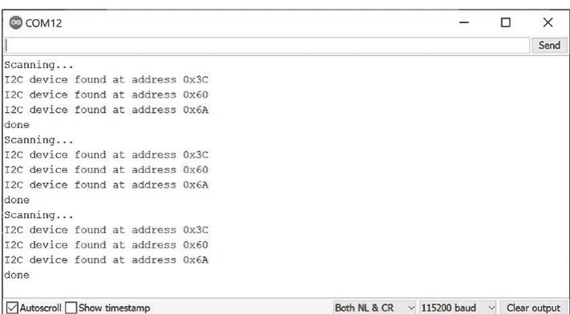

图3-10. 检测OLED I2C显示屏的I2C地址

接下来，我们将设置库，以便在Arduino Nano 33 IoT上为OLED I2C显示屏构建程序。

### 设置OLED I2C显示屏库

要在Arduino上使用OLED I2C显示屏，我们需要从Adafruit安装以下两个库：

- Adafruit_SSD1306, https://github.com/adafruit/Adafruit_SSD1306
- Adafruit GFX Library, https://github.com/adafruit/Adafruit-GFX-Library

我们可以通过Arduino软件中的库管理器安装这些库。输入Adafruit_SSD1306和Adafruit GFX Library来安装这些库。图3-11展示了Adafruit_SSD1306库。

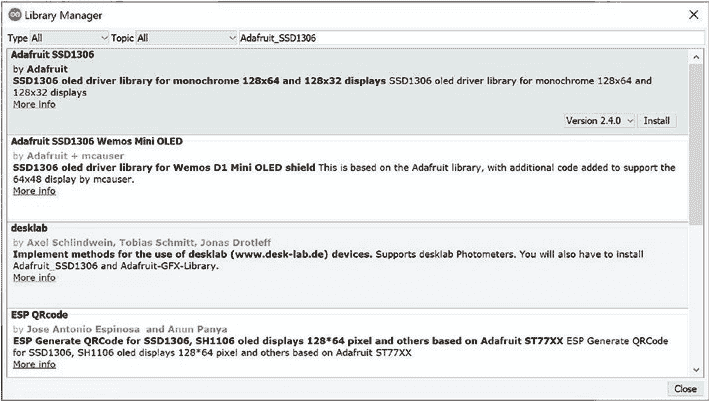

*图3-11.* 为OLED I2C显示屏添加库

安装这些库。你可能会被要求安装额外的库来配合Adafruit_SSD1306和Adafruit GFX库使用——例如Adafruit BusIO。

接下来，我们根据OLED I2C显示屏的I2C地址修改这个程序。在上一节中，我们的OLED I2C显示屏的地址是0x3C。将display.begin()中的I2C地址替换为0x3C，如图3-12所示。

现在你可以编译并将此程序上传到Arduino Nano 33 IoT。你应该会在OLED I2C显示屏上看到一些图形。图3-13显示了ssd1306_128x64_i2c程序在128x64像素的OLED I2C显示屏上的输出。

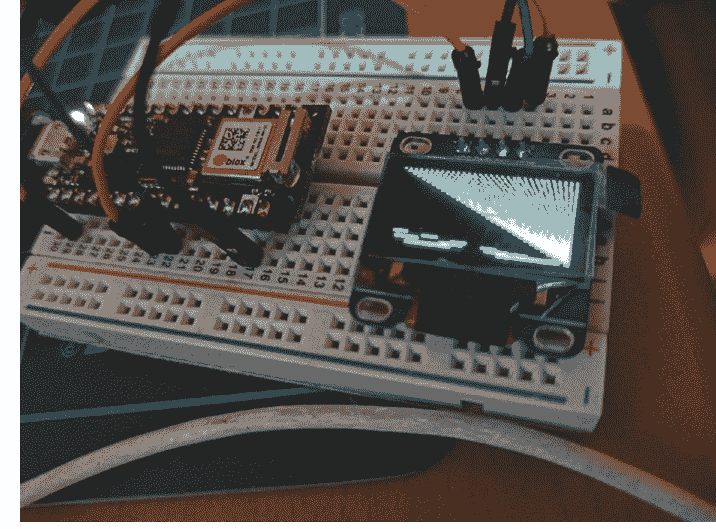

图3-13. 在OLED I2C显示屏上运行ssd1306_128x64_i2c程序

如果你能看到ssd1306_128x64_i2c程序的显示输出，说明你的OLED I2C显示屏工作正常。我们将使用这款OLED来显示传感器数据。

### 显示陀螺仪传感器

如果你没有看到显示输出，首先检查你的OLED I2C显示屏的I2C地址。然后确保你的OLED I2C显示屏尺寸为128x64像素。

在本节中，我们将构建Arduino程序，将陀螺仪传感器数据显示到OLED I2C显示屏上。我们将使用上一节中的程序来读取陀螺仪传感器。

现在我们可以打开Arduino软件并创建一个新程序。我们首先导入OLED I2C显示屏和陀螺仪传感器所需的所有库。

```
#include <SPI.h>
#include <Wire.h>
#include <Adafruit_GFX.h>
#include <Adafruit_SSD1306.h>
#include <Arduino_LSM6DS3.h>
```

我们定义OLED I2C显示屏的尺寸。在本演示中，我使用128x64像素。你可以根据你的OLED模块更改其尺寸。

```
#define SCREEN_WIDTH 128
#define SCREEN_HEIGHT 64
```

接下来，我们通过传递OLED模块的I2C地址和显示尺寸来配置Adafruit_SSD1306。

```
#define OLED_RESET  4 // Reset pin
Adafruit_SSD1306 display(SCREEN_WIDTH, SCREEN_HEIGHT, &Wire, OLED_RESET);
```

在setup()函数中，我们初始化串口通信、陀螺仪传感器和Adafruit_SSD1306。

```
void setup() {
    Serial.begin(115200);

    if (!IMU.begin()) {
        Serial.println("Failed to initialize IMU!");
        while (1);
    }
    if(!display.begin(SSD1306_SWITCHCAPVCC, 0x3C)) { // Address
    // 0x3D for 128x64
        Serial.println(F("SSD1306 allocation failed"));
        for(;;); // Don't proceed, loop forever
    }
}
```

之后，我们通过调用display() 2秒钟来测试OLED I2C显示屏。然后，我们清除OLED显示屏的屏幕。

```
display.display();
delay(2000); // Pause for 2 seconds

// Clear the buffer
display.clearDisplay();
}
```

在loop()函数中，我们读取陀螺仪传感器。首先，我们使用IMU.gyroscopeAvailable()检查传感器数据。如果可用，我们可以使用IMU.readGyroscope()函数读取传感器数据。将所有传感器数据存储在x、y和z变量中。

```
void loop() {
    float x, y, z;

    if (IMU.gyroscopeAvailable()) {
        IMU.readGyroscope(x, y, z);
```

接下来，我们使用print()函数在OLED I2C显示屏上显示传感器数据。我们还使用setTextSize()来设置字体大小。

```
display.clearDisplay();
display.setTextSize(1);
display.setTextColor(SSD1306_WHITE);
display.setCursor(0,0);
display.print("Gyroscope: X, Y, Z");
display.setTextSize(2);
display.setCursor(0,12);
display.print(String(x));
display.setCursor(0,30);
display.print(String(y));
display.setCursor(0,48);
display.print(String(z));
display.display();
```

最后，我们使用Serial.print()和Serial.println()函数将传感器数据显示到串行终端中。

```
Serial.print(x);
Serial.print('\t');
Serial.print(y);
Serial.print('\t');
Serial.println(z);

delay(300);
}
}
```

将此程序保存为OledSensor。现在你可以编译并将此程序上传到Arduino Nano 33 IoT。你应该会在OLED I2C显示屏上看到传感器数据，如图3-14所示。

# 第3章 IMU传感器：加速度计与陀螺仪

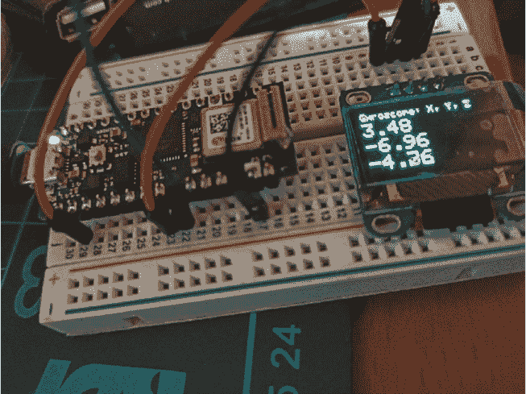

**图3-14.** *在OLED I2C显示屏上显示陀螺仪传感器*

你也可以在串口监视器工具上看到程序输出。你可以在图3-15中看到我的程序输出。

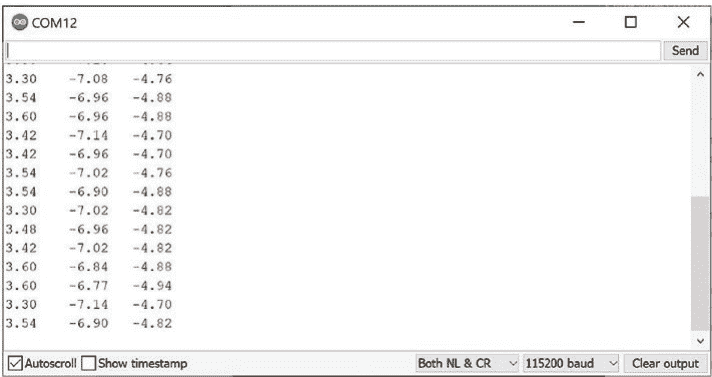

#### 图3-15. OledSensor的程序输出

本章到此结束。你可以通过在项目中应用IMU传感器来进行练习。

## 小结

你已经学会了如何访问Arduino Nano 33 IoT中的内置IMU传感器。我们首先设置了LSM6DS3库。然后，我们创建了Arduino程序来访问Arduino Nano 33 IoT上的加速度计和陀螺仪传感器。最后，我们在串口绘图器工具和OLED I2C显示屏上显示了传感器数据。

接下来，我们将学习如何访问Arduino Nano 33 IoT上的网络并制作IoT程序。
