# 第4章

## Arduino Nano 33 IoT网络

Arduino Nano 33 IoT是为物联网实现而设计的。该板有一个网络模块WiFi，使其能够与其他系统通信。在本章中，我们重点介绍Arduino Nano 33 IoT如何访问外部系统（如服务器）并与之协作。

在本章中，你将学习以下主题：

- 使用WiFiNINA库设置WiFi
- 扫描WiFi热点
- 连接到网络
- 访问网络时间协议（NTP）服务器
- 构建一个简单的IoT应用

本章需要一个WiFi网络之类的环境。你应该提供一个已启用互联网的WiFi热点，以便Arduino Nano 33 IoT可以与其他系统通信。


### 引言

Arduino Nano 33 IoT 是 Arduino 的物联网平台之一。该板使用 WiFi 和蓝牙模块连接到网络。WiFi 是人们用来访问互联网的常见网络。蓝牙是无线个人局域网（WPAN）的一部分，可在短距离内与其他设备进行通信。

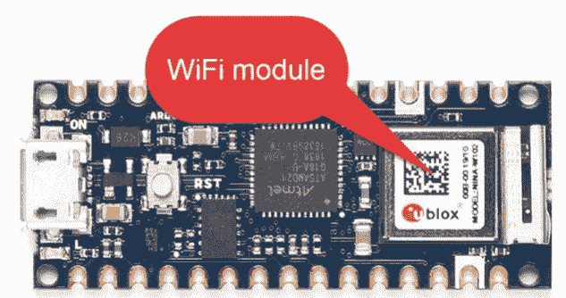

图 4-1. Arduino Nano 33 IoT 上的 WiFi 模块

Arduino Nano 33 IoT 设计用于低成本的物联网设备，以利用物联网解决方案。Arduino Nano 33 IoT 具有 WiFi 模块，如图 4-1 所示。在本章中，我们在 Arduino Nano 33 IoT 上应用 WiFi 模块与其他设备进行通信。

### 设置 WiFiNINA 库

要访问 Arduino Nano 33 IoT 板上的 WiFi 模块，我们应安装 WiFiNINA 库。我们可以通过库管理器安装它。你可以点击菜单 Sketch ▶ Include Library ▶ Manage Libraries。点击 Manage Libraries 菜单后，我们会得到如图 4-2 所示的对话框。你可以在搜索文本框中输入 WiFiNINA。之后，你应该能在列表中看到 WiFiNINA（见图 4-2）。

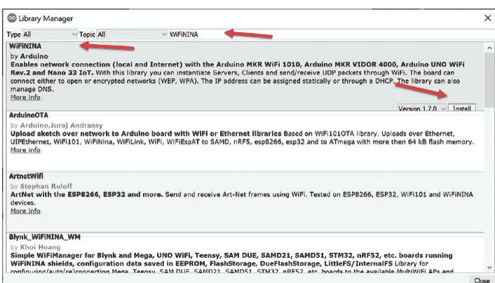

图 4-2. 安装 WiFiNINA 库

确保你的计算机已连接到互联网。安装 WiFiNINA 库后，我们可以创建 Arduino 程序通过 WiFi 网络与其他系统进行通信。

### 扫描 WiFi 热点

如果我们知道 WiFi SSID 名称，我们就可以访问 WiFi 热点。在本节中，我们构建一个 Arduino 程序来扫描现有的 WiFi SSID，然后在串行终端上打印列表。

现在你可以打开 Arduino 软件。你可以编写以下完整程序。

```
#include <SPI.h>
#include <WiFiNINA.h>

int led = 13;
```

```
void setup() {
    Serial.begin(115200);
    pinMode(led, OUTPUT);

    // check for the WiFi module:
    if (WiFi.status() == WL_NO_MODULE) {
        Serial.println("Communication with WiFi module failed!");
        // don't continue
        while (true);
    }
}
void loop() {
    digitalWrite(led, HIGH);
    scanWiFi();
    digitalWrite(led, LOW);
    delay(15000);
}

void scanWiFi() {
    Serial.print("Scanning...");
    byte ssid = WiFi.scanNetworks();

    Serial.print("found ");
    Serial.println(ssid);

    for (int i = 0; i<ssid; i++) {
        Serial.print(">> ");
        Serial.print(WiFi.SSID(i));
        Serial.print("\tRSSI: ");
        Serial.print(WiFi.RSSI(i));
        Serial.print(" dBm");
        Serial.print("\tEncryption: ");
        Serial.println(WiFi.encryptionType(i));
    }
}
```

```
Serial.println("");
Serial.println("");
}
```

将此程序保存为 WifiScan。现在你可以编译并上传此程序到 Arduino Nano 33 IoT。我们可以使用串行监视器查看程序输出。

图 4-3 显示了我对 WifiScan 程序的程序输出。你可以看到 WiFi SSID 的列表。如果你看不到 WiFi SSID 的列表，你应该移动到可以确定找到它们的地方。

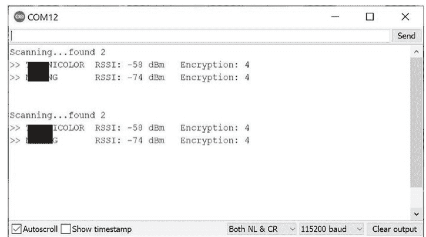

图 4-3. 扫描 WiFi 热点

它是如何工作的？

首先，我们定义 WiFiNINA 库和 Arduino Nano 33 IoT 上内置 LED 的数字引脚。

```
#include <SPI.h>
#include <WiFiNINA.h>

int led = 13;
```

在 setup() 函数中，我们初始化 Serial 和 WiFi 对象。

```
void setup() {
    Serial.begin(115200);
    pinMode(led, OUTPUT);

    // check for the WiFi module:
    if (WiFi.status() == WL_NO_MODULE) {
        Serial.println("Communication with WiFi module failed!");
        // don't continue
        while (true);
    }
}
```

为了扫描现有的 WiFi SSID，我们创建 scanWiFi() 函数。我们可以调用 WiFi.scanNetworks() 来检索所有现有的 WiFi SSID。一旦我们获得 WiFi SSID 列表，我们就打印 WiFi 信息，如 SSID 名称、RSSI 和加密模型。

```
void scanWiFi() {
    Serial.print("Scanning...");
    byte ssid = WiFi.scanNetworks();

    Serial.print("found ");
    Serial.println(ssid);

    for (int i = 0; i<ssid; i++) {
        Serial.print(">> ");
        Serial.print(WiFi.SSID(i));
        Serial.print("\tRSSI: ");
        Serial.print(WiFi.RSSI(i));
        Serial.print(" dBm");
        Serial.print("\tEncryption: ");
        Serial.println(WiFi.encryptionType(i));
    }
}
```

```
Serial.println("");
Serial.println("");
}
```

我们将在 loop() 函数中使用 scanWiFi() 函数。我们也可以在程序扫描 WiFi SSID 时打开 LED。完全扫描 WiFi SSID 后，我们关闭 LED 并设置 15 秒的延迟。

```
void loop() {
  digitalWrite(led, HIGH);
  scanWiFi();
  digitalWrite(led, LOW);
  delay(15000);
}
```

### 连接到 WiFi 网络

我们已经学会如何获取 WiFi SSID 列表。现在我们可以连接到并加入某个 WiFi SSID。我们需要 WiFi SSID 名称及其密钥的信息，如果该 WiFi SSID 应用了访问安全。

对于我们的演示，我们使用名为 WiFiWebClient 的 Arduino 程序。此程序将连接到 WiFi SSID，然后访问 Google 网站。图 4-4 是一个程序示例：WiFiWebClient。

```
#include <SPI.h>
#include <WiFiNINA.h>

#include "arduino_secrets.h"
char ssid[] = SECRET_SSID;
char pass[] = SECRET_PASS;
int keyIndex = 0;

int status = WL_IDLE_STATUS;
char server[] = "www.google.com";

WiFiClient client;
```

我们初始化 Serial 和 WiFi 对象。我们为串行通信设置波特率 115200。我们还通过调用 WiFi.status() 函数验证 WiFi 模块。

```
void setup() {
  Serial.begin(115200);
  while (!Serial) {
    ;
  }
  // check for the WiFi module:
  if (WiFi.status() == WL_NO_MODULE) {
    Serial.println("Communication with WiFi module failed!");
    // don't continue
    while (true);
  }
}
```

WiFi 对象初始化后，Arduino 连接到 WiFi 网络。一旦我们的 Arduino 连接上，我们使用 printWiFiStatus() 函数在串行终端上打印 WiFi 连接状态。

// attempt to connect to Wifi network:
while (status != WL_CONNECTED) {
    Serial.print("Attempting to connect to SSID: ");
    Serial.println(ssid);
    status = WiFi.begin(ssid, pass);

    // wait 10 seconds for connection:
    delay(10000);
}
Serial.println("Connected to wifi");
printWifiStatus();

然后，我们使用 client.connect() 函数连接到 Google 网站。连接到 Google 网站后，我们可以发出 HTTP GET 请求。

```
Serial.println("\nStarting connection to server...");
if (client.connect(server, 80)) {
    Serial.println("connected to server");
    // Make a HTTP request:
    client.println("GET /search?q=arduino HTTP/1.1");
    client.println("Host: www.google.com");
    client.println("Connection: close");
    client.println();
}
```

```
void loop() {
    while (client.available()) {
        char c = client.read();
        Serial.write(c);
    }
}
```

```
// if the server's disconnected, stop the client:
if (!client.connected()) {
    Serial.println();
    Serial.println("disconnecting from server.");
    client.stop();

    // do nothing forevermore:
    while (true);
}
}
```

以下是 printWiFiStatus() 函数的实现。我们使用 WiFi.localIP() 函数打印 IP 地址。我们还通过调用 WiFi.RSSI() 函数获取 RSSI。

```
void printWifiStatus() {
    // print the SSID of the network you're attached to:
    Serial.print("SSID: ");
    Serial.println(WiFi.SSID());

    // print your WiFi shield's IP address:
    IPAddress ip = WiFi.localIP();
    Serial.print("IP Address: ");
    Serial.println(ip);

    // print the received signal strength:
    long rssi = WiFi.RSSI();
    Serial.print("signal strength (RSSI):");
    Serial.print(rssi);
    Serial.println(" dBm");
}
```

保存所有代码。现在你可以编译并上传此程序到 Arduino Nano 33 IoT。我们可以使用串行监视器查看程序输出。

图 4-5 显示了我对 WiFiWebClient 程序的程序输出。你可以通过访问 Google 网站看到输出程序。

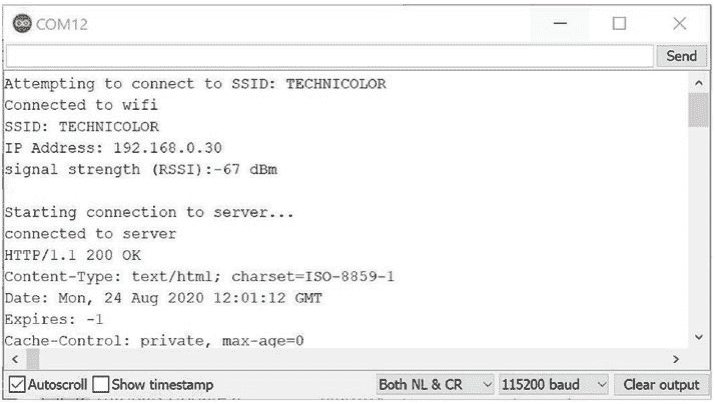

图 4-5. 访问 Google 网站的编程输出

### 访问网络时间协议服务器

有时我们想在 Arduino Nano 33 IoT 上获取当前时间。我们可以应用网络时间协议（NTP）服务器来检索当前时间。此时间使用 UTC 时区。

对于我们的演示，我们可以使用 Arduino 的程序示例。此程序称为 WiFiUdpNtpClient。你可以在图 4-6 中看到此程序。

我们将探索此程序。首先，此程序有两个文件：WiFiUdpNtpClient.ino 和 arduino_secret.h。你可以在 arduino_secret.h 文件上设置你的 WiFi SSID 名称和密钥。

```
#define SECRET_SSID "SSID"
#define SECRET_PASS "SSID-PIN"
```

我们的核心程序在 WiFiUdpNtpClient.ino 文件中实现。我们声明 WiFiNINA、WiFi SSID 信息和 WiFiClient 对象。


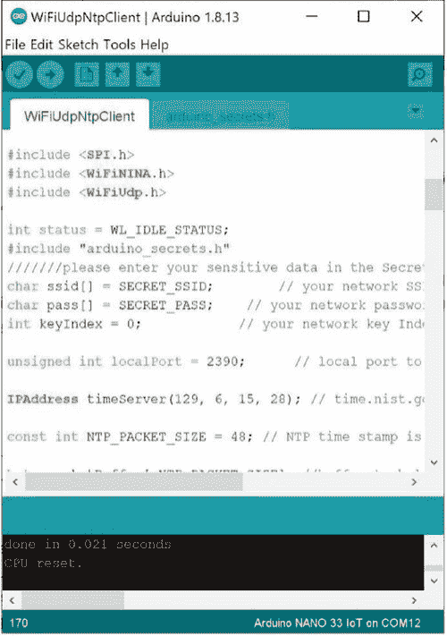

#### **图 4-6.** *WiFiUdpNtpClient 的程序代码*

```cpp
#include <SPI.h>
#include <WiFiNINA.h>
#include <WiFiUdp.h>

int status = WL_IDLE_STATUS;
#include "arduino_secrets.h"
char ssid[] = SECRET_SSID;
char pass[] = SECRET_PASS;
int keyIndex = 0;
```

```
// attempt to connect to Wifi network:
while (status != WL_CONNECTED) {
    Serial.print("Attempting to connect to SSID: ");
    Serial.println(ssid);
    // Connect to WPA/WPA2 network. Change this line if using
    // open or WEP network:
    status = WiFi.begin(ssid, pass);

    // wait 10 seconds for connection:
    delay(10000);
}

Serial.println("Connected to wifi");
printWifiStatus();

Serial.println("\nStarting connection to server...");
Udp.begin(localPort);
}
```

在 loop() 函数中，我们通过调用 sendNTPpacket() 函数向 NTP 服务器发送数据。我们将在下一步实现 sendNTPpacket() 函数。一旦我们从 NTP 服务器收到响应，我们使用 Udp.parsePacket() 解析数据。

```
void loop() {
    sendNTPpacket(timeServer);
    delay(1000);
    if (Udp.parsePacket()) {
        Serial.println("packet received");
        Udp.read(packetBuffer, NTP_PACKET_SIZE);
```

我们从 NTP 服务器计算出纪元时间，即秒数。

```
unsigned long highWord = word(packetBuffer[40],
packetBuffer[41]);
unsigned long lowWord = word(packetBuffer[42],
packetBuffer[43]);

unsigned long secsSince1900 = highWord << 16 | lowWord;
Serial.print("Seconds since Jan 1 1900 = ");
Serial.println(secsSince1900);
```

```
// now convert NTP time into everyday time:
Serial.print("Unix time = ");
// Unix time starts on Jan 1 1970. In seconds, that's
// 2208988800:
const unsigned long seventyYears = 2208988800UL;
// subtract seventy years:
unsigned long epoch = secsSince1900 - seventyYears;
// print Unix time:
Serial.println(epoch);
```

然后，我们将 UTC 时间，如小时、分钟和秒，打印到串行终端。

```
Serial.print("The UTC time is ");
Serial.print((epoch % 86400L) / 3600);
Serial.print(':');
if (((epoch % 3600) / 60) < 10) {
    Serial.print('0');
}
Serial.print((epoch % 3600) / 60);
Serial.print(':');
if ((epoch % 60) < 10) {
    Serial.print('0');
}
```

```
Serial.println(epoch % 60); // print the second
}
delay(10000);
}
```

以下是 `sendNTPpacket()` 函数的实现。我们请求 NTP 服务器的数据。我们传递 NTP 服务器的 IP 地址。NTP 响应的结果被读取并存储到 packetBuffer 变量中。

```
unsigned long sendNTPpacket(IPAddress& address) {
  // set all bytes in the buffer to 0
  memset(packetBuffer, 0, NTP_PACKET_SIZE);
  // Initialize values needed to form NTP request
  packetBuffer[0] = 0b11100011;  // LI, Version, Mode
  packetBuffer[1] = 0;           // Stratum, or type of clock
  packetBuffer[2] = 6;           // Polling Interval
  packetBuffer[3] = 0xEC;         // Peer Clock Precision
  // 8 bytes of zero for Root Delay & Root Dispersion
  packetBuffer[12] = 49;
  packetBuffer[13] = 0x4E;
  packetBuffer[14] = 49;
  packetBuffer[15] = 52;

  //NTP requests are to port 123
  Udp.beginPacket(address, 123);
  Udp.write(packetBuffer, NTP_PACKET_SIZE);
  Udp.endPacket();
}
```

以下是 `printWiFiStatus()` 函数的实现。我们使用 `WiFi.localIP()` 函数打印 IP 地址。我们还通过调用 `WiFi.RSSI()` 函数获取 RSSI。

```
void printWifiStatus() {
    // print the SSID of the network you're attached to:
    Serial.print("SSID: ");
    Serial.println(WiFi.SSID());

    // print your WiFi shield's IP address:
    IPAddress ip = WiFi.localIP();
    Serial.print("IP Address: ");
    Serial.println(ip);

    // print the received signal strength:
    long rssi = WiFi.RSSI();
    Serial.print("signal strength (RSSI):");
    Serial.print(rssi);
    Serial.println(" dBm");
}
```

现在我们可以保存此程序。您可以编译并上传到 Arduino Nano 33 IoT。然后，打开串行监视器工具查看程序输出。图 4-7 显示了我的程序输出。

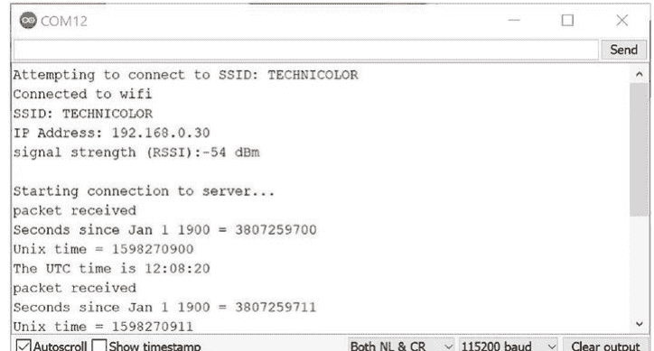

图 4-7. 从 NTP 服务器获取当前时间的程序输出

### 构建一个简单的物联网应用

由于 Arduino Nano 33 IoT 内置了网络模块，我们可以构建一个简单的物联网应用。我们可以从网站控制 LED。我们可以打开/关闭 LED。对于演示实现，我们需要三个 LED。

技术上，我们将在 Arduino Nano 33 IoT 内部构建一个简单的 Web 服务器。我们接收 HTTP GET 请求以从用户处执行 LED 开/关。我们定义以下 HTTP GET 请求。

- http://<ip_address Arduino>/gpio1/1 用于打开 LED1
- http://<ip_address Arduino>/gpio1/0 用于关闭 LED1
- http://<ip_address Arduino>/gpio2/1 用于打开 LED2
- http://<ip_address Arduino>/gpio2/0 用于打开 LED2
- http://<ip_address Arduino>/gpio3/1 用于打开 LED3
- http://<ip_address Arduino>/gpio3/0 用于打开 LED3

接下来，我们为演示构建接线。

#### 接线

我们需要三个 LED 用于演示。我们可以构建以下接线：

- LED 1 连接到 Arduino Nano 33 IoT 的数字引脚 6
- LED 2 连接到 Arduino Nano 33 IoT 的数字引脚 4。
- LED 3 连接到 Arduino Nano 33 IoT 的数字引脚 3。
- 所有 LED GND 引脚都连接到 Arduino Nano 33 IoT 上的地 GND 引脚。

图 4-8 显示了我们物联网项目的接线。

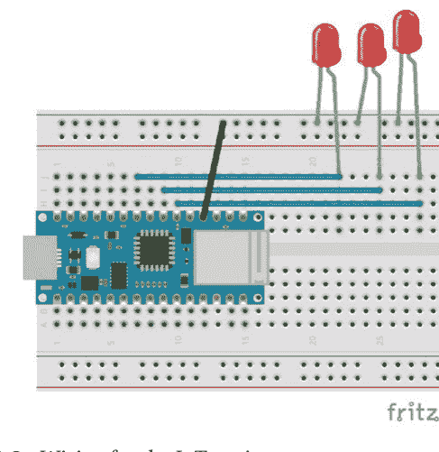

图 4-8. 物联网项目的接线

#### 开发程序

我们的物联网项目实现是使用 Sketch 构建 Arduino 程序。我们将连接到现有 WiFi，然后执行一个简单的 Web 服务器。我们必须等待传入的 HTTP GET 请求以打开/关闭 LED。

要实现，我们打开 Arduino 软件并创建一个新项目。首先，我们定义 LED 引脚和 WiFi SSID。设置您的 WiFi SSID 名称和 SSID 密钥（如果可用）。要实现一个简单的 Web 服务器，我们使用 WiFiServer 库。您可以在此链接阅读它，https://www.arduino.cc/en/Reference/WiFiServer。

```
#include <SPI.h>
#include <WiFiNINA.h>

int led1 = 6;
int led2 = 4;
int led3 = 3;

const char* ssid = "wifi-ssid";
const char* password = "ssid-key";

int status = WL_IDLE_STATUS;
WiFiServer server(80);
```

在 setup() 函数中，我们使用波特率 115200 初始化 Serial 对象并为 LED 引脚设置数字模式。我们为数字模式设置 OUTPUT。

```
void setup() {
  Serial.begin(115200);
  delay(10);

  // prepare GPIO5
  pinMode(led1, OUTPUT);
  pinMode(led2, OUTPUT);
  pinMode(led3, OUTPUT);
  digitalWrite(led1, 0);
  digitalWrite(led2, 0);
  digitalWrite(led3, 0);
```

接下来，我们通过调用 WiFi.begin() 函数并传递 WiFi SSID 及其密钥来连接到现有 WiFi。

```
while (status != WL_CONNECTED) {
  Serial.print("Attempting to connect to SSID: ");
  Serial.println(ssid);
  status = WiFi.begin(ssid, password);
```

```
// wait 10 seconds for connection:
delay(10000);
}
Serial.println("");
Serial.println("WiFi connected");
```

如果我们的 Arduino 已连接到 WiFi 网络，我们可以通过从 WiFiServer 对象调用 begin() 函数来启动 Web 服务器。

```
server.begin();
Serial.println("Server started");

// Print the IP address
char ips[24];
IPAddress ip = WiFi.localIP();
sprintf(ips, "%d.%d.%d.%d", ip[0], ip[1], ip[2], ip[3]);
Serial.println(ips);
}
```

在 loop() 函数中，我们执行一些任务，例如等待传入的 HTTP 请求。然后，我们解析传入的数据包。如果数据包有效，我们可以打开/关闭 LED。首先，我们等待传入的客户端连接。我们可以调用 server.available()。

```
void loop() {
    // Check if a client has connected
    WiFiClient client = server.available();
    if (!client) {
        return;
    }

    // Wait until the client sends some data
    Serial.println("new client");
    while(!client.available()){
        delay(1);
    }
```


一旦我们建立了客户端连接，就需要等待传入的 HTTP 请求包。我们解析数据包以识别命令类型。可以使用字符串处理过程。当收到“/gpioX/Y”请求时，我们调用 `indexOf()`。X 是 LED 编号，Y 是打开/关闭 LED 的命令。

```cpp
String req = client.readStringUntil('\r');
Serial.println(req);
client.flush();

// Match the request
int val1 = 0;
int val2 = 0;
int val3 = 0;
int ledreq = 0;
if (req.indexOf("/gpio1/0") != -1) {
    val1 = 0;
    ledreq = 1;
}
else if (req.indexOf("/gpio1/1") != -1) {
    val1 = 1;
    ledreq = 1;
}
else if (req.indexOf("/gpio2/0") != -1) {
    val2 = 0;
    ledreq = 2;
}
else if (req.indexOf("/gpio2/1") != -1) {
    val2 = 1;
    ledreq = 2;
}
else if (req.indexOf("/gpio3/0") != -1) {
    val3 = 0;
    ledreq = 3;
}
else if (req.indexOf("/gpio3/1") != -1) {
    val3 = 1;
    ledreq = 3;
}
else {
    Serial.println("invalid request");
    client.stop();
    return;
}
```

识别命令类型后，我们可以使用 `digitalWrite()` 打开/关闭 LED。

```cpp
digitalWrite(led1, val1);
digitalWrite(led2, val2);
digitalWrite(led3, val3);
```

接下来，我们向客户端发送响应。我们使用 `client.print()` 函数发送 HTML 脚本。之后，我们关闭客户端连接。

```cpp
client.flush();
String s = "HTTP/1.1 200 OK\r\nContent-Type: text/html\r\n\r\n<!DOCTYPE HTML>\r\n<html>\r\n";
if(ledreq==1) {
    s += "LED1 is ";
    s += (val1)? "ON": "OFF";
}else if(ledreq==2) {
    s += "LED2 is ";
    s += (val2)? "ON": "OFF";
}else if(ledreq==3) {
    s += "LED3 is ";
    s += (val3)? "ON": "OFF";
}
s += "</html>\n";

// Send the response to the client
client.print(s);
delay(1);
client.stop();
Serial.println("Client disconnected");
}
```

你可以将此程序保存为 IoTDemo。接下来，我们可以编译并测试该程序。

#### 测试

我们将 IoTDemo 程序编译并上传到 Arduino Nano 33 IoT 后，可以打开串行监视器工具。我们应该会看到 Arduino Nano 33 IoT 的 IP 地址。如果看不到，说明 Arduino Nano 33 IoT 在连接现有 WiFi 时可能遇到了问题。图 4-9 显示了 Arduino Nano 33 IoT 的 IP 地址。

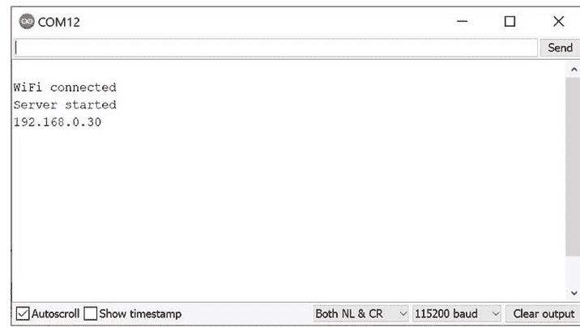

图4-9. Arduino Nano 33 IoT 已连接到 WiFi

测试时，我们可以使用浏览器。你可以发出一个打开 LED 的请求。我们可以访问 http://<ipaddress>/gpio1/1 来打开 LED 1。如果成功，我们会得到如图 4-10 所示的响应。LED 1 也会点亮。


图4-10. 通过 HTTP GET 请求打开 LED

要关闭 LED 1，我们可以使用此链接发出请求：http://<ipaddress>/gpio1/0。我们会看到 LED 1 熄灭。同时也会收到来自 Arduino Nano 33 IoT 的响应，如图 4-11 所示。

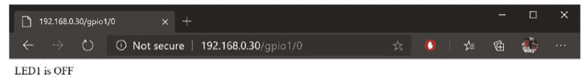

图4-11. 通过 HTTP GET 请求关闭 LED

我们的 IoTDemo 程序还会打印有关客户端连接和客户端请求的所有信息。你可以在图 4-12 中看到我的程序输出。

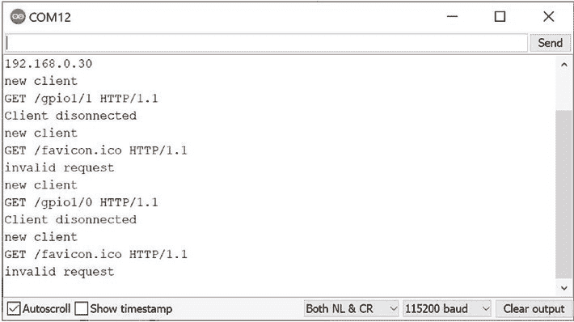

图4-12. 串行终端上 IoT 项目的程序输出

本章到此结束。我们可以通过基于 Arduino Nano 33 IoT 板开发 IoT 程序来进行练习。


图4-12. 串行终端上 IoT 项目的程序输出

## 总结

我们已经学习了如何在 Arduino Nano 33 IoT 上设置 WiFiNINA 库。我们将开发板连接到了现有的 WiFi 网络。然后，我们尝试连接到 Google 网站。我们从 NTP 服务器请求了当前时间。最后，我们构建了一个用于打开/关闭 LED 的 IoT 应用程序。

在下一章中，我们将学习如何连接到 Arduino IoT Cloud。

### 设置 Arduino IoT Cloud

为了访问 Arduino IoT Cloud 并为其构建程序，我们需要设置 Arduino 设备。我们应在该平台注册一个新账户。你可以通过此链接在 Arduino IoT Cloud 上注册账户：https://create.arduino.cc/iot/。注册完成后，我们将 Arduino Nano 33 IoT 注册到 Arduino IoT Cloud。

你可以在图 5-1 中看到 Arduino IoT Cloud 的仪表板。我们有三个菜单：Things、Dashboards 和 Devices。没有付费订阅的成员只能在该平台创建 Things 菜单。


图5-1. Arduino IoT Cloud 网站的仪表板

如果你在 Arduino 商店有账户，可以使用同一账户注册 Arduino IoT Cloud。然后，我们就可以注册我们的 Arduino Nano 33 IoT。

#### 注册 Arduino Nano 33 IoT

在使用 Arduino IoT Cloud 之前，我们必须注册 Arduino 设备。本章我们使用 Arduino Nano 33 IoT。注册 Arduino 设备需要一些步骤。你可以执行以下任务：

- 安装 Arduino Create Agent
- 添加新的 Arduino 设备

接下来，我们可以安装 Arduino Create Agent。

#### 安装 Arduino Create Agent

Arduino Create Agent 是一个后台程序，用于监听本地 Arduino 设备。该代理程序充当本地 Arduino 设备与 Arduino IoT Cloud 之间的桥梁。

Arduino Create Agent 程序适用于 Windows、Linux 和 macOS 平台。你可以通过此链接下载该程序：https://github.com/arduino/arduino-create-agent。安装后，应允许该程序在后台运行。在 Windows 平台上，你可以在任务栏上看到 Arduino Create Agent 的托盘图标，如图 5-2 所示。

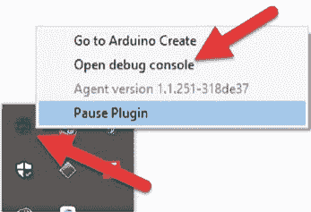

图5-2. Windows 操作系统上 Arduino Create Agent 的托盘图标

你可以通过在 Arduino Create Agent 中单击 Debug Console 菜单来打开它。如果 Arduino 设备已连接到本地计算机，Arduino Create Agent 的调试控制台将显示设备状态。图 5-3 显示我的 Arduino Nano 33 IoT 已被检测到。

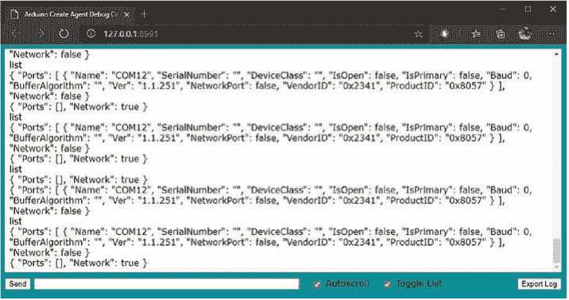

图5-3. Arduino Create Agent 调试控制台的界面

如果你没有看到 Arduino 设备，请确保 Arduino 已正确连接到计算机。完成后，你可以注册 Arduino Nano 33 IoT。

#### 添加新的 Arduino 设备

一旦我们在本地计算机上设置了 Arduino Create Agent 程序，就可以添加新的 Arduino 设备。打开 Arduino IoT Cloud 网站，然后点击 DEVICES 菜单。你会看到 Arduino 设备列表。

现在你可以添加新的 Arduino Nano 33 IoT。插入 Arduino Nano 33 IoT 后，你应该会看到如图 5-4 所示的对话框。点击 Arduino 设备菜单中的 Set up。

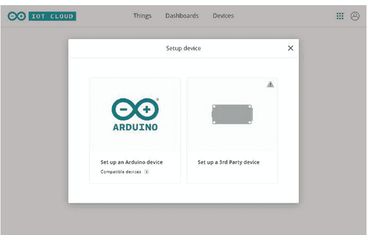

图5-4. 添加新的 Arduino 设备

点击此选项后，你应该会看到 Arduino Nano 33 IoT，如图 5-5 所示。如果没有看到 Arduino Nano 33 IoT，请确保 Arduino Nano 33 IoT 已连接并且 Arduino Create Agent 正在运行。

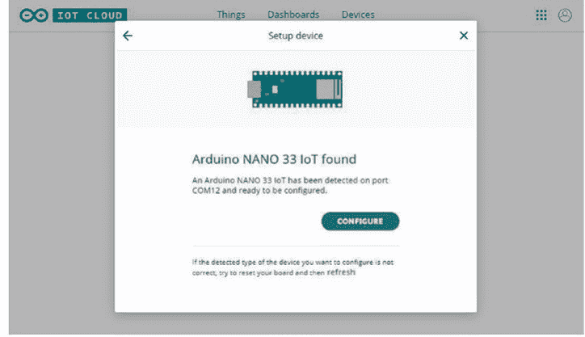

图5-5. Arduino IoT Cloud 检测到 Arduino Nano 33 IoT

为 Arduino Nano 33 IoT 设置设备名称。完成后，可以点击 CONFIGURE 按钮。Arduino IoT Cloud 将配置你的 Arduino Nano 33 IoT，如图 5-6 所示。完成此任务需要几分钟时间。配置完成后，你应该会在 Arduino IoT Cloud 列表中看到 Arduino Nano 33 IoT，如图 5-7 所示。

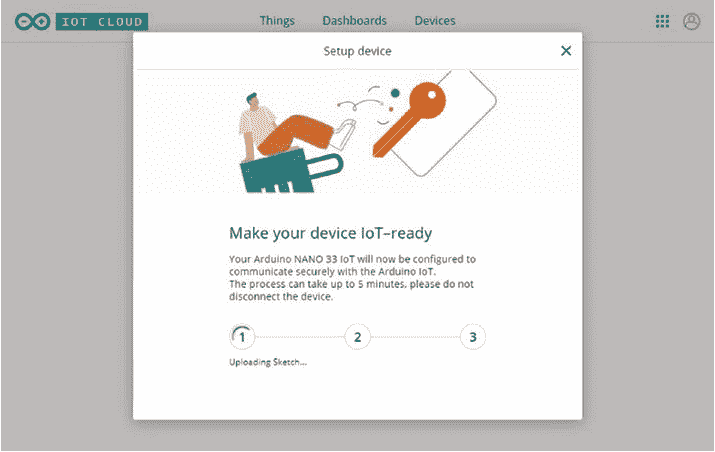

图5-6. 正在配置 Arduino Nano 33 IoT

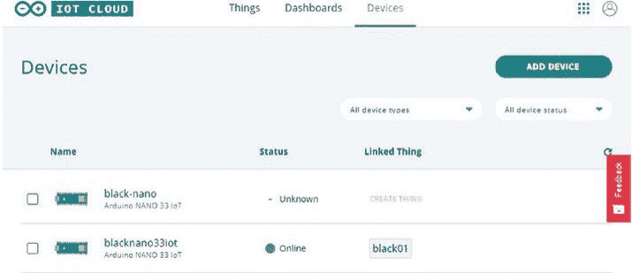

图5-7. Arduino Nano 33 IoT 设备已添加

### 开发远程 LED 按钮

在本节中，我们将构建一个程序，通过 Arduino IoT Cloud 仪表板远程控制 LED。我们可以从 Arduino IoT Cloud 仪表板网站打开/关闭 Arduino Nano 33 IoT 上的 LED。

为了实现演示，我们可以按以下步骤执行一些任务：

- 添加新的 Thing
- 添加属性
- 编辑 Sketch 程序
- 构建仪表板
- 测试

我们将在下一节中执行这些步骤。

#### 添加新的 Thing

Arduino IoT Cloud 的一个功能是与 Arduino 设备交互的程序。使用免费会员资格，我们只能创建一个 Thing。在本演示中，我们通过 Arduino IoT Cloud 仪表板构建 LED 的遥控器。

打开 Arduino IoT Cloud 网站，点击 Things 菜单。然后，你会得到一个表单，如图 5-8 所示。输入 Thing 名称和 Arduino 设备。每个 Thing 都通过一个 Arduino 设备连接。

设置 Thing 名称后，你可以点击 CREATE 按钮。之后，你会看到一个表单，如图 5-9 所示。我们将在下一节配置 Arduino Nano 33 IoT 的属性。


#### 图 5-8. 添加一个新的 Thing

#### 图 5-9. Arduino Thing 的仪表盘

#### 添加属性

我们可以通过 Thing 属性来暴露 Arduino Nano 33 IoT 的 I/O。例如，我们想将传感器数据暴露给 Arduino IoT Cloud。在此场景中，我们想暴露 Arduino Nano 33 IoT 上的内置 LED。我们可以对 LED 设置 I/O，以便通过网络打开/关闭 LED。

你可以先在 Arduino IoT Cloud 上打开一个 Thing。图 5-9 显示了我们已经创建的 Thing。点击 Add Property 按钮添加一个新属性。点击后，你将获得一个表单，如图 5-10 所示。

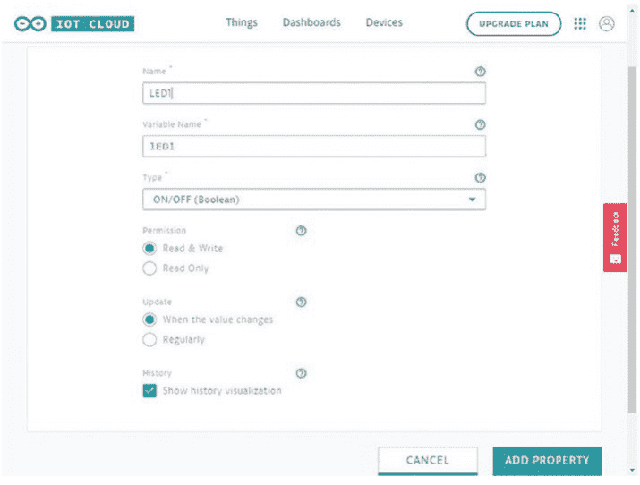

图 5-10. 添加一个新属性

在此场景中，你可以设置以下选项：

- Name: LED1
- VARIABLE NAME: LED1
- TYPE: ON/OFF (Boolean)
- Permission: Read & Write
- Update: when the value changes
- History: checked

我的条目显示在图 5-10 中。填写所有字段后，你可以点击 ADD PROPERTY 按钮。你将返回 Things 表单。你应该在 Thing 表单上看到 LED1 属性，如图 5-11 所示。

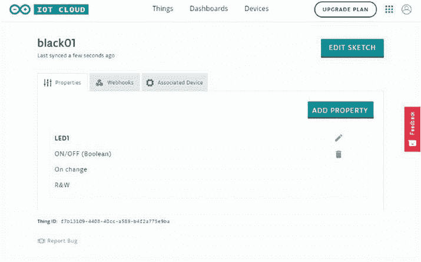

图 5-11. 带有一个属性的 Thing

你已经创建了一个 Thing。接下来，我们可以修改 Sketch 程序以连接到此 LED1 属性。

#### 编辑 Sketch 程序

现在我们可以编辑我们的 Sketch 程序。在 Thing 仪表盘的属性表单上（见图 5-11），你可以点击 EDIT SKETCH 按钮。点击后，你将获得 Arduino 网页编辑器，如图 5-12 所示。

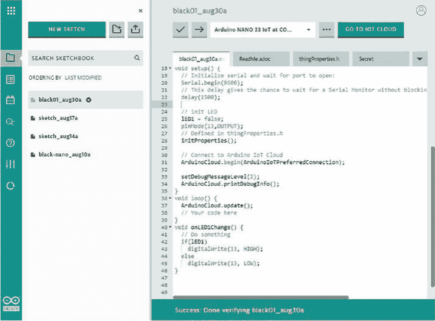

*图 5-12.* 编辑 Sketch 程序

首先，我们修改 Secret 程序以配置 Arduino Nano 33 IoT 上的 WiFi 网络。在 Secret 选项卡上填写 SSID ID 和 SSID key。现在我们在主 Sketch 上修改代码。

你可以看到我们的属性变量 LED1 已在主 Sketch 程序中声明。

```
#include "arduino_secrets.h"
bool LED1;
#include "thingProperties.h"
```

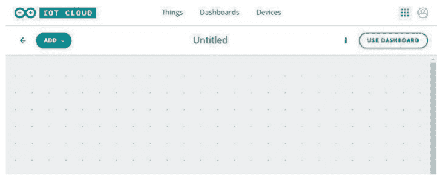

#### 图 5-13. Arduino IoT Cloud 的仪表盘

我们可以在仪表盘编辑器上添加一个新的开关。点击 ADD 按钮并选择 Switch widget。你可以在图 5-14 中看到 Switch widget 选项。

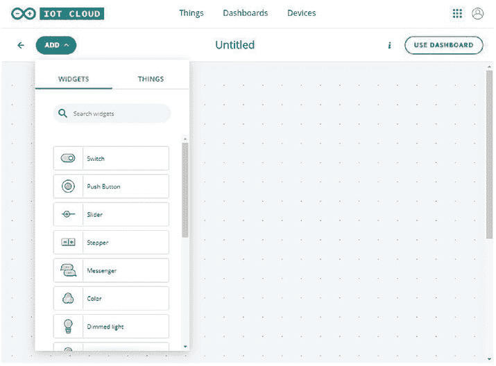

#### 图 5-14. 在仪表盘上添加一个小部件

点击 Switch widget 然后将其拖到仪表盘编辑器。拖动 Switch widget 后，你应该可以看到 Switch widget，如图 5-15 所示。

点击 Example Data 将 Switch widget 链接到 Thing 属性。点击后，你将获得如图 5-16 所示的表单。

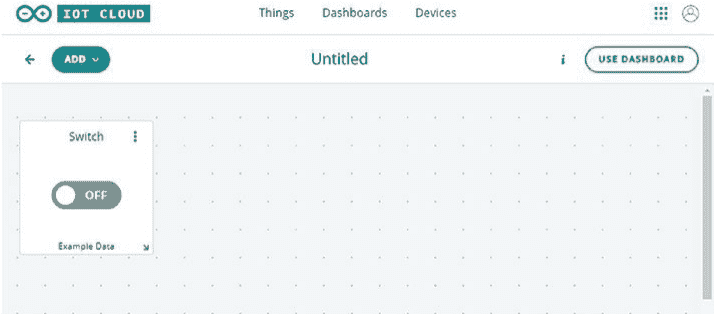

图 5-15. 添加一个开关

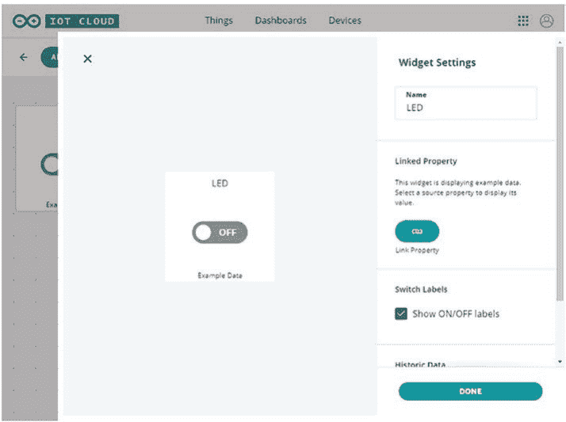

#### 图 5-16. 设置 Switch widget

点击 Linked Property 按钮以链接到 Thing 属性。我们将获得一个表单，如图 5-17 所示。选择我们的 Thing 名称，并选择 Property (LED1)。如果完成，点击 LINK PROPERTY 按钮。然后，我们将返回到仪表盘编辑器。

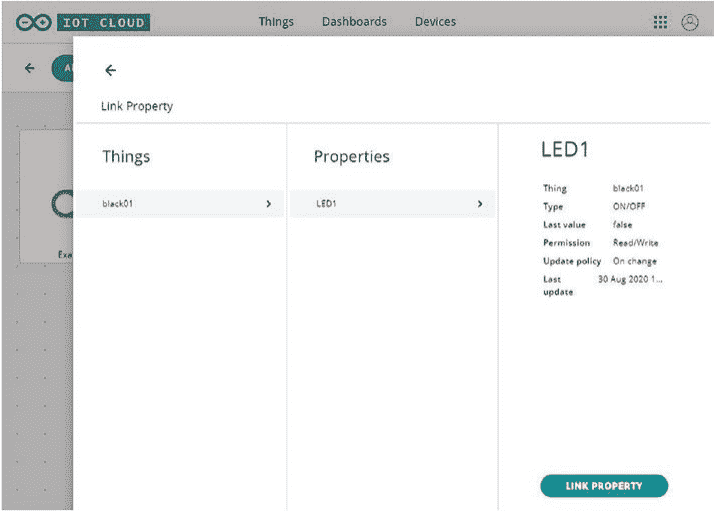

*图 5-17.* 将开关链接到 thing 属性

你也可以重命名我们的仪表盘程序——例如，LED Demo。现在我们可以测试我们的仪表盘程序。

#### 测试

要测试我们的程序，我们需要将仪表盘程序激活到运行模式。你可以点击 USE DASHBOARD 按钮来激活仪表盘程序。

你可以尝试将 Switch 切换到 ON 模式。然后，你应该看到 Arduino Nano 33 IoT 上的内置 LED 点亮。你也可以通过将 Switch 切换到 OFF 模式来关闭 LED。

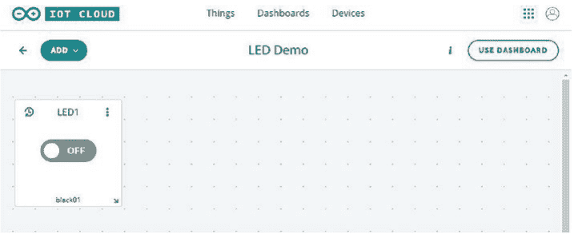

*图 5-18. 仪表盘编辑器上的 LED 演示程序*

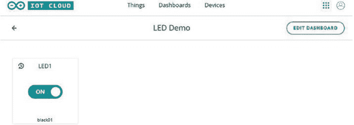

*图 5-19. 切换 Switch 以打开 LED*

你可以通过添加一些 LED 来自定义此程序。然后，你可以在 Things 程序上添加一些属性。

### 开发传感器监控

我们已经创建了 Arduino IoT Cloud 来打开/关闭 Arduino Nano 33 IoT 上的 LED。现在我们可以继续构建 Arduino IoT Cloud 程序以监控传感器。在此演示中，我们使用 Arduino Nano 33 IoT 上的内置传感器。为测试，我们使用陀螺仪传感器。

要实现此演示，我们可以按以下步骤执行一些任务：

- adding a new thing
- adding properties
- editing the Sketch program
- building a dashboard
- testing

我们在下一节中实现这些步骤。

#### 添加一个新的 Thing

你可以在 Arduino IoT Cloud 上创建一个新的 Thing。如果你有免费会员，你应该删除 Arduino IoT Cloud 上的现有 Thing，因为你只能创建一个 Thing。

现在你可以创建一个新的 Thing。例如，我们将 Thing 名称设为 GyroscopeThing。然后，我们可以向 GyroscopeThing 添加一些属性。

#### 添加属性

创建 Thing 后，我们可以添加属性。对于此演示，我们创建三个属性来监控来自 Arduino Nano 33 IoT 的陀螺仪传感器。这些属性将链接到陀螺仪传感器的 X、Y 和 Z 度。当我们可以添加一个新属性时，我们有一个表单，如图 5-20 所示。我们添加三个属性，其属性参数如表 5-1 所示。

创建三个 Thing 属性后，我们将返回到 Things 仪表盘。你可以在图 5-21 中看到三个属性。

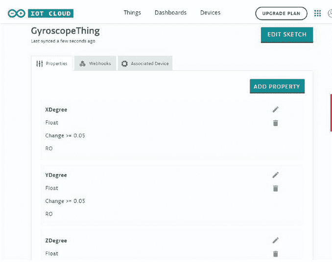

图 5-21. GyroscopeThing 上的三个属性

#### 编辑 Sketch 程序

在 GyroscopeThing 上添加三个属性后，我们可以编辑 Sketch 程序。我们将读取陀螺仪传感器，然后将传感器数据更新到属性变量。

点击 EDIT SKETCH 按钮以在 Arduino IoT Cloud 上编辑我们的程序。然后，我们有 Sketch 网页编辑器。我们修改此 Sketch 程序以使我们能够读取陀螺仪传感器并更新三个 Thing 属性。

首先，我们在 Arduino Secret 上设置 SSID ID 和 SSID key。然后，我们打开主程序。我们在 Sketch 程序上添加 LSM6DS3 库。

```
#include "arduino_secrets.h"
#include <Arduino_LSM6DS3.h>
```

我们将看到我们的属性变量，例如 xDegree、yDegree 和 zDegree。

```
float xDegree;
float yDegree;
float zDegree;
```

```
#include "thingProperties.h"
```

在 setup() 函数中，我们通过调用 IMU.begin() API 初始化 LSM6DS3 库。然后，我们可以访问 Arduino Nano 33 IoT 上的陀螺仪传感器。

```
void setup() {
...
  if (!IMU.begin()) {
    Serial.println("Failed to initialize IMU!");
    while (1);
  }
...
}
```

我们可以读取陀螺仪传感器然后更新到 xDegree、yDegree 和 zDegree 变量。我们可以调用 IMU.gyroscopeAvailable() 来检查传感器数据是否可用。要读取传感器数据，我们可以使用 IMU.readGyroscope() 函数。

```
void loop() {
    ArduinoCloud.update();
    // Your code here
    if (IMU.gyroscopeAvailable()) {
        IMU.readGyroscope(xDegree, yDegree, zDegree);
    }
    delay(1000);
}
```

保存此程序。现在你可以编译此 Sketch 程序并上传到 Arduino Nano 33 IoT 设备。

#### 构建仪表盘

我们构建一个仪表盘以在 Arduino Nano 33 IoT 和 Arduino IoT Cloud 之间创建交互。我们按以下步骤执行一个新的仪表盘程序：

- Create a new dashboard.
- Add three value widgets into the dashboard editor.
- Each value widget is to be linked to each Thing Property, as shown in Figure 5-22.
- Do the same action for XDegree, YDegree, and ZDegree value widgets.

最后，我们可以设置仪表盘名称。现在我们可以测试仪表盘上的小部件。

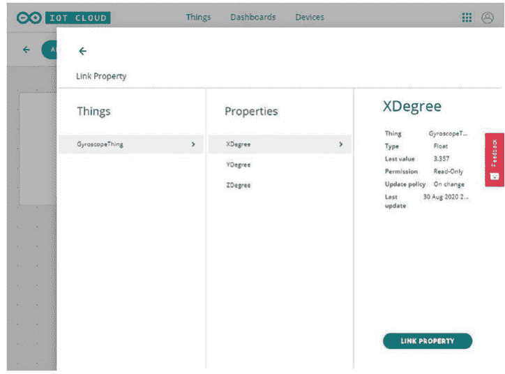

图 5-22. 将属性链接到小部件

#### 测试

我们可以测试我们的 Arduino IoT Cloud 程序。你可以导航到 Arduino IoT Cloud 仪表盘。点击我们已经创建的仪表盘表单。点击 USE DASHBOARD 按钮进入 RUN 模式。

你可以在图 5-23 中看到小部件输出。摇动你的 Arduino Nano 33 IoT 板以在仪表盘小部件上看到传感器数据变化。


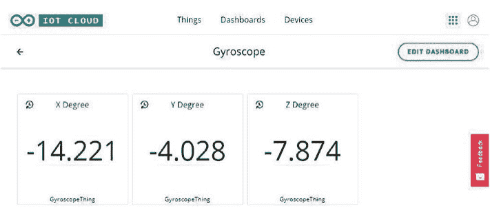

*Figure 5-23.* 在 Arduino IoT Cloud 仪表板上显示传感器数值

你已在 Arduino IoT Cloud 上创建了一个仪表板，用于监控来自 Arduino Nano 33 IoT 的传感器。你可以通过应用一些传感器或执行器来与 Arduino IoT Cloud 集成来进行练习。

## Summary

我们学习了如何开始使用 Arduino IoT Cloud。我们已设置并将 Arduino Nano 33 IoT 注册到 Arduino IoT Cloud。我们还为 Arduino IoT Cloud 构建了两个程序：远程控制 LED 和传感器监控。

接下来，我们将学习如何工作并与 Bluetooth Low Energy 进行交互。
