# CHAPTER 6

## Bluetooth Low Energy (BLE)

Arduino Nano 33 IoT 具有两个内置网络模块：WiFi 和 Bluetooth。本章我们探讨如何在 Arduino Nano 33 IoT 上开始使用 Bluetooth Low Energy (BLE)。我们将构建程序来利用 BLE 模块。

本章你将学习以下主题：

- Setting up BLE library on Arduino Nano 33 IoT
- Building a simple BLE application
- Developing an LED control program over BLE
- Exposing sensor data over BLE service

### Introduction

Arduino Nano 33 IoT 是 Arduino 的物联网平台之一。该板使用 WiFi 和 Bluetooth 模块连接到网络。Arduino Nano 33 IoT 支持 BLE 无线电。BLE 技术使我们能够广告我们的服务并在 BLE 设备之间进行交互，例如移动设备。

# CHAPTER 6　BLUETOOTH LOW ENERGY (BLE)

```cpp
// begin initialization
if (!BLE.begin()) {
    Serial.println("starting BLE failed!");
    while (1);
}
```

现在我们通过调用 BLE.setLocalName() 设置我们的 BLE 无线电名称。该名称将在 BLE 读卡器上被检测到。我们还通过调用 BLE.setAdvertisedServiceUuid() 函数设置 BLE UUID。BLE UUID 表示计算出的 128 位值。你可以使用此在线工具生成 UUID，https://www.guidgenerator.com/online-guid-generator.aspx。

```cpp
BLE.setLocalName("HelloBLE");
BLE.setAdvertisedServiceUuid("19B10000-E8F2-537E-4F6C-D104768A1214");

// start advertising
BLE.advertise();
Serial.println("Bluetooth device active, waiting for connections...");
}
```

确保你的 BLE UUID 符合标准 BLE SIG。一些 BLE UUID 由其服务保留。你可以在此链接检查这些服务，https://www.bluetooth.com/specifications/assigned-numbers/service-discovery/。

接下来，我们在 loop() 函数中等待传入的 BLE 读卡器。我们可以调用 BLE.central() 来等待 BLE 读卡器。

```cpp
void loop() {
    // wait for a BLE central
    BLEDevice central = BLE.central();
```

在 BLE 读卡器连接到 Arduino Nano 33 IoT 上的 BLE 无线电后，我们可以获得 BLEDevice 对象。然后，我们通过调用 digitalWrite() 并传递 HIGH 值来打开 LED。然后，我们通过检查连接状态进行无限循环。

```cpp
if (central) {
  Serial.print("Connected to central: ");
  Serial.println(central.address());
  digitalWrite(LED_BUILTIN, HIGH);

  while (central.connected()) {
    // do nothing
  }
```

如果 BLE 读卡器断开连接，我们将从 central.connected() 获得 false 值。之后，我们通过调用 digitalWrite() 并传递 LOW 值来关闭 LED。

```cpp
digitalWrite(LED_BUILTIN, LOW);
Serial.print("Disconnected from central: ");
Serial.println(central.address());
}
}
```

我们的程序已完成。你可以将此程序保存为 HelloBLE。

### Testing Program

现在我们的 Arduino 程序 HelloBLE 可以编译并上传到 Arduino Nano 33 IoT。为了测试此程序，我们需要一台具有 Android 或 iOS 平台的手机。在此演示中，我使用了一部 Android 手机。

首先，打开 Serial Monitor 以查看来自 HelloBLE 程序的程序输出。接下来，在 Google Play 商店或 Apple 商店安装 nRF Connect for Mobile 应用程序。你可以在图 6-2 中看到来自 Google Play 商店的 nRF Connect for Mobile 应用程序。

下载并安装适用于移动平台的 nRF Connect for Mobile 应用程序。安装后，你可以运行此程序。你可以看到我的 Android 上的 nRF Connect for Mobile 应用程序，如图 6-3 所示。接下来，我们可以连接到 Arduino Nano 33 IoT。

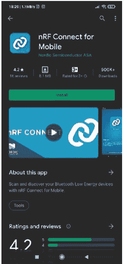

Figure 6-2. nRF Connect for Mobile application on the Google Play store

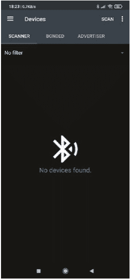

#### Figure 6-3. A form of nRF Connect for Mobile application

我们可以点击 SCAN 以获取 BLE 设备列表。你应该会看到 HelloBLE 服务。你可以在图 6-4 中看到我的 HelloBLE。如果看不到，你应该再次点击 SCAN 按钮。

现在你点击 HelloBLE 上的 CONNECT 按钮。之后，我们将通过 BLE 无线电连接到 Arduino Nano 33 IoT。图 6-5 显示我的 Android 手机已连接到来自 Arduino Nano 33 IoT 的 HelloBLE 服务。

要从 HelloBLE 服务断开连接，你可以点击 DISCONNECT 按钮。然后，我们的移动设备关闭 BLE 无线电通信。如果已打开 Serial Monitor 工具，你将在此工具上看到所有事件消息。你可以在图 6-6 中看到我的 Serial Monitor 工具上的程序输出。

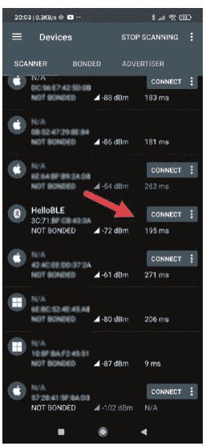

Figure 6-4. HelloBLE service is showing

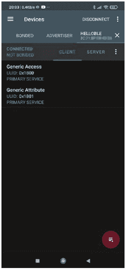

Figure 6-5. Connected to HelloBLE service

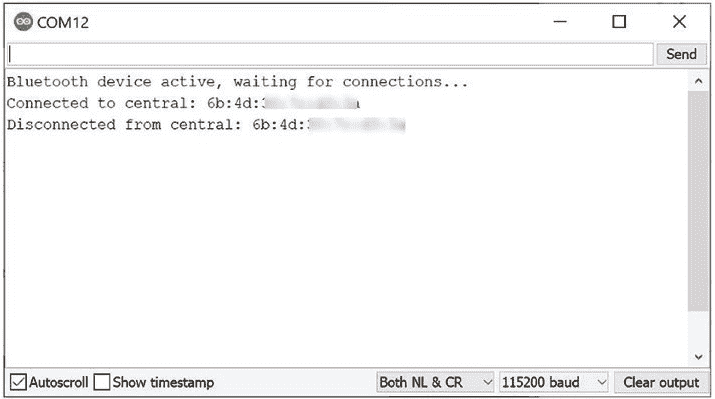

Figure 6-6. Program output on the serial console from HelloBLE

### Demo 2: Controlling LED with BLE

在此演示中，我们通过 BLE 无线电构建一个 LED 控制器。我们利用 BLE 服务来公开 LED 服务。我们可以使用移动应用程序打开/关闭 LED。

对于实现，我们使用来自 Arduino 的程序示例 LED。接下来，我们开发 Sketch 程序。

### Writing the Program

我们将开发 Arduino 程序通过 BLE 无线电控制 LED。现在你开始打开 Arduino 软件。创建一个新程序。接下来，我们逐步编写代码。

首先，我们将 ArduinoBLE 库导入到我们的程序中。我们还使用 BLERead 和 BLEWrite 特性初始化 BLE 服务。我们为 LED_BUILTIN 定义 ledPin。我们编写以下代码。

```cpp
#include <ArduinoBLE.h>

BLEService ledService("19B10000-E8F2-537E-4F6C-D104768A1214");
BLEByteCharacteristic switchCharacteristic("19B10001-E8F2-537E-4F6C-D104768A1214", BLERead | BLEWrite);

const int ledPin = LED_BUILTIN;
```

然后，我们在 setup() 函数中初始化串行通信和数字 OUTPUT 模式。我们还使用 BLE.begin() 函数在 Arduino Nano 33 IoT 上初始化 BLE 无线电。

```cpp
void setup() {
  Serial.begin(9600);
  while (!Serial);

  // set LED pin to output mode
  pinMode(ledPin, OUTPUT);
}
```

```cpp
// begin initialization
if (!BLE.begin()) {
    Serial.println("starting BLE failed!");
    while (1);
}
```

接下来，我们使用 addCharacteristic() 函数设置 BLE 服务和特性。我们还通过调用 writeValue() 函数初始化特性值。

```cpp
// set advertised local name and service UUID:
BLE.setLocalName("LED");
BLE.setAdvertisedService(ledService);

// add the characteristic to the service
ledService.addCharacteristic(switchCharacteristic);

// add service
BLE.addService(ledService);

// set the initial value for the characeristic:
switchCharacteristic.writeValue(0);
```

在我们定义 BLE 服务后，我们可以使用 BLE.advertise() 函数开始广告。我们打印一条信息，说明我们的 BLE 已准备好等待传入的 BLE 读卡器。

```cpp
// start advertising
BLE.advertise();

Serial.println("BLE LED Peripheral");
}
```

在 loop() 函数中，我们等待 BLE 读卡器。我们使用 BLE.central()。如果 BLE 读卡器连接到 Arduino Nano 33 IoT，我们将获得一个 BLEDevice 对象。

最后，如果 BLE 读卡器断开连接，我们将向串行终端打印消息。

```cpp
Serial.print(f("Disconnected from central: "));
Serial.println(central.address());
}
}
```

我们的程序已完成。你可以将此程序保存为 LED。

### Testing the Program

现在我们的 Arduino 程序 LED 可以编译并上传到 Arduino Nano 33 IoT。为了测试此程序，我们需要一台具有 Android 或 iOS 平台的手机。在此演示中，我使用了一部 Android 手机。

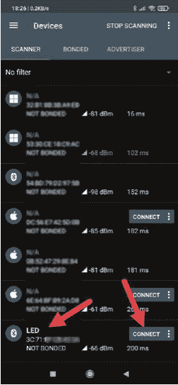

*Figure 6-7. LED service shows in nRF Connect for Mobile application*


# 第 6 章　蓝牙低功耗 (BLE)

首先，打开串行监视器以查看 LED 程序的程序输出。现在你可以从你的平台打开 nRF Connect for Mobile 应用程序。你应该能在该应用程序上看到 BLE 服务，如图 6-7 所示。点击 CONNECT 按钮以连接到 Arduino Nano 33 IoT。

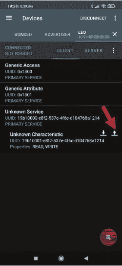

**图 6-8。** *显示 BLE 服务特征*

连接后，你将获得一个表单，如图 6-8 所示。你可以展开 BLE 服务特征。我们有两个属性：READ 和 WRITE。

点击 WRITE 属性图标。然后，设置一个值 15 以打开 LED，如图 6-9 所示。点击 SEND 发送此值。你应该能看到 Arduino Nano 33 IoT 上的 LED 点亮。你也可以发送 00 以在 BLE 服务 WRITE 上关闭 LED，如图 6-10 所示。

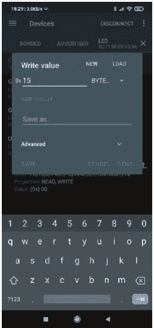

图 6-9. 写入数据 15 以打开 LED

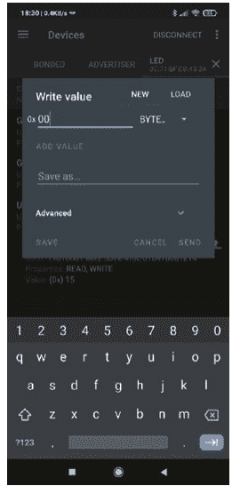

图 6-10. 写入数据 00 以关闭 LED

如果你已经打开了串行监视器工具，你将看到程序输出事件信息。你可以在图 6-11 中看到我的程序输出。

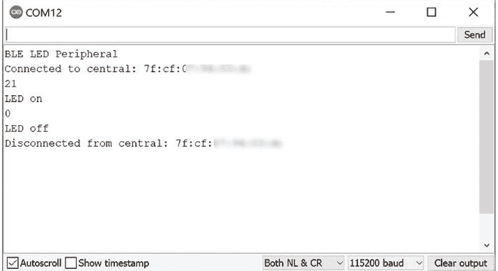

图 6-11. LED 的程序输出

### 演示 3：传感器实时监控

在本节中，我们通过 BLE 无线电构建传感器实时监控。我们制作一个 BLE 服务，提供陀螺仪传感器数据给 BLE 读取器。BLE 读取器将在传感器数据发生变化时获得通知。

### 编写程序

我们创建一个新的 Arduino 程序来创建 BLE 服务，然后广播陀螺仪传感器到 BLE 读取器。我们将创建一个包含三个特征的 BLE 服务。每个 BLE 特征将公开陀螺仪传感器 x、y 和 z 度的信息。

开始开发时，我们可以打开 Arduino 软件。首先，我们调用所需的库。

```
#include <ArduinoBLE.h>
#include <Arduino_LSM6DS3.h>
```

然后，我们定义 BLE 服务和三个 BLE 特征。
我们需要不同的 UUID 来应用这些功能。我们还定义三个变量来保存传感器数据。

```
BLEService sensorService("16150f38-e7a9-4fe1-ae08-48464baf25b2");
BLEStringCharacteristic xSensorLevel("ff99948c-18ff-4ed8-942e-512b9b24b6da", BLERead | BLENotify,15);
BLEStringCharacteristic ySensorLevel("8084aa6b-6cae-461f-9540-e1a5768de49d", BLERead | BLENotify,15);
BLEStringCharacteristic zSensorLevel("ab80cb77-fe74-40d8-9757-96f8a54c16d9", BLERead | BLENotify,15);

// last sensor data
float oldXLevel = 0;
float oldYLevel = 0;
float oldZLevel = 0;
long previousMillis = 0;
```

在 setup() 函数中，我们使用波特率 115200 初始化串行通信、陀螺仪传感器、LED 数字引脚和 OLED 集成电路 I2C 显示模块。

```
void setup() {
  Serial.begin(115200);
  while (!Serial);

  if (!IMU.begin()) {
    Serial.println("Failed to initialize IMU!");
    while (1);
  }
}
```

```
pinMode(LED_BUILTIN, OUTPUT);

if (!BLE.begin()) {
    Serial.println("starting BLE failed!");
    while (1);
}
```

现在我们定义 BLE 服务名称并添加到广告服务中。然后，将所有 BLE 特征添加到 BLE 服务中。

```
BLE.setLocalName("Gyroscope");
BLE.setAdvertisedService(sensorService);

sensorService.addCharacteristic(xSensorLevel);
sensorService.addCharacteristic(ySensorLevel);
sensorService.addCharacteristic(zSensorLevel);
BLE.addService(sensorService);
```

我们使用 writeValue() 函数在所有 BLE 特征上设置初始默认值。

```
xSensorLevel.writeValue(String(0));
ySensorLevel.writeValue(String(0));
zSensorLevel.writeValue(String(0));
```

现在我们可以通过调用 BLE.advertise() 函数开始广告 BLE 服务。BLE 读取器将识别此 BLE 服务器。

```
BLE.advertise();
Serial.println("Bluetooth device active, waiting for connections...");
}
```

在 loop() 函数中，我们等待传入的 BLE 读取器。一旦 BLE 读取器连接，我们打印 BLE 读取器的 MAC 地址。然后，我们打开 LED。

```
void loop() {
    BLEDevice central = BLE.central();
    if (central) {
        Serial.print("Connected to central: ");
        Serial.println(central.address());
        digitalWrite(LED_BUILTIN, HIGH);
```

如果 BLE 读取器已连接，我们有 BLEDevice 对象。我们可以执行循环函数直到 BLE 读取器断开连接。在循环内部，我们调用 updateGyroscopeLevel() 函数将传感器数据更新到 BLE 服务。

```
while (central.connected()) {
    //long currentMillis = millis();
    updateGyroscopeLevel();
    delay(300);
}
```

在 BLE 读取器断开连接后，我们关闭 LED。

```
digitalWrite(LED_BUILTIN, LOW);
    Serial.print("Disconnected from central: ");
    Serial.println(central.address());
}
}
```

对于 updateGyroscopeLevel() 函数的实现，我们使用 IMU.readGyroscope() 读取陀螺仪传感器。我们还使用 IMU.gyroscopeAvailable() 函数验证现有传感器数据。

```
void updateGyroscopeLevel() {
    float x, y, z;

    if (IMU.gyroscopeAvailable()) {
        IMU.readGyroscope(x, y, z);
```

图 6-12 显示了在 nRF Connect for Mobile 应用程序上检测到的陀螺仪 BLE 服务。然后，点击 CONNECT 按钮以连接陀螺仪 BLE 服务。

连接后，我们可以看到陀螺仪 BLE 服务的属性和特征，如图 6-13 所示。

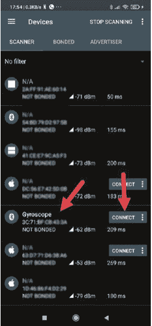

图 6-12. 检测陀螺仪 BLE 服务

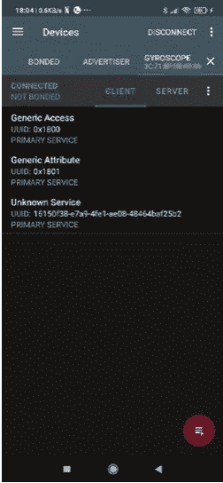

***图 6-13。***  *已连接到陀螺仪 BLE 服务*

你可以展开 Unknown Service 以查看 BLE 特征。展开后，你将看到代表陀螺仪传感器数据的三个 BLE 特征。图 6-14 显示了陀螺仪 BLE 服务的三个 BLE 特征。

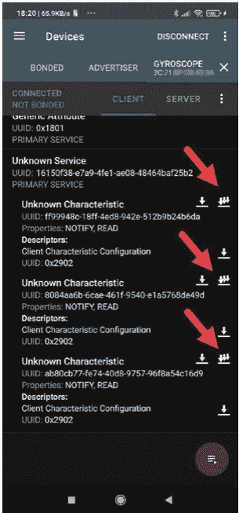

#### 图 6-14. 从陀螺仪 BLE 服务打开 BLE 特征

点击箭头数组图标，如图 6-14 所示。点击后，你将看到来自陀螺仪传感器的传感器数据。图 6-15 显示了来自 Arduino Nano 33 IoT 的陀螺仪传感器数据。传感器数据由图 6-15 中的圆圈标记。

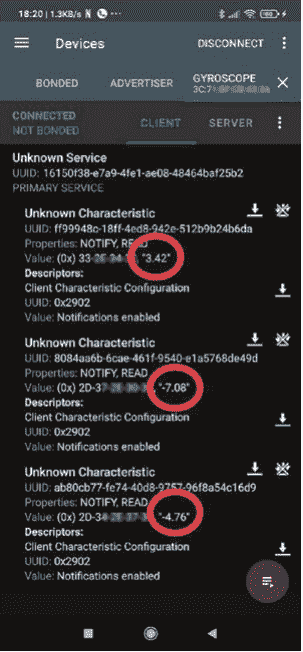

**图 6-15。** *在陀螺仪 BLE 服务上显示陀螺仪传感器*

本章到此结束。你可以通过创建各种 BLE 服务进行更多练习。你也可以构建自己的移动应用程序来消费 BLE 服务。

## 总结

我们学习了如何在 Arduino Nano 33 IoT 板上设置 BLE 无线电。我们还通过应用 BLE 无线电构建了 Arduino 程序。我们从开发 Helloworld 应用程序开始。我们还通过 BLE 无线电控制了 LED。
