# Python 超越基础：编写整洁代码的最佳实践


致我的侄子 Jack

## 关于作者

Al Sweigart 是一名软件开发者和技术书籍作者，居住在西雅图。Python 是他最喜欢的编程语言，他也是其多个开源模块的开发者。他的其他书籍在他的网站 https://www.inventwithpython.com/ 上以知识共享许可免费提供。他的猫 Zophie 重 11 磅。

## 关于技术审阅者

Kenneth Love 是一名程序员、教师和会议组织者。他是 Django 贡献者和 PSF Fellow，目前担任 O'Reilly Media 的技术负责人和软件工程师。

## 致谢

仅在封面上写我的名字具有误导性。这本书如果没有许多人的努力就不可能存在。我想感谢我的出版商 Bill Pollock；以及我的编辑 Frances Saux、Annie Choi、Meg Sneeringer 和 Jan Cash。我还要感谢出版编辑 Maureen Forys、校对编辑 Anne Marie Walker 以及 No Starch Press 执行编辑 Barbara Yien。感谢 Josh Ellingson 再次绘制了精彩的封面插图。感谢我的技术审阅者 Kenneth Love，以及我在 Python 社区遇到的所有其他好朋友。

## 引言


Hello again, world! 作为 1990 年代末的青少年程序员和 aspiring 黑客，我会仔细阅读最新一期的 *2600：黑客季刊*。有一天，我终于鼓起勇气参加了我所在城市该杂志的月度聚会，对大家似乎都那么博学感到惊叹。（后来我才意识到，其中很多人比实际知识更有自信。）我在整个会议中都点头附和着别人的话，试图跟上他们的对话。我离开那次聚会时决心要花上每分每秒学习计算、编程和网络安全，以便能在下个月的聚会上加入讨论。

在下一次聚会上，我仍然只是点头，觉得自己比别人笨。所以我再次下定决心要学习并变得“足够聪明”以便

坚持下去。月复一月，我的知识在增长，但总觉得自己落后。我开始意识到计算机领域的庞大，并担心自己永远学不完。

我比高中朋友更了解编程，但肯定不足以应聘软件开发工作。在 1990 年代，Google、YouTube 和 Wikipedia 都不存在。但即使这些资源可用，我也不知道如何使用它们；我不确定下一步该学什么。相反，我学会了在不同的编程语言中编写 *Hello, world!* 程序，但仍然觉得自己没有取得真正的进展。我不知道如何超越基础。

软件开发远不止循环和函数。一旦你完成了初学者课程或读完一本入门编程书，你寻找更多指导的搜索又会指向另一个 *Hello, world!* 教程。程序员们常称这段时期为 *desert of despair*：你在不同的学习材料中漫无目的地徘徊，感觉自己没有进步。你已经太高级而无法使用初学者材料，却又缺乏经验去攻克更复杂的主题。

身处这片沙漠的人会强烈感受到冒名顶替综合征。你不觉得自己是“真正的”程序员，也不懂得像“真正的”程序员那样编写代码。我写这本书就是为了针对这一群体。如果你已经学会了 Python 的基础知识，这本书应该能帮助你成为更胜任的软件开发者，并摆脱这种绝望感。

## 谁应该阅读本书以及原因

本书面向完成过基础 Python 教程并想了解更多的人。你学习过的教程可能是我之前的书籍 *Automate the Boring Stuff with Python*（No Starch Press，2019），Eric Matthes 所著的 *Python Crash Course*（No Starch Press，2019）之类的书籍，或是在线课程。

这些教程可能让你对编程产生兴趣，但你仍然需要更多技能。如果你觉得自己尚未达到专业程序员水平，但又不知道如何达到那个水平，这本书就是为你准备的。

或者，你可能通过除 Python 之外的其他语言接触到编程，并且想直接进入 Python 及其工具生态系统，而不想重新阅读相同的 *Hello, world!* 基础知识。如果是这样，你不需要阅读数百页解释基本语法的页面；在攻克本书之前，浏览一下 https://learnxinyminutes.com/docs/python/ 上的“Learn Python in Y Minutes”文章，或 Eric Matthes 的“Python Crash Course—Cheat Sheet”页面 https://ehmatthes.github.io/pcc/cheatsheets/README.html 就足够了。

## 关于本书

本书涵盖的不仅仅是更深层次的 Python 语法。它还讨论了使用命令行以及专业开发者使用的命令行工具，例如代码格式化器、代码检查器和版本控制。

我解释了代码可读性的来源以及如何编写干净的代码。我收录了一些编程项目，以便你能在实际软件中看到这些原则的应用。虽然这不是一本计算机科学教科书，但我也解释了 Big O 算法分析和面向对象设计。没有一本单独的书能把一个人转变为专业软件开发者，但我写这本书是为了进一步推动你朝这个方向的知识。我介绍了几个你可能只能通过艰苦经验零散发现的主题。完成本书后，你的基础会更加坚实，从而更好地应对新的挑战。虽然我建议你按顺序阅读本书的章节，但请随意跳到感兴趣的章节：

## 第一部分：入门

### 第 1 章：处理错误和寻求帮助
教你如何有效地提问并自行找到答案。它还教你如何阅读错误信息以及在网上寻求帮助的礼仪。

### 第 2 章：环境设置和命令行
解释如何浏览命令行，以及如何设置开发环境和 PATH 环境变量。

## 第二部分：最佳实践、工具和技术

### 第 3 章：使用 Black 进行代码格式化
描述 PEP 8 风格指南以及如何格式化代码以提高可读性。你将学习如何使用 Black 代码格式化工具自动执行此过程。

### 第 4 章：选择易懂的名称
描述你应该如何为变量和函数命名以提高代码可读性。

### 第 5 章：查找代码异味
列出可能表明代码中存在 bug 的若干潜在危险信号。

### 第 6 章：编写 Pythonic 代码
详细说明编写符合 Python 惯用风格代码的几种方法，以及何为 Pythonic 代码。

### 第 7 章：编程术语
解释编程领域使用的技术术语以及常被混淆的术语。

### 第 8 章：常见的 Python 陷阱
涵盖 Python 语言中常见的困惑和 bug 来源以及如何纠正它们，以及应避免的编码策略。

### 第 9 章：晦涩的 Python 奇特之处
涵盖 Python 语言的若干奇怪怪癖，例如字符串驻留和 antigravity 复活节彩蛋，你可能 otherwise 无法注意到。通过弄清为何某些数据类型和运算符会产生如此出乎意料的行为，你将对 Python 的工作原理有更深入的理解。

### 第 10 章：编写有效的函数
详细说明如何为函数结构化以获得最大的实用性和可读性。你将学习 * 和 ** 参数语法、大函数与小函数之间的权衡，以及诸如 lambda 函数等函数式编程技术。

### 第 11 章：注释、文档字符串和类型提示
涵盖程序中非代码部分的重要性以及它们如何影响可维护性。它包括你应该多频繁地编写注释和文档字符串，以及如何使它们具有信息性。本章还讨论了类型提示以及如何使用诸如 Mypy 之类的静态分析器来检测 bug。

### 第 12 章：使用 Git 组织你的代码项目
描述使用 Git 版本控制工具记录对源代码所做的更改的历史、恢复工作之前的版本或追踪 bug 何时首次出现。它还涉及如何使用 Cookiecutter 工具来构建代码项目的文件结构。

### 第 13 章：性能测量和 Big O 算法分析
解释如何使用 timeit 和 cProfile 模块客观地测量代码的速度。此外，它还涵盖 Big O 算法分析，以及它如何让你预测代码的性能随着需要处理的数据量增长而变慢的方式。

### 第 14 章：实践项目
让你通过编写两个命令行游戏来应用本部分学到的技术：Tower of Hanoi，这是一个涉及从一座塔移动到另一座塔的盘子的解谜游戏，以及经典的双人四连珠棋盘游戏。

## 第三部分：面向对象的 Python

### 第 15 章：面向对象编程和类
定义面向对象编程（OOP）的角色，因为它经常被误解。许多开发者因为认为这是别人都在做的事情而在代码中过度使用 OOP 技术，但这会导致源代码变得复杂。本章教你如何编写类，但更重要的是，它教你为什么应该使用它们以及不应该使用它们。

### 第 16 章：面向对象编程和继承
解释类继承及其对代码重用的实用性。

### 第 17 章：Pythonic OOP：属性和 Dunder 方法
涵盖面向对象设计中的 Python 特定功能，例如属性、dunder 方法和运算符重载。

## 你的编程之旅

从新手到胜任程序员的旅程常常感觉像是在用消防水带喝水。面对如此多的资源，你可能会担心自己在浪费时间在次优的编程指南上。

在你读完本书后（甚至在阅读本书期间），我建议你通过阅读以下额外的入门材料来跟进：

- *Python Crash Course*（No Starch Press，2019）由 Eric Matthes 所著，这是一本面向初学者的书籍，但其项目式方法即使是经验丰富的程序员也能体验到 Python 的 Pygame、matplotlib 和 Django 库。
- *Impractical Python Projects*（No Starch Press，2018）由 Lee Vaughan 提供项目式方法来扩展你的 Python 技能。你按照本书说明创建的程序很有趣，也是很好的编程练习。
- *Serious Python*（No Starch Press，2018）由 Julien Danjou 描述了你需要采取的步骤，从 *garage project* 爱好者进步到遵循行业最佳实践并编写可扩展代码的知识型软件开发者。

但 Python 的技术方面只是其优势之一。该编程语言吸引了一个多元化的社区，负责创建友好且易于访问的文档和支持体系，这是其他编程生态系统无法匹敌的。年度 PyCon 大会以及众多地区性 PyCon 主办了适合所有经验水平的各种演讲。PyCon 组织者将这些演讲免费在线提供在 https://pyvideo.org/。Tags 页面让你可以轻松找到与你的兴趣相对应的主题演讲。

要更深入地探索 Python 语法和标准库的高级功能，我建议阅读以下书目：

- *Effective Python*（Addison-Wesley Professional，2019）由 Brett Slatkin 所著，是 *Pythonic* 最佳实践和语言特性的令人印象深刻的集合。
- *Python Cookbook*（O’Reilly Media，2013）由 David Beazley 和 Brian K. Jones 所著，提供大量代码片段，可升级任何 Python 新手的技能库。
- *Fluent Python*（O’Reilly Media，2021）由 Luciano Ramalho 所著，是探索 Python 语言复杂性的杰作，虽然其近 800 页的篇幅可能令人望而生畏，但绝对值得付出努力。

祝你在编程之旅好运。让我们开始吧！


## 第一部分：入门
开始使用

### 1
### 处理错误和寻求帮助


请不要拟人化计算机；它们觉得这非常烦人。当计算机向你展示错误信息时，并不是因为你冒犯了它。计算机是我们大多数人会交互的最复杂的工具，但归根结底，它们只是工具。

即便如此，很容易责怪这些工具。因为学习编程很大程度上是自学的，即使你已经学习 Python 数月，每天仍需多次查阅互联网，也很常见会觉得自己像个失败者。但即使是专业的软件开发者，也会搜索互联网或查阅文档来回答编程问题。

除非你有财力或社会资源聘请私人导师来回答你的编程问题，否则你只能依靠计算机、互联网搜索引擎和自己的毅力。幸运的是，你的问题几乎肯定已经被问过。作为程序员，能够自行找到答案的能力远比任何算法或数据结构知识更重要。本章将指导你培养这一关键技能。

## 如何理解 Python 错误信息

当程序员面对错误信息那一大堆技术术语时，很多人第一反应是完全忽略它。但在这个错误信息内部，就包含了程序出了什么问题的答案。找到这个答案是一个两步过程：检查追溯信息并在互联网上搜索错误信息。

## 检查追溯信息

当代码引发了一个 except 语句未处理的异常时，Python 程序会崩溃。发生这种情况时，Python 会显示异常的消息和追溯信息。也称为堆栈跟踪，追溯信息显示异常在程序中发生的位置以及导致它的函数调用轨迹。

为了练习阅读追溯信息，输入以下有错误的程序并保存为 abcTraceback.py。行号仅供参考，不是程序的一部分。

```
1. def a():
2.     print('Start of a()')
3.     b() # Call b().
4.
5. def b():
6.     print('Start of b()')
7.     c() # Call c().
8.
9. def c():
10.    print('Start of c()')
11.    42 / 0 # This will cause a zero divide error.
12.
13. a() # Call a().
```

在此程序中，a() 函数调用 b() ①，后者调用 c() ②。在 c() 内部，42 / 0 表达式 ③ 导致零除错误。运行此程序时，输出应如下所示：

```
Start of a()
Start of b()
Start of c()
Traceback (most recent call last):
    File "abcTraceback.py", line 13, in <module>
        a()  # Call a().
    File "abcTraceback.py", line 3, in a
        b()  # Call b().
    File "abcTraceback.py", line 7, in b
        c()  # Call c().
```

```
File "abcTraceback.py", line 11, in c
    42 / 0 # This will cause a zero divide error.
ZeroDivisionError: division by zero
```

让我们逐行检查这个追溯信息，从这一行开始：

```
Traceback (most recent call last):
```

这条消息让你知道接下来的是追溯信息。most recent call last 文本表示每个函数调用都按顺序列出，从第一个函数调用开始，到最近的一个结束。

下一行显示追溯信息的第一个函数调用：

```
File "abcTraceback.py", line 13, in <module>
    a()  # Call a().
```

这两行是帧摘要，它们显示了帧对象内部的信息。当函数被调用时，局部变量数据以及函数调用结束后返回代码的位置都会存储在帧对象中。帧对象保存与函数调用相关的局部变量和其他数据。帧对象在函数被调用时创建，在函数返回时销毁。追溯信息为导致崩溃的每个帧显示一个帧摘要。我们可以看到这个函数调用在 abcTraceback.py 的第 13 行，<module> 文本告诉我们这一行在全局作用域中。下一行以两个空格缩进显示第 13 行。

接下来的四行是下一个两个帧摘要：

```
File "abcTraceback.py", line 3, in a
    b()  # Call b().
File "abcTraceback.py", line 7, in b
    c()  # Call c().
```

我们可以从 line 3, in a 文本看出 b() 在 a() 函数的第 3 行被调用，这导致 c() 在 b() 函数的第 7 行被调用。请注意，尽管 print() 调用在函数调用发生前已运行，但第 2、6 和 10 行的 print() 调用不会显示在追溯信息中。只有导致异常的函数调用所在的行才会显示在追溯信息中。

最后一个帧摘要显示导致未处理异常的行，后面跟着异常的名称和异常的消息：

```
File "abcTraceback.py", line 11, in c
    42 / 0 # This will cause a zero divide error.
ZeroDivisionError: division by zero
```

请注意，追溯信息给出的行号是 Python 最终检测到错误的位置。错误的真正来源可能在这一行之前。

错误信息 notoriously 简短且难以理解：除非你知道除以零在数学上是不可能的并且是常见的软件错误，否则 division by zero 这三个词对你来说毫无意义。在此程序中，错误并不难找到。查看帧摘要中的代码行，很清楚 42 / 0 代码中零除错误发生的位置。

但让我们看一个更困难的例子。将以下代码输入到文本编辑器中并保存为 zeroDivideTraceback.py：

```
def spam(number1, number2):
    return number1 / (number2 - 42)

spam(101, 42)
```

运行此程序时，输出应如下所示：

```
Traceback (most recent call last):
    File "zeroDivideTraceback.py", line 4, in <module>
    spam(101, 42)
    File "zeroDivideTraceback.py", line 2, in spam
    return number1 / (number2 - 42)
ZeroDivisionError: division by zero
```

错误信息相同，但 return number1 / (number2 - 42) 中的零除就不那么明显了。你可以从 / 运算符推断出发生了除法，并且表达式 (number2 - 42) 必须求值为 0。这会让你得出结论：当 number2 参数设置为 42 时，spam() 函数就会失败。

有时追溯信息可能会指出错误在 bug 真正原因的下一行。例如，在以下程序中，第一行缺少闭合括号：

```
print('Hello.'
print('How are you?')
```

但此程序的错误信息指出问题出在第二行：

```
File "example.py", line 2
    print('How are you?')
    ^
SyntaxError: invalid syntax
```

原因是 Python 解释器直到读取第二行时才注意到语法错误。追溯信息可以指出问题发生的位置，但这并不总是 bug 实际原因所在的位置。如果帧摘要没有提供足够的信息来找出 bug，或者 bug 的真正原因在追溯信息未显示的上一行，你将不得不使用调试器逐步执行程序或检查任何日志消息来找到原因。这可能需要大量时间。搜索错误信息的互联网可能会更快地为你提供有关解决方案的关键线索。

## 搜索错误信息

通常，错误信息非常简短，甚至不是完整的句子。因为程序员经常遇到它们，所以它们旨在作为提醒而不是完整解释。如果你第一次遇到错误信息，将其复制粘贴到互联网搜索中通常会返回有关错误含义及其可能原因的详细解释。图 1-1 显示了搜索 python “ZeroDivisionError: division by zero” 的结果。在错误信息周围加上引号有助于找到确切的短语，添加单词 python 也能缩小搜索范围。

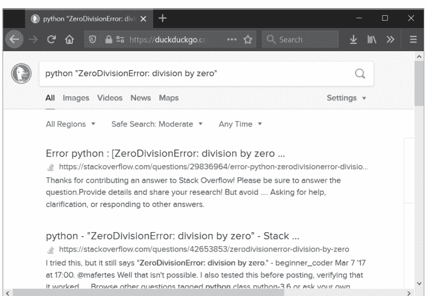

图 1-1：将错误信息复制粘贴到互联网搜索工具中可以快速提供解释和解决方案。

搜索错误信息并不算作弊。没人期望记住编程语言的每一种可能的错误信息。专业软件开发者每天都会在互联网上搜索编程答案。

你可能希望排除错误信息中特定于你代码的部分。例如，考虑以下错误信息：

```
>>> print(employeeRecord)
Traceback (most recent call last):
  File "<stdin>", line 1, in <module>
```


① NameError: name 'employeRecord' is not defined
>>> 42 - 'hello'
Traceback (most recent call last):
  File "<stdin>", line 1, in <module>
② TypeError: unsupported operand type(s) for -: 'int' and 'str'

这个示例中变量 employeRecord 有一个拼写错误，导致了错误 ①。因为 NameError: name 'employeRecord' is not defined 中的标识符 employeRecord 特定于你的代码，你可能希望改为搜索 python “NameError: name” “is not defined”。在最后一行，错误信息 ② 中的 'int' 和 'str' 部分似乎指的是 42 和 'hello' 值，因此将搜索截断为 python “TypeError: unsupported operand type(s) for” 可以避免包含特定于你的代码的部分。如果这些搜索没有产生有用的结果，请尝试包含完整的错误信息。

## 使用 Linter 预防错误

最佳的修复错误的方法是首先不犯错。Lint 软件，或称 linter，是一种分析你的源代码以警告任何潜在错误的应用程序。名称参考了衣物烘干机滤网收集的小纤维和碎屑。虽然 linter 不能捕获所有错误，但静态分析（在不运行代码的情况下检查源代码）可以识别由拼写错误引起的常见错误。（第 11 章探讨如何使用类型提示进行静态分析。）许多文本编辑器和集成开发环境（IDE）都集成了在后台运行的 linter，可以实时指出问题，如图 1-2 所示。

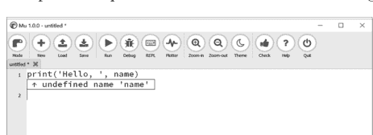

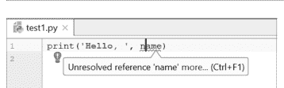

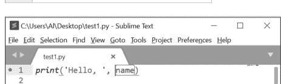

图 1-2：linter 在 Mu（上）、PyCharm（中）和 Sublime Text（下）中指出未定义的变量。

linter 提供的近乎即时的通知极大地提高了你的编程效率。没有它，你必须运行程序，观察它崩溃，阅读回溯，然后找到源代码中的行来修复拼写错误。而且如果你犯了多个拼写错误，这个运行-修复循环一次只能找到一个。Linting 可以同时指出多个错误，并且直接在编辑器中进行，因此你可以查看它们发生的行。

你的编辑器或 IDE 可能没有内置的 lint 功能，但如果它支持插件，几乎肯定会有 linter 可用。通常，这些插件使用名为 Pyflakes 的 linting 模块或其他模块来进行分析。你可以从 https://pypi.org/project/pyflakes/ 安装 Pyflakes，或通过运行 pip install --user pyflakes 进行安装。付出这些努力是值得的。

> 注意
> 在 Windows 上，你可以运行 python 和 pip 命令。但在 macOS 和 Linux 上，这些命令名称仅适用于 Python 2，因此你需要改运行 python3 和 pip3。每当你在本书中看到 python 或 pip 时，请记住这一点。

随 Python 提供的 IDE IDLE 没有 linter，也没有安装 linter 的能力。

## 如何寻求编程帮助

当互联网搜索和 linter 无法解决你的问题时，你可以在互联网上寻求编程帮助。但高效地寻求建议是有礼仪的。如果经验丰富的软件开发者愿意免费回答你的问题，最好高效利用他们的时间。

向陌生人寻求编程帮助应始终是最后的手段。在有人回复你发布的问题之前，可能会过去数小时或数天，如果你能得到回复的话。搜索网络上其他人已经问过你的问题并阅读他们的答案要快得多。在线文档和搜索引擎的设立是为了减轻本应由人类完成的问答工作。

但当你已穷尽所有选择，必须向人类求助你的编程问题时，避免以下常见错误：

- 询问是否可以提问，而不是直接提问
- 暗示你的问题而不是直接提问
- 在错误的论坛或网站上提问
- 写一个不具体的帖子标题或电子邮件主题，例如 “我有一个问题” 或 “请帮忙”
- 说 “我的程序无法工作” 但不解释你希望它如何工作
- 未包含完整的错误信息
- 未分享你的代码
- 分享格式不佳的代码
- 未解释你已经尝试过什么
- 未提供操作系统或版本信息
- 要求别人为你编写程序

这个 “不要” 列表不仅仅是为了礼貌；这些习惯会阻止你的助手帮助你。你的助手的第一步将是运行你的代码并尝试重现你的问题。为此，他们需要了解你的代码、计算机和意图的很多信息。提供的信息太少远比太多更常见。接下来的几个部分探讨了你可以做些什么来防止这些常见错误。我假设你将问题发布到在线论坛，但这些准则也适用于向单个人员或邮件列表发送电子邮件提问的情况。

### 通过提前提供信息减少来回沟通

如果你当面接近某人，问 “我可以问你一个问题吗？” 是一种简短、礼貌的方式来确认你的助手是否可用。但在在线论坛上，你的助手可以在有时间时再回复。因为回复之间可能相隔数小时，最好在初始帖子中提供助手可能需要的所有信息，而不是请求允许提问。如果他们没有回复，你可以将此信息复制并粘贴到不同的论坛。

### 以实际问题的形式陈述你的问题

当你解释问题时，很容易假设你的助手知道你在说什么。但编程是一个庞大的领域，他们可能没有你在遇到困难的特定领域的经验。因此，以实际问题的形式陈述你的问题很重要。虽然以 “我想要……” 或 “代码无法工作” 开头的句子可以暗示你的问题是什么，但请确保包含明确的问题：literally，以问号结尾的句子。否则，你在问什么可能就不清楚了。

### 在合适的网站上提问

在 JavaScript 论坛上提问 Python 问题，或在网络安全邮件列表上提问算法问题很可能不会有成效。通常，邮件列表和在线论坛都有常见问题（FAQ）文档或说明页面，解释哪些主题适合讨论。例如，python-dev 邮件列表是关于 Python 语言的设计特性，因此它不是一个通用的 Python 帮助邮件列表。网页 https://www.python.org/about/help/ 可以引导你找到适合提问任何类型 Python 问题的合适地点。

### 在标题中总结你的问题

将问题发布到在线论坛的好处是，未来的程序员可以通过互联网搜索找到它及其答案。务必使用总结问题的标题，以便搜索引擎易于整理。像 “请帮忙” 或 “为什么这不起作用？” 这样的通用标题太模糊了。如果你通过电子邮件提问，有意义的主题行会在助手扫描收件箱时告诉他们你的问题是什么。

### 解释你希望代码做什么

问题 “为什么我的程序无法工作？” 省略了你希望程序做什么这一关键细节。这对你的助手来说并不总是显而易见的，因为他们不知道你的意图。即使你的问题只是 “为什么我会得到这个错误？” 说明程序的最终目标也有帮助。在某些情况下，你的助手可以告诉你是否需要完全不同的方法，你可以放弃问题，而不是浪费时间尝试解决它。

### 包含完整的错误信息

务必复制并粘贴整个错误信息，包括回溯。仅仅描述错误，例如 “我得到一个超出范围的错误”，不足以让助手弄清楚出了什么问题。此外，说明你是否总是遇到此错误，还是间歇性问题。如果你已确定错误发生的特定情况，也请包含这些细节。

### 分享你的完整代码

除了完整的错误信息和回溯外，还提供整个程序的源代码。这样，你的助手就可以在他们的机器上使用调试器运行你的程序以检查发生了什么。始终提供一个最小、完整且可重现（MCR）的示例，可可靠地重现你遇到的错误。MCR 术语来自 Stack Overflow，并在 https://stackoverflow.com/help/mcve/ 详细讨论。最小意味着你的代码示例在仍能重现你遇到的问题的同时尽可能简短。完整意味着你的代码示例包含重现问题所需的一切。可重现意味着你的代码示例可靠地重现了你描述的问题。

但如果你的程序包含在一个文件中，将其发送给助手就是一件简单的事情。只需确保它格式正确，如下一节所述。


## Stack Overflow 与构建答案档案

Stack Overflow 是一个用于回答编程问题的热门网站，但许多新手程序员在使用它时会表达沮丧，甚至感到畏惧。Stack Overflow 的版主以无情关闭不符合其严格准则的问题而闻名。但 Stack Overflow 如此严格是有原因的。

Stack Overflow 的目的并非仅仅回答问题，而是构建一个与答案匹配的编程问题档案。因此，他们希望问题具体、独特且不基于观点。问题需要详细且表述清晰，以便搜索引擎用户能够轻松找到它们。（在 Stack Overflow 之前的程序员互联网是 XKCD 漫画《古人智慧》中的笑话的基础，网址为 https://xkcd.com/979。）同一个问题的三十个条目不仅会重复网站志愿者专家的回答工作，还可能因多个结果而让搜索引擎用户感到困惑。问题需要有具体、客观的答案：“什么是最好的编程语言？”是观点问题，会引发不必要的争论。（此外，我们已经知道 Python 是最好的编程语言。）

但处于需要并请求帮助却只见问题被迅速关闭的境地可能会让人感到受伤和尴尬。我的建议是，首先仔细阅读本章中的建议以及 Stack Overflow 的“如何提问？”指南，网址为 https://stackoverflow.com/help/how-to-ask/。其次，如果你害怕问“愚蠢”的问题，请随意使用化名。Stack Overflow 不要求其账户使用真实姓名。如果你更喜欢一个更随意的提问场所，可以考虑将问题发布到 https://reddit.com/r/learnpython/，该社区对接受的问题更为宽松。尽管如此，在提交问题之前，请务必阅读他们的发帖指南。

## 使用正确格式使代码更易读

分享代码的目的是让你的助手能够运行你的程序并复现你遇到的错误。他们不仅需要代码，还需要代码格式正确。确保他们可以轻松复制你的源代码并原样运行。如果你将源代码复制粘贴到电子邮件中，请注意许多电子邮件客户端可能会删除缩进，导致代码看起来像这样：

```
def knuts(self, value):
if not isinstance(value, int) or value < 0:
raise WizCoinException('knuts attr must be a positive int')
self._knuts = value
```

不仅让你的助手为程序中的每一行重新插入缩进需要花费很长时间，而且每行原本有多少缩进也不明确。为了确保代码格式正确，请将代码复制粘贴到 pastebin 网站，例如 https://pastebin.com/ 或 https://gist.github.com/，它们会将你的代码存储在简短的公开 URL 中，例如 https://pastebin.com/XeU3yusC。分享此 URL 比使用文件附件更容易。

如果你将代码发布到网站，例如 https://stackoverflow.com/ 或 https://reddit.com/r/learnpython/，请确保使用其文本框提供的格式工具。通常，用四个空格缩进一行会确保该行使用等宽“代码字体”，更易于阅读。你也可以用反引号 (`) 字符将文本括起来，使其显示为等宽代码字体。这些网站经常提供格式信息的链接。不使用这些技巧可能会破坏你的源代码，使其全部显示在一行上，如下所示：

```
def knuts(self, value):if not isinstance(value, int) or value < 0:raise WizCoinException('knuts attr must be a positive int') self._knuts = value
```

此外，不要通过截屏或拍摄屏幕照片并发送图像的方式分享代码。从图像中无法复制粘贴代码，而且通常也难以阅读。

## 告诉助手你已经尝试过什么

在发布问题时，告诉你的助手你已经尝试过什么以及这些尝试的结果。这些信息可以节省助手重试这些错误线索的精力，并表明你已努力解决自己的问题。

此外，这些信息可确保你是在请求帮助，而不是要求别人为你编写软件。不幸的是，计算机科学学生经常要求网上陌生人做作业，企业家则要求别人免费为他们创建“快速应用”。编程帮助论坛并非为此目的而设。

## 描述你的环境

你计算机的特定设置可能会影响程序的运行方式和产生的错误。为了确保你的助手能在其计算机上复现你的问题，请提供有关你计算机的以下信息：

- 操作系统及版本，例如“Windows 10 Professional Edition”或“macOS Catalina"
- 运行程序的 Python 版本，例如“Python 3.7”或“Python 3.6.6"
- 程序使用的任何第三方模块及其版本，例如“Django 2.1.1”

你可以通过运行 pip list 来找到已安装第三方模块的版本。按照惯例，也可以在 `__version__` 属性中包含模块的版本，如以下交互式 shell 示例所示：

```
>>> import django
>>> django.__version__
'2.1.1'
```

很可能这些信息并不必要。但为了减少来回沟通，请在初始帖子中提供这些信息。

## 提问示例

以下是遵循上一节 dos 和 don'ts 的一个提问恰当的问题：

**Selenium WebDriver：如何查找元素的全部属性？**

在 Python Selenium 模块中，一旦我拥有一个 WebElement 对象，我就可以使用 `get_attribute()` 获取其任何属性的值：

```
foo = elem.get_attribute('href')
```

如果名为 'href' 的属性不存在，则返回 None。

我的问题是，如何获取元素所拥有的所有属性的列表？似乎没有 `get_attributes()` 或 `get_attribute_names()` 方法。

我使用的是 Python 的 Selenium 模块 2.44.0 版本。

这个问题来自 https://stackoverflow.com/q/27307131/1893164/。标题用一句话概括了问题。问题以提问的形式陈述并以问号结尾。将来，如果有人在互联网搜索结果中读到此标题，他们会立即知道它是否与自己的问题相关。

该问题使用等宽代码字体格式化代码，并将文本分散到多个段落中。帖子中的问题很明确：甚至以“我的问题是”开头。它暗示 `get_attributes()` 或 `get_attribute_names()`本可以是答案，但并非如此，这表明提问者已尝试寻找解决方案，同时暗示了他们认为此问题的真正答案应是什么样的。提问者还提供了 Selenium 模块的版本信息，以防相关。提供的信息越多越好，而不是信息不足。

## 总结

独立回答自己的编程问题是程序员必须学习的最重要技能。互联网由程序员构建，拥有大量提供所需答案的资源。

但首先，你必须解析 Python 抛出的通常晦涩的错误信息。如果你无法理解错误信息的文本也没关系。你仍然可以将此文本提交给搜索引擎，以找到错误信息的通俗英语解释和可能的原因。错误的回溯将指示错误在你的程序中发生的具体位置。

实时代码检查器可以在你编写代码时指出拼写错误和潜在的 bug。代码检查器非常有用，以至于现代软件开发实际上要求使用它们。如果你的文本编辑器或 IDE 没有代码检查器或添加代码检查器插件的能力，请考虑切换到具备该功能的编辑器。

如果你无法通过搜索互联网找到问题的解决方案，可以尝试将问题发布到在线论坛或给某人发送电子邮件。为了使此过程高效，本章提供了提问良好编程问题的指南。这包括提出具体、表述清晰的问题，提供完整的源代码和错误信息细节，说明你已经尝试过什么，并告诉助手你使用的操作系统和 Python 版本。不仅发布的答案会解决你的问题，还可以帮助将来有相同问题并找到你帖子的程序员。

不要因为你似乎 constantly 在查找答案和寻求帮助而感到气馁。编程是一个庞大的领域，没有人能同时记住其所有细节。即使是经验丰富的软件开发人员每天也会在线查阅文档和解决方案。相反，专注于提高寻找解决方案的技能，你就会走向成为熟练 Python 程序员的道路。


### 2 环境设置和命令行


环境设置是组织计算机以便编写代码的过程。这涉及安装必要的工具、配置它们以及处理设置过程中出现的任何问题。没有单一的设置流程，因为每个人都有不同的计算机、不同的操作系统、操作系统的不同版本以及 Python 解释器的不同版本。尽管如此，本章描述了一些基本概念，帮助你使用命令行、环境变量和文件系统管理自己的计算机。

学习这些概念和工具可能看起来令人头疼。你想编写代码，而不是到处翻弄配置设置或理解晦涩的控制台命令。但这些技能从长远来看会为你节省时间。忽略错误信息或随机更改配置设置以让系统勉强运行可能会掩盖问题，但不会修复它们。通过现在花时间理解这些问题，你可以防止它们再次出现。

### 文件系统

*文件系统* 是操作系统组织数据以便存储和检索的方式。一个文件有两个关键属性：*文件名*（通常写成一个词）和 *路径*。路径指定了计算机上文件的位置。例如，我的 Windows 10 笔记本上一个文件的 *文件名* 为 *project.docx*，其路径为 *C:\Users\Al\Documents*。文件名最后的句点之后的部分是文件的 *扩展名*，它告诉你文件的类型。文件名 *project.docx* 是一个 Word 文档，而 *Users*、*Al* 和 *Documents* 都指的是 *文件夹*（也称为 *目录*）。文件夹可以包含文件和其他文件夹。例如，*project.docx* 在 *Documents* 文件夹中，该文件夹在 *Al* 文件夹中，而 *Al* 文件夹在 *Users* 文件夹中。图 2-1 显示了这种文件夹组织。

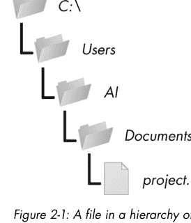

图 2-1：文件夹层级中的一个文件

路径中的 *C:\* 部分是 *根文件夹*，它包含所有其他文件夹。在 Windows 上，根文件夹名为 *C:\*，也称为 *C:* 驱动器。在 macOS 和 Linux 上，根文件夹是 */*。在本书中，我将使用 Windows 风格的根文件夹 *C:\*。如果你在 macOS 或 Linux 上输入交互式 shell 示例，请改输入 */*。

额外的卷，例如 DVD 驱动器或 USB 闪存驱动器，在不同操作系统上显示方式不同。在 Windows 上，它们显示为新的、带字母的根驱动器，例如 *D:\* 或 *E:\*。在 macOS 上，它们显示为 */Volumes* 文件夹内的新文件夹。在 Linux 上，它们显示为 */mnt*（“挂载”）文件夹内的新文件夹。请注意，文件夹名称和文件名在 Windows 和 macOS 上不区分大小写，但在 Linux 上区分大小写。

### Python 中的路径

在 Windows 上，反斜杠（\）分隔文件夹和文件名，但在 macOS 和 Linux 上，正斜杠（/）分隔它们。为了使你的 Python 脚本跨平台兼容，而不必两种写法都写，你可以使用 *pathlib* 模块和 */* 运算符。

导入 pathlib 的典型方式是使用语句 `from pathlib import Path`。由于 Path 类是 pathlib 中使用最频繁的类，这种形式让你可以输入 Path 而不是 pathlib.Path。

```
from pathlib import Path
```

你可以将文件夹或文件名的字符串传递给 Path() 来创建该文件夹或文件名的 Path 对象。只要表达式中最左边的对象是 Path 对象，你就可以使用 / 运算符将 Path 对象或字符串连接起来。输入以下内容到交互式 shell 中：

```
>>> from pathlib import Path
>>> Path('spam') / 'bacon' / 'eggs'
WindowsPath('spam/bacon/eggs')
>>> Path('spam') / Path('bacon/eggs')
WindowsPath('spam/bacon/eggs')
>>> Path('spam') / Path('bacon', 'eggs')
WindowsPath('spam/bacon/eggs')
```

请注意，因为我在 Windows 机器上运行此代码，Path() 返回 WindowsPath 对象。在 macOS 和 Linux 上，会返回 PosixPath 对象。（POSIX 是类 Unix 操作系统的标准集合，超出本书范围。）就我们的目的而言，这两种类型没有区别。

你可以将 Path 对象传递给 Python 标准库中期望文件名的任何函数。例如，函数调用 open(Path('C:\\') / 'Users' / 'Al' / 'Desktop' / 'spam.py') 等价于 open(r'C:\Users\Al\Desktop\spam.py')。

### 主目录

所有用户在计算机上都有一个自己的主文件夹或主目录来存放自己的文件。你可以通过调用 Path.home() 获取主文件夹的 Path 对象：

```
>>> Path.home()
WindowsPath('C:/Users/Al')
```

主目录的位置取决于你的操作系统：

- 在 Windows 上，主目录位于 C:\Users。
- 在 Mac 上，主目录位于 /Users。
- 在 Linux 上，主目录通常位于 /home。

你的脚本几乎肯定有权限读取和写入主目录中的文件，因此它是存储 Python 程序将使用的文件的理想位置。

### 当前工作目录

在你的计算机上运行的每个程序都有一个当前工作目录（cwd）。任何不以根文件夹开头的<|message|>文件名或路径都可以假设在 cwd 中。虽然“文件夹”是目录的更现代名称，但请注意 cwd（或只是工作目录）是标准术语，而不是“当前工作文件夹”。

你可以使用 Path.cwd() 函数以 Path 对象的形式获取 cwd，并使用 os.chdir() 更改它。输入以下内容到交互式 shell 中：

```
>>> from pathlib import Path
>>> import os
①>>> Path.cwd()
WindowsPath('C:/Users/Al/AppData/Local/Programs/Python/Python38')
②>>> os.chdir('C:\\Windows\\System32')
>>> Path.cwd()
WindowsPath('C:/Windows/System32')
```

这里，cwd 被设置为 C:\Users\Al\AppData\Local\Programs\Python\Python38 ①，因此文件名 project.docx 将指代 C:\Users\Al\AppData\Local\Programs\Python\Python38\project.docx。当我们将 cwd 更改为 C:\Windows\System32 ② 时，文件名 project.docx 将指代 C:\Windows\System32\project.docx。

如果你尝试更改到不存在的目录，Python 会显示错误：

```
>>> os.chdir('C:/ThisFolderDoesNotExist')
Traceback (most recent call last):
  File "<stdin>", line 1, in <module>
FileNotFoundError: [WinError 2] The system cannot find the file specified:
'C:/ThisFolderDoesNotExist'
```

os 模块中的 os.getcwd() 函数是以前获取 cwd 字符串的方式。

### 绝对路径与相对路径

指定文件路径有两种方式：

- 绝对路径，始终以根文件夹开头
- 相对路径，相对于程序的 cwd

还有点（.）和点点（..）文件夹。这些不是真正的文件夹，而是可以在路径中使用的特殊名称。单个句点（.）作为文件夹名称是“此目录”的简写。两个句点（..）表示“父文件夹”。

图 2-2 显示了一些文件夹和文件的示例。当 cwd 设置为 C:\bacon 时，其他文件夹和文件的相对路径如图所示。

相对路径开头的 .\ 是可选的。例如，.\spam.txt 和 spam.txt 指的是同一个文件。

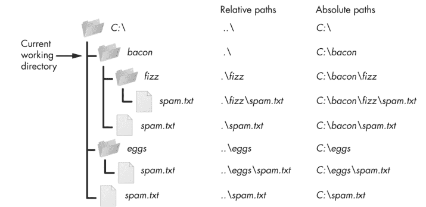

| 相对路径 | 绝对路径 |
|---|---|
| ..\\ | C:\ |
| .\\ | C:\bacon |
| .\fizz | C:\bacon\fizz |
| .\fizz\spam.txt | C:\bacon\fizz\spam.txt |
| .\spam.txt | C:\bacon\spam.txt |
| ..\eggs | C:\eggs |
| ..\eggs\spam.txt | C:\eggs\spam.txt |
| ..\spam.txt | C:\spam.txt |

图 2-2：工作目录为 C:\bacon 时文件夹和文件的相对路径

### 程序和进程

*程序* 是你可以运行的任何软件应用程序，例如网页浏览器、电子表格应用程序或文字处理器。*进程* 是程序的正在运行的实例。例如，图 2-3 显示了同一个计算器程序的五个正在运行的进程。

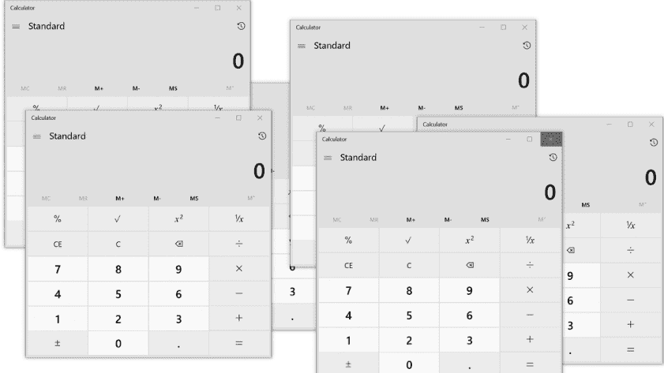

图 2-3：同一个计算器程序多次运行作为多个独立进程


进程彼此保持独立，即使运行相同的程序。例如，如果你同时运行多个 Python 程序的实例，每个进程可能具有各自不同的变量值。每个进程，即使是运行相同程序的进程，都有自己的 cwd 和环境变量设置。一般来说，命令行一次只运行一个进程（尽管你可以同时打开多个命令行）。

每个操作系统都有查看正在运行进程列表的方法。在 Windows 上，你可以按 CTRL-SHIFT-ESC 调出任务管理器应用程序。在 macOS 上，你可以运行 应用程序 ▸ 实用工具 ▸ 活动监视器。在 Ubuntu Linux 上，你可以按 CTRL-ALT-DEL 打开一个也称为任务管理器的应用程序。这些任务管理器可以在进程无响应时强制终止正在运行的进程。

## 命令行

命令行是一个基于文本的程序，让你输入命令来与操作系统交互并运行程序。你也可能听到它被称为命令行界面（CLI，读音与“fly”押韵）、命令提示符、终端、shell 或控制台。它提供了图形用户界面（GUI，读作“gooey”）的替代方案，后者允许用户通过不仅仅是基于文本的界面与计算机交互。GUI 通过视觉信息向用户展示，使其比命令行更容易地完成任务。大多数计算机用户将命令行视为高级功能，从不使用它。令人望而生畏的部分原因在于完全缺乏使用提示；尽管 GUI 可能会显示一个按钮告诉你在哪里点击，但空白的终端窗口并不会提醒你输入什么。

但熟练使用命令行是有充分理由的。其一，设置环境通常需要使用命令行而不是图形窗口。其二，输入命令比用鼠标点击图形窗口要快得多。基于文本的命令也比拖动一个图标到另一个图标更不含糊。这使它们更适合自动化，因为你可以将多个具体命令组合成脚本来执行复杂的操作。

命令行程序存在于你计算机上的可执行文件中。在此上下文中，我们通常称其为 shell 或 shell 程序。运行 shell 程序会使终端窗口出现：

- 在 Windows 上，shell 程序位于 C:\Windows\System32\cmd.exe。
- 在 macOS 上，shell 程序位于 /bin/bash。
- 在 Ubuntu Linux 上，shell 程序位于 /bin/bash。

多年来，程序员为 Unix 操作系统创建了许多 shell 程序，例如 Bourne Shell（在名为 sh 的可执行文件中）和后来的 Bourne-Again Shell（在名为 Bash 的可执行文件中）。Linux 默认使用 Bash，而 macOS 在 Catalina 及更高版本中使用类似的 Zsh 或 Z shell。由于其不同的发展历史，Windows 使用名为命令提示符的 shell。所有这些程序做的事情都一样：它们呈现一个终端窗口，其中包含基于文本的 CLI，用户可以在其中输入命令并运行程序。

在本节中，你将学习命令行的一些通用概念和常用命令。你可以掌握大量晦涩的命令并成为真正的巫师，但只需知道十几个左右就能解决大多数问题。确切的命令名称在不同操作系统上可能略有不同，但底层概念是相同的。

## 打开终端窗口

要打开终端窗口，请执行以下操作：

- 在 Windows 上，单击开始按钮，键入命令提示符，然后按 ENTER。
- 在 macOS 上，单击右上角的 Spotlight 图标，键入终端，然后按 ENTER。
- 在 Ubuntu Linux 上，按 WIN 键调出 Dash，键入终端，然后按 ENTER。或者使用键盘快捷键 CTRL-ALT-T。

像显示 >>> 提示的交互式 shell 一样，终端显示一个 shell 提示符，你可以在其中输入命令。在 Windows 上，提示符将是你当前所在文件夹的完整路径：

```
C:\Users\Al>your commands go here
```

在 macOS 上，提示符显示你的计算机名称、冒号以及 cwd，其中主文件夹表示为波浪号（~）。之后是你的用户名后跟美元符号（$）：

```
Al’s-MacBook-Pro:~ al$ your commands go here
```

在 Ubuntu Linux 上，提示符与 macOS 提示符类似，只是以用户名和 at（@）符号开头：

```
al@al-VirtualBox:~$ your commands go here
```

许多书籍和教程将命令行提示符表示为简单的 $ 以简化示例。可以自定义这些提示符，但这超出了本书的范围。

## 从命令行运行程序

要运行程序或命令，将其名称输入命令行。让我们运行随操作系统附带的默认计算器程序。输入以下内容到命令行：

- 在 Windows 上，输入 calc.exe。
- 在 macOS 上，输入 `open -a Calculator`。（技术上，这运行了 `open` 程序，然后运行计算器程序。）
- 在 Linux 上，输入 `gnome-calculator`。

程序名称和命令在 Linux 上区分大小写，但在 Windows 和 macOS 上不区分大小写。这意味着尽管你在 Linux 上必须键入 `gnome-calculator`，你可以在 Windows 上键入 `calc.exe`，在 macOS 上键入 `OPEN -a Calculator`。

将这些计算器程序名称输入命令行等同于从开始菜单、Finder 或 Dash 运行计算器程序。这些计算器程序名称之所以能作为命令工作，是因为 `calc.exe`、`open` 和 `gnome-calculator` 程序存在于包含在 PATH 环境变量中的文件夹中。“环境变量和 PATH”第 35 页对此进行了进一步解释。但简而言之，当你在命令行输入程序名称时，shell 会检查是否在 PATH 列出的文件夹之一中存在该名称的程序。在 Windows 上，shell 会先在 cwd（你可以在提示符中看到）中查找程序，然后再检查 PATH 中的文件夹。要告诉 macOS 和 Linux 的命令行首先检查 cwd，你必须在文件名前输入 `./`。

如果程序不在 PATH 列出的文件夹中，你有两个选择：

- 使用 `cd` 命令将 cwd 更改为包含程序的文件夹，然后输入程序名称。例如，你可以输入以下两个命令：
- 输入可执行程序文件的完整文件路径。例如，与其输入 `calc.exe`，你可以输入 `C:\Windows\System32\calc.exe`。

```
cd C:\Windows\System32
calc.exe
```

在 Windows 上，如果程序以文件扩展名 `.exe` 或 `.bat` 结尾，包含扩展名是可选的：输入 `calc` 与输入 `calc.exe` 效果相同。macOS 和 Linux 中的可执行程序通常没有标记为可执行的扩展名；相反，它们设置了可执行权限。“无需命令行运行 Python 程序”第 39 页有更多信息。

## 使用命令行参数

*命令行参数* 是你在命令名称后输入的文本片段。与传递给 Python 函数调用的参数类似，它们为命令提供特定的选项或附加指示。例如，当你运行命令 `cd C:\Users` 时，`C:\Users` 部分是传递给 `cd` 命令的参数，告诉 `cd` 将 cwd 更改为哪个文件夹。或者，当你使用 `python yourScript.py` 命令从终端窗口运行 Python 脚本时，`yourScript.py` 部分是告诉 `python` 程序要查找指令的文件的参数。

*命令行选项*（也称为标志、开关或简单选项）是单个字母或短词的命令行参数。在 Windows 上，命令行选项通常以正斜杠（/）开头；在 macOS 和 Linux 上，它们以单个破折号（-）或双破折号（--）开头。你在运行 macOS 命令 open -a Calculator 时已经使用了 -a 选项。命令行选项在 macOS 和 Linux 上通常区分大小写，但在 Windows 上不区分大小写，我们用空格分隔多个命令行选项。

文件夹和文件名是常见的命令行参数。如果文件夹或文件名包含空格作为其名称的一部分，请用双引号将名称括起来以避免混淆命令行。例如，如果你想更改到名为 *Vacation Photos* 的文件夹，输入 cd Vacation Photos 会使命令行认为你传递了两个参数，Vacation 和 Photos。相反，你输入 cd "Vacation Photos"：

```
C:\Users\Al>cd "Vacation Photos"

C:\Users\Al\Vacation Photos>
```

许多命令的另一个常见参数是 macOS 和 Linux 上的 --help 以及 Windows 上的 /?。它们会调出与命令相关联的信息。例如，如果你在 Windows 上运行 cd /?，shell 会告诉你 cd 命令的作用并列出其他命令行参数：

```
C:\Users\Al>cd /?
Displays the name of or changes the current directory.

CHDIR [/D] [drive:][path]
CHDIR [..]
CD [/D] [drive:][path]
CD [..]

..  Specifies that you want to change to the parent directory.

Type CD drive: to display the current directory in the specified drive.
Type CD without parameters to display the current drive and directory.

Use the /D switch to change current drive in addition to changing current directory for a drive.
--snip--
```

此帮助信息告诉我们 Windows cd 命令也被称为 chdir。（大多数人不会在较短的 cd 命令就能完成相同操作时键入 chdir。）方括号包含可选参数。例如，CD [/D] [drive:][path] 告诉你可以使用 /D 选项指定驱动器或路径。

不幸的是，虽然 /? 和 --help 信息为有经验的用户提供了命令的提醒，但解释通常可能很晦涩。它们不是初学者的好资源。你最好使用一个

改用书籍或网络教程，例如 William Shotts 所著《The Linux Command Line》第 2 版（2019 年）、OccupyTheWeb 所著《Linux Basics for Hackers》（2018 年），或 Adam Bertram 所著《PowerShell for Sysadmins》（2020 年），均由 No Starch Press 出版。

## 使用 -c 从命令行运行 Python 代码

如果你需要运行少量一次性使用的 Python 代码，运行一次后就丢弃，请在 Windows 上向 python.exe 或在 macOS 和 Linux 上向 python3 传递 -c 开关。需要运行的代码应放在 -c 开关之后，用双引号括起来。例如，在终端窗口中输入以下内容：

```
C:\Users\Al>python -c "print('Hello, world')"
Hello, world
```

-c 开关在你想查看单个 Python 指令的结果而不想浪费时间进入交互式 shell 时非常方便。例如，你可以快速显示 help() 函数的输出然后返回到命令行：

```
C:\Users\Al>python -c "help(len)"
Help on built-in function len in module builtins:

len(obj, /)
    Return the number of items in a container.

C:\Users\Al>
```

## 从命令行运行 Python 程序

Python 程序是具有 .py 文件扩展名的文本文件。它们不是可执行文件；相反，Python 解释器读取这些文件并执行其中的 Python 指令。在 Windows 上，解释器的可执行文件是 python.exe。在 macOS 和 Linux 上，它是 python3（原始的 python 文件包含 Python 2 版本的解释器）。运行命令 python yourScript.py 或 python3 yourScript.py 将运行保存在名为 yourScript.py 的文件中的 Python 指令。

## 运行 py.exe 程序

在 Windows 上，Python 会在 C:\Windows 文件夹中安装一个 py.exe 程序。该程序与 python.exe 相同，但接受一个额外的命令行参数，让你运行计算机上安装的任何 Python 版本。你可以从任何文件夹运行 py 命令，因为 C:\Windows 文件夹包含在 PATH 环境变量中。如果安装了多个 Python 版本，运行 py 会自动运行计算机上安装的最新版本。你也可以传递 -3 或 -2 命令行参数分别运行已安装的最新 Python 3 或版本 2。或者你可以输入更具体的版本号，例如 -3.6 或 -2.7，以运行特定的 Python 安装。在版本开关之后，你可以像传递给 python.exe 一样向 py.exe 传递所有相同的命令行参数。从 Windows 命令行运行以下内容：

```
C:\Users\Al>py -3.6 -c "import sys;print(sys.version)"
3.6.6 (v3.6.6:4cf1f54eb7, Jun 27 2018, 03:37:03) [MSC v.1900 64 bit (AMD64)]

C:\Users\Al>py -2.7
Python 2.7.14 (v2.7.14:84471935ed, Sep 16 2017, 20:25:58) [MSC v.1500 64 bit (AMD64)] on win32
Type "help", "copyright", "credits" or "license" for more information.
>>>
```

py.exe 程序在你在 Windows 机器上安装了多个 Python 版本并且需要运行特定版本时非常有帮助。

## 从 Python 程序运行命令

Python 的 subprocess.run() 函数位于 subprocess 模块中，可以在你的 Python 程序中运行 shell 命令，然后将命令输出作为字符串呈现。例如，以下代码运行 ls -al 命令：

```
>>> import subprocess, locale
①>>> procObj = subprocess.run(['ls', '-al'], stdout=subprocess.PIPE)
②>>> outputStr = procObj.stdout.decode(locale.getdefaultlocale()[1])
>>> print(outputStr)
total 8
drwxr-xr-x  2 al al 4096 Aug  6 21:37  .
drwxr-xr-x 17 al al 4096 Aug  6 21:37  ..
-rw-r--r--  1 al al     0 Aug  5 15:59 spam.py
```

我们将 ['ls', '-al'] 列表传递给 subprocess.run() ①。该列表包含命令名 ls，后跟其参数，作为单独的字符串。注意，传递 ['ls -al'] 是不会工作的。我们将命令的输出存储为字符串 outputStr ②。subprocess.run() 和 locale.getdefaultlocale() 的在线文档会让你更好地了解这些函数的工作原理，但它们使代码在运行 Python 的任何操作系统上都能工作。

## 使用 Tab 补全减少输入

由于高级用户每天花数小时向计算机输入命令，现代命令行提供了功能来减少必要的输入量。Tab 补全功能（也称为命令行补全或自动完成）允许用户键入文件夹或文件名的前几个字符，然后按 TAB 键让 shell 填入其余名称。

例如，当你在 Windows 上键入 cd c:\u 并按 TAB 时，当前命令会检查 C:\ 中以 u 开头的文件夹或文件，并补全为 c:\Users。它也会将小写的 u 修正为 U。（在 macOS 和 Linux 上，Tab 补全不会修正大小写。）如果 C:\ 文件夹中以 U 开头的文件夹或文件名有多个，你可以继续按 TAB 来循环浏览它们所有。要缩小匹配数量，你也可以键入 cd c:\us，这会将可能性过滤为以 us 开头的文件夹和文件名。

在 macOS 和 Linux 上，多次按 TAB 键也有效。在以下示例中，用户键入了 cd D，然后按了两次 TAB：

```
al@al-VirtualBox:~$ cd D
Desktop/  Documents/  Downloads/
al@al-VirtualBox:~$ cd D
```

在键入 D 之后按两次 TAB 会导致 shell 显示所有可能的匹配项。shell 会用你迄今为止键入的命令给你一个新的提示。此时，你可以键入例如 e 然后按 TAB，让 shell 补全 cd Desktop/ 命令。

Tab 补全非常有用，以至于许多 GUI IDE 和文本编辑器也包含此功能。与命令行不同，这些 GUI 程序通常在你键入时在你的文字下方显示一个小菜单，让你选择一个以自动完成其余命令。

## 查看命令历史

在它们的命令历史中，现代 shell 也会记住你输入的命令。在终端中按向上箭头键会在命令行中填入你上次输入的命令。你可以继续按向上箭头键来查找更早的命令，或按向下箭头键返回到更新的命令。如果你想取消提示中当前命令并从全新提示开始，按 CTRL-C。

在 Windows 上，你可以通过运行 doskey /history 来查看命令历史。（名称奇怪的 doskey 程序可以追溯到微软的 Windows 之前的操作系统 MS-DOS。）在 macOS 和 Linux 上，你可以通过运行 history 命令来查看命令历史。

## 使用常用命令

本节包含你在命令行中会使用的常用命令的简短列表。这里列出的命令和参数远不止这些，但你可以将它们视为在命令行中导航所需的最低限度。

本节命令的命令行参数出现在方括号之间。例如，`cd [destination folder]` 意味着你应该输入 cd，后跟新文件夹的名称。

## 使用通配符匹配文件夹和文件名

许多命令接受文件夹和文件名作为命令行参数。通常，这些命令也接受带有通配符 * 和 ? 的名称，让你指定多个匹配文件。* 字符匹配任意数量的字符，而 ? 字符匹配任意单个字符。我们称使用 * 和 ? 通配符的表达式为 glob 模式（“global patterns”的缩写）。

Glob 模式让你指定文件名的模式。例如，你可以运行 dir 或 ls 命令来显示 cwd 中的所有文件和文件夹。但如果你只想查看 Python 文件，dir *.py 或 ls *.py 只会显示以 .py 结尾的文件。glob 模式 *.py 的意思是“任意一组字符，后跟 .py”：

```
C:\Users\Al>dir *.py
Volume in drive C is Windows
Volume Serial Number is DFF3-8658

Directory of C:\Users\Al

03/24/2019  10:45 PM           8,399 conwaygameoflife.py
03/24/2019  11:00 PM           7,896 test1.py
10/29/2019  08:18 PM          21,254 wizcoin.py
               3 File(s)         37,549 bytes
               0 Dir(s)  506,300,776,448 bytes free
```

glob 模式 records201?.txt 的意思是“records201，后跟任意单个字符，后跟 .txt”。这将匹配 records2010.txt 到 records2019.txt 的记录文件（以及诸如 records201X.txt 之类的文件名）。glob 模式 records20??.txt 将匹配任意两个字符，例如 records2021.txt 或 records20AB.txt。

## 使用 cd 更改目录

运行 `cd [destination folder]` 会将 shell 的当前工作目录更改为目标文件夹：

```
C:\Users\Al>cd Desktop

C:\Users\Al\Desktop>
```

shell 会将其提示的一部分显示为当前工作目录，并且在命令中使用的任何文件夹或文件都将相对于此目录解释。

如果文件夹名称中有空格，请用双引号将名称括起来。要将当前工作目录更改为用户的主文件夹，在 macOS 和 Linux 上输入 cd ~，在 Windows 上输入 cd %USERPROFILE%。

在 Windows 上，如果你还想更改当前驱动器，你首先需要作为单独的命令输入驱动器名称：

```
C:\Users\Al>d:

D:\>cd BackupFiles

D:\BackupFiles>
```

要切换到当前工作目录的父目录，请使用 .. 文件夹名称：

```
C:\Users\AI>cd ..
C:\Users>
```

## 使用 dir 和 ls 列出文件夹内容

在 Windows 上，dir 命令显示当前工作目录中的文件夹和文件。ls 命令在 macOS 和 Linux 上执行相同的操作。您可以通过运行 dir [another folder] 或 ls [another folder] 来显示另一个文件夹的内容。

-l 和 -a 开关是 ls 命令的有用参数。默认情况下，ls 仅显示文件和文件夹的名称。要显示包含文件大小、权限、最后修改时间戳和其他信息的长列表格式，请使用 -l。根据惯例，macOS 和 Linux 操作系统将以句点开头的文件视为配置文件并将其隐藏在正常命令之外。您可以使用 -a 使 ls 显示所有文件，包括隐藏文件。要同时显示长列表格式和所有文件，请将开关组合为 ls -al。以下是在 macOS 或 Linux 终端窗口中的示例：

```
al@ubuntu:~$ ls
Desktop  Downloads  mu_code  Pictures  snap  Videos
Documents  examples.desktop  Music  Public  Templates
al@ubuntu:~$ ls -al
total 112
drwxr-xr-x 18 al  al  4096 Aug  4 18:47 .
drwxr-xr-x  3 root root 4096 Jun 17 18:11 ..
-rw-------  1 al  al  5157 Aug  2 20:43 .bash_history
-rw-r--r--  1 al  al   220 Jun 17 18:11 .bash_logout
-rw-r--r--  1 al  al  3771 Jun 17 18:11 .bashrc
drwx------ 17 al  al  4096 Jul 30 10:16 .cache
drwx------ 14 al  al  4096 Jun 19 15:04 .config
drwxr-xr-x  2 al  al  4096 Aug  4 17:33 Desktop
--snip--
```

ls -al 在 Windows 中的对应命令是 dir。以下是在 Windows 终端窗口中的示例：

```
C:\Users\AI>dir
    Volume in drive C is Windows
    Volume Serial Number is DFF3-8658

    Directory of C:\Users\AI

06/12/2019  05:18 PM    <DIR>          .
06/12/2019  05:18 PM    <DIR>          ..
12/04/2018  07:16 PM    <DIR>          .android
--snip--
08/31/2018  12:47 AM                 14,618 projectz.ipynb
10/29/2014  04:34 PM                121,474 foo.jpg
```

## 使用 dir /s 和 find 列出子文件夹内容

在 Windows 上，运行 dir /s 会显示当前工作目录的文件夹及其子文件夹。例如，以下命令会显示我的 C:\github\ezgmail 文件夹及其所有子文件夹中的每个 .py 文件：

```
C:\github\ezgmail>dir /s *.py
Volume in drive C is Windows
Volume Serial Number is DEE0-8982

Directory of C:\github\ezgmail

06/17/2019  06:58 AM            1,396 setup.py
               1 File(s)            1,396 bytes

Directory of C:\github\ezgmail\docs

12/07/2018  09:43 PM            5,504 conf.py
               1 File(s)            5,504 bytes

Directory of C:\github\ezgmail\src\ezgmail

06/23/2019  07:45 PM           23,565 __init__.py
12/07/2018  09:43 PM               56 __main__.py
               2 File(s)           23,621 bytes

    Total Files Listed:
               4 File(s)           30,521 bytes
               0 Dir(s)  505,407,283,200 bytes free
```

find . -name 命令在 macOS 和 Linux 上执行相同的操作：

```
al@ubuntu:~/Desktop$ find . -name "*.py"
./someSubFolder/eggs.py
./someSubFolder/bacon.py
./spam.py
```

. 告诉 find 从当前工作目录开始搜索。-name 选项告诉 find 按名称查找文件夹和文件名。"*.py" 告诉 find 显示名称与 *.py 模式匹配的文件夹和文件。请注意，find 命令要求 -name 之后的参数用双引号括起来。

## 使用 copy 和 cp 复制文件和文件夹

要在不同目录中创建文件或文件夹的副本，请运行 copy [source file or folder] [destination folder] 或 cp [source file or folder] [destination folder]。以下是在 Linux 终端窗口中的示例：

```
al@ubuntu:~/someFolder$ ls
hello.py  someSubFolder
al@ubuntu:~/someFolder$ cp hello.py someSubFolder
al@ubuntu:~/someFolder$ cd someSubFolder
al@ubuntu:~/someFolder/someSubFolder$ ls
hello.py
```

## 简短的命令名称

当我开始学习 Linux 操作系统时，我惊讶地发现我熟悉的 Windows copy 命令在 Linux 上名为 cp。“copy” 这个名称比“cp”可读性高得多。简短、晦涩的名称真的值得节省两个字符的输入吗？

随着我在命令行中获得更多经验，我意识到答案是肯定的“是”。我们阅读源代码的次数比编写源代码多，因此为变量和函数使用冗长的名称是有帮助的。但我们输入命令到命令行的次数比阅读它们多，所以在这种情况下，情况恰恰相反：简短的命令名称使命令行更易于使用，并减轻手腕的负担。

## 使用 move 和 mv 移动文件和文件夹

在 Windows 上，您可以通过运行 move [source file or folder] [destination folder] 将源文件或文件夹移动到目标文件夹。mv [source file or folder] [destination folder] 命令在 macOS 和 Linux 上执行相同的操作。

以下是在 Linux 终端窗口中的示例：

```
al@ubuntu:~/someFolder$ ls
hello.py  someSubFolder
al@ubuntu:~/someFolder$ mv hello.py someSubFolder
al@ubuntu:~/someFolder$ ls
someSubFolder
al@ubuntu:~/someFolder$ cd someSubFolder/
al@ubuntu:~/someFolder/someSubFolder$ ls
hello.py
```

hello.py 文件已从 ~/someFolder 移动到 ~/someFolder/someSubFolder，并且不再出现在其原始位置。

## 使用 ren 和 mv 重命名文件和文件夹

运行 ren [file or folder] [new name] 可在 Windows 上重命名文件或文件夹，而 mv [file or folder] [new name] 在 macOS 和 Linux 上执行相同的操作。请注意，您可以在 macOS 和 Linux 上使用 mv 命令移动和重命名文件。如果为第二个参数提供现有文件夹的名称，mv 命令会将文件或文件夹移动到该位置。如果提供一个与现有文件或文件夹不匹配的名称，mv 命令会重命名文件或文件夹。

以下是在 Linux 终端窗口中的示例：

```
al@ubuntu:~/someFolder$ ls
hello.py  someSubFolder
al@ubuntu:~/someFolders$ mv hello.py goodbye.py
al@ubuntu:~/someFolders$ ls
goodbye.py  someSubFolder
```

*hello.py* 文件现在名称为 *goodbye.py*。

## 使用 del 和 rm 删除文件和文件夹

要在 Windows 上删除文件或文件夹，请运行 `del [file or folder]`。要在 macOS 和 Linux 上执行此操作，请运行 `rm [file]`（`rm` 是 remove 的缩写）。

这两个删除命令有一些细微差别。在 Windows 上，对文件夹运行 `del` 会删除其所有文件，但不会删除其子文件夹。`del` 命令也不会删除源文件夹；您必须使用 `rd` 或 `rmdir` 命令来执行此操作，我将在第 34 页的“使用 rd 和 rmdir 删除文件夹”中解释。此外，运行 `del [folder]` 不会删除源文件夹的子文件夹中的任何文件。您可以通过运行 `del /s /q [folder]` 来删除文件。`/s` 在子文件夹上运行 `del` 命令，而 `/q` 基本上意味着“保持安静，不要要求我确认”。图 2-4 说明了这种差异。

del delicious   del /s /q delicious

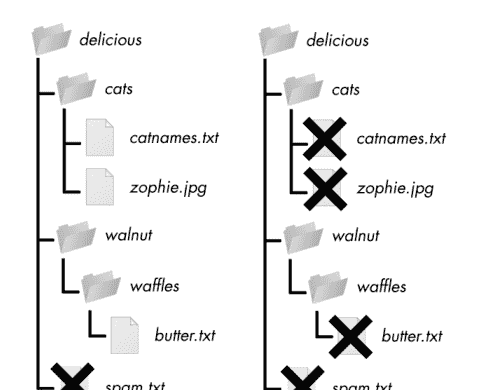

图 2-4：运行 del delicious（左）或 del /s /q delicious（右）时，这些示例文件夹中的文件将被删除。

在 macOS 和 Linux 上，您不能使用 `rm` 命令删除文件夹。但您可以运行 `rm -r [folder]` 来删除文件夹及其所有内容。在 Windows 上，`rd /s /q [folder]` 会执行相同的操作。图 2-5 说明了此任务。

```
rd /s /q delicious
rm -r delicious
```

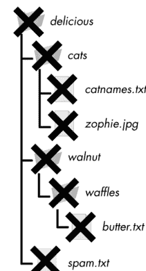

图 2-5：运行 rd /s /q delicious 或 rm -r delicious 时，这些示例文件夹中的文件将被删除。

## 使用 md 和 mkdir 创建文件夹

运行 md [new folder] 可在 Windows 上创建新的空文件夹，而运行 mkdir [new folder] 可在 macOS 和 Linux 上执行相同的操作。mkdir 命令在 Windows 上也有效，但 md 更容易输入。

以下是在 Linux 终端窗口中的示例：

```
al@ubuntu:~/Desktop$ mkdir yourScripts
al@ubuntu:~/Desktop$ cd yourScripts
al@ubuntu:~/Desktop/yourScripts$ ls
al@ubuntu:~/Desktop/yourScripts$
```

请注意，新创建的 yourScripts 文件夹是空的；当我们运行 ls 命令列出文件夹内容时，什么也没有出现 ①。

## 使用 rd 和 rmdir 删除文件夹

运行 rd [source folder] 可在 Windows 上删除源文件夹，而 rmdir [source folder] 可在 macOS 和 Linux 上删除源文件夹。与 mkdir 类似，rmdir 命令在 Windows 上也有效，但 rd 更容易输入。在删除之前，文件夹必须为空。

以下是在 Linux 终端窗口中的示例：

```
al@ubuntu:~/Desktop$ mkdir yourScripts
al@ubuntu:~/Desktop$ ls
yourScripts
```

```
al@ubuntu:~/Desktop$ rmdir yourScripts
al@ubuntu:~/Desktop$ ls
al@ubuntu:~/Desktop$
```

在此示例中，我们创建了一个名为 *yourScripts* 的空文件夹然后将其删除。

要删除非空文件夹（连同其中包含的所有文件夹和文件），在 Windows 上运行 `rd /s/q [source folder]`，或在 macOS 和 Linux 上运行 `rm -rf [source folder]`。

## 使用 where 和 which 查找程序

在 Windows 上运行 `where [program]` 或在 macOS 和 Linux 上运行 `which [program]` 会告诉你程序的确切位置。当你在命令行输入命令时，你的计算机会在 PATH 环境变量列出的文件夹中查找程序（尽管 Windows 会先检查 cwd）。

这些命令可以告诉你输入 python 时 shell 运行的是哪个可执行 Python 程序。如果你安装了多个 Python 版本，你的计算机可能有多个同名可执行程序。实际运行的是哪个取决于 PATH 环境变量中文件夹的顺序，而 where 和 which 命令会输出它：

```
C:\Users\Al>where python
C:\Users\Al\AppData\Local\Programs\Python\Python38\python.exe
```

在此示例中，文件夹名称表明从 shell 运行的 Python 版本位于 *C:\Users\Al\AppData\Local\Programs\Python\Python38\*。

## 使用 cls 和 clear 清除终端

在 Windows 上运行 `cls` 或在 macOS 和 Linux 上运行 `clear` 将清除终端窗口中的所有文本。如果只是想以一个看起来全新的终端窗口开始，这很有用。

## 环境变量和 PATH

无论程序是用何种语言编写，所有正在运行的程序进程都有一组称为 *环境变量* 的变量，可以存储字符串。环境变量通常保存着每个程序都会觉得有用的系统范围设置。例如，TEMP 环境变量保存着任何程序都可以存储临时文件的路径。当操作系统运行一个程序（如命令行）时，新创建的进程会收到操作系统环境变量和值的自己的副本。你可以独立于操作系统的环境变量集更改进程的环境变量。但这些更改仅适用于该进程，不适用于操作系统或任何其他进程。

我在本章讨论环境变量，因为其中一个变量 PATH 可以帮助你从命令行运行程序。

## 查看环境变量

你可以通过从命令行运行 set（在 Windows 上）或 env（在 macOS 和 Linux 上）来查看终端窗口的环境变量列表：

```
C:\Users\Al>set
ALLUSERSPROFILE=C:\ProgramData
APPDATA=C:\Users\Al\AppData\Roaming
CommonProgramFiles=C:\Program Files\Common Files
--snip--
USERPROFILE=C:\Users\Al
VBOX_MSI_INSTALL_PATH=C:\Program Files\Oracle\VirtualBox\
WINDIR=C:\WINDOWS
```

等号 (=) 左侧的文本是环境变量名，右侧的文本是字符串值。每个进程都有自己的环境变量集，因此不同的命令行可以为其环境变量具有不同的值。

你也可以使用 echo 命令查看单个环境变量的值。在 Windows 上运行 echo %HOMEPATH% 或在 macOS 和 Linux 上运行 echo $HOME 分别查看 HOMEPATH 或 HOME 环境变量的值，其中包含当前用户的主文件夹。在 Windows 上，它看起来像这样：

```
C:\Users\Al>echo %HOMEPATH%
\Users\Al
```

在 macOS 或 Linux 上，它看起来像这样：

```
al@al-VirtualBox:~$ echo $HOME
/home/al
```

如果该进程创建另一个进程（如命令行运行 Python 解释器时），子进程会收到父进程环境变量的自己的副本。子进程可以更改其环境变量的值而不影响父进程的环境变量，反之亦然。

你可以将操作系统的环境变量集视为“主副本”，进程从中复制其环境变量。操作系统的环境变量比 Python 程序的环境变量更改频率更低。事实上，大多数用户从未直接触及他们的环境变量设置。

## 使用 PATH 环境变量

当你输入命令，如 Windows 上的 python 或 macOS 和 Linux 上的 python3 时，终端会在你当前所在的文件夹中查找具有该名称的程序。如果在那里找不到，它将检查 PATH 环境变量列出的文件夹。

例如，在我的 Windows 计算机上，python.exe 程序文件位于 C:\Users\Al\AppData\Local\Programs\Python\Python38 文件夹中。要运行它，我必须输入 C:\Users\Al\AppData\Local\Programs\Python\Python38\python.exe，或先切换到该文件夹然后输入 python.exe。

这个冗长的路径名需要大量输入，因此我改为将此文件夹添加到 PATH 环境变量中。然后，当我输入 python.exe 时，命令行会在 PATH 列出的文件夹中搜索具有此名称的程序，从而免去我输入整个文件路径的麻烦。

因为环境变量只能包含单个字符串值，所以向 PATH 环境变量添加多个文件夹名称需要使用特殊格式。在 Windows 上，分号分隔文件夹名称。你可以使用 path 命令查看当前的 PATH 值：

```
C:\Users\Al>path
C:\Path;C:\WINDOWS\system32;C:\WINDOWS;C:\WINDOWS\System32\Wbem;
--snip--
C:\Users\Al\AppData\Local\Microsoft\WindowsApps
```

在 macOS 和 Linux 上，冒号分隔文件夹名称：

```
al@ubuntu:~$ echo $PATH
/home/al/.local/bin:/usr/local/sbin:/usr/local/bin:/usr/sbin:/usr/bin:/sbin:/bin:/usr/games:/usr/local/games:/snap/bin
```

文件夹名称的顺序很重要。如果我在 C:\WINDOWS\system32 和 C:\WINDOWS 中有两个名为 someProgram.exe 的文件，输入 someProgram.exe 将运行 C:\WINDOWS\system32 中的程序，因为该文件夹在 PATH 环境变量中排在前面。

如果你输入的程序或命令不存在于 cwd 或 PATH 列出的任何目录中，命令行会给出错误，例如 command not found 或 not recognized as an internal or external command。如果没有打错字，请检查程序位于哪个文件夹，并查看它是否出现在 PATH 环境变量中。

## 更改命令行的 PATH 环境变量

你可以更改当前终端窗口的 PATH 环境变量以包含额外文件夹。在 Windows 和 macOS/Linux 之间添加文件夹到 PATH 的过程略有不同。在 Windows 上，你可以运行 path 命令将新文件夹添加到当前的 PATH 值：

```
1 C:\Users\Al>path C:\newFolder;%PATH%
```

```
2 C:\Users\Al>path
C:\newFolder;C:\Path;C:\WINDOWS\system32;C:\WINDOWS;C:\WINDOWS\System32\Wbem;
--snip--
C:\Users\Al\AppData\Local\Microsoft\WindowsApps
```

%PATH% 部分 ① 会扩展为 PATH 环境变量的当前值，因此你是在现有 PATH 值的开头添加新文件夹和分号。你可以再次运行 path 命令来查看 PATH 的新值 ②。

在 macOS 和 Linux 上，你可以使用类似于 Python 中赋值语句的语法设置 PATH 环境变量：

```
① al@al-VirtualBox:~$ PATH=/newFolder:$PATH
② al@al-VirtualBox:~$ echo $PATH
/newFolder:/home/al/.local/bin:/usr/local/sbin:/usr/local/bin:/usr/sbin:/usr/bin:/sbin:/bin:/usr/games:/usr/local/games:/snap/bin
```

$PATH 部分 ① 会扩展为 PATH 环境变量的当前值，因此你是在现有 PATH 值中添加新文件夹和冒号。你可以再次运行 echo $PATH 命令来查看 PATH 的新值 ②。

但前面两种向 PATH 添加文件夹的方法仅适用于当前终端窗口以及在添加后从其中运行的任何程序。如果你打开一个新的终端窗口，它将不会有你的更改。永久添加文件夹需要更改操作系统的环境变量集。

## 在 Windows 上永久添加文件夹到 PATH

Windows 有两组环境变量：系统环境变量（适用于所有用户）和用户环境变量（覆盖系统环境变量但仅适用于当前用户）。要编辑它们，请单击开始菜单，然后输入“编辑此账户的环境变量”，这将打开环境变量窗口，如图 2-6 所示。

从用户变量列表（不是系统变量列表）中选择 Path，单击编辑，在出现的文本字段中添加新文件夹名称（不要忘记分号分隔符），然后单击确定。

这个界面不是最容易使用的，因此如果你经常在 Windows 上编辑环境变量，我建议安装免费的 Rapid Environment Editor 软件，网址为 https://www.rapidee.com/。请注意，安装后，你必须以管理员身份运行此软件才能编辑系统环境变量。单击开始菜单，输入 Rapid Environment Editor，右键单击软件图标，然后单击“以管理员身份运行”。

从命令提示符，你可以使用 setx 命令永久修改系统 PATH 变量：

```
C:\Users\Al>setx /M PATH "C:\newFolder;%PATH%"
```

你需要以管理员身份运行命令提示符才能运行 setx 命令。


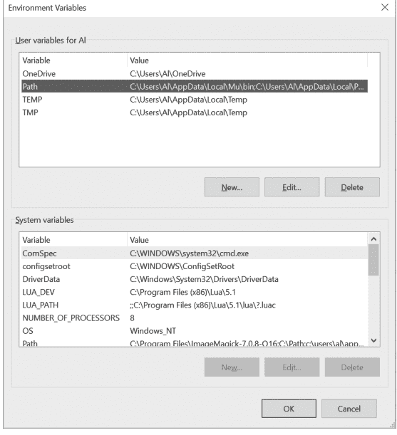

Figure 2-6: Windows 上的环境变量窗口

## 在 macOS 和 Linux 上永久添加文件夹到 PATH

要在 macOS 和 Linux 上为所有终端窗口添加文件夹到 PATH 环境变量，你需要修改主文件夹中的 .bashrc 文本文件并添加以下行：

```
export PATH=/newFolder:$PATH
```

这一行会修改所有未来终端窗口的 PATH。在 macOS Catalina 及更高版本中，默认的 shell 程序已从 Bash 更改为 Z Shell，因此你需要改为主文件夹中的 .zshrc。

## 无需命令行运行 Python 程序

你可能已经知道如何从操作系统提供的启动器运行程序。Windows 有“开始”菜单，macOS 有 Finder 和 Dock，Ubuntu Linux 有 Dash。安装程序时它们会自动添加到这些启动器中。你也可以在文件资源管理器应用中双击程序图标（如 Windows 上的文件资源管理器、macOS 上的 Finder 以及 Ubuntu Linux 上的 Files）来运行它们。

但这些方法不适用于你的 Python 程序。经常双击 .py 文件会将其在编辑器或 IDE 中打开，而不是运行它。而且如果你直接尝试运行 Python，只会打开 Python 交互式 shell。运行 Python 程序最常见的方式是在 IDE 中打开并点击运行菜单选项，或在命令行中执行。这两种方法如果你只是想启动一个 Python 程序都会很繁琐。

相反，你可以设置 Python 程序，使其能够像你安装的其他应用程序一样轻松地从操作系统的启动器运行。以下各节详细说明了如何为你的特定操作系统执行此操作。

## 在 Windows 上运行 Python 程序

在 Windows 上，你可以通过其他几种方式运行 Python 程序。无需打开终端窗口，你可以按 WIN-R 打开“运行”对话框并输入 py C:\path\to\yourScript.py，如图 2-7 所示。py.exe 程序安装在 C:\Windows\py.exe，已包含在 PATH 环境变量中，运行程序时 .exe 文件扩展名是可选的。

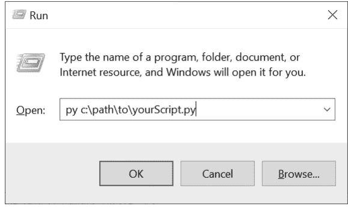

Figure 2-7. Windows 上的“运行”对话框

不过，这种方法仍要求你输入脚本的完整路径。此外，显示程序输出的终端窗口会在程序结束时自动关闭，你可能会错过一些输出。

你可以通过创建批处理脚本来解决这些问题，批处理脚本是一个带有 .bat 文件扩展名的文本文件，可以一次运行多个终端命令，类似于 macOS 和 Linux 中的 shell 脚本。你可以使用记事本等文本编辑器创建这些文件。新建一个包含以下两行的文本文件：

```
@py.exe C:\path\to\yourScript.py %*
@pause
```

将此路径替换为程序的绝对路径，并将此文件保存为 .bat 文件扩展名（例如 yourScript.bat）。每条命令开头的 @ 符号可防止其在终端窗口中显示，而 %* 会将批处理文件名后输入的任何命令行参数转发给 Python 脚本。Python 脚本随后会在 sys.argv 列表中读取命令行参数。此批处理文件将免去你每次运行程序时都要输入 Python 程序的完整绝对路径。@pause 命令会在 Python 脚本末尾添加 Press any key to continue... 以防止程序窗口过快消失。

我建议你将所有的批处理和 .py 文件放在已存在于 PATH 环境变量中的单个文件夹中，例如位于 C:\Users\<USERNAME> 的主文件夹。设置好批处理文件后，你只需按 WIN-R，输入批处理文件的名称（输入 .bat 文件扩展名是可选的），然后按 ENTER 即可运行 Python 脚本。

## 在 macOS 上运行 Python 程序

在 macOS 上，你可以通过创建带有 .command 文件扩展名的文本文件来创建 shell 脚本来运行 Python 脚本。在 TextEdit 等文本编辑器中创建一个，并添加以下内容：

```
#!/usr/bin/env bash
python3 /path/to/yourScript.py
```

将此文件保存在主文件夹中。在终端窗口中，通过运行 chmod u+x yourScript.command 使此 shell 脚本可执行。现在你应该能够点击 Spotlight 图标（或按 COMMAND-SPACE）并输入 shell 脚本的名称来运行它。shell 脚本随后会运行你的 Python 脚本。

## 在 Ubuntu Linux 上运行 Python 程序

在 Ubuntu Linux 上运行 Python 脚本没有像 Windows 和 macOS 那样快捷的方式，尽管你可以简化其中一些步骤。首先，确保你的 .py 文件位于主文件夹中。其次，将以下行作为 .py 文件的第一行添加：

```
#!/usr/bin/env python3
```

这称为 shebang 行，它告诉 Ubuntu 在运行此文件时使用 python3 来运行它。第三，通过在终端中运行 chmod 命令为此文件添加执行权限：

```
al@al-VirtualBox:~$ chmod u+x yourScript.py
```

现在无论何时你想快速运行 Python 脚本，都可以按 CTRL-ALT-T 打开一个新的终端窗口。此终端将设置为主文件夹，因此你只需输入 ./yourScript.py 即可运行此脚本。./ 是必需的，因为它告诉 Ubuntu yourScript.py 存在于 cwd（本例中为主文件夹）中。

## 摘要

环境设置涉及使计算机进入可以轻松运行程序所需的所有步骤。它要求你了解有关计算机工作原理的几个低级概念，例如文件系统、文件路径、进程、命令行和环境变量。

文件系统是计算机组织所有文件的方式。文件是完整的绝对文件路径或相对于 cwd 的文件路径。你将通过命令行浏览文件系统。命令行还有其他几个名称，如终端、shell 和控制台，但它们都指的是同一事物：让你输入命令的基于文本的程序。虽然 Windows 与 macOS/Linux 之间的命令行和常见命令的名称略有不同，但它们有效地执行相同的任务。

当你输入命令或程序名称时，命令行会在 PATH 环境变量列出的文件夹中查找该名称。理解这一点对于排查你可能遇到的命令未找到错误非常重要。将新文件夹添加到 PATH 环境变量的步骤在 Windows 与 macOS/Linux 之间也有细微差别。

熟悉命令行需要时间，因为有太多命令和命令行参数需要学习。不要担心如果你花费大量时间在线搜索帮助；这就是经验丰富的软件开发人员每天所做的事情。

## 第二部分：最佳实践、工具和技术

最佳实践，
工具和技术

### 3

### 使用 Black 进行代码格式化


代码格式化是对源代码应用一组规则以赋予其特定外观。虽然对解析程序的计算机来说并不重要，但代码格式化对于可读性至关重要，而可读性对于维护代码是必要的。如果代码对人类（无论是你还是同事）来说难以理解，就很难修复错误或添加新功能。格式化代码不仅仅是外观问题。Python 的可读性是该语言流行的关键原因之一。

本章向你介绍 Black，这是一款代码格式化工具，可以在不改变程序行为的情况下自动将源代码格式化为一致、可读的风格。Black 很有用，因为在文本编辑器或 IDE 中手动格式化代码很繁琐。你将首先了解 Black 所做的代码风格选择的合理性。然后你将学习如何安装、使用和自定义该工具。


## 如何失去朋友并疏远同事

我们可以用多种方式编写代码，结果行为相同。例如，我们可以在每个逗号后写一个空格，并始终一致地使用一种引号字符：

```
spam = [ 'dog', 'cat', 'moose' ]
```

但即使我们使用不同数量的空格和引号样式编写列表，我们仍然会有语法上有效的 Python 代码：

```
spam= [ 'dog' ,'cat',"moose"]
```

喜欢前一种方法的程序员可能会喜欢空格带来的视觉分隔以及引号字符的统一性。但程序员有时会选择后者，因为他们不想担心对程序是否正确运行没有影响的细节。

初学者经常忽略代码格式，因为他们专注于编程概念和语言语法。但对于初学者来说，建立良好的代码格式习惯很有价值。编程已经够困难了，为他人或未来的自己编写可理解的代码可以最大程度地减少这个问题。

虽然你可能一开始独自编码，但编程通常是一种协作活动。如果多个程序员在同一源代码文件上以自己的风格编写，代码可能会变得不一致，即使它能正常运行。更糟的是，程序员会不断地重新格式化彼此的代码以符合自己的风格，浪费时间和引起争论。是否在逗号后加一个或零个空格是个人偏好问题。这些风格选择可以很像决定道路的哪一侧行驶；人们是在道路右侧还是左侧行驶并不重要，只要每个人始终一致地在同一侧行驶即可。

## 风格指南与 PEP 8

编写可读代码的一个简单方法是遵循风格指南，一份概述软件项目应遵循的格式规则集的文件。Python 增强提案 8（PEP 8）就是由 Python 核心开发团队编写的此类风格指南。但一些软件公司也建立了自己的风格指南。

你可以在 https://www.python.org/dev/peps/pep-0008/ 上在线找到 PEP 8。许多 Python 程序员将 PEP 8 视为权威规则集，尽管 PEP 8 的创建者持不同意见。指南中“愚蠢的一致性是小聪明者的妖怪”部分提醒读者，在项目中保持一致性和可读性，而不是遵守任何单个格式规则，是强制执行风格指南的首要原因。

PEP 8 甚至包含以下建议：“Know when to be inconsistent—sometimes style guide recommendations just aren’t applicable. When in doubt, use your best judgment.” 无论你遵循其中的全部、部分还是不遵循，阅读 PEP 8 文档都是值得的。

> Know when to be inconsistent—sometimes style guide recommendations just aren’t applicable. When in doubt, use your best judgment.

由于我们使用 Black 代码格式化工具，我们的代码将遵循 Black 的风格指南，该指南改编自 PEP 8 的风格指南。你应该学习这些代码格式指南，因为你可能并不总是方便使用 Black。 本章中学习的 Python 代码准则通常也适用于其他语言，而这些语言可能没有自动格式化工具可用。

我并不喜欢 Black 格式化代码的方方面面，但我把它看作是一个良好妥协的标志。Black 使用程序员可以接受的格式规则，让我们花更少的时间争论，花更多的时间编程。

## 水平间距

空白对于可读性与所写的代码一样重要。这些空格有助于将代码的不同部分彼此分开，使其更容易识别。本节解释水平间距——即在单行代码内的空白放置，包括行首的缩进。

## 使用空格字符进行缩进

缩进是代码行开头的空白。你可以使用两种空白字符之一，即空格或制表符，来缩进代码。虽然任一字符都可以使用，但最佳做法是使用空格而不是制表符进行缩进。

原因在于这两种字符的行为不同。空格字符始终在屏幕上以单个空格的字符串值呈现，像这样 ' '。但制表符字符呈现为包含转义字符的字符串值，或 '\t'，更模糊。制表符通常，但不总是，以可变数量的间距呈现，以便后续文本从下一个制表位开始。制表位每隔八个空格放置在文本文件的宽度上。你可以在以下交互式 shell 示例中看到这种变化，该示例首先使用空格字符分隔单词，然后使用制表符：

```
>>> print('Hello there, friend!\nHow are you?')
Hello there, friend!
How are you?
>>> print('Hello\tthere,\tfriend!\nHow\tare\tyou?')
Hello     there,    friend!
How       are       you?
```

由于制表符代表可变宽度的空白，你应该避免在源代码中使用它们。大多数代码编辑器和 IDE 在你按下 TAB 键时会自动插入四个或八个空格字符，而不是一个制表符字符。

你也不能在同一代码块中同时使用制表符和空格进行缩进。在早期 Python 程序中使用两者进行缩进曾是繁琐错误的来源，以至于 Python 3 甚至不会运行这样缩进的代码；它会引发 TabError: inconsistent use of tabs and spaces in indentation 异常。Black 会自动将用于缩进的任何制表符字符转换为四个空格字符。

至于每个缩进级别的长度，Python 代码中的常见做法是每个缩进级别使用四个空格。以下示例中的空格字符已用句点标记以使其可见：

```
def getCatAmount():
....numCats = input('How many cats do you have?')
....if int(numCats) < 6:
........print('You should get more cats.')
```

与替代方案相比，四空格标准具有实际好处；使用每个缩进级别八个空格会导致代码很快达到行长度限制，而使用每个缩进级别两个空格字符会使缩进差异难以辨认。程序员通常不会考虑其他数量，例如三个或六个空格，因为他们，以及二进制计算总体上，对 2、4、8、16 等 2 的幂数有偏好。

## 行内间距

水平间距不仅仅是缩进。空格对于使代码行中的不同部分在视觉上区分开来很重要。如果你从不使用空格字符，你的行可能会变得密集且难以解析。以下小节提供了一些应遵循的间距规则。

## 在运算符和标识符之间放置单个空格

如果你在运算符和标识符之间不留空格，你的代码看起来会连在一起。例如，这一行用空格分隔运算符和变量：

```
YES: blanks = blanks[:i] + secretWord[i] + blanks[i + 1 :]
```

这行去掉了所有空格：

```
NO: blanks=blanks[:i]+secretWord[i]+blanks[i+1:]
```

在这两种情况下，代码都使用 + 运算符添加三个值，但没有空格时，blanks[i+1:] 中的 + 看起来像是添加了第四个值。空格使更明显这个 + 是 blanks 中值的切片的一部分。

## 在分隔符前不要加空格，在分隔符后加单个空格

我们使用逗号字符分隔列表和字典中的项目，以及函数 def 语句中的参数。你应该在这些逗号前不加空格，并在其后加一个空格，如此示例所示：

```
YES: def spam(eggs, bacon, ham):
YES:     weights = [42.0, 3.1415, 2.718]
```

否则，你会得到“拥挤”的代码，难以阅读：

```
NO: def spam(eggs,bacon,ham):
NO:     weights = [42.0,3.1415,2.718]
```

不要在分隔符前添加空格，因为这会不必要地吸引眼球到分隔符字符：

```
NO: def spam(eggs , bacon , ham):
NO:     weights = [42.0 , 3.1415 , 2.718]
```

Black 会自动在逗号后插入空格并删除它们前的空格。

## 不要在句点前后放置空格

Python 允许你在标记 Python 属性开头的句点前后插入空格，但你应避免这样做。不在那里放置空格会强调对象与其属性之间的联系，如此示例所示：

```
YES: 'Hello, world'.upper()
```

如果你在句点前后放置空格，对象和属性看起来彼此无关：

```
NO: 'Hello, world' . upper()
```

Black 会自动删除句点周围的空格。

## 不要在函数、方法或容器名称后放置空格

我们可以很容易地识别函数和方法名称，因为它们后面跟着一组括号，所以不要在名称和左括号之间放置空格。我们通常会这样写函数调用：

```
YES: print('Hello, world!')
```

但添加一个空格会使这个单一函数调用看起来像是两个独立的东西：

```
NO: print ('Hello, world!')
```

Black 会移除函数或方法名与其开括号之间的任何空格。

同样，不要在索引、切片或键的开方括号前添加空格。我们通常在访问容器类型（如列表、字典或元组）内部的项目时，不会在变量名和开方括号之间添加空格，像这样：

```
YES: spam[2]
YES: spam[0:3]
YES: pet['name']
```

再添加一个空格会使代码看起来像两个独立的东西：

```
NO: spam [2]
NO: spam [0:3]
NO: pet ['name']
```

Black 会移除变量名与开方括号之间的任何空格。

## 不要在开括号后或闭括号前添加空格

括号、方括号或大括号与其内容之间不应有空格。例如，def 语句中的参数或列表中的值应在其括号和方括号之后和之前立即开始和结束：

```
YES: def spam(eggs, bacon, ham):
YES:     weights = [42.0, 3.1415, 2.718]
```

不应在开括号后或闭括号前放置空格：

```
NO: def spam( eggs, bacon, ham ):
NO:     weights = [ 42.0, 3.1415, 2.718 ]
```

添加这些空格并不会提高代码的可读性，因此是不必要的。如果你的代码中存在这些空格，Black 会将其移除。

## 在行尾注释前空两格

如果你在代码行末尾添加注释，请在代码结束处和以 # 字符开头的注释之前空两格：

```
YES: print('Hello, world!')  # Display a greeting.
```

这两个空格使区分代码和注释变得更容易。单个空格，甚至更糟，没有空格，会使注意到这种分隔变得更加困难：

```
NO: print('Hello, world!') # Display a greeting.
NO: print('Hello, world!')# Display a greeting.
```

Black 会在代码结束处和注释开始处之间放置两个空格。

总的来说，我建议不要在代码行末尾放置注释，因为它们会使行变得过长而难以在屏幕上阅读。

## 垂直间距

垂直间距是指代码行之间空行的放置。就像书中的新段落防止句子形成文字的墙一样，垂直间距可以将某些代码行分组并将这些组彼此分开。

PEP 8 对代码中插入空行有几条指导原则：它指出你应该用两个空行分隔函数，用两个空行分隔类，并在类中使用一个空行分隔方法。Black 会自动遵循这些规则，通过在你的代码中插入或移除空行，将此代码：

```
NO: class ExampleClass:
    def exampleMethod1():
        pass
    def exampleMethod2():
        pass
def exampleFunction():
    pass
```

... 转换为此代码：

```
YES: class ExampleClass:
    def exampleMethod1():
        pass

    def exampleMethod2():
        pass

def exampleFunction():
    pass
```

## 垂直间距示例

Black 无法做到的就是决定函数、方法或全局作用域内的空行应放在何处。将哪些行分组在一起是一个主观决定，由程序员决定。

例如，让我们来看一下 Django Web 应用框架中 validators.py 中的 EmailValidator 类。你不必理解这段代码的工作原理。但请注意空行如何将 __call__() 方法的代码分隔成四个组：

```
--snip--
    def __call__(self, value):
        ① if not value or '@' not in value:
            raise ValidationError(self.message, code=self.code)

        ② user_part, domain_part = value.rsplit('@', 1)

        ③ if not self.user_regex.match(user_part):
            raise ValidationError(self.message, code=self.code)

        ④ if (domain_part not in self.domain_whitelist and
                not self.validate_domain_part(domain_part)):
            # Try for possible IDN domain-part
            try:
                domain_part = punycode(domain_part)
            except UnicodeError:
                pass
            else:
                if self.validate_domain_part(domain_part):
                    return
            raise ValidationError(self.message, code=self.code)
--snip--
```

即使这部分代码没有注释来描述，空行也表明这些组在概念上彼此不同。第一个组 ① 检查 value 参数中是否存在 @ 符号。此任务与第二个组 ② 的任务不同，第二个组将 value 中的电子邮件地址字符串拆分为两个新变量 user_part 和 domain_part。第三个 ③ 和第四个 ④ 组分别使用这些变量来验证电子邮件地址的用户部分和域名部分。

尽管第四组有 11 行，远多于其他组，但它们都与验证电子邮件地址的域名这一相同任务相关。如果你觉得此任务实际上由多个子任务组成，你可以插入空行来分隔它们。

Django 此部分的程序员决定域名验证行都应属于一个组，但其他程序员可能不同意。因为这是主观的，Black 不会修改函数或方法内的垂直间距。

## 垂直间距最佳实践

Python 的一个鲜为人知的特性是，你可以使用分号在一行上分隔多个语句。这意味着以下两行：

```
print('What is your name?')
name = input()
```

... 如果用分号分隔，可以写在同一行：

```python
print('What is your name?'); name = input()
```

正如你使用逗号时所做的那样，你应在分号前不留空格，并在其后留一个空格。

对于以冒号结尾的语句，例如 if、while、for、def 或 class 语句，单行块，如此示例中对 print() 的调用：

```python
if name == 'Alice':
    print('Hello, Alice!')
```

... 可以与它的 if 语句写在同一行：

```python
if name == 'Alice': print('Hello, Alice!')
```

但仅仅因为 Python 允许你在一行中包含多个语句，并不意味着这是一种良好的实践。它会导致代码行过宽，单行内容过多难以阅读。Black 会将这些语句拆分为单独的行。

同样，你可以使用单个 import 语句导入多个模块：

```python
import math, os, sys
```

即便如此，PEP 8 建议你将此语句拆分为每个模块一个 import 语句：

```python
import math
import os
import sys
```

如果你为导入写单独的行，在使用版本控制系统的 diff 工具比较更改时，你会更容易发现导入模块的任何添加或移除。（版本控制系统，如 Git，在第 12 章中介绍。）

PEP 8 还建议按以下顺序将导入语句分组为以下三个组：

- 1. Python 标准库中的模块，如 `math`、`os` 和 `sys`
- 2. 第三方模块，如 Selenium、Requests 或 Django
- 3. 程序的一部分的本地模块

这些指导原则是可选的，Black 不会更改你的代码导入语句的格式。

## Black：不妥协的代码格式化工具

Black 会自动格式化你的 .py 文件中的代码。虽然你应该理解本章介绍的格式化规则，但 Black 可以为你完成所有实际的样式设置。如果你与其他人一起从事编码项目，只需让 Black 决定即可立即解决许多关于如何格式化代码的争论。

你无法更改 Black 遵循的许多规则，这就是为什么它被称为“不妥协的代码格式化工具”。事实上，该工具的名称来自亨利·福特关于他向客户提供的汽车颜色选择的引言：“你想要任何颜色都可以，只要它是黑色的。”

我刚刚描述了 Black 使用的确切样式；你可以在 https://black.readthedocs.io/en/stable/the_black_code_style.html 找到 Black 的完整样式指南。

## 安装 Black

使用 Python 自带的 pip 工具安装 Black。在 Windows 中，通过打开命令提示符窗口并输入以下内容来执行此操作：

```
C:\Users\AI>python -m pip install --user black
```

在 macOS 和 Linux 上，打开终端窗口并输入 python3 而不是 python（你应该对本书中使用 python 的所有说明都这样做）：

```
Al's-MacBook-Pro:~ al$ python3 -m pip install --user black
```

-m 选项告诉 Python 将 pip 模块作为应用程序运行，一些 Python 模块就是这样设置的。通过运行 python -m black 测试安装是否成功。你应该看到消息 No paths given. Nothing to do. 而不是 No module named black。

## 从命令行运行 Black

你可以从命令提示符或终端窗口为任何 Python 文件运行 Black。此外，你的 IDE 或代码编辑器可以在后台运行 Black。你可以在 Black 的主页 https://github.com/psf/black/ 上找到让 Black 与 Jupyter Notebook、Visual Studio Code、PyCharm 和其他编辑器配合使用的说明。

假设你想自动格式化一个名为 yourScript.py 的文件。从 Windows 的命令行运行以下命令（在 macOS 和 Linux 上，使用 python3 命令代替 python）：

```
C:\Users\AI>python -m black yourScript.py
```

运行此命令后，yourScript.py 的内容将根据 Black 的样式指南进行格式化。

你的 PATH 环境变量可能已经设置好可以直接运行 Black，在这种情况下，你可以通过简单地输入以下内容来格式化 yourScript.py：

```
C:\Users\AI>black yourScript.py
```


如果你想让 Black 处理文件夹中的每个 .py 文件，请指定单个文件夹而不是单个文件。以下 Windows 示例会格式化 C:\yourPythonFiles 文件夹中的每个文件，包括其子文件夹：

```
C:\Users\AI>python -m black C:\yourPythonFiles
```

指定文件夹很有用，如果你的项目包含多个 Python 文件，而你不想为每个文件输入一条命令。

尽管 Black 在格式化代码的方式上相当严格，但接下来的三个小节描述了一些你可以更改的选项。要查看 Black 提供的完整选项范围，请运行 python -m black --help。

## 调整 Black 的行长度设置

Python 代码的标准行长为 80 个字符。80 字符行的历史可以追溯到 1920 年代的穿孔卡计算时代，当时 IBM 引入了具有 80 列和 12 行的穿孔卡。80 列标准在随后几十年开发的打印机、显示器和命令行窗口中得以保留。

但在 21 世纪，高分辨率屏幕可以显示超过 80 个字符宽的文本。更长的行长度可以避免你为了查看文件而垂直滚动。更短的行长度可以防止一行代码过于拥挤，并允许你在不水平滚动的情况下并排比较两个源代码文件。

Black 默认每行使用 88 个字符，原因相当随意，因为它比标准 80 字符行多出 10%。我更喜欢使用 120 个字符。要告诉 Black 例如使用 120 字符的行长度限制来格式化你的代码，请使用 -l 120（那是小写字母 L，不是数字 1）命令行选项。在 Windows 上，命令如下所示：

```
C:\Users\AI>python -m black -l 120 yourScript.py
```

无论你为项目选择什么行长度限制，项目中的所有 .py 文件都应使用相同的限制。

## 禁用 Black 的双引号字符串设置

Black 会自动将代码中的任何字符串字面量从使用单引号更改为双引号，除非字符串包含双引号字符，在这种情况下它会使用单引号。例如，假设 yourScript.py 包含以下内容：

```
a = 'Hello'
b = "Hello"
c = 'Al\'s cat, Zophie.'
d = 'Zophie said, "Meow"'
e = "Zophie said, \"Meow\""
f = """Hello"""
```

在 yourScript.py 上运行 Black 会将其格式化如下：

```
① a = "Hello"
b = "Hello"
c = "Al's cat, Zophie."
② d = 'Zophie said, "Meow"'
e = 'Zophie said, "Meow"'
③ f = """Hello"""
```

Black 对双引号的偏好使你的 Python 代码看起来与用其他编程语言编写的代码相似，这些语言通常对字符串字面量使用双引号。请注意，变量 a、b 和 c 的字符串使用双引号。变量 d 的字符串保留了原来的单引号，以避免转义字符串内的任何双引号 ②。请注意，Black 也对 Python 的三引号、多行字符串使用双引号 ③。

但如果你希望 Black 保持你的字符串字面量原样并且不更改所使用的引号类型，请传递 -S 命令行选项。（注意 S 为大写。）例如，在 Windows 中对原始的 yourScript.py 文件运行 Black 会产生以下输出：

```
C:\Users\AI>python -m black -S yourScript.py
All done!
1 file left unchanged.
```

你也可以在同一命令中使用 -l 行长度限制和 -S 选项：

```
C:\Users\AI>python -m black -l 120 -S yourScript.py
```

## 预览 Black 将做的更改

虽然 Black 不会重命名你的变量或更改程序的行为，但你可能不喜欢 Black 所做的样式更改。如果你想坚持使用原始格式，你可以使用源代码的版本控制或维护自己的备份。或者，你可以通过使用 --diff 命令行选项运行 Black 来预览它将做的更改，而不会实际更改你的文件。在 Windows 中，它如下所示：

```
C:\Users\AI>python -m black --diff yourScript.py
```

此命令以版本控制软件常用的 diff 格式输出差异，但通常人类也能读懂。例如，如果 yourScript.py 包含行 weights=[42.0,3.1415,2.718]，运行 --diff 选项会显示以下结果：

```
C:\Users\AI>python -m black --diff yourScript.py
--- yourScript.py 2020-12-07 02:04:23.141417 +0000
+++ yourScript.py      2020-12-07 02:08:13.893578 +0000
@@ -1 +1,2 @@
-weights=[42.0,3.1415,2.718]
+weights = [42.0, 3.1415, 2.718]
```

减号表示 Black 将删除行 weights=[42.0,3.1415,2.718] 并用以加号为前缀的行替换它：weights = [42.0, 3.1415, 2.718]。请记住，一旦你运行 Black 更改源代码文件，就无法撤销此更改。你需要在运行 Black 之前制作源代码的备份副本或使用版本控制软件，例如 Git。

## 为代码的某些部分禁用 Black

Black 再好，你可能也不想让它格式化代码的某些部分。例如，当我对齐多个相关的赋值语句时，我喜欢做自己的特殊间距，如以下示例所示：

```
#### Set up constants for different time amounts:
SECONDS_PER_MINUTE = 60
SECONDS_PER_HOUR   = 60 * SECONDS_PER_MINUTE
SECONDS_PER_DAY    = 24 * SECONDS_PER_HOUR
SECONDS_PER_WEEK   = 7  * SECONDS_PER_DAY
```

Black 会删除 = 赋值运算符前的额外空格，在我看来，这会使其可读性降低：

```
#### Set up constants for different time amounts:
SECONDS_PER_MINUTE = 60
SECONDS_PER_HOUR = 60 * SECONDS_PER_MINUTE
SECONDS_PER_DAY = 24 * SECONDS_PER_HOUR
SECONDS_PER_WEEK = 7 * SECONDS_PER_DAY
```

通过添加 # fmt: off 和 # fmt: on 注释，我们可以告诉 Black 关闭这些行的代码格式化，然后之后恢复代码格式化：

```
#### Set up constants for different time amounts:
#### fmt: off
SECONDS_PER_MINUTE = 60
SECONDS_PER_HOUR   = 60 * SECONDS_PER_MINUTE
SECONDS_PER_DAY    = 24 * SECONDS_PER_HOUR
SECONDS_PER_WEEK   = 7  * SECONDS_PER_DAY
#### fmt: on
```

现在在该文件上运行 Black 不会影响这两个注释之间的代码的独特间距或其他任何格式。

## 摘要

虽然良好的格式可能是不可见的，但糟糕的格式会使阅读代码变得令人沮丧。风格是主观的，但软件开发领域通常对什么是良好和糟糕的格式达成一致，同时仍为个人偏好留下空间。

Python 的语法在风格方面相当灵活。如果你编写的代码永远不会被其他人看到，你可以随意编写。但软件开发很大程度上是协作的。无论你是在项目中与其他人合作，还是只是想请更有经验的开发者审阅你的工作，将代码格式化以符合公认的风格指南都很重要。

在编辑器中格式化代码是一项枯燥的任务，你可以使用 Black 之类的工具来自动化。本章介绍了 Black 遵循的几个准则，以使代码更具可读性，包括垂直和水平地为代码添加空格，使其不会过于密集而难以阅读，以及设置每行应有的长度限制。Black 会为你强制执行这些规则，防止与协作者发生潜在的风格争论。

但代码风格不仅仅是空格和在单双引号之间做出选择。例如，选择描述性变量名也是代码可读性的关键因素。虽然像 Black 这样的自动化工具可以做出 *语法* 决策，例如代码应有的空格量，但它们无法做出 *语义* 决策，例如什么是好的变量名。

这种责任在你身上，我们将在下一章讨论这个话题。

### 4

### 选择易懂的名称


“计算机科学中最难的两个问题是命名事物、缓存失效和差一错误。”这个经典笑话归因于 Leon Bambrick，并基于 Phil Karlton 的一句名言，其中包含一丝真理：为变量、函数、类和编程中的任何其他事物想出好名字——正式称为 *标识符*——是很难的。简洁、描述性的名称对程序的可读性很重要。但创建名称说起来容易做起来难。如果你要搬到新房子，把所有搬家箱都标记为“东西”会很简洁但不描述性。一本编程书的描述性名称可能是 *用 Python 编写你自己的电脑游戏*，但它不够简洁。


除非你编写的是“一次性”代码，运行一次后就不打算再维护，那么在程序中选择好的名称时就应该多花些心思。如果你只是为变量使用 a、b 和 c，你的未来自我将花费不必要的精力去回忆这些变量最初的用途。

名称是一个主观的选择，你必须自己做出决定。像 Black 这样的自动化格式化工具，在第 3 章中描述过，无法决定你应该如何命名变量。本章为你提供了一些指导原则，帮助你选择合适的名称并避免糟糕的名称。同样，这些指导原则并非一成不变：请运用你的判断来决定何时将它们应用于你的代码。

## 元语法变量

在教程或代码片段中，当我们需要一个通用的变量名时，我们通常会使用一个 *元语法变量*。在 Python 中，我们经常在变量名不重要的代码示例中将变量命名为 spam、eggs、bacon 和 ham。这就是本书在代码示例中使用这些名称的原因；它们并非供你在实际项目中使用。这些名称来自蒙提·派森的“Spam”小品（https://en.wikipedia.org/wiki/Spam_(Monty_Python)）。foo 和 bar 对于元语法变量也很常见。它们源自 FUBAR，这是二战时期美国陆军俚语缩写，表示情况是“[糟糕]到无法辨认的地步”。

## 命名大小写风格

由于 Python 标识符区分大小写且不能包含空白字符，程序员使用多种风格来表示包含多个单词的标识符：

-   `snake_case` 用下划线分隔单词，看起来像在每个单词之间有一条平坦的小蛇。这种写法通常表示所有字母都是小写，尽管常量通常写成 UPPER_SNAKE_CASE。
-   `camelCase` 通过将除第一个单词外的每个单词的首字母大写来分隔单词。这种写法通常表示第一个单词以小写字母开头。大写字母看起来像骆驼的驼峰。
-   `PascalCase`，以其在 Pascal 编程语言中的使用命名，与 `camelCase` 类似，但也会将第一个单词大写。

大小写是代码格式化问题，我们在第 3 章中会介绍。最常见的风格是 snake_case 和 camelCase。只要你的项目始终使用其中一种，而不是两者混用，两种都可以。

## PEP 8 的命名约定

第 3 章中介绍的 PEP 8 文档对 Python 命名约定有一些建议：

-   所有字母都应为 ASCII 字母——即没有重音符号的大写和小写英文字母。
-   模块应具有简短、全小写的名字。
-   类名应写成 PascalCase。
-   常量变量应写成大写 SNAKE_CASE。
-   函数、方法 和变量名应写成小写 snake_case。
-   方法的第一个参数应始终命名为小写的 self。
-   类方法的第一个参数应始终命名为小写的 cls。
-   类中的私有属性应始终以下划线 (_) 开头。
-   类中的公共属性绝不以下划线 (_) 开头。

你可以根据需要弯曲或打破这些规则。例如，虽然英语是编程中的主要语言，但你可以使用任何语言的字母字符作为标识符：コンピューター = 'laptop' 是语法上有效的 Python 代码。正如你在这本书中看到的，我对变量名的偏好违背了 PEP 8，因为我使用 camelCase 而不是 snake_case。PEP 8 中提醒程序员不必严格遵循 PEP 8。重要的可读性因素不是你选择哪种风格，而是在使用该风格时保持一致。

你可以在 https://www.python.org/dev/peps/pep-0008/#naming-conventions 在线阅读 PEP 8 的“命名约定”部分。

## 适当的名字长度

显然，名称不应该太长或太短。长的变量名打字很费劲，而短的变量名可能令人困惑或神秘。由于代码被阅读的次数比被编写的次数多，因此更安全的做法是偏向于使用过长的变量名。让我们看一些名称过短和过长的示例。

### 名称过短

最常见的命名错误是选择名称过短。短名称在你第一次编写时可能很有意义，但其精确含义可能在几天或几周后就会丢失。让我们考虑几种短名称的类型。

-   一个一或两个字母的名称如 g 可能指的是以 g 开头的某个其他单词，但这样的单词有很多。仅有一或两个字母长的缩写和名称很容易写，但对其他人来说难以阅读。这也适用于 . . .
-   . . . 一个 *缩写名称* 如 *mon*，它可能代表 *监视器*、*月份*、*怪物* 或任何数量的单词。
-   一个 *单字名称* 如 *开始* 可能很模糊：开始什么？这样的名称可能缺少当别人阅读时并不明显的内容。

一或两个字母、缩写或单字名称可能对你来说是可理解的，但你始终需要记住，其他程序员（甚至几周后的你自己）将难以理解其含义。

在某些例外情况下，短变量名是可以的。例如，在遍历数字范围或列表索引的 for 循环中，使用 *i*（表示 *索引*）作为变量名是很常见的，如果你有嵌套循环，则使用 *j* 和 *k*（因为它们在字母表中跟在 *i* 之后）：

```
>>> for i in range(10):
...     for j in range(3):
...         print(i, j)
...
0 0
0 1
0 2
1 0
--snip--
```

另一个例外是使用 *x* 和 *y* 表示笛卡尔坐标。在大多数其他情况下，我不建议使用单字母变量名。虽然使用 *w* 和 *h* 作为 *宽度* 和 *高度* 的简写，或使用 *n* 作为 *数字* 的简写可能很诱人，但这些含义可能对他人并不明显。

### 不要从源代码中删减字母

不要从源代码中删除字母。虽然在 1990 年代之前，C 编程语言中像 `memcpy`（内存复制）和 `strcmp`（字符串比较）这样的名称中省略字母很流行，但它们是一种你今天不应该使用的难以阅读的命名风格。如果一个名称不容易发音，它就不是容易理解的。

此外，请随意使用可以使代码读起来像纯英语的短语。例如，`number_of_trials` 比仅仅 `number_trials` 更易读。

### 名称过长

通常，名称的作用域越大，它就应该越具有描述性。像 payment 这样短的名称对于单个简短函数中的局部变量来说是可以的。但如果在 10,000 行的程序中将其用作全局变量，payment 可能就不足以描述，因为这样大的程序可能处理多种付款数据。更具描述性的名称，如 salesClientMonthlyPayment 或 annual_electric_bill_payment，可能更合适。名称中的额外单词提供了更多上下文并消除了歧义。

与其描述不足，不如过于描述性更好。但在确定何时较长的名称不必要时，有一些指导原则。

## 名称中的前缀

名称中常见前缀的使用可能表明名称中存在不必要的细节。如果变量是类的属性，前缀可能提供不需要包含在变量名中的信息。例如，如果你有一个 Cat 类和一个 weight 属性，很明显 weight 指的是猫的体重。因此，名称 catWeight 就过于描述且不必要地冗长。

同样，匈牙利命名法是一种旧的且现在已过时的做法，即在名称中包含数据类型缩写。例如，名称 strName 表示变量包含字符串值，而 iVacationDays 表示变量包含整数。现代语言和 IDE 可以在无需这些前缀的情况下将此数据类型信息传达给程序员，使得匈牙利命名法在今天成为不必要的实践。如果你发现自己在名称中包含数据类型名称，请考虑将其删除。

另一方面，is 和 has 前缀用于包含布尔值的变量，或返回布尔值 的函数和方法，会使这些名称更易读。考虑以下对名为 is_vehicle 的变量和名为 has_key() 的方法的使用：

```
if item_under_repair.has_key('tires'):
    is_vehicle = True
```

has_key() 方法和 is_vehicle 变量支持代码的纯英语阅读：“如果维修中的项目有一个名为‘tires’的键，那么该项目就是车辆”就为真。

同样，为名称添加单位可以提供有用的信息。存储浮点值的 weight 变量是模糊的：重量是以磅、千克还是吨为单位？此单位信息不是数据类型，因此包含 kg 或 lbs 或 tons 的前缀或后缀与匈牙利命名法不同。如果你没有使用包含单位信息的重量特定数据类型，将变量命名为 weight_kg 之类的名称可能是明智的。事实上，在 1999 年，火星气候轨道器机器人航天探测器就丢失了，因为洛克希德·马丁提供的软件以英制标准

units，而 NASA 的系统使用公制，导致轨迹错误。据报道，该航天器花费了 1.25 亿美元。

## 名称中的顺序数字后缀

名称中的顺序数字后缀表明你可能需要更改变量的数据类型或为名称添加不同的细节。单独的数字通常不足以区分这些名称。

变量名 payment1、payment2 和 payment3 并不能告诉阅读代码的人这些付款值之间的区别是什么。程序员可能应该将这三个变量重构为一个名为 payments 的单个列表或元组变量，其中包含三个值。

函数调用如 makePayment1(amount)、makePayment2(amount) 等可能应该被重构为一个接受整数参数的单个函数：makePayment(1, amount)、makePayment(2, amount) 等。如果这些函数具有不同的行为从而证明需要单独的函数，则数字背后的含义应在名称中说明：例如 makeLowPriorityPayment(amount) 和 makeHighPriorityPayment(amount)，或 make1stQuarterPayment(amount) 和 make2ndQuarterPayment(amount)。

如果你有选择带顺序数字后缀名称的有效理由，使用它们是可以的。但如果你使用这些名称只是因为这是容易的选择，请考虑修改它们。

## 使名称可搜索

对于除最小的程序之外的所有程序，你可能需要使用编辑器或 IDE 的 CTRL-F“查找”功能来定位变量和函数被引用的位置。如果你选择一个简短、通用的变量名，例如 num 或 a，你最终会得到多个误匹配。为了使名称易于立即找到，请使用包含具体细节的较长变量名来形成唯一名称。

一些 IDE 会具有重构功能，可以根据程序使用方式识别名称。例如，一个常见功能是“重命名”工具，可以区分名为 num 和 number 的变量，以及区分局部 num 和全局 num 变量。但你仍应像这些工具不存在一样选择名称。

牢记这一规则自然有助于你选择描述性名称而不是通用名称。名称 email 很模糊，因此请考虑更具描述性的名称，如 emailAddress、downloadEmailAttachment、emailMessage 或 replyToAddress。这样的名称不仅更精确，而且在源代码文件中也更容易找到。

## 避免使用笑话、双关语和文化引用

在我之前的一份软件工作中，我们的代码库中包含一个名为 gooseDownload() 的函数。我完全不知道这是什么意思，因为我们创建的产品与鸟类或下载鸟类无关。当我找到最初编写该函数的高级同事时，他解释说 goose 是用作动词，就像“goose the engine”。我也不知道这个短语是什么意思。他还必须进一步解释，“goose the engine”是汽车行话，意思是踩下油门踏板使发动机更快运转。因此，gooseDownload() 是一个使下载变快的函数。我点了点头，回到了我的办公桌。多年后，这位同事离开公司后，我将他的函数重命名为 increaseDownloadSpeed()。

在为程序选择名称时，你可能会想使用笑话、双关语或文化引用为代码增添一些轻松感。不要这样做。笑话在文本中很难传达，而且笑话将来可能不会那么好笑。双关语也很容易被忽略，而处理同事将双关语误认为是拼写错误而反复报告的错误可能会相当惩罚。

特定文化的引用会妨碍清晰地传达代码的意图。互联网使得与世界各地的陌生人共享源代码变得前所未有的容易，而他们不一定精通英语或理解英语笑话。如本章前面所述，Python 文档中使用的名称 spam、eggs 和 bacon 引用了 Monty Python 的喜剧小品，但我们仅将其用作元语法变量；在实际代码中使用它们是不明智的。

最好的做法是以非英语母语者能够轻松理解的方式编写代码：礼貌、直接且无幽默感。我以前的同事可能认为 gooseDownload() 是一个有趣的笑话，但没有什么比不得不解释它更快地扼杀一个笑话。

## 不要覆盖内置名称

你还永远不应该为自己的变量使用 Python 的内置名称。例如，如果你将变量命名为 list 或 set，你将覆盖 Python 的 list() 和 set() 函数，可能导致代码后面出现错误。list() 函数创建列表对象。但覆盖它可能导致此错误：

```
>>> list(range(5))
[0, 1, 2, 3, 4]
① >>> list = ['cat', 'dog', 'moose']
② >>> list(range(5))
Traceback (most recent call last):
  File "<stdin>", line 1, in <module>
TypeError: 'list' object is not callable
```

如果我们将列表值赋给名称 list ①，我们将丢失原始的 list() 函数。尝试调用 list() ② 将导致 TypeError。要判断 Python 是否已在使用某个名称，请将其输入到交互式 shell 中或尝试导入它。如果名称未被使用，你将收到 NameError 或 ModuleNotFoundError。例如，Python 使用名称 open 和 test，但不使用 spam 和 eggs：

```
>>> open
<built-in function open>
>>> import test
>>> spam
Traceback (most recent call last):
  File "<stdin>", line 1, in <module>
NameError: name 'spam' is not defined
>>> import eggs
Traceback (most recent call last):
  File "<stdin>", line 1, in <module>
ModuleNotFoundError: No module named 'eggs'
```

一些经常被覆盖的 Python 名称有 all、any、date、email、file、format、hash、id、input、list、min、max、object、open、random、set、str、sum、test 和 type。不要将这些名称用于你的标识符。

另一个常见问题是将你的 .py 文件命名为与第三方模块相同的名称。例如，如果你安装了第三方 Pyperclip 模块，但也创建了 pyperclip.py 文件，import pyperclip 语句将导入 pyperclip.py 而不是 Pyperclip 模块。当你尝试调用 Pyperclip 的 copy() 或 paste() 函数时，你会收到一个错误，提示它们不存在：

```
>>> # Run this code with a file named pyperclip.py in the current folder.
>>> import pyperclip # This imports your pyperclip.py, not the real one.
>>> pyperclip.copy('hello')
Traceback (most recent call last):
  File "<stdin>", line 1, in <module>
AttributeError: module 'pyperclip' has no attribute 'copy'
```

请注意在 Python 代码中覆盖现有名称，尤其是在意外收到这些 has no attribute 错误消息时。

## 有史以来最糟糕的变量名

名称 data 是一个糟糕的、通用的变量名，因为字面上所有变量都包含数据。命名变量为 var 也是如此，这有点像给你的宠物狗取名“Dog”。名称 temp 常用于临时保存数据的变量，但仍然是一个糟糕的选择：毕竟，从禅的角度来看，所有变量都是临时的。不幸的是，尽管这些名称很模糊，但它们经常出现；避免在代码中使用它们。

如果你需要一个变量来保存温度数据的统计方差，请使用名称 temperatureVariance。名称 tempVarData 会是一个糟糕的选择，这应该是不言而喻的。

## 总结

选择名称与算法或计算机科学无关，然而它是编写可读代码的重要部分。最终，你在代码中使用的名称由你决定，但要意识到存在许多指导原则。PEP 8 文档推荐了几种命名约定，例如模块使用小写名称，类使用 PascalCase 名称。名称不应太短或太长。但通常最好偏向过于描述性，而不是不够详细。

名称应简洁但具有描述性。能够使用 CTRL-F 搜索功能轻松找到的名称是独特且描述性变量的标志。思考你的名称的可搜索性，以确定是否使用了过于通用的名称。此外，还要考虑不懂流利英语的程序员是否能理解该名称：在名称中避免使用笑话、双关语和文化引用；相反，选择礼貌、直接且无幽默感的名称。

尽管本章中的许多建议只是指导原则，但你应始终避免使用 Python 标准库已使用的名称，例如 all、any、date、email、file、format、hash、id、input、list、min、max、object、open、random、set、str、sum、test 和 type。使用这些名称可能会导致代码中出现细微的错误。

计算机并不关心你的名称是描述性的还是模糊的。名称使代码对人类更易读，而不是对计算机更易运行。如果代码可读，就容易理解。如果容易理解，就容易更改。如果容易更改，就更容易修复错误或添加新功能。使用易于理解的名称是生产高质量软件的基础步骤。


### 5

### 查找代码异味


导致程序崩溃的代码显然是错误的，但崩溃并不是程序中问题的唯一指标。其他迹象可能暗示存在更微妙的错误或难以阅读的代码。就像瓦斯味可能表示瓦斯泄漏，烟味可能表示火灾一样，代码异味是一种源代码模式，预示着潜在的错误。代码异味并不一定意味着存在问题，但它确实意味着你应该调查你的程序。

本章列出了几种常见的代码异味。预防一个错误所花费的时间和精力，远少于日后遇到、理解并修复该错误。每位程序员都有花上数小时调试，最后发现修复只需修改一行代码的故事。因此，即使是潜在错误的蛛丝马迹也应让你停下来，促使你再次检查是否在制造未来的问题。

当然，代码异味不一定就是问题。最终，是否处理或忽略代码异味，是你需要做出的判断。

### 重复代码

最常见的代码异味是重复代码。重复代码是指你可以通过复制粘贴其他代码到程序中而创建的任何源代码。例如，这个简短的程序包含重复代码。请注意它三次询问用户感觉如何：

```
print('Good morning!')
print('How are you feeling?')
feeling = input()
print('I am happy to hear that you are feeling ' + feeling + '.')
print('Good afternoon!')
print('How are you feeling?')
feeling = input()
print('I am happy to hear that you are feeling ' + feeling + '.')
print('Good evening!')
print('How are you feeling?')
feeling = input()
print('I am happy to hear that you are feeling ' + feeling + '.')
```

重复代码是个问题，因为它使修改代码变得困难；你对重复代码其中一份所做的更改，必须在程序中对其所有副本都进行。如果你在某处忘记更改，或对不同副本做出不同的更改，你的程序很可能会出现错误。

解决重复代码的方法是将其去重；也就是说，通过将代码放在函数或循环中，使其在程序中只出现一次。在下面的示例中，我将重复代码移入一个函数，然后反复调用该函数：

```
def askFeeling():
    print('How are you feeling?')
    feeling = input()
    print('I am happy to hear that you are feeling ' + feeling + '.')

print('Good morning!')
askFeeling()
print('Good afternoon!')
askFeeling()
print('Good evening!')
askFeeling()
```

在下一个示例中，我将重复代码移入循环中：

```
for timeOfDay in ['morning', 'afternoon', 'evening']:
    print('Good ' + timeOfDay + '!')
    print('How are you feeling?')
    feeling = input()
    print('I am happy to hear that you are feeling ' + feeling + '.')
```

你也可以结合这两种技术，同时使用函数和循环：

```
def askFeeling(timeOfDay):
    print('Good ' + timeOfDay + '!')
    print('How are you feeling?')
    feeling = input()
    print('I am happy to hear that you are feeling ' + feeling + '.')

for timeOfDay in ['morning', 'afternoon', 'evening']:
    askFeeling(timeOfDay)
```

请注意，生成“Good morning/afternoon/evening!” 消息的代码是相似但不完全相同。在程序的第三次改进中，我对代码进行了参数化以去重相同的部分。与此同时，timeOfDay 参数和 timeOfDay 循环变量取代了不同的部分。现在我通过移除多余的副本对这段代码进行了去重，我只需在一个地方进行必要的更改即可。

与所有代码异味一样，避免重复代码并不是你必须始终遵循的硬性规则。一般来说，重复代码段越长或程序中出现的重复副本越多，去重的理由就越充分。我不介意复制粘贴代码一次甚至两次。但当我的程序中存在三到四个副本时，我通常会开始考虑去重代码。

有时，代码不值得去重而费事。比较本节中的第一个代码示例和最近的一个。虽然重复代码更长，但它简单直接。去重后的示例做同样的事情，但涉及一个循环、一个新的 timeOfDay 循环变量，以及一个参数也命名为 timeOfDay 的新函数。

重复代码是一种代码异味，因为它使你的代码更难一致地更改。如果程序中有多个重复项，解决方案是将代码放在函数或循环内，使其只出现一次。

### 魔法数字

编程涉及数字不足为奇。但源代码中出现的某些数字可能会让其他程序员（或你在编写几周后）感到困惑。例如，考虑以下行中的数字 604800：

```
expiration = time.time() + 604800
```

time.time() 函数返回一个表示当前时间的整数。我们可以假设 expiration 变量将表示未来 604,800 秒后的某个时间点。但 604800 颇为神秘：这个到期日的意义是什么？注释可以帮助澄清：

```
expiration = time.time() + 604800  # Expire in one week.
```

这是一个不错的解决方案，但更好的方法是使用常量替换这些“魔法”数字。常量是变量名以大写字母书写，以表示其值在初始赋值后不应更改。通常，常量被定义为源代码文件顶部的全局变量：

```
# Set up constants for different time amounts:
SECONDS_PER_MINUTE = 60
SECONDS_PER_HOUR   = 60 * SECONDS_PER_MINUTE
SECONDS_PER_DAY    = 24 * SECONDS_PER_HOUR
SECONDS_PER_WEEK   = 7  * SECONDS_PER_DAY

--snip--

expiration = time.time() + SECONDS_PER_WEEK  # Expire in one week.
```

你应该为服务于不同目的的魔法数字使用单独的常量，即使魔法数字相同。例如，一副扑克牌有 52 张牌，一年有 52 周。但如果你的程序中同时存在这两个数量，你应该这样做：

```
NUM_CARDS_IN_DECK = 52
NUM_WEEKS_IN_YEAR = 52

print('This deck contains', NUM_CARDS_IN_DECK, 'cards.')
print('The 2-year contract lasts for', 2 * NUM_WEEKS_IN_YEAR, 'weeks.')
```

运行此代码时，输出将如下所示：

```
This deck contains 52 cards.
The 2-year contract lasts for 104 weeks.
```

使用单独的常量允许你在未来独立更改它们。请注意，常量变量在程序运行期间不应更改值。但这并不意味着程序员永远不能在源代码中更新它们。例如，如果代码的未来版本包含一张 Joker 牌，你可以更改 cards 常量而不影响 weeks 常量：

```
NUM_CARDS_IN_DECK = 53
NUM_WEEKS_IN_YEAR = 52
```

术语魔法数字也可以适用于非数值。例如，你可能会将字符串值用作常量。考虑以下程序，它要求用户输入方向，如果方向为北则显示警告。'nrth' 的拼写错误会导致错误，使程序无法显示警告：

```python
while True:
    print('Set solar panel direction:')
    direction = input().lower()
    if direction in ('north', 'south', 'east', 'west'):
        break

print('Solar panel heading set to:', direction)
① if direction == 'nrth':
    print('Warning: Facing north is inefficient for this panel.')
```
```

这个错误很难检测：'nrth' 字符串 ① 中的拼写错误在语法上仍然是正确的 Python。程序不会崩溃，很容易忽略警告消息的缺失。但如果我们使用常量并犯下同样的拼写错误，拼写错误会导致程序崩溃，因为 Python 会注意到 NRTH 常量不存在：

```python
# Set up constants for each cardinal direction:
NORTH = 'north'
SOUTH = 'south'
EAST = 'east'
WEST = 'west'

while True:
    print('Set solar panel direction:')
    direction = input().lower()
    if direction in (NORTH, SOUTH, EAST, WEST):
        break

print('Solar panel heading set to:', direction)
① if direction == NRTH:
    print('Warning: Facing north is inefficient for this panel.')
```
```

运行此程序时，带有 NRTH 拼写错误 ① 的代码行引发的 NameError 异常会使错误立即显现：

```
Set solar panel direction:
west
Solar panel heading set to: west
Traceback (most recent call last):
    File "panelset.py", line 14, in <module>
        if direction == NRTH:
NameError: name 'NRTH' is not defined
```

魔法数字是一种代码异味，因为它们不传达其目的，使代码可读性降低，更难更新，并且容易出现无法检测的拼写错误。解决方案是使用常量变量代替。


## 注释放开的代码和死代码

临时措施下注释掉代码使其不运行是可以的。你可能想跳过某些行来测试其他功能，而注释它们可以让你以后轻松地加回来。但如果注释掉的代码仍然保留在原位，就完全不清楚为什么要移除它，以及在什么条件下它可能再次需要。请考虑以下示例：

```
doSomething()
#doAnotherThing()
doSomeImportantTask()
doAnotherThing()
```

这段代码引发了许多未解答的问题：为什么 doAnotherThing() 被注释掉了？我们还会再次包含它吗？为什么第二次调用 doAnotherThing() 没有被注释掉？原本是否有两个 doAnotherThing() 调用，还是有一个调用被移到了 doSomeImportantTask() 之后？是否有理由不删除注释掉的代码？这些问题都没有 readily available 的答案。

死代码是指无法到达或逻辑上永远无法运行的代码。例如，函数内部 return 语句之后的代码、if 语句块中始终为假条件下的代码，或从未被调用的函数中的代码都属于死代码。要在实践中看到这一点，请在交互式 shell 中输入以下内容：

```
>>> import random
>>> def coinFlip():
...     if random.randint(0, 1):
...         return 'Heads!'
...     else:
...         return 'Tails!'
...     return 'The coin landed on its edge!'
...
>>> print(coinFlip())
Tails!
```

return 'The coin landed on its edge!' 这一行是死代码，因为 if 和 else 块中的代码会在执行到达该行之前返回。死代码具有误导性，因为阅读它的程序员会假设它是程序的活跃部分，而实际上它与注释掉的代码相同。

占位符是这些代码异味规则的例外。它们是未来代码的占位符，例如尚未实现的功能或类。作为真实代码的替代，占位符包含一个 pass 语句，它什么也不做。（它也称为无操作或 no-op。）pass 语句的存在是为了让你在语言语法要求某些代码的地方创建占位符：

```
>>> def exampleFunction():
...     pass
...
```

当此函数被调用时，它什么也不做。相反，它表示最终会添加代码。

另外，为了避免意外调用未实现的功能，你可以用 raise NotImplementedError 语句对其进行占位。这将立即表明该函数尚未准备好被调用：

```
>>> def exampleFunction():
...     raise NotImplementedError
...
>>> exampleFunction()
Traceback (most recent call last):
  File "<stdin>", line 1, in <module>
  File "<stdin>", line 2, in exampleFunction
NotImplementedError
```

引发 NotImplementedError 会在你的程序意外调用占位符函数或方法时发出警告。

注释掉的代码和死代码是代码异味，因为它们可能误导程序员认为代码是程序的可执行部分。相反，删除它们并使用版本控制系统，例如 Git 或 Subversion，来跟踪更改。版本控制在第 12 章中介绍。有了版本控制，你可以从程序中删除代码，如果需要，还可以轻松地稍后将其加回。

## Print Debugging

打印调试是在程序中放置临时的 print() 调用以显示变量的值，然后重新运行程序的做法。该过程通常遵循以下步骤：

- 1. 在你的程序中注意到一个错误。
- 2. 为某些变量添加 print() 调用以了解它们包含的内容。
- 3. 重新运行程序。
- 4. 因为之前的调用没有显示足够的信息，所以添加更多 print() 调用。
- 5. 重新运行程序。
- 6. 在最终找出错误之前，再重复前两个步骤几次。
- 7. 重新运行程序。
- 8. 意识到你忘记删除一些 print() 调用并将其删除。

打印调试看似快速简单。但在显示修复错误所需的信息之前，通常需要多次迭代重新运行程序。解决方案是使用调试器或为你的程序设置日志文件。通过使用调试器，你可以一次运行程序的一行代码并检查任何变量。使用调试器可能看起来比简单插入 print() 调用更慢，但从长远来看它可以节省你的时间。

日志文件可以记录程序的大量信息，以便你将一次运行与之前的运行进行比较。在 Python 中，内置的 logging 模块提供了你所需的功能，只需三行代码即可轻松创建日志文件：

```
import logging
logging.basicConfig(filename='log_filename.txt', level=logging.DEBUG, format='%(asctime)s - %(levelname)s - %(message)s')
logging.debug('This is a log message.')
```

在导入 logging 模块并设置其基本配置后，你可以调用 logging.debug() 将信息写入文本文件，而不是使用 print() 在屏幕上显示它。与打印调试不同，调用 logging.debug() 使得很明显哪些输出是调试信息，哪些输出是程序正常运行的结果。你可以在《Automate the Boring Stuff with Python》第 2 版（No Starch, 2019）第 11 章中找到有关调试的更多信息，你可以在 https://autbor.com/2e/c11/ 在线阅读。

## Variables with Numeric Suffixes

编写程序时，你可能需要多个存储相同类型数据的变量。在这种情况下，你可能会想通过为其添加数字后缀来重用变量名。例如，如果你正在处理一个注册表单，要求用户输入两次密码以防止打字错误，你可能会将这些密码字符串存储在名为 password1 和 password2 的变量中。这些数字后缀并不是对变量包含的内容或它们之间的差异的良好描述。它们也无法表明这些变量有多少个：是否还有 password3 或 password4？尝试创建不同的名称，而不是懒惰地添加数字后缀。对于这个密码示例，更好的名称集合是 password 和 confirm_password。

让我们看另一个示例：如果有一个处理起点和目的坐标的函数，你可能有参数 x1、y1、x2 和 y2。但数字后缀名称传达的信息不如名称 start_x、start_y、end_x 和 end_y 多。与 x1 和 y1 相比，start_x 和 start_y 变量彼此相关也更清晰。

如果你的数字后缀超过 2，你可能想使用列表或集合数据结构将数据存储为集合。例如，你可以将 pet1Name、pet2Name、pet3Name 等的值存储在一个名为 petNames 的列表中。

这种代码异味并不适用于每个简单以数字结尾的变量。例如，拥有一个名为 enableIPv6 的变量是完全可以的，因为“6”是“IPv6”专有名词的一部分，而不是数字后缀。但如果你为一系列变量使用数字后缀，请考虑用数据结构（如列表或字典）替换它们。

## Classes That Should Just Be Functions or Modules

使用 Java 等语言的程序员习惯于创建类来组织程序的代码。例如，让我们看一下这个示例 Dice 类，它有一个 roll() 方法：

```
>>> import random
>>> class Dice:
...     def __init__(self, sides=6):
...         self.sides = sides
...     def roll(self):
...         return random.randint(1, self.sides)
...
>>> d = Dice()
>>> print('You rolled a', d.roll())
You rolled a 1
```

这看起来像是组织良好的代码，但想想我们的实际需求是什么：1 到 6 之间的随机数。我们可以用一个简单的函数调用替换整个类：

```
>>> print('You rolled a', random.randint(1, 6))
You rolled a 6
```

与其他语言相比，Python 使用一种随意的方式来组织代码，因为它的代码不需要存在于类或其他样板结构中。如果你发现自己只是为了进行一次函数调用而创建对象，或者如果你编写的类只包含静态方法，这些都是代码异味，表明你可能最好改写函数。

在 Python 中，我们使用模块而不是类来分组函数。因为类无论如何都必须在模块中，所以把这段代码放在类中只是在你的代码中添加了一个不必要的组织层。第 15 章到第 17 章更详细地讨论了这些面向对象设计原则。Jack Diederich 在 PyCon 2012 的演讲“Stop Writing Classes”涵盖了你可能过度复杂化 Python 代码的其他方式。

## List Comprehensions Within List Comprehensions

列表推导式是创建复杂列表值的一种简洁方式。例如，要创建一个 0 到 100 的数字的字符串列表，排除所有 5 的倍数，你通常需要一个 for 循环：

```
>>> spam = []
>>> for number in range(100):
...     if number % 5 != 0:
...         spam.append(str(number))
...
>>> spam
['1', '2', '3', '4', '6', '7', '8', '9', '11', '12', '13', '14', '16', '17',
--snip--
'86', '87', '88', '89', '91', '92', '93', '94', '96', '97', '98', '99']
```

另外，你可以使用列表推导式语法在一行代码中创建同样的列表：

```
>>> spam = [str(number) for number in range(100) if number % 5 != 0]
>>> spam
['1', '2', '3', '4', '6', '7', '8', '9', '11', '12', '13', '14', '16', '17',
--snip--
'86', '87', '88', '89', '91', '92', '93', '94', '96', '97', '98', '99']
```

Python 也有集合推导式和字典推导式的语法：

```
>>> spam = {str(number) for number in range(100) if number % 5 != 0}
>>> spam
{'39', '31', '96', '76', '91', '11', '71', '24', '2', '1', '22', '14', '62',
--snip--
'4', '57', '49', '51', '9', '63', '78', '93', '6', '86', '92', '64', '37'}
>>> spam = {str(number): number for number in range(100) if number % 5 != 0}
>>> spam
{'1': 1, '2': 2, '3': 3, '4': 4, '6': 6, '7': 7, '8': 8, '9': 9, '11': 11,
--snip--
'92': 92, '93': 93, '94': 94, '96': 96, '97': 97, '98': 98, '99': 99}
```

集合推导式 ① 使用大括号代替方括号并生成一个集合值。字典推导式 ② 生成一个字典值，并在推导式中使用冒号分隔键和值。

这些推导式简洁且可以使你的代码更具可读性。但请注意，推导式会基于可迭代对象生成列表、集合或字典（在本例中为 range(100) 调用返回的 range 对象）。列表、集合和字典都是可迭代对象，这意味着你可以将推导式嵌套在推导式内部，如以下示例所示：

```
>>> nestedIntList = [[0, 1, 2, 3], [4], [5, 6], [7, 8, 9]]
>>> nestedStrList = [[str(i) for i in sublist] for sublist in nestedIntList]
>>> nestedStrList
[['0', '1', '2', '3'], ['4'], ['5', '6'], ['7', '8', '9']]
```

但是嵌套的列表推导式（或嵌套的集合和字典推导式）会将大量复杂性压缩到少量代码中，使你的代码难以阅读。最好将其扩展为一个或多个 for 循环：

```
>>> nestedIntList = [[0, 1, 2, 3], [4], [5, 6], [7, 8, 9]]
>>> nestedStrList = []
>>> for sublist in nestedIntList:
...     nestedStrList.append([str(i) for i in sublist])
...
>>> nestedStrList
[['0', '1', '2', '3'], ['4'], ['5', '6'], ['7', '8', '9']]
```

推导式也可以包含多个 for 表达式，尽管这同样容易产生难以阅读的代码。例如，以下列表推导式从嵌套列表中生成一个扁平化列表：

```
>>> nestedList = [[0, 1, 2, 3], [4], [5, 6], [7, 8, 9]]
>>> flatList = [num for sublist in nestedList for num in sublist]
>>> flatList
[0, 1, 2, 3, 4, 5, 6, 7, 8, 9]
```

此列表推导式包含两个 for 表达式，但即使是经验丰富的 Python 开发者也难以理解。展开形式使用两个 for 循环，创建相同的扁平化列表，但更易于阅读：

```
>>> nestedList = [[0, 1, 2, 3], [4], [5, 6], [7, 8, 9]]
>>> flatList = []
>>> for sublist in nestedList:
...     for num in sublist:
...         flatList.append(num)
...
>>> flatList
[0, 1, 2, 3, 4, 5, 6, 7, 8, 9]
```

推导式是可产生简洁代码的语法快捷方式，但不要过度使用并将它们相互嵌套。

## 空的 except 块和糟糕的错误信息

捕获异常是确保程序在出现问题时仍能继续运行的主要方法之一。当引发异常但没有 except 块来处理它时，Python 程序会立即停止而崩溃。这可能导致未保存的工作丢失或文件处于半完成状态。

你可以通过提供包含错误处理代码的 except 块来防止崩溃。但决定如何处理错误可能很困难，程序员可能会诱惑于简单地使用 pass 语句让 except 块保持空白。例如，在以下代码中我们使用 pass 创建一个不执行任何操作的 except 块：

```
>>> try:
...     num = input('Enter a number: ')
...     num = int(num)
... except ValueError:
...     pass
...
Enter a number: forty two
>>> num
'forty two'
```

当 'forty two' 传递给 int() 时，此代码不会崩溃，因为 int() 引发的 ValueError 被 except 语句处理了。但对错误不做任何响应可能比崩溃更糟。程序崩溃是为了不继续以错误数据或不完整状态运行，这可能导致更糟的错误。我们的代码在输入非数字字符时不会崩溃。但现在 num 变量包含字符串而不是整数，这可能在 num 变量被使用时导致问题。我们的 except 语句与其说是处理错误，不如说是隐藏错误。

使用糟糕的错误信息处理异常是另一种代码坏味道。看这个例子：

```
>>> try:
...     num = input('Enter a number: ')
...     num = int(num)
... except ValueError:
...     print('An incorrect value was passed to int()')
...
Enter a number: forty two
An incorrect value was passed to int()
```

此代码不会崩溃，这很好，但它没有为用户提供足够的信息来知道如何解决问题。错误信息是供用户阅读的，而不是程序员。不仅此错误信息包含用户无法理解的技术细节，例如对 int() 函数的引用，而且它没有告诉用户如何解决问题。错误信息应解释发生了什么以及用户应如何处理。

程序员更容易快速写出对发生了什么的单一、无帮助的描述，而不是用户可以采取的详细修复步骤。但请记住，如果你的程序没有处理所有可能引发的异常，那就是一个未完成的程序。

## 代码坏味道神话

有些代码坏味道根本不是代码坏味道。编程充满了被断章取义或在失去用处后仍长期存在的半记得的坏建议。我要怪那些试图把主观意见当作最佳实践的科技书籍作者。

你可能被告知这些做法是代码坏味道，但它们大多没问题。我称它们为代码坏味道神话：这些是可以并且应该忽略的警告。让我们看几个例子。

### 神话：函数应该只有一个位于末尾的 return 语句

“单一入口，单一出口” 的想法源于对汇编和 FORTRAN 语言时代建议的误解。这些语言允许你在任何点进入子程序（类似于函数的结构），包括中间部分，使得很难调试哪些
子程序的部分已被执行。函数没有这个问题（执行总是从函数开始处开始）。但这一建议一直延续下来，变成“函数和方法应该只有一个 return 语句，且应位于函数或方法的末尾。”

试图为每个函数或方法实现单一 return 语句通常需要一系列复杂且令人困惑的 if-else 语句，比拥有多个 return 语句更难理解。在函数或方法中拥有多个 return 语句是可以的。

### 神话：函数最多应有一个 try 语句

“函数和方法应该只做一件事”总体上是好的建议。但将其理解为异常处理应在单独的函数中进行就走得太远了。例如，让我们看一个指示我们想要删除的文件是否已不存在的函数：

```python
>>> import os
>>> def deleteWithConfirmation(filename):
...     try:
...         if (input('Delete ' + filename + ', are you sure? Y/N') == 'Y'):
...             os.unlink(filename)
...     except FileNotFoundError:
...         print('That file already did not exist.')
...
```

这种代码坏味道神话的支持者认为，因为函数应该始终只做一件事，而错误处理是一件事，所以我们应该将此函数拆分为两个函数。他们认为，如果你使用 try-except 语句，它应该是函数中的第一个语句并包围函数的全部代码，看起来像这样：

```python
>>> import os
>>> def handleErrorForDeleteWithConfirmation(filename):
...     try:
...         _deleteWithConfirmation(filename)
...     except FileNotFoundError:
...         print('That file already did not exist.')
...
>>> def _deleteWithConfirmation(filename):
...     if (input('Delete ' + filename + ', are you sure? Y/N') == 'Y'):
...         os.unlink(filename)
...
```

这是不必要复杂的代码。_deleteWithConfirmation() 函数现在用下划线前缀标记为私有，以明确它永远不应直接调用，只能通过调用 handleErrorForDeleteWithConfirmation() 间接调用。此新函数的名字很别扭，因为我们调用它是为了删除文件，而不是为了处理删除文件的错误。


你的函数应保持简小且简单，但这并不意味着它们始终必须局限于做“一件事”（无论你如何定义）。如果你的函数包含多个 try-except 语句，并且这些语句并不包围函数的全部代码，这也是可以接受的。

## 神话：标志参数不好

在函数或方法调用中，布尔参数有时被称为标志参数。在编程中，标志是一个表示二进制设置的值，例如“启用”或“禁用”，它通常由布尔值表示。我们可以将这些设置描述为已设置（即 True）或已清除（即 False）。

认为函数调用中的标志参数不好这一错误信念，基于这样的说法：根据标志值，函数会做两件完全不同的事情，如以下示例所示：

```
def someFunction(flagArgument):
    if flagArgument:
        # Run some code...
    else:
        # Run some completely different code...
```

确实，如果你的函数看起来像这样，你应该创建两个独立的函数，而不是让参数决定运行函数代码的哪一半。但大多数带有标志参数的函数并不会这样做。例如，你可以为 sorted() 函数的 reverse 关键字参数传递一个布尔值来确定排序顺序。将函数拆分为名为 sorted() 和 reverseSorted() 的两个函数（同时也复制所需文档量）并不会改进这段代码。因此，标志参数总是坏的这一想法是一个代码坏味道神话。

## 神话：全局变量不好

函数和方法就像程序中的迷你程序：它们包含代码，包括在函数返回时会被遗忘的局部变量。这类似于程序的变量在程序终止后被遗忘。函数是隔离的：它们的代码根据调用时传入的参数要么正确执行，要么存在 bug。

但使用全局变量的函数和方法会失去部分这种有益的隔离。每你在函数中使用的一个全局变量实际上就成为函数的另一个输入，就像参数一样。参数越多意味着复杂度越高，进而导致 bug 的可能性越大。如果函数因全局变量中的错误值而出现 bug，该错误值可能在程序的任何地方被设置。要查找此错误值的可能原因，你不能只分析函数中的代码或调用函数的代码行；你必须查看整个程序的代码。因此，你应限制对全局变量的使用。

例如，让我们来看一下虚构的 partyPlanner.py 程序中长度达数千行的 calculateSlicesPerGuest() 函数。我已包含行号以让你了解程序的大小：

```
1504. def calculateSlicesPerGuest(numberOfCakeSlices):
1505.     global numberOfPartyGuests
1506.     return numberOfCakeSlices / numberOfPartyGuests
```

假设我们在运行此程序时遇到以下异常：

```
Traceback (most recent call last):
    File "partyPlanner.py", line 1898, in <module>
        print(calculateSlicesPerGuest(42))
    File "partyPlanner.py", line 1506, in calculateSlicesPerGuest
        return numberOfCakeSlices / numberOfPartyGuests
ZeroDivisionError: division by zero
```

程序出现零除错误，由行 return numberOfCakeSlices / numberOfPartyGuests 引起。numberOfPartyGuests 变量必须被设置为 0 才会导致这种情况，但 where did numberOfPartyGuests get assigned this value? 因为它是一个全局变量，这可能发生在程序数千行代码的任何地方！从追踪信息中，我们知道 calculateSlicesPerGuest() 在我们虚构程序的第 1898 行被调用。如果我们查看第 1898 行，我们可以查出为 numberOfCakeSlices 参数传递了什么参数。但 numberOfPartyGuests 全局变量可能在函数调用前的任何时间被设置。

请注意，全局常量不被视为不良编程实践。因为它们的值永远不会改变，所以它们不会像其他全局变量那样给代码引入复杂性。当程序员提到“全局变量不好”时，他们并不是指常量变量。

全局变量扩大了调试所需的范围，以查找导致异常的值可能被设置的位置。这使得大量使用全局变量成为一个坏主意。但“所有全局变量都不好”这一想法是一个代码坏味道神话。全局变量在较小的程序中或用于跟踪适用于整个程序的设置时可能是有用的。如果你可以避免使用一个全局变量，那就是一个你可能应该避免使用的信号。但“全局变量不好”是一个过于简化的观点。

## 神话：注释是不必要的

糟糕的注释确实比没有注释更糟。带有过时或误导性信息的注释会给程序员带来更多工作，而不是更好的理解。但这一潜在问题有时被用来宣称所有注释都是坏的。该论点断言每个注释都应被更易读的代码取代，以至于程序根本不应该有注释。

注释是用英语（或程序员所说的任何语言）编写的，使其能够传达变量、函数和类名无法传达的信息。但编写简洁有效的注释很难。注释就像代码一样，需要重写和多次迭代才能做好。我们在写完代码后立即理解自己写的代码，因此写注释似乎是毫无意义的额外工作。因此，程序员很容易接受“注释是不必要的”观点。

更常见的经历是程序注释太少或没有注释，而不是注释太多或具有误导性。拒绝注释就像说，“乘坐客机横跨大西洋只有 99.999991% 安全，所以我要游过去。”

第 10 章有更多关于如何编写有效注释的信息。

## 摘要

代码坏味道表明可能有更好的写法。它们不一定需要更改，但应促使你重新审视。最常见的代码坏味道是重复代码，这可能表明有机会将代码放入函数或循环中。这确保未来的代码更改只需在唯一一处进行。其他代码坏味道包括魔术数字，即代码中未解释的值，可以用具有描述性名称的常量替换。同样，被注释掉的代码和死代码永远不会被计算机运行，可能会误导后来阅读程序代码的程序员。最好将其删除，并在以后需要将其加回程序时依靠像 Git 这样的源代码控制系统。

打印调试使用 print() 调用来显示调试信息。虽然这种调试方法很简单，但从长远来看，依赖调试器和日志来诊断 bug 通常更快。

带有数字后缀的变量，例如 x1、x2、x3 等，通常最好用包含列表的单个变量替换。与 Java 等语言不同，在 Python 中我们使用模块而不是类来分组函数。包含单个方法或仅有静态方法的类是一个代码坏味道，提示你应该将该代码放入模块而不是类中。尽管列表推导式是创建列表值的简洁方式，但嵌套的列表推导式通常难以阅读。

此外，用空的 except 块处理的任何异常都是一个代码坏味道，表明你只是压制错误而不是处理它。简短、晦涩的错误信息对用户来说与没有错误信息一样无用。

除了这些代码坏味道之外，还有代码坏味道神话：不再有效或随着时间推移已被证明适得其反的编程建议。这些包括在每个函数中只放单个 return 语句或 try-except 块，从不使用标志参数或全局变量，以及认为注释是不必要的。


当然，就像所有编程建议一样，本章描述的代码坏味道可能适用于你的项目或个人偏好，也可能不适用。最佳实践并不是客观的衡量标准。随着经验的积累，你会对什么代码可读或可靠得出不同的结论，但本章中的建议概述了需要考虑的问题。

### 6

### 编写 Pythonic 代码


*Powerful* 对于编程语言来说是一个毫无意义的形容词。每种编程语言都自称强大：官方 Python 教程以“Python is an easy to learn, powerful programming language.”这句话开头。但没有任何一种语言能做另一种语言做不到的算法，也没有衡量单位来量化编程语言的“power”（尽管你确实可以测量程序员为自己喜欢的语言争论的音量）。

但每种语言都有其自己的设计模式和陷阱，构成了其优势和劣势。要像真正的 *Pythonista* 一样编写 Python 代码，你需要知道的不仅仅是语法和标准库。下一步是学习其 *idioms*，即 Python 特定的编码实践。某些 Python 语言特性非常适合以被称为 *pythonic* 的方式编写代码。

在本章中，我将提供几种编写 Python 惯用代码的常见方法，以及它们的非 Pythonic 对应物。什么是 pythonic 因程序员而异，但通常包括我在此讨论的示例和实践。有经验的 Python 程序员使用这些技术，因此熟悉它们可以帮助你在实际代码中识别它们。

## Python 之禅

*Python 之禅* 由 Tim Peters 提出，是一套用于 Python 语言设计和 Python 程序的 20 条准则。你的 Python 代码不一定必须遵循这些准则，但它们值得牢记。Python 之禅也是一个 *Easter egg*，或隐藏笑话，当你运行 `import this` 时会出现：

```
>>> import this
The Zen of Python, by Tim Peters

Beautiful is better than ugly.
Explicit is better than implicit.
--snip--
```

**NOTE** *神秘的是，只有 19 条准则被写下来。据说 Python 的创造者 Guido van Rossum 说，缺失的第 20 条格言是“some bizarre Tim Peters in-joke。” Tim 留空让 Guido 填写，但他似乎从未抽出时间去做。*

最终，这些准则都是程序员可以争论的观点。像所有好的道德准则集一样，它们相互矛盾以提供最大的灵活性。以下是我的解读：

### 美好胜于丑陋。
美丽的代码可以被视为易于阅读和理解。程序员经常快速编写代码而不考虑可读性。计算机可以运行不可读的代码，但不可读的代码对人类程序员来说难以维护和调试。美是主观的，但编写时不考虑可理解性的代码对他人来说往往是丑陋的。Python 流行的原因在于其语法不像其他语言那样充满晦涩的标点符号，使其易于使用。

### 显式胜于隐式。
如果我只写“This is self-explanatory”，我就为这条格言提供了糟糕的解释。同样，在代码中，最好是冗长且明确的。你应该避免将代码的功能隐藏在晦涩的语言特性之后，这些特性需要深入了解语言才能完全理解。

### 简单胜于复杂。复杂胜于繁琐。
这两条格言提醒我们可以用简单或复杂的技术构建任何东西。如果你有一个需要铲子的简单问题，使用 50 吨液压推土机就是过度杀伤。但对于巨大的工作，操作一台推土机的复杂性优于协调 100 名铲工的繁琐。优先选择简单而不是复杂，但要知道简单的局限。

### 扁平胜于嵌套。
程序员喜欢将代码组织成类别，尤其是包含子类别、再包含子子类别的类别。这些层级往往带来的不是组织，而是官僚主义。用一个顶级模块或数据结构编写代码是可以的。如果你的代码看起来像 spam.eggs.bacon.ham() 或 spam['eggs']['bacon']['ham']，你就是让代码过于复杂。

### 稀疏胜于密集。
程序员经常喜欢将尽可能多的功能塞进尽可能少的代码中，如以下行：print('\n'.join("%i bytes = %i bits which has %i possible values." % (j, j*8, 256**j-1) for j in (1 << i for i in range(8)))). 虽然这样的代码可能会让他们的朋友印象深刻，但会让必须理解它的同事感到愤怒。不要让你的代码一次尝试做太多。分散在多行上的代码通常比密集的一行代码更容易阅读。这条格言大致等同于 simple is better than complex。

### 可读性很重要。
虽然 strcmp() 对从 1970 年代就开始用 C 编程的人来说可能显然意味着“string compare”函数，但现代计算机有足够的内存来写出完整的函数名。不要从你的名称中删除字母或编写过于简洁的代码。花时间为你的变量和函数想出描述性、具体的名称。代码各部分之间的一行空白可以起到书籍中段落分隔的作用，让读者知道哪些部分是 meant to be read together。这条格言大致等同于 beautiful is better than ugly。

### 特殊情况不足以打破规则。虽然实用性胜于纯粹性。
这两条格言相互矛盾。编程充满了程序员应该在代码中努力追求的“最佳实践”。为了快速的 hack 而规避这些实践可能很诱人，但会导致不一致、难以阅读的代码巢。另一方面，过度弯腰遵守规则可能导致高度抽象、难以阅读的代码。例如，Java 编程语言试图将所有代码都适配到其面向对象范式，往往即使是最小的程序也会产生大量样板代码。随着经验的积累，在这两条格言之间取得平衡会变得更容易。随着时间的推移，你不仅会学会规则，还会学会何时打破它们。

### 错误绝不应静默通过。除非明确静默。
仅仅因为程序员经常忽略错误消息，并不意味着程序应该停止发出它们。静默错误可能发生在函数返回错误代码或 None 而不是引发异常时。这两条格言告诉我们，让程序快速失败并崩溃比静默错误并继续运行更好。后来不可避免发生的错误更难调试，因为它们是在原始原因很久之后才被检测到的。虽然你可以始终决定明确忽略程序引起的错误，但要确保你是有意识地做出这种选择。

### 面对歧义，拒绝猜测的诱惑。
计算机让人类变得迷信：为了驱除计算机中的恶魔，我们执行关机然后开机的神圣仪式。据说这会修复任何神秘问题。但计算机不是魔法。如果你的代码无法工作，就有原因，只有仔细、批判性的思考才能解决问题。拒绝盲目尝试解决方案直到似乎有效；通常，你只是掩盖了问题而不是解决了它。

### 应该有一种——最好只有一种——显而易见的方法来做某事。
这是对 Perl 编程语言座右铭“There’s more than one way to do it!”的抨击。事实证明，有三种或四种不同的方式编写执行相同任务的代码是一把双刃剑：你可以在编写代码的方式上具有灵活性，但现在你必须学习它可能被写成的每一种方式才能阅读他人的代码。这种灵活性不值得学习编程语言所需增加的努力。

### 虽然这种方法一开始可能不明显，除非你会说荷兰语。
这句话是个玩笑。Python 的创造者 Guido van Rossum 是荷兰人。

### 现在总比从不好。虽然从不经常比 *right* 现在好。
这两条格言告诉我们，运行缓慢的代码显然比运行快速的代码更糟。但让程序完成需要等待，总比过早地以错误结果完成要好。

### 如果实现难以解释，那就是坏主意。如果实现容易解释，它可能是一个好主意。
许多事情随着时间的推移变得更复杂：税法、浪漫关系、Python 编程书籍。软件也不例外。这两条格言提醒我们，如果代码复杂到程序员无法理解和调试，那就是坏代码。但仅仅因为程序的代码很容易向他人解释，并不意味着它不是坏代码。不幸的是，弄清楚如何让代码尽可能简单，而不是更简单，是困难的。


## 命名空间真是个了不起的主意——让我们多用一些！

命名空间是用于防止命名冲突的标识符的独立容器。例如，内置函数 open() 和 webbrowser.open() 函数同名，但指的是不同的函数。导入 webbrowser 不会覆盖内置的 open() 函数，因为这两个 open() 函数存在于不同的命名空间中：分别是内置命名空间和 webbrowser 模块的命名空间。但请记住，扁平优于嵌套：命名空间再好，你也应该只在为防止命名冲突时才创建它们，而不是为了添加不必要的分类。

正如所有关于编程的观点一样，你可以反驳我这里列出的观点，或者它们可能与你的情况无关。争论你应该如何编写代码或什么算作“pythonic”很少像你想象的那样有成效。（除非你正在写一本充满编程观点的整本书。）

## 学会热爱显著缩进

我从其他语言转来的程序员那里听到的关于 Python 最常见的担忧是，Python 的显著缩进（常被错误地称为显著空白）很奇怪且不熟悉。代码行开头的缩进量在 Python 中有意义，因为它决定了哪些代码行属于同一个代码块。

使用缩进来分组 Python 代码块可能看起来很奇怪，因为其他语言使用大括号 { 和 } 来开始和结束代码块。但非 Python 语言的程序员通常也会缩进他们的代码块，就像 Python 程序员一样，以使代码更易读。例如，Java 编程语言没有显著缩进。Java 程序员不需要缩进代码块，但他们通常为了可读性而这样做。以下示例有一个名为 main() 的 Java 函数，其中包含对 println() 函数的单个调用：

```
// Java Example
public static void main(String[] args) {
    System.out.println("Hello, world!");
}
```

如果 println() 行没有缩进，这段 Java 代码也能正常运行，因为在大括号标记 Java 中代码块的开始和结束，而不是缩进。Python 不允许缩进是可选的，它强制你的代码始终保持可读性。但请注意，Python 没有显著空白，因为 Python 不限制你如何使用非缩进空白（2 + 2 和 2+2 都是有效的 Python 表达式）。

有些程序员认为大括号应该与打开语句在同一行，而另一些人认为它应该在下一行。程序员会争论他们偏好的风格的优点直到永远。Python 通过完全不使用大括号巧妙地回避了这个问题，让 Python 开发者可以回到更有成效的工作中。我希望所有编程语言都能采用 Python 对分组代码块的方法。

但有些人仍然渴望大括号，并希望将其添加到 Python 的未来版本中——尽管它们是多么不 Pythonic。Python 的 __future__ 模块将特性回溯移植到更早的 Python 版本中，如果你尝试将大括号特性导入 Python，你会发现一个隐藏的彩蛋：

```
>>> from __future__ import braces
SyntaxError: not a chance
```

我不会指望大括号在不久的将来被添加到 Python 中。

## 常见误用语法

如果 Python 不是你的第一门编程语言，你可能会用编写其他语言代码的相同策略来编写 Python 代码。或者，也许你因为不了解更成熟的最佳实践而学会了一种不寻常的 Python 编写方式。这种别扭的代码可以工作，但通过学习更标准的 Pythonic 代码编写方法，你可以节省一些时间和精力。本节解释程序员常犯的错误以及你应该如何改写代码。

### 改用 enumerate() 而不是 range()

在遍历列表或其他序列时，一些程序员使用 range() 和 len() 函数来生成从 0 到序列长度（不包括长度）的索引整数。在这些 for 循环中，使用变量名 i（代表索引）很常见。例如，将以下不 Pythonic 的示例输入到交互式 shell 中：

```
>>> animals = ['cat', 'dog', 'moose']
>>> for i in range(len(animals)):
...     print(i, animals[i])
...
0 cat
1 dog
2 moose
```

range(len()) 惯用法很直接，但并不理想，因为它可能难以阅读。相反，将列表或序列传递给内置的 enumerate() 函数，它将返回索引的整数和该索引处的项目。例如，你可以编写以下 Pythonic 代码。

```
>>> # Pythonic Example
>>> animals = ['cat', 'dog', 'moose']
>>> for i, animal in enumerate(animals):
...     print(i, animal)
...
0 cat
1 dog
2 moose
```

使用 enumerate() 而不是 range(len()) 编写的代码会稍微更简洁一些。如果你只需要项目而不需要索引，你仍然可以直接以 Pythonic 的方式遍历列表：

```
>>> # Pythonic Example
>>> animals = ['cat', 'dog', 'moose']
>>> for animal in animals:
...     print(animal)
...
cat
dog
moose
```

调用 enumerate() 和直接遍历序列比使用老式的 range(len()) 惯用法更可取。

### 改用 with 语句而不是 open() 和 close()

open() 函数会返回一个包含用于读取或写入文件的方法的文件对象。完成后，文件对象的 close() 方法会使文件对其他程序的读写可用。你可以单独使用这些函数。但这样做是不 Pythonic 的。例如，将以下内容输入到交互式 shell 以将文本“Hello, world!”写入名为 spam.txt 的文件：

```
>>> # Unpythonic Example
>>> fileObj = open('spam.txt', 'w')
>>> fileObj.write('Hello, world!')
13
>>> fileObj.close()
```

这样写代码可能会导致文件未关闭，例如，如果在 try 块中发生错误，程序会跳过对 close() 的调用。例如：

```
>>> # Unpythonic Example
>>> try:
...     fileObj = open('spam.txt', 'w')
...     eggs = 42 / 0  # A zero divide error happens here.
...     fileObj.close()  # This line never runs.
... except:
...     print('Some error occurred.')
...
Some error occurred.
```

到达零除错误时，执行会转移到 except 块，跳过 close() 调用并使文件保持打开状态。这可能导致以后难以追溯到 try 块的文件损坏错误。

相反，你可以使用 with 语句在执行离开 with 语句块时自动调用 close()。以下 Pythonic 示例完成了本节第一个示例中的相同任务：

```
>>> # Pythonic Example
>>> with open('spam.txt', 'w') as fileObj:
...     fileObj.write('Hello, world!')
...
```

即使没有显式的 close() 调用，with 语句在执行离开块时也会知道调用它。

### 使用 is 比较 None 而不是 ==

== 等值运算符比较两个对象的数值，而 is 恒等运算符比较两个对象的身份。第 7 章涵盖值和身份。两个对象可以存储等效的值，但作为两个独立的对象意味着它们具有独立的身份。然而，每当你将值与 None 进行比较时，你几乎总是应该使用 is 运算符而不是 == 运算符。

在某些情况下，表达式 spam == None 即使 spam 仅包含 None 也可能评估为 True。这可能是由于重载 == 运算符造成的，第 17 章更详细地介绍了这一点。但 spam is None 将检查 spam 变量中的值是否 literally 为 None。因为 None 是 NoneType 数据类型的唯一值，任何 Python 程序中只有一个 None 对象。如果变量被设置为 None，is None 比较将始终评估为 True。第 17 章描述了重载 == 运算符的具体细节，但以下是这种行为的示例：

```
>>> class SomeClass:
...     def __eq__(self, other):
...         if other is None:
...             return True
...
>>> spam = SomeClass()
>>> spam == None
True
>>> spam is None
False
```


类以这种方式重载 == 运算符的可能性很小，但为了以防万一，Python 中已成为惯用法始终使用 is None 而不是 == None。

最后，不应使用 is 运算符与值 True 和 False。可以使用 == 等值运算符将一个值与 True 或 False 进行比较，例如 spam == True 或 spam == False。更常见的做法是完全省略运算符和布尔值，像写 if spam: 或 if not spam: 这样的代码，而不是写 if spam == True: 或 if spam == False:。

## 格式化字符串

字符串几乎出现在每一种计算机程序中，无论编程语言是什么。这种数据类型很常见，因此有许多处理和格式化字符串的方法也就不足为奇了。本节重点介绍几种最佳实践。

### 如果字符串包含大量反斜杠，请使用原始字符串

转义字符允许你将原本无法包含的文本插入到字符串字面量中。例如，在 'Zophie\'s chair' 中需要 \，这样 Python 就会将第二个引号解释为字符串的一部分，而不是标记字符串结束的符号。因为反斜杠具有这种特殊的转义含义，如果你想在字符串中放入一个真正的反斜杠字符，必须将其输入为 \\。

原始字符串是带有 r 前缀的字符串字面量，它们不将反斜杠字符视为转义字符。相反，它们只是将反斜杠放入字符串中。例如，这个 Windows 文件路径的字符串需要多个转义的反斜杠，这并不很 Pythonic：

```
>>> # Unpythonic Example
>>> print('The file is in C:\\Users\\Al\\Desktop\\Info\\Archive\\Spam')
The file is in C:\Users\Al\Desktop\Info\Archive\Spam
```

这个原始字符串（注意 r 前缀）在更易读的同时产生相同字符串值：

```
>>> # Pythonic Example
>>> print(r'The file is in C:\Users\Al\Desktop\Info\Archive\Spam')
The file is in C:\Users\Al\Desktop\Info\Archive\Spam
```

原始字符串并不是一种不同的字符串数据类型；它们只是输入包含多个反斜杠字符的字符串字面量的便捷方式。我们经常使用原始字符串来输入正则表达式或 Windows 文件路径的字符串，这些字符串中通常包含多个反斜杠字符，如果逐个使用 \\ 转义会很麻烦。

### 使用 f 字符串格式化字符串

字符串格式化，或字符串插值，是创建包含其他字符串的字符串的过程，在 Python 中有着悠久的历史。最初，+ 运算符可以连接字符串，但这导致代码包含大量引号和加号：'Hello, ' + name + '. Today is ' + day + ' and it is ' + weather + '.'. %s 转换说明符使语法稍微容易一些：'Hello, %s. Today is %s and it is %s.' % (name, day, weather)。这两种技术都会将 name、day 和 weather 变量中的字符串插入到字符串字面量中，以求值为新的字符串值，像这样：'Hello, Al. Today is Sunday and it is sunny.'

format() 字符串方法增加了格式规范微语言（https://docs.python.org/3/library/string.html#formatspec），它以类似于 %s 转换说明符的方式使用 {} 花括号对。然而，该方法有些繁琐且可能产生难以阅读的代码，因此我不建议使用它。

但从 Python 3.6 开始，f 字符串（format strings 的简称）提供了一种更方便的方式来创建包含其他字符串的字符串。就像原始字符串在第一个引号前加上 r 前缀一样，f 字符串以 f 为前缀。你可以在 f 字符串的花括号之间包含变量名，以插入这些变量中存储的字符串：

```
>>> name, day, weather = 'Al', 'Sunday', 'sunny'
>>> f'Hello, {name}. Today is {day} and it is {weather}.'
'Hello, Al. Today is Sunday and it is sunny.'
```

花括号中也可以包含完整的表达式：

```
>>> width, length = 10, 12
>>> f'A {width} by {length} room has an area of {width * length}.'
'A 10 by 12 room has an area of 120.'
```

如果需要在 f 字符串中使用字面量的花括号，可以用额外的花括号对其进行转义：

```
>>> spam = 42
>>> f'This prints the value in spam: {spam}'
'This prints the value in spam: 42'
>>> f'This prints literal curly braces: {{spam}}'
'This prints literal curly braces: {spam}'
```

因为你可以在字符串内联放置变量名和表达式，所以你的代码比使用旧的字符串格式化方式更具可读性。

所有这些不同的字符串格式化方式都违背了 Python 之禅的格言，即做某事应该有一种——最好只有一种——显而易见的方法。但 f 字符串是对语言的改进（在我看来），而且正如另一条准则所述，实用性胜过纯粹性。如果你只为 Python 3.6 或更高版本编写代码，请使用 f 字符串。如果你编写的代码可能在更早的 Python 版本上运行，请坚持使用 format() 字符串方法或 %s 转换说明符。

## 制作列表的浅拷贝

切片语法可以轻松地从现有对象创建新的字符串或列表。将以下内容输入到交互式 shell 中以查看其工作原理：

```
>>> 'Hello, world!'[7:12] # Create a string from a larger string.
'world'
>>> 'Hello, world!'[:5] # Create a string from a larger string.
'Hello'
>>> ['cat', 'dog', 'rat', 'eel'][2:] # Create a list from a larger list.
['rat', 'eel']
```

冒号 (:) 分隔要放入正在创建的新列表中的项目的起始和结束索引。如果你省略冒号前的起始索引，如 'Hello, world!'[:5]，起始索引默认为 0。如果你省略冒号后的结束索引，如 ['cat', 'dog', 'rat', 'eel'][2:]，结束索引默认为列表末尾。

如果你省略两个索引，起始索引为 0（列表的开始），结束索引为列表的末尾。这有效地创建了列表的副本：

```
>>> spam = ['cat', 'dog', 'rat', 'eel']
>>> eggs = spam[:]
>>> eggs
['cat', 'dog', 'rat', 'eel']
>>> id(spam) == id(eggs)
False
```

请注意 spam 和 eggs 中列表的标识是不同的。eggs = spam[:] 行创建了 spam 中列表的浅拷贝，而 eggs = spam 只会复制对列表的引用。但 [:] 看起来有点奇怪，使用 copy 模块的 copy() 函数来生成列表的浅拷贝更具可读性：

```
>>> # Pythonic Example
>>> import copy
>>> spam = ['cat', 'dog', 'rat', 'eel']
>>> eggs = copy.copy(spam)
>>> id(spam) == id(eggs)
False
```

你应该了解这种奇怪的语法，以防遇到使用它的 Python 代码，但我不建议在自己的代码中编写它。请记住，[:] 和 copy.copy() 都创建浅拷贝。

## 使用字典的 Pythonic 方式

由于键值对（将在第 7 章进一步讨论）通过将一个数据映射到另一个数据所提供的灵活性，字典是许多 Python 程序的核心。因此，了解 Python 代码常用的一些字典惯用法很有用。

有关字典的更多信息，请参阅 Python 程序员 Brandon Rhodes 关于字典及其工作原理的精彩演讲：“The Mighty Dictionary” 在 PyCon 2010，可在 https://invpy.com/mightydictionary 查看，以及 “The Dictionary Even Mightier” 在 PyCon 2017，可在 https://invpy.com/dictionaryevenmightier 查看。

### 使用 get() 和 setdefault() 操作字典

尝试访问不存在的字典键会导致 KeyError 错误，因此程序员经常会编写非 Pythonic 的代码来避免这种情况，像这样：

```
>>> # Unpythonic Example
>>> numberOfPets = {'dogs': 2}
>>> if 'cats' in numberOfPets: # Check if 'cats' exists as a key.
...     print('I have', numberOfPets['cats'], 'cats.')
... else:
...     print('I have 0 cats.')
...
I have 0 cats.
```

此代码检查字符串 'cats' 是否作为键存在于 numberOfPets 字典中。如果存在，print() 调用会作为用户消息的一部分访问 numberOfPets['cats']。如果不存在，另一个 print() 调用会打印字符串而不访问 numberOfPets['cats']，以免引发 KeyError。

这种模式经常出现，以至于字典有一个 get() 方法，允许你在字典中不存在键时指定要返回的默认值。以下 Pythonic 代码等同于前面的示例：

```
>>> # Pythonic Example
>>> numberOfPets = {'dogs': 2}
>>> print('I have', numberOfPets.get('cats', 0), 'cats.')
I have 0 cats.
```

numberOfPets.get('cats', 0) 调用检查 'cats' 键是否存在于 numberOfPets 字典中。如果存在，方法调用返回 'cats' 键的值。如果不存在，则返回第二个参数 0。


使用 get() 方法为不存在的键指定默认值，比使用 if-else 语句更简洁且更易读。

相反，你可能希望在键不存在时设置默认值。例如，如果字典 numberOfPets 没有 'cats' 键，那么指令 numberOfPets['cats'] += 10 将会引发 KeyError 错误。你可能希望添加代码来检查键的缺失并设置默认值：

```
>>> # Unpythonic Example
>>> numberOfPets = {'dogs': 2}
>>> if 'cats' not in numberOfPets:
...     numberOfPets['cats'] = 0
...
>>> numberOfPets['cats'] += 10
>>> numberOfPets['cats']
10
```

但由于这种模式也很常见，字典提供了一个更 Pythonic 的 setdefault() 方法。以下代码与前一个示例等价：

```
>>> # Pythonic Example
>>> numberOfPets = {'dogs': 2}
>>> numberOfPets.setdefault('cats', 0) # Does nothing if 'cats' exists.
0
>>> numberOfPets['cats'] += 10
>>> numberOfPets['cats']
10
```

如果你正在编写 if 语句来检查字典中是否存在键，并在键缺失时设置默认值，请改用 setdefault() 方法。

## 使用 collections.defaultdict 处理默认值

你可以使用 collections.defaultdict 类完全消除 KeyError 错误。该类允许你通过导入 collections 模块并调用 collections.defaultdict() 来创建默认字典，并传入一个用于默认值的数据类型。例如，通过向 collections.defaultdict() 传入 int，你可以创建一个字典式对象，为不存在的键使用 0 作为默认值。请输入以下内容到交互式 shell 中：

```
>>> import collections
>>> scores = collections.defaultdict(int)
>>> scores
defaultdict(<class 'int'>, {})
>>> scores['Al'] += 1 # No need to set a value for the 'Al' key first.
>>> scores
defaultdict(<class 'int'>, {'Al': 1})
>>> scores['Zophie'] # No need to set a value for the 'Zophie' key first.
0
>>> scores['Zophie'] += 40
>>> scores
defaultdict(<class 'int'>, {'Al': 1, 'Zophie': 40})
```

请注意，你传入的是 int() 函数，而不是调用它，因此在 collections.defaultdict(int) 中 int 后省略括号。你也可以传入 list 以使用空列表作为默认值。请输入以下内容到交互式 shell 中：

```
>>> import collections
>>> booksReadBy = collections.defaultdict(list)
>>> booksReadBy['Al'].append('Oryx and Crake')
>>> booksReadBy['Al'].append('American Gods')
>>> len(booksReadBy['Al'])
2
>>> len(booksReadBy['Zophie']) # The default value is an empty list.
0
```

如果你需要为每个可能的键提供默认值，使用 collections.defaultdict() 比使用普通字典并不断调用 setdefault() 方法要容易得多。

## 使用字典代替 switch 语句

Java 等语言有 switch 语句，这是一种 if-elif-else 语句，根据特定变量包含的众多值中的某一个来运行代码。Python 没有 switch 语句，因此 Python 程序员有时会编写如下示例代码，根据 season 变量包含的众多值中的某一个运行不同的赋值语句：

```
# All of the following if and elif conditions have "season ==":
if season == 'Winter':
    holiday = 'New Year\'s Day'
elif season == 'Spring':
    holiday = 'May Day'
elif season == 'Summer':
    holiday = 'Juneteenth'
elif season == 'Fall':
    holiday = 'Halloween'
else:
    holiday = 'Personal day off'
```

这段代码不一定是非 Pythonic 的，但有点冗长。默认情况下，Java switch 语句具有“fall-through”特性，要求每个块以 break 语句结束。否则，执行会继续到下一个块。忘记添加此 break 语句是常见的错误来源。但我们在 Python 示例中的所有 if-elif 语句都可能很重复。

一些 Python 程序员更喜欢设置字典值而不是使用 if-elif 语句。以下简洁且 Pythonic 的代码与前一个示例等价：

```
holiday = {'Winter': 'New Year\'s Day',
    'Spring': 'May Day',
    'Summer': 'Juneteenth',
    'Fall': 'Halloween'}.get(season, 'Personal day off')
```

这段代码只是一个赋值语句。存储在 holiday 中的值是 get() 方法调用的返回值，该方法返回 season 所设定的键的值。如果 season 键不存在，get() 返回 'Personal day off'。使用字典会使代码更简洁，但也可能使代码更难阅读。使用此约定与否由你决定。

## 条件表达式：Python 的“丑陋”三元运算符

三元运算符（在 Python 中正式称为条件表达式，有时也称为三元选择表达式）根据条件将表达式求值为两个值之一。通常，你会用 Pythonic 的 if-else 语句来实现这一点：

```
>>> # Pythonic Example
>>> condition = True
>>> if condition:
...     message = 'Access granted'
... else:
...     message = 'Access denied'
...
>>> message
'Access granted'
```

Ternary 简单来说是指具有三个输入的运算符，但在编程中它与条件表达式同义。条件表达式还为符合此模式的代码提供更简洁的一行写法。在 Python 中，它们使用 if 和 else 关键字的奇特排列来实现：

```
>>> valueIfTrue = 'Access granted'
>>> valueIfFalse = 'Access denied'
>>> condition = True
>>> message = valueIfTrue if condition else valueIfFalse
>>> message
'Access granted'
>>> print(valueIfTrue if condition else valueIfFalse)
'Access granted'
>>> condition = False
>>> message = valueIfTrue if condition else valueIfFalse
>>> message
'Access denied'
```

表达式 valueIfTrue if condition else valueIfFalse ① 如果 condition 变量为 True 则求值为 valueIfTrue。当 condition 变量为 False 时，表达式求值为 valueIfFalse。Guido van Rossum 戏称他的语法设计为“intentionally ugly。”大多数具有三元运算符的语言先列出条件，然后是真值，最后是假值。你可以在任何可以使用表达式或值的地方使用条件表达式，包括作为函数调用的参数 ②。

为什么 Python 会在 Python 2.5 中引入这种语法，即使它违背了“优美胜于丑陋”的第一条准则？不幸的是，尽管有些难以阅读，许多程序员使用三元运算符并希望 Python 支持这种语法。可以滥用布尔运算符短路来创建一种三元运算符。表达式 condition and valueIfTrue or valueIfFalse 如果 condition 为 True 则求值为 valueIfTrue，如果 condition 为 False 则求值为 valueIfFalse（除一个重要情况外）。请输入以下内容到交互式 shell 中：

```
>>> # Unpythonic Example
>>> valueIfTrue = 'Access granted'
>>> valueIfFalse = 'Access denied'
>>> condition = True
>>> condition and valueIfTrue or valueIfFalse
'Access granted'
```

这种 condition and valueIfTrue or valueIfFalse 风格的伪三元运算符有一个微妙的 bug：如果 valueIfTrue 是一个假值（如 0、False、None 或空字符串），当 condition 为 True 时，表达式会意外求值为 valueIfFalse。

但程序员仍然继续使用这种假三元运算符，“Why doesn’t Python have a ternary operator?” 成为向 Python 核心开发者提出的 perennial 问题。条件表达式的创建是为了让程序员停止要求三元运算符，并且不再使用容易出错的伪三元运算符。但条件表达式也丑陋到足以阻止程序员使用它们。尽管优美可能胜于丑陋，Python 的“ugly”三元运算符是实用性胜过纯粹性的一个例子。

条件表达式并不完全是 Pythonic 的，但也不是非 Pythonic 的。如果你使用它们，请避免在其他条件表达式内部嵌套条件表达式：

```
>>> # Unpythonic Example
>>> age = 30
>>> ageRange = 'child' if age < 13 else 'teenager' if age >= 13 and age < 18 else 'adult'
>>> ageRange
'adult'
```

嵌套条件表达式是密集的一行代码在技术上正确但阅读时令人沮丧的良好示例。


## 处理变量值

你经常需要检查和修改变量存储的值。
Python 有几种方法可以做到这一点。让我们看几个例子。

### 链式赋值和比较运算符

当你需要检查一个数字是否在某个范围内时，你可能会像这样使用布尔 and 运算符：

```
# Unpythonic Example
if 42 < spam and spam < 99:
```

但是 Python 允许你链式使用比较运算符，这样就不需要使用 and 运算符了。以下代码与前一个示例等价：

```
# Pythonic Example
if 42 < spam < 99:
```

同样适用于链式使用 = 赋值运算符。你可以在一行代码中将多个变量设置为相同的值：

```
>>> # Pythonic Example
>>> spam = eggs = bacon = 'string'
>>> print(spam, eggs, bacon)
string string string
```

要检查这三个变量是否相同，你可以使用 and 运算符，或者更简单地，链式使用 == 比较运算符来判断相等。

```
>>> # Pythonic Example
>>> spam = eggs = bacon = 'string'
>>> spam == eggs == bacon == 'string'
True
```

链式运算符是 Python 中一个小而有用的快捷方式。然而，如果使用不当，它们可能会导致问题。第 8 章演示了一些使用它们可能在你的代码中引入意外 bug 的情况。

### 检查变量是否属于多个值中的一个

你有时可能会遇到前一节描述情况的反面：检查单个变量是否属于多个可能值中的一个。你可以使用 or 运算符来做到这一点，例如在表达式 spam == 'cat' or spam == 'dog' or spam == 'moose' 中。所有那些冗余的 “spam ==” 部分使这个表达式有点笨拙。

相反，你可以将多个值放入一个元组中，并使用 in 运算符检查变量的值是否存在于该元组中，如以下示例所示：

```
>>> # Pythonic Example
>>> spam = 'cat'
>>> spam in ('cat', 'dog', 'moose')
True
```

不仅这种惯用法更容易理解，而且根据 timeit 的说法，它也稍快一些。

## 摘要

所有编程语言都有自己的惯用法和最佳实践。本章重点介绍 Python 程序员编写“pythonic”代码的特定方式，以充分利用 Python 的语法。

pythonic 代码的核心是来自 Zen of Python 的 20 条格言，它们是编写 Python 的粗略指南。这些格言是观点，并非编写 Python 代码的严格必要条件，但值得牢记。

Python 的显著缩进（不要与显著空白混淆）引发了新 Python 程序员最多的抗议。虽然几乎所有编程语言通常都使用缩进来使代码更易读，但 Python 要求使用它来代替其他语言常用的大括号。

尽管许多 Python 程序员在 for 循环中使用 range(len()) 惯例，但 enumerate() 函数提供了一种更清晰的方法来在遍历序列时获取索引和值。同样，与手动调用 open() 和 close() 相比，with 语句是处理文件更简洁且不易出错的方式。with 语句确保只要执行移出 with 语句的块，close() 就会被调用。

Python 有几种字符串插值方式。原始方式是使用 %s 转换说明符来标记在原始字符串中应包含字符串的位置。从 Python 3.6 开始的现代方式是使用 f-strings。F-strings 用字母 f 为字符串字面量做前缀，并使用大括号标记在字符串内部可以放置字符串（或整个表达式）的位置。

The [:] syntax for making shallow copies of lists is a bit odd-looking and not necessarily pythonic, but it’s become a common way to quickly create a shallow list.

Dictionaries have a get() and setdefault() method for dealing with nonexistent keys. Alternatively, a collections.defaultdict dictionary will use a default value for nonexistent keys. Also, although there is no switch statement in Python, using a dictionary is a terse way to implement its equivalent without using several if-elif-else statements, and you can use ternary operators when evaluating between two values.

A chain of == operators can check whether multiple variables are equal to each other, whereas the in operator can check whether a variable is one of many possible values.

本章介绍了几种 Python 语言惯用法，为你提供了如何编写更 pythonic 代码的提示。在下一章中，你将了解一些初学者容易陷入的 Python gotchas 和 pitfalls。

### 7

### 编程术语


在 XKCD 漫画 “Up Goer Five” (https://xkcd.com/1133/) 中，网络漫画艺术家 Randall Munroe 使用仅 1,000 个最常见的英语单词为 Saturn V 火箭创建了技术示意图。漫画将所有技术术语分解成幼儿也能理解的句子。但它也强调了为什么我们不能用简单术语解释一切：解释 “Thing to help people escape really fast if there’s a problem and everything is on fire so they decide not to go to space” 可能比 “Launch Escape System” 更容易让普通受众理解。但它对 NASA 工程师来说在日常工作中说起来太冗长了。即便如此，他们可能更愿意使用缩写 LES。

尽管计算机术语对新程序员来说可能令人困惑和难以接受，但它是必要的简写。Python 和软件开发中的几个术语在含义上有细微差别，甚至经验丰富的开发人员有时也会随意互换使用。这些术语的技术定义在不同编程语言之间可能有所不同，但本章介绍的术语与 Python 相关。你将对它们背后的编程语言概念获得广泛但不深入的理解。

本章假设你尚未熟悉 classes 和 object-oriented programming (OOP)。我在此限制了对 classes 和其他 OOP 术语的解释，但这些术语将在第 15 到 17 章中更详细地解释。

## 定义

随着房间里程序员数量接近两人，关于语义争论的可能性接近 100%。语言是流动的，人类是词语的主人而不是相反。一些开发人员可能会略微不同地使用术语，但熟悉这些术语仍然很有用。本章探讨这些术语以及它们之间的比较。如果你需要按字母顺序排列的术语表，你可以依赖官方 Python 术语表 https://docs.python.org/3/glossary.html 来提供规范定义。

毫无疑问，一些程序员会阅读本章中的定义并提出可以无休止挑剔的特殊情况或例外。与其成为权威指南，本章旨在为你提供易于理解的定义，即使它们并不全面。正如编程中的一切一样，总有更多东西需要学习。

### Python 语言与 Python 解释器

词 python 可以有多种含义。Python 编程语言的名字来源于英国喜剧团体 Monty Python，而不是蛇（尽管 Python 教程和文档同时使用 Monty Python 和蛇的引用）。同样，就计算机编程而言，Python 也可以有两种含义。

当我们说，“Python 运行一个程序”或“Python 将引发异常”时，我们说的是 Python 解释器——实际读取 .py 文件文本并执行其指令的软件。当我们说，“Python 解释器”时，我们几乎总是说的是 CPython，由 Python Software Foundation 维护的 Python 解释器，可在 https://www.python.org 获取。CPython 是 Python 语言的一种实现——即为遵循规范而创建的软件——但还有其他实现。尽管 CPython 用 C 编程语言编写，Jython 是用 Java 编写的，用于运行与 Java 程序互操作的 Python 脚本。PyPy 是一个即时编译器，用于在程序执行时编译 Python，其本身是用 Python 编写的。


所有这些实现都运行用 Python 编程语言编写的源代码，这就是我们说“这是一个 Python 程序”或“我正在学习 Python”时的意思。理想情况下，任何 Python 解释器都可以运行用 Python 语言编写的任何源代码；然而，在现实世界中，不同解释器之间会存在一些细微的不兼容性和差异。CPython 被称为 Python 语言的参考实现，因为如果 CPython 和其他解释器对 Python 代码的解释存在差异，则以 CPython 的行为为准且被认为是规范和正确的。

## 垃圾回收

在许多早期的编程语言中，程序员必须指示程序根据需要为数据结构分配然后释放或释放内存。手动内存分配是众多错误的原因，例如内存泄漏（程序员忘记释放内存）或双重释放错误（程序员两次释放同一内存，导致数据损坏）。

为了避免这些错误，Python 具有垃圾回收，这是一种自动内存管理形式，可跟踪何时分配和释放内存，因此程序员无需处理。你可以将垃圾回收视为内存回收，因为它使内存可用于新数据。例如，将以下内容输入到交互式 shell 中：

```
>>> def someFunction():
...     print('someFunction() called.')
...     spam = ['cat', 'dog', 'moose']
...
>>> someFunction()
someFunction() called.
```

当 someFunction() 被调用时，Python 为列表 ['cat', 'dog', 'moose'] 分配内存。程序员无需弄清楚需要请求多少字节的内存，因为 Python 会自动管理此过程。Python 的垃圾收集器将在函数调用返回时释放局部变量，以便将该内存用于其他数据。垃圾回收使编程变得更容易且不易出错。

## 字面量

字面量是源代码中用于固定、逐字书写的值的文本。在以下代码示例中

```
>>> age = 42 + len('Zophie')
```

42 和 'Zophie' 文本是整数和字符串字面量。把字面量想象成在源代码文本中逐字出现的值。只有内置数据类型在 Python 源代码中才可以具有字面量值，因此变量 age 不是字面量值。表 7-1 列出了一些 Python 字面量的示例。

## 表 7-1：Python 中的字面量示例

| 字面量 | 数据类型 |
|---|---|
| 42 | 整数 |
| 3.14 | 浮点数 |
| 1.4886191506362924e+36 | 浮点数 |
| """Howdy!""" | 字符串 |
| r 'Green\Blue' | 字符串 |
| [] | 列表 |
| {'name': 'Zophie'} | 字典 |
| b'\x41' | 字节 |
| True | 布尔 |
| None | NoneType |

挑剔者会争辩说，根据官方 Python 语言文档，我的一些选择不是字面量。技术上，-5 在 Python 中不是字面量，因为语言将负号 (-) 定义为对 5 字面量操作的运算符。此外，True、False 和 None 被认为是 Python 关键字而不是字面量，而 [] 和 {} 被称为显示或原子，具体取决于你查看官方文档的哪个部分。无论如何，字面量是软件专业人士会为所有这些示例使用的通用术语。

## 关键字

每种编程语言都有自己的关键字。Python 关键字是一组保留用于语言一部分的名称，不能用作变量名（即作为标识符）。例如，你不能有一个名为 while 的变量，因为 while 是为 while 循环保留的关键字。以下是截至 Python 3.9 的 Python 关键字。

|  |  |  |  |  |
|---|---|---|---|---|
| and | continue | finally | is | raise |
| as | def | for | lambda | return |
| assert | del | from | None | True |
| async | elif | global | nonlocal | try |
| await | else | if | not | while |
| break | except | import | or | with |
| class | False | in | pass | yield |

请注意，Python 关键字始终为英文，并且在替代语言中不可用。例如，以下函数具有用西班牙语书写的标识符，但 def 和 return 关键字仍为英文。

```
def agregarDosNúmeros(primerNúmero, segundoNúmero):
    return primerNúmero + segundoNúmero
```

不幸的是，对于不会说英语的 65 亿人来说，英语主导了编程领域。

## 对象、值、实例和标识

对象是对数据片段的表示，例如数字、一些文本或更复杂的数据结构，例如列表或字典。所有对象都可以存储在变量中、作为函数调用的参数传递，并从函数调用中返回。

所有对象都有值、标识和数据类型。值是对象表示的数据，例如整数 42 或字符串 'hello'。虽然有些令人困惑，但一些程序员将值一词用作对象的同义词，尤其是在整数或字符串等简单数据类型上。例如，包含 42 的变量是包含整数值的变量，但我们也可以说它是一个包含值为 42 的整数对象的变量。

对象是在创建时具有标识，该标识是一个唯一的整数，你可以通过调用 id() 函数来查看。例如，将以下代码输入到交互式 shell 中：

```
>>> spam = ['cat', 'dog', 'moose']
>>> id(spam)
33805656
```

变量 spam 存储一个列表数据类型的对象。其值为 ['cat', 'dog', 'moose']。其标识为 33805656，尽管整数 ID 每次程序运行时都会变化，因此你在计算机上可能会得到不同的 ID。一旦创建，对象的标识在程序运行期间不会改变。虽然数据类型和对象的标识永远不会改变，但对象的值可以改变，正如我们在本例中看到的那样：

```
>>> spam.append('snake')
>>> spam
['cat', 'dog', 'moose', 'snake']
>>> id(spam)
33805656
```

现在列表还包含 'snake'。但正如你从 id(spam) 调用中看到的那样，其标识没有改变，它仍然是同一个列表。但让我们看看输入以下代码时会发生什么：

```
>>> spam = [1, 2, 3]
>>> id(spam)
33838544
```

spam 中的值已被具有新标识的新列表对象覆盖：33838544 而不是 33805656。像 spam 这样的标识符与标识不同，因为多个标识符可以引用同一个对象，正如在两个变量被分配给同一个字典的这个示例中一样：

```
>>> spam = {'name': 'Zophie'}
>>> id(spam)
33861824
>>> eggs = spam
>>> id(eggs)
33861824
```

spam 和 eggs 标识符的标识都是 33861824，因为它们引用同一个字典对象。现在在交互式 shell 中更改 spam 的值：

```
>>> spam = {'name': 'Zophie'}
>>> eggs = spam
>>> spam['name'] = 'Al'
>>> spam
{'name': 'Al'}
>>> eggs
{'name': 'Al'}
```

你会看到对 spam ① 的更改神秘地也出现在 eggs ② 中。原因是它们都引用同一个对象。

## 变量隐喻：盒子 vs 标签

许多入门书籍使用盒子作为变量的隐喻，这是一种过度简化。很容易认为变量是一个存储值的盒子，如图 7-1 所示，但当涉及到引用时，这个隐喻就失效了。之前的 spam 和 eggs 变量并不存储单独的字典；相反，它们存储对计算机内存中同一字典的引用。


图 7-1：许多书籍说你可以把变量想象成包含值的盒子。

在 Python 中，所有变量在技术上都是引用，而不是值的容器，无论其数据类型如何。盒子隐喻很简单但也有缺陷。不要把变量想成盒子，你可以把变量想成内存中对象的标签。图 7-2 显示了之前 spam 和 eggs 示例上的标签。

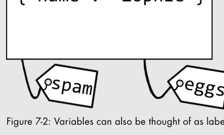

图 7-2：变量也可以被认为是对值的标签。

因为多个变量可以引用同一个对象，所以该对象可以被“存储”在多个变量中。多个盒子不能存储同一个对象，因此使用标签隐喻可能对你更容易。Ned Batchelder 的 PyCon 2015 演讲，“关于 Python 名称和值的事实与神话”对此主题有更多信息，网址为 https://youtu.be/_AEJHKgK9ns。

如果不理解 = 赋值运算符始终复制引用而不是对象，你可能会通过认为自己在制作对象的重复副本而引入错误，而实际上你是在复制对原始对象的引用。幸运的是，这对于不可变值如整数、字符串和元组来说不是问题，原因我将在第 114 页的“可变和不可变”中解释。

你可以使用 is 运算符比较两个对象是否具有相同的标识。相比之下，== 运算符只检查对象值是否相同。你可以将 x is y 视为 id(x) == id(y) 的简写。输入以下内容到交互式 shell 中以查看差异：

```
>>> spam = {'name': 'Zophie'}
>>> eggs = spam
>>> spam is eggs
True
>>> spam == eggs
True
>>> bacon = {'name': 'Zophie'}
>>> spam == bacon
True
>>> spam is bacon
False
```


变量 spam 和 eggs 引用同一个字典对象 ①，因此它们的身份和值相同。但 bacon 引用的是一个单独的字典对象 ②，尽管它包含的数据与 spam 和 eggs 相同。相同的数据意味着 bacon 的值与 spam 和 eggs 相同，但它们是两个不同的对象，具有两个不同的身份。

## 项

在 Python 中，位于容器对象（如列表或字典）内部的对象也称为项或元素。例如，列表 ['dog', 'cat', 'moose'] 中的字符串是对象，但也称为项。

## 可变与不可变

如前所述，Python 中的所有对象都有值、数据类型和身份，其中只有值可以改变。如果可以更改对象的值，则它是可变对象。如果不能更改其值，则它是不可变对象。表 7-2 列出了 Python 中的一些可变和不可变数据类型。

表 7-2：Python 中的一些可变和不可变数据类型

| 可变数据类型 | 不可变数据类型 |
|---|---|
| 列表 | 整数 |
| 字典 | 浮点数 |
| 集合 | 布尔值 |
| 字节数组 | 字符串 |
| 数组 | 冻结集合 |
|  | 字节 |
|  | 元组 |

当你覆盖一个变量时，看起来像是你在更改对象的值，如以下交互式 shell 示例所示：

```
>>> spam = 'hello'
>>> spam
'hello'
>>> spam = 'goodbye'
>>> spam
'goodbye'
```

但在这段代码中，你并没有将 'hello' 对象的值从 'hello' 改为 'goodbye'。它们是两个独立的对象。你只是让 spam 从引用 'hello' 对象切换到引用 'goodbye' 对象。你可以通过使用 id() 函数来显示这两个对象的身份来检查这一点是否正确：

```
>>> spam = 'hello'
>>> id(spam)
40718944
>>> spam = 'goodbye'
>>> id(spam)
40719224
```

这两个字符串对象具有不同的身份（40718944 和 40719224），因为它们是不同的对象。但引用可变对象的变量的值可以在原地修改。例如，将以下内容输入交互式 shell：

```
>>> spam = ['cat', 'dog']
>>> id(spam)
33805576
① >>> spam.append('moose')
② >>> spam[0] = 'snake'
>>> spam
['snake', 'dog', 'moose']
>>> id(spam)
33805576
```

append() 方法 ① 和通过索引进行项赋值 ② 都在原地修改列表的值。尽管列表的值已更改，其身份仍然相同（33805576）。但当你使用 + 运算符连接列表时，你会创建一个新对象（具有新的身份）来覆盖旧列表：

```
>>> spam = spam + ['rat']
>>> spam
['snake', 'dog', 'moose', 'rat']
>>> id(spam)
33840064
```

列表连接会创建一个具有新身份的新列表。此时，旧列表最终将被垃圾回收器从内存中释放。你需要查阅 Python 文档来了解哪些方法和操作在原地修改对象，哪些会覆盖对象。需要记住的一个好规则是，如果你在源代码中看到一个字面量，例如前一个示例中的 ['rat']，Python 很可能创建一个新对象。对对象调用的方法，例如 append()，通常会在原地修改对象。

对于整数、字符串或元组等不可变数据类型的对象，赋值更简单。例如，将以下内容输入交互式 shell：

```
>>> bacon = 'Goodbye'
>>> id(bacon)
33827584
① >>> bacon = 'Hello'
>>> id(bacon)
33863820
② >>> bacon = bacon + ', world!'
>>> bacon
'Hello, world!'
>>> id(bacon)
33870056
③ >>> bacon[0] = 'J'
Traceback (most recent call last):
  File "<stdin>", line 1, in <module>
TypeError: 'str' object does not support item assignment
```

字符串是不可变的，因此你无法更改其值。尽管看起来 bacon 中的字符串值正从 'Goodbye' 改为 'Hello' ①，实际上它是由具有新身份的新字符串对象覆盖的。同样，使用字符串连接的表达式会创建具有新身份的新字符串对象 ②。在 Python 中，使用项赋值尝试原地修改字符串是不允许的 ③。

元组的值由其包含的对象及其顺序定义。元组是不变序列对象，用括号括住值。这意味着元组中的项不能被覆盖：

```
>>> eggs = ('cat', 'dog', [2, 4, 6])
>>> id(eggs)
39560896
>>> id(eggs[2])
40654152
>>> eggs[2] = eggs[2] + [8, 10]
Traceback (most recent call last):
  File "<stdin>", line 1, in <module>
TypeError: 'tuple' object does not support item assignment
```

但不可变元组内部的可变列表仍然可以在原地修改：

```
>>> eggs[2].append(8)
>>> eggs[2].append(10)
>>> eggs
('cat', 'dog', [2, 4, 6, 8, 10])
>>> id(eggs)
39560896
>>> id(eggs[2])
40654152
```

尽管这是一个晦涩的特殊情况，但很重要，需要记住。如图 7-3 所示，元组仍然引用相同的对象。但如果元组包含一个可变对象并且该对象更改了其值——也就是说，如果对象发生变异——则元组的值也会改变。

我，以及几乎所有 Pythonista，都称元组为不可变。但某些元组是否可以称为可变，取决于你的定义。我在我的 PyCascades 2019 演讲 “The Amazing Mutable, Immutable Tuple” 中更深入地探讨了这个主题，网址为 https://invpy.com/amazingtuple/。你也可以阅读 Luciano Ramalho 在《Fluent Python》第 2 章中的解释。（O'Reilly Media, 2015）

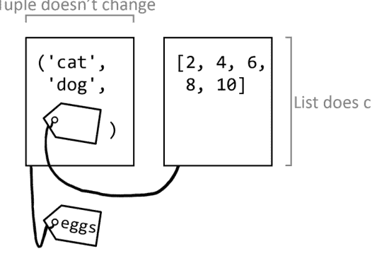

图 7-3：尽管元组中对象的集合是不可变的，但对象本身可以是可变的。

## 索引、键和哈希

Python 列表和字典是可以包含多个其他值的数值。要访问这些值，你使用索引运算符，它由一对方括号 ([ ]) 和一个称为索引的整数组成，以指定要访问哪个值。输入以下内容到交互式 shell 以查看列表的索引是如何工作的：

```
>>> spam = ['cat', 'dog', 'moose']
>>> spam[0]
'cat'
>>> spam[-2]
'dog'
```

在此示例中，0 是一个索引。第一个索引是 0，而不是 1，因为 Python（像大多数语言一样）使用零基索引。使用一基索引的语言很少见：Lua 和 R 是最主要的。Python 还支持负索引，其中 -1 指列表中的最后一项，-2 指倒数第二项，以此类推。你可以将负索引 spam[-n] 视为与 spam[len(spam) - n] 相同。

> 计算机科学家兼创作歌手 Stan Kelly-Bootle 曾开玩笑说，“Should array indices start at 0 or 1? My compromise of 0.5 was rejected without, I thought, proper consideration。”

你也可以对列表字面量使用索引运算符，尽管所有这些方括号在实际代码中看起来可能令人困惑且不必要：

```
>>> ['cat', 'dog', 'moose'][2]
'moose'
```

索引也可以用于列表之外的数值，例如对字符串进行索引以获取单个字符：

```
>>> 'Hello, world'[0]
'H'
```

Python 字典按键值对组织：

```
>>> spam = {'name': 'Zophie'}
>>> spam['name']
'Zophie'
```

尽管列表索引仅限于整数，Python 字典的索引运算符是键，可以是任何可哈希对象。哈希是一个整数，充当值的某种指纹。对象的哈希在其生命周期内永不改变，并且具有相同值的对象必须具有相同的哈希。在此实例中，字符串 'name' 是值 'Zophie' 的键。hash() 函数如果对象可哈希，将返回对象的哈希。不可变对象，例如字符串、整数、浮点数和元组，可以是可哈希的。列表（以及其他可变对象）不可哈希。输入以下内容到交互式 shell：

```
>>> hash('hello')
-1734230105925061914
>>> hash(42)
42
>>> hash(3.14)
322818021289917443
>>> hash((1, 2, 3))
2528502973977326415
>>> hash([1, 2, 3])
Traceback (most recent call last):
  File "<stdin>", line 1, in <module>
TypeError: 'list' object is unhashable
```

尽管细节超出了本书的范围，但键的哈希用于查找存储在字典和集合数据结构中的项。这就是为什么你不能使用可变列表作为字典的键：

```
>>> d = {}
>>> d[[1, 2, 3]] = 'some value'
Traceback (most recent call last):
  File "<stdin>", line 1, in <module>
TypeError: 'list' object is unhashable
```

哈希与身份不同。具有相同值的两个不同对象将具有不同的身份但相同的哈希。例如，输入以下内容到交互式 shell：

>>> a = ('cat', 'dog', 'moose')
>>> b = ('cat', 'dog', 'moose')
>>> id(a), id(b)


```python
>>> id(a), id(b)
(37111992, 37112136)
>>> id(a) == id(b)
False
>>> hash(a), hash(b)
(-3478972040190420094, -3478972040190420094)
>>> hash(a) == id(b)
True
```

a 和 b 引用的元组具有不同的身份 1，但它们的值相同意味着它们将具有相同的哈希值 2。请注意，元组只有在只包含可哈希项时才是可哈希的。因为字典中只能使用可哈希项作为键，所以不能使用包含不可哈希列表的元组作为键。输入以下内容到交互式 shell 中：

```python
>>> tuple1 = ('cat', 'dog')
>>> tuple2 = ('cat', ['apple', 'orange'])
>>> spam = {}
>>> spam[tuple1] = 'a value'
>>> spam[tuple2] = 'another value'
Traceback (most recent call last):
  File "<stdin>", line 1, in <module>
TypeError: unhashable type: 'list'
```

请注意 tuple1 是可哈希的 1，但 tuple2 包含一个不可哈希的列表 2，因此它也是不可哈希的。

## 容器、序列、映射和集合类型

container、sequence 和 mapping 这些词在 Python 中的含义不一定适用于其他编程语言。在 Python 中，容器是能够包含多个其他对象的任何数据类型的对象。列表和字典是 Python 中常用的容器类型。

序列是具有可通过整数索引访问的有序值的任何容器数据类型的对象。字符串、元组、列表和 bytes 对象是序列数据类型。这些类型对象可以使用索引运算符（[ 和 ] 括号）中的整数索引访问值，并且也可以传递给 len() 函数。通过“有序”，我们指的是序列中存在第一个值、第二个值，等等。例如，以下两个列表值不被视为相等，因为它们的值的顺序不同：

```python
>>> [1, 2, 3] == [3, 2, 1]
False
```

映射是使用键而不是索引的任何容器数据类型的对象。映射可以是有序的或无序的。Python 3.4 及更早版本的字典是无序的，因为字典中没有第一个或最后一个键值对：

```python
>>> spam = {'a': 1, 'b': 2, 'c': 3, 'd': 4}  # This is run from CPython 3.5.
>>> list(spam.keys())
['a', 'c', 'd', 'b']
>>> spam['e'] = 5
```

```python
>>> list(spam.keys())
['e', 'a', 'c', 'd', 'b']
```

在 Python 的早期版本中，你无法保证从字典中以一致的顺序获取项目。由于字典的无序特性，用不同的键值对顺序编写的两个字典字面量仍然被视为相等：

```python
>>> {'a': 1, 'b': 2, 'c': 3} == {'c': 3, 'a': 1, 'b': 2}
True
```

但从 CPython 3.6 开始，字典确实保留了其键值对的插入顺序：

```python
>>> spam = {'a': 1, 'b': 2, 'c': 3, 'd': 4}  # This is run from CPython 3.6.
>>> list(spam)
['a', 'b', 'c', 'd']
>>> spam['e'] = 5
>>> list(spam)
['a', 'b', 'c', 'd', 'e']
```

这是 CPython 3.6 解释器中的一个特性，但在 Python 3.6 的其他解释器中并不存在。所有 Python 3.7 解释器都支持有序字典，该特性在 Python 3.7 中成为语言标准。但仅仅因为字典是有序的并不意味着其项目可以通过整数索引访问：spam[0] 不会计算为有序字典中的第一个项目（除非碰巧第一个项目的键为 0）。如果有序字典包含相同的键值对，即使每个字典中的键值对顺序不同，也被视为相同。

collections 模块包含许多其他映射类型，包括 OrderedDict、ChainMap、Counter 和 UserDict，其在 https://docs.python.org/3/library/collections.html 的在线文档中有描述。

## 双下划线方法与魔术方法

Dunder 方法，也称为魔术方法，是 Python 中名称以两个下划线开头和结尾的特殊方法。这些方法用于运算符重载。Dunder 是 double underscore（双下划线）的缩写。最熟悉的 dunder 方法是 __init__()（读作“dunder init dunder”，或简单地读作“init”），它用于初始化对象。Python 有几十个 dunder 方法，第 17 章详细解释了它们。

## 模块与包

模块是其他 Python 程序可以导入以使用其代码的 Python 程序。随 Python 提供的模块统称为 Python 标准库，但你也可以创建自己的模块。如果你将 Python 程序保存为例如 spam.py，其他程序可以运行 import spam 来访问 spam.py 程序的函数、类和顶层变量。

包是通过在文件夹内放置一个名为 __init__.py 的文件而形成的模块集合。你使用文件夹的名称作为包的名称。包可以包含多个模块（即 .py 文件）或其它包（包含 __init__.py 文件的其他文件夹）。

有关模块和包的更多解释和细节，请查看官方 Python 文档 https://docs.python.org/3/tutorial/modules.html。

## 可调用对象与一等对象

函数和方法并不是 Python 中唯一可以调用的东西。任何实现了可调用运算符——两个括号 ()——的对象都是可调用对象。例如，如果你有一个 def hello(): 语句，你可以认为该代码是一个名为 hello 的变量，其中包含一个函数对象。对该变量使用可调用运算符会调用变量中的函数：hello()。

类是 OOP 概念，类是既不是函数也不是方法的可调用对象的示例。例如，datetime 模块中的 date 类使用可调用运算符调用，如代码 datetime.date(2020, 1, 1) 所示。当类对象被调用时，类中 __init__() 方法内的代码会被运行。第 15 章有关于类的更多细节。

函数在 Python 中是一等对象，这意味着你可以将它们存储在变量中、作为函数调用的参数传递、从函数调用中返回，并做任何你能对对象做的事。将 def 语句视为将函数对象分配给变量。例如，你可以创建一个 spam() 函数然后调用它：

```python
>>> def spam():
...     print('Spam! Spam! Spam!')
>>> spam()
Spam! Spam! Spam!
```

你也可以将 spam() 函数对象分配给其他变量。当你调用已分配函数对象的变量时，Python 会执行该函数：

```python
>>> eggs = spam
>>> eggs()
Spam! Spam! Spam!
```

这些被称为别名，它们是现有函数的不同名称。它们通常在需要重命名函数时使用。但大量现有代码使用旧名称，更改起来工作量太大。

一等函数最常见的用途是让你可以将函数传递给其他函数。例如，我们可以定义一个 callTwice() 函数，可以传递一个需要被调用两次的函数：

```python
>>> def callTwice(func):
...     func()
...     func()
...
>>> callTwice(spam)
Spam! Spam! Spam!
Spam! Spam! Spam!
```

你也可以在源代码中两次编写 spam()。但你可以将 callTwice() 函数在运行时传递给任何函数，而不必事先在源代码中两次输入函数调用。

## 容易混淆的术语

技术术语本身就足够令人困惑，尤其是那些相关但定义不同的术语。更糟糕的是，语言、操作系统和计算领域可能会使用不同的术语来表示相同的意思，或使用相同的术语来表示不同的意思。为了与其他程序员清晰地交流，你需要学习以下术语之间的区别。

### 语句 vs. 表达式

表达式是由运算符和值组成的指令，计算结果为单个值。值可以是变量（包含一个值）或函数调用（返回一个值）。因此，2 + 2 是一个表达式，计算结果为单个值 4。但 len(myName) > 4 和 myName.isupper() or myName == 'Zophie' 也是表达式。单独的值也是一个表达式，计算结果为其自身。

语句本质上是 Python 中的所有其他指令。这些包括 if 语句、for 语句、def 语句、return 语句，等等。语句不计算为值。一些语句可以包含表达式，例如赋值语句 spam = 2 + 2 或 if 语句 if myName == 'Zophie':。

尽管 Python 3 使用 print() 函数，Python 2 却有一个 print 语句。区别看起来可能只是引入了括号，但重要的是要注意 Python 3 的 print() 函数有一个返回值（始终为 None），可以作为参数传递给其他函数，并且可以分配给变量。语句都不可能进行这些操作。然而，你仍然可以在 Python 2 中使用括号，如以下交互式 shell 示例所示：

```python
>>> print 'Hello, world!' # run in Python 2
Hello, world!
>>> print('Hello, world!') # run in Python 2
Hello, world!
```


虽然这看起来像一个函数调用 ①，但它实际上是一个带有圆括号包裹的字符串值的打印语句，就像赋值 spam = (2 + 2) 等价于 spam = 2 + 2 一样。在 Python 2 和 3 中，你可以分别向 print 语句或 print() 函数传递多个值。在 Python 3 中，这看起来如下：

```
>>> print('Hello', 'world') # run in Python 3
Hello world
```

但是在 Python 2 中使用相同的代码会被解释为在打印语句中传递两个字符串值的元组，产生以下输出：

```
>>> print('Hello', 'world') # run in Python 2
('Hello', 'world')
```

语句和由函数调用组成的表达式存在细微但真实的差异。

## 块 vs. 子句 vs. 主体

术语 block、clause 和 body 常常可以互换使用，指代一组 Python 指令。块以缩进开始，并在缩进返回到之前的缩进级别时结束。例如，跟在 if 或 for 语句之后的代码被称为该语句的块。以冒号结尾的语句之后需要一个新块，例如 if、else、for、while、def、class 等。

但 Python 确实允许单行块。这是一种有效但不推荐的 Python 语法：

```
if name == 'Zophie': print('Hello, kitty!')
```

通过使用分号，你也可以在 if 语句的块中拥有多条指令：

```
if name == 'Zophie': print('Hello, kitty!'); print('Do you want a treat?')
```

但你不能对需要新块的其他语句使用单行形式。以下不是有效的 Python 代码：

```
if name == 'Zophie': if age < 2: print('Hello, kitten!')
```

if 语句是子句头，而嵌套在 if 中的两个 print() 调用是子句套件或主体。官方 Python 文档使用 block 来指代作为一个单元执行的 Python 代码片段，例如模块、函数或类定义 (https://docs.python.org/3/reference/executionmodel.html)。

## 变量 vs. 属性

变量只是引用对象的名称。属性是，引用官方文档的话，“any name following a dot” (https://docs.python.org/3/tutorial/classes.html#python-scopes-and-namespaces)。属性与对象关联（点号/句点前的名称）。例如，在交互式 shell 中输入以下内容：

```
>>> import datetime
>>> spam = datetime.datetime.now()
>>> spam.year
2018
>>> spam.month
1
```

在此代码示例中，spam 是一个变量，包含一个 datetime 对象（由 datetime.datetime.now() 返回），而 year 和 month 是该对象的属性。即使在 sys.exit() 这样的情况下，exit() 函数也被视为 sys 模块对象的属性。

其他语言将属性称为字段、属性或成员变量。

## 函数 vs. 方法

函数是一段在被调用时运行的代码。方法是一个与类关联的函数（或可调用对象，在下一节描述），就像属性是与对象关联的变量一样。函数包括内置函数或与模块关联的函数。例如，在交互式 shell 中输入以下内容：

```
>>> len('Hello')
5
>>> 'Hello'.upper()
'HELLO'
>>> import math
>>> math.sqrt(25)
5.0
```

在此示例中，len() 是一个函数，而 upper() 是字符串方法。方法也被视为与其关联的对象的属性。请注意，句点并不一定意味着你处理的是方法而不是函数。sqrt() 函数与 math 关联，而 math 是一个模块，而不是类。

## 可迭代对象 vs. 迭代器

Python 的 for 循环非常灵活。语句 for i in range(3): 将运行一段代码三次。range(3) 调用不仅仅是 Python 告诉 for 循环“重复执行某段代码三次”的方式。调用 range(3) 返回一个 range 对象，就像调用 list('cat') 返回一个 list 对象一样。这两种对象都是可迭代对象（或简称为可迭代）的例子。

你在 for 循环中使用可迭代对象。输入以下内容到交互式 shell 中，查看 for 循环如何遍历 range 对象和 list 对象：

```
>>> for i in range(3):
...   print(i) # body of the for loop
...
0
1
2
>>> for i in ['c', 'a', 't']:
...   print(i) # body of the for loop
...
c
a
t
```

可迭代对象还包括所有序列类型，例如 range、list、tuple 和字符串对象，但也包括一些容器对象，例如字典、集合和文件对象。

然而，在这些 for 循环示例中，幕后还有更多操作。在幕后，Python 为 for 循环调用内置的 iter() 和 next() 函数。当在 for 循环中使用时，可迭代对象会传递给内置的 iter() 函数，该函数返回迭代器对象。虽然可迭代对象包含项目，但迭代器对象会跟踪循环中下一个要使用的项目。在循环的每次迭代中，迭代器对象会传递给内置的 next() 函数以返回可迭代对象中的下一个项目。我们可以手动调用 iter() 和 next() 函数，以直接了解 for 循环的工作方式。输入以下内容到交互式 shell 中，以执行与之前循环示例相同的指令：

```
>>> iterableObj = range(3)
>>> iterableObj
range(0, 3)
>>> iteratorObj = iter(iterableObj)
>>> i = next(iteratorObj)
>>> print(i) # body of the for loop
0
>>> i = next(iteratorObj)
>>> print(i) # body of the for loop
1
>>> i = next(iteratorObj)
>>> print(i) # body of the for loop
2
>>> i = next(iteratorObj)
Traceback (most recent call last):
  File "<stdin>", line 1, in <module>
StopIteration
```

请注意，如果你在可迭代对象的最后一个项目已被返回后调用 next()，Python 会引发 StopIteration 异常 1。Python 的 for 循环会捕获此异常以知道何时停止循环，而不是用此错误消息导致程序崩溃。

迭代器只能遍历可迭代对象中的项目一次。这类似于你只能使用 open() 和 readlines() 读取文件内容一次，然后必须重新打开文件才能再次读取其内容。如果你想再次遍历可迭代对象，必须再次调用 iter() 以创建另一个迭代器对象。你可以创建任意数量的迭代器对象；每个对象都会独立跟踪其应返回的下一个项目。输入以下内容到交互式 shell 中，查看其工作原理：

```
>>> iterableObj = list('cat')
>>> iterableObj
['c', 'a', 't']
>>> iteratorObj1 = iter(iterableObj)
>>> iteratorObj2 = iter(iterableObj)
>>> next(iteratorObj1)
'c'
>>> next(iteratorObj1)
'a'
>>> next(iteratorObj2)
'c'
```

请记住，可迭代对象作为参数传递给 iter() 函数，而从 iter() 调用返回的对象是迭代器对象。迭代器对象传递给 next() 函数。当你使用类语句创建自己的数据类型时，可以实现 __iter__() 和 __next__() 特殊方法，以便在 for 循环中使用你的对象。

## 语法 vs. 运行时 vs. 语义错误

有许多方法可以对错误进行分类。但在高层次上，你可以将编程错误分为三种类型：语法错误、运行时错误和语义错误。

语法是给定编程语言中有效指令的规则集。语法错误，例如缺少括号、用句点代替逗号或其他拼写错误，会立即生成 SyntaxError。语法错误也称为解析错误，当 Python 解释器无法将源代码文本解析为有效指令时就会发生。在英语中，此错误相当于语法不正确或一串无意义的词，如“by uncontaminated cheese certainly it’s”。计算机需要特定的指令，无法读取程序员的思维来确定程序应做什么，因此带有语法错误的程序甚至无法运行。

运行时错误是指正在运行的程序未能执行某项任务，例如尝试打开不存在的文件或将数字除以零。在英语中，运行时错误相当于给出不可能的指令，如“画一个有三条边的正方形”。如果未处理运行时错误，程序将崩溃并显示追踪信息。但你可以使用 try-except 语句捕获运行时错误并运行错误处理代码。例如，在交互式 shell 中输入以下内容：

```
>>> slices = 8
>>> eaters = 0
>>> print('Each person eats', slices / eaters, 'slices.')
```

运行此代码时会显示以下追踪信息：

```
Traceback (most recent call last):
  File "<pyshell#4>", line 1, in <module>
    print('Each person eats', slices / eaters, 'slices.')
ZeroDivisionError: division by zero
```

请记住，追踪信息中提到的行号只是 Python 解释器检测到错误的位置。错误的真正原因可能在前一行代码，甚至可能在程序更早的地方。

源代码中的语法错误在程序运行前会被解释器捕获，但语法错误也可能在运行时发生。eval() 函数可以接受一段 Python 代码字符串并运行它，这可能在运行时产生 SyntaxError。例如，eval('print("Hello, world)') 缺少一个闭合的双引号，程序直到调用 eval() 时才会遇到它。

语义错误（也称为逻辑错误）是一种更微妙的错误。语义错误不会导致错误消息或崩溃，但计算机以程序员未打算的方式执行指令。在英语中，语义错误的等价物是告诉计算机：“去商店买一盒牛奶，如果他们有鸡蛋，就买一打。”计算机随后会买 13 盒牛奶，因为商店有鸡蛋。好也罢坏也罢，计算机完全按照你的指示执行。例如，在交互式 shell 中输入以下内容：

```
>>> print('The sum of 4 and 2 is', '4' + '2')
```

你会得到以下输出：

```
The sum of 4 and 2 is 42
```

显然，42 不是答案。但请注意程序没有崩溃。因为 Python 的 + 运算符会相加整数值并连接字符串值，错误地使用字符串值 '4' 和 '2' 而不是整数导致了非预期的行为。


## 参数 vs. 实参

参数是 def 语句中括号内的变量名。实参是在函数调用中传递的值，然后被赋给参数。例如，在交互式 shell 中输入以下内容：

```
>>> def greeting(name, species):
...     print(name + ' is a ' + species)
...
>>> greeting('Zophie', 'cat')
Zophie is a cat
```

在 def 语句中，name 和 species 是参数 1。在函数调用中，'Zophie' 和 'cat' 是实参 2。这两个术语经常被混淆。请记住，在此上下文中，参数和实参分别只是变量和值的另一种叫法。

## 类型强制转换 vs. 类型转换

你可以将一种类型的对象转换为另一种类型的对象。例如，int('42') 将字符串 '42' 转换为整数 42。实际上，字符串对象 '42' 并没有被转换，int() 函数更多是基于原始对象创建了一个新的整数对象。当像这样显式进行转换时，我们称之为对对象进行类型转换，尽管程序员通常仍将此过程称为转换对象。

Python 通常会隐式进行类型转换，例如在计算表达式 2 + 3.0 得到 5.0 时。值，例如 2 和 3.0，会被强制转换为运算符可以处理的一种通用数据类型。这种隐式进行的转换称为类型强制转换。

强制转换有时会导致令人惊讶的结果。Python 中的布尔值 True 和 False 分别可以被强制转换为整数值 1 和 0。尽管在实际代码中你永远不会将布尔值写成这些值，这意味着表达式 True + False + True 等价于 1 + 0 + 1 并求值为 2。了解这一点后，你可能会认为将布尔值列表传递给 sum() 是统计列表中 True 值数量的好方法。但事实证明，调用列表方法 count() 更快。

## 属性 vs. 属性

在许多语言中，property 和 attribute 这两个术语被同义使用，但在 Python 中这两个词有不同的含义。属性，如“变量 vs. 属性”第 124 页所述，是与对象关联的名称。属性包括对象的成员变量和方法。

其他语言，如 Java，为类提供了 getter 和 setter 方法。不是直接为属性赋一个（可能无效的）值，程序必须调用该属性的 setter 方法。

setter 方法内部的代码可以确保成员变量只被赋予有效值。getter 方法读取属性的值。如果一个属性名为 accountBalance，那么 setter 和 getter 方法通常分别命名为 setAccountBalance() 和 getAccountBalance()。

在 Python 中，属性允许程序员以更简洁的语法使用 getter 和 setter。第 17 章更详细地探讨了 Python 属性。

## 字节码 vs. 机器码

源代码被编译成称为机器码的指令形式，CPU 直接执行这些指令。机器码由 CPU 的指令集组成，即计算机内置的命令集。由机器码组成的编译程序称为二进制文件。像 C 这样久负盛名的语言有编译器软件，可以将 C 源代码编译为几乎所有可用 CPU 的二进制文件。但如果像 Python 这样的语言想在同一组 CPU 上运行，就需要投入大量工作为每个 CPU 编写 Python 编译器。

将源代码转换为机器可用的代码还有另一种方法。不是创建由 CPU 硬件直接执行的机器码，你可以创建字节码。也称为可移植代码或 p-code，字节码是由软件解释器程序执行，而不是直接由 CPU 执行。Python 字节码由指令集组成，尽管没有任何真实硬件 CPU 执行这些指令。相反，软件解释器执行字节码。Python 字节码存储在你有时会在 .py 源文件旁边看到的 .pyc 文件中。用 C 编写的 CPython 解释器可以将 Python 源代码编译为 Python 字节码，然后执行指令。（Java 虚拟机 [JVM] 软件也是如此，它执行 Java 字节码。）因为它是用 C 编写的，CPython 有一个 Python 解释器，并且可以为 C 已有编译器的任何 CPU 编译。

Scott Sanderson 和 Joe Jevnik 在 PyCon 2016 上发表的演讲“玩转 Python 字节码” 是了解此主题的绝佳资源 (https://youtu.be/mxju9KqzwjI)。

## 脚本 vs. 程序，脚本语言 vs. 编程语言

脚本与程序之间的区别，甚至脚本语言与编程语言之间的区别，都是模糊且任意的。可以说所有脚本都是程序，所有脚本语言都是编程语言。但脚本语言有时被认为更容易或“不是真正的”编程语言。

区分脚本和程序的一种方法是代码的执行方式。用脚本语言编写的脚本直接从源代码解释执行，而用编程语言编写的程序则编译为二进制文件。但 Python 通常被认为是一种脚本语言，即使在运行 Python 程序时存在编译为字节码的步骤。与此同时，Java 通常不被认为是一种脚本语言，即使它像 Python 一样生成字节码而不是机器码二进制文件。从技术上讲，*语言* 本身不是被编译或解释的；相反，存在语言的编译器或解释器 *实现*，并且可以为任何语言创建编译器或解释器。

这些区别可以争论，但最终并不很重要。脚本语言不一定功能较弱，编译型编程语言也不一定更难使用。

## 库 vs. 框架 vs. SDK vs. 引擎 vs. API

使用他人的代码可以大大节省时间。你经常可以找到打包成库、框架、SDK、引擎或 API 的代码供使用。这些实体之间的区别很微妙但很重要。

一个 *库* 是第三方制作的代码集合的通用术语。库可以包含函数、类或其他供开发者使用的代码片段。Python 库可能采用包、一组包，甚至只是单个模块的形式。库通常特定于某种语言。开发者不需要知道库代码的工作原理；他们只需要知道如何调用或与库中的代码接口。一个 *标准库*，例如 Python 标准库，是被假定对所有编程语言实现都可用的代码库。

一个 *框架* 是一组采用 *控制反转* 运行的代码；开发者创建框架按需调用的函数，而不是开发者的代码调用框架中的函数。控制反转通常被描述为“不要调用我们，我们会调用你”。例如，为 Web 应用框架编写代码涉及创建框架在收到 Web 请求时调用的网页函数。

一个 *软件开发工具包* (*SDK*) 包括代码库、文档和软件工具，用于帮助为特定操作系统或平台创建应用程序。例如，Android SDK 和 iOS SDK 分别用于创建 Android 和 iOS 的移动应用。Java 开发工具包 (JDK) 是用于为 JVM 创建应用程序的 SDK。

一个 *引擎* 是一个大型、自包含的系统，可以由开发者的软件外部控制。开发者通常调用引擎中的函数来执行大型、复杂的任务。引擎的例子包括游戏引擎、物理引擎、推荐引擎、数据库引擎、国际象棋引擎和搜索引擎。

一个 *应用程序编程接口* (*API*) 是库、SDK、框架或引擎的公开接口。API 指定如何调用库的函数或请求以访问资源。库创建者（希望）会提供 API 的文档。许多流行的社交网络和网站提供 HTTP API，供程序访问其服务，而不是由使用 Web 浏览器的用户访问。使用这些 API 可以让你编写程序，例如自动在 Facebook 上发帖或读取 Twitter 时间线。


## 摘要

编程多年仍然对某些编程术语感到陌生是很常见的。但大多数大型软件应用程序都是由软件开发团队而不是个人创建的。因此，在团队中工作时，能够无歧义地沟通非常重要。

本章解释了 Python 程序由标识符、变量、字面量、关键字和对象组成，并且所有 Python 对象都有值、数据类型和身份。尽管每个对象都有数据类型，但也存在几种宽泛的类型类别，例如容器、序列、映射、集合、内置和用户定义。

在特定上下文中，一些术语，如值、变量和函数，有不同的名称，例如项、参数、实参和方法。

还有一些术语也很容易混淆。在日常编程中混淆其中一些术语并不是什么大问题：例如 property 与 attribute，block 与 body，exception 与 error，或 library、framework、SDK、engine 和 API 之间的细微差别。其他误解不会使你编写的代码出错，但可能会让你显得不专业：例如，初学者常将 statement 和 expression，function 和 method，以及 parameter 和 argument 互换使用。

但其他术语，如 iterable 与 iterator，syntax error 与 semantic error，以及 bytecode 与 machine code，具有截然不同的含义，除非你想让同事困惑，否则绝不应混淆它们。

你仍然会发现术语的使用因语言而异，甚至因程序员而异。随着经验的积累（以及频繁的网络搜索），你会逐渐更熟悉这些行话。

## 延伸阅读

官方 Python 术语表 https://docs.python.org/3/glossary.html 列出了 Python 生态系统使用的简短但有用的定义。官方 Python 文档 https://docs.python.org/3/reference/datamodel.html 更详细地描述了 Python 对象。

Nina Zakharenko 在 PyCon 2016 的演讲 “Memory Management in Python—The Basics”，网址 https://youtu.be/F6u5rhUQ6dU，解释了 Python 垃圾回收器工作原理的许多细节。官方 Python 文档 https://docs.python.org/3/library/gc.html 有关垃圾回收器的更多信息。

关于在 Python 3.6 中使字典有序的 Python 邮件列表讨论也值得一读，网址为 https://mail.python.org/pipermail/python-dev/2016-September/146327.html。

### 8

### 常见的 Python 陷阱


虽然 Python 是我最喜欢的编程语言，但它并非没有缺陷。每种语言都有瑕疵（有些比其他语言更多），Python 也不例外。新的 Python 程序员必须学会避免一些常见的“陷阱”。程序员通常通过经验随机学习这类知识，但本章将其集中在一处。了解这些陷阱背后的编程知识可以帮助你理解为什么 Python 有时表现得很奇怪。

本章解释了可变对象，如列表和字典，在修改其内容时如何表现出意外的行为。你将学习 sort() 方法如何不按完全的字母顺序排序项目，以及浮点数如何产生舍入误差。不等运算符 != 在链式使用时有异常行为。当你编写包含单个项目的元组时，必须使用尾随逗号。本章介绍了如何避免这些常见陷阱。

## 在循环遍历列表时不要添加或删除项目

使用 for 或 while 循环在遍历列表（即迭代）时添加或删除列表中的项目很可能会导致错误。考虑以下场景：你想遍历一个描述衣物项目的字符串列表，并通过在列表中每次找到袜子时插入一双匹配的袜子来确保袜子数量为偶数。这个任务看起来很简单：遍历列表中的字符串，当在字符串中找到 'sock'，例如 'red sock' 时，将另一个 'red sock' 字符串追加到列表中。

但这段代码无法正常工作。它会被困在无限循环中，你必须按 CTRL-C 来中断它：

```
>>> clothes = ['skirt', 'red sock']
>>> for clothing in clothes:  # Iterate over the list.
...     if 'sock' in clothing:  # Find strings with 'sock'.
...         clothes.append(clothing)  # Add the sock's pair.
...         print('Added a sock:', clothing)  # Inform the user.
...
Added a sock: red sock
Added a sock: red sock
Added a sock: red sock
--snip--
Added a sock: red sock
Traceback (most recent call last):
    File "<stdin>", line 3, in <module>
KeyboardInterrupt
```

你可以在 https://autor.com/addingloop/ 找到此代码执行的视觉化。

问题在于，当你将 'red sock' 追加到 clothes 列表时，列表现在有一个新的第三项需要遍历：['skirt', 'red sock', 'red sock']。for 循环在下一次迭代时到达第二个 'red sock'，因此它会追加另一个 'red sock' 字符串。这使得列表变为 ['skirt', 'red sock', 'red sock', 'red sock']，为 Python 遍历提供了另一个字符串。如图 8-1 所示，这将持续发生，这就是为什么我们会看到永无止境的 'Added a sock.' 消息。循环要么在计算机内存耗尽并导致 Python 程序崩溃时停止，要么在你按 CTRL-C 中断时停止。

```
clothing
↓
['skirt', 'red sock']

clothing
↓
['skirt', 'red sock']

clothing
↓
['skirt', 'red sock', 'red sock']

clothing
↓
['skirt', 'red sock', 'red sock']

clothing
↓
['skirt', 'red sock', 'red sock', 'red sock']

clothing
↓
['skirt', 'red sock', 'red sock', 'red sock']

clothing
↓
['skirt', 'red sock', 'red sock', 'red sock', 'red sock']

:
```

图 8-1：在 for 循环的每次迭代中，都会向列表追加一个新的 'red sock'，clothing 在下一次迭代中引用它。这个循环会永远重复。

结论是不要在遍历列表时向列表添加项目。相反，使用一个单独的列表来存放新的、修改后的列表内容，例如本示例中的 newClothes：

```
>>> clothes = ['skirt', 'red sock', 'blue sock']
>>> newClothes = []
>>> for clothing in clothes:
...     if 'sock' in clothing:
...         print('Appending:', clothing)
...         newClothes.append(clothing)  # We change the newClothes list, not clothes.
...
Appending: red sock
Appending: blue sock
>>> print(newClothes)
['red sock', 'blue sock']
>>> clothes.extend(newClothes)  # Appends the items in newClothes to clothes.
>>> print(clothes)
['skirt', 'red sock', 'blue sock', 'red sock', 'blue sock']
```

你可以在 https://autor.com/addingloopfixed/ 找到此代码执行的视觉化。

我们的 for 循环遍历了 clothes 列表中的项目，但在循环内部并未修改 clothes。相反，它修改了一个单独的列表 newClothes。然后，在循环结束后，我们通过用 newClothes 的内容扩展它来修改 clothes。现在你有一个带有配对袜子的 clothes 列表。

同样，你也不应在遍历列表时从列表中删除项目。考虑以下代码，我们希望从列表中删除任何不是 'hello' 的字符串。简单的做法是遍历列表，删除与 'hello' 不匹配的项目：

```
>>> greetings = ['hello', 'hello', 'mello', 'yello', 'hello']
>>> for i, word in enumerate(greetings):
...     if word != 'hello':  # Remove everything that isn't 'hello'.
...         del greetings[i]
...
>>> print(greetings)
['hello', 'hello', 'yello', 'hello']
```

你可以在 https://autor.com/deletingloop/ 找到此代码执行的视觉化。

似乎 'yello' 留在了列表中。原因是在 for 循环检查索引 2 时，它从列表中删除了 'mello'。但这将列表中所有剩余项目向下移动了一个索引，使 'yello' 从索引 3 移到索引 2。循环的下一次迭代检查索引 3，而此时索引 3 是最后一个 'hello'，如图 8-2 所示。'yello' 字符串未经检查就溜过去了！不要在遍历列表时从列表中删除项目。

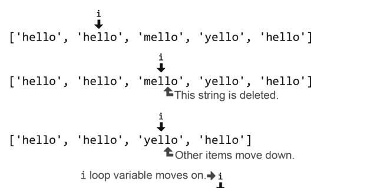

图 8-2：当循环删除 'mello' 时，列表中的项目向下移动一个索引，导致 i 跳过 'yello'。

相反，创建一个新列表，复制所有项目（除了你想删除的项目），然后替换原始列表。对于前一个示例的无错误等价物，将以下代码输入到交互式 shell 中。


```
>>> greetings = ['hello', 'hello', 'mello', 'yello', 'hello']
>>> newGreetings = []
>>> for word in greetings:
...     if word == 'hello':  # Copy everything that is 'hello'.
...         newGreetings.append(word)
...
>>> greetings = newGreetings  # Replace the original list.
>>> print(greetings)
['hello', 'hello', 'hello']
```

此代码执行的可视化位于 https://autobox.com/deletingloopfixed/。

请记住，因为这段代码只是一个创建列表的简单循环，你可以用列表推导式来替换它。列表推导式运行速度不会更快，也不会使用更少的内存，但输入更简短，同时不会损失太多可读性。将以下内容输入到交互式 shell 中，它等价于前一个示例中的代码：

```
>>> greetings = ['hello', 'hello', 'mello', 'yello', 'hello']
>>> greetings = [word for word in greetings if word == 'hello']
>>> print(greetings)
['hello', 'hello', 'hello']
```

列表推导式不仅更简洁，还避免了在迭代时修改列表时出现的陷阱。

## 参考、内存使用与 SYS.GETSIZEOF()

看起来创建新列表而不是修改原列表会浪费内存。但请记住，就像变量在技术上包含对值的引用而不是实际值一样，列表也包含对值的引用。前面显示的 newGreetings.append(word) 行并不是复制 word 变量中的字符串，只是复制了对字符串的引用，而引用要小得多。

你可以通过使用 sys.getsizeof() 函数来看到这一点，该函数返回传递给它的对象在内存中占用的字节数。在此交互式 shell 示例中，我们可以看到短字符串 'cat' 占用 52 字节，而更长的字符串占用 85 字节：

```
>>> import sys
>>> sys.getsizeof('cat')
52
>>> sys.getsizeof('a much longer string than just "cat"')
85
```

（在我使用的 Python 版本中，字符串对象的开销占用 49 字节，而字符串中的每个实际字符占用 1 字节。）但包含其中任一字符串的列表占用 72 字节，无论字符串有多长：

```
>>> sys.getsizeof(['cat'])
72
>>> sys.getsizeof(['a much longer string than just "cat"'])
72
```

原因在于列表在技术上并不包含字符串，而是只包含对字符串的引用，而引用的大小与所引用数据的大小无关。像 newGreetings.append(word) 这样的代码并不是复制 word 中的字符串，而是复制对字符串的引用。如果你想知道一个对象以及它所引用的所有对象占用多少内存，Python 核心开发者 Raymond Hettinger 为此编写了一个函数，你可以在 https://code.activestate.com/recipes/577504-compute-memory-footprint-of-an-object-and-its-cont/ 访问。

因此，你不必觉得通过创建新列表而不是在迭代时修改原列表而浪费内存。即使你的修改列表的代码似乎有效，它也可能是导致难以发现和修复的微妙错误的原因。浪费程序员的时间比浪费计算机内存昂贵得多。

虽然你不应该在迭代时从列表（或任何可迭代对象）中添加或删除项目，但修改列表的内容是可以的。例如，假设我们有一个字符串形式的数字列表：['1', '2', '3', '4', '5']。我们可以在迭代列表的同时将这个字符串列表转换为整数列表 [1, 2, 3, 4, 5]：

```
>>> numbers = ['1', '2', '3', '4', '5']
>>> for i, number in enumerate(numbers):
...     numbers[i] = int(number)
...
>>> numbers
[1, 2, 3, 4, 5]
```

此代码执行的可视化位于 https://autobox.com/convertstringnumbers。修改列表中的项目是可以的；改变列表中的项目数量才是容易出错的。

另一种安全地在列表中添加或删除项目的方法是从列表末尾向开头反向迭代。这样，你可以在迭代时从列表中删除项目，或者只要将项目添加到列表末尾就可以向列表中添加项目。例如，输入以下代码，它会从 someInts 列表中删除偶数整数。

```
>>> someInts = [1, 7, 4, 5]
>>> for i in range(len(someInts)):
...     if someInts[i] % 2 == 0:
...         del someInts[i]
...
Traceback (most recent call last):
    File "<stdin>", line 2, in <module>
IndexError: list index out of range
>>> someInts = [1, 7, 4, 5]
>>> for i in range(len(someInts) - 1, -1, -1):
...     if someInts[i] % 2 == 0:
...         del someInts[i]
...
>>> someInts
[1, 7, 5]
```

此代码之所以有效，是因为循环未来将迭代的项目索引永远不会改变。但删除值后值重复上移使得这种技术对于长列表效率低下。此代码执行的可视化位于 https://autobox.com/iteratebackwards1。你可以在图 8-3 中看到向前迭代和向后迭代的差异。

### 向前迭代

### 向后迭代

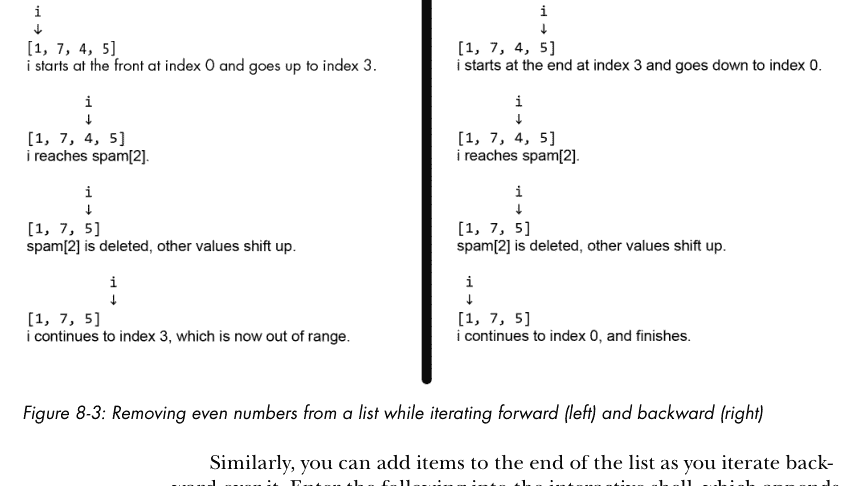

图 8-3：迭代时向前（左）和向后（右）从列表中删除偶数

同样，你也可以在反向迭代列表时向列表末尾添加项目。将以下内容输入到交互式 shell 中，它会将 someInts 列表中的任何偶数整数的副本追加到列表末尾：

```
>>> someInts = [1, 7, 4, 5]
>>> for i in range(len(someInts) - 1, -1, -1):
...     if someInts[i] % 2 == 0:
...         someInts.append(someInts[i])
...
>>> someInts
[1, 7, 4, 5, 4]
```

此代码执行的可视化位于 https://autobox.com/iteratebackwards2。通过反向迭代，我们可以向列表追加项目或从列表中删除项目。但这样做正确起来可能很棘手，因为对这种基本技术的细微改动可能会引入错误。创建新列表而不是修改原列表要简单得多。正如 Python 核心开发者 Raymond Hettinger 所说：

Q. 修改列表时在循环中进行的最佳实践是什么？
A. 不要。

## 不要在没有 copy.copy() 和 copy.deepcopy() 的情况下复制可变值

最好将变量视为引用对象的标签或名牌，而不是包含对象的盒子。这种心智模型在修改可变对象时尤其有用：可变对象是指值可以突变（即改变）的对象，例如列表、字典和集合。常见的陷阱是复制引用可变对象的变量到另一个变量，并认为实际对象被复制了。在 Python 中，赋值语句永远不会复制对象；它们只复制对对象的引用。（Python 开发者 Ned Batchelder 有一个关于这个想法的精彩 PyCon 2015 演讲，标题为“Facts and Myths about Python Names and Values”。在 https://youtu.be/_AEJHKgK9ns 观看。）

例如，将以下代码输入到交互式 shell 中，注意即使我们只更改 spam 变量，cheese 变量也会发生变化：

```
>>> spam = ['cat', 'dog', 'eel']
>>> cheese = spam
>>> spam
['cat', 'dog', 'eel']
>>> cheese
['cat', 'dog', 'eel']
>>> spam[2] = 'MOOSE'
>>> spam
['cat', 'dog', 'MOOSE']
>>> cheese
['cat', 'dog', 'MOOSE']
>>> id(cheese), id(spam)
2356896337288, 2356896337288
```

此代码执行的可视化位于 https://autobox.com/listcopygotcha1。如果你认为 cheese = spam 复制了列表对象，你可能会惊讶于 cheese 似乎发生了变化，即使我们只修改了 spam。但赋值语句永远不会复制对象，只会复制对对象的引用。赋值语句 cheese = spam 使 cheese 引用计算机内存中与 spam 相同的列表对象。它不会复制列表对象。这就是为什么更改 spam 也会更改 cheese：两个变量引用同一个列表对象。

同样的原则也适用于传递给函数调用的可变对象。将以下内容输入到交互式 shell 中，注意全局变量 spam 和局部参数（记住，参数是在函数的 def 语句中定义的变量）theList 都引用同一个对象：

```
>>> def printIdOfParam(theList):
...     print(id(theList))
...
>>> eggs = ['cat', 'dog', 'eel']
>>> print(id(eggs))
2356893256136
>>> printIdOfParam(eggs)
2356893256136
```

此代码执行的可视化位于 https://autobox.com/listcopygotcha2。请注意，eggs 和 theList 返回的 id() 标识相同，这意味着这些变量引用同一个列表对象。eggs 变量的列表对象并未复制到 theList；复制的是引用，这就是为什么两个变量引用同一个列表。引用只有几个字节大小，但想象一下如果 Python 复制整个列表而不是只复制引用。如果 eggs 包含十亿个项目而不是仅仅三个，将其传递给 printIdOfParam() 函数就需要复制这个巨大的列表。这只是一个简单的函数调用就会消耗数 GB 的内存！这就是为什么 Python 赋值只复制引用，从不复制对象。

防止这种陷阱的一种方法是使用 copy.copy() 函数制作列表对象的副本（而不是仅仅引用）。将以下内容输入到交互式 shell 中：

```
>>> import copy
>>> bacon = [2, 4, 8, 16]
>>> ham = copy.copy(bacon)
>>> id(bacon), id(ham)
(2356896337352, 2356896337480)
>>> bacon[0] = 'CHANGED'
>>> bacon
['CHANGED', 4, 8, 16]
>>> ham
[2, 4, 8, 16]
>>> id(bacon), id(ham)
(2356896337352, 2356896337480)
```

此代码执行的可视化位于 https://autobox.com/copycopy1。ham 变量引用的是复制的列表对象，而不是 bacon 引用的原始列表对象，因此它不会受到这种陷阱的影响。

但正如变量更像是标签或名牌而不是包含对象的盒子一样，列表也包含引用对象的标签或名牌

而不是实际对象。如果你的列表包含其他列表，copy.copy() 仅复制这些内部列表的引用。将以下内容输入到交互式 shell 以查看此问题：

```
>>> import copy
>>> bacon = [[1, 2], [3, 4]]
>>> ham = copy.copy(bacon)
>>> id(bacon), id(ham)
(2356896466248, 2356896375368)
>>> bacon.append('APPENDED')
>>> bacon
[[1, 2], [3, 4], 'APPENDED']
>>> ham
[[1, 2], [3, 4]]
>>> bacon[0][0] = 'CHANGED'
>>> bacon
[['CHANGED', 2], [3, 4], 'APPENDED']
>>> ham
[['CHANGED', 2], [3, 4]]
>>> id(bacon[0]), id(ham[0])
(2356896337480, 2356896337480)
```

此代码执行的视觉化位于 https://author.com/copycopy2。虽然 bacon 和 ham 是两个不同的列表对象，但它们引用相同的 [1, 2] 和 [3, 4] 内部列表，因此对这些内部列表的更改会在两个变量中都得到反映，即使我们使用了 copy.copy()。解决方案是使用 copy.deepcopy()，它会复制被复制列表对象内部的任何列表对象（以及这些列表对象中的列表对象，等等）。将以下内容输入到交互式 shell：

```
>>> import copy
>>> bacon = [[1, 2], [3, 4]]
>>> ham = copy.deepcopy(bacon)
>>> id(bacon[0]), id(ham[0])
(2356896337352, 2356896466184)
>>> bacon[0][0] = 'CHANGED'
>>> bacon
[['CHANGED', 2], [3, 4]]
>>> ham
[[1, 2], [3, 4]]
```

此代码执行的视觉化位于 https://author.com/copydeepcopy。虽然 copy.deepcopy() 比 copy.copy() 稍慢，但如果不确定被复制的列表是否包含其他列表（或其他可变对象，如字典或集合），使用它更安全。我的一般建议是始终使用 copy.deepcopy()：它可能会防止微妙的错误，而代码中的减速可能不会被注意到。

## 不要为默认参数使用可变值

Python 允许你在定义的函数中为参数设置默认参数。如果用户没有显式设置参数，函数将使用默认参数执行。当对函数的多数调用使用相同的参数时，这很有用，因为默认参数使参数成为可选的。例如，为 split() 方法传递 None 会使其按空白字符分割，但 None 也是默认参数：调用 'cat dog'.split() 与调用 'cat dog'.split(None) 做的事情相同。函数使用参数的默认参数，除非调用者传入一个。

但你永远不应将可变对象，例如列表或字典，作为默认参数设置。要了解这如何导致错误，请查看以下示例，其中定义了一个 addIngredient() 函数，该函数将成分字符串添加到代表三明治的列表中。因为该列表的第一个和最后一个项通常是 'bread'，所以可变列表 ['bread', 'bread'] 被用作默认参数：

```
>>> def addIngredient(ingredient, sandwich=['bread', 'bread']):
...     sandwich.insert(1, ingredient)
...     return sandwich
...
>>> mySandwich = addIngredient('avocado')
>>> mySandwich
['bread', 'avocado', 'bread']
```

但将可变对象，例如像 ['bread', 'bread'] 这样的列表，用于默认参数存在一个微妙的问题：列表是在函数的 def 语句执行时创建的，而不是每次调用函数时创建。这意味着只有一个 ['bread', 'bread'] 列表对象被创建，因为我们只定义 addIngredient() 函数一次。但对 addIngredient() 的每次函数调用都会重用此列表。这会导致意外的行为，如下所示：

```
>>> mySandwich = addIngredient('avocado')
>>> mySandwich
['bread', 'avocado', 'bread']
>>> anotherSandwich = addIngredient('lettuce')
>>> anotherSandwich
['bread', 'lettuce', 'avocado', 'bread']
```

因为 addIngredient('lettuce') 最终使用与之前调用相同的默认参数列表，而该列表中已经添加了 'avocado'，所以函数返回 ['bread', 'lettuce', 'avocado', 'bread'] 而不是 ['bread', 'lettuce', 'bread']。'avocado' 字符串再次出现，因为 sandwich 参数的列表与上一次函数调用相同。只有一个 ['bread', 'bread'] 列表被创建，因为函数的 def 语句只执行一次，而不是每次调用函数时执行。此代码执行的视觉化位于 https://author.com/sandwich。

如果你需要在默认参数中使用列表或字典，Pythonic 的解决方案是将默认参数设置为 None。然后编写代码来检查这一点，并在每次调用函数时提供新的列表或字典。这确保函数在每次调用时创建新的可变对象，而不是仅在函数定义时创建一次，如以下示例所示：

```
>>> def addIngredient(ingredient, sandwich=None):
...     if sandwich is None:
...         sandwich = ['bread', 'bread']
...     sandwich.insert(1, ingredient)
...     return sandwich
...
>>> firstSandwich = addIngredient('cranberries')
>>> firstSandwich
['bread', 'cranberries', 'bread']
>>> secondSandwich = addIngredient('lettuce')
>>> secondSandwich
['bread', 'lettuce', 'bread']
>>> id(firstSandwich) == id(secondSandwich)
False
```

请注意 firstSandwich 和 secondSandwich 不共享相同的列表引用 ①，因为 sandwich = ['bread', 'bread'] 在每次调用 addIngredient() 时都会创建一个新的列表对象，而不仅仅是在定义 addIngredient() 时创建一次。

可变数据类型包括列表、字典、集合以及由 class 语句创建的对象。不要在 def 语句中将这些类型对象作为默认参数放置。

## 不要使用字符串拼接构建字符串

在 Python 中，字符串是不可变对象。这意味着字符串值不能更改，任何看起来修改字符串的代码实际上都是创建了一个新的字符串对象。例如，以下每个操作都会更改 spam 变量的内容，而不是通过更改字符串值，而是通过用具有新标识的新字符串值替换它：

```
>>> spam = 'Hello'
>>> id(spam), spam
(38330864, 'Hello')
>>> spam = spam + ' world!'
>>> id(spam), spam
(38329712, 'Hello world!')
>>> spam = spam.upper()
>>> id(spam), spam
(38329648, 'HELLO WORLD!')
>>> spam = 'Hi'
>>> id(spam), spam
(38395568, 'Hi')
>>> spam = f'{spam} world!'
>>> id(spam), spam
(38330864, 'Hi world!')
```

请注意，每次调用 id(spam) 都会返回不同的标识，因为 spam 中的字符串对象没有被更改：它被完全新的具有不同标识的字符串对象替换。使用 f-string、format() 字符串方法或 %s 格式说明符创建新字符串也会创建新的字符串对象，就像字符串拼接一样。通常，这个技术细节并不重要。Python 是一种高级语言，会为你处理这些细节中的许多内容，以便你可以专注于创建程序。

但通过大量字符串拼接构建字符串可能会减慢你的程序。循环的每次迭代都会创建一个新的字符串对象并丢弃旧的字符串对象：在代码中，这看起来像是 for 或 while 循环内部的拼接，如下所示：

```python
>>> finalString = ''
>>> for i in range(100000):
...     finalString += 'spam '
...
>>> finalString
spam spam spam spam spam spam spam spam spam spam spam spam --snip--
```

因为 finalString += 'spam ' 在循环内部发生了 100,000 次，Python 正在执行 100,000 次字符串拼接。CPU 必须通过将当前的 finalString 与 'spam ' 拼接来创建这些中间字符串值，将它们放入内存，然后在下一轮迭代时几乎立即丢弃它们。这浪费了很多精力，因为我们只关心最终的字符串。

构建字符串的 Pythonic 方法是将较小的字符串追加到列表中，然后将列表连接成一个字符串。这种方法仍然创建 100,000 个字符串对象，但它只执行一次字符串拼接，即在调用 join() 时。例如，以下代码生成等效的 finalString，但没有中间的字符串拼接：

```python
>>> finalString = []
>>> for i in range(100000):
...     finalString.append('spam ')
...
>>> finalString = ''.join(finalString)
>>> finalString
spam spam spam spam spam spam spam spam spam spam spam spam --snip--
```

当我在我的机器上测量这两段代码的运行时间时，列表追加方法比字符串拼接方法快 10 倍。（第 13 章描述了如何测量程序运行速度。）这种差异随着 for 循环迭代次数的增加而变得更大。但当你将 range(100000) 改为 range(100) 时，虽然拼接仍然比列表追加慢，但速度差异可以忽略不计。你不需要痴迷地避免字符串拼接，f-strings，

format() 字符串方法，或在每种情况下使用 %s 格式说明符。速度只有在执行大量字符串连接时才会显著提升。

Python 让你不必考虑许多底层细节。这使得程序员可以快速编写软件，而且如前所述，程序员的时间比 CPU 时间更有价值。但在某些情况下，了解细节是有好处的，例如不可变字符串和可变列表之间的区别，以避免踩到陷阱，比如通过连接来构建字符串。

## 不要期望 sort() 按字母顺序排序

理解排序算法——算法会根据既定的顺序系统地排列值——是计算机科学教育的重要基础。但这不是一本计算机科学书籍；我们不需要知道这些算法，因为我们只需调用 Python 的 sort() 方法即可。然而，你会注意到 sort() 有一些奇怪的排序行为，会把大写 Z 排在小写 a 之前：

```
>>> letters = ['z', 'A', 'a', 'Z']
>>> letters.sort()
>>> letters
['A', 'Z', 'a', 'z']
```

美国信息交换标准代码（ASCII，读作“ask-ee”）是将数字代码（称为代码点或序号）与文本字符之间的一种映射。sort() 方法使用 ASCII 排序（一个通用术语，意为按序号排序）而不是字母排序。在 ASCII 系统中，A 由代码点 65 表示，B 由 66 表示，以此类推，直到 Z 为 90。小写 a 由代码点 97 表示，b 由 98 表示，以此类推，直到 z 为 122。按 ASCII 排序时，大写 Z（代码点 90）在小写 a（代码点 97）之前。

尽管在 1990 年代之前和整个 1990 年代在西方计算中几乎是通用的，ASCII 仅是美国标准：美元符号 $ 有代码点（代码点 36），但英国英镑符号 £ 没有代码点。ASCII 大多已被 Unicode 取代，因为 Unicode 包含 ASCII 的所有代码点以及超过 100,000 个其他代码点。

你可以通过将其传递给 ord() 函数来获取字符的代码点或序号。你可以通过将序号整数传递给 chr() 函数来反向操作，它返回该字符的字符串。例如，将以下内容输入到交互式 shell 中：

```
>>> ord('a')
97
>>> chr(97)
'a'
```

如果你想进行字母排序，将 str.lower 方法传递给 key 参数。这会将列表排序，就好像对值调用了 lower() 字符串方法一样：

```
>>> letters = ['z', 'A', 'a', 'Z']
>>> letters.sort(key=str.lower)
>>> letters
['A', 'a', 'z', 'Z']
```

请注意，列表中的实际字符串并未转换为小写；它们只是按好像已转换的方式排序。Ned Batchelder 在他的演讲“Pragmatic Unicode, or, How Do I Stop the Pain?” 中提供了有关 Unicode 和代码点的更多信息，网址为 https://nedbatchelder.com/text/unipain.html。

顺便说一下，Python 的 sort() 方法使用的排序算法是 Timsort，它由 Python 核心开发者兼“Python 之禅”作者 Tim Peters 设计。它是合并排序和插入排序算法的混合体，描述见 https://en.wikipedia.org/wiki/Timsort。

## 不要假设浮点数是完全精确的

计算机只能存储二进制数系统的数字，即 1 和 0。要表示我们熟悉的十进制数，我们需要将像 3.14 这样的数字翻译成一系列二进制的 1 和 0。计算机根据电气和电子工程师学会（IEEE，读作“eye-triple-ee”）发布的 IEEE 754 标准来执行此操作。为了简化，这些细节对程序员隐藏，让你可以用小数点输入数字并忽略十进制到二进制的转换过程：

```
>>> 0.3
0.3
```

尽管具体案例的细节超出了本书范围，IEEE 754 对浮点数的表示并不总是完全匹配十进制数。一个众所周知的例子是 0.1：

```
>>> 0.1 + 0.1 + 0.1
0.30000000000000004
>>> 0.3 == (0.1 + 0.1 + 0.1)
False
```

这种奇怪的、略不准确的和是由于计算机表示和处理浮点数的方式造成的舍入误差引起的。这不是 Python 的陷阱；IEEE 754 标准是硬件标准，直接实现在 CPU 的浮点电路中。你在 C++、JavaScript 以及所有运行在采用 IEEE 754 的 CPU 上的其他语言中都会得到相同的结果（这实际上是世界上所有 CPU 的情况）。

IEEE 754 标准，再次出于超出本书范围的技术原因，也无法表示大于 2^53 的所有整数值。例如，2^53 和 2^53 + 1 作为 float 值，都舍入为 9007199254740992.0：

```
>>> float(2**53) == float(2**53) + 1
True
```

只要你使用浮点数据类型，就没有办法解决这些舍入误差。但别担心。除非你在为银行、核反应堆或银行的核反应堆编写软件，否则舍入误差足够小，以至于对你的程序来说可能不是重要问题。通常，你可以通过使用较小单位的整数来解决它们：例如 133 美分而不是 1.33 美元，或 200 毫秒而不是 0.2 秒。这样，10 + 10 + 10 加起来是 30 美分或毫秒，而不是 0.1 + 0.1 + 0.1 加起来是 0.30000000000000004 美元或秒。

但如果你需要精确度，例如用于科学或财务计算，请使用 Python 内置的 decimal 模块，其文档见 https://docs.python.org/3/library/decimal.html。虽然它们较慢，但 Decimal 对象是 float 值的精确替代品。例如，decimal.Decimal('0.1') 创建一个对象，表示精确的数字 0.1，而不会出现 0.1 float 值会有的不精确性。

将 float 值 0.1 传递给 decimal.Decimal() 会创建一个具有与 float 值相同不精确性的 Decimal 对象，这就是为什么 resulting Decimal 对象不完全等于 Decimal('0.1')。相反，将 float 值的字符串传递给 decimal.Decimal()。为说明这一点，将以下内容输入到交互式 shell 中：

```
>>> import decimal
>>> d = decimal.Decimal(0.1)
>>> d
Decimal('0.1000000000000000055511151231257827021181583404541015625')
>>> d = decimal.Decimal('0.1')
>>> d
Decimal('0.1')
>>> d + d + d
Decimal('0.3')
```

整数没有舍入误差，因此始终可以安全地将其传递给 decimal.Decimal()。将以下内容输入到交互式 shell 中：

```
>>> 10 + d
Decimal('10.1')
>>> d * 3
Decimal('0.3')
>>> 1 - d
Decimal('0.9')
>>> d + 0.1
Traceback (most recent call last):
  File "<stdin>", line 1, in <module>
TypeError: unsupported operand type(s) for +: 'decimal.Decimal' and 'float'
```

但 Decimal 对象没有无限精度；它们只是具有可预测的、已建立的精度级别。例如，考虑以下操作：

```
>>> import decimal
>>> d = decimal.Decimal(1) / 3
>>> d
Decimal('0.333333333333333333333333333')
>>> d * 3
Decimal('0.999999999999999999999999999')
>>> (d * 3) == 1 # d is not exactly 1/3
False
```

表达式 decimal.Decimal(1) / 3 计算出的值不完全是三分之一。但默认情况下，它将精确到 28 位有效数字。你可以通过访问 decimal.getcontext().prec 属性来了解 decimal 模块使用的有效数字位数。（技术上，prec 是 getcontext() 返回的 Context 对象的属性，但将其放在一行上很方便。）你可以更改此属性，以便之后创建的所有 Decimal 对象使用这种新的精度级别。以下交互式 shell 示例将精度从原来的 28 位有效数字降低到 2：

```
>>> import decimal
>>> decimal.getcontext().prec
28
>>> decimal.getcontext().prec = 2
>>> decimal.Decimal(1) / 3
Decimal('0.33')
```

decimal 模块为数字如何相互作用提供了精细控制。decimal 模块的完整文档见 https://docs.python.org/3/library/decimal.html。

## 不要链式使用不等号 != 运算符

像 18 < age < 35 这样的比较运算符链，或像 six = halfDozen = 6 这样的赋值运算符链，都是方便的快捷方式，分别相当于 (18 < age) and (age < 35) 和 six = 6; halfDozen = 6。

但不要链式使用 != 比较运算符。你可能会认为以下代码检查三个变量是否彼此具有不同的值，因为以下表达式求值为 True：

```
>>> a = 'cat'
>>> b = 'dog'
>>> c = 'moose'
>>> a != b != c
True
```


但是这个链实际上等价于 (a != b) and (b != c)。这意味着 a 仍然可能与 c 相同，而 a != b != c 表达式仍然为 True：

```
>>> a = 'cat'
>>> b = 'dog'
>>> c = 'cat'
>>> a != b != c
True
```

这个 bug 很微妙，代码具有误导性，因此最好完全避免使用链式 != 运算符。

## 不要忘记单元素元组的逗号

在代码中编写元组值时，请记住即使元组只包含一个项目，仍然需要尾随逗号。虽然值 (42, ) 是一个包含整数 42 的元组，但值 (42) 只是整数 42。 (42) 中的括号与表达式 (20 + 1) * 2 中使用的括号类似，其计算结果为整数值 42。忘记逗号可能导致以下情况：

```
>>> spam = ('cat', 'dog', 'moose')
>>> spam[0]
'cat'
>>> spam = ('cat')
>>> spam[0]
'c'
>>> spam = ('cat', )
>>> spam[0]
'cat'
```

没有逗号时，('cat') 会被求值为字符串值，这就是为什么 spam[0] 会求值为字符串的第一个字符 'c' ① 的原因。尾随逗号对于使括号被识别为元组值是必需的 ②。在 Python 中，是逗号让元组超越了括号。

## 摘要

误解会发生在每种语言中，甚至包括编程语言。Python 有一些陷阱可能困住粗心的人。即使它们很少出现，了解它们仍然是最好的，这样你就可以快速识别和调试它们可能导致的问题。

虽然可以在遍历列表的同时添加或删除列表中的项目，但这是一个潜在的错误来源。更安全的做法是遍历列表的副本，然后再对原列表进行更改。当你复制列表（或其他任何可变对象）时，请记住赋值语句只复制对象的引用，而不是实际对象。你可以使用 `copy.deepcopy()` 函数来复制对象（以及它引用的任何对象）。

你不应该在 `def` 语句中对默认参数使用可变对象，因为它们是在 `def` 语句运行时创建一次，而不是每次函数被调用时创建。更好的做法是使默认参数为 `None`，然后添加代码来检查 `None` 并在函数被调用时创建可变对象。

一个微妙的陷阱是在循环中使用 `+` 运算符将多个较小的字符串连接起来。对于少量迭代，这种语法是可以的。但在内部，Python 在每次迭代中不断创建和销毁字符串对象。更好的方法是将较小的字符串追加到列表中，然后调用 `join()` 运算符来创建最终字符串。

`sort()` 方法按数值码点排序，这与字母顺序不同：大写 Z 会排在小写 a 之前。要修复此问题，可以调用 `sort(key=str.lower)`。

浮点数由于其表示数字的方式而存在轻微的舍入误差。对于大多数程序来说，这并不重要。但如果对你的程序很重要，你可以使用 Python 的 `decimal` 模块。

永远不要将 `!=` 运算符链接在一起，因为像 `'cat' != 'dog' != 'cat'` 这样的表达式会令人困惑地求值为 True。

尽管本章描述了你最有可能遇到的 Python 陷阱，但在大多数实际代码中它们并不会每天出现。Python 在最大限度地减少程序中可能出现的意外方面做得非常出色。在下一章中，我们将介绍一些更罕见且相当奇特的陷阱。如果你不是在刻意寻找，几乎不可能遇到这些 Python 语言的奇特之处，但探索它们存在的原因会很有趣。

### 9

### 晦涩的 Python 奇特之处


定义编程语言的规则系统很复杂，可能导致代码虽然没有错误，但相当奇怪且出乎意料。本章深入探讨更晦涩的 Python 语言奇特之处。你不太可能在实际编码中遇到这些情况，但它们是 Python 语法的有趣用法（或滥用，取决于你的观点）。

通过研究本章中的示例，你将更好地了解 Python 在内部的工作原理。让我们有点乐趣，探索一些深奥的陷阱。

## 为什么 256 是 256 但 257 不是 257

== 运算符比较两个对象的相等值，而 is 运算符比较它们的相等身份。虽然整数值 42 和浮点值 42.0 的值相同，但它们是计算机内存中不同位置的两个不同对象。你可以通过使用 id() 函数检查它们的不同的 ID 来确认这一点：

```
>>> a = 42
>>> b = 42.0
>>> a == b
True
>>> a is b
False
>>> id(a), id(b)
(140718571382896, 2526629638888)
```

当 Python 创建一个新的整数对象并将其存储在内存中时，该对象创建所需的时间非常少。作为一个微小的优化，CPython（可在 https://python.org 下载的 Python 解释器）在每个程序开始时为 -5 到 256 创建整数对象。这些整数称为预分配整数，CPython 会自动为它们创建对象，因为它们相当常见：程序更可能使用整数 0 或 2，而不是例如 1729。在内存中创建新的整数对象时，CPython 首先检查它是否在 -5 到 256 之间。如果是，CPython 通过简单地返回现有的整数对象而不是创建新对象来节省时间。这种行为还通过不存储重复的小整数来节省内存，如图 9-1 所示。

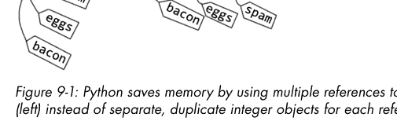

图 9-1：Python 通过使用对单个整数对象的多个引用（左）而不是为每个引用使用单独的重复整数对象（右）来节省内存。

由于这种优化，某些人为构造的情况会产生奇怪的结果。要看一个例子，请在交互式 shell 中输入以下内容：

```
>>> a = 256
>>> b = 256
>>> a is b
True
>>> c = 257
>>> d = 257
>>> c is d
False
```

所有 256 对象实际上是同一个对象，因此 a 和 b 的 is 运算符返回 True ①。但 Python 为 c 和 d 创建了单独的 257 对象，这就是 is 运算符返回 False ② 的原因。

表达式 257 is 257 求值为 True，但 CPython 在同一语句中重用为相同字面量创建的整数对象：

```
>>> 257 is 257
True
```

当然，实际程序通常只使用整数的值，而不是其身份。它们永远不会使用 is 运算符来比较整数、浮点数、字符串、布尔值或其他简单数据类型的值。一个例外是当你使用 is None 而不是 == None 时，如“Use is to Compare with None Instead of ==”第 96 页所述。否则，你很少会遇到这个问题。

## 字符串驻留

同样，Python 重用对象来表示代码中的相同字符串字面量，而不是制作相同字符串的单独副本。要在实践中看到这一点，请在交互式 shell 中输入以下内容：

```
>>> spam = 'cat'
>>> eggs = 'cat'
>>> spam is eggs
True
>>> id(spam), id(eggs)
(1285806577904, 1285806577904)
```

Python 注意到分配给 eggs 的 'cat' 字符串字面量与分配给 spam 的 'cat' 字符串字面量相同；因此，它不会创建第二个冗余的字符串对象，而是将 eggs 分配为对 spam 使用的同一字符串对象的引用。这解释了为什么它们的字符串 ID 相同。

这种优化称为字符串驻留，与预分配整数一样，它只不过是 CPython 的实现细节。你永远不应该编写依赖它的代码。此外，这种优化并不会捕获每一个可能的相同字符串。尝试识别可以使用优化的每个实例通常花费的时间比优化所节省的时间更多。例如，尝试在交互式 shell 中从 'c' 和 'at' 创建 'cat' 字符串；你会注意到 CPython 将最终的 'cat' 字符串作为新的字符串对象创建，而不是重用为 spam 创建的字符串对象：

```
>>> bacon = 'c'
>>> bacon += 'at'
>>> spam is bacon
False
>>> id(spam), id(bacon)
(1285806577904, 1285808207384)
```


字符串驻留是一种优化技术，解释器和编译器在许多不同的语言中使用。你可以在 https://en.wikipedia.org/wiki/String_interning 上找到更多细节。

## Python 的伪自增和自减运算符

在 Python 中，你可以使用增强赋值运算符将变量的值增加 1 或减少 1。代码 spam += 1 和 spam -= 1 分别将 spam 中的数值递增和递减 1。

其他语言，例如 C++ 和 JavaScript，有 ++ 和 -- 运算符用于自增和自减。（“C++” 名称本身就反映了这一点；它是一个带点调侃的笑话，表示它是 C 语言的增强形式。）C++ 和 JavaScript 中的代码可能有 ++spam 或 spam++ 之类的操作。Python 明智地没有包含这些运算符，因为它们 notoriously 容易出现微妙的错误（详见 https://softwareengineering.stackexchange.com/q/59880）。

但以下 Python 代码完全合法：

```
>>> spam = --spam
>>> spam
42
```

你首先应该注意的是，在 Python 中 ++ 和 -- “运算符”实际上并不会递增或递减 spam 中的值。相反，首部的 - 是 Python 的一元取反运算符。它允许你写出这样的代码：

```
>>> spam = 42
>>> -spam
-42
```

在值前面使用多个一元负运算符是合法的。使用两个运算符会得到值的负数的负数，对于整数值来说最终只是原始值：

```
>>> spam = 42
>>> -(-spam)
42
```

这是一个非常愚蠢的操作，你几乎永远不会在实际代码中看到一元取反运算符被使用两次。（但如果你看到了，很可能是因为程序员学习的是另一种语言，然后写出了有问题的 Python 代码！）

还有一个 + 一元运算符。它将整数值求值为与原始值相同的符号，也就是说，它实际上什么都不做：

```
>>> spam = 42
>>> +spam
42
>>> spam = -42
```

```
>>> +spam
-42
```

写 +42（或 ++42）看起来和 --42 一样愚蠢，那么 Python 为什么还要有这个一元运算符呢？它仅存在于为了补充 - 运算符，以便在为自己的类重载这些运算符时使用。（这是一堆你可能不熟悉的术语！你将在第 17 章学习更多关于运算符重载的内容。）

+ 和 - 一元运算符只有在 Python 值前面才有效，而不是在其后面。虽然 spam++ 和 spam-- 在 C++ 或 JavaScript 中可能是合法代码，但在 Python 中它们会产生语法错误：

```
>>> spam++
  File "<stdin>", line 1
    spam++
         ^
SyntaxError: invalid syntax
```

Python 没有自增和自减运算符。语言语法的一个怪癖只是让它看起来像是有。

## 全或无

all() 内置函数接受一个序列值，例如列表，如果该序列中的所有值都是“真值”，则返回 True。如果一个或多个值是“假值”，则返回 False。你可以将函数调用 all([False, True, True]) 视为等价于表达式 False and True and True。

你可以使用 all() 结合列表推导式，首先基于另一个列表创建一个布尔值列表，然后评估其整体值。例如，在交互式 shell 中输入以下内容：

```
>>> spam = [67, 39, 20, 55, 13, 45, 44]
>>> [i > 42 for i in spam]
[True, False, False, True, False, True, True]
>>> all([i > 42 for i in spam])
False
>>> eggs = [43, 44, 45, 46]
>>> all([i > 42 for i in eggs])
True
```

all() 工具如果 spam 或 eggs 中的所有数字都大于 42，则返回 True。

但如果你将一个空序列传递给 all()，它总是返回 True。在交互式 shell 中输入以下内容：

```
>>> all([])
True
```

最好将 all([]) 视为评估断言“此列表中没有项目是假值”，而不是“此列表中的所有项目都是真值”。否则，你可能会得到一些奇怪的结果。例如，在交互式 shell 中输入以下内容：

```
>>> spam = []
>>> all([i > 42 for i in spam])
True
>>> all([i < 42 for i in spam])
True
>>> all([i == 42 for i in spam])
True
```

这段代码似乎表明不仅 spam（一个空列表）中的所有值都大于 42，而且它们也小于 42 且恰好等于 42！这在逻辑上似乎不可能。但请记住，这三个列表推导式都求值为空列表，这就是为什么它们中没有项目是假值，而 all() 函数返回 True 的原因。

## 布尔值是整数值

正如 Python 认为浮点值 42.0 等于整数值 42，它也认为布尔值 True 和 False 分别等价于 1 和 0。在 Python 中，bool 数据类型是 int 数据类型的子类。（我们将在第 16 章介绍类和子类。）你可以使用 int() 将布尔值转换为整数：

```
>>> int(False)
0
>>> int(True)
1
>>> True == 1
True
>>> False == 0
True
```

你也可以使用 isinstance() 确认布尔值被视为一种整数类型：

```
>>> isinstance(True, bool)
True
>>> isinstance(True, int)
True
```

值 True 的数据类型是 bool。但由于 bool 是 int 的子类，True 也是一个 int。这意味着你可以在几乎可以使用整数的任何地方使用 True 和 False。这可能导致一些奇怪的代码：

```
>>> True + False + True + True  # Same as 1 + 0 + 1 + 1
3
>>> -True          # Same as -1.
-1
```

```
>>> 42 * True      # Same as 42 * 1 mathematical multiplication.
42
>>> 'hello' * False # Same as 'hello' * 0 string replication.
''
>>> 'hello'[False]  # Same as 'hello'[0]
'h'
>>> 'hello'[True]   # Same as 'hello'[1]
'e'
>>> 'hello'[-True]  # Same as 'hello'[-1]
'o'
```

当然，仅因为你可以用数字使用布尔值并不意味着你应该这样做。之前的示例都难以阅读，不应在实际代码中使用。最初，Python 没有 bool 数据类型。它直到 Python 2.3 才添加布尔值，此时它将 bool 设为 int 的子类以便于实现。你可以在 PEP 285 中阅读 bool 数据类型的历史，网址为 https://www.python.org/dev/peps/pep-0285/。

顺便说一下，True 和 False 仅在 Python 3 中才成为关键字。这意味着在 Python 2 中，可以使用 True 和 False 作为变量名，导致像这样的看似悖论的代码：

```
Python 2.7.14 (v2.7.14:84471935ed, Sep 16 2017, 20:25:58) [MSC v.1500 64 bit (AMD64)] on win32
Type "help", "copyright", "credits" or "license" for more information.
>>> True is False
False
>>> True = False
>>> True is False
True
```

幸运的是，这种令人困惑的代码在 Python 3 中是不可能的，如果你尝试使用关键字 True 或 False 作为变量名，它会引发语法错误。

## 链接多种运算符

在同一表达式中链接不同种类的运算符可能会产生意外的错误。例如，这个（ admittedly 不现实的）示例在单个表达式中使用了 == 和 in 运算符：

```
>>> False == False in [False]
True
```

这个 True 结果令人惊讶，因为你期望它求值为以下之一：

- (False == False) in [False]，结果为 False。
- False == (False in [False])，结果也为 False。

但 False == False in [False] 与这两个表达式都不等价。相反，它等价于 (False == False) and (False in [False])，正如

42 < spam < 99 等价于 (42 < spam) and (spam < 99)。该表达式根据以下图表求值：

```
(False == False) and (False in [False])
↓
(True) and (False in [False])
↓
(True) and (True)
↓
True
```

False == False in [False] 表达式是一个有趣的 Python 谜题，但在任何实际代码中出现的可能性都不大。

## Python 的反重力功能

要启用 Python 的反重力功能，在交互式 shell 中输入以下内容：

```
>>> import antigravity
```

这一行是一个有趣的彩蛋，会打开网络浏览器到一个关于 Python 的经典 XKCD 漫画条，网址为 https://xkcd.com/353/。你可能会惊讶 Python 可以打开你的网络浏览器，但这是 webbrowser 模块提供的内置功能。Python 的 webbrowser 模块有一个 open() 函数，它会找到你操作系统的默认网络浏览器并打开一个浏览器窗口到特定 URL。在交互式 shell 中输入以下内容：

```
>>> import webbrowser
>>> webbrowser.open('https://xkcd.com/353/')
```

webbrowser 模块功能有限，但它可以用于引导用户到互联网上的更多信息。

## 总结

很容易忘记计算机和编程语言是由人类设计的，并且有其自身的局限性。大量软件建立在语言设计者和硬件工程师的创造之上并依赖于它们。他们非常努力地确保如果你程序中有 bug，是因为你的程序有缺陷，而不是运行它的解释器软件或 CPU 硬件。我们最终会把这些工具视为理所当然。

但这就是学习计算机和软件的奇特角落有价值的原因。当你的代码引发错误或崩溃（甚至只是行为奇怪，让你想“这很奇怪”）时，你需要了解常见的陷阱来调试这些问题。

你几乎肯定不会遇到本章提到的任何问题，但了解这些小细节会让你成为一名经验丰富的 Python 程序员。


