### 11 注释、文档字符串和类型提示


你源代码中的注释和文档可能与代码本身一样重要。原因在于软件永远不会完成；你总需要进行更改，无论是添加新功能还是修复 bug。但除非你理解代码，否则无法更改代码，因此保持其可读状态很重要。正如计算机科学家 Harold Abelson、Gerald Jay Sussman 和 Julie Sussman 曾经写道：“Programs must be written for people to read, and only incidentally for machines to execute.”

> 程序必须为人们阅读而编写，而机器执行只是附带。

注释、文档字符串和类型提示有助于你保持代码的可读性。注释是你直接写在源代码中的简短、通俗易懂的解释，计算机会忽略它们。注释为未编写代码的其他人，或有时甚至为未来的代码编写者提供有用的说明、警告和提醒。几乎每个程序员都曾问自己：“Who wrote this unreadable mess?” 只有在找到答案是，“I did.” 时才作罢。

文档字符串是针对你的函数、方法和模块的 Python 特定文档形式。当你以文档字符串格式指定注释时，诸如文档生成器或 Python 内置 help() 模块之类的自动化工具可让开发者轻松查找有关你代码的信息。

类型提示是你可添加到 Python 源代码中的指令，用于指定变量、参数和返回值的 数据类型。这允许静态代码分析工具验证你的代码不会因类型错误的值而产生异常。类型提示首次出现在 Python 3.5 中，但由于它们基于注释，你可以在任何 Python 版本中使用它们。

本章重点介绍上述三种在代码中嵌入文档以使其更易读的技术。外部文档，如用户手册、在线教程和参考资料很重要，但本书不涵盖。如果你想了解更多关于外部文档的信息，请查看 https://www.sphinx-doc.org/ 上的 Sphinx 文档生成器。

### 注释

与大多数编程语言一样，Python 支持单行注释和多行注释。# 号与行尾之间的任何文本都是单行注释。虽然 Python 没有专门的多行注释语法，但三引号多行字符串可以充当其用途。毕竟，单独的字符串值不会导致 Python 解释器执行任何操作。请看此示例：

```
# This is a single-line comment.

"""This is a
multiline string that
also works as a multiline comment. """
```

如果你的注释跨越多行，使用单个多行注释比使用多个连续的单行注释更好，后者更难阅读，如下所示：

```
"""This is a good way
to write a comment
that spans multiple lines. """
# This is not a good way
# to write a comment
# that spans multiple lines.
```


注释和文档在编程过程中常常被视为事后才想到的事情，甚至有些人认为它们弊大于利。但正如第 83 页上“神话：注释是不必要的”所解释的那样，如果你想编写专业、可读的代码，注释是不可或缺的。在本节中，我们将编写有用的注释，在不影响程序可读性的前提下为读者提供信息。

## 注释风格

让我们看看一些遵循良好风格实践的注释：

```
① # Here is a comment about this code:
    someCode()

② # Here is a lengthier block comment that spans multiple lines using
    # several single-line comments in a row.
③ #
    # These are known as block comments.

if someCondition:
    ④ # Here is a comment about some other code:
    ⑤ someOtherCode()  # Here is an inline comment.
```

注释通常应单独占一行，而不是写在代码行的末尾。大多数情况下，它们应该是完整的句子，具有适当的 capitalization 和标点，而不是短语或单个单词 ①。例外情况是注释应遵守与源代码相同的行长度限制。跨越多行的注释 ② 可以使用连续的多条单行注释，这被称为块注释。我们使用空白的单行注释来分隔块注释中的段落 ③。注释应与它们所注释的代码具有相同的缩进级别 ④。跟在一行代码后面的注释称为内联注释 ⑤，代码与注释之间至少应有两个空格。

单行注释在 # 符号后应有一个空格：

```
#Don't write comments immediately after the # sign.
```

注释可以包含指向相关信息的 URL 链接，但链接绝不能替代注释，因为互联网上的链接内容随时可能消失：

```
# Here is a detailed explanation about some aspect of the code
# that is supplemented by a URL. More info at https://example.com
```

上述约定属于风格而非内容问题，但它们有助于提高注释的可读性。你的注释越可读，程序员越可能注意它们，而注释只有在程序员阅读它们时才有用。

## 内联注释

内联注释出现在代码行的末尾，如以下示例所示：

```
while True:  # Keep asking player until they enter a valid move.
```

内联注释简短，以便符合程序风格指南设定的行长度限制。这意味着它们很容易变得太短而无法提供足够的信息。如果你决定使用内联注释，请确保注释仅描述它紧跟其后的那一行代码。如果你的内联注释需要更多空间或描述额外的代码行，请将其放在单独的行上。

内联注释的一个常见且合适的用途是解释变量的用途或为其提供其他类型的上下文。这些内联注释写在创建变量的赋值语句上：

```
TOTAL_DISKS = 5  # More disks means a more difficult puzzle.
```

内联注释的另一个常见用途是在创建变量时为变量的值添加上下文：

```
month = 2  # Months range from 0 (Jan) to 11 (Dec).
catWeight = 4.9  # Weight is in kilograms.
website = 'inventwithpython.com'  # Don't include "https://" at front.
```

内联注释不应指定变量的数据类型，因为这可以从赋值语句中明显看出，除非以类型提示的注释形式进行，如本章后面“使用注释回溯类型提示”部分所述。

## 解释性注释

一般来说，注释应解释代码为何如此编写，而不是代码做了什么或如何做到。即使采用了第 3 章和第 4 章中介绍的适当代码风格和有用的命名约定，实际代码也无法解释原始程序员的意图。如果你编写了代码，几周后你甚至可能会忘记其中的细节。 现在的你应该编写信息丰富的代码注释，以防止未来的你诅咒过去的你。

例如，这里有一个无用的注释，它解释了代码在做什么。与其暗示此代码的动机，它只是陈述显而易见的事情：

```
>>> currentWeekWages *= 1.5  # Multiply the current week's wages by 1.5
```

此注释比无用更糟。从代码中可以明显看出 currentWeekWages 变量正在乘以 1.5，因此完全省略此注释会简化你的代码。以下注释会好得多：

```
>>> currentWeekWages *= 1.5  # Account for time-and-a-half wage rate.
```

此注释解释了此行代码背后的意图，而不是重复代码的工作方式。它提供了即使是写得很好的代码也无法提供的上下文。

## 总结性注释

解释程序员的意图并不是注释唯一有用的方式。简短的注释可以总结几行代码，使读者能够快速浏览源代码并大致了解其功能。程序员通常使用空白行将代码的“段落”彼此分开，而总结性注释通常占据这些段落开始处的一行。与解释单行代码的一行注释不同，总结性注释在更高层次的抽象上描述代码的功能。

例如，从阅读这四行代码可以看出，它们将 playerTurn 变量设置为代表另一名玩家的数值。但简短的单行注释免除了读者必须阅读和推理代码以理解这样做的目的：

```
# Switch turns to other player:
if playerTurn == PLAYER_X:
    playerTurn = PLAYER_O
elif playerTurn == PLAYER_O:
    playerTurn = PLAYER_X
```

在你的程序中散布这些总结性注释会使快速浏览变得容易得多。程序员随后可以更仔细地查看任何感兴趣的特定点。总结性注释还可以防止程序员对代码的功能产生误导性的想法。简短的总结性注释可以确认开发者正确理解了代码的工作方式。

## “经验教训”注释

当我在软件公司工作时，我曾被要求修改一个图表库，使其能够处理图表中数百万数据点的实时更新。我们使用的库要么能实时更新图表，要么支持数百万数据点的图表，但不能同时兼顾。我以为几天就能完成任务。到第三周时，我仍然坚信几天就能完成。每天解决方案似乎都近在咫尺，而在第五周时我才有了可用的原型。

在整个过程中，我学到了很多关于图表库的工作原理及其功能和局限性的细节。然后我花了几个小时将这些细节写成一页长的注释并放在源代码中。我知道任何以后需要修改我代码的人都会遇到与我相同的所有看似简单的问题，而我正在编写的文档将为他们节省数周的努力。

这些我称之为“经验教训”注释，可能跨越多个段落，使其在源代码文件中显得格格不入。但它们包含的信息对于任何需要维护此代码的人来说都是宝贵的。不要害怕在源代码文件中编写冗长、详细的注释来解释某些东西的工作原理。对其他程序员来说，其中许多细节是未知的、被误解的或容易被忽视的。不需要这些信息的软件开发者可以轻松跳过它们，但确实需要它们的开发者会感激它们。请记住，与其他注释一样，经验教训注释与模块或函数文档（由文档字符串处理）不同。它也不是面向软件用户的教程或如何指南。相反，经验教训注释是为阅读源代码的开发者准备的。

因为我的经验教训注释涉及一个开源图表库，可能对他人有用，所以我花了一些时间将其作为答案发布在公共问答网站 https://stackoverflow.com 上，以便处于类似情况的其他人可以找到它。

## 法律注释

一些软件公司或开源项目出于法律原因，在每个源代码文件的顶部注释中包含版权、软件许可证和作者信息。这些注释最多应为几行，看起来像这样：

```
"""Cat Herder 3.0 Copyright (C) 2021 Al Sweigart. All rights reserved.
See license.txt for the full text."""
```

如果可能，请引用包含许可证全文的外部文档或网站，而不是在每个源代码文件的顶部包含冗长的完整许可证。每次打开源代码文件时都要滚动过去好几屏文字是令人疲惫的，而且包含完整许可证并不会提供额外的法律保护。

## 专业注释

在我第一份软件工作时，一位我非常尊敬的资深同事把我叫到一旁解释说，因为我们有时会向客户发布产品的源代码，所以注释保持专业语气很重要。显然，我在代码中特别令人沮丧的部分的注释中写了“WTF”。我感到尴尬，立即道歉并编辑了注释。从那一刻起，我一直保持我的代码，即使是个人项目，也保持一定的专业性。

你可能会想在程序的注释中添加轻松的语气或发泄你的沮丧，但养成避免这样做的习惯。你不知道未来谁会阅读你的代码，而且很容易误解文本的语气。正如第 64 页上“避免笑话、双关语和文化引用”中所解释的那样，最好的做法是以礼貌、直接且无幽默的语气编写注释。


## 代码标签和 TODO 注释

程序员有时会留下简短的注释来提醒自己还有待完成的工作。这通常采用代码标签的形式：一条带有全大写标签的注释，例如 TODO，后面跟一个简短的描述。理想情况下，你应该使用项目管理工具来跟踪这类问题，而不是将它们深埋在源代码中。但对于不使用此类工具的较小、个人项目来说，偶尔的 TODO 注释可以作为有用的提醒。下面是一个示例：

```
_chargeIonFluxStream()  # TODO: Investigate why this fails every Tuesday.
```

你可以为这些提醒使用几种不同的代码标签：

- **TODO** 引入关于需要完成的工作的一般提醒
- **FIXME** 引入提醒，指出代码的这一部分并不完全正常工作
- **HACK** 引入提醒，指出代码的这一部分可以工作，也许勉强可以，但代码应该改进
- **XXX** 引入一般警告，通常严重程度较高

你应该用更具体的任务或问题的描述来跟随这些始终大写的标签。稍后，你可以搜索源代码中的标签来找到需要修复的代码。缺点是，除非你恰好阅读了包含这些提醒的代码部分，否则很容易忘记这些提醒。代码标签不应取代正式的问题跟踪器或错误报告工具。如果你要在代码中使用代码标签，我建议保持简单：只使用 TODO，放弃其他标签。

## 魔法注释和源文件编码

你可能在 .py 源文件顶部看到过类似以下行的内容：

```
#!/usr/bin/env python3
# -*- coding: utf-8 -*-
```

这些魔法注释始终出现在文件顶部，提供解释器或编码信息。Shebang 行 ①（在第 2 章中介绍）告诉你的操作系统使用哪个解释器来运行文件中的指令。

第二个魔法注释是编码定义行 ②。在这种情况下，该行将 UTF-8 定义为源文件使用的 Unicode 编码方案。你几乎永远不需要包含这一行，因为大多数编辑器和 IDE 已经以 UTF-8 编码保存源代码文件，而且从 Python 3.0 开始的 Python 版本默认将 UTF-8 视为定义的编码。以 UTF-8 编码的文件可以包含任何字符，因此你的 .py 源文件无论包含英语、中文还是阿拉伯字母都完全没问题。

关于 Unicode 和字符串编码的介绍，我强烈推荐 Ned Batchelder 的博客文章“实用 Unicode”，网址为 https://nedbatchelder.com/text/unipain.html。

## 文档字符串

文档字符串是多行注释，出现在模块的 .py 源代码文件顶部或直接跟在 class 或 def 语句之后。它们提供有关正在定义的模块、类、函数或方法的文档。自动文档生成工具使用这些文档字符串生成外部文档文件，例如帮助文件或网页。

文档字符串必须使用三引号的多行注释，而不是以井号 # 开头的单行注释。文档字符串应始终使用三个双引号作为其三引号字符串，而不是三个单引号。例如，以下是流行的 requests 模块中 sessions.py 文件的摘录：

```python
# -*- coding: utf-8 -*-
"""
requests.session
~~~~~~~~~~~~~~~~

This module provides a Session object to manage and persist settings across requests (cookies, auth, proxies).
"""
import os
import sys
--snip--
class Session(SessionRedirectMixin):
    """A Requests session.

    Provides cookie persistence, connection-pooling, and configuration.

    Basic Usage::

        >>> import requests
        >>> s = requests.Session()
        >>> s.get('https://httpbin.org/get')
        <Response [200]>
--snip--

def get(self, url, **kwargs):
    r"""Sends a GET request. Returns :class:`Response` object.

    :param url: URL for the new :class:`Request` object.
    :param \**kwargs: Optional arguments that ``request`` takes.
    :rtype: requests.Response
    """
--snip--
```

sessions.py 文件的摘录包含模块 ②、Session 类 ③ 以及 Session 类的 get() 方法 ④ 的文档字符串。请注意，虽然模块的文档字符串必须是模块中出现的第一个字符串，但它应位于任何魔法注释之后，例如 shebang 行或编码定义 ①。

稍后，你可以通过检查相应对象的 __doc__ 属性来检索模块、类、函数或方法的文档字符串。例如，这里我们检查文档字符串以了解更多关于 sessions 模块、Session 类和 get() 方法的信息：

```
>>> from requests import sessions
>>> sessions.__doc__
'\nrequests.session\n~~~~~~~~~~~~~~\n\nThis module provides a Session object to manage and persist settings across\nrequests (cookies, auth, proxies).\n'
>>> sessions.Session.__doc__
"A Requests session.\n\n    Provides cookie persistence, connection-pooling, and configuration.\n\n    Basic Usage::\n\n        >>> import requests\n--snip--
>>> sessions.Session.get.__doc__
'Sends a GET request. Returns :class:`Response` object.\n\n    :param url: URL for the new :class:`Request` object.\n        :param \*\*kwargs:
--snip--
```

自动文档工具可以利用文档字符串提供上下文相关的信息。其中一种工具是 Python 内置的 help() 函数，它以比直接原始 __doc__ 字符串更易读的格式显示你传递给它的对象的文档字符串。当你在交互式 shell 中进行实验时，这很有用，因为你可以立即调出你正在尝试使用的任何模块、类或函数的信息：

```
>>> from requests import sessions
>>> help(sessions)
Help on module requests.sessions in requests:

NAME
    requests.sessions

DESCRIPTION
    requests.session
    ~~~~~~~~~~~~~~~~

    This module provides a Session object to manage and persist settings
-- More --
```

如果文档字符串太大而无法在屏幕上显示，Python 会在窗口底部显示 -- More --。你可以按 ENTER 滚动到下一行，按空格键滚动到下一页，或按 Q 退出查看文档字符串。

一般来说，文档字符串应包含一行总结模块、类或函数的描述，后跟一个空行和更详细的信息。对于函数和方法，这可以包括有关其参数、返回值和副作用的信息。我们为其他程序员而不是软件用户编写文档字符串，因此它们应包含技术信息，而不是教程。

文档字符串提供的第二个关键好处是它们将文档集成到源代码中。当你将文档与代码分开编写时，你常常会完全忘记它。相反，当你将文档字符串放在模块、类和函数的顶部时，信息仍然易于审查和更新。

你可能并不总是能够立即编写文档字符串，如果你仍在处理它所描述的代码。在这种情况下，在文档字符串中包含一个 TODO 注释作为提醒，提醒你填写其余细节。例如，以下虚构的 reverseCatPolarity() 函数有一个糟糕的文档字符串，说明了显而易见的事情：

```
def reverseCatPolarity(catId, catQuantumPhase, catVoltage):
    """Reverses the polarity of a cat.

    TODO Finish this docstring."""
--snip--
```

因为每个类、函数和方法都应该有文档字符串，你可能会想只写最少的文档然后继续。没有 TODO 注释，很容易忘记这个文档字符串最终需要重写。

PEP 257 在 https://www.python.org/dev/peps/pep-0257/ 包含有关文档字符串的进一步文档。

## 类型提示

许多编程语言具有静态类型，这意味着程序员必须在源代码中声明所有变量、参数和返回值的 数据类型。这允许解释器或编译器在程序运行之前检查代码是否正确使用所有对象。Python 具有动态类型：变量、参数和返回值可以是任何数据类型，甚至在程序运行时更改数据类型。动态语言通常更容易编程，因为它们需要更少的正式规范，但它们缺乏静态语言所具有的防止错误的好处。如果你写一行 Python 代码，例如 round('forty two')，你可能不会意识到你在向一个只接受 int 或 float 参数的函数传递字符串，直到你运行代码并导致错误。静态类型语言会在你分配错误类型的值或传递错误类型的参数时给出早期警告。

Python 的类型提示提供可选的静态类型。在以下示例中，类型提示以粗体显示：

```
def describeNumber(number: int) -> str:
    if number % 2 == 1:
        return 'An odd number. '
```

```
elif number == 42:
    return 'The answer. '
else:
    return 'Yes, that is a number. '
myLuckyNumber: int = 42
print(describeNumber(myLuckyNumber))
```

正如你所见，对于参数或变量，类型提示使用冒号将名称与类型分隔开，而对于返回值，类型提示使用箭头 (->) 将 def 语句的闭合括号与类型分隔开。describeNumber() 函数的类型提示显示它接受 number 参数的整数值并返回字符串值。

如果你使用类型提示，就不必将其应用于程序中的每一项数据。相反，你可以使用渐进式类型化方法，这是在动态类型灵活性和静态类型安全性之间的一种折中，即仅为某些变量、参数和返回值包含类型提示。但你的程序类型提示越多，静态代码分析工具就能获得越多的信息来发现程序中的潜在错误。

请注意，在前面的示例中，指定类型的名称与 int() 和 str() 构造函数函数的名称相匹配。在 Python 中，类、类型和数据类型具有相同的含义。对于由类创建的任何实例，你应使用类名作为类型：

```
import datetime
① noon: datetime.time = datetime.time(12, 0, 0)

class CatTail:
    def __init__(self, length: int, color: str) -> None:
        self.length = length
        self.color = color

② zophieTail: CatTail = CatTail(29, 'grey')
```

noon 变量具有类型提示 datetime.time ①，因为它是一个时间对象（在 datetime 模块中定义）。同样，zophieTail 对象具有 CatTail 类型提示 ②，因为它是使用 class 语句创建的 CatTail 类的对象。类型提示会自动应用于指定类型的所有子类。例如，具有类型提示 dict 的变量可以设置为任何字典值，也可以设置为任何 collections.OrderedDict 和 collections.defaultdict 值，因为这些类是 dict 的子类。第 16 章更详细地介绍了子类。

静态类型检查工具并不一定需要变量的类型提示。原因在于静态类型检查工具会进行类型推断，从变量的首次赋值语句推断出类型。例如，从 spam = 42 这一行，类型检查器可以推断 spam 应该具有 int 的类型提示。但我仍然建议设置类型提示。将来将其更改为浮点数，如 spam = 42.0，也会改变推断的类型，这可能不是你的本意。最好强制程序员在更改值时同时更改类型提示，以确认他们做的是有意更改而非偶然更改。

## 使用静态分析器

尽管 Python 支持类型提示的语法，但 Python 解释器完全忽略它们。如果你运行一个将类型无效的变量传递给函数的 Python 程序，Python 的行为就好像类型提示不存在一样。换句话说，类型提示不会导致 Python 解释器执行任何运行时类型检查。它们仅为静态类型检查工具服务，这些工具在程序运行之前分析代码，而不是在程序运行时分析。

我们称这些工具为静态分析工具，因为它们在程序运行之前分析源代码，而运行时分析或动态分析工具则分析正在运行的程序。（令人困惑的是，此处的静态和动态指的是程序是否正在运行，而静态类型和动态类型指的是我们如何声明变量和函数的数据类型。Python 是一种动态类型语言，但为其编写了静态分析工具，如 Mypy。）

## 安装和运行 Mypy

尽管 Python 没有官方的类型检查工具，但 Mypy 目前是最受欢迎的第三方类型检查器。你可以通过运行以下命令使用 pip 安装 Mypy：

```
python -m pip install --user mypy
```

在 macOS 和 Linux 上请改用 python3 而不是 python。其他知名类型检查器包括微软的 Pyright、Facebook 的 Pyre 和 Google 的 Pytype。

要运行类型检查器，请打开命令提示符或终端窗口并运行 python -m mypy 命令（以应用程序形式运行模块），并将要检查的 Python 代码的文件名作为参数传递。在此示例中，我正在检查我在一个名为 example.py 的文件中创建的示例程序的代码：

```
C:\Users\Al\Desktop>python -m mypy example.py
Incompatible types in assignment (expression has type "float", variable has type "int")
Found 1 error in 1 file (checked 1 source file)
```

如果没有问题，类型检查器不会输出任何内容；如果有问题则会打印错误信息。在此 example.py 文件中，第 171 行存在问题，因为名为 spam 的变量具有 int 类型提示，但被赋予了 float 值。这可能会导致失败，应进行调查。有些错误信息初读时可能难以理解。Mypy 可以报告大量可能的错误，太多无法在此列出。了解错误含义的最简单方法是在网上搜索。在这种情况下，你可以搜索类似“Mypy incompatible types in assignment”的内容。

每次更改代码时都从命令行运行 Mypy 效率相当低下。为了更好地使用类型检查器，你需要配置你的 IDE 或文本编辑器在后台运行它。这样，编辑器会在你输入代码时不断运行 Mypy，然后在编辑器中显示任何错误。图 11-1 显示了前一个示例中的错误在 Sublime Text 文本编辑器中的情况。

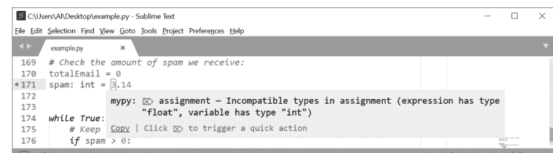

图 11-1：Sublime Text 文本编辑器中显示来自 Mypy 的错误

配置你的 IDE 或文本编辑器与 Mypy 配合使用的步骤取决于你使用的是哪个 IDE 或文本编辑器。你可以通过搜索“<your IDE> Mypy configure”、“<your IDE> type hints setup”或类似内容在线找到说明。如果一切都失败了，你始终可以从命令提示符或终端窗口运行 Mypy。

## 告诉 Mypy 忽略代码

你可能会编写出于某种原因不想收到类型提示警告的代码。对静态分析工具而言，该行可能看起来使用了错误的类型，但在程序运行时实际上是正常的。你可以通过在行尾添加 # type: ignore 注释来抑制任何类型提示警告。以下是示例：

```python
def removeThreesAndFives(number: int) -> int:
    number = str(number)  # type: ignore
    number = number.replace('3', '').replace('5', '')  # type: ignore
    return int(number)
```

为了从传递给 removeThreesAndFives() 的整数中删除所有 3 和 5 位数字，我们暂时将整数 number 变量设置为字符串。这会导致类型检查器对函数中的前两行发出警告，因此我们在这两行添加 # type: ignore 类型提示以抑制类型检查器的警告。

请谨慎使用 # type: ignore。忽略类型检查器的警告会为错误潜入代码提供机会。你几乎肯定可以重写代码以避免出现警告。例如，如果我们使用 numberAsStr = str(number) 创建一个新变量，或用单行 return int(str(number.replace('3', '').replace('5', ''))) 代码替换所有三行，我们就可以避免对 number 变量重复使用多种类型。我们不想通过将参数的类型提示更改为 Union[int, str] 来抑制警告，因为参数旨在仅允许整数。

## 为多种类型设置类型提示

Python 的变量、参数和返回值可以有多种数据类型。为了适应这一点，你可以通过从内置 typing 模块导入 Union 来指定具有多种类型的类型提示。在 Union 类名后方用方括号指定一系列类型：

```
from typing import Union
spam: Union[int, str, float] = 42
spam = 'hello'
spam = 3.14
```

在此示例中，Union[int, str, float] 类型提示指定你可以将 spam 设置为整数、字符串或浮点数。请注意，最好使用 from typing import X 形式的导入语句，而不是 import typing 形式，然后在整个程序中一致地使用冗长的 typing.X 进行类型提示。

你可能在变量或返回值除了另一种类型外还可能具有 None 值的情况下指定多种数据类型。要在类型提示中包含 NoneType（即 None 值的类型），请将 None 放在方括号内，而不是 NoneType。（从技术上讲，NoneType 不是像 int 或 str 那样的内置标识符。）

更好的做法是，不要使用例如 Union[str, None]，而是可以从 typing 模块导入 Optional 并使用 Optional[str]。此类型提示意味着函数或方法可能返回 None 而不是预期类型的值。以下是示例：

```
from typing import Optional
lastName: Optional[str] = None
lastName = 'Sweigart'
```

在此示例中，你可以将 lastName 变量设置为 None 或 str 值。但最好谨慎使用 Union 和 Optional。你的变量和函数允许的类型越少，代码就越简单，而简单代码比复杂代码更不容易出错。记住 Python 之禅的格言：简单胜于复杂。对于返回 None 以指示错误的函数，请考虑改为引发异常。参见第 178 页的“引发异常 vs. 返回错误代码”。

你可以使用 Any 类型提示（同样来自 typing 模块）来指定变量、参数或返回值可以是任何数据类型：

```
from typing import Any
import datetime
spam: Any = 42
spam = datetime.date.today()
spam = True
```


在此示例中，Any 类型提示允许你将 spam 变量设置为任何数据类型的值，例如 int、datetime.date 或 bool。你也可以使用 object 作为类型提示，因为它是 Python 中所有数据类型的基类。但 Any 比 object 更易于理解的类型提示。

正如你对 Union 和 Optional 所做的那样，请谨慎使用 Any。如果将所有变量、参数和返回值都设置为 Any 类型提示，你将失去静态类型检查的好处。指定 Any 类型提示与不指定类型提示之间的区别在于，Any 明确表示变量或函数接受任何类型的值，而缺少类型提示则表示该变量或函数尚未进行类型提示。

## 为列表、字典等设置类型提示

列表、字典、元组、集合和其他容器数据类型可以容纳其他值。如果将 list 指定为变量的类型提示，则该变量必须包含一个列表，但列表可能包含任何类型的值。以下代码不会引起类型检查器的任何投诉：

```
spam: list = [42, 'hello', 3.14, True]
```

若要明确声明列表内部值的数据类型，必须使用 typing 模块的 List 类型提示。请注意，List 的首字母是大写 L，这与 list 数据类型有所区别：

```
from typing import List, Union
① catNames: List[str] = ['Zophie', 'Simon', 'Pooka', 'Theodore']
② numbers: List[Union[int, float]] = [42, 3.14, 99.9, 86]
```

在此示例中，catNames 变量包含一个字符串列表，因此在从 typing 模块导入 List 后，我们将类型提示设置为 List[str] ①。类型检查器会捕获对 append() 或 insert() 方法的任何调用，或任何将非字符串值放入列表的代码。如果列表应包含多种类型，我们可以使用 Union 设置类型提示。例如，numbers 列表可以包含整数和浮点值，因此我们将其类型提示设置为 List[Union[int, float]] ②。

typing 模块为每种容器类型提供单独的类型别名。以下是 Python 中常见容器类型的类型别名列表：

- List 用于 list 数据类型。
- Tuple 用于 tuple 数据类型。
- Dict 用于字典 (dict) 数据类型。
- Set 用于 set 数据类型。
- FrozenSet 用于 frozenset 数据类型。
- Sequence 用于 list、tuple 以及任何其他序列数据类型。
- Mapping 用于字典 (dict)、set、frozenset 以及任何其他映射数据类型。
- ByteString 用于 bytes、bytearray 和 memoryview 类型。

你可以在 https://docs.python.org/3/library/typing.html#classes-functions-and-decorators 在线找到这些类型的完整列表。

## 使用注释回溯类型提示

回溯是将新版软件中的功能移植（即适配并添加到）旧版本的过程。Python 的类型提示功能是 3.5 版本的新功能。但在可能由早于 3.5 的解释器版本运行的 Python 代码中，你仍然可以通过在注释中放置类型信息来使用类型提示。对于变量，使用赋值语句后的内联注释。对于函数和方法，在 def 语句之后的下一行编写类型提示。以 type: 开头，后跟数据类型。以下是带有注释中类型提示的代码示例：

```
from typing import List

spam = 42  # type: int
def sayHello():
    # type: () -> None
    """The docstring comes after the type hint comment."""
    print('Hello!')

def addTwoNumbers(listOfNumbers, doubleTheSum):
    # type: (List[float], bool) -> float
    total = listOfNumbers[0] + listOfNumbers[1]
    if doubleTheSum:
        total *= 2
    return total
```

请注意，即使你使用的是注释类型提示样式，仍然需要导入 typing 模块 ①，以及在注释中使用的任何类型别名。早于 3.5 的版本在标准库中没有 typing 模块，因此你必须通过运行以下命令单独安装 typing：

```
python -m pip install --user typing
```

在 macOS 和 Linux 上运行 python3 而不是 python。

为了将 spam 变量设置为整数，我们在行尾添加 # type: int 作为注释 ②。对于函数，注释应包含括号，其中包含与参数顺序相同的以逗号分隔的类型提示列表。零参数的函数将有一个空的括号集 ③。如果有多个参数，请在括号内用逗号分隔它们 ④。

注释类型提示样式的可读性略低于正常样式，因此仅在代码可能由早于 3.5 的 Python 版本运行时使用它。

## 摘要

程序员经常忘记为代码编写文档。但通过花一点时间在代码中添加注释、文档字符串和类型提示，你可以避免以后浪费时间。文档完善的代码也更容易维护。

认为注释和文档无关紧要，甚至在编写软件时是弊大于利的观点很诱人。（方便的是，这一观点允许程序员避免编写文档的工作。）不要被欺骗；写得好的文档一致地节省你远超编写它所需的时间和精力。程序员盯着屏幕上晦涩难懂、未加注释的代码的情况，比拥有太多有帮助的信息的情况更常见。

良好的注释为需要稍后阅读代码并理解其作用的程序员提供简洁、有用且准确的信息。这些注释应解释原始程序员的意图并总结代码的小段，而不是陈述单行代码的显而易见之处。注释有时会详细说明程序员在编写代码时学到的经验。这些宝贵的信息可能会让未来的维护者不必以艰难的方式重新学习这些经验。

文档字符串是一种 Python 特有的注释，是在类或 def 语句之后立即出现，或位于模块顶部的多行字符串。文档工具，例如 Python 内置的 help() 函数，可以提取文档字符串以提供有关类、函数或模块目的的具体信息。

在 Python 3.5 中引入的类型提示为 Python 代码带来渐进式类型。渐进式类型允许程序员在保持动态类型灵活性的同时应用静态类型的错误检测优势。Python 解释器会忽略类型提示，因为 Python 没有运行时类型检查。即使如此，静态类型检查工具也会使用类型提示在代码未运行时分析源代码。类型检查器，例如 Mypy，可以确保你没有将无效值赋给传递给函数的变量。这通过防止一大类错误为你节省时间和精力。

### 12

### 使用 Git 组织你的代码项目
项目与 Git


*版本控制系统* 是记录所有源代码更改并使检索旧版本代码变得容易的工具。可以将这些工具视为复杂的 *撤销* 功能。

例如，如果你替换了一个函数，然后后来决定更喜欢旧的版本，你可以将代码恢复到原始版本。或者，如果你发现了一个新 bug，你可以返回到早期版本以确定它首次出现的时间以及哪个代码更改导致了它。

版本控制系统在你对文件进行更改时管理文件。这比例如复制你的 *myProject* 文件夹并将其命名为 *myProject-copy* 更可取。如果你继续进行更改，最终必须再制作一个名为 *myProject-copy2* 的副本，然后是 *myProject-copy3*、*myProject-copy3b*、*myProject-copyAsOfWednesday* 等等。复制文件夹可能很简单，但这种方法无法扩展。学习使用版本控制系统可以从长远来看为你节省时间和麻烦。

Git、Mercurial 和 Subversion 是流行的版本控制应用程序，尽管 Git 是其中最受欢迎的。在本章中，你将学习如何为代码项目设置文件并使用 Git 跟踪其更改。

## Git 提交和仓库

Git 允许你在对项目文件进行更改时保存其状态，称为快照或提交。这样，如果你需要，可以回滚到任何之前的快照。Commit 既是名词也是动词；程序员提交（或保存）他们的提交（或快照）。Check-in 也是提交的较不流行的术语。

版本控制系统还使软件开发团队在对项目的源代码进行更改时保持同步变得容易。随着每个程序员提交他们的更改，其他程序员可以将这些更新拉取到他们的计算机上。版本控制系统跟踪进行了哪些提交、谁进行的以及何时进行的，同时还有开发人员描述更改的注释。

版本控制将项目的源代码管理在一个名为仓库或 repo 的文件夹中。通常，你应该为正在处理的每个项目保留一个单独的 Git 仓库。本章假设你主要独自工作，不需要帮助程序员协作的高级 Git 功能，例如分支和合并。但即使你独自工作，也没有编程项目太小而不受益于版本控制。

## 使用 Cookiecutter 创建新的 Python 项目

我们将包含与项目相关的所有源代码、文档、测试和其他文件的文件夹称为在 Git 用语中的工作目录或工作树，更一般地称为项目文件夹。工作目录中的文件统称为工作副本。在创建 Git 仓库之前，让我们为 Python 项目创建文件。

每位程序员都有自己喜欢的方法来做到这一点。尽管如此，Python 项目遵循文件夹名称和层次结构的约定。你的简单程序可能只由单个 .py 文件组成。但随着你处理更复杂的项目，你会开始包含额外的 .py 文件、数据文件、文档、单元测试等。通常，项目文件夹的根目录包含用于 .py 源代码文件的 src 文件夹、用于单元测试的 tests 文件夹以及用于任何文档（例如由 Sphinx 文档工具生成的文档）的 docs 文件夹。其他文件包含项目信息和工具配置：README.md 用于一般信息，.coveragerc 用于代码覆盖率配置，LICENSE.txt 用于项目的软件许可证，等等。这些工具和文件超出了本书的范围，但值得研究。随着你获得更多编码经验，为新的编程项目重新创建相同的基

为了设置你的编码任务，你可以使用 cookiecutter Python 模块自动创建这些文件和文件夹。你可以在 https://cookiecutter.readthedocs.io/ 找到该模块和 Cookiecutter 命令行程序的完整文档。

为了安装 Cookiecutter，运行 pip install --user cookiecutter（在 Windows 上）或 pip3 install --user cookiecutter（在 macOS 和 Linux 上）。此安装包含 Cookiecutter 命令行程序和 cookiecutter Python 模块。输出可能会警告你命令行程序被安装到未列在 PATH 环境变量中的文件夹：

```
Installing collected packages: cookiecutter
    WARNING: The script cookiecutter.exe is installed in 'C:\Users\Al\AppData\Roaming\Python\Python38\Scripts' which is not on PATH.
    Consider adding this directory to PATH or, if you prefer to suppress this warning, use --no-warn-script-location.
```

考虑按照第 35 页“环境变量和 PATH”中的说明将文件夹（本例中为 C:\Users\Al\AppData\Roaming\Python\Python38\Scripts）添加到 PATH 环境变量中。否则，你将不得不通过输入 python -m cookiecutter（在 Windows 上）或 python3 -m cookiecutter（在 macOS 和 Linux 上）作为 Python 模块运行 Cookiecutter，而不是简单地运行 cookiecutter。

在本章中，我们将为名为 wizcoin 的模块创建一个仓库，该模块处理虚构巫师货币中的加隆、锡克尔和纳特硬币。cookiecutter 模块使用模板为多种不同类型的项目创建起始文件。通常，模板只是一个 GitHub.com 链接。例如，从 C:\Users\Al 文件夹中，你可以在终端窗口中输入以下内容，以创建包含基本 Python 项目样板文件的 C:\Users\Al\wizcoin 文件夹。cookiecutter 模块会从 GitHub 下载模板并询问你一系列关于要创建的项目的问题：

```
C:\Users\Al>cookiecutter gh:asweigart/cookiecutter-basicpythonproject
project_name [Basic Python Project]: WizCoin
module_name [basicpythonproject]: wizcoin
author_name [Susie Softwaredeveloper]: Al Sweigart
author_email [susie@example.com]: al@inventwithpython.com
github_username [susieexample]: asweigart
project_version [0.1.0]:
project_short_description [A basic Python project.]: A Python module to represent the galleon, sickle, and knut coins of wizard currency.
```

如果出现错误，你也可以运行 python -m cookiecutter 而不是 cookiecutter。此命令会从 https://github.com/asweigart/cookiecutter-basicpythonproject 下载我创建的模板。你可以在 https://github.com/cookiecutter/cookiecutter 找到许多编程语言的模板。由于 Cookiecutter 模板通常托管在 GitHub 上，你也可以在命令行参数中输入 gh: 作为 https://github.com/ 的简写。

当 Cookiecutter 询问你问题时，你可以输入响应或直接按 ENTER 使用方括号之间显示的默认响应。例如，project_name [Basic Python Project]: 要求你为项目命名。如果不输入任何内容，Cookiecutter 将使用“Basic Python Project”作为项目名称。这些默认值也提示了期望的响应类型。project_name [Basic Python Project]: 提示显示包含空格的大写项目名称，而 module_name [basicpythonproject]: 提示显示模块名称为小写且没有空格。我们没有为 project_version [0.1.0]: 提示输入响应，因此响应默认为“0.1.0”。

回答问题后，Cookiecutter 在当前工作目录中创建 wizcoin 文件夹，其中包含你进行 Python 项目所需的基本文件，如图 12-1 所示。

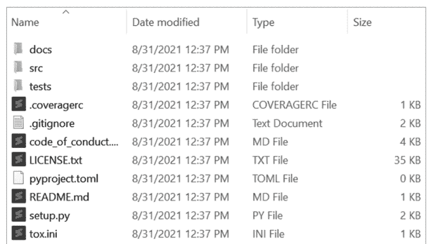

图 12-1：Cookiecutter 创建的 wizcoin 文件夹中的文件

如果不了解这些文件的用途也没关系。对每个文件的完整解释超出了本书的范围，但 https://github.com/asweigart/cookiecutter-basicpythonproject 提供了进一步阅读的链接和描述。现在我们有了起始文件，让我们使用 Git 来跟踪它们。

## 安装 Git

Git 可能已安装在你的计算机上。要查找，请从命令行运行 `git --version`。如果看到类似 git version 2.29.0.windows.1 的消息，则你已安装 Git。如果看到“command not found”错误消息，则必须安装 Git。在 Windows 上，访问 https://git-scm.com/download，然后下载并运行 Git 安装程序。在 macOS Mavericks（10.9）及更高版本上，只需从终端运行 `git --version` 即可提示安装 Git，如图 12-2 所示。

在 Ubuntu 或 Debian Linux 上，从终端运行 sudo apt install git-all。在 Red Hat Linux 上，从终端运行 sudo dnf install git-all。其他 Linux 发行版的说明请访问 https://git-scm.com/download/linux。通过运行 `git --version` 确认安装是否成功。


图 12-2：在 macOS 10.9 或更高版本上第一次运行 git --version 时，会提示你安装 Git。

## 配置你的 Git 用户名和电子邮件

安装 Git 后，你需要配置你的姓名和电子邮件，以便你的提交包含作者信息。从终端运行以下 git config 命令，使用你的姓名和电子邮件信息：

```
C:\Users\Al>git config --global user.name "Al Sweigart"
C:\Users\Al>git config --global user.email al@inventwithpython.com
```

此配置信息存储在主文件夹中的 .gitconfig 文件中（如我的 Windows 笔记本电脑上的 C:\Users\Al）。你永远不需要直接编辑此文本文件。相反，你可以通过运行 git config 命令来更改它。你可以使用 git config --list 命令列出当前的 Git 配置设置。

## 安装 GUI Git 工具

本章重点介绍 Git 命令行工具，但安装为 Git 添加 GUI 的软件可以帮助你完成日常任务。即使是熟悉 CLI Git 命令的专业软件开发人员也经常使用 GUI Git 工具。网页 https://git-scm.com/downloads/guis 建议了几种此类工具，例如 Windows 的 TortoiseGit、macOS 的 GitHub Desktop 和 Linux 的 GitExtensions。

例如，图 12-3 显示了 Windows 上 TortoiseGit 如何根据状态为文件资源管理器图标添加覆盖层：未修改的仓库文件为绿色，已修改的仓库文件（或包含已修改文件的文件夹）为红色，未跟踪文件无图标。检查这些覆盖层显然比不断在终端中输入命令获取此信息更方便。TortoiseGit 还添加了用于运行 Git 命令的上下文菜单，如图 12-3 所示。

使用 GUI Git 工具很方便，但它不能替代学习本章介绍的命令行命令。请记住，你可能有一天需要在未安装这些 GUI 工具的计算机上使用 Git。

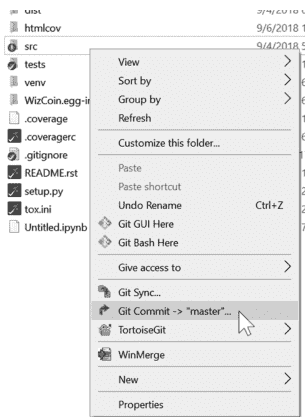

图 12-3：Windows 的 TortoiseGit 为文件资源管理器添加了运行 Git 命令的 GUI。

## Git 工作流程

使用 Git 仓库涉及以下步骤。首先，通过运行 `git init` 或 `git clone` 命令创建 Git 仓库。其次，使用 `git add <filename>` 命令添加文件以供仓库跟踪。第三，一旦添加了文件，你就可以使用 `git commit -am "<descriptive commit message>"` 命令提交它们。此时，你可以对代码进行更多更改。

你可以通过运行 `git help <command>` 查看每个命令的帮助文件，例如 `git help init` 或 `git help add`。这些帮助页面便于参考，但过于枯燥和技术化，不适合用作教程。你稍后会了解每个命令的更多细节，但在开始之前，你需要了解一些 Git 概念，以便更容易理解本章的其余内容。

## Git 如何跟踪文件状态

工作目录中的所有文件要么由 Git 跟踪，要么未跟踪。已跟踪文件是已添加到仓库并提交的文件，而其他所有文件均未跟踪。对于 Git 仓库来说，工作副本中未跟踪的文件几乎不存在。另一方面，已跟踪文件存在于以下三种状态之一：

- *已提交状态* 是指工作副本中的文件与仓库最近一次提交完全相同。（这有时也称为 *未修改状态* 或 *干净状态*。）
- *已修改状态* 是指工作副本中的文件与仓库最近一次提交不同。


-   暂存状态是指文件已被修改并标记为包含在下一次提交中。我们说该文件已暂存或在暂存区中。（暂存区也称为索引或缓存。）

图 12-4 包含了一个文件在这四种状态之间移动的示意图。你可以将一个未跟踪文件添加到 Git 仓库中，在这种情况下它会变成已跟踪并被暂存。然后你可以提交已暂存的文件将其放入已提交状态。你不需要任何 Git 命令将文件置于已修改状态；一旦你对已提交的文件进行更改，它就会自动标记为已修改。

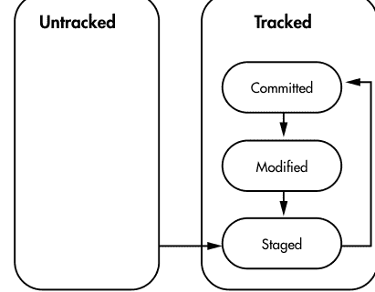

图 12-4：Git 仓库中文件的可能状态及其之间的转换

在创建仓库后的任何步骤，运行 git status 来查看仓库当前状态及其文件的状态。你在使用 Git 工作时会经常运行此命令。在以下示例中，我设置了处于不同状态的文件。请注意这四个文件在 git status 输出中是如何出现的：

```
C:\Users\Al\ExampleRepo>git status
On branch master
Changes to be committed:
(use "git restore --staged <file>..." to unstage)
  1 new file:   new_file.py
  2 modified:   staged_file.py

Changes not staged for commit:
(use "git add <file>..." to update what will be committed)
(use "git restore <file>..." to discard changes in working directory)
  3 modified:   modified_file.py

Untracked files:
(use "git add <file>..." to include in what will be committed)
  4 untracked_file.py
```

在此工作副本中，有一个 new_file.py ①，它最近被添加到仓库中，因此处于暂存状态。还有两个已跟踪文件，staged_file.py ② 和 modified_file.py ③，它们分别处于暂存和已修改状态。然后还有一个名为 untracked_file.py ④ 的未跟踪文件。git status 的输出还提供了将文件移动到其他状态的 Git 命令的提醒。

## 为什么要暂存文件？

你可能会想知道暂存状态的意义何在。为什么不直接在已修改和已提交之间切换而不暂存文件？处理暂存区充满了棘手的特殊情况，也是 Git 初学者的一个主要困惑来源。例如，文件在被暂存后可能会被修改，导致文件同时存在于已修改和已暂存状态，如上一节所述。技术上讲，暂存区并不包含文件，而更多是包含更改，因为单个已修改文件的某些部分可以被暂存，而其他部分未暂存。诸如此类的情况就是 Git 享有复杂声誉的原因，而且许多关于 Git 如何工作的信息来源在最好情况下也不精确，在最坏情况下则具有误导性。

但我们可以避免大部分这种复杂性。在本章中，我建议通过使用 git commit -am 命令在单个步骤中暂存并提交已修改文件来避免它。这样它们将直接从已修改状态移动到干净状态。此外，我建议在仓库中添加、重命名或删除文件后立即提交文件。另外，使用图形化 Git 工具（稍后会解释）而不是命令行可以帮助你避免这些棘手的情况。

## 在计算机上创建 Git 仓库

Git 是一个分布式版本控制系统，这意味着它将所有的快照和仓库元数据本地存储在计算机上的名为 .git 的文件夹中。与集中式版本控制系统不同，Git 不需要在互联网上连接到服务器即可进行提交。这使得 Git 快速且在离线时可用。

从终端运行以下命令来创建 .git 文件夹。（在 macOS 和 Linux 上，你需要运行 mkdir 而不是 md。）

```
C:\Users\Al>md wizcoin
C:\Users\Al>cd wizcoin
C:\Users\Al\wizcoin>git init
Initialized empty Git repository in C:/Users/Al/wizcoin/.git/
```

当你通过运行 git init 将文件夹转换为 Git 仓库时，其中的所有文件最初都是未跟踪的。对于我们的 wizcoin 文件夹，git init 命令创建了 wizcoin/.git 文件夹，其中包含 Git 仓库元数据。只要存在这个 .git 文件夹，一个文件夹就是 Git 仓库；没有它，你只是在普通文件夹中有一组源代码文件。你永远不需要直接修改 .git 中的文件，所以只需忽略此文件夹。事实上，它被命名为 .git 是因为大多数操作系统会自动隐藏名称以句点开头的文件夹和文件。

现在你在 C:\Users\Al\wizcoin 工作目录中有一个仓库。计算机上的仓库称为本地仓库；位于他人计算机上的仓库称为远程仓库。这种区别很重要，因为你经常需要在本地和远程仓库之间共享提交，以便与其他开发者在同一项目上协作。

现在你可以使用 git 命令在工作目录中添加文件并跟踪更改。如果你运行 git status 在新创建的仓库中，你会看到以下内容：

```
C:\Users\Al\wizcoin>git status
On branch master

No commits yet

nothing to commit (create/copy files and use "git add" to track)
```

该命令的输出告知你此仓库中尚无提交。

## 使用 WATCH 命令运行 GIT STATUS

在使用 Git 命令行工具时，你经常会运行 git status 来查看仓库的状态。无需手动输入此命令，你可以使用 watch 命令为你运行。它每两秒重复运行一次给定命令，用其最新输出刷新屏幕。

在 Windows 上，你可以通过下载 https://inventwithpython.com/watch.exe 并将此文件放置到 PATH 文件夹中，例如 C:\Windows 来获取 watch 命令。在 macOS 上，你可以前往 https://www.macports.org/ 下载并安装 MacPorts，然后运行 sudo ports install watch。在 Linux 上，watch 命令已安装。安装完成后，打开一个新的命令提示符或终端窗口，运行 cd 更改目录到你的 Git 仓库项目文件夹，然后运行 watch "git status"。watch 命令将每两秒运行一次 git status，在屏幕上显示最新结果。你可以在使用另一个终端窗口中的 Git 命令行工具时保持此窗口打开，以实时查看仓库状态的变化。你可以打开另一个终端窗口并运行 watch "git log --oneline" 来查看你所做的提交摘要，也会实时更新。这些信息有助于消除对你输入的 Git 命令对仓库做了什么的猜测。

## 添加文件以供 Git 跟踪

只有被跟踪的文件才能通过 git 命令提交、回滚或以其他方式交互。运行 git status 来查看项目文件夹中文件的状态：

```
C:\Users\Al\wizcoin>git status
On branch master

No commits yet

① Untracked files:
  (use "git add <file>..." to include in what will be committed)

    .coveragerc
    .gitignore
    LICENSE.txt
    README.md
--snip--
    tox.ini

nothing added to commit but untracked files present (use "git add" to track)
```

wizcoin 文件夹中的所有文件目前都是未跟踪的 ①。我们可以通过对这些文件进行初始提交来跟踪它们，这需要两个步骤：为每个要提交的文件运行 git add，然后运行 git commit 创建所有这些文件的提交。一旦你提交了一个文件，Git 就会跟踪它。

git add 命令将文件从未跟踪状态或已修改状态移动到暂存状态。我们可以为每个计划暂存的文件运行 git add（例如，git add .coveragerc，git add .gitignore，git add LICENSE.txt，等等），但这很繁琐。相反，让我们使用 * 通配符一次添加多个文件。例如，git add *.py 会添加当前工作目录及其子目录中的所有 .py 文件。要添加所有未跟踪文件，使用单个句点 (.) 告诉 Git 匹配所有文件：

```
C:\Users\Al\wizcoin>git add .
```

运行 git status 查看你已暂存的文件：

```
C:\Users\Al\wizcoin>git status
On branch master

No commits yet

① Changes to be committed:
  (use "git rm --cached <file>..." to unstage)

    ② new file:   .coveragerc
    new file:   .gitignore
--snip--
    new file:   tox.ini
```


git status 的输出会告诉你下一次运行 git commit 时哪些文件将被暂存提交 ①。它还会告诉你这些是新添加到仓库的文件 ②，而不是仓库中已存在并被修改的文件。

运行 git add 选择要添加到仓库的文件后，运行 git commit -m "Adding new files to the repo."（或类似的提交信息）然后再次运行 git status 查看仓库状态：

```
C:\Users\Al\wizcoin>git commit -m "Adding new files to the repo."
[master (root-commit) 65f3b4d] Adding new files to the repo.
15 files changed, 597 insertions(+)
create mode 100644 .coveragerc
create mode 100644 .gitignore
--snip--
create mode 100644 tox.ini

C:\Users\Al\wizcoin>git status
On branch master
nothing to commit, working tree clean
```

请注意，.gitignore 文件中列出的任何文件都不会被添加到暂存区，正如我在下一节中解释的那样。

## 在仓库中忽略文件

Git 未跟踪的文件在运行 git status 时会显示为未跟踪。但在编写代码过程中，你可能希望完全从版本控制中排除某些文件，以免意外跟踪它们。这些包括：

- 项目文件夹中的临时文件
- Python 解释器在运行 .py 程序时生成的 .pyc、.pyo 和 .pyd 文件
- 各种软件开发工具生成的 .tox、htmlcov 以及其他文件夹 docs/_build
- 任何其他可以重新生成的编译文件或生成文件（因为仓库用于源文件，而不是由源文件创建的产品）
- 包含数据库密码、身份验证令牌、信用卡号码或其他敏感信息的源代码文件

为避免包含这些文件，请创建一个名为 .gitignore 的文本文件，列出 Git 不应跟踪的文件夹和文件。Git 会自动将它们从 git add 或 git commit 命令中排除，并且在运行 git status 时不会出现。

cookiecutter-basicpythonproject 模板创建的 .gitignore 文件如下所示：

```
# Byte-compiled / optimized / DLL files
__pycache__/
*.py[cod]
*$py.class
--snip--
```

.gitignore 文件使用 * 作为通配符，# 作为注释。你可以在 https://git-scm.com/docs/gitignore 的在线文档中阅读更多相关内容。

你应该将实际的 .gitignore 文件添加到 Git 仓库中，以便其他程序员在克隆你的仓库时拥有它。如果你想查看基于 .gitignore 设置而被忽略的工作目录中的哪些文件，请运行 git ls-files --other --ignored --exclude-standard 命令。

## 提交更改

在向仓库添加新文件后，你可以继续为项目编写代码。当你想要创建另一个快照时，可以运行 git add . 来暂存所有修改过的文件，并运行 git commit -m <commit message> 来提交所有已暂存的文件。但使用单个 git commit -am <commit message> 命令会更简单：

```
C:\Users\Al\wizcoin>git commit -am "Fixed the currency conversion bug."
[master (root-commit) e1ae3a3] Fixed the currency conversion bug.
1 file changed, 12 insertions(+)
```

如果你只想提交某些修改过的文件而不是所有修改过的文件，可以省略 -am 中的 -a 选项，并在提交信息后指定文件，例如 git commit -m <commit message> file1.py file2.py。

提交信息为将来使用提供提示：它是关于本次提交所做更改的提醒。可能会诱惑写一个简短、笼统的信息，例如“Updated code，”或“Fixed a few bugs，”或甚至只是“x”（因为不允许空白提交信息）。但三周后，当你需要回滚到代码的早期版本时，详细的提交信息将节省你在确定需要回滚多远时的大量麻烦。

如果你忘记添加 -m "<message>" 命令行参数，Git 将在终端窗口中打开 Vim 文本编辑器。Vim 超出了本书的范围，因此请按 ESC 键并输入 qa! 以安全退出 Vim 并取消提交。然后再次输入 git commit 命令，这次使用 -m "<message>" 命令行参数。

要查看专业的提交信息示例，请查看 Django Web 框架的提交历史记录 https://github.com/django/django/commits/master。由于 Django 是一个大型开源项目，提交频繁且提交信息正式。对于你的小型个人编程项目来说，不频繁的提交和模糊的提交信息可能足够好用，但 Django 有超过 1,000 名贡献者。任何人的糟糕提交信息都会成为所有人的问题。

文件现在已安全提交到 Git 仓库。再次运行 git status 查看其状态：

```
C:\Users\Al\wizcoin>git status
On branch master
nothing to commit, working tree clean
```

通过提交已暂存的文件，你已将它们移回已提交状态，Git 告诉我们工作树是干净的；换句话说，没有修改或暂存的文件。回顾一下，当我们向 Git 仓库添加文件时，文件从未跟踪变为已暂存，然后变为已提交。文件现在已准备好进行未来的修改。

请注意，你不能向 Git 仓库提交文件夹。Git 会在其中的文件被提交时自动将文件夹包含在仓库中，但你不能提交空文件夹。

如果最近的提交信息中有拼写错误，你可以使用 git commit --amend -m "<new commit message>" 命令重写它。

## 使用 git diff 在提交前查看更改

在提交代码之前，你应该快速查看运行 git commit 时将提交的更改。你可以使用 git diff 命令查看当前工作副本中的代码与最新提交中的代码之间的差异。

让我们通过一个使用 git diff 的示例。打开 README.md 文本编辑器或 IDE。（你在运行 Cookiecutter 时应该已创建此文件。如果不存在，请创建一个空白文本文件并另存为 README.md。）这是一个 Markdown 格式的文件，但像 Python 脚本一样，它是用纯文本编写的。将 Quickstart Guide 部分中的 TODO - fill this in later 文本更改为以下内容（暂时保留其中的 xample 拼写错误；我们稍后会修复）：

```
Quickstart Guide
-----------------

Here's some xample code demonstrating how this module is used:

>>> import wizcoin
>>> coin = wizcoin.WizCoin(2, 5, 10)
>>> str(coin)
'2g, 5s, 10k'
>>> coin.value()
1141
```

在我们添加并提交 README.md 之前，运行 git diff 命令查看我们所做的更改：

```
C:\Users\Al\wizcoin>git diff
diff --git a/README.md b/README.md
index 76b5814..3be49c3 100644
--- a/README.md
+++ b/README.md
@@ -13,7 +13,14 @@ To install with pip, run:
Quickstart Guide
---------------

-TODO - fill this in later
+Here's some xample code demonstrating how this module is used:
+
+    >>> import wizcoin
+    >>> coin = wizcoin.WizCoin(2, 5, 10)
+    >>> str(coin)
+    '2g, 5s, 10k'
+    >>> coin.value()
+    1141

Contribute
----------
```

输出显示，你的工作副本中的 README.md 已从仓库最新提交中存在的 README.md 更改。以下划线开头的行 - 已被删除；以下划线开头的行 + 已被添加。

在审查更改时，你还会注意到我们写了 xample 而不是 example，出现了拼写错误。我们不应该提交这个拼写错误。让我们纠正它。然后再次运行 git diff 检查更改并将其添加到仓库并提交：

```
C:\Users\Al\wizcoin>git diff
diff --git a/README.md b/README.md
index 76b5814..3be49c3 100644
--- a/README.md
+++ b/README.md
@@ -13,7 +13,14 @@ To install with pip, run:
Quickstart Guide
---------------

-TODO - fill this in later
+Here's some example code demonstrating how this module is used:
--snip--
C:\Users\Al\wizcoin>git add README.md

C:\Users\Al\wizcoin>git commit -m "Added example code to README.md"
[master 2a4c5b8] Added example code to README.md
1 file changed, 8 insertions(+), 1 deletion(-)
```

更正现已安全提交到仓库。

## 使用 git difftool 通过 GUI 应用程序查看更改

使用使用 GUI 的差异程序查看更改会更容易。在 Windows 上，你可以下载 WinMerge (https://winmerge.org/)，一个免费的开源 diff

程序，然后安装它。在 Linux 上，你可以使用 sudo apt-get install meld 命令安装 Meld，或者使用 sudo apt-get install kompare 命令安装 Kompare。在 macOS 上，你可以通过先安装并配置 Homebrew（一个安装软件的包管理器），然后使用 Homebrew 安装 tkdiff 的命令来安装 tkdiff：

```
/bin/bash -c "$(curl -fsSL https://raw.githubusercontent.com/Homebrew/install/master/install.sh)"
brew install tkdiff
```

你可以通过运行 git config diff.tool <tool_name> 来配置 Git 使用这些工具，其中 <tool_name> 为 winmerge、tkdiff、meld 或 kompare。然后运行 git difftool <filename> 在工具的 GUI 中查看对文件所做的更改，如图 12-5 所示。

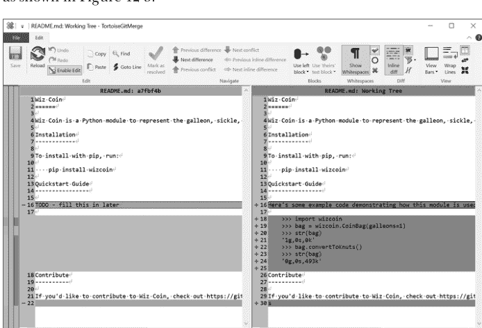

图 12-5：在这种情况下的 GUI 差异工具 WinMerge，比 git diff 的文本输出更易读。

此外，运行 git config --global difftool.prompt false，这样 Git 在每次想要打开差异工具时就不会要求确认。如果你安装了 GUI Git 客户端，你也可以配置它使用这些工具（或者它可能自带一个可视化差异工具）。

## 应该多久提交一次更改？

即使版本控制允许你将文件回滚到之前的提交，你可能会想知道应该多久进行一次提交。如果你提交过于频繁，你会难以在大量无关紧要的提交中筛选出你要查找的代码版本。

如果你提交过于不频繁，每个提交将包含大量更改，并且回滚到特定提交会撤销比你想要更多的更改。总的来说，程序员倾向于比应该的提交频率更低。

你应该在完成整个功能单元时提交代码，例如功能、类或错误修复。不要提交包含语法错误或明显损坏的代码。提交可以包含几行更改的代码，也可以包含数百行，但无论哪种情况，你都应该能够跳回到任何之前的提交并且仍然拥有一个可工作的程序。你在提交前应始终运行任何单元测试。理想情况下，所有测试都应该通过（如果未通过，请在提交信息中提及）。

## 从仓库中删除文件

如果你不再需要 Git 跟踪某个文件，你不能简单地从文件系统中删除该文件。你必须通过 Git 使用 git rm 命令删除它，该命令也会告诉 Git 停止跟踪文件。为了练习操作，运行 echo "Test file" > deleteme.txt 命令创建一个名为 deleteme.txt 的小文件，其内容为 "Test file"。然后通过运行以下命令将其提交到仓库：

```
C:\Users\Al\wizcoin>echo "Test file" > deleteme.txt
C:\Users\Al\wizcoin>git add deleteme.txt
C:\Users\Al\wizcoin>git commit -m "Adding a file to test Git deletion."
[master 441556a] Adding a file to test Git deletion.
 1 file changed, 1 insertion(+)
 create mode 100644 deleteme.txt
C:\Users\Al\wizcoin>git status
On branch master
nothing to commit, working tree clean
```

不要使用 Windows 上的 del 命令或 macOS 和 Linux 上的 rm 命令删除文件。（如果你这样做了，你可以运行 git restore <filename> 来恢复它，或者直接继续使用 git rm 命令将其从仓库中移除。）相反，使用 git rm 命令删除并暂存 deleteme.txt 文件，如以下示例所示：

```
C:\Users\Al\wizcoin>git rm deleteme.txt
rm 'deleteme.txt'
```

git rm 命令会从你的工作副本中删除文件，但你还没有完成。就像 git add 一样，git rm 命令会暂存文件。你需要像对待其他任何更改一样提交文件删除操作：

```
C:\Users\Al\wizcoin>git status
On branch master
Changes to be committed:
  (use "git reset HEAD <file>..." to unstage)
        deleted:    deleteme.txt
```

```
C:\Users\Al\wizcoin>git commit -m "Deleting deleteme.txt from the repo to finish the deletion test."
[master 369de78] Deleting deleteme.txt from the repo to finish the deletion test.
1 file changed, 1 deletion(-)
delete mode 100644 deleteme.txt
C:\Users\Al\Desktop\wizcoin>git status
On branch master
nothing to commit, working tree clean
```

即使你已从工作副本中删除了 *deleteme.txt*，它仍然存在于仓库的历史记录中。本章后面“恢复旧更改”部分描述了如何恢复已删除文件或撤销更改。

`git rm` 命令仅适用于处于干净、已提交状态且没有任何修改的文件。否则，Git 会要求你提交更改或使用 `git reset HEAD <filename>` 命令还原它们。（`git status` 的输出会提醒你此命令 ①。）此操作可防止你意外删除未提交的更改。

## 在仓库中重命名和移动文件

与删除文件类似，除非使用 Git，否则不应在仓库中重命名或移动文件。如果你尝试在不使用 Git 的情况下这样做，它会认为你删除了一个文件，然后创建了一个内容恰好相同的新文件。相反，使用 `git mv` 命令，然后执行 `git commit`。让我们通过运行以下命令将 *README.md* 文件重命名为 *README.txt*：

```
C:\Users\Al\wizcoin>git mv README.md README.txt
C:\Users\Al\wizcoin>git status
On branch master
Changes to be committed:
  (use "git reset HEAD <file>..." to unstage)

        renamed:  README.md -> README.txt

C:\Users\Al\wizcoin>git commit -m "Testing the renaming of files in Git."
[master 3fee6a6] Testing the renaming of files in Git.
1 file changed, 0 insertions(+), 0 deletions(-)
rename README.md => README.txt (100%)
```

这样，*README.txt* 的更改历史也包括 *README.md* 的历史。

我们也可以使用 `git mv` 命令将文件移动到新文件夹。输入以下命令创建一个名为 *movetest* 的新文件夹并将 *README.txt* 移入其中：

```
C:\Users\Al\wizcoin>mkdir movetest
C:\Users\Al\wizcoin>git mv README.txt movetest/README.txt
C:\Users\Al\wizcoin>git status
On branch master
Changes to be committed:
  (use "git reset HEAD <file>..." to unstage)

      renamed:  README.txt -> movetest/README.txt

C:\Users\Al\wizcoin>git commit -m "Testing the moving of files in Git."
[master 3ed22ed] Testing the moving of files in Git.
 1 file changed, 0 insertions(+), 0 deletions(-)
 rename README.txt => movetest/README.txt (100%)
```

你也可以通过向 git mv 传递新名称和位置来同时重命名和移动文件。让我们将 README.txt 移回工作目录根目录的原始位置并赋予其原始名称：

```
C:\Users\Al\wizcoin>git mv movetest/README.txt README.md
C:\Users\Al\wizcoin>git status
On branch master
Changes to be committed:
  (use "git reset HEAD <file>..." to unstage)

      renamed:  movetest/README.txt -> README.md

C:\Users\Al\wizcoin>git commit -m "Moving the README file back to its original place and name."
[master 962a8ba] Moving the README file back to its original place and name.
1 file changed, 0 insertions(+), 0 deletions(-)
 rename movetest/README.txt => README.md (100%)
```

请注意，即使 README.md 文件已回到原始文件夹并具有原始名称，Git 仓库仍会记住移动和重命名操作。你可以使用下一节所述的 git log 命令查看此历史记录。

## 查看提交日志

git log 命令输出所有提交的列表：

```
C:\Users\Al\wizcoin>git log
commit 962a8baa29e452c74d40075d92b00897b02668fb (HEAD -> master)
Author: Al Sweigart <al@inventwithpython.com>
Date:   Wed Sep 1 10:38:23 2021 -0700

    Moving the README file back to its original place and name.

commit 3ed22ed7ae26220bbd4c4f6bc52f4700dbb7c1f1
Author: Al Sweigart <al@inventwithpython.com>
Date:   Wed Sep 1 10:36:29 2021 -0700

    Testing the moving of files in Git.

--snip--
```

此命令可能会显示大量文本。如果日志无法容纳在你的终端窗口中，你可以使用上下箭头键向上或向下滚动。要退出，请按 q 键。

如果你想将文件设置为早于最新提交的提交，你需要先找到提交哈希，这是一个由 40 个十六进制数字（由数字和字母 A 到 F 组成）组成的字符串，作为提交的唯一标识符。例如，我们仓库中最新的提交的完整哈希为 962a8baa29e452c74d40075d92b00897b02668fb。但通常只使用前七位数字：962a8ba。

随着时间的推移，日志可能会变得非常冗长。--oneline 选项会将输出精简为简化的提交哈希和每个提交信息的首行。在命令行中输入 git log --oneline：

```
C:\Users\Al\wizcoin>git log --oneline
962a8ba (HEAD -> master) Moving the README file back to its original place and name.
3ed22ed Testing the moving of files in Git.
15734e5 Deleting deleteme.txt from the repo to finish the deletion test.
441556a Adding a file to test Git deletion.
2a4c5b8 Added example code to README.md
e1ae3a3 An initial add of the project files.
```

如果此日志仍然太长，你可以使用 -n 来将输出限制为最近的提交。尝试输入 git log --oneline -n 3 以仅查看最后三个提交：

```
C:\Users\Al\wizcoin>git log --oneline -n 3
962a8ba (HEAD -> master) Moving the README file back to its original place and name.
3ed22ed Testing the moving of files in Git.
15734e5 Deleting deleteme.txt from the repo to finish the deletion test.
```

要显示文件在特定提交时的内容，你可以运行 git show <hash>:<filename> 命令。但 GUI Git 工具提供的用于检查仓库日志的界面比命令行 Git 工具更方便。

## 恢复旧更改

假设你想使用源代码的早期版本，因为你引入了错误，或者也许你不小心删除了文件。版本控制系统允许你撤销或回滚工作副本到早期提交的内容。你使用的确切命令取决于工作副本中文件的状态。

请记住，版本控制系统只会添加信息。即使你从仓库中删除文件，Git 也会记住它，以便你以后可以恢复它。回滚更改实际上会添加一个新的更改，将文件的内容设置为之前提交中的状态。你可以在 https://github.blog/2015-06-08-how-to-undo-almost-anything-with-git/ 找到有关各种回滚类型的详细信息。


## 撤销未提交的本地更改

如果你对文件做了未提交的更改，但想将其恢复到最新提交中的版本，可以运行 git restore <filename>。在下面的示例中，我们修改了 README.md 文件，但尚未暂存或提交它：

```
C:\Users\Al\wizcoin>git status
On branch master

Changes not staged for commit:
  (use "git add <file>..." to update what will be committed)
  (use "git restore <file>..." to discard changes in working directory)
        modified:   README.md

no changes added to commit (use "git add" and/or "git commit -a")
C:\Users\Al\wizcoin>git restore README.md
C:\Users\Al\wizcoin>git status
On branch master
Your branch is up to date with 'origin/master'.

nothing to commit, working tree clean
```

在运行 git restore README.md 命令后，README.md 的内容会恢复到上一次提交的状态。这实际上是对你对该文件所做的更改（但尚未暂存或提交）的撤销。但请注意：你无法再撤销这次“撤销”来恢复这些更改。

你也可以运行 git checkout . 来撤销你在工作副本中对所有文件所做的更改。

## 取消暂存已暂存的文件

如果你通过运行 git add 命令将一个修改过的文件暂存了，但现在想将其从暂存区移除以便不包含在下一个提交中，运行 git restore --staged <filename> 来取消暂存它：

```
C:\Users\Al>git restore --staged README.md
Unstaged changes after reset:
M       spam.txt
```

README.md 保持修改状态，就像 git add 暂存该文件之前一样，但该文件已不再处于暂存状态。

## 回滚最近的提交

假设你做了几个无用的提交，并且想从之前的提交重新开始。要撤销特定数量的最近提交，比如三个，使用 git revert -n HEAD~3..HEAD 命令。你可以用任意数量的提交替换 3。例如，假设你跟踪了正在撰写的一部悬疑小说的更改，并且有以下 Git 日志记录了所有提交和提交信息。

```
C:\Users\Al\novel>git log --oneline
de24642 (HEAD -> master) Changed the setting to outer space.
2be4163 Added a whacky sidekick.
97c655e Renamed the detective to 'Snuggles'.
8aa5222 Added an exciting plot twist.
2590860 Finished chapter 1.
2dece36 Started my novel.
```

后来你决定想从哈希值 8aa5222 处的精彩情节转折重新开始。这意味着你应该撤销最后三个提交的更改：de24642、2be4163 和 97c655e。运行 git revert -n HEAD~3..HEAD 来撤销这些更改，然后运行 git add . 和 git commit -m "<commit message>" 来提交此内容，就像对其他任何更改一样：

```
C:\Users\Al\novel>git revert -n HEAD~3..HEAD

C:\Users\Al\novel>git add .

C:\Users\Al\novel>git commit -m "Starting over from the plot twist."
[master faec20e] Starting over from the plot twist.
1 file changed, 34 deletions(-)

C:\Users\Al\novel>git log --oneline
faec20e (HEAD -> master) Starting over from the plot twist.
de24642 Changed the setting to outer space.
2be4163 Added a whacky sidekick.
97c655e Renamed the detective to 'Snuggles'.
8aa5222 Added an exciting plot twist.
2590860 Finished chapter 1.
2dece36 Started my novel.
```

Git 仓库通常只添加信息，因此撤销这些提交仍会保留它们在提交历史中。如果你以后想撤销这次“撤销”，可以使用 git revert 再次回滚。

## 回滚单个文件的特定提交

因为提交捕获的是整个仓库的状态而不是单个文件，如果你想回滚单个文件的更改，就需要使用不同的命令。例如，假设我有一个小型软件项目的 Git 仓库。我创建了一个 eggs.py 文件并添加了 spam() 和 bacon() 函数，然后将 bacon() 重命名为 cheese()。该仓库的日志看起来可能像这样：

```
C:\Users\Al\myproject>git log --oneline
895d220 (HEAD -> master) Adding email support to cheese().
df617da Renaming bacon() to cheese().
ef1e4bb Refactoring bacon().
ac27c9e Adding bacon() function.
009b7c0 Adding better documentation to spam().
0657588 Creating spam() function.
d811971 Initial add.
```

但我决定想将该文件恢复到添加 bacon() 之前的状态，而不更改仓库中的任何其他文件。我可以使用 git show <hash>: <filename> 命令来显示该文件在特定提交后的样子。该命令看起来可能像这样：

```
C:\Users\Al\myproject>git show 009b7c0:eggs.py
<contents of eggs.py as it was at the 009b7c0 commit>
```

使用 git checkout <hash> -- <filename>，我可以将 eggs.py 的内容设置为此版本并像平常一样提交更改后的文件。git checkout 命令只会更改工作副本。你仍然需要像处理其他任何更改一样暂存并提交这些更改：

```
C:\Users\Al\myproject>git checkout 009b7c0 -- eggs.py

C:\Users\Al\myproject>git add eggs.py

C:\Users\Al\myproject>git commit -m "Rolled back eggs.py to 009b7c0"
[master d41e595] Rolled back eggs.py to 009b7c0
1 file changed, 47 deletions(-)

C:\Users\Al\myproject>git log --oneline
d41e595 (HEAD -> master) Rolled back eggs.py to 009b7c0
895d220 Adding email support to cheese().
df617da Renaming bacon() to cheese().
ef1e4bb Refactoring bacon().
ac27c9e Adding bacon() function.
009b7c0 Adding better documentation to spam().
0657588 Creating spam() function.
d811971 Initial add.
```

eggs.py 文件已被回滚，其余仓库保持不变。

## 重写提交历史

如果你不小心提交了一个包含敏感信息（如密码、API 密钥或信用卡号）的文件，仅编辑掉这些信息并做一次新提交是不够的。任何有权访问仓库的人，无论是在你的电脑上还是远程克隆，都可以回滚到包含此信息的提交。

实际上从你的仓库中彻底移除这些信息使其无法恢复是棘手的，但也是可能的。具体步骤超出了本书的范围，但你可以使用 git filter-branch 命令，或最好使用 BFG Repo-Cleaner 工具。你可以在 https://help.github.com/en/articles/removing-sensitive-data-from-a-repository 阅读有关两者的信息。

解决此问题的最简单预防措施是创建一个名为 secrets.txt、confidential.py 或类似名称的文件，将敏感的私有信息放在其中，并将其添加到 .gitignore 中，这样你就永远不会不小心将其提交到仓库。你的程序可以读取此文件以获取敏感信息，而不是将敏感信息直接放在其源代码中。

## GitHub 和 git push 命令

虽然 Git 仓库可以完全存在于你的电脑上，但许多免费网站可以在线托管你的仓库克隆，让其他人可以轻松下载并为你的项目做出贡献。这些网站中最大的一个是 GitHub。如果你在线上保留项目的克隆，其他人就可以在你开发的电脑关闭时添加你的代码。该克隆也充当有效的备份。

> NOTE
> 
> 尽管这些术语可能导致混淆，但 Git 是维护仓库并包含 git 命令的版本控制软件，而 GitHub 是一个在线托管 Git 仓库的网站。

转到 https://github.com 并注册一个免费账户。从 GitHub 主页或你个人资料页面的 Repositories 选项卡，点击 New 按钮开始新项目。输入 wizcoin 作为仓库名称，并使用我们在“使用 Cookiecutter 创建新 Python 项目”第 200 页中给 Cookiecutter 的相同项目描述，如图 12-6 所示。将仓库标记为 Public 并取消选中 Initialize this repository with a README 复选框，因为我们将导入现有仓库。然后点击 Create repository。这些步骤本质上就像在 GitHub 网站上运行 git init。

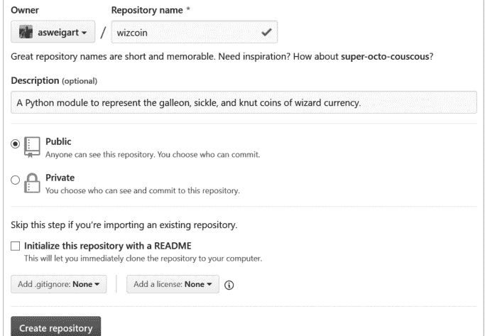

图 12-6： 在 GitHub 上创建新仓库

你可以在 https://github.com/<username>/<repo_name> 找到你的仓库网页。在我的例子中，我的 wizcoin 仓库托管在 https://github.com/asweigart/wizcoin。


## 将现有仓库推送到 GitHub

要从命令行推送现有仓库，请执行以下操作：

```
C:\Users\Al\wizcoin>git remote add origin https://github.com/<github_username>/wizcoin.git
C:\Users\Al\wizcoin>git push -u origin master
Username for 'https://github.com': <github_username>
Password for 'https://<github_username>@github.com': <github_password>
Counting objects: 3, done.
Writing objects: 100% (3/3), 213 bytes | 106.00 KiB/s, done.
Total 3 (delta 0), reused 0 (delta 0)
To https://github.com/<your github>/wizcoin.git
 * [new branch]      master -> master
Branch 'master' set up to track remote branch 'master' from 'origin'.
```

git remote add origin https://github.com/<github_username>/wizcoin.git 命令将 GitHub 添加为与本地仓库对应的远程仓库。然后你可以使用 git push -u origin master 命令将你在本地仓库中做出的任何提交推送到远程仓库。完成首次推送后，你只需运行 git push 即可推送本地仓库中的所有后续提交。每次提交后都将提交推送到 GitHub 是一个好主意，以确保 GitHub 上的远程仓库与本地仓库保持同步，但这并非严格必要。

当你重新加载 GitHub 上的仓库网页时，应该能在网站上看到文件和提交的显示。关于 GitHub 还有很多需要学习的内容，包括如何通过 pull request 接受他人对你的仓库的贡献。这些内容以及 GitHub 的其他高级功能超出了本书的范围。

## 从现有 GitHub 仓库克隆仓库

也可以做相反的操作：在 GitHub 上创建新仓库并将其克隆到你的电脑上。在 GitHub 网站上创建一个新仓库，但这次请选择 Initialize this repository with a README 复选框。

要将此仓库克隆到本地电脑，请前往 GitHub 上的仓库页面并点击 Clone or download 按钮以打开一个窗口，其 URL 应类似于 https://github.com/<github_username>/wizcoin.git。使用仓库的 URL 与 git clone 命令将其下载到你的电脑：

```
C:\Users\Al>git clone https://github.com/<github_username>/wizcoin.git
Cloning into 'wizcoin'...
remote: Enumerating objects: 5, done.
remote: Counting objects: 100% (5/5), done.
remote: Compressing objects: 100% (3/3), done.
remote: Total 5 (delta 0), reused 5 (delta 0), pack-reused 0
Unpacking objects: 100% (5/5), done.
```

现在你可以使用此 Git 仓库提交和推送更改，就像你运行 git init 创建仓库一样。

git clone 命令在本地仓库进入你不知道如何撤销的状态时也很有用。虽然不太理想，但你可以始终保存工作目录中文件的副本，删除本地仓库，然后使用 git clone 重新创建仓库。这种情况发生的频率如此之高，即使是经验丰富的软件开发者也会遇到，因此它构成了 https://xkcd.com/1597/ 中的笑话的基础。

## 摘要

版本控制系统是程序员的救星。提交代码的快照使回顾进度变得容易，在某些情况下还可以回滚不需要的更改。学习像 Git 这样的版本控制系统的基础知识无疑能在长期节省你的时间。

Python 项目通常有几个标准文件和文件夹，cookiecutter 模块可帮助你为其中许多文件创建起始样板。这些文件构成了你提交到本地 Git 仓库的第一个文件。我们称包含所有这些内容的文件夹为 *工作目录* 或 *项目文件夹*。

Git 跟踪工作目录中的文件，所有这些文件都可能处于三种状态之一：已提交（也称为未修改或干净）、已修改或已暂存。Git 命令行工具有多个命令，例如 git status 或 git log，可让你查看此信息，但你也可以安装多个第三方 GUI Git 工具。

git init 命令在你的本地电脑上创建一个新的空仓库。git clone 命令从远程服务器（例如流行的 GitHub 网站）复制一个仓库。不管怎样，一旦你拥有仓库，就可以使用 git add 和 git commit 提交对仓库的更改，并使用 git push 将这些提交推送到远程 GitHub 仓库。本章还描述了几个用于撤销你所做提交的命令。执行撤销操作可让你回滚到文件更早的版本。

Git 是一个功能丰富的工具，拥有许多特性，而本章仅涵盖版本控制系统的基础知识。许多资源可供你学习 Git 的高级特性。我推荐两本可在网上找到的免费书籍：Scott Chacon 所著的 *Pro Git*，网址为 https://git-scm.com/book/en/v2，以及 Eric Sink 所著的 *Version Control by Example*，网址为 https://ericsink.com/vcbe/index.html。

### 13

### 性能测量和 Big O 算法分析
大 O 算法分析


对于大多数小型程序来说，性能并不是那么重要。我们可能花费一个小时编写一个脚本来自动化一个只需要几秒钟运行的任务。即使花费更长时间，程序也可能在我们端着咖啡回到办公桌时就已经完成。

有时投入时间学习如何使脚本更快是明智的。但在我们知道如何测量程序速度之前，就无法知道我们的更改是否提高了程序的速度。这就是 Python 的 timeit 和 cProfile 模块发挥作用的地方。这些模块不仅测量代码运行速度，还会创建一份分析报告，显示代码中哪些部分已经很快，哪些部分可以改进。

除了测量程序速度外，在本章中你还将学习如何测量随着程序数据增长而导致的运行时理论增长。在计算机科学中，我们称之为大 O 表示法。没有传统计算机科学背景的软件开发者有时可能会觉得自己的知识存在空白。但尽管计算机科学教育令人满意，但它并不总是与软件开发直接相关。我开玩笑说（但只有一半是玩笑）大 O 表示法构成了我学位有用性的约 80%。本章对这一实用主题进行了介绍。

## timeit 模块

“过早优化是万恶之源” 是软件开发中的一句常见格言。（它常被归因于计算机科学家 Donald Knuth，他又将其归因于计算机科学家 Tony Hoare。Tony Hoare 反过来又将其归因于 Donald Knuth。）过早优化，或在不知道需要优化什么之前就进行优化，通常表现为程序员试图使用巧妙的技巧来节省内存或编写更快的代码。例如，其中一种技巧是使用 XOR 算法在不使用第三个临时变量的情况下交换两个整数值：

```
>>> a, b = 42, 101  # Set up the two variables.
>>> print(a, b)
42 101
>>> # A series of ^ XOR operations will end up swapping their values:
>>> a = a ^ b
>>> b = a ^ b
>>> a = a ^ b
>>> print(a, b)  # The values are now swapped.
101 42
```

除非你不熟悉 XOR 算法（它使用 ^ 位运算符），否则这段代码看起来很晦涩。使用巧妙的编程技巧的问题在于它们可能产生复杂、难以阅读的代码。请记住，Python 之禅的原则之一是可读性很重要。

更糟糕的是，你的巧妙技巧可能最终并不那么巧妙。你不能仅仅假设一个巧妙的技巧更快，或者它所取代的旧代码一开始就很慢。要弄清楚的唯一方法是测量和比较运行时：运行程序或代码片段所需的时间。请记住，增加运行时意味着程序变慢：程序完成相同工作所需的时间更长。（我们有时也使用 runtime 一词来指程序运行期间的时期。这意味着错误发生在程序运行时，而不是程序被编译为字节码时。）

Python 标准库的 timeit 模块可以通过运行代码片段数千次或数百万次来测量其运行时速度，让你确定平均运行时。timeit 模块还会暂时禁用自动垃圾回收器以确保更一致的运行时。如果你想测试多行代码，可以传递多行代码字符串或使用分号分隔代码行：

```
>>> import timeit
>>> timeit.timeit('a, b = 42, 101; a = a ^ b; b = a ^ b; a = a ^ b')
0.1307766629999998
>>> timeit.timeit('"""a, b = 42, 101
```


```
... a = a ^ b
... b = a ^ b
... a = a ^ b""")
0.13515726800000039
```

在我的电脑上，XOR 算法运行这段代码大约需要十分之一秒。这快吗？让我们把它与使用第三个临时变量的整数交换代码进行比较：

```
>>> import timeit
>>> timeit.timeit('a, b = 42, 101; temp = a; a = b; b = temp')
0.027540389999998638
```

真令人惊讶！使用第三个临时变量不仅更易读，而且速度也快了两倍！聪明的 XOR 技巧可能可以节省几字节的内存，但以牺牲速度和代码可读性为代价。牺牲代码可读性来减少几字节的内存使用或纳秒级的运行时间是不值得的。

更好的是，你可以使用多重赋值技巧，也称为可迭代解包，来交换两个变量，它也运行在很小的时间内：

```
>>> timeit.timeit('a, b = 42, 101; a, b = b, a')
0.024489236000007963
```

不仅这是最易读的代码，而且也是最快的。我们知道这一点不是因为我们假设它，而是因为我们客观地测量了它。

timeit.timeit() 函数还可以接受第二个字符串参数作为设置代码。设置代码在运行第一个字符串的代码之前只运行一次。你也可以通过为 number 关键字参数传递一个整数来更改默认的试验次数。例如，以下测试测量 Python 的 random 模块生成 1 到 100 之间的 10,000,000 个随机数有多快。（在我机器上，大约需要 10 秒。）

```
>>> timeit.timeit('random.randint(1, 100)', 'import random', number=10000000)
10.020913950999784
```

默认情况下，你传递给 timeit.timeit() 的字符串中的代码将无法访问程序其余部分中的变量和函数：

```
>>> import timeit
>>> spam = 'hello'  # We define the spam variable.
>>> timeit.timeit('print(spam)', number=1)  # We measure printing spam.
Traceback (most recent call last):
  File "<stdin>", line 1, in <module>
  File "C:\Users\Al\AppData\Local\Programs\Python\Python37\lib\timeit.py", line 232, in timeit
    return Timer(stmt, setup, timer, globals).timeit(number)
  File "C:\Users\Al\AppData\Local\Programs\Python\Python37\lib\timeit.py", line 176, in timeit
    timing = self.inner(it, self.timer)
  File "<timeit-src>", line 6, in inner
NameError: name 'spam' is not defined
```

要修复这个问题，请将函数传递 globals() 的返回值作为 globals 关键字参数：

```
>>> timeit.timeit('print(spam)', number=1, globals=globals())
hello
0.000994909999462834
```

编写代码的一个好规则是先让它工作，然后再让它变快。只有在你有一个可工作的程序后，才应专注于使其更高效。

## cProfile 分析器

尽管 timeit 模块可用于测量小的代码片段，但 cProfile 模块更有效地用于分析整个函数或程序。分析会系统地分析程序的速度、内存使用情况和其他方面。cProfile 模块是 Python 的分析器，或可测量程序运行时间并为程序的各个函数调用构建运行时间分析的软件。这些信息提供了对代码的更细粒度的测量。

要使用 cProfile 分析器，将你想要测量的代码的字符串传递给 cProfile.run()。让我们看看 cProfile 如何测量并报告一个从 1 到 1,000,000 求和所有数字的短函数的执行情况：

```
import time, cProfile
def addUpNumbers():
    total = 0
    for i in range(1, 1000001):
        total += i

cProfile.run('addUpNumbers()')
```

运行此程序时，输出看起来会像这样：

```
4 function calls in 0.064 seconds

Ordered by: standard name

ncalls  tottime  percall  cumtime  percall  filename:lineno(function)
1       0.000    0.000    0.064    0.064    <string>:1(<module>)
1       0.064    0.064    0.064    0.064    test1.py:2(addUpNumbers)
1       0.000    0.000    0.064    0.064    {built-in method builtins.exec}
1       0.000    0.000    0.000    0.000    {method 'disable' of '_lsprof.Profiler' objects}
```

每一行代表一个不同的函数以及在该函数中花费的时间。cProfile.run() 输出中的列是：

**ncalls** 对函数进行的调用次数
**totttime** 在函数中花费的总时间，不包括子函数中的时间
percall 总时间除以调用次数
cumtime 在函数及其所有子函数中花费的累计时间
percall 累计时间除以调用次数
filename:lineno(function) 函数所在的文件名及行号

例如，从 https://nostarch.com/crackingcodes/ 下载 rsaCipher.py 和 al_sweigart_pubkey.txt 文件。此 RSA 密码程序曾出现在《用 Python 破解密码》（No Starch Press, 2018）中。输入以下内容到交互式 shell 中，以分析 encryptAndWriteToFile() 函数在加密由 'abc' * 100000 表达式创建的 300,000 字符消息时的性能：

```
>>> import cProfile, rsaCipher
>>> cProfile.run("rsaCipher.encryptAndWriteToFile('encrypted_file.txt', 'al_sweigart_pubkey.txt', 'abc'*100000)")
11749 function calls in 28.900 seconds

Ordered by: standard name

ncalls tottime percall cumtime percall filename:lineno(function)
1 0.001 0.001 28.900 28.900 <string>:1(<module>)
2 0.000 0.000 0.000 0.000 _bootlocale.py:11(getpreferredencoding)
--snip--
1 0.017 0.017 28.900 28.900 rsaCipher.py:104(encryptAndWriteToFile)
1 0.248 0.248 0.249 0.249 rsaCipher.py:36(getBlocksFromText)
1 0.006 0.006 28.873 28.873 rsaCipher.py:70(encryptMessage)
1 0.000 0.000 0.000 0.000 rsaCipher.py:94(readKeyFile)
--snip--
2347 0.000 0.000 0.000 0.000 {built-in method builtins.len}
2344 0.000 0.000 0.000 0.000 {built-in method builtins.min}
2344 28.617 0.012 28.617 0.012 {built-in method builtins.pow}
2 0.001 0.001 0.001 0.000 {built-in method io.open}
4688 0.001 0.000 0.001 0.000 {method 'append' of 'list' objects}
--snip--
```

你可以看到传递给 cProfile.run() 的代码花费了 28.9 秒完成。请注意总时间最高的函数；在这种情况下，Python 内置的 pow() 函数占用了 28.617 秒。这几乎是整个代码的运行时间！我们无法更改此代码（它是 Python 的一部分），但也许我们可以更改代码以减少对它的依赖。

在这种情况下这是不可能的，因为 rsaCipher.py 已经相当优化了。即使如此，对此代码的分析也为我们提供了 pow() 是主要瓶颈的见解。因此，几乎没有必要尝试改进，例如 readKeyFile() 函数（运行时间如此之短，以至于 cProfile 报告其运行时间为 0）。

这一思想被阿姆达尔定律所概括，阿姆达尔定律是一个公式，用于计算在改进程序的某个组件后整个程序加速多少。公式为 speed-up of whole task = 1 / ((1 - p) + (p / s))，其中 s 是对组件的加速，p 是该组件占整体程序的比例。所以，如果你将占程序总运行时间 90% 的组件的速度提高一倍，你将得到 1 / ((1 − 0.9) + (0.9 / 2)) = 1.818，即整体程序加速 82%。这比例如将仅占总运行时间 25% 的组件速度提高三倍要好，后者仅为 1 / ((1 − 0.25) + (0.25 / 2)) = 1.143，即整体加速 14%。你不需要记住公式。只需记住，加快代码中缓慢或冗长的部分比加快已经快速或短小的部分更有成效。这很常见：昂贵的房子打 10% 的折扣比便宜的一双鞋打 10% 的折扣更好。

## Big O 算法分析

Big O 是一种算法分析形式，描述代码如何扩展。它将代码分类为若干个阶，总体描述随着需要完成的工作量增加，代码的运行时间会多长。Python 开发者 Ned Batchelder 将 big O 描述为“代码随数据增长而变慢”的分析，这也是他信息丰富的 PyCon 2018 演讲的标题，该演讲可在 https://youtu.be/duvZ-2UK0fc/ 获取

让我们考虑以下场景。假设你有一项工作需要一个小时完成。如果工作量加倍，需要多长时间？你可能会想当然地认为需要两倍的时间，但实际上，答案取决于工作的类型。

如果阅读一本短书需要一个小时，那么阅读两本短书大约需要两个小时。但如果你可以在一个小时内按字母顺序排列 500 本书，那么排列 1,000 本书很可能需要超过两个小时，因为你需要在更大的书籍集合中找到每本书的正确位置。另一方面，如果你只是检查书架是否为空，那么书架上有 0 本、10 本或 1,000 本书都无关紧要。看一眼你就会立即知道答案。无论有多少本书，运行时间大致保持不变。尽管有些人读或整理书的速度可能更快或更慢，但这些总体趋势保持不变。

算法的 big O 描述了这些趋势。算法可以在快速或慢速的计算机上运行，但我们仍然可以使用 big O 来描述算法在总体上的表现如何，而不管执行算法的实际硬件如何。Big O 不使用秒或 CPU 周期等具体单位来描述算法的运行时间，因为这些在不同的计算机或编程语言之间会有所不同。

## Big O 阶

Big O 记号通常定义以下阶。这些从较低的阶开始，描述代码随着数据量的增长，


减速最少的，到描述代码减速最多的更高阶：

- 1. O(1)，常数时间（最低阶）
- 2. O(log n)，对数时间
- 3. O(n)，线性时间
- 4. O(n log n)，N-Log-N 时间
- 5. O(n²)，多项式时间
- 6. O(2ⁿ)，指数时间
- 7. O(n!)，阶乘时间（最高阶）

请注意，big O 使用以下记法：一个大写字母 O，后面跟着一对包含阶数描述的括号。大写字母 O 代表阶数或数量级上的。n 代表代码将处理的数据输入的大小。我们把 O(n) 读作“big oh of n”或“big oh n。”

你不需要理解 logarithmic 或 polynomial 等词的精确数学含义就能使用 big O 记法。我将在下一节详细描述这些阶数，但这里有一个过度简化的解释：

- O(1) 和 O(log n) 算法很快。
- O(n) 和 O(n log n) 算法不算差。
- O(n²)、O(2ⁿ) 和 O(n!) 算法很慢。

当然，你可以找到反例，但这些描述总体上是很好的规则。这里列出的 big O 阶数不止这些，但这些是最常见的。让我们看看每种阶数描述的任务类型。

## Big O 阶数的书架隐喻

在下面的 big O 阶数示例中，我将继续使用书架隐喻。n 指的是书架上的书的数量，而 big O 排序描述了随着书的数量增加，各种任务花费的时间如何变长。

### O(1)，常数时间

判断“书架是否空着？”是一个常数时间操作。书架上有多少本书并不重要；看一眼就能知道书架是否空着。书的数量可能变化，但运行时间保持不变，因为一旦我们在书架上看到一本书，就可以停止查看了。n 值与任务速度无关，这就是为什么 O(1) 中没有 n。你也可能会看到常数时间写成 O(c)。

### O(log n)，对数

对数是指数运算的逆运算：指数 2⁴，或 2 × 2 × 2 × 2，等于 16，而对数 log₂(16)（读作“log base 2 of 16”）等于 4。在编程中，我们通常假设对数的底数为 2，这就是为什么我们写 O(log n) 而不是 O(log₂ n)。

在按字母顺序排列的书架上查找一本书是对数时间操作。要找到一本书，可以检查书架中间的书。如果那就是你要找的书，就完成了。否则，你可以判断你要找的书是在这本中间书之前还是之后。通过这样做，你实际上将需要搜索的书的范围减半。你可以重复这个过程，再检查你预计能找到它的那一半的中间书。我们称之为二分搜索算法，本章后面“Big O Analysis Examples”中有它的例子。

将一组 n 本书对半分割的次数是 log₂ n。在 16 本书的书架上，找到正确的书最多需要四步。因为每一步都将需要搜索的书的数量减少一半，所以书的数量翻倍的书架搜索时只多一步。如果按字母顺序排列的书架上有 4.2 亿本书，找到一本特定书仍然只需要 32 步。

Log n 算法通常涉及分而治之的步骤，即选择 n 输入的一半进行处理，然后从这一半中再选一半，以此类推。Log n 操作扩展性很好：工作量 n 可以翻倍，但运行时间只增加一步。

### O(n)，线性时间

阅读书架上的所有书是一个线性时间操作。如果书的长度大致相同，并且你将书架上的书的数量加倍，阅读所有书大约需要双倍的时间。运行时间与书的数量 n 成正比增加。

### O(n log n)，N-Log-N 时间

将一组书按字母顺序排序是一个 n-log-n 时间操作。这个阶数是 O(n) 和 O(log n) 运行时间的乘积。你可以把 O(n log n) 任务想象成必须执行 n 次的 O(log n) 任务。以下是随意的解释。

从一堆待字母化排序的书和一个空书架开始。按照“ O(log n), Logarithmic”第 232 页详细说明的二分搜索算法步骤，找到一本书在书架上的位置。这是一个 O(log n) 操作。有 n 本书需要字母化排序，每本书需要 log n 步来排序，因此对整套书进行字母化排序需要 n × log n，或 n log n 步。书的数量加倍时，对所有书进行字母化排序的时间会多于两倍，所以 n log n 算法扩展性相当好。

事实上，所有高效的通用排序算法都是 O(n log n)：merge sort、quicksort、heapsort 和 Timsort。（Timsort 由 Tim Peters 发明，是 Python 的 sort() 方法使用的算法。）

### O(n²)，多项式时间

检查未排序书架上的重复书籍是一个多项式时间操作。如果有 100 本书，你可以从第一本书开始，将其与另外 99 本书进行比较，看看它们是否相同。然后取第二本书，检查它是否与另外 99 本书中的任何一本相同。检查一本书的重复项是 99 步（我们将其向上取整为 100，这就是本例中的 n）。我们必须对每本书做一次，共 100 次。因此，检查书架上是否有任何重复书籍的步骤数大约是 n × n，或 n²。（即使我们聪明到不重复比较，这个近似值仍然成立。）

运行时间随着书籍数量的增加而平方增长。检查 100 本书的重复项是 100 × 100，或 10,000 步。但检查两倍的数量，200 本书，是 200 × 200，或 40,000 步：工作量增加四倍。

在我实际编写代码的经验中，我发现 big O 分析最常见的用途是避免在存在 O(n log n) 或 O(n) 算法时意外编写 O(n³) 算法。O(n³) 阶数是算法急剧变慢的时候，因此将你的代码识别为 O(n²) 或更高应该会让你停下来思考。也许有另一种算法可以更快地解决问题。在这些情况下，学习数据结构和算法（DSA）课程，无论是在大学还是在线，都可能有所帮助。

我们也称 O(n²) 为二次时间。算法可能有 O(n³)，或三次时间，比 O(n²) 更慢；O(n⁴)，或四次时间，比 O(n³) 更慢；或其他多项式时间复杂度。

### O(2ⁿ)，指数时间

用书架上每一种可能的书籍组合拍照是一个指数时间操作。可以这样想：书架上的每本书要么被包含在照片中，要么不被包含。Figure 13-1 显示了 n 为 1、2 或 3 时的每一种组合。如果 n 为 1，有两种可能的照片：有书和无书。如果 n 为 2，有四种可能的照片：两本书都在书架上，两本书都不在，第一本在第二本不在，以及第二本在第一本不在。当你增加第三本书时，你需要做的工作量再次翻倍：你需要做包含第三本书的每一种两本书的子集（四张照片）和不包含第三本书的每一种两本书的子集（另外四张照片，共 2³ 或八张照片）。每增加一本书，工作量就会翻倍。对于 n 本书，你需要拍摄的照片数量（即需要做的工作量）是 2ⁿ。

n = 1 book
2 combinations

n = 1 本书
2 种组合

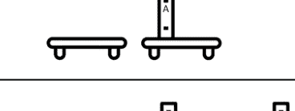

n = 2 books
4 combinations

n = 2 本书
4 种组合

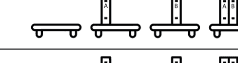

n = 3 books
8 combinations

n = 3 本书
8 种组合

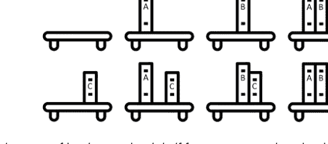

图 13-1：书架上一个、两个或三个书的所有组合

指数任务的运行时间增长非常快。六本书需要 2⁶ 或 32 张照片，但 32 本书将包括 2³² 或超过 4.2 亿张照片。O(2ⁿ)、O(3ⁿ)、O(4ⁿ) 等是不同的阶数，但都具有指数时间复杂度。

### O(n!)，阶乘时间

用书架上书籍的每一种可想象的顺序拍照是一个阶乘时间操作。我们称每一种可能的顺序为 n 本书的排列。这导致 n!，或 n 阶乘，种排序。数字的阶乘是该数字以下所有正整数的乘积。例如，3! 是 3 × 2 × 1，或 6。Figure 13-2 显示了三本书的每一种可能排列。

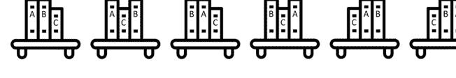

图 13-2：书架上三本书的所有 3!（即 6）种排列

要自己计算，请思考你将如何列出 n 本书的每一种排列。你有 n 种选择作为第一本书；然后有 n − 1 种选择作为第二本书（即除第一本书外所有书）；然后有 n − 2 种选择

对于第三本书；以此类推。6 本书时，6! 的结果是 6 × 5 × 4 × 3 × 2 × 1，即 720 张照片。再多加一本书就变成 7!，需要 5,040 张照片。即使对于较小的 n 值，阶乘时间算法也很快变得无法在合理的时间内完成。如果你有 20 本书，并且可以每秒排列一次并拍照，遍历每一种可能的排列仍然需要比宇宙存在的时间更长。

一个众所周知的 O(n!) 问题是旅行商难题。销售人员必须访问 n 个城市，并希望计算所有 n! 种可能访问顺序的行驶距离。通过这些计算，他们可以确定行驶距离最短的顺序。在城市众多的地区，这一任务在及时完成上是不可能的。幸运的是，优化算法可以在远快于 O(n!) 的时间内找到一条较短（但不保证是最短）的路线。

## 大 O 衡量最坏情况

大 O 专门衡量任何任务的 *最坏情况*。例如，在一个未整理的书架上寻找特定书籍，需要你从一端开始扫描书籍直到找到它。你可能运气好，你要找的书可能是你检查的第一本书。但你也可能运气不好；它可能是你检查的最后一本书，或者根本不在书架上。因此，在最佳情况下，即使有数十亿本书需要搜索也没关系，因为你会立即找到你要找的那本。但这种乐观主义对于算法分析没有用。大 O 描述的是不幸情况下发生的情况：如果书架上有 n 本书，你必须检查全部 n 本书。在这个例子中，运行时间以与书籍数量相同的速率增加。

一些程序员还使用 *大欧米伽记法*，它描述了算法的最佳情况。例如，Ω(n) 算法在最佳情况下以线性效率运行。在最坏情况下，它可能会运行得更慢。一些算法会遇到特别幸运的情况，在这种情况下无需做任何工作，例如当你已经在目的地时寻找前往目的地的驾驶路线。

*大西塔记法* 描述了最佳和最坏情况顺序相同的算法。例如，Θ(n) 描述了一个算法，其在最佳情况下 *和* 最坏情况下都具有线性效率，也就是说，它是 O(n) 和 Ω(n) 算法。这些记法在软件工程中不如大 O 常用的，但你仍应了解它们的存在。

人们谈论“平均情况的大 O”来指大西塔，或谈论“最佳情况的大 O”来指大欧米伽的情况并不少见。这是一个自相矛盾的说法；大 O 专门指算法的最坏情况运行时间。但即使他们的措辞在技术上是不正确的，你仍然可以理解他们的意思。

## 做大 O 分析绰绰有余的数学

如果你的代数生疏了，这里有足够做大 O 分析的数学知识：

### 乘法
重复相加。2 × 4 = 8，就像 2 + 2 + 2 + 2 = 8 一样。有变量时，n + n + n 是 3 × n。

### 乘法记号
代数记号通常省略 × 符号，所以 2 × n 写成 2n。用数字时，2 × 3 写成 2(3) 或简单地写成 6。

### 乘法恒等性质
将一个数乘以 1 得到该数本身：5 × 1 = 5 且 42 × 1 = 42。更一般地，n × 1 = n。

### 乘法的分配律
2 × (3 + 4) = (2 × 3) + (2 × 4)。等式的两边都等于 14。更一般地，a(b + c) = ab + ac。

### 指数运算
重复乘法。2⁴ = 16（读作“2 的 4 次幂是 16”），就像 2 × 2 × 2 × 2 = 16 一样。这里，2 是底数，4 是指数。有变量时，n × n × n × n 是 n⁴。在 Python 中，我们使用 ** 运算符：2 ** 4 计算结果为 16。

### 1 次幂求值为底数
2¹ = 2 且 9999¹ = 9999。更一般地，n¹ = n。

### 0 次幂始终求值为 1
2⁰ = 1 且 9999⁰ = 1。更一般地，n⁰ = 1。

### 系数
乘法因子。在 3n² + 4n + 5 中，系数是 3、4 和 5。你可以看到 5 是一个系数，因为 5 可以重写为 5(1)，然后重写为 5n⁰。

### 对数
指数运算的逆运算。因为 2⁴ = 16，我们知道 log₂(16) = 4。我们读作“以 2 为底 16 的对数是 4”。在 Python 中，我们使用 math.log() 函数：math.log(16, 2) 计算结果为 4.0。

计算大 O 通常涉及通过合并同类项来简化方程。项是数字和变量相乘的某种组合：在 3n² + 4n + 5 中，项是 3n²、4n 和 5。同类项具有相同变量且指数相同。在表达式 3n² + 4n + 6n + 5 中，项 4n 和 6n 是同类项。我们可以将其简化并重写为 3n² + 10n + 5。

请记住，因为 n × 1 = n，所以像 3n² + 5n + 4 这样的表达式可以被视为 3n² + 5n + 4(1)。该表达式中的项与大 O 阶 O(n²)、O(n) 和 O(1) 相匹配。这将在我们为大 O 计算丢弃系数时出现。

这些数学规则提醒在你第一次学习如何找出一段代码的大 O 时可能会派上用场。但到你在本章后面完成“快速分析大 O”时，你可能就不再需要它们了。大 O 是一个简单的概念，即使你不严格遵循数学规则也可以使用。

## 确定代码的大 O 阶

要确定一段代码的大 O 阶，我们必须完成四项任务：确定 n 是什么、统计代码中的步骤、丢弃低阶项，并丢弃系数。

例如，让我们找出以下 readingList() 函数的大 O：

```
def readingList(books):
    print('Here are the books I will read:')
    numberOfBooks = 0
    for book in books:
        print(book)
        numberOfBooks += 1
    print(numberOfBooks, 'books total.')
```

请记住，n 表示代码所处理输入数据的大小。在函数中，n几乎总是基于一个参数。readingList() 函数的唯一参数是 books，所以 books 的大小似乎是 n 的一个好候选，因为 books 越大，函数运行所需的时间越长。

接下来，让我们统计这段代码中的步骤。什么算作一步有些模糊，但一行代码是一个不错的经验法则。循环的步骤数等于迭代次数乘以循环内代码行的数量。为了说明我的意思，这里是 readingList() 函数内部代码的计数：

```
def readingList(books):
    print('Here are the books I will read:')  # 1 step
    numberOfBooks = 0                     # 1 step
    for book in books:                    # n * steps in the loop
        print(book)                       # 1 step
        numberOfBooks += 1                # 1 step
    print(numberOfBooks, 'books total.')  # 1 step
```

我们将每行代码视为一步，除了 for 循环。这行代码对 books 中的每个项目执行一次，而由于 books 的大小是我们的 n，我们说它执行 n 步。不仅如此，它还对循环内的所有步骤执行 n 次。因为循环内有两步，总共是 2 × n 步。我们可以这样描述我们的步骤：

```
def readingList(books):
    print('Here are the books I will read:')  # 1 step
    numberOfBooks = 0                     # 1 step
    for book in books:                    # n * 2 steps
        print(book)                       # (already counted)
        numberOfBooks += 1                # (already counted)
    print(numberOfBooks, 'books total.')  # 1 step
```

现在当我们计算总步数时，我们得到 1 + 1 + (n × 2) + 1。我们可以将这个表达式更简单地重写为 2n + 3。

大 O 并不是要描述具体细节；它是一个总体指标。因此，我们从计数中丢弃低阶项。2n + 3 中的阶是线性（2n）和常数（3）。如果我们只保留这些阶中最大的一个，我们就剩下 2n。

接下来，我们从阶中丢弃系数。在 2n 中，系数是 2。丢弃它后，我们剩下 n。这给出了 readingList() 函数的最终大 O：O(n)，或线性时间复杂度。

如果仔细想想，这个阶是有意义的。我们的函数中有几个步骤，但总的来说，如果 books 列表的大小增加十倍，运行时间大约也会增加十倍。将 books 从 10 本书增加到 100 本书会使算法从 1 + 1 + (2 × 10) + 1，即 23 步，变为 1 + 1 + (2 × 100) + 1，即 203 步。数字 203 大约是 23 的 10 倍，所以运行时间与 n 的增加成比例增长。

## 为什么低阶项和系数无关紧要

我们丢弃步骤计数中的低阶项，因为随着 n 增大，它们变得不那么重要。如果我们将之前的 readingList() 函数中的 books 列表从 10 增加到 10,000,000,000（100 亿），步骤数将从 23 增加到 20,000,000,003。对于足够大的 n，这额外的三步几乎无关紧要。

当数据量增加时，较小阶的大系数与较高阶相比不会产生差异。在某个 n 大小时，较高阶总是比较低阶慢。例如，假设我们有 quadraticExample()，它是 O(n²) 且有 3n² 步。我们还有 linearExample()，它是 O(n) 且有 1,000n 步。1,000 系数大于 3 系数并不重要；随着 n 的增加，最终 O(n²) 二次操作会比 O(n) 线性操作慢。实际代码并不重要，但我们可以这样思考：

```
def quadraticExample(someData):  # n is the size of someData
    for i in someData:      # n steps
        for j in someData:  # n steps
            print('Something')  # 1 step
            print('Something')  # 1 step
            print('Something')  # 1 step

def linearExample(someData):  # n is the size of someData
    for i in someData:      # n steps
        for k in range(1000):  # 1 * 1000 steps
            print('Something')  # (Already counted)
```

linearExample() 函数的系数（1,000）与 quadraticExample() 的系数（3）相比很大。如果输入大小 n 为 10，O(n²) 函数看起来更快，只有 300 步，而 O(n) 函数有 10,000 步。

但大 O 记法主要关注算法在工作负载扩展时的性能。当 n 达到 334 或更大时，quadraticExample() 函数将始终比

linearExample() 函数。即使 linearExample() 为 1,000,000 n 步，quadraticExample() 函数在 n 达到 333,334 时仍然会变慢。 在某个点上，O(n²) 操作总是会比 O(n) 或更低阶的操作慢。 要了解其原理，请查看图 13-3 中显示的大 O 图表。 该图表包含所有主要的大 O 符号阶数。 x 轴是 n，即数据的大小，y 轴是执行操作所需的运行时间。

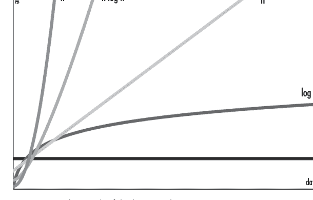

图 13-3：大 O 阶的图表

正如你所见，高阶的运行时间增长速度比低阶快得多。 尽管低阶可能有较大的系数使其暂时大于高阶，但高阶最终会超过它们。

## Big O 分析示例

让我们确定一些示例函数的大 O 阶数。 在这些示例中，我们将使用一个名为 books 的参数，它是一个字符串书名的列表。

countBookPoints() 函数根据 books 列表中的书籍数量计算分数。 大多数书籍价值一分，某些作者的书籍价值两分：

```
def countBookPoints(books):
    points = 0          # 1 step
    for book in books:  # n * steps in the loop
        points += 1     # 1 step

    for book in books:              # n * steps in the loop
        if 'by Al Sweigart' in book: # 1 step
            points += 1             # 1 step
    return points                   # 1 step
```

步骤数合计为 1 + (n × 1) + (n × 2) + 1，合并同类项后变为 3n + 2。 一旦我们去掉低阶和系数，这就变成 O(n)，即线性复杂度，无论我们遍历 books 一次、两次还是十亿次。

到目前为止，所有使用单个循环的示例都具有线性复杂度，但请注意这些循环迭代了 n 次。 正如你将在下一个示例中看到的那样，代码中的循环本身并不意味着线性复杂度，尽管遍历数据的循环确实如此。

这个 iLoveBooks() 函数打印 “I LOVE BOOKS!!!” 和 “BOOKS ARE GREAT!!!” 10 次：

```python
def iLoveBooks(books):
    for i in range(10):          # 10 * steps in the loop
        print('I LOVE BOOKS!!!')  # 1 step
        print('BOOKS ARE GREAT!!!') # 1 step
```

该函数有一个 for 循环，但它没有遍历 books 列表，并且无论 books 的大小如何，它都执行 20 步。 我们可以将其重写为 20(1)。 去掉 20 系数后，我们剩下 O(1)，即常数时间复杂度。 这是有道理的； 函数的运行时间相同，无论 n，即 books 列表的大小是多少。

接下来，我们有一个 cheerForFavoriteBook() 函数，它搜索 books 列表以查找喜爱的书籍：

```python
def cheerForFavoriteBook(books, favorite):
    for book in books:           # n * steps in the loop
        print(book)              # 1 step
        if book == favorite:     # 1 step
            for i in range(100): # 100 * steps in the loop
                print('THIS IS A GREAT BOOK!!!') # 1 step
```

for book 循环遍历 books 列表，这需要 n 步乘以循环内的步数。 该循环包含一个嵌套的 for i 循环，它迭代 100 次。 这意味着 for book 循环运行 102 × n，或 102n 步。 去掉系数后，我们发现 cheerForFavoriteBook() 仍然只是 O(n) 线性操作。 这个 102 系数似乎相当大，以至于可以忽略不计，但请考虑这一点：如果 favorite 从未出现在 books 列表中，此函数只会运行 1n 步。 系数的影响可能变化如此之大，以至于它们并不太有意义。

接下来，findDuplicateBooks() 函数搜索 books 列表（线性操作）一次针对每本书（另一个线性操作）：

```python
def findDuplicateBooks(books):
    for i in range(len(books)): # n steps
        for j in range(i + 1, len(books)):     # n steps
            if books[i] == books[j]:      # 1 step
                print('Duplicate:', books[i]) # 1 step
```

for i 循环遍历整个 books 列表，执行循环内的步骤 n 次。 for j 循环也遍历 books 列表的一部分，尽管由于我们丢弃了系数，这也算作线性时间操作。 这意味着 for i 循环执行 n × n 操作——即 n²。 这使得 findDuplicateBooks() 成为 O(n²) 多项式时间操作。

嵌套循环本身并不意味着多项式操作，但两个循环都迭代 n 次的嵌套循环则意味着。 这些导致 n² 步，意味着 O(n²) 操作。

让我们看一个具有挑战性的示例。 前面提到的二分搜索算法通过在已排序的列表（我们称之为 haystack）中搜索中间位置的项目（我们称之为 needle）来工作。 如果我们在那里找不到 needle，我们将继续搜索 haystack 的前半部分或后半部分，具体取决于我们期望在哪个半部分找到 needle。 我们将重复此过程，搜索越来越小的半部分，直到找到 needle 或得出结论它不在 haystack 中。 请注意，二分搜索仅在 haystack 中的项目按排序顺序排列时才有效。

```
def binarySearch(needle, haystack):
    if not len(haystack):          # 1 step
        return None               # 1 step
    startIndex = 0                # 1 step
    endIndex = len(haystack) - 1  # 1 step

    haystack.sort()               # ??? steps

    while startIndex <= endIndex:  # ??? steps
        midIndex = (startIndex + endIndex) // 2  # 1 step
        if haystack[midIndex] == needle:        # 1 step
            # Found the needle.
            return midIndex                     # 1 step
        elif needle < haystack[midIndex]:       # 1 step
            # Search the previous half.
            endIndex = midIndex - 1             # 1 step
        elif needle > haystack[midIndex]:            # 1 step
            # Search the latter half.
            startIndex = midIndex + 1           # 1 step
```

binarySearch() 中的两行不容易计数。 haystack.sort() 方法调用的大 O 阶数取决于 Python sort() 方法内部的代码。 这种代码不容易找到，但你可以在互联网上查找其大 O 阶数，以了解它是 O(n log n)。 （所有通用排序函数在最好情况下都是 O(n log n)。） 我们将在本章后面的“常见函数调用的大 O 阶数”中介绍几种常见 Python 函数和方法的 大 O 阶数。

while 循环不像我们见过的 for 循环那样直接分析。 我们必须理解二分搜索算法才能确定此循环的迭代次数。 在循环之前，startIndex 和 endIndex 覆盖 haystack 的整个范围，并且 midIndex 设置为此范围的中点。 在 while 循环的每次迭代中，会发生两件事之一。 如果 haystack[midIndex] == needle，我们知道找到了 needle，并且函数返回 needle 在 haystack 中的索引。 如果 needle < haystack[midIndex] 或 needle > haystack[midIndex]，则 startIndex 和 endIndex 覆盖的范围减半，通过调整 startIndex 或调整 endIndex。 将任意大小为 n 的列表除以二的次数是 log₂(n)。 （不幸的是，这只是一个你应该知道的数学事实。） 因此，while 循环的大 O 阶数为 O(log n)。

但由于 haystack.sort() 行的 O(n log n) 阶数高于 O(log n)，我们丢弃较低的 O(log n) 阶数，整个 binarySearch() 函数的大 O 阶数变为 O(n log n)。 如果我们可以保证 binarySearch() 只会被调用时 haystack 为已排序列表，我们可以删除 haystack.sort() 行并使 binarySearch() 成为 O(log n) 函数。 这在技术上提高了函数的效率，但并不会使整个程序更高效，因为它只是将所需的排序工作转移到程序的其他部分。 大多数二分搜索实现省略了排序步骤，因此二分搜索算法被称为具有 O(log n) 对数复杂度。

## 常见函数调用的大 O 阶数

你的代码的大 O 分析必须考虑它调用的任何函数的大 O 阶数。 如果你编写了该函数，你只需分析自己的代码。 但要找到 Python 内置函数和方法的 大 O 阶数，你必须查阅类似以下列表。

此列表包含序列类型（如字符串、元组和列表）的一些常见 Python 操作的大 O 阶数：

- `s[i]` 读取和 `s[i] = value assignment` O(1) 操作。
- `s.append(value)` 一个 O(1) 操作。
- `s.insert(i, value)` 一个 O(n) 操作。 在序列中插入值（尤其是在前面）需要将索引高于 i 的所有项目向上移动一个位置。
- `s.remove(value)` 一个 O(n) 操作。 从序列中删除值（尤其是在前面）需要将索引高于 i 的所有项目向下移动一个位置。
- `s.reverse()` 一个 O(n) 操作，因为序列中的每个项目都必须重新排列。
- `s.sort()` 一个 O(n log n) 操作，因为 Python 的排序算法是 O(n log n)。
- `value in s` 一个 O(n) 操作，因为必须检查每个项目。
- `for value in s:` 一个 O(n) 操作。
- `len(s)` 一个 O(1) 操作，因为 Python 跟踪序列中的项目数量，因此在传递给 len() 时无需重新计数。

此列表包含映射类型（如字典、集合和 frozensets）的一些常见 Python 操作的大 O 阶数：

- `m[key]` 读取和 `m[key] = value assignment` O(1) 操作。
- `m.add(value)` 一个 O(1) 操作。


`value in m` 对于字典来说是一个 O(1) 操作，比使用 `in` 检查序列要快得多。
`for key in m:` 是一个 O(n) 操作。
`len(m)` 是一个 O(1) 操作，因为 Python 会跟踪映射中项目的数量，所以在传递给 `len()` 时无需重新计数。

虽然列表通常必须从头到尾搜索其项目，但字典使用键来计算地址，并且查找键值的所需时间保持不变。此计算称为 *hashing algorithm*，地址称为 *hash*。哈希超出了本书的范围，但这是许多映射操作为 O(1) 常数时间的原因。集合也使用哈希，因为集合本质上是只有键而非键值对的字典。

但请记住，将列表转换为集合是一个 O(n) 操作，因此将列表转换为集合然后访问集合中的项目并不会带来任何好处。

## 快速分析 Big O

一旦你熟悉了执行 Big O 分析，通常就不需要逐一运行每个步骤。过一段时间后，你只需寻找代码中的一些明显特征即可快速确定 Big O 阶。

记住 *n* 是代码操作的数据的大小，这里有一些你可以使用的通用规则：

- 如果代码不访问任何数据，则为 O(1)。
- 如果代码遍历数据，则为 O(n)。
- 如果代码有两个嵌套循环，每个循环都遍历数据，则为 O(n²)。
- 函数调用不算作一个步骤，而是函数内部代码的总步骤。参见第 242 页的“常见函数调用的 Big O 阶”。
- 如果代码有一个 *divide and conquer* 步骤，反复将数据减半，则为 O(log n)。
- 如果代码有一个 *divide and conquer* 步骤，对数据中的每个项目执行一次，则为 O(n log n)。
- 如果代码遍历 *n* 数据中值的每一种可能组合，则为 O(2ⁿ)，或其他某种指数阶。
- 如果代码遍历数据中值的每一种可能排列（即顺序），则为 O(n!)。
- 如果代码涉及对数据进行排序，则至少为 O(n log n)。

这些规则是良好的起点。但它们不能替代实际的 Big O 分析。请记住，Big O 阶并不是判断代码是否慢、快或高效的最终标准。考虑以下 waitAnHour() 函数：

```
import time
def waitAnHour():
    time.sleep(3600)
```

从技术上讲，waitAnHour() 函数是 O(1) 常数时间。我们认为常数时间代码很快，但其运行时间是一小时！这是否使此代码低效？不：很难想象如何编写一个运行时间比一小时更快的 waitAnHour() 函数。

Big O 并不是替代对代码进行分析。Big O 符号的意义在于让你了解代码在输入数据增加时将如何表现。

## 当 n 很小时 Big O 不重要，而 n 通常很小

掌握了 Big O 符号的知识后，你可能会急于分析所写的每一行代码。在你开始用这个工具到处敲钉子之前，请记住 Big O 符号在需要处理大量数据时最有用。在实际情况下，数据量通常很小。

在这种情况下，设计出复杂、精妙且 Big O 阶更低的算法可能不值得付出努力。Go 编程语言设计者 Rob Pike 有五条编程规则，其中一条是：“Fancy algorithms are slow when ‘n’ is small, and ‘n’ is usually small。” 大多数软件开发人员不会处理庞大的数据中心或复杂计算，而是更平常的程序。在这些情况下，在分析器下运行代码将比 Big O 分析提供更具体的性能信息。

## 总结

Python 标准库提供了两个用于分析的模块：timeit 和 cProfile。timeit.timeit() 函数可用于运行小的代码片段以比较它们之间的速度差异。cProfile.run() 函数会为较大的函数编译详细报告并可指出任何瓶颈。

衡量代码性能而不是对其做出假设很重要。加速程序的巧妙技巧实际上可能会使其变慢。或者你可能会花费大量时间优化最终证明是不重要的程序方面。阿姆达尔定律在数学上捕捉到了这一点。该公式描述了对一个组件的加速如何影响整个程序的加速。

Big O 是程序员在计算机科学中最广泛使用的实用概念。理解它需要一点数学知识，但其底层概念是弄清代码如何随着数据增长而变慢，可以在无需大量计算的情况下描述算法。

Big O 符号有七种常见阶：O(1)，或常数时间，描述代码在数据大小 n 增长时不变；O(log n)，或对数时间，描述代码在 n 数据大小加倍时增加一步；O(n)，或线性时间，描述代码随 n 数据增长成比例变慢；O(n log n)，或 n-log-n 时间，描述代码比 O(n) 稍慢，许多排序算法具有此阶。

较高的阶更慢，因为它们的运行时间比输入数据的大小增长得快得多：O(n²)，或多项式时间，描述代码的运行时间随 n 输入的平方增加；O(2ⁿ)，或指数时间，以及 O(n!)，或阶乘时间，阶并不常见，但在涉及组合或排列时分别会出现。

请记住，虽然 Big O 是一个有用的分析工具，但它不能替代在分析器下运行代码以找出任何瓶颈。但了解 Big O 符号以及代码如何随着数据增长而变慢，可以帮助你避免编写比所需慢几个数量级的代码。

### 14

### 实践项目


到目前为止，本书已教你编写可读、Pythonic 代码的技术。让我们通过查看两个命令行游戏的源代码来实践这些技术：汉诺塔和四子棋。

这些项目简短且基于文本，以保持范围小，但它们展示了本书迄今概述的原则。我使用第 53 页所述的 "Black: The Uncompromising Code Formatter" 工具格式化了代码。我根据第 4 章的指南选择了变量名。我以第 6 章所述的 Pythonic 风格编写了代码。此外，我按第 11 章所述编写了注释和文档字符串。由于程序很小，我们尚未涵盖面向对象编程（OOP），因此我编写了这两个项目而不使用第 15 至 17 章中你将了解更多内容的类。

本章提供了这两个项目的完整源代码以及代码的详细分解。这些解释与其说是代码如何工作（只需对 Python 语法有基本了解），不如说是代码为何这样编写。尽管如此，不同的软件开发人员对如何编写代码以及他们认为什么是 Pythonic 有不同的看法。你当然可以质疑和批评这些项目中的源代码。

在本书中阅读完一个项目后，我建议你自己输入代码并运行程序几次以了解其工作原理。然后尝试从头重新实现程序。你的代码不必与本章中的代码匹配，但重写代码将让你感受到编程所需的决策和设计权衡。

### 汉诺塔

汉诺塔谜题使用不同大小的圆盘堆叠。圆盘中心有孔，因此你可以将它们放在三个柱子中的一个上（图 14-1）。要解谜，玩家必须将圆盘堆移动到其他柱子之一。有三项限制：

- 1. 玩家一次只能移动一个圆盘。
- 2. 玩家只能将圆盘移动到塔的顶部和从塔的顶部移动。
- 3. 玩家永远不能将较大的圆盘放在较小的圆盘上。


图 14-1：一个实物汉诺塔谜题套装

解决这个谜题是计算机科学中用于教授递归算法的常见问题。我们的程序不会解决这个谜题；相反，它会将谜题呈现给人类玩家解决。你可以在 https://en.wikipedia.org/wiki/Tower_of_Hanoi 找到有关汉诺塔的更多信息。


## 输出

汉诺塔程序使用文本字符来表示圆盘，通过 ASCII 艺术显示塔。与现代应用相比它可能看起来很原始，但这种方法保持了实现的简单性，因为我们只需要 print() 和 input() 调用与用户交互。运行程序时，输出将类似于以下内容。玩家输入的文本以粗体显示。

```
THE TOWER OF HANOI, by Al Sweigart al@inventwithpython.com

Move the tower of disks, one disk at a time, to another tower. Larger disks cannot rest on top of a smaller disk.

More info at https://en.wikipedia.org/wiki/Tower_of_Hanoi

    ||       ||       ||
    @_1@
    @@_2@@
    @@@_3@@@
    @@@@_4@@@@
    @@@@@_5@@@@@
    A       B       C

Enter the letters of "from" and "to" towers, or QUIT.
(e.g., AB to moves a disk from tower A to tower B.)

> AC
    ||       ||       ||
    @@_2@@
    @@@_3@@@
    @@@@_4@@@@
    @@@@@_5@@@@@
    A       B       @_1@
    C

Enter the letters of "from" and "to" towers, or QUIT.
(e.g., AB to moves a disk from tower A to tower B.)

--snip--

    ||       ||       ||
    ||       ||       @_1@
    ||       ||       @@_2@@
    ||       ||       @@@_3@@@
    ||       ||       @@@@_4@@@@
    ||       ||       @@@@@_5@@@@@
    A       B       C

You have solved the puzzle! Well done!
```

对于 n 个圆盘，解决汉诺塔至少需要 2^n − 1 次移动。因此这个五层圆盘塔需要 31 步：AC, AB, CB, AC, BA, BC, AC, AB, CB, CA, BA, CB, AC, AB, CB, AC, BA, BC, AC, BA, CB, CA, BA, BC, AC, AB, CB, AC, BA, BC, 和最后的 AC。如果你想自己挑战更大的难度，可以将程序中的 TOTAL_DISKS 变量从 5 增加到 6。

## 源代码

在编辑器或 IDE 中打开一个新文件，并输入以下代码。将其保存为 towerofhanoi.py。

```python
"""THE TOWER OF HANOI, by Al Sweigart al@inventwithpython.com
A stack-moving puzzle game."""

import copy
import sys

TOTAL_DISKS = 5  # More disks means a more difficult puzzle.

# Start with all disks on tower A:
SOLVED_TOWER = list(range(TOTAL_DISKS, 0, -1))

def main():
    """Runs a single game of The Tower of Hanoi."""
    print(
        """THE TOWER OF HANOI, by Al Sweigart al@inventwithpython.com

Move the tower of disks, one disk at a time, to another tower. Larger
disks cannot rest on top of a smaller disk.

More info at https://en.wikipedia.org/wiki/Tower_of_Hanoi
"""
    )

    """The towers dictionary has keys "A", "B", and "C" and values
that are lists representing a tower of disks. The list contains
integers representing disks of different sizes, and the start of
the list is the bottom of the tower. For a game with 5 disks,
the list [5, 4, 3, 2, 1] represents a completed tower. The blank
list [] represents a tower of no disks. The list [1, 3] has a
larger disk on top of a smaller disk and is an invalid
configuration. The list [3, 1] is allowed since smaller disks
can go on top of larger ones."""
    towers = {"A": copy.copy(SOLVED_TOWER), "B": [], "C": []}

    while True:  # Run a single turn on each iteration of this loop.
        # Display the towers and disks:
        displayTowers(towers)

        # Ask the user for a move:
        fromTower, toTower = getPlayerMove(towers)

        # Move the top disk from fromTower to toTower:
        disk = towers[fromTower].pop()
        towers[toTower].append(disk)

        # Check if the user has solved the puzzle:
        if SOLVED_TOWER in (towers["B"], towers["C"]):
            displayTowers(towers)  # Display the towers one last time.
            print("You have solved the puzzle! Well done!")
            sys.exit()

def getPlayerMove(towers):
    """Asks the player for a move. Returns (fromTower, toTower)."""

    while True:  # Keep asking player until they enter a valid move.
        print('Enter the letters of "from" and "to" towers, or QUIT.')
        print("(e.g., AB to moves a disk from tower A to tower B.)")
        print()
        response = input("> ").upper().strip()

        if response == "QUIT":
            print("Thanks for playing!")
            sys.exit()

        # Make sure the user entered valid tower letters:
        if response not in ("AB", "AC", "BA", "BC", "CA", "CB"):
            print("Enter one of AB, AC, BA, BC, CA, or CB.")
            continue  # Ask player again for their move.

        # Use more descriptive variable names:
        fromTower, toTower = response[0], response[1]

        if len(towers[fromTower]) == 0:
            # The "from" tower cannot be an empty tower:
            print("You selected a tower with no disks.")
            continue  # Ask player again for their move.
        elif len(towers[toTower]) == 0:
            # Any disk can be moved onto an empty "to" tower:
            return fromTower, toTower
        elif towers[toTower][-1] < towers[fromTower][-1]:
            print("Can't put larger disks on top of smaller ones.")
            continue  # Ask player again for their move.
        else:
            # This is a valid move, so return the selected towers:
            return fromTower, toTower

def displayTowers(towers):
    """Display the three towers with their disks."""

    # Display the three towers:
    for level in range(TOTAL_DISKS, -1, -1):
        for tower in (towers["A"], towers["B"], towers["C"]):
            if level >= len(tower):
                displayDisk(0)  # Display the bare pole with no disk.
            else:
                displayDisk(tower[level])  # Display the disk.
    print()

    # Display the tower labels A, B, and C:
    emptySpace = " " * (TOTAL_DISKS)
    print("{0} A{0}{0} B{0}{0} C\n".format(emptySpace))

def displayDisk(width):
    """Display a disk of the given width. A width of 0 means no disk."""
    emptySpace = " " * (TOTAL_DISKS - width)

    if width == 0:
        # Display a pole segment without a disk:
        print(f"{emptySpace}||{emptySpace}", end="")
    else:
        # Display the disk:
        disk = "@" * width
        numLabel = str(width).rjust(2, " ")
        print(f"{emptySpace}{disk}{numLabel}{disk}{emptySpace}", end="")

# If this program was run (instead of imported), run the game:
if __name__ == "__main__":
    main()
```

运行此程序并玩几局游戏，以便在阅读源代码说明之前了解程序的作用。若要检查拼写错误，请将其复制并粘贴到 https://inventwithpython.com/beyond/diff/ 在线 diff 工具中。

## 编写代码

让我们更仔细地查看源代码，看看它如何遵循本书中描述的最佳实践和模式。

我们从程序顶部开始：

```
"""THE TOWER OF HANOI, by Al Sweigart al@inventwithpython.com
A stack-moving puzzle game."""
```

程序以多行注释开始，该注释用作 towerofhanoi 模块的文档字符串。内置的 help() 函数将使用此信息来描述模块：

```
>>> import towerofhanoi
>>> help(towerofhanoi)
Help on module towerofhanoi:

NAME
    towerofhanoi

DESCRIPTION
    THE TOWER OF HANOI, by Al Sweigart al@inventwithpython.com
    A stack-moving puzzle game.
```

```
FUNCTIONS
    displayDisk(width)
    Display a single disk of the given width.
--snip--
```

如果需要，你可以在模块的文档字符串中添加更多文字，甚至是段落信息。这里我只写了少量内容，因为程序非常简单。

文档字符串之后是导入语句：

```
import copy
import sys
```

Black 将其格式化为单独的语句，而不是像 import copy, sys 这样的单条语句。这使得在跟踪程序员所做更改的版本控制系统（如 Git）中，更容易看到导入模块的添加或删除。

接下来，我们定义此程序所需的常量：

```
TOTAL_DISKS = 5  # More disks means a more difficult puzzle.

# Start with all disks on tower A:
SOLVED_TOWER = list(range(TOTAL_DISKS, 0, -1))
```

我们在文件顶部附近定义它们，以便将它们分组并使其成为全局变量。我们使用大写 snake_case 书写它们的名字以标记它们为常量。

TOTAL_DISKS 常量表示谜题有多少个圆盘。SOLVED_TOWER 变量是包含已解决塔的列表的示例：它包含所有圆盘，最大的在底部，最小的在顶部。我们根据 TOTAL_DISKS 值生成此值，对于五个圆盘来说它是 [5, 4, 3, 2, 1]。

请注意，此文件中没有类型提示。原因是我们可以从代码中推断出所有变量、参数和返回值类型。例如，我们已将 TOTAL_DISKS 常量赋值为整数 5。从中，类型检查器（如 Mypy）会推断 TOTAL_DISKS 只能包含整数。

我们定义了一个 main() 函数，程序在文件底部附近调用它：

```
def main():
    """Runs a single game of The Tower of Hanoi."""
    print(
        """THE TOWER OF HANOI, by Al Sweigart al@inventwithpython.com

Move the tower of disks, one disk at a time, to another tower. Larger
disks cannot rest on top of a smaller disk.

More info at https://en.wikipedia.org/wiki/Tower_of_Hanoi
"""
    )
```


函数也可以有文档字符串。请注意 def 语句下方 main() 的文档字符串。你可以通过在交互式 shell 中运行 import towerofhanoi 和 help(towerofhanoi.main) 来查看此文档字符串。

接下来，我们写一个注释，详细描述我们用来表示塔的数据结构，因为它构成了该程序工作原理的核心：

```
"""The towers dictionary has keys "A", "B", and "C" and values that are lists representing a tower of disks. The list contains integers representing disks of different sizes, and the start of the list is the bottom of the tower. For a game with 5 disks, the list [5, 4, 3, 2, 1] represents a completed tower. The blank list [] represents a tower of no disks. The list [1, 3] has a larger disk on top of a smaller disk and is an invalid configuration. The list [3, 1] is allowed since smaller disks can go on top of larger ones."""
towers = {"A": copy.copy(SOLVED_TOWER), "B": [], "C": []}
```

我们将 SOLVED_TOWER 列表用作栈，它是软件开发中最简单的数据结构之一。栈是有序的值列表，只能通过在栈顶添加（也称为推入）或移除（也称为弹出）值来更改。此数据结构完美地表示了我们程序中的塔。我们可以将 Python 列表变成栈，如果我们使用 append() 方法进行推入，使用 pop() 方法进行弹出，并且以其他方式避免更改列表。我们将把列表的末尾视为栈顶。

每个 towers 列表中的整数代表一个特定尺寸的圆盘。例如，在一个有五个圆盘的游戏中，列表 [5, 4, 3, 2, 1] 将表示从底部最大的（5）到顶部最小的（1）的完整圆盘堆栈。

请注意，我们的注释还提供了有效和无效塔堆栈的示例。

在 main() 函数内部，我们编写了一个无限循环，在每次迭代中运行我们拼图游戏的一回合：

```
while True:  # Run a single turn on each iteration of this loop.
    # Display the towers and disks:
    displayTowers(towers)

    # Ask the user for a move:
    fromTower, toTower = getPlayerMove(towers)

    # Move the top disk from fromTower to toTower:
    disk = towers[fromTower].pop()
    towers[toTower].append(disk)
```

在一回合中，玩家查看塔的当前状态并输入移动。程序随后更新 towers 数据结构。我们已将这些任务的细节隐藏在 displayTowers() 和 getPlayerMove() 函数中。这些描述性的函数名称使 main() 函数能够提供程序所做事情的总体概述。

下一行代码通过将 SOLVED_TOWER 中的完整塔与 towers["B"] 和 towers["C"] 进行比较来检查玩家是否已解开谜题：

```
# Check if the user has solved the puzzle:
if SOLVED_TOWER in (towers["B"], towers["C"]):
    displayTowers(towers)  # Display the towers one last time.
    print("You have solved the puzzle! Well done!")
    sys.exit()
```

我们不将其与 towers["A"] 进行比较，因为该杆从一开始就有一个完整的塔；玩家需要在 B 或 C 杆上形成塔才能解开谜题。请注意，我们重用 SOLVED_TOWER 来创建起始塔并检查玩家是否解开了谜题。因为 SOLVED_TOWER 是一个常量，我们可以相信它始终具有我们在源代码开头赋予它的值。

我们使用的条件等价于但比 SOLVED_TOWER == towers["B"] or SOLVED_TOWER == towers["C"] 更短，这是一种我们在第 6 章中介绍的 Python 习惯用法。如果此条件为 True，玩家已解开谜题，我们结束程序。否则，我们返回循环进行另一回合。

getPlayerMove() 函数要求玩家输入圆盘移动并根据游戏规则验证移动：

```
def getPlayerMove(towers):
    """Asks the player for a move. Returns (fromTower, toTower)."""
    while True:  # Keep asking player until they enter a valid move.
        print('Enter the letters of "from" and "to" towers, or QUIT.')
        print("(e.g., AB to move a disk from tower A to tower B.)")
        print()
        response = input("> ").upper().strip()
```

我们启动一个无限循环，直到 return 语句导致执行离开循环和函数，或 sys.exit() 调用终止程序为止。循环的第一部分要求玩家通过指定 from 和 to 塔来输入移动。

请注意 input("> ").upper().strip() 指令，它接收玩家的键盘输入。input("> ") 调用通过显示 > 提示来接受玩家的文本输入。此符号表示玩家应输入内容。如果程序未显示提示，玩家可能会暂时认为程序已冻结。

我们对 input() 返回的字符串调用 upper() 方法，使其返回字符串的大写形式。这允许玩家输入大写或小写的塔标签，例如塔 A 的 'a' 或 'A'。随后，对大写字符串调用 strip() 方法，返回一个没有两侧空白字符的字符串，以防用户在输入移动时意外添加了空格。这种用户友好性使我们的程序对玩家来说稍微容易使用一些。

仍在 getPlayerMove() 函数中，我们检查用户输入的内容：

```
if response == "QUIT":
    print("Thanks for playing!")
    sys.exit()
```

```
# Make sure the user entered valid tower letters:
if response not in ("AB", "AC", "BA", "BC", "CA", "CB"):
    print("Enter one of AB, AC, BA, BC, CA, or CB.")
    continue # Ask player again for their move.
```

如果用户输入 'QUIT'（无论大小写，甚至在字符串开头或结尾有空格，由于调用了 upper() 和 strip()），程序将终止。我们本可以让 getPlayerMove() 返回 'QUIT' 来指示调用者应调用 sys.exit()，而不是让 getPlayerMove() 调用 sys.exit()。但这会使 getPlayerMove() 的返回值变得复杂：它将返回一个由两个字符串组成的元组（用于玩家的移动）或一个单独的 'QUIT' 字符串。返回单一数据类型值的函数比可以返回多种可能类型值的函数更容易理解。我在第 177 页的“Return Values Should Always Have the Same Data Type”中讨论了这一点。

在三座塔之间，只有六种 from-to 塔组合是可能的。尽管我们在检查移动的条件中硬编码了全部六个值，但代码比类似 len(response) != 2 或 response[0] not in 'ABC' 或 response[1] not in 'ABC' 或 response[0] == response[1] 的写法更容易阅读。鉴于这些情况，硬编码方法是最直接的。

通常，将 "AB"、"AC" 等值作为魔术值硬编码被认为是不良做法，这些值仅在程序有三根杆时有效。但尽管我们可能希望通过更改 TOTAL_DISKS 常量来调整圆盘数量，但我们不太可能为游戏添加更多杆。在这一行写出每一种可能的杆移动是可以的。

我们创建两个新变量 fromTower 和 toTower，作为数据的描述性名称。它们没有功能上的目的，但使代码比 response[0] 和 response[1] 更易于阅读：

```
# Use more descriptive variable names:
fromTower, toTower = response[0], response[1]
```

接下来，我们检查所选塔是否构成合法移动：

```
if len(towers[fromTower]) == 0:
    # The "from" tower cannot be an empty tower:
    print("You selected a tower with no disks.")
    continue # Ask player again for their move.
elif len(towers[toTower]) == 0:
    # Any disk can be moved onto an empty "to" tower:
    return fromTower, toTower
elif towers[toTower][-1] < towers[fromTower][-1]:
    print("Can't put larger disks on top of smaller ones.")
    continue # Ask player again for their move.
```

如果不是，continue 语句会导致执行返回到循环的开头，重新要求玩家输入移动。请注意，我们检查 toTower 是否为空；如果是，我们返回 fromTower, toTower 以强调移动有效，因为你总可以将圆盘放在空杆上。这两个初始条件确保在检查第三个条件时，towers[toTower] 和 towers[fromTower] 不会为空或导致 IndexError。我们以这种方式排列这些条件是为了防止 IndexError 或额外的检查。

重要的是，你的程序要处理用户输入的任何无效输入或潜在的错误情况。用户可能不知道输入什么，或者可能出现拼写错误。同样，文件可能会意外丢失，或者数据库可能会崩溃。你的程序需要对异常情况具有弹性；否则，它们会意外崩溃或在以后导致微妙的错误。

如果之前的条件都不为 True，getPlayerMove() 返回 fromTower, toTower：

```python
else:
    # This is a valid move, so return the selected towers:
    return fromTower, toTower
```

在 Python 中，return 语句始终返回单个值。虽然此 return 语句看起来返回两个值，但 Python 实际上返回一个包含两个值的单个元组，等价于 return (fromTower, toTower)。Python 程序员在这种情况下经常省略括号。括号并不是定义元组的关键，逗号才是。

请注意，程序仅从 main() 函数调用一次 getPlayerMove() 函数。该函数并不能帮我们避免重复代码，而这通常是使用函数最常见的原因。我们完全可以将 getPlayerMove() 中的所有代码放在 main() 函数中。但我们也可以使用函数作为将代码组织成独立单元的方式，这就是我们使用 getPlayerMove() 的方式。这样可以防止 main() 函数变得过长且难以管理。

displayTowers() 函数在 towers 参数中显示塔 A、B 和 C 上的圆盘：

```python
def displayTowers(towers):
    """Display the three towers with their disks."""

    # Display the three towers:
    for level in range(TOTAL_DISKS, -1, -1):
        for tower in (towers["A"], towers["B"], towers["C"]):
            if level >= len(tower):
                displayDisk(0)  # Display the bare pole with no disk.
            else:
                displayDisk(tower[level])  # Display the disk.
    print()
```

它依赖于我们接下来会介绍的 displayDisk() 函数来显示塔中的每个圆盘。for level 循环检查塔的每个可能的圆盘，而 for tower 循环检查塔 A、B 和 C。


displayTowers() 函数调用 displayDisk() 来以特定宽度显示每个圆盘，或者如果传入 0，则显示没有圆盘的杆：

```
# Display the tower labels A, B, and C:
emptySpace = ' ' * (TOTAL_DISKS)
print('{0} A{0}{0} B{0}{0} C\n'.format(emptySpace))
```

我们在屏幕上显示 A、B 和 C 标签。玩家需要这些信息来区分塔，并强化塔的标签是 A、B 和 C，而不是 1、2 和 3 或 左、中、右。我选择不使用 1、2 和 3 作为塔的标签，以防止玩家将这些数字与用于圆盘大小的数字混淆。

我们将 emptySpace 变量设置为放置在每个标签之间的空格数，这反过来又基于 TOTAL_DISKS，因为游戏中圆盘越多，杆子之间的距离就越宽。与其使用 f-string，如 print(f'{emptySpace} A{emptySpace}{emptySpace} B{emptySpace}{emptySpace} C\n')，我们使用 format() 字符串方法。这使我们能够在相关字符串中出现 {0} 的任何位置使用相同的 emptySpace 参数，从而产生比 f-string 版本更短、更易读的代码。

displayDisk() 函数显示单个圆盘及其宽度。如果没有圆盘，则只显示杆：

```
def displayDisk(width):
    """Display a disk of the given width. A width of 0 means no disk."""
    emptySpace = ' ' * (TOTAL_DISKS - width)
    if width == 0:
        # Display a pole segment without a disk:
        print(f'{emptySpace}||{emptySpace}', end='')
    else:
        # Display the disk:
        disk = '@' * width
        numLabel = str(width).rjust(2, '_')
        print(f"{emptySpace}{disk}{numLabel}{disk}{emptySpace}", end='')
```

我们使用前导空格、等于圆盘宽度的 @ 字符数、宽度对应的两个字符（如果宽度为单位数则包括下划线）、另一系列 @ 字符，然后是尾随空格来表示一个圆盘。要仅显示空杆，我们只需要前导空格、两个竖线字符和尾随空格。因此，我们需要六次调用 displayDisk()，使用六个不同的宽度参数来显示以下塔：

```
||
@ 1@
@@_2@@
@@@_3@@@
@@@@_4@@@@
@@@@@_5@@@@@
```

注意 displayTowers() 和 displayDisk() 函数如何分担显示塔的职责。尽管 displayTowers() 决定如何解释表示每个塔的数据结构，但它依赖于 displayDisk() 来实际显示塔的每个圆盘。像这样将程序分解为更小的函数使每个部分更容易测试。如果程序错误地显示圆盘，问题很可能出在 displayDisk() 中。如果圆盘出现顺序错误，问题很可能出在 displayTowers() 中。无论哪种情况，你需要调试的代码部分都会小得多。

要调用 main() 函数，我们使用一种常见的 Python 惯用法：

```
# If this program was run (instead of imported), run the game:
if __name__ == '__main__':
    main()
```

如果玩家直接运行 towerofhanoi.py 程序，Python 会自动将 __name__ 变量设置为 '__main__'。但如果有人使用 import towerofhanoi 将程序作为模块导入，那么 __name__ 将被设置为 'towerofhanoi'。if __name__ == '__main__': 行会在有人运行我们的程序时调用 main() 函数，开始一局汉诺塔游戏。但如果我们只是想将程序作为模块导入，以便例如在单元测试中调用其中的各个函数，则此条件将为 False，且 main() 不会被调用。

## Four-in-a-Row

四连珠是一款双人落子游戏。每个玩家都试图创建四个自己棋子的连线，无论是水平、垂直还是对角线。它类似于桌游 Connect Four 和 Four Up。游戏使用 7×6 的直立棋盘，棋子会落到列中最低的未占用空间。在我们的四连珠游戏中，两名人类玩家 X 和 O 将相互对战，而不是一名人类玩家对抗电脑。

### The Output

当你在本章中运行四连珠程序时，输出将如下所示：

```
Four-in-a-Row, by Al Sweigart al@inventwithpython.com

Two players take turns dropping tiles into one of seven columns, trying
to make four in a row horizontally, vertically, or diagonally.

    1234567
    +-------+
    |.......|
    |.......|
    |.......|
    |.......|
    |.......|
    +-------+
```

```
Player X, enter 1 to 7 or QUIT:
> 1

    1234567
    +-------+
    |.......|
    |.......|
    |.......|
    |.......|
    |.......|
    |X......|
    +-------+
Player O, enter 1 to 7 or QUIT:
--snip--
Player O, enter 1 to 7 or QUIT:
> 4

    1234567
    +-------+
    |.......|
    |.......|
    |...O...|
    |X.OO...|
    |X.XO...|
    |XOXO.X.|
    +-------+
Player O has won!
```

尝试找出在阻止对手同时完成的同时获得四连珠的许多微妙策略。

### The Source Code

在编辑器或 IDE 中打开一个新文件，输入以下代码，并将其保存为 fourinarow.py：

```
"""Four-in-a-Row, by Al Sweigart al@inventwithpython.com
A tile-dropping game to get four-in-a-row, similar to Connect Four."""

import sys

# Constants used for displaying the board:
EMPTY_SPACE = "."  # A period is easier to count than a space.
PLAYER_X = "X"
PLAYER_O = "O"

# Note: Update BOARD_TEMPLATE & COLUMN_LABELS if BOARD_WIDTH is changed.
BOARD_WIDTH = 7
BOARD_HEIGHT = 6
COLUMN_LABELS = ("1", "2", "3", "4", "5", "6", "7")
assert len(COLUMN_LABELS) == BOARD_WIDTH

# The template string for displaying the board:
BOARD_TEMPLATE = """
1234567
+-------+
|{}{}{}{}{}{}{}|
|{}{}{}{}{}{}{}|
|{}{}{}{}{}{}{}|
|{}{}{}{}{}{}{}|
|{}{}{}{}{}{}{}|
|{}{}{}{}{}{}{}|
+-------+"""

def main():
    """Runs a single game of Four-in-a-Row."""
    print(
        """Four-in-a-Row, by Al Sweigart al@inventwithpython.com

Two players take turns dropping tiles into one of seven columns, trying
to make Four-in-a-Row horizontally, vertically, or diagonally.
"""
    )

    # Set up a new game:
    gameBoard = getNewBoard()
    playerTurn = PLAYER_X

    while True:  # Run a player's turn.
        # Display the board and get player's move:
        displayBoard(gameBoard)
        playerMove = getPlayerMove(playerTurn, gameBoard)
        gameBoard[playerMove] = playerTurn

        # Check for a win or tie:
        if isWinner(playerTurn, gameBoard):
            displayBoard(gameBoard)  # Display the board one last time.
            print("Player {} has won!".format(playerTurn))
            sys.exit()
        elif isFull(gameBoard):
            displayBoard(gameBoard)  # Display the board one last time.
            print("There is a tie!")
            sys.exit()

        # Switch turns to other player:
        if playerTurn == PLAYER_X:
            playerTurn = PLAYER_O
        elif playerTurn == PLAYER_O:
            playerTurn = PLAYER_X

def getNewBoard():
    """Returns a dictionary that represents a Four-in-a-Row board.

    The keys are (columnIndex, rowIndex) tuples of two integers, and the
    values are one of the "X", "O" or "." (empty space) strings."""
    board = {}
    for rowIndex in range(BOARD_HEIGHT):
        for columnIndex in range(BOARD_WIDTH):
            board[(columnIndex, rowIndex)] = EMPTY_SPACE
    return board

def displayBoard(board):
    """Display the board and its tiles on the screen."""

    # Prepare a list to pass to the format() string method for the board
    # template. The list holds all of the board's tiles (and empty
    # spaces) going left to right, top to bottom:
    tileChars = []
    for rowIndex in range(BOARD_HEIGHT):
        for columnIndex in range(BOARD_WIDTH):
            tileChars.append(board[(columnIndex, rowIndex)])

    # Display the board:
    print(BOARD_TEMPLATE.format(*tileChars))

def getPlayerMove(playerTile, board):
    """Let a player select a column on the board to drop a tile into.

    Returns a tuple of the (column, row) that the tile falls into."""
    while True:  # Keep asking player until they enter a valid move.
        print(f"Player {playerTile}, enter 1 to {BOARD_WIDTH} or QUIT:")
        response = input("> ").upper().strip()

        if response == "QUIT":
            print("Thanks for playing!")
            sys.exit()

        if response not in COLUMN_LABELS:
            print(f"Enter a number from 1 to {BOARD_WIDTH}.")
            continue  # Ask player again for their move.

        columnIndex = int(response) - 1  # -1 for 0-based column indexes.

        # If the column is full, ask for a move again:
        if board[(columnIndex, 0)] != EMPTY_SPACE:
            print("That column is full, select another one.")
            continue  # Ask player again for their move.

        # Starting from the bottom, find the first empty space.
        for rowIndex in range(BOARD_HEIGHT - 1, -1, -1):
            if board[(columnIndex, rowIndex)] == EMPTY_SPACE:
                return (columnIndex, rowIndex)

def isFull(board):
    """Returns True if the `board` has no empty spaces, otherwise
    returns False."""
    for rowIndex in range(BOARD_HEIGHT):
        for columnIndex in range(BOARD_WIDTH):


```
if board[(columnIndex, rowIndex)] == EMPTY_SPACE:
    return False  # Found an empty space, so return False.
return True  # All spaces are full.

def isWinner(playerTile, board):
    """Returns True if `playerTile` has four tiles in a row on `board`,
    otherwise returns False."""

    # Go through the entire board, checking for four-in-a-row:
    for columnIndex in range(BOARD_WIDTH - 3):
        for rowIndex in range(BOARD_HEIGHT):
            # Check for four-in-a-row going across to the right:
            tile1 = board[(columnIndex, rowIndex)]
            tile2 = board[(columnIndex + 1, rowIndex)]
            tile3 = board[(columnIndex + 2, rowIndex)]
            tile4 = board[(columnIndex + 3, rowIndex)]
            if tile1 == tile2 == tile3 == tile4 == playerTile:
                return True

    for columnIndex in range(BOARD_WIDTH):
        for rowIndex in range(BOARD_HEIGHT - 3):
            # Check for four-in-a-row going down:
            tile1 = board[(columnIndex, rowIndex)]
            tile2 = board[(columnIndex, rowIndex + 1)]
            tile3 = board[(columnIndex, rowIndex + 2)]
            tile4 = board[(columnIndex, rowIndex + 3)]
            if tile1 == tile2 == tile3 == tile4 == playerTile:
                return True

    for columnIndex in range(BOARD_WIDTH - 3):
        for rowIndex in range(BOARD_HEIGHT - 3):
            # Check for four-in-a-row going right-down diagonal:
            tile1 = board[(columnIndex, rowIndex)]
            tile2 = board[(columnIndex + 1, rowIndex + 1)]
            tile3 = board[(columnIndex + 2, rowIndex + 2)]
            tile4 = board[(columnIndex + 3, rowIndex + 3)]
            if tile1 == tile2 == tile3 == tile4 == playerTile:
                return True

            # Check for four-in-a-row going left-down diagonal:
            tile1 = board[(columnIndex + 3, rowIndex)]
            tile2 = board[(columnIndex + 2, rowIndex + 1)]
            tile3 = board[(columnIndex + 1, rowIndex + 2)]
            tile4 = board[(columnIndex, rowIndex + 3)]
            if tile1 == tile2 == tile3 == tile4 == playerTile:
                return True

    return False

# If this program was run (instead of imported), run the game:
if __name__ == "__main__":
    main()
```

运行此程序并玩几局游戏，以便在阅读源代码说明之前了解此程序的作用。 如需检查拼写错误，请将其复制并粘贴到 https://inventwithpython.com/beyond/diff/ 在线差异工具中。

## 编写代码

让我们像对汉诺塔程序那样查看程序的源代码。 我再次使用 Black 格式化了这段代码，行限制为 75 个字符。

我们从程序顶部开始：

```python
"""Four-in-a-Row, by Al Sweigart al@inventwithpython.com
A tile-dropping game to get four-in-a-row, similar to Connect Four."""

import sys

# Constants used for displaying the board:
EMPTY_SPACE = "."  # A period is easier to count than a space.
PLAYER_X = "X"
PLAYER_O = "O"
```

我们以文档字符串、模块导入和常量赋值开始程序，就像在汉诺塔程序中所做的那样。 我们定义 PLAYER_X 和 PLAYER_O 常量，这样就不需要在整个程序中使用字符串 "x" 和 "O"，从而更容易捕获错误。 如果在使用常量时输入了拼写错误，例如 PLAYER_XX，Python 将引发 NameError，立即指出问题。 但如果对 "X" 字符输入了拼写错误，例如 "XX" 或 "Z"，由此产生的错误可能不会立即显而易见。 如第 71 页“Magic Numbers”中所述，使用常量而不是直接使用字符串值不仅提供描述，还能对源代码中的任何拼写错误提供早期警告。

常量在程序运行期间不应更改。 但程序员可以在程序的未来版本中更新它们的值。 因此，我们做了一个说明，告诉程序员如果更改 BOARD_WIDTH 的值，则应更新稍后描述的 BOARD_TEMPLATE 和 COLUMN_LABELS 常量：

```python
# Note: Update BOARD_TEMPLATE & COLUMN_LABELS if BOARD_WIDTH is changed.
BOARD_WIDTH = 7
BOARD_HEIGHT = 6
```

接下来，我们创建 COLUMN_LABELS 常量：

```python
COLUMN_LABELS = ("1", "2", "3", "4", "5", "6", "7")
assert len(COLUMN_LABELS) == BOARD_WIDTH
```

我们稍后会使用此常量来确保玩家选择有效的列。 请注意，如果我们将 BOARD_WIDTH 设置为 7 以外的其他值，我们将不得不向 COLUMN_LABELS 元组添加标签或从中删除标签。 我本可以通过基于 BOARD_WIDTH 的代码来避免这种情况，例如： COLUMN_LABELS = tuple([str(n) for n in range(1, BOARD_WIDTH + 1)])。 但 COLUMN_LABELS 未来不太可能更改，因为标准的四连珠游戏是在 7×6 的棋盘上进行的，所以我决定写出一个显式的元组值。

当然，这种硬编码是一种代码坏味道，如第 71 页“Magic Numbers”所述，但它比替代方案更易读。 此外，assert 语句提醒我们在更改 BOARD_WIDTH 而未更新 COLUMN_LABELS 时会发出警告。

与汉诺塔一样，四连珠程序使用 ASCII 艺术绘制游戏棋盘。 以下几行是一个包含多行字符串的单个赋值语句：

```
# The template string for displaying the board:
BOARD_TEMPLATE = """
    1234567
    +-------+
    |{}{}{}{}{}{}|
    |{}{}{}{}{}{}|
    |{}{}{}{}{}{}|
    |{}{}{}{}{}{}|
    |{}{}{}{}{}{}|
    |{}{}{}{}{}{}|
    +-------+"""
```

此字符串包含大括号 ({}), format() 字符串方法将用棋盘的内容替换它们。 （稍后解释的 displayBoard() 函数将处理此事。） 因为棋盘由七列和六行组成，所以我们在六行中的每一行使用七对大括号 {} 来表示每个槽位。 请注意，就像 COLUMN_LABELS 一样，我们在技术上是将棋盘硬编码为创建固定数量的列和行。 如果我们将 BOARD_WIDTH 或 BOARD_HEIGHT 更改为新的整数，我们还必须更新 BOARD_TEMPLATE 中的多行字符串。

我们本可以基于 BOARD_WIDTH 和 BOARD_HEIGHT 常量编写代码来生成 BOARD_TEMPLATE，如下所示：

```
BOARD_EDGE = "   +" + ("-" * BOARD_WIDTH) + "+"
BOARD_ROW = "   |" + ("{}" * BOARD_WIDTH) + "|\n"
BOARD_TEMPLATE = "\n   " + "".join(COLUMN_LABELS) + "\n" + BOARD_EDGE + "\n" + (BOARD_ROW * BOARD_WIDTH) + BOARD_EDGE
```

但这段代码的可读性不如简单的多行字符串，而且我们不太可能更改游戏棋盘的大小，所以我们将使用简单的多行字符串。

我们开始编写 main() 函数，该函数将调用我们为此游戏制作的所有其他函数：

```
def main():
    """Runs a single game of Four-in-a-Row."""
    print(
        """Four-in-a-Row, by Al Sweigart al@inventwithpython.com
Two players take turns dropping tiles into one of seven columns, trying
to make four-in-a-row horizontally, vertically, or diagonally.
"""
    )

# Set up a new game:
gameBoard = getNewBoard()
playerTurn = PLAYER_X
```

我们为 main() 函数提供了一个文档字符串，可通过内置的 help() 函数查看。 main() 函数还为新游戏准备游戏棋盘并选择第一个玩家。

main() 函数内部有一个无限循环：

```
while True:  # Run a player's turn.
    # Display the board and get player's move:
    displayBoard(gameBoard)
    playerMove = getPlayerMove(playerTurn, gameBoard)
    gameBoard[playerMove] = playerTurn
```

此循环的每次迭代都由一次回合组成。 首先，我们向玩家显示游戏棋盘。 其次，玩家选择要放置瓷砖的列，第三，我们更新游戏棋盘数据结构。

接下来，我们评估玩家移动的结果：

```
# Check for a win or tie:
if isWinner(playerTurn, gameBoard):
    displayBoard(gameBoard)  # Display the board one last time.
    print("Player {} has won!".format(playerTurn))
    sys.exit()
elif isFull(gameBoard):
    displayBoard(gameBoard)  # Display the board one last time.
    print("There is a tie!")
    sys.exit()
```

如果玩家进行了获胜的移动，isWinner() 返回 True，游戏结束。 如果玩家填满了棋盘且没有获胜者，isFull() 返回 True，游戏结束。 请注意，除了调用 sys.exit() 之外，我们本可以使用简单的 break 语句。 这将导致执行跳出 while 循环，并且由于 main() 函数中此循环之后没有代码，该函数将返回到底部程序中的 main() 调用，导致程序结束。 但我选择使用 sys.exit()，以便让阅读代码的程序员清楚地知道程序将立即终止。

如果游戏尚未结束，以下几行将 playerTurn 设置为另一位玩家：

```
# Switch turns to other player:
if playerTurn == PLAYER_X:
    playerTurn = PLAYER_O
elif playerTurn == PLAYER_O:
    playerTurn = PLAYER_X
```


注意我本可以把 elif 语句改成没有条件的简单 else 语句。但请回忆 Python 之禅 的原则，即显式优于隐式。这段代码明确表示，如果现在是玩家 O 的回合，下一个回合将是玩家 X 的回合。另一种写法只会说如果现在不是玩家 X 的回合，下一个回合将是玩家 X 的回合。即使 if 和 else 语句与布尔条件很契合，PLAYER_X 和 PLAYER_O 的值也不等同于 True 和 False：not PLAYER_X 不等于 PLAYER_O。因此，在检查 playerTurn 的值时，直接明了会更有帮助。

Alternatively, I could have performed the same actions in a one-liner:

```
playerTurn = {PLAYER_X: PLAYER_O, PLAYER_O: PLAYER_X}[ playerTurn]
```

This line uses the dictionary trick mentioned in “Use Dictionaries Instead of a switch Statement” on page 101. But like many one-liners, it's not as readable as a direct if and elif statement.

Next, we define the getNewBoard() function:

```
def getNewBoard():
    """Returns a dictionary that represents a Four-in-a-Row board.

    The keys are (columnIndex, rowIndex) tuples of two integers, and the
    values are one of the "X", "O" or "." (empty space) strings."""
    board = {}
    for rowIndex in range(BOARD_HEIGHT):
        for columnIndex in range(BOARD_WIDTH):
            board[(columnIndex, rowIndex)] = EMPTY_SPACE
    return board
```

This function returns a dictionary that represents a Four-in-a-Row board. It has (columnIndex, rowIndex) tuples for keys (where columnIndex and rowIndex are integers), and the 'X', 'O', or '.' character for the tile at each place on the board. We store these strings in PLAYER_X, PLAYER_O, and EMPTY_SPACE, respectively.

Our Four-in-a-Row game is rather simple, so using a dictionary to represent the game board is a suitable technique. Still, we could have used an OOP approach instead. We'll explore OOP in Chapters 15 through 17.

The displayBoard() function takes a game board data structure for the board argument and displays the board onscreen using the BOARD_TEMPLATE constant:

```
def displayBoard(board):
    """Display the board and its tiles on the screen."""

    # Prepare a list to pass to the format() string method for the board
    # template. The list holds all of the board's tiles (and empty
    # spaces) going left to right, top to bottom:
    tileChars = []
```

Recall that the BOARD_TEMPLATE is a multiline string with several brace pairs. When we call the format() method on BOARD_TEMPLATE, these braces will be replaced by the arguments passed to format().

The tileChars variable will contain a list of these arguments. We start by assigning it a blank list. The first value in tileChars will replace the first pair of braces in BOARD_TEMPLATE, the second value will replace the second pair, and so on. Essentially, we're creating a list of the values from the board dictionary:

```
for rowIndex in range(BOARD_HEIGHT):
    for columnIndex in range(BOARD_WIDTH):
        tileChars.append(board[(columnIndex, rowIndex)])

# Display the board:
print(BOARD_TEMPLATE.format(*tileChars))
```

These nested for loops iterate over every possible row and column on the board, appending them to the list in tileChars. Once these loops have finished, we pass the values in the tileChars list as individual arguments to the format() method using the star * prefix. “Using * to Create Variadic Functions” section on page 167 explained how to use this syntax to treat the values in a list as separate function arguments: the code print(*['cat', 'dog', 'rat']) is equivalent to print('cat', 'dog', 'rat'). We need the star because the format() method expects one argument for every brace pair, not a single list argument.

Next, we write the getPlayerMove() function:

```
def getPlayerMove(playerTile, board):
    """Let a player select a column on the board to drop a tile into.

    Returns a tuple of the (column, row) that the tile falls into."""
    while True:  # Keep asking player until they enter a valid move.
        print(f"Player {playerTile}, enter 1 to {BOARD_WIDTH} or QUIT:")
        response = input(" > ").upper().strip()

        if response == "QUIT":
            print("Thanks for playing!")
            sys.exit()
```

The function begins with an infinite loop that waits for the player to enter a valid move. This code resembles the getPlayerMove() function in the Tower of Hanoi program. Note that the print() call at the start of the while loop uses an f-string so we don’t have to change the message if we update BOARD_WIDTH.

We check that the player’s response is a column; if it isn’t, the continue statement moves the execution back to the start of the loop to ask the player for a valid move:

```
if response not in COLUMN_LABELS:
    print(f"Enter a number from 1 to {BOARD_WIDTH}.")
    continue  # Ask player again for their move.
```

We could have written this input validation condition as not response.isdecimal() or spam < 1 or spam > BOARD_WIDTH, but it's simpler to just use response not in COLUMN_LABELS.

Next, we need to find out which row a tile dropped in the player's selected column would land on:

```
columnIndex = int(response) - 1  # -1 for 0-based column indexes.

# If the column is full, ask for a move again:
if board[(columnIndex, 0)] != EMPTY_SPACE:
    print("That column is full, select another one.")
    continue  # Ask player again for their move.
```

The board displays the column labels 1 to 7 onscreen. But the (columnIndex, rowIndex) indexes on the board use 0-based indexing, so they range from 0 to 6. To solve this discrepancy, we convert the string values '1' to '7' to the integer values 0 to 6.

The row indexes start at 0 at the top of the board and increase to 6 at the bottom of the board. We check the top row in the selected column to see whether it's occupied. If so, this column is completely full and the continue statement moves the execution back to the start of the loop to ask the player for another move.

If the column isn't full, we need to find the lowest unoccupied space for the tile to land on:

```
# Starting from the bottom, find the first empty space.
for rowIndex in range(BOARD_HEIGHT - 1, -1, -1):
    if board[(columnIndex, rowIndex)] == EMPTY_SPACE:
        return (columnIndex, rowIndex)
```

This for loop starts at the bottom row index, BOARD_HEIGHT - 1 or 6, and moves up until it finds the first empty space. The function then returns the indexes of the lowest empty space.

Anytime the board is full, the game ends in a tie:

```
def isFull(board):
    """Returns True if the `board` has no empty spaces, otherwise returns False."""
    for rowIndex in range(BOARD_HEIGHT):
        for columnIndex in range(BOARD_WIDTH):
            if board[(columnIndex, rowIndex)] == EMPTY_SPACE:
                return False  # Found an empty space, so return False.
    return True  # All spaces are full.
```

The isFull() function uses a pair of nested for loops to iterate over every place on the board. If it finds a single empty space, the board isn't full, and the function returns False. If the execution makes it through both loops, the isFull() function found no empty space, so it returns True.

The isWinner() function checks whether a player has won the game:

```
def isWinner(playerTile, board):
    """Returns True if `playerTile` has four tiles in a row on `board`,
    otherwise returns False."""

    # Go through the entire board, checking for four-in-a-row:
    for columnIndex in range(BOARD_WIDTH - 3):
        for rowIndex in range(BOARD_HEIGHT):
            # Check for four-in-a-row going across to the right:
            tile1 = board[(columnIndex, rowIndex)]
            tile2 = board[(columnIndex + 1, rowIndex)]
            tile3 = board[(columnIndex + 2, rowIndex)]
            tile4 = board[(columnIndex + 3, rowIndex)]
            if tile1 == tile2 == tile3 == tile4 == playerTile:
                return True
```

This function returns True if playerTile appears four times in a row horizontally, vertically, or diagonally. To figure out whether the condition is met, we have to check every set of four adjacent spaces on the board. We'll use a series of nested for loops to do this.

The (columnIndex, rowIndex) tuple represents a starting point. We check the starting point and the three spaces to the right of it for the playerTile string. If the starting space is (columnIndex, rowIndex), the space to its right will be (columnIndex + 1, rowIndex), and so on. We'll save the tiles in these four spaces to the variables tile1, tile2, tile3, and tile4. If all of these variables have the same value as playerTile, we've found a four-in-a-row, and the isWinner() function returns True.

In “Variables with Numeric Suffixes” on page 76, I mentioned that variable names with sequential numeric suffixes (like tile1 through tile4 in this game) are often a code smell that indicates you should use a single list instead. But in this context, these variable names are fine. We don't need to replace them with a list, because the Four-in-a-Row program will always require exactly four of these tile variables. Remember that a code smell doesn't necessarily indicate a problem; it only means we should take a second look and confirm that we've written our code in the most readable way. In this case, using a list would make our code more complicated, and it wouldn't add any benefit, so we'll stick to using tile1, tile2, tile3, and tile4.

We use a similar process to check for vertical four-in-a-row tiles:

```
for columnIndex in range(BOARD_WIDTH):
    for rowIndex in range(BOARD_HEIGHT - 3):
        # Check for four-in-a-row going down:
        tile1 = board[(columnIndex, rowIndex)]
        tile2 = board[(columnIndex, rowIndex + 1)]
        tile3 = board[(columnIndex, rowIndex + 2)]
        tile4 = board[(columnIndex, rowIndex + 3)]
        if tile1 == tile2 == tile3 == tile4 == playerTile:
            return True
```

接下来，我们检查沿着向下并向右的对角线模式的四连子；然后检查沿着向下并向左的对角线模式的四连子：

```
for columnIndex in range(BOARD_WIDTH - 3):
    for rowIndex in range(BOARD_HEIGHT - 3):
        # Check for four-in-a-row going right-down diagonal:
        tile1 = board[(columnIndex, rowIndex)]
        tile2 = board[(columnIndex + 1, rowIndex + 1)]
        tile3 = board[(columnIndex + 2, rowIndex + 2)]
        tile4 = board[(columnIndex + 3, rowIndex + 3)]
        if tile1 == tile2 == tile3 == tile4 == playerTile:
            return True

        # Check for four-in-a-row going left-down diagonal:
        tile1 = board[(columnIndex + 3, rowIndex)]
        tile2 = board[(columnIndex + 2, rowIndex + 1)]
        tile3 = board[(columnIndex + 1, rowIndex + 2)]
        tile4 = board[(columnIndex, rowIndex + 3)]
        if tile1 == tile2 == tile3 == tile4 == playerTile:
            return True
```

这段代码与水平四连子检查类似，因此这里不再重复解释。如果所有四连子检查都未找到任何匹配项，函数将返回 False 以表示 playerTile 在此棋盘上不是获胜者：

```
return False
```

剩下的唯一任务是调用 main() 函数：

```
# If this program was run (instead of imported), run the game:
if __name__ == '__main__':
    main()
```

再一次，我们使用一个常见的 Python 惯用法，如果直接运行 fourinarow.py 则会调用 main()，但如果将 fourinarow.py 作为模块导入则不会。

## 摘要

汉诺塔拼图游戏和四连珠游戏都是简短的程序，但通过遵循本书中的实践，你可以确保其代码具有可读性且易于调试。这些程序遵循了几种良好的实践：它们已使用 Black 自动格式化，使用文档字符串描述模块和函数，并将常量放在文件顶部。它们将变量、函数参数和函数返回值限制为单一数据类型，因此类型提示虽然是有益的额外文档形式，但并非必需。

在汉诺塔中，我们将三个塔表示为一个字典，其键为 'A'、'B' 和 'C'，值是整数列表。这样可行，但如果我们的程序更大或更复杂，使用类来表示这些数据会是更好的主意。本章未使用类和 OOP 技术，因为我直到第 15 到 17 章才介绍 OOP。但请记住，使用类来表示这种数据结构是完全有效的。塔以 ASCII 艺术的形式在屏幕上渲染，使用文本字符显示每个塔的圆盘。

四连珠游戏使用 ASCII 艺术来显示游戏板的表示。我们使用存储在 BOARD_TEMPLATE 常量中的多行字符串来显示它。该字符串有 42 对大括号 {} 用于显示 7×6 棋盘上的每个空格。我们使用大括号，以便 format() 字符串方法可以用该位置的棋子替换它们。这样，BOARD_TEMPLATE 字符串如何生成屏幕上显示的游戏板就更明显了。

尽管它们的数据结构不同，这两个程序有很多相似之处。它们都将数据结构渲染到屏幕上，向玩家请求输入，验证该输入，然后在循环回到开始之前用它来更新数据结构。但我们可以用许多不同方式编写代码来执行这些操作。什么使代码具有可读性最终是一种主观意见，而不是衡量其遵循某些规则列表的程度的客观指标。本章的源代码表明，虽然我们应该始终对任何代码异味进行二次审视，但并非所有代码异味都表示我们需要修复的问题。代码可读性比盲目遵循程序的“零代码异味”政策更重要。
