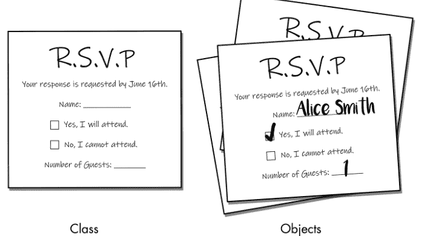
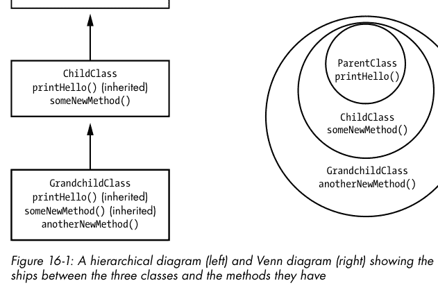
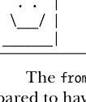
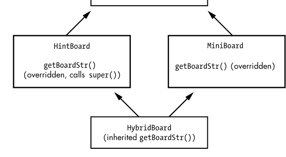

### 第 15 章：面向对象编程和类


*OOP* 是一种编程语言特性，允许你将变量和函数组合成新的数据类型，称为 *classes*，从中可以创建对象。通过将代码组织成类，你可以将单体程序分解为更小、更易于理解和调试的部分。

对于小型程序，OOP 增加的与其说是组织，不如说是官僚主义。尽管某些语言，如 Java，要求你将所有代码组织到类中，但 Python 的 OOP 特性是可选的。程序员如果需要可以使用类，如果不需要也可以忽略。Python 核心开发者 Jack Diederich 的 PyCon 2012 演讲，“Stop Writing Classes” (https://youtu.be/o9pEzgHorH0/)，指出了程序员在更简单的函数或模块即可胜任的情况下仍编写类的许多案例。

尽管如此，作为程序员，你应该熟悉类的基本概念以及它们的工作方式。在本章中，你将学习类是什么、为什么在程序中使用它们，以及背后的语法和编程概念。OOP 是一个广泛的主题，本章仅作为入门。

### 真实世界类比：填写表单

你在生活中很可能多次填写过纸质或电子表单：用于医生就诊、在线购买或婚礼 RSVP。表单作为另一种人或组织收集他们需要了解你的信息的统一方式而存在。不同的表单要求不同类型的信息。你会在医生的表单上报告敏感的医疗状况，并在婚礼 RSVP 上报告你带来的任何客人，但不会反过来。

在 Python 中，class、type 和 data type 含义相同。像纸质或电子表单一样，类是 Python 对象的蓝图（也称为实例），它们包含代表名词的数据。这个名词可能是医生的病人、电子商务购买或婚礼客人。类就像空白的表单模板，而从该类创建的对象就像填写好的表单，包含有关表单所代表的事物类型的实际数据。例如，在图 15-1 中，RSVP 回复表单就像一个类，而填写好的 RSVP 就像一个对象。



图 15-1：婚礼 RSVP 表单模板就像类，而填写好的表单就像对象。

你也可以将类和对象视为电子表格，如图 15-2 所示。


图 15-2：所有 RSVP 数据的电子表格

列标题构成类，而每一行则构成一个对象。

类和对象常被谈论为现实世界中事物的的数据模型，但不要混淆地图和领土。类中包含的内容取决于程序需要做什么。图 15-3 显示了一些代表同一现实世界人物但来自不同类的对象，除了姓名外，它们存储完全不同的信息。

obj = Customer()
obj.name = 'Alice'
obj.customerSince = 2015
obj.numPurchases = 42

obj = Employee()
obj.name = 'Alice'
obj.title = 'Software dev'
obj.employeeID = '1729'


obj = WeddingGuest()
obj.name = 'Alice'
obj.hasRSVPed = True
obj.hasAccepted = True
obj.guests = 1

obj = Patient()
obj.name = 'Alice'
obj.bloodType = 'O-'
obj.allergies = ['eggs', 'pollen']

图 15-3：由不同类创建的四个对象代表同一现实世界人物，具体取决于软件应用程序需要了解该人物的信息

此外，你的类中包含的信息应取决于程序的需求。许多 OOP 教程使用 Car 类作为基本示例，却未指出类中包含的内容完全取决于你编写的软件类型。没有一种通用 Car 类会明显具有 honkHorn() 方法或 numberOfCupholders 属性，只是因为这些是现实世界汽车的特征。你的程序可能是汽车经销商网站、赛车视频游戏或道路交通模拟。汽车经销商网站的 Car 类可能具有 milesPerGallon 或 manufacturersSuggestedRetailPrice 属性（就像汽车经销商的电子表格可能会将这些用作列）。但视频游戏和道路交通模拟不会具有这些属性，因为这些信息与它们无关。视频游戏的 Car 类可能具有 explodeWithLargeFireball() 方法，但汽车经销商和交通模拟 hopefully 不会。

### 从类创建对象

你已经在 Python 中使用过类和对象，即使你自己还没有创建过类。考虑 datetime 模块，它包含一个名为 date 的类。datetime.date 类的对象（也简单称为 datetime.date 对象或 date 对象）代表特定日期。在交互式 shell 中输入以下内容以创建 datetime.date 类的对象：

```
>>> import datetime
>>> birthday = datetime.date(1999, 10, 31) # Pass the year, month, and day.
>>> birthday.year
1999
>>> birthday.month
10
>>> birthday.day
31
>>> birthday.weekday() # weekday() is a method; note the parentheses.
6
```

属性是与对象关联的变量。对 datetime.date() 的调用创建了一个新的 date 对象，使用参数 1999、10、31 初始化，因此该对象代表 1999 年 10 月 31 日。我们将这些参数分配为 date 类的 year、month 和 day 属性，所有 date 对象都有这些属性。

有了这些信息，类的 weekday() 方法可以计算星期几。在此示例中，它返回 6 代表星期日，因为根据 Python 的在线文档，weekday() 的返回值是一个整数，从星期一的 0 开始到星期日的 6。文档列出了 date 类对象拥有的其他几个方法。尽管 date 对象包含多个属性和方法，它仍然是一个单一对象，可以存储在变量中，例如本示例中的 birthday。


## 创建一个简单的类：WizCoin

让我们创建一个 WizCoin 类，它代表一种虚构巫师货币中的硬币数量。在这种货币中，面额有 knuts、sickles（价值 29 knuts）和 galleons（价值 17 sickles 或 493 knuts）。请记住，WizCoin 类中的对象代表硬币的数量，而不是金钱的金额。例如，它会告诉你你持有五枚四分之一和一枚十美分，而不是 $1.35。

在一个名为 wizcoin.py 的新文件中，输入以下代码来创建 WizCoin 类。请注意，__init__ 方法名在 init 前后各有两个下划线（我们将在本章后面“Methods, __init__(), and self”部分讨论 __init__）：

```python
class WizCoin:
    def __init__(self, galleons, sickles, knuts):
        """Create a new WizCoin object with galleons, sickles, and knuts."""
        self.galleons = galleons
        self.sickles = sickles
        self.knuts = knuts
        # NOTE: __init__() methods NEVER have a return statement.

    def value(self):
        """The value (in knuts) of all the coins in this WizCoin object."""
        return (self.galleons * 17 * 29) + (self.sickles * 29) + (self.knuts)

    def weightInGrams(self):
        """Returns the weight of the coins in grams."""
        return (self.galleons * 31.103) + (self.sickles * 11.34) + (self.knuts * 5.0)
```

此程序使用 class 语句 ① 定义了一个名为 WizCoin 的新类。创建类会创建一个新的对象类型。使用 class 语句定义类类似于使用 def 语句定义新函数。在 class 语句后面的代码块中定义了三个方法：__init__()（initializer 的简写）②、value() ③ 和 weightInGrams() ④。请注意，所有方法都有一个名为 self 的第一个参数，我们将在下一节中探讨它。

按惯例，模块名（如我们 wizcoin.py 文件中的 wizcoin）为小写，而类名（如 WizCoin）以大写字母开头。不幸的是，Python 标准库中的某些类，例如 date，并不遵循此惯例。

为了练习创建 WizCoin 类的新对象，请在单独的文件编辑器窗口中输入以下源代码，并将文件保存为 wc_example1.py，与 wizcoin.py 放在同一文件夹中：

```python
import wizcoin

purse = wizcoin.WizCoin(2, 5, 99) # The ints are passed to __init__().
print(purse)
print('G:', purse.galleons, 'S:', purse.sickles, 'K:', purse.knuts)
print('Total value:', purse.value())
print('Weight:', purse.weightInGrams(), 'grams')
print()
coinJar = wizcoin.WizCoin(13, 0, 0) # The ints are passed to __init__().
print(coinJar)
print('G:', coinJar.galleons, 'S:', coinJar.sickles, 'K:', coinJar.knuts)
print('Total value:', coinJar.value())
print('Weight:', coinJar.weightInGrams(), 'grams')
```

对 WizCoin() ① ② 的调用会创建一个 WizCoin 对象并为其运行 __init__() 方法中的代码。我们将三个整数作为参数传递给 WizCoin()，它们会被转发给 __init__() 的参数。这些参数会被分配给对象的 self.galleons、self.sickles 和 self.knuts 属性。请注意，就像 time.sleep() 函数要求你先导入 time 模块并在函数名前加上 time. 一样，我们也必须导入 wizcoin 并在 WizCoin() 函数名前加上 wizcoin.。运行此程序时，输出将类似于以下内容：

```
<wizcoin.WizCoin object at 0x000002136F138080>
G: 2 S: 5 K: 99
Total value: 1230
Weight: 613.906 grams

<wizcoin.WizCoin object at 0x000002136F138128>
G: 13 S: 0 K: 0
Total value: 6409
Weight: 404.339 grams
```

如果出现错误消息，例如 ModuleNotFoundError: No module named 'wizcoin'，请检查你的文件是否命名为 wizcoin.py，并且它与 wc_example1.py 在同一文件夹中。

WizCoin 对象没有有用的字符串表示形式，因此打印 purse 和 coinJar 会显示尖括号之间的内存地址。（你将在第 17 章学习如何更改此设置。）

正如我们可以对字符串对象调用 lower() 字符串方法一样，我们也可以对分配给 purse 和 coinJar 变量的 WizCoin 对象调用 value() 和 weightInGrams() 方法。这些方法根据对象的 galleons、sickles 和 knuts 属性计算值。

类和 OOP 可以带来更易维护的代码——也就是说，更容易在未来阅读、修改和扩展的代码。让我们更详细地探索此类的方法和属性。

## 方法、__init__() 和 self

方法是可以与特定类的对象关联的函数。回想一下，lower() 是一个字符串方法，意味着它是在字符串对象上调用的。你可以在字符串上调用 lower()，例如 'Hello'.lower()，但不能在列表上调用它，例如 ['dog', 'cat'].lower()。另外，请注意方法在对象之后：正确的代码是 'Hello'.lower()，而不是 lower('Hello')。与 lower() 这样的方法不同，像 len() 这样的函数与单一数据类型无关；你可以将字符串、列表、字典和许多其他类型的对象传递给 len()。

正如你在上一节中看到的，我们通过将类名作为函数调用来创建对象。此函数被称为构造函数（或构造器，或缩写为 ctor，发音为“see-tore”），因为它构造了一个新对象。我们也说构造函数实例化了类的一个新实例。

调用构造函数会导致 Python 创建新对象然后运行 __init__() 方法。类不需要有 __init__() 方法，但几乎总是会有。__init__() 方法是通常设置属性初始值的地方。例如，回想一下 WizCoin 的 __init__() 方法如下所示：

```python
def __init__(self, galleons, sickles, knuts):
    """Create a new WizCoin object with galleons, sickles, and knuts."""
    self.galleons = galleons
    self.sickles = sickles
    self.knuts = knuts
# NOTE: __init__() methods NEVER have a return statement.
```

当 wc_example1.py 程序调用 WizCoin(2, 5, 99) 时，Python 会创建一个新的 WizCoin 对象，然后将三个参数（2、5 和 99）传递给一次 __init__() 调用。但 __init__() 方法有四个参数：self、galleons、sickles 和 knuts。原因在于所有方法都有一个名为 self 的第一个参数。当在对象上调用方法时，对象会自动作为 self 参数传入。其余参数会正常分配。如果你看到错误消息，例如 TypeError: __init__() takes 3 positional arguments but 4 were given，你可能忘记在方法的 def 语句中添加 self 参数。

你不必将方法的第一个参数命名为 self；你可以将其命名为任何名称。但使用 self 是惯例，选择不同的名称会使你的代码对其他 Python 程序员来说可读性降低。当你阅读代码时，self 作为第一个参数的存在是你区分方法和函数的最快方式。同样，如果你的方法代码永远不需要使用 self 参数，这表明你的方法可能应该只是一个函数。

WizCoin(2, 5, 99) 的 2、5 和 99 参数不会自动分配给新对象的属性；我们需要在 __init__() 中使用三个赋值语句来完成此操作。通常，__init__() 参数与属性同名，但 self.galleons 中的 self 表明它是一个对象的属性，而 galleons 是一个参数。将构造函数的参数存储在对象的属性中是类 __init__() 方法的常见任务。上一节中的 datetime.date() 调用执行了类似的任务，只是我们传递的三个参数用于新创建的 date 对象的 year、month 和 day 属性。

你之前调用过 int()、str()、float() 和 bool() 函数在数据类型之间转换，例如 str(3.1415) 基于浮点值 3.1415 返回字符串值 '3.1415'。之前，我们将这些描述为

functions, but int, str, float, and bool are actually classes, and the int(), str(), float(), and bool() functions are constructor functions that return new integer, string, float, and Boolean objects. Python's style guide recommends using capitalized camelcase for your class names (like WizCoin), although many of Python's built-in classes don't follow this convention.

Note that calling the WizCoin() construction function returns the new WizCoin object, but the __init__() method never has a return statement with a return value. Adding a return value causes this error: TypeError: __init__() should return None.

## Attributes

Attributes are variables associated with an object. The Python documentation describes attributes as “any name following a dot.” For example, consider the birthday.year expression in the previous section. The year attribute is a name following a dot.

每个对象都有自己的属性集合。当 wcexample1.py 程序创建了两个 WizCoin 对象并将它们存储在 purse 和 coinJar 变量中时，它们的属性具有不同的值。你可以像访问和设置任何变量一样访问和设置这些属性。为了练习设置属性，打开一个新的文件编辑器窗口并输入以下代码，将其保存为与 wizcoin.py 文件相同文件夹下的 wcexample2.py：

```
import wizcoin

change = wizcoin.WizCoin(9, 7, 20)
print(change.sickles) # Prints 7.
change.sickles += 10
print(change.sickles) # Prints 17.

pile = wizcoin.WizCoin(2, 3, 31)
print(pile.sickles) # Prints 3.
pile.someNewAttribute = 'a new attr' # A new attribute is created.
print(pile.someNewAttribute)
```

When you run this program, the output looks like this:

运行此程序时，输出如下所示：

```
7
17
3
a new attr
```

You can think of an object's attributes as similar to a dictionary's keys. You can read and modify their associated values and assign an object new attributes. Technically, methods are considered attributes of a class, as well.

你可以将对象的属性视为类似于字典的键。你可以读取和修改其关联的值，并为对象分配新的属性。严格来说，方法也被视为类的属性。

## Private Attributes and Private Methods

In languages such as C++ or Java, attributes can be marked as having private access, which means the compiler or interpreter only lets code inside the class's methods access or modify the attributes of objects of that class. But
in Python, this enforcement doesn't exist. All attributes and methods are effectively *public access*: code outside of the class can access and modify any attribute in any object of that class.

在 C++ 或 Java 等语言中，属性可以被标记为私有访问，这意味着编译器或解释器只允许类的方法内部的代码访问或修改该类对象的属性。但在 Python 中，这种强制执行并不存在。所有属性和方法实际上都是 *公开访问*：类外部的代码可以访问和修改该类对象的任何属性。

But private access is useful. For example, objects of a BankAccount class could have a balance attribute that only methods of the BankAccount class should have access to. For those reasons, Python's convention is to start *private* attribute or method names with a single underscore. Technically, there is nothing to stop code outside the class from accessing private attributes and methods, but it's a best practice to let only the class's methods access them.

但私有访问是有用的。例如，BankAccount 类的对象可以有一个 balance 属性，只有 BankAccount 类的方法应该能够访问它。出于这些原因，Python 的约定是以单个下划线开头 *私有* 属性或方法名称。严格来说，没有任何东西可以阻止类外部的代码访问私有属性和方法，但最佳实践是只允许类的方法访问它们。

Open a new file editor window, enter the following code, and save it as *privateExample.py*. In it, objects of a BankAccount class have private _name and _balance attributes that only the deposit() and withdraw() methods should directly access:

打开一个新的文件编辑器窗口，输入以下代码，并将其保存为 *privateExample.py*。其中，BankAccount 类的对象具有私有 _name 和 _balance 属性，只有 deposit() 和 withdraw() 方法应该直接访问它们：

```python
class BankAccount:
    def __init__(self, accountHolder):
        # BankAccount methods can access self._balance, but code outside of
        # this class should not:
        self._balance = 0
        self._name = accountHolder
        with open(self._name + 'Ledger.txt', 'w') as ledgerFile:
            ledgerFile.write('Balance is 0\n')

    def deposit(self, amount):
        if amount <= 0:
            return # Don't allow negative "deposits".
        self._balance += amount
        with open(self._name + 'Ledger.txt', 'a') as ledgerFile:
            ledgerFile.write('Deposit ' + str(amount) + '\n')
            ledgerFile.write('Balance is ' + str(self._balance) + '\n')

    def withdraw(self, amount):
        if self._balance < amount or amount < 0:
            return # Not enough in account, or withdraw is negative.
        self._balance -= amount
        with open(self._name + 'Ledger.txt', 'a') as ledgerFile:
            ledgerFile.write('Withdraw ' + str(amount) + '\n')
            ledgerFile.write('Balance is ' + str(self._balance) + '\n')

acct = BankAccount('Alice') # We create an account for Alice.
acct.deposit(120) # _balance can be affected through deposit()
acct.withdraw(40) # _balance can be affected through withdraw()

# Changing _name or _balance outside of BankAccount is impolite, but allowed:
acct._balance = 1000000000
acct.withdraw(1000)

acct._name = 'Bob' # Now we're modifying Bob's account ledger!
acct.withdraw(1000) # This withdrawal is recorded in BobLedger.txt!
```

When you run *privateExample.py*, the ledger files it creates are inaccurate because we modified the _balance and _name outside the class, which resulted in invalid states. *AliceLedger.txt* inexplicably has a lot of money in it:

运行 *privateExample.py* 时，它创建的账本文件不准确，因为我们在类外部修改了 _balance 和 _name，导致了无效状态。*AliceLedger.txt* 不明原因地有很多钱：

```
Balance is 0
Deposit 120
Balance is 120
Withdraw 40
Balance is 80
Withdraw 1000
Balance is 999999000
```

Now there’s a *BobLedger.txt* file with an inexplicable account balance, even though we never created a BankAccount object for Bob:

现在有一个 *BobLedger.txt* 文件，其中有无法解释的账户余额，即使我们从未为 Bob 创建过 BankAccount 对象：

```
Withdraw 1000
Balance is 999998000
```

Well-designed classes will be mostly self-contained, providing methods to adjust the attributes to valid values. The _balance and _name attributes are marked as private ① ②, and the only valid way of adjusting the BankAccount class’s value is through the deposit() and withdraw() methods. These two methods have checks ③ ⑤ to make sure _balance isn’t put into an invalid state (such as a negative integer value). These methods also record each transaction to account for the current balance ④ ⑥.

设计良好的类将主要是自包含的，提供方法将属性调整为有效值。_balance 和 _name 属性被标记为私有 ① ②，调整 BankAccount 类值的唯一有效方式是通过 deposit() 和 withdraw() 方法。这两个方法都有检查 ③ ⑤，以确保 _balance 不会被置于无效状态（例如负整数值）。这些方法还记录每次交易以记账当前余额 ④ ⑥。

Code outside the class that modifies these attributes, such as acct._balance = 1000000000 ⑦ or acct._name = 'Bob' ⑧ instructions, can put the object into an invalid state and introduce bugs (and audits from the bank examiner). By following the underscore prefix convention for private access, you make debugging easier. The reason is that you know the cause of the bug will be in the code in the class instead of anywhere in the entire program.

类外部修改这些属性的代码，例如 acct._balance = 1000000000 ⑦ 或 acct._name = 'Bob' ⑧ 指令，会使对象进入无效状态并引入错误（以及银行检查员的审计）。通过遵循私有访问的下划线前缀约定，你可以使调试更容易。原因在于，你知道错误的原因将在类中的代码中，而不是整个程序的任何地方。

Note that unlike Java and other languages, Python has no need for public getter and setter methods for private attributes. Instead Python uses properties, as explained in Chapter 17.

请注意，与 Java 和其他语言不同，Python 不需要为私有属性提供公共的 getter 和 setter 方法。相反，Python 使用属性，如第 17 章所述。

## The type() Function and __qualname__ Attribute

Passing an object to the built-in type() function tells us the object’s data type through its return value. The objects returned from the type() function are type objects, also called class objects. Recall that the terms type, data type, and class all have the same meaning in Python. To see what the type() function returns for various values, enter the following into the interactive shell:

将对象传递给内置的 type() 函数可通过其返回值告诉我们对象的数据类型。type() 函数返回的对象是类型对象，也称为类对象。请记住，在 Python 中，type、数据类型和 class 这三个术语具有相同的含义。要查看 type() 函数对各种值返回什么，请在交互式 shell 中输入以下内容：

```
>>> type(42)  # The object 42 has a type of int.
<class 'int'>
>>> int  # int is a type object for the integer data type.
<class 'int'>
>>> type(42) == int  # Type check 42 to see if it is an integer.
True
>>> type('Hello') == int  # Type check 'Hello' against int.
False
>>> import wizcoin
>>> type(42) == wizcoin.WizCoin  # Type check 42 against WizCoin.
False
>>> purse = wizcoin.WizCoin(2, 5, 10)
>>> type(purse) == wizcoin.WizCoin # Type check purse against WizCoin.
True
```

Note that int is a type object and is the same kind of object as what type(42) returns, but it can also be called as the int() constructor function: the int('42') function doesn't convert the '42' string argument; instead, it returns an integer object based on the argument.

请注意，int 是一个类型对象，与 type(42) 返回的对象是同一种对象，但它也可以作为 int() 构造函数调用：int('42') 函数不会转换 '42' 字符串参数；相反，它会基于参数返回一个整数对象。

Say you need to log some information about the variables in your program to help you debug them later. You can only write strings to a logfile, but passing the type object to str() will return a rather messy-looking string. Instead, use the __qualname__ attribute, which all type objects have, to write a simpler, human-readable string:

假设你需要记录程序中变量的一些信息以便以后调试。你只能向日志文件写入字符串，但将类型对象传递给 str() 会返回一个看起来相当杂乱的字符串。相反，使用所有类型对象都有的 __qualname__ 属性来写入更简单、人类可读的字符串：

```
>>> str(type(42))  # Passing the type object to str() returns a messy string.
"<class 'int'>"
>>> type(42).__qualname__ # The __qualname__ attribute is nicer looking.
'int'
```

The __qualname__ attribute is most often used for overriding the __repr__() method, which is explained in more detail in Chapter 17.

__qualname__ 属性最常用于覆盖 __repr__() 方法，详情请参见第 17 章。

## Non-OOP vs. OOP Examples: Tic-Tac-Toe

At first, it can be difficult to see how to use classes in your programs. Let's look at an example of a short tic-tac-toe program that doesn't use classes, and then rewrite it so it does.

起初，很难看出如何在程序中使用类。让我们看一个不使用类的简短井字棋程序的示例，然后将其重写以使用类。

Open a new file editor window and enter the following program; then save it as tictactoe.py:

打开一个新的文件编辑器窗口并输入以下程序；然后将其保存为 tictactoe.py：

```
# tictactoe.py, A non-OOP tic-tac-toe game.

ALL_SPACES = list('123456789')  # The keys for a TTT board dictionary.
X, O, BLANK = 'X', 'O', ' '  # Constants for string values.

def main():
    """Runs a game of tic-tac-toe."""
    print('Welcome to tic-tac-toe!')
    gameBoard = getBlankBoard()  # Create a TTT board dictionary.
    currentPlayer, nextPlayer = X, O  # X goes first, O goes next.

    while True:
        print(getBoardStr(gameBoard))  # Display the board on the screen.

        # Keep asking the player until they enter a number 1-9:
```

move = None
while not isValidSpace(gameBoard, move):
    print(f"What is {currentPlayer}'s move? (1-9)")
    move = input()
updateBoard(gameBoard, move, currentPlayer)  # Make the move.

# Check if the game is over:
if isWinner(gameBoard, currentPlayer):  # First check for victory.
    print(getBoardStr(gameBoard))
    print(currentPlayer + ' has won the game!')
    break
elif isBoardFull(gameBoard):  # Next check for a tie.
    print(getBoardStr(gameBoard))
    print('The game is a tie!')
    break
currentPlayer, nextPlayer = nextPlayer, currentPlayer  # Swap turns.
print('Thanks for playing!')

def getBlankBoard():
    """Create a new, blank tic-tac-toe board."""
    board = {}  # The board is represented as a Python dictionary.
    for space in ALL_SPACES:
        board[space] = BLANK  # All spaces start as blank.
    return board

def getBoardStr(board):
    """Return a text-representation of the board."""
    return f'''
{board['1']}{board['2']}{board['3']} 1 2 3
-+-+
{board['4']}{board['5']}{board['6']} 4 5 6
-+-+
{board['7']}{board['8']}{board['9']} 7 8 9'''

def isValidSpace(board, space):
    """Returns True if the space on the board is a valid space number
and the space is blank."""
    return space in ALL_SPACES and board[space] == BLANK

def isWinner(board, player):
    """Return True if player is a winner on this TTTBoard."""
    b, p = board, player  # Shorter names as "syntactic sugar".
    # Check for 3 marks across the 3 rows, 3 columns, and 2 diagonals.
    return ((b['1'] == b['2'] == b['3'] == p) or  # Across the top
            (b['4'] == b['5'] == b['6'] == p) or  # Across the middle
            (b['7'] == b['8'] == b['9'] == p) or  # Across the bottom
            (b['1'] == b['4'] == b['7'] == p) or  # Down the left
            (b['2'] == b['5'] == b['8'] == p) or  # Down the middle
            (b['3'] == b['6'] == b['9'] == p) or  # Down the right
            (b['3'] == b['5'] == b['7'] == p) or  # Diagonal
            (b['1'] == b['5'] == b['9'] == p))   # Diagonal

def isBoardFull(board):
    """Return True if every space on the board has been taken."""
for space in ALL_SPACES:
    if board[space] == BLANK:
        return False  # If a single space is blank, return False.
return True  # No spaces are blank, so return True.

def updateBoard(board, space, mark):
    """Sets the space on the board to mark."""
    board[space] = mark

if __name__ == '__main__':
    main() # Call main() if this module is run, but not when imported.

运行此程序时，输出看起来会像这样：

```
Welcome to tic-tac-toe!

    | |   1 2 3
    -+-+
    | |   4 5 6
    -+-+
    | |   7 8 9
What is X's move? (1-9)
1

    X| |   1 2 3
    -+-+
    | |   4 5 6
    -+-+
    | |   7 8 9
What is O's move? (1-9)
--snip--
    X| |O 1 2 3
    -+-+
    |O|   4 5 6
    -+-+
    X|O|X 7 8 9
What is X's move? (1-9)
4

    X| |O 1 2 3
    -+-+
    X|O|   4 5 6
    -+-+
    X|O|X 7 8 9
X has won the game!
Thanks for playing!
```

简而言之，此程序通过使用字典对象来表示井字棋板上的九个空格。字典的键是字符串 '1' 到 '9'，其值是字符串 'X'、'O' 或 ' '。编号的空格排列方式与电话键盘相同。

tictactoe.py 中的函数执行以下操作：

-   `main()` 函数包含创建新棋盘数据结构（存储在 gameBoard 变量中）的代码，并调用程序中的其他函数。
-   `getBlankBoard()` 函数返回一个字典，将九个空格设为 ' ' 以表示空白棋盘。
-   `getBoardStr()` 函数接受表示棋盘的字典，并返回可打印到屏幕的多行字符串表示形式。这是游戏显示的井字棋板文本的渲染方式。
-   `isValidSpace()` 函数如果传入的是有效空格编号且该空格为空，则返回 True。
-   `isWinner()` 函数的参数接受棋盘字典和 'X' 或 'O'，以确定该玩家在棋盘上是否有三枚标记连成一线。
-   `isBoardFull()` 函数确定棋盘上是否没有空白空格，即游戏已结束。`updateBoard()` 函数的参数接受棋盘字典、一个空格以及玩家的 X 或 O 标记，并更新字典。

请注意，许多函数将变量 board 作为第一个参数接受。这意味着这些函数彼此相关，因为它们都操作同一个数据结构。

当代码中的多个函数都操作同一个数据结构时，通常最好将它们作为类的方法和属性组合在一起。让我们在 tictactoe.py 程序中重新设计，使用 TTTBoard 类来将棋盘字典存储在名为 spaces 的属性中。原本带有 board 参数的函数将成为 TTTBoard 类的方法，并使用 self 参数代替 board 参数。

打开一个新的文件编辑器窗口，输入以下代码，并将其保存为 tictactoe_oop.py：

```python
# tictactoe_oop.py, an object-oriented tic-tac-toe game.

ALL_SPACES = list('123456789')  # The keys for a TTT board.
X, O, BLANK = 'X', 'O', ' '  # Constants for string values.

def main():
    """Runs a game of tic-tac-toe."""
    print('Welcome to tic-tac-toe!')
    gameBoard = TTTBoard()  # Create a TTT board object.
    currentPlayer, nextPlayer = X, O # X goes first, O goes next.

    while True:
        print(gameBoard.getBoardStr())  # Display the board on the screen.

        # Keep asking the player until they enter a number 1-9:
        move = None
while not gameBoard.isValidSpace(move):
    print(f'What is {currentPlayer}\'s move? (1-9)')
    move = input()
gameBoard.updateBoard(move, currentPlayer)  # Make the move.

# Check if the game is over:
if gameBoard.isWinner(currentPlayer):  # First check for victory.
    print(gameBoard.getBoardStr())
    print(currentPlayer + ' has won the game!')
    break
elif gameBoard.isBoardFull():  # Next check for a tie.
    print(gameBoard.getBoardStr())
    print('The game is a tie!')
    break
currentPlayer, nextPlayer = nextPlayer, currentPlayer  # Swap turns.
print('Thanks for playing!')

class TTTBoard:
    def __init__(self, usePrettyBoard=False, useLogging=False):
        """Create a new, blank tic tac toe board."""
        self._spaces = {}  # The board is represented as a Python dictionary.
        for space in ALL_SPACES:
            self._spaces[space] = BLANK  # All spaces start as blank.

    def getBoardStr(self):
        """Return a text-representation of the board."""
        return f'''
{self._spaces['1']}|{self._spaces['2']}|{self._spaces['3']} 1 2 3
-+-+
{self._spaces['4']}|{self._spaces['5']}|{self._spaces['6']} 4 5 6
-+-+
{self._spaces['7']}|{self._spaces['8']}|{self._spaces['9']} 7 8 9'''

    def isValidSpace(self, space):
        """Returns True if the space on the board is a valid space number
        and the space is blank."""
        return space in ALL_SPACES and self._spaces[space] == BLANK

    def isWinner(self, player):
        """Return True if player is a winner on this TTTBoard."""
        s, p = self._spaces, player  # Shorter names as "syntactic sugar".
        # Check for 3 marks across the 3 rows, 3 columns, and 2 diagonals.
        return ((s['1'] == s['2'] == s['3'] == p) or # Across the top
                (s['4'] == s['5'] == s['6'] == p) or # Across the middle
                (s['7'] == s['8'] == s['9'] == p) or # Across the bottom
                (s['1'] == s['4'] == s['7'] == p) or # Down the left
                (s['2'] == s['5'] == s['8'] == p) or # Down the middle
                (s['3'] == s['6'] == s['9'] == p) or # Down the right
                (s['3'] == s['5'] == s['7'] == p) or # Diagonal
                (s['1'] == s['5'] == s['9'] == p))  # Diagonal

    def isBoardFull(self):
        """Return True if every space on the board has been taken."""


```
for space in ALL_SPACES:
    if self._spaces[space] == BLANK:
        return False  # If a single space is blank, return False.
    return True  # No spaces are blank, so return True.

def updateBoard(self, space, player):
    """Sets the space on the board to player."""
    self._spaces[space] = player

if __name__ == '__main__':
    main() # Call main() if this module is run, but not when imported.
```

功能上，这个程序与非面向对象的井字游戏程序相同。输出看起来完全一样。我们将原本在 getBlankBoard() 中的代码移到了 TTTBoard 类的 __init__() 方法中，因为它们执行相同的任务，即准备棋盘数据结构。我们将其他函数转换为方法，用 self 参数替换了旧的 board 参数，因为它们也具有类似的目的：它们都是操作井字游戏棋盘数据结构的代码块。

当这些方法中的代码需要更改存储在 _spaces 属性中的字典时，代码使用 self._spaces。当这些方法中的代码需要调用其他方法时，调用也会以 self 和一个点号为前缀。这与“Creating a Simple Class: WizCoin”中 coinJars.values() 的情况类似，其中 coinJars 变量中有一个对象。在此示例中，具有要调用的方法的对象位于 self 变量中。

另外，请注意 _spaces 属性以下划线开头，这意味着只有 TTTBoard 的方法内部的代码才应访问或修改它。类外部的代码只能通过调用修改它的[content]
```
for space in ALL_SPACES:
    if self._spaces[space] == BLANK:
        return False  # If a single space is blank, return False.
    return True  # No spaces are blank, so return True.

def updateBoard(self, space, player):
    """Sets the space on the board to player."""
    self._spaces[space] = player

if __name__ == '__main__':
    main() # Call main() if this module is run, but not when imported.
```

功能上，这个程序与非面向对象的井字游戏程序相同。输出看起来完全一样。我们将原本在 getBlankBoard() 中的代码移到了 TTTBoard 类的 __init__() 方法中，因为它们执行相同的任务，即准备棋盘数据结构。我们将其他函数转换为方法，用 self 参数替换了旧的 board 参数，因为它们也具有类似的目的：它们都是操作井字游戏棋盘数据结构的代码块。

当这些方法中的代码需要更改存储在 _spaces 属性中的字典时，代码使用 self._spaces。当这些方法中的代码需要调用其他方法时，调用也会以 self 和一个点号为前缀。这与“Creating a Simple Class: WizCoin”中 coinJars.values() 的情况类似，其中 coinJars 变量中有一个对象。在此示例中，具有要调用的方法的对象位于 self 变量中。

另外，请注意 _spaces 属性以下划线开头，这意味着只有 TTTBoard 的方法内部的代码才应访问或修改它。类外部的代码只能通过调用修改它的[content]
```
for space in ALL_SPACES:
    if self._spaces[space] == BLANK:
        return False  # If a single space is blank, return False.
    return True  # No spaces are blank, so return True.

def updateBoard(self, space, player):
    """Sets the space on the board to player."""
    self._spaces[space] = player

if __name__ == '__main__':
    main() # Call main() if this module is run, but not when imported.
```

功能上，这个程序与非面向对象的井字游戏程序相同。输出看起来完全一样。我们将原本在 getBlankBoard() 中的代码移到了 TTTBoard 类的 __init__() 方法中，因为它们执行相同的任务，即准备棋盘数据结构。我们将其他函数转换为方法，用 self 参数替换了旧的 board 参数，因为它们也具有类似的目的：它们都是操作井字游戏棋盘数据结构的代码块。

当这些方法中的代码需要更改存储在 _spaces 属性中的字典时，代码使用 self._spaces。当这些方法中的代码需要调用其他方法时，调用也会以 self 和一个点号为前缀。这与“Creating a Simple Class: WizCoin”中 coinJars.values() 的情况类似，其中 coinJars 变量中有一个对象。在此示例中，具有要调用的方法的对象位于 self 变量中。

另外，请注意 _spaces 属性以下划线开头，这意味着只有 TTTBoard 的方法内部的代码才应访问或修改它。类外部的代码只能通过调用修改它的[content]
```
for space in ALL_SPACES:
    if self._spaces[space] == BLANK:
        return False  # If a single space is blank, return False.
    return True  # No spaces are blank, so return True.

def updateBoard(self, space, player):
    """Sets the space on the board to player."""
    self._spaces[space] = player

if __name__ == '__main__':
    main() # Call main() if this module is run, but not when imported.
```

功能上，这个程序与非面向对象的井字游戏程序相同。输出看起来完全一样。我们将原本在 getBlankBoard() 中的代码移到了 TTTBoard 类的 __init__() 方法中，因为它们执行相同的任务，即准备棋盘数据结构。我们将其他函数转换为方法，用 self 参数替换了旧的 board 参数，因为它们也具有类似的目的：它们都是操作井字游戏棋盘数据结构的代码块。

当这些方法中的代码需要更改存储在 _spaces 属性中的字典时，代码使用 self._spaces。当这些方法中的代码需要调用其他方法时，调用也会以 self 和一个点号为前缀。这与“Creating a Simple Class: WizCoin”中 coinJars.values() 的情况类似，其中 coinJars 变量中有一个对象。在此示例中，具有要调用的方法的对象位于 self 变量中。

另外，请注意 _spaces 属性以下划线开头，这意味着只有 TTTBoard 的方法内部的代码才应访问或修改它。类外部的代码只能通过调用修改它的[content]
```
for space in ALL_SPACES:
    if self._spaces[space] == BLANK:
        return False  # If a single space is blank, return False.
    return True  # No spaces are blank, so return True.

def updateBoard(self, space, player):
    """Sets the space on the board to player."""
    self._spaces[space] = player

if __name__ == '__main__':
    main() # Call main() if this module is run, but not when imported.
```

功能上，这个程序与非面向对象的井字游戏程序相同。输出看起来完全一样。我们将原本在 getBlankBoard() 中的代码移到了 TTTBoard 类的 __init__() 方法中，因为它们执行相同的任务，即准备棋盘数据结构。我们将其他函数转换为方法，用 self 参数替换了旧的 board 参数，因为它们也具有类似的目的：它们都是操作井字游戏棋盘数据结构的代码块。

当这些方法中的代码需要更改存储在 _spaces 属性中的字典时，代码使用 self._spaces。当这些方法中的代码需要调用其他方法时，调用也会以 self 和一个点号为前缀。这与“Creating a Simple Class: WizCoin”中 coinJars.values() 的情况类似，其中 coinJars 变量中有一个对象。在此示例中，具有要调用的方法的对象位于 self 变量中。

另外，请注意 _spaces 属性以下划线开头，这意味着只有 TTTBoard 的方法内部的代码才应访问或修改它。类外部的代码只能通过调用修改它的[content]
```
for space in ALL_SPACES:
    if self._spaces[space] == BLANK:
        return False  # If a single space is blank, return False.
    return True  # No spaces are blank, so return True.

def updateBoard(self, space, player):
    """Sets the space on the board to player."""
    self._spaces[space] = player

if __name__ == '__main__':
    main() # Call main() if this module is run, but not when imported.
```

功能上，该程序与非面向对象的井字游戏程序相同，输出也完全一致。我们把原来在 getBlankBoard() 中的代码移到了 TTTBoard 类的 __init__() 方法，因为两者都用于准备棋盘数据结构。我们把其他函数改写为方法，用 self 参数取代原来的 board 参数，因为它们同样是对井字游戏棋盘数据结构进行操作的[content]
```
for space in ALL_SPACES:
    if self._spaces[space] == BLANK:
        return False  # If a single space is blank, return False.
    return True  # No spaces are blank, so return True.

def updateBoard(self, space, player):
    """Sets the space on the board to player."""
    self._spaces[space] = player

if __name__ == '__main__':
    main() # Call main() if this module is run, but not when imported.
```

功能上，该程序与非面向对象的井字游戏程序相同，输出也完全一致。我们把原来在 getBlankBoard() 中的代码移到了 TTTBoard 类的 __init__() 方法，因为两者都用于准备棋盘数据结构。我们把其他函数改写为方法，用 self 参数取代原来的 board 参数，因为它们同样是对井字游戏棋盘数据结构进行操作的[content]
```
for space in ALL_SPACES:
    if self._spaces[space] == BLANK:
        return False  # If a single space is blank, return False.
    return True  # No spaces are blank, so return True.

def updateBoard(self, space, player):
    """Sets the space on the board to player."""
    self._spaces[space] = player

if __name__ == '__main__':
    main() # Call main() if this module is run, but not when imported.
```

功能上，该程序与非面向对象的井字游戏程序相同。


我们创建了三个名为 ParentClass ①、ChildClass ② 和 GrandchildClass ③ 的类。ChildClass 继承自 ParentClass，这意味着 ChildClass 将拥有 ParentClass 的所有相同方法。我们说 ChildClass 从 ParentClass 继承方法。此外，GrandchildClass 继承自 ChildClass，因此它拥有 ChildClass 以及其父类 ParentClass 的所有相同方法。

使用这种技术，我们实际上是将 printHello() 方法 ② 的代码复制并粘贴到了 ChildClass 和 GrandchildClass 类中。我们对 printHello() 中的代码所做的任何更改不仅会更新 ParentClass，还会更新 ChildClass 和 GrandchildClass。这与更改函数中的代码会更新其所有函数调用相同。你可以在图 16-1 中看到这种关系。请注意，在类图中，箭头是从子类指向基类绘制的。这反映了类总是知道其基类但不会知道其子类的事实。



图 16-1：层次结构图（左）和 Venn 图（右），显示三个类之间以及它们所拥有的方法的关联

通常说父子类表示“是一种”关系。ChildClass 对象是一个 ParentClass 对象，因为它拥有 ParentClass 对象所拥有的所有方法，包括它自己定义的一些额外方法。这种关系是单向的：ParentClass 对象不是 ChildClass 对象。如果 ParentClass 对象尝试调用 someNewMethod()，而该方法仅存在于 ChildClass 对象（以及 ChildClass 的子类）中，Python 会引发 AttributeError。

程序员经常认为相关类必须符合某种现实世界的“是一种”层级。OOP 教程通常有 Vehicle ▸ FourWheelVehicle ▸ Car、Animal ▸ Bird ▸ Sparrow 或 Shape ▸ Rectangle ▸ Square 的父类、子类和孙子类。但请记住，继承的主要目的是代码重用。如果你的程序需要一个类，其方法集合是另一个类方法的完整超集，继承可以让你避免复制和粘贴代码。

我们有时也将子类称为 subclass 或 derived class，并将父类称为 super class 或 base class。

## 重写方法

子类继承其父类的所有方法。但子类可以通过提供自己的代码来重写继承的方法。子类的重写方法将与父类的方法具有相同的名称。

为了说明这一概念，让我们回到上一章中创建的井字游戏。这次，我们将创建一个新类 MiniBoard，它继承自 TTTBoard 并重写 getBoardStr() 以提供更小的井字棋盘绘制。程序会询问玩家使用哪种棋盘样式。我们不需要复制和粘贴 TTTBoard 的其余方法，因为 MiniBoard 将继承它们。

将以下内容添加到你的 tictactoe_oop.py 文件末尾，以创建原始 TTTBoard 类的子类然后重写 getBoardStr() 方法：

```python
class MiniBoard(TTTBoard):
    def getBoardStr(self):
        """Return a tiny text-representation of the board."""
        # Change blank spaces to a '.'
        for space in ALL_SPACES:
            if self._spaces[space] == BLANK:
                self._spaces[space] = '.'

        boardStr = f'''{self._spaces['1']}{self._spaces['2']}{self._spaces['3']} 123
        {self._spaces['4']}{self._spaces['5']}{self._spaces['6']} 456
        {self._spaces['7']}{self._spaces['8']}{self._spaces['9']} 789'''

        # Change '.' back to blank spaces.
        for space in ALL_SPACES:
            if self._spaces[space] == '.':
                self._spaces[space] = BLANK
        return boardStr
```

与 TTTBoard 类的 getBoardStr() 方法一样，MiniBoard 的 getBoardStr() 方法创建了一个多行字符串的井字棋盘，当传递给 print() 函数时用于显示。但这个字符串要小得多，去掉了 X 和 O 标记之间的线条，并使用句点表示空白。

更改 main() 中的这一行，使其实例化 MiniBoard 对象而不是 TTTBoard 对象：

```python
if input('Use mini board? Y/N: ').lower().startswith('y'):
    gameBoard = MiniBoard() # Create a MiniBoard object.
else:
    gameBoard = TTTBoard() # Create a TTTBoard object.
```

除了对 main() 的这一行更改外，其余程序的工作方式与之前相同。现在运行程序时，输出将类似于这样：

```
Welcome to Tic-Tac-Toe!
Use mini board? Y/N: y

    ... 123
    ... 456
    ... 789
What is X's move? (1-9)
1

    X.. 123
    ... 456
    ... 789
What is O's move? (1-9)
--snip--
    XXX 123
    .OO 456
    O.X 789
X has won the game!
Thanks for playing!
```

你的程序现在可以轻松拥有这两种井字棋盘类的实现。当然，如果你只想要棋盘的迷你版本，你可以简单地替换 TTTBoard 的 getBoardStr() 方法中的代码。但如果两者都需要，继承让你可以通过重用其通用代码轻松创建两个类。

如果我们不使用继承，我们可以，例如，为 TTTBoard 添加一个名为 useMiniBoard 的新属性，并在 getBoardStr() 内部放置一个 if-else 语句来决定何时显示常规棋盘或迷你棋盘。对于如此简单的更改，这会很好用。但如果 MiniBoard 子类需要重写 2、3 甚至 100 个方法怎么办？如果我们想创建 TTTBoard 的几个不同子类怎么办？不使用继承会导致方法内部出现 if-else 语句的爆炸以及代码复杂度的大幅增加。通过使用子类和重写方法，我们可以将代码更好地组织到单独的类中以处理这些不同的用例。

## super() 函数

子类的重写方法通常与父类的方法相似。尽管继承是一种代码重用技术，重写方法可能会导致你将父类方法中的相同代码重写为子类方法的一部分。为了防止这种重复代码，内置的 super() 函数允许重写方法调用父类中的原始方法。

例如，让我们创建一个名为 HintBoard 的新类，它继承自 TTTBoard。新类重写了 getBoardStr()，因此在绘制井字棋盘后，如果 X 或 O 在下一次移动中可以获胜，它还会添加一个提示。这意味着 HintBoard 类的 getBoardStr() 方法必须执行 TTTBoard 类的 getBoardStr() 方法绘制井字棋盘所需的所有相同任务。无需重复执行此操作的代码，我们可以使用 super() 从 HintBoard 类的 getBoardStr() 方法调用 TTTBoard 类的 getBoardStr() 方法。将以下内容添加到你的 tictactoe_oop.py 文件末尾：

```python
class HintBoard(TTTBoard):
    def getBoardStr(self):
        """Return a text-representation of the board with hints."""
        boardStr = super().getBoardStr() # Call getBoardStr() in TTTBoard.

        xCanWin = False
        oCanWin = False
        originalSpaces = self._spaces # Backup _spaces.
        for space in ALL_SPACES: # Check each space:
            # Simulate X moving on this space:
            self._spaces = copy.copy(originalSpaces)
            if self._spaces[space] == BLANK:
                self._spaces[space] = X
            if self.isWinner(X):
                xCanWin = True
            # Simulate O moving on this space:
            self._spaces = copy.copy(originalSpaces)
            if self._spaces[space] == BLANK:
                self._spaces[space] = O
            if self.isWinner(O):
                oCanWin = True
        if xCanWin:
            boardStr += '\nX can win in one more move.'
        if oCanWin:
            boardStr += '\nO can win in one more move.'
        self._spaces = originalSpaces
        return boardStr
```

首先，super().getBoardStr() ① 运行父类 TTTBoard 的 getBoardStr() 方法内部的代码，该代码返回井字棋盘的字符串。我们暂时将此字符串保存在名为 boardStr 的变量中。通过重用 TTTBoard 类的 getBoardStr() 创建棋盘字符串后，此方法中的其余代码处理生成提示。getBoardStr() 方法随后将 xCanWin 和 oCanWin 变量设为 False，并将 self._spaces 字典备份到 originalSpaces 变量 ②。然后一个 for 循环遍历从 '1' 到 '9' 的所有棋盘空格。在循环内部，self._spaces 属性被设为 originalSpaces 字典的副本，如果当前循环的空格为空，则在那里放置一个 X。这模拟了 X 在此空白处进行下一次移动。调用 self.isWinner() 将确定这是否会是获胜移动，如果是，则将 xCanWin 设为 True。然后这些步骤对 O 重复执行，以查看 O 是否可以通过在此空格移动来获胜 ③。此方法使用 copy 模块来复制 self._spaces 中的字典，因此在 tictactoe.py 顶部添加以下行：

```python
import copy
```

接下来，修改 main() 中的这一行，使其实例化 HintBoard 对象而不是 TTTBoard 对象：

```
gameBoard = HintBoard() # Create a TTT board object.
```

除了对 main() 的这一行更改外，其余程序与之前完全一样。现在运行程序时，输出看起来会像这样：

```
Welcome to Tic-Tac-Toe!
--snip--
    X| |   1 2 3
    -+-+
    | |0   4 5 6
    -+-+
    | |X   7 8 9
X can win in one more move.
What is O's move? (1-9)
5

    X| |   1 2 3
    -+-+
    |O|0   4 5 6
    -+-+
    | |X   7 8 9
O can win in one more move.
--snip--
The game is a tie!
Thanks for playing!
```

在方法末尾，如果 xCanWin 或 oCanWin 为 True，则会在 boardStr 字符串中添加一条相应的额外消息。最后返回 boardStr。

并非每个被重写的方法都需要使用 super()！如果一个类的重写方法与父类中被重写的方法完全不同，则无需使用 super() 调用被重写的方法。super() 函数在类具有多个父方法时尤其有用，如本章后面“多重继承”部分所述。

## 优先使用组合而非继承

继承是代码复用的绝佳技术，你可能想立即在所有类中使用它。但你可能并不总是希望基类和子类紧密耦合。创建多层继承带来的更多是官僚主义，而非组织性。

虽然你可以使用继承来处理具有“is a”关系的类（换句话说，当子类是父类的一种时），但对于具有“has a”关系的类，使用一种称为组合的技术往往更有利。组合是一种类设计技术，即在你的类中包含对象，而不是继承这些对象的类。这就是我们在类中添加
属性时所做的事情。在使用继承设计类时，优先考虑组合而非继承。这正是我们在本章和上一章的所有示例中所做的，如以下列表所述：

- 一个 WizCoin 对象“拥有”加隆、锡克尔和纳特硬币的数量。
- 一个 TTTBoard 对象“拥有”九个格子的集合。
- 一个 MiniBoard 对象“是” TTTBoard 对象，因此它也“拥有”九个格子的集合。
- 一个 HintBoard 对象“是” TTTBoard 对象，因此它也“拥有”九个格子的集合。

让我们回到上一章的 WizCoin 类。如果我们创建一个新的 WizardCustomer 类来表示魔法世界中的顾客，这些顾客会携带一定数量的金钱，我们可以用 WizCoin 类来表示。但这两个类之间没有“is a”关系；WizardCustomer 对象不是 WizCoin 对象的一种。如果使用继承，可能会产生一些别扭的代码：

```
import wizcoin

class WizardCustomer(wizcoin.WizCoin):
    def __init__(self, name):
        self.name = name
        super().__init__(0, 0, 0)

wizard = WizardCustomer('Alice')
print(f'{wizard.name} has {wizard.value()} knuts worth of money.')
print(f'{wizard.name}\'s coins weigh {wizard.weightInGrams()} grams.')
```

在这个示例中，WizardCustomer 继承了 WizCoin 对象的 方法，例如 value() 和 weightInGrams()。从技术上讲，继承自 WizCoin 的 WizardCustomer 可以完成与将 WizCoin 对象作为属性包含的 WizardCustomer 相同的任务。但 wizard.value() 和 wizard.weightInGrams() 方法名具有误导性：它们似乎会返回巫师的价值和重量，而不是巫师硬币的价值和重量。此外，如果我们以后想为巫师的体重添加 weightInGrams() 方法，该方法名已经被占用了。

最好将 WizCoin 对象作为属性，因为巫师顾客“拥有”一定数量的巫师硬币：

```
import wizcoin

class WizardCustomer:
    def __init__(self, name):
        self.name = name
        self.purse = wizcoin.WizCoin(0, 0, 0)

wizard = WizardCustomer('Alice')
print(f'{wizard.name} has {wizard.purse.value()} knuts worth of money.')
print(f'{wizard.name}\'s coins weigh {wizard.purse.weightInGrams()} grams.')
```

与其让 WizardCustomer 类继承 WizCoin 的方法，我们给 WizardCustomer 类一个 purse 属性 ①，其中包含一个 WizCoin 对象。当你使用组合时，对 WizCoin 类方法的任何更改都不会改变 WizardCustomer 类的方法。这种技术为两个类的未来设计更改提供了更大的灵活性，并带来更易维护的代码。

## 继承的弊端

继承的主要弊端是，对父类所做的任何未来更改都必然会被其所有子类继承。在大多数情况下，这种紧密耦合正是你想要的。但在某些情况下，你的代码需求无法轻松适应你的继承模型。

例如，假设我们在一个车辆模拟程序中有 Car、Motorcycle 和 LunarRover 类。它们都需要类似的方法，例如 startIgnition() 和 changeTire()。与其将这段代码复制粘贴到每个类中，我们可以创建一个父类 Vehicle，并让 Car、Motorcycle 和 LunarRover 继承它。现在如果我们需要在 changeTire() 方法中修复一个错误，只有一个地方需要更改。这在我们有数十个继承自 Vehicle 的不同车辆相关类时尤其有帮助。这些类的代码看起来像这样：

```
class Vehicle:
    def __init__(self):
        print('Vehicle created.')
    def startIgnition(self):
        pass  # Ignition starting code goes here.
    def changeTire(self):
        pass  # Tire changing code goes here.

class Car(Vehicle):
    def __init__(self):
        print('Car created.')

class Motorcycle(Vehicle):
    def __init__(self):
        print('Motorcycle created.')

class LunarRover(Vehicle):
    def __init__(self):
        print('LunarRover created.')
```

但对 Vehicle 的所有未来更改也会影响这些子类。如果我们需要一个 changeSparkPlug() 方法会怎样？汽车和摩托车有带火花塞的内燃机，但月球漫游车没有。通过优先使用组合而非继承，我们可以创建单独的 CombustionEngine 和 ElectricEngine 类。然后我们设计 Vehicle 类，使其“has an”
engine 属性，可以是 CombustionEngine 或 ElectricEngine 对象，并具有适当的方法：

```
class CombustionEngine:
    def __init__(self):
        print('Combustion engine created.')
    def changeSparkPlug(self):
        pass  # Spark plug changing code goes here.

class ElectricEngine:
    def __init__(self):
        print('Electric engine created.')

class Vehicle:
    def __init__(self):
        print('Vehicle created.')
        self.engine = CombustionEngine()  # Use this engine by default.
--snip--

class LunarRover(Vehicle):
    def __init__(self):
        print('LunarRover created.')
        self.engine = ElectricEngine()
```

这可能需要重写大量代码，特别是如果你有几个类继承自现有的 Vehicle 类：所有 vehicleObj.changeSparkPlug() 调用都需要变为 vehicleObj.engine.changeSparkPlug()，适用于 Vehicle 类或其子类的每个对象。由于如此大规模的更改可能会引入错误，你可能只想让 LunarVehicle 的 changeSparkPlug() 方法什么都不做。在这种情况下，Pythonic 的做法是在 LunarVehicle 类内部将 changeSparkPlug 设置为 None：

```
class LunarRover(Vehicle):
    changeSparkPlug = None
    def __init__(self):
        print('LunarRover created.')
```

changeSparkPlug = None 行遵循本章后面“类属性”部分所述的语法。这会覆盖从 Vehicle 继承的 changeSparkPlug() 方法，因此使用 LunarRover 对象调用它会引发错误：

```
>>> myVehicle = LunarRover()
LunarRover created.
>>> myVehicle.changeSparkPlug()
Traceback (most recent call last):
  File "<stdin>", line 1, in <module>
TypeError: 'NoneType' object is not callable
```

此错误使我们能够快速失败，并在尝试使用 LunarRover 对象调用此不适当方法时立即发现问题。LunarRover 的任何子类也会继承 changeSparkPlug() 的此 None 值。TypeError: 'NoneType' object is not callable 错误消息告诉我们程序员

LunarRover 类有意将 changeSparkPlug() 方法设为 None。如果一开始根本不存在这样的方法，我们就会收到 NameError: name 'changeSparkPlug' is not defined 错误信息。

继承可能会创建出复杂且自相矛盾的类。相比之下，使用组合通常更为有利。

## isinstance() 和 issubclass() 函数
当我们需要知道一个对象的类型时，可以将对象传递给内置的 type() 函数，如前一章所述。但如果要对对象进行类型检查，使用更灵活的内置函数 isinstance() 会更好。isinstance() 函数会在对象是给定类或给定类的子类时返回 True。 在交互式 shell 中输入以下内容：

```
>>> class ParentClass:
...     pass
...
>>> class ChildClass(ParentClass):
...     pass
...
>>> parent = ParentClass() # Create a ParentClass object.
>>> child = ChildClass() # Create a ChildClass object.
>>> isinstance(parent, ParentClass)
True
>>> isinstance(parent, ChildClass)
False
① >>> isinstance(child, ChildClass)
True
② >>> isinstance(child, ParentClass)
True
```

注意，isinstance() 表明 child 中的 ChildClass 对象是 ChildClass 的实例①，也是 ParentClass 的实例②。这是有道理的，因为 ChildClass 对象“是一种” ParentClass 对象。

你也可以将一个类对象的元组作为第二个参数传入，以检查第一个参数是否属于该元组中的任意一个类：

```
>>> isinstance(42, (int, str, bool)) # True if 42 is an int, str, or bool.
True
```

使用频率较低的内置函数 issubclass() 可以判断第一个参数传递的类对象是否是第二个参数传递的类对象的子类（或同一类）：

```
>>> issubclass(ChildClass, ParentClass) # ChildClass subclasses ParentClass.
True
>>> issubclass(ChildClass, str) # ChildClass doesn't subclass str.
False
>>> issubclass(ChildClass, ChildClass) # ChildClass is ChildClass.
True
```

与 isinstance() 类似，你也可以将一个类对象的元组作为 issubclass() 的第二个参数，以检查第一个参数是否是对元组中任意一个类的子类。isinstance() 与 issubclass() 的关键区别在于，issubclass() 接收两个类对象，而 isinstance() 接收一个对象和一个类对象。

## 类方法
类方法与类相关联，而不是与单个对象相关联，就像普通方法一样。你可以在代码中通过两个标记来识别类方法：在方法 def 语句之前使用 @classmethod 装饰器，以及第一个参数使用 cls，如以下示例所示。

```python
class ExampleClass:
    def exampleRegularMethod(self):
        print('This is a regular method.')

    @classmethod
    def exampleClassMethod(cls):
        print('This is a class method.')

# Call the class method without instantiating an object:
ExampleClass.exampleClassMethod()

obj = ExampleClass()
# Given the above line, these two lines are equivalent:
obj.exampleClassMethod()
obj.__class__.exampleClassMethod()
```

cls 参数的作用类似于 self，只是 self 引用的是一个对象，而 cls 参数引用的是对象的类。这意味着类方法中的代码无法访问单个对象的属性或调用对象的普通方法。类方法只能调用其他类方法或访问类属性。我们使用名称 cls 是因为 class 是 Python 的关键字，就像其他关键字 if、while 或 import 一样，我们不能将其用作参数名。我们经常通过类对象调用类属性，如 ExampleClass.exampleClassMethod()。但我们也可以通过该类的任何对象调用它们，如 obj.exampleClassMethod()。

类方法并不常用。最频繁的用例是提供除 __init__() 之外的替代构造方法。例如，如果构造函数可以接受新对象所需的数据字符串，或包含新对象所需数据的文件名字符串，该怎么办？我们不希望 __init__() 方法的参数列表冗长且令人困惑。相反，让我们使用类方法来返回一个新对象。

例如，让我们创建一个 AsciiArt 类。如你在第 14 章所见，ASCII 艺术使用文本字符来形成图像。

```python
class AsciiArt:
    def __init__(self, characters):
        self._characters = characters

    @classmethod
    def fromFile(cls, filename):
        with open(filename) as fileObj:
            characters = fileObj.read()
            return cls(characters)

    def display(self):
        print(self._characters)

    # Other AsciiArt methods would go here...

face1 = AsciiArt(' _____ \n' +
                 '  . .  \n' +
                 '  \___/  \n' +
                 ' |_____|')
face1.display()

face2 = AsciiArt.fromFile('face.txt')
face2.display()
```

AsciiArt 类有一个 __init__() 方法，可以传入图像的文本字符作为字符串。它还有一个 fromFile() 类方法，可以传入包含 ASCII 艺术的文本文件的字符串文件名。两种方法都会创建 AsciiArt 对象。

当你运行此程序并且存在包含 ASCII 艺术头像的 face.txt 文件时，输出将如下所示：



与让 __init__() 做所有事情相比，fromFile() 类方法使你的代码更易于阅读。

类方法的另一个好处是 AsciiArt 的子类可以继承其 fromFile() 方法（如果需要可以重写它）。这就是为什么我们在 AsciiArt 类的 fromFile() 方法中调用 cls(characters) 而不是 AsciiArt(characters)。cls() 调用在 AsciiArt 的子类中无需修改也能工作，因为该方法中没有硬编码 AsciiArt 类。但 AsciiArt() 调用总是会调用 AsciiArt 类的 __init__()，而不是子类的 __init__()。你可以把 cls 理解为“表示此类的一个对象”。

请记住，就像普通方法应该在其代码中的某处使用 self 参数一样，类方法也应该始终使用其 cls 参数。如果你的类方法代码从未使用 cls 参数，这表明该类方法可能只是一个函数。

## 类属性
类属性是一个属于类而不是对象的变量。我们在类内部但在所有方法之外创建类属性，就像我们在 .py 文件中但在所有函数之外创建全局变量一样。以下是名为 count 的类属性的示例，它跟踪已创建的 CreateCounter 对象数量：

```
class CreateCounter:
    count = 0 # This is a class attribute.

    def __init__(self):
        CreateCounter.count += 1

print('Objects created:', CreateCounter.count)  # Prints 0.
a = CreateCounter()
b = CreateCounter()
c = CreateCounter()
print('Objects created:', CreateCounter.count)  # Prints 3.
```

CreateCounter 类有一个名为 count 的单一类属性。所有 CreateCounter 对象共享此属性，而不是各自拥有独立的 count 属性。这就是为什么构造函数中的 CreateCounter.count += 1 行可以统计每个创建的 CreateCounter 对象。当你运行此程序时，输出将如下所示：

```
Objects created: 0
Objects created: 3
```

我们很少使用类属性。即使是这个“统计已创建多少个 CreateCounter 对象”的示例，也可以通过使用全局变量而不是类属性更简单地实现。

## 静态方法
静态方法没有 self 或 cls 参数。静态方法本质上只是函数，因为它们无法访问类或其对象的属性或方法。在 Python 中，几乎不需要使用静态方法。如果你决定使用一个，最好认真考虑直接创建一个普通函数。

我们通过在 def 语句之前放置 @staticmethod 装饰器来定义静态方法。以下是静态方法的示例。


```
class ExampleClassWithStaticMethod:
    @staticmethod
    def sayHello():
        print('Hello!')

# Note that no object is created, the class name precedes sayHello():
ExampleClassWithStaticMethod.sayHello()
```

ExampleClassWithStaticMethod 类中的 sayHello() 静态方法与 sayHello() 函数几乎没有区别。事实上，你可能更喜欢使用函数，因为你可以在不事先输入类名的情况下调用它。

静态方法在没有 Python 灵活语言特性的其他语言中更常见。Python 引入静态方法模仿了其他语言的特性，但并没有提供太多实际价值。

## 何时使用类和静态面向对象特性

你很少需要类方法、类属性和静态方法。它们也容易被过度使用。如果你想“为什么我不能直接使用函数或全局变量代替呢？”，这就是一个提示，说明你可能不需要使用类方法、类属性或静态方法。这本中级书籍之所以涵盖它们，唯一的原因是让你在代码中遇到时能够识别它们，但我并不鼓励你使用它们。如果你在创建自己的框架，并且有一个复杂的类族，而使用该框架的程序员又期望对这些类进行子类化，那么它们可能会有用。但当你编写直接的 Python 应用时，你很可能不需要它们。

有关这些特性以及为什么需要或不需要它们的更多讨论，请阅读 Phillip J. Eby 的文章“Python 不是 Java”，网址为 https://dirtsimple.org/2004/12/python-is-not-java.html，以及 Ryan Tomayko 的文章“静态方法的事”，网址为 https://tomayko.com/blog/2004/the-static-method-thing。

## 面向对象的术语

OOP 的解释通常从大量术语开始，例如继承、封装和多态。了解这些术语的重要性被高估了，但你至少应该对其有基本的理解。我已经讲解过继承，所以我在这里描述其他概念。

## 封装

单词封装有两个常见但相关的定义。第一个定义是封装是将相关数据和代码捆绑成一个单一单元。封装意味着打包。这本质上就是类所做的：它们组合相关的属性和方法。例如，我们的 WizCoin 类将代表纳特、锡克尔和加隆的三个整数封装到单个 WizCoin 对象中。

第二个定义是封装是一种信息隐藏技术，让对象隐藏关于对象如何工作的复杂实现细节。你在第 282 页的“私有属性和私有方法”中看到过这一点，其中 BankAccount 对象提供 deposit() 和 withdraw() 方法来隐藏其 _balance 属性的处理细节。函数也具有类似的黑盒目的：math.sqrt() 函数如何计算一个数的平方根是隐藏的。你只需要知道该函数返回你传入的数的平方根。

## 多态

多态允许将一种类型的对象当作另一种类型的对象来处理。例如，len() 函数返回传入参数的长度。你可以向 len() 传入字符串来查看它有多少个字符，也可以传入列表或字典来分别查看有多少个项目或键值对。这种形式的多态称为泛型函数或参数化多态，因为它可以处理许多不同类型的对象。

多态还指特设多态或运算符重载，其中运算符（如 + 或 *）可以根据其操作对象的类型表现出不同的行为。例如，+ 运算符在操作两个整数或浮点值时执行数学加法，但在操作两个字符串时执行字符串连接。运算符重载在第 17 章中介绍。

## 何时不使用继承

使用继承很容易过度设计你的类。正如 Luciano Ramalho 所说，“将对象放置在整洁的层次结构中迎合了我们对秩序的感官；程序员只是为了好玩才这么做。”我们会在单个类或模块中的几个函数就能达到相同效果时，创建类、子类和子子类。但请记住第 6 章中 Python 之禅的原则：简单胜于复杂。

使用 OOP 允许你将代码组织成更小的单元（在这种情况下是类），比一个包含数百个函数且定义顺序杂乱的大型 .py 文件更容易推理。如果有多个函数都操作相同字典或列表数据结构，则继承很有用。在这种情况下，将它们组织成一个类是有益的。

但以下是一些你不需要创建类或使用继承的例子：

- 如果你的类包含的方法从不使用 self 或 cls 参数，请删除该类并用函数代替这些方法。
- 如果你创建了一个只有一个子类的父类，但从未创建父类对象，你可以将它们合并为一个类。
- 如果你创建了超过三到四个层级的子类，你可能不必要地使用了继承。将这些子类合并为更少的类。

正如上一章中 tic-tac-toe 程序的非 OOP 和 OOP 版本所说明的那样，完全有可能不使用类仍然拥有一个运行正常、无 bug 的程序。不要觉得你必须将程序设计成某种复杂的类网络。一个有效简单的解决方案比一个无效复杂的解决方案更好。Joel Spolsky 在他的博客文章“不要让宇航员建筑师吓到你”中写到了这一点，网址为 https://www.joelonsoftware.com/2001/04/21/dont-let-architecture-astronauts-scare-you/。

你应该了解像继承这样的面向对象概念的工作原理，因为它们可以帮助你组织代码，使开发和调试更容易。由于 Python 的灵活性，该语言不仅提供 OOP 特性，而且在它们不适合你的程序需求时也不要求你使用它们。

## 多重继承

许多编程语言将类的父类限制为最多一个。Python 通过提供称为多重继承的特性来支持多个父类。例如，我们可以有一个带有 flyInTheAir() 方法的 Airplane 类和一个带有 floatOnWater() 方法的 Ship 类。然后我们可以通过在类语句中用逗号分隔列出两者来创建同时继承自 Airplane 和 Ship 的 FlyingBoat 类。打开一个新的文件编辑器窗口并将以下内容保存为 flyingboat.py：

```
class Airplane:
    def flyInTheAir(self):
        print('Flying...')

class Ship:
    def floatOnWater(self):
        print('Floating...')

class FlyingBoat(Airplane, Ship):
    pass
```

我们创建的 FlyingBoat 对象将继承 flyInTheAir() 和 floatOnWater() 方法，如交互式 shell 所示：

```
>>> from flyingboat import *
>>> seaDuck = FlyingBoat()
>>> seaDuck.flyInTheAir()
Flying...
>>> seaDuck.floatOnWater()
Floating...
```

只要父类的方法名不同且不重叠，多重继承就很简单。这类类称为混入。（这只是某种类别的通用术语；Python 没有 mixin 关键字。）但是当我们从多个共享方法名的复杂类继承时会发生什么？

例如，考虑本章前面出现的 MiniBoard 和 HintTTTBoard 井字棋板类。如果我们想要一个类既显示迷你井字棋板又提供提示怎么办？使用多重继承，我们可以重用这些现有类。将以下内容添加到你的 tictactoe_oop.py 文件末尾，但在调用 main() 函数的 if 语句之前：

```
class HybridBoard(HintBoard, MiniBoard):
    pass
```

这个类里面什么都没有。它通过继承 HintBoard 和 MiniBoard 来重用代码。接下来，修改 main() 函数中的代码，使其创建一个 HybridBoard 对象：

```
gameBoard = HybridBoard() # Create a TTT board object.
```

两个父类 MiniBoard 和 HintBoard 都有一个名为 getBoardStr() 的方法，那么 HybridBoard 继承哪一个呢？运行此程序时，输出显示迷你井字棋板，同时也提供提示：

```
--snip--
    X.. 123
    .O. 456
    X.. 789
X can win in one more move.
```

Python 似乎神奇地合并了 MiniBoard 类的 getBoardStr() 方法和 HintBoard 类的 getBoardStr() 方法以同时实现两者！但这是因为我编写它们时让它们协同工作。事实上，如果你切换 HybridBoard 类类语句中类的顺序，使其看起来像这样：

```
class HybridBoard(MiniBoard, HintBoard):
```

你将完全失去提示：

```
--snip--
    X.. 123
    .O. 456
    X.. 789
```

要理解为什么会这样，你需要了解 Python 的方法解析顺序（MRO）以及 super() 函数实际的工作方式。


## 方法解析顺序

我们的井字棋程序现在有四个类来表示棋盘，其中三个定义了 getBoardStr() 方法，一个继承了 getBoardStr() 方法，如图 16-2 所示。



图 16-2：我们井字棋板程序中的四个类

当我们在 HybridBoard 对象上调用 getBoardStr() 时，Python 知道 HybridBoard 类没有此名称的方法，因此它会检查其父类。但该类有两个父类，两者都有一个 getBoardStr() 方法。哪一个会被调用？

你可以通过检查 HybridBoard 类的 MRO 来找到答案，MRO 是 Python 在继承方法或方法调用 super() 函数时检查的类的有序列表。你可以在交互式 shell 中通过调用其 mro() 方法来查看 HybridBoard 类的 MRO：

```
>>> from tictactoe_oop import *
>>> HybridBoard.mro()
[<class 'tictactoe_oop.HybridBoard'>, <class 'tictactoe_oop.HintBoard'>,
<class 'tictactoe_oop.MiniBoard'>, <class 'tictactoe_oop.TTTBoard'>, <class 'object'>]
```

从这个返回值可以看出，当在 HybridBoard 上调用方法时，Python 首先在 HybridBoard 类中检查它。如果没有，Python 会检查 HintBoard 类，然后检查 MiniBoard 类，最后检查 TTTBoard 类。每个 MRO 列表的末尾都是内置的 object 类，它是 Python 中所有类的父类。

对于单继承，确定 MRO 很简单：只需形成父类的链。对于多继承，则更复杂。Python 的 MRO 遵循 C3 算法，其细节超出了本书范围。但你可以通过记住两条规则来确定 MRO：

- Python 先检查子类再检查父类。
- Python 按类语句中从左到右列出的顺序检查继承的类。

如果我们在 HybridBoard 对象上调用 getBoardStr()，Python 首先检查 HybridBoard 类。然后，由于该类的父类从左到右分别是 HintBoard 和 MiniBoard，Python 会检查 HintBoard。该父类有一个 getBoardStr() 方法，因此 HybridBoard 继承并调用它。

但事情并不止于此：接下来，该方法调用 super().getBoardStr()。Super 是 Python super() 函数的一个有点误导性的名称，因为它不返回父类，而是返回 MRO 中的下一个类。这意味着当我们在 HybridBoard 对象上调用 getBoardStr() 时，其 MRO 中在 HintBoard 之后的下一个类是 MiniBoard，而不是父类 TTTBoard。因此，super().getBoardStr() 的调用会调用 MiniBoard 类的 getBoardStr() 方法，该方法返回迷你井字棋盘字符串。super() 调用之后 HintBoard 类的 getBoardStr() 中的剩余代码会将提示文本附加到该字符串。

如果我们更改 HybridBoard 类的类语句，使其先列出 MiniBoard 再列出 HintBoard，其 MRO 将把 MiniBoard 放在 HintBoard 之前。这意味着 HybridBoard 从 MiniBoard 继承 getBoardStr()，而 MiniBoard 没有对 super() 的调用。这种顺序导致了导致迷你井字棋盘在没有提示的情况下显示的错误：没有 super() 调用，MiniBoard 类的 getBoardStr() 方法永远不会调用 HintBoard 类的 getBoardStr() 方法。

多继承允许你用少量代码创建大量功能，但很容易导致过度设计、难以理解的代码。优先使用单继承、mixin 类或不使用继承。这些技术通常足以完成程序的任务。

## 摘要

继承是一种代码重用技术。它允许你创建继承父类方法的子类。你可以重写方法为其提供新代码，也可以使用 super() 函数调用父类中的原始方法。子类与其父类具有“是一种”关系，因为子类的对象是父类对象的一种。

在 Python 中，使用类和继承是可选的。一些程序员认为过度使用继承带来的复杂性不值得其带来的好处。通常使用组合而不是继承更灵活，因为它在某一个类的对象与其它类的对象之间实现“有一个”关系，而不是直接从其它类继承方法。这意味着一个类的对象可以拥有另一个类的对象。例如，Customer 对象可以有一个 birthdate 方法，该方法被赋值为 Date 对象，而不是 Customer 类继承 Date。

就像 type() 可以返回传递给它的对象的类型一样，isinstance() 和 issubclass() 函数返回传递给它们的对象类型和继承信息。

类可以拥有对象方法和属性，但也可以拥有类方法、类属性和静态方法。虽然这些很少使用，但它们可以实现全局变量和函数无法提供的其它面向对象技术。

Python 允许类从多个父类继承，尽管这可能导致难以理解的代码。super() 函数和类的方 法根据 MRO 确定如何继承方法。你可以在交互式 shell 中通过对类调用 mro() 方法来查看类的 MRO。

本章和上一章涵盖了一般的 OOP 概念。在下一章中，我们将探索 Python 特定的 OOP 技术。

### 17

### Pythonic OOP：属性和 Dunder 方法


许多语言都有 OOP 特性，但 Python 有一些独特的 OOP 特性，包括属性和 dunder 方法。学习如何使用这些 Pythonic 技术可以帮助你编写简洁且可读的代码。

属性允许你在每次读取、修改或删除对象的属性时运行特定代码，以确保对象不会进入无效状态。在其它语言中，这段代码通常称为 *获取器* 或 *设置器*。Dunder 方法允许你使用 Python 的内置运算符，如 + 运算符，操作你的对象。这就是你可以将两个 `datetime.timedelta` 对象，如 `datetime.timedelta(days=2)` 和 `datetime.timedelta(days=3)`，组合起来创建新的 `datetime.timedelta(days=5)` 对象的方式。

除了使用其它示例外，我们还将通过添加属性并使用 dunder 方法重载运算符，继续扩展我们在第 15 章开始的 `WizCoin` 类。这些特性将使 `WizCoin` 对象更具表现力，并在导入 `wizcoin` 模块的任何应用程序中更易于使用。

### 属性

我们在第 15 章中使用的 BankAccount 类通过在其名称开头放置下划线将 _balance 属性标记为私有。但请记住，将属性指定为私有只是约定：在 Python 中所有属性技术上都是公开的，这意味着它们可被类外部的代码访问。没有任何东西可以阻止代码故意或恶意地将 _balance 属性更改为无效值。

但你可以使用属性防止这些私有属性被意外更改为无效值。在 Python 中，属性是具有专门分配的 getter、setter 和 deleter 方法的属性，这些方法可以调节属性的读取、更改和删除方式。例如，如果属性只 supposed to have integer values，将其设置为字符串 '42' 很可能会导致错误。属性会调用 setter 方法运行代码来修复，或至少提供对设置无效值的早期检测。如果你想过“我希望每次访问此属性、用赋值语句修改它或用 del 语句删除它时都能运行一些代码”，那么你需要使用属性。

### 将属性转换为属性

首先，让我们创建一个具有普通属性而不是属性的简单类。打开一个新的文件编辑器窗口并输入以下代码，保存为 regularAttributeExample.py：

```
class ClassWithRegularAttributes:
    def __init__(self, someParameter):
        self.someAttribute = someParameter

obj = ClassWithRegularAttributes('some initial value')
print(obj.someAttribute)  # Prints 'some initial value'
obj.someAttribute = 'changed value'
print(obj.someAttribute)  # Prints 'changed value'
del obj.someAttribute  # Deletes the someAttribute attribute.
```

这个 ClassWithRegularAttributes 类有一个名为 someAttribute 的普通属性。__init__() 方法将 someAttribute 设置为 'some initial value'，但我们随后直接将属性值更改为 'changed value'。运行此程序时，输出如下：

```
some initial value
changed value
```

此输出表明代码可以轻松地将 someAttribute 更改为任何值。使用普通属性的缺点是你的代码可以将 someAttribute 属性设置为无效值。这种灵活性简单方便，但也意味着 someAttribute 可能被设置为导致错误的一些无效值。


让我们按照以下步骤使用属性重写这个类，以对名为 someAttribute 的属性执行此操作：

- 1. 使用下划线前缀重命名属性：`_someAttribute`。
- 2. 创建一个名为 `someAttribute` 的方法，并使用 `@property` 装饰器。这个 getter 方法具有所有方法都有的 `self` 参数。
- 3. 创建另一个名为 `someAttribute` 的方法，并使用 `@someAttribute.setter` 装饰器。这个 setter 方法具有名为 `self` 和 `value` 的参数。
- 4. 创建另一个名为 `someAttribute` 的方法，并使用 `@someAttribute.deleter` 装饰器。这个 deleter 方法具有所有方法都有的 `self` 参数。

打开一个新的文件编辑器窗口并输入以下代码，保存为 *propertiesExample.py*：

```python
class ClassWithProperties:
    def __init__(self):
        self.someAttribute = 'some initial value'

    @property
    def someAttribute(self): # This is the "getter" method.
        return self._someAttribute

    @someAttribute.setter
    def someAttribute(self, value): # This is the "setter" method.
        self._someAttribute = value

    @someAttribute.deleter
    def someAttribute(self): # This is the "deleter" method.
        del self._someAttribute

obj = ClassWithProperties()
print(obj.someAttribute) # Prints 'some initial value'
obj.someAttribute = 'changed value'
print(obj.someAttribute) # Prints 'changed value'
del obj.someAttribute # Deletes the _someAttribute attribute.
```

此程序的输出与 *regularAttributeExample.py* 代码相同，因为它们本质上执行相同的任务：打印对象的初始属性，然后更新该属性并再次打印。

但请注意，类外部的代码从不直接访问 `_someAttribute` 属性（毕竟它是私有的）。相反，外部代码访问的是 `someAttribute` 属性。这个属性的实际构成有点抽象：getter、setter 和 deleter 方法组合在一起构成属性。当我们将名为 `someAttribute` 的属性重命名为 `_someAttribute`，同时为其创建 getter、setter 和 deleter 方法时，我们称之为 `someAttribute` 属性。

在这种情况下，_someAttribute 属性被称为 *后备字段* 或 *后备变量*，它是属性所基于的属性。大多数，但并非所有属性都使用后备变量。我们将在本章后面的“只读属性”中创建一个没有后备变量的属性。

你永远不会在代码中调用 getter、setter 和 deleter 方法，因为 Python 会在以下情况下为你执行：

- 当 Python 运行访问属性的代码时，例如 `print(obj.someAttribute)`，在幕后它会调用 getter 方法并使用返回的值。
- 当 Python 运行带有属性的赋值语句时，例如 `obj.someAttribute = 'changed value'`，在幕后它会调用 setter 方法，并将 'changed value' 字符串作为 value 参数传递。
- 当 Python 运行带有属性的 `del` 语句时，例如 `del obj.someAttribute`，在幕后它会调用 deleter 方法。

属性的 getter、setter 和 deleter 方法中的代码直接作用于后备变量。你不希望 getter、setter 或 deleter 方法作用于属性本身，因为这可能导致错误。在一个可能的示例中，getter 方法会访问属性，导致 getter 方法调用自身，这会使其再次访问属性，导致它再次调用自身，依此类推直到程序崩溃。打开一个新的文件编辑器窗口并输入以下代码，保存为 badPropertyExample.py：

```
class ClassWithBadProperty:
    def __init__(self):
        self.someAttribute = 'some initial value'

    @property
    def someAttribute(self):  # This is the "getter" method.
        # We forgot the _ underscore in `self._someAttribute here`, causing
        # us to use the property and call the getter method again:
        return self.someAttribute  # This calls the getter again!

    @someAttribute.setter
    def someAttribute(self, value):  # This is the "setter" method.
        self._someAttribute = value

obj = ClassWithBadProperty()
print(obj.someAttribute)  # Error because the getter calls the getter.
```

当你运行此代码时，getter 会不断调用自身，直到 Python 引发 RecursionError 异常：

```
Traceback (most recent call last):
    File "badPropertyExample.py", line 16, in <module>
        print(obj.someAttribute)  # Error because the getter calls the getter.
    File "badPropertyExample.py", line 9, in someAttribute
        return self.someAttribute  # This calls the getter again!
```

```
File "badPropertyExample.py", line 9, in someAttribute
    return self.someAttribute  # This calls the getter again!
File "badPropertyExample.py", line 9, in someAttribute
    return self.someAttribute  # This calls the getter again!
[Previous line repeated 996 more times]
RecursionError: maximum recursion depth exceeded
```

为了防止这种递归，你的 getter、setter 和 deleter 方法内部的代码应始终作用于后备变量（其名称应具有下划线前缀），而不是属性。这些方法外部的代码应使用属性，尽管与私有访问下划线前缀约定一样，没有什么能阻止你直接编写作用于后备变量的代码。

## 使用 Setter 验证数据

使用属性最常见需求是验证数据或确保其格式符合你的要求。你可能不希望类外部的代码能够将属性设置为任意值；这可能导致错误。你可以使用属性添加检查，以确保只有有效值被赋给属性。这些检查让你能在代码开发早期捕获错误，因为它们会在无效值被设置时立即引发异常。

让我们更新第 15 章中的 wizcoin.py 文件，将 galleons、sickles 和 knuts 属性转换为属性。我们将更改这些属性的 setter，使其仅接受正整数。我们的 WizCoin 对象表示硬币数量，你不能拥有半枚硬币或少于零的硬币数量。如果类外部的代码尝试将 galleons、sickles 或 knuts 属性设置为无效值，我们将引发 WizCoinException 异常。

打开你在第 15 章保存的 wizcoin.py 文件并将其修改如下：

```
class WizCoinException(Exception):
    """The wizcoin module raises this when the module is misused."""
    pass

class WizCoin:
    def __init__(self, galleons, sickles, knuts):
        """Create a new WizCoin object with galleons, sickles, and knuts."""
        self.galleons = galleons
        self.sickles  = sickles
        self.knuts    = knuts
        # NOTE: __init__() methods NEVER have a return statement.

--snip--

    @property
    def galleons(self):
        """Returns the number of galleon coins in this object."""
        return self._galleons
```

```
@galleons.setter
def galleons(self, value):
    if not isinstance(value, int):
        raise WizCoinException('galleons attr must be set to an int, not a ' + value.__class__.__qualname__)
    if value < 0:
        raise WizCoinException('galleons attr must be a positive int, not ' + value.__class__.__qualname__)
    self._galleons = value
```

--snip--

新的更改添加了一个继承自 Python 内置 Exception 类的 WizCoinException 类 ①。类的 docstring 描述了 wizcoin 模块 ② 如何使用它。这是 Python 模块的最佳实践：WizCoin 类的对象在被误用时可以引发它。这样，如果 WizCoin 对象引发其他异常类，如 ValueError 或 TypeError，这很可能表示 WizCoin 类存在错误。

在 __init__() 方法中，我们将 self.galleons、self.sickles 和 self.knuts 属性 ③ 设置为相应的参数。

在文件的底部，在 total() 和 weight() 方法之后，我们为 self._galleons 属性添加了一个 getter ④ 和 setter 方法 ⑤。getter 只是返回 self._galleons 中的值。setter 检查分配给 galleons 属性的值是否为整数 ⑥ 且为正数 ⑧。如果任一检查失败，将引发 WizCoinException 并附带错误消息。只要代码始终使用 galleons 属性，此检查就能防止 _galleons 被设置为无效值。

所有 Python 对象都自动具有一个 __class__ 属性，它引用对象的类对象。换句话说，value.__class__ 与 type(value) 返回的类对象相同。该类对象具有一个名为 __qualname__ 的属性，它是类名称的字符串。（具体来说，它是类的限定名称，其中包括类对象嵌套在其中的任何类的名称。嵌套类用途有限，超出本书范围。）例如，如果 value 存储了 datetime.date(2021, 1, 1) 返回的 date 对象，则 value.__class__.__qualname__ 将是字符串 'date'。异常消息使用 value.__class__.__qualname__ ⑦ 来获取值对象名称的字符串。类名使错误消息对阅读它的程序员更有用，因为它不仅标识 value 参数不是正确的类型，还标识了它是什么类型以及它应该是哪种类型。

你需要复制 _galleons 的 getter 和 setter 代码以用于 _sickles 和 _knuts 属性。它们代码相同，只是使用 _sickles 和 _knuts 属性作为后备变量，而不是 _galleons。

## 只读属性

你的对象可能需要一些只读属性，这些属性不能使用赋值运算符 = 设置。你可以通过省略 setter 和 deleter 方法来使属性只读。


例如，WizCoin 类中的 total() 方法返回该对象以 knuts 为单位的值。我们可以将它从一个普通方法改为只读属性，因为没有合理的方式来设置 WizCoin 对象的 total。毕竟，如果你将 total 设置为整数 1000，这是指 1,000 knuts？还是指 1 galleon 和 493 knuts？还是指其他某种组合？因此，我们将通过向 wizcoin.py 文件中添加加粗的代码来使 total 成为只读属性：

```
@property
def total(self):
    """Total value (in knuts) of all the coins in this WizCoin object."""
    return (self.galleons * 17 * 29) + (self.sickles * 29) + (self.knuts)

# Note that there is no setter or deleter method for `total`.
```

在 total() 前面添加 @property 函数装饰器后，每当访问 total 时，Python 都会调用 total() 方法。因为没有 setter 或 deleter 方法，如果任何代码尝试通过赋值或 del 语句分别修改或删除 total，Python 会引发 AttributeError。请注意，total 属性的值取决于 galleons、sickles 和 knuts 属性中的值：该属性不是基于名为 _total 的备份变量。 在交互式 shell 中输入以下内容：

```
>>> import wizcoin
>>> purse = wizcoin.WizCoin(2, 5, 10)
>>> purse.total
1141
>>> purse.total = 1000
Traceback (most recent call last):
  File "<stdin>", line 1, in <module>
AttributeError: can't set attribute
```

你可能不喜欢程序在尝试更改只读属性时立即崩溃，但这种行为比允许更改只读属性更可取。你的程序能够修改只读属性肯定会在程序运行期间在某个时刻导致错误。如果该错误在修改只读属性之后很久才发生，就很难追踪到原始原因。立即崩溃可以让你更早地注意到问题。

不要将只读属性与常量变量混淆。常量变量全部大写，依赖于程序员不去修改它们。它们的值 supposed 在程序运行期间保持恒定不变。只读属性与任何属性一样，与对象相关联。只读属性不能直接设置或删除。但它可能会计算出一个变化的值。我们的 WizCoin 类的 total 属性会随着其 galleons、sickles 和 knuts 属性的变化而变化。

## 何时使用属性

正如你在前面的章节中看到的，属性提供了对如何使用类的属性的更多控制，并且它们是编写代码的 Pythonic 方式。名称类似于 `getSomeAttribute()` 或 `setSomeAttribute()` 的方法表明你可能应该改用属性。

这并不是说以 *获取* 或 *设置* 开头的 *每个* 方法实例都应该立即被属性替换。有些情况下，即使方法名称以 *获取* 或 *设置* 开头，你也应该使用方法。以下是一些示例：

- 对于耗时超过一两秒的慢速操作——例如，下载或上传文件
- 对于具有副作用的操作，例如对其他属性或对象的更改
- 对于需要向 get 或 set 操作传递额外参数的操作——例如，在像 `emailObj.getFileAttachment(filename)` 这样的方法调用中

程序员通常将方法视为动词（因为方法执行某些操作），而将属性和属性视为名词（因为它们代表某些项目或对象）。如果你的代码似乎更像是在执行获取或设置的操作，而不是获取或设置一个项目，那么最好使用 getter 或 setter 方法。最终，这个决定取决于作为程序员的你认为听起来是否正确。

使用 Python 属性的巨大优势在于，你在最初创建类时不必使用它们。你可以使用普通属性，如果以后需要属性，可以在不破坏类外部任何代码的情况下将属性转换为属性。当我们使用属性的名称创建属性时，我们可以使用下划线前缀重命名属性，我们的程序仍将像以前一样工作。

## Python 的 Dunder 方法

Python 有几个以双下划线开头和结尾的特殊方法名称，简称为 *双下划线*。这些方法被称为 *双下划线方法*、*特殊方法* 或 *魔法方法*。你已经熟悉 `__init__()` dunder 方法名称，但 Python 还有更多。我们经常将它们用于 *运算符重载*——即添加自定义行为，允许我们使用类的对象与 Python 运算符，如 + 或 >=。其他 dunder 方法让类的对象能够与 Python 的内置函数一起工作，例如 `len()` 或 `repr()`。

与 `__init__()` 或属性的 getter、setter 和 deleter 方法一样，你几乎从不直接调用 dunder 方法。当你使用运算符或内置函数使用对象时，Python 会在幕后调用它们。例如，如果你为类创建名为 `__len__()` 或 `__repr__()` 的方法，当该类的对象分别传递给 len() 或 repr() 函数时，它们会在幕后被调用。这些方法在官方 Python 文档 https://docs.python.org/3/reference/datamodel.html 中在线记录。

随着我们探索不同类型的 dunder 方法，我们将扩展我们的 WizCoin 类以利用它们。

### 字符串表示 Dunder 方法

你可以使用 __repr__() 和 __str__() dunder 方法来创建 Python 通常不知道如何处理的对象的字符串表示。通常，Python 以两种方式创建对象的字符串表示。repr（读作 "repper"）字符串是一段 Python 代码字符串，运行后会创建对象的副本。str（读作 "stir"）字符串是一个人类可读的字符串，提供关于对象的清晰、有用信息。repr 和 str 字符串分别由 repr() 和 str() 内置函数返回。例如，输入以下内容到交互式 shell 以查看 datetime.date 对象的 repr 和 str 字符串：

```
>>> import datetime
>>> newyears = datetime.date(2021, 1, 1)
>>> repr(newyears)
'datetime.date(2021, 1, 1)'
>>> str(newyears)
'2021-01-01'
>>> newyears
datetime.date(2021, 1, 1)
```

在这个示例中，datetime.date 对象 ② 的 'datetime.date(2021, 1, 1)' repr 字符串 literally 是一段创建该对象 ① 副本的 Python 代码字符串。这个副本提供了对象的精确表示。另一方面，datetime.date 对象 ③ 的 '2021-01-01' str 字符串是以人类易读的方式表示对象值的字符串。如果我们 simply 将对象输入到交互式 shell ④，它会显示 repr 字符串。对象的 str 字符串通常显示给用户，而对象的 repr 字符串用于技术上下文，例如错误消息和日志文件。

Python 知道如何显示其内置类型的对象，例如整数和字符串。但它无法知道如何显示我们创建的类的对象。如果 repr() 不知道如何为对象创建 repr 或 str 字符串，按惯例字符串将被括在角括号中并包含对象的内存地址和类名：'<wizcoin.WizCoin object at 0x00000212B4148EE0>'。要为 WizCoin 对象创建这种字符串，请在交互式 shell 中输入以下内容：

```
>>> import wizcoin
>>> purse = wizcoin.WizCoin(2, 5, 10)
>>> str(purse)
'<wizcoin.WizCoin object at 0x00000212B4148EE0>'
>>> repr(purse)
'<wizcoin.WizCoin object at 0x00000212B4148EE0>'
>>> purse
<wizcoin.WizCoin object at 0x00000212B4148EE0>
```

这些字符串不太可读或有用，因此我们可以通过实现 __repr__() 和 __str__() dunder 方法来告诉 Python 使用什么字符串。__repr__() 方法指定当对象传递给 repr() 内置函数时 Python 应返回什么字符串，而 __str__() 方法指定当对象传递给 str() 内置函数时 Python 应返回什么字符串。将以下内容添加到 wizcoin.py 文件的末尾：

```
--snip--
def __repr__(self):
    """Returns a string of an expression that re-creates this object."""
    return f'{self.__class__.__qualname__}({self.galleons}, {self.sickles}, {self.knuts})'

def __str__(self):
    """Returns a human-readable string representation of this object."""
    return f'{self.galleons}g, {self.sickles}s, {self.knuts}k'
```

当我们将 purse 传递给 repr() 和 str() 时，Python 调用 __repr__() 和 __str__() dunder 方法。我们在代码中不调用 dunder 方法。请注意，包含对象在花括号中的 f-string 将隐式调用 str() 来获取对象的 str 字符串。例如，在交互式 shell 中输入以下内容：

```
>>> import wizcoin
>>> purse = wizcoin.WizCoin(2, 5, 10)
>>> repr(purse)  # Calls WizCoin's __repr__() behind the scenes.
'WizCoin(2, 5, 10)'
>>> str(purse)  # Calls WizCoin's __str__() behind the scenes.
'2g, 5s, 10k'
>>> print(f'My purse contains {purse}.')  # Calls WizCoin's __str__().
My purse contains 2g, 5s, 10k.
```

当我们将 purse 中的 WizCoin 对象传递给 repr() 和 str() 函数时，在幕后 Python 调用 WizCoin 类的 __repr__() 和 __str__() 方法。我们编程这些方法以返回更可读和有用的字符串。如果你将 'WizCoin(2, 5, 10)' repr 字符串的文本输入到交互式 shell，它将创建一个具有与 purse 中的对象相同属性的 WizCoin 对象。str 字符串是对象值更人类可读的表示：'2g, 5s, 10k'。如果你在 f-string 中使用 WizCoin 对象，Python 使用对象的 str 字符串。

如果 WizCoin 对象复杂到无法通过单个构造函数调用创建其副本，我们会将 repr 字符串括在角括号中以表示它不是 Python 代码。这就是通用表示字符串，例如 '<wizcoin.WizCoin object at 0x00000212B4148EE0>' 所做的。将此字符串输入到交互式 shell 会引发 SyntaxError，因此它不可能被误认为是创建对象副本的 Python 代码。

在 __repr__() 方法内部，我们使用 self.__class__.__qualname__ 而不是硬编码字符串 'WizCoin'；因此，如果我们对 WizCoin 进行子类化，继承的 __repr__() 方法将使用子类名称而不是 'WizCoin'。此外，如果我们重命名 WizCoin 类，__repr__() 方法将自动使用更新后的名称。


但是 WizCoin 对象的 str 字符串以整洁、简洁的形式向我们展示了属性值。我强烈建议你在所有类中实现 __repr__() 和 __str__()。

## repr 字符串中的敏感信息

如前所述，我们通常向用户显示 str 字符串，而在技术上下文（如日志文件）中使用 repr 字符串。但是，如果你创建的对象包含敏感信息，例如密码、医疗细节或个人身份信息，则 repr 字符串可能会导致安全问题。如果是这种情况，请确保 __repr__() 方法不会在其返回的字符串中包含这些信息。当软件崩溃时，通常会设置包含变量内容到日志文件中以帮助调试。 often，这些日志文件并未被视为敏感信息。在多起安全事件中，公开共享的日志文件无意中包含了密码、信用卡号、家庭地址和其他敏感信息。在为你的类编写 __repr__() 方法时请记住这一点。

## 数值双下划线方法

数值双下划线方法，也称为数学双下划线方法，重载了 Python 的数学运算符，例如 +、-、*、/ 等。目前，我们无法使用 + 运算符将两个 WizCoin 对象相加。如果尝试这样做，Python 将引发 TypeError 异常，因为它不知道如何添加 WizCoin 对象。要查看此错误，请在交互式 shell 中输入以下内容：

```
>>> import wizcoin
>>> purse = wizcoin.WizCoin(2, 5, 10)
>>> tipJar = wizcoin.WizCoin(0, 0, 37)
>>> purse + tipJar
Traceback (most recent call last):
  File "<stdin>", line 1, in <module>
TypeError: unsupported operand type(s) for +: 'WizCoin' and 'WizCoin'
```

不要为 WizCoin 类编写 addWizCoin() 方法，你可以使用 __add__() 双下划线方法使 WizCoin 对象与 + 运算符一起工作。将以下内容添加到 wizcoin.py 文件的末尾：

```
--snip--
    def __add__(self, other):
        """Adds the coin amounts in two WizCoin objects together."""
        if not isinstance(other, WizCoin):
            return NotImplemented

        return WizCoin(other.galleons + self.galleons, other.sickles + self.sickles, other.knuts + self.knuts)
```

当 WizCoin 对象位于 + 运算符的左侧时，Python 会调用 __add__() 方法①，并将 + 运算符右侧的值作为 other 参数传入。（参数可以命名为任何名称，但 other 是惯例。）

请记住，你可以向 __add__() 方法传递任何类型的对象，因此该方法必须包含类型检查②。例如，将整数或浮点数添加到 WizCoin 对象是没有意义的，因为我们不知道它应该添加到 galleons、sickles 还是 knuts 金额中。

__add__() 方法创建一个新的 WizCoin 对象，其金额等于 self 和 other 的 galleons、sickles 和 knuts 属性之和③。因为这三个属性包含整数，所以我们可以在它们上使用 + 运算符。现在我们已经为 WizCoin 类重载了 + 运算符，可以在 WizCoin 对象上使用 + 运算符。

像这样重载 + 运算符使我们能够编写更易读的代码。例如，在交互式 shell 中输入以下内容：

```
>>> import wizcoin
>>> purse = wizcoin.WizCoin(2, 5, 10)  # Create a WizCoin object.
>>> tipJar = wizcoin.WizCoin(0, 0, 37)  # Create another WizCoin object.
>>> purse + tipJar  # Creates a new WizCoin object with the sum amount.
WizCoin(2, 5, 47)
```

如果为 other 传递了错误类型的对象，双下划线方法不应引发异常，而应返回内置值 NotImplemented。例如，在以下代码中，other 是一个整数：

```
>>> import wizcoin
>>> purse = wizcoin.WizCoin(2, 5, 10)
>>> purse + 42  # WizCoin objects and integers can't be added together.
Traceback (most recent call last):
  File "<stdin>", line 1, in <module>
TypeError: unsupported operand type(s) for +: 'WizCoin' and 'int'
```

返回 NotImplemented 会向 Python 发出信号，让它尝试调用其他方法来执行此操作。（请参阅本章后面的“反射数值双下划线方法”了解更多详情。）在幕后，Python 使用 42 调用 __add__() 方法作为 other 参数，这也返回 NotImplemented，导致 Python 引发 TypeError。

虽然我们不应该能够将整数加到 WizCoin 对象上或从中减去整数，但通过定义 __mul__() 双下划线方法来允许代码将 WizCoin 对象乘以正整数是有意义的。将以下内容添加到 wizcoin.py 的末尾：

```
--snip--
    def __mul__(self, other):
        """Multiplies the coin amounts by a non-negative integer."""
        if not isinstance(other, int):
            return NotImplemented
        if other < 0:
            # Multiplying by a negative int results in negative
            # amounts of coins, which is invalid.
            raise WizCoinException('cannot multiply with negative integers')
        return WizCoin(self.galleons * other, self.sickles * other, self.knuts * other)
```

此 __mul__() 方法允许你将 WizCoin 对象乘以正整数。如果 other 是整数，则是 __mul__() 方法期望的数据类型，我们不应返回 NotImplemented。但如果该整数为负数，将 WizCoin 对象乘以它会导致我们的 WizCoin 对象中出现负面额的硬币。因为这违背了我们对该类的设计，所以我们会引发带有描述性错误消息的 WizCoinException。

> 注
> 你不应在数值双下划线方法中更改 self 对象。相反，该方法应始终创建并返回一个新对象。+ 以及其他数值运算符始终被期望计算为一个新对象，而不是就地修改对象的值。

输入以下内容到交互式 shell 以查看 __mul__() 双下划线方法的作用：

```
>>> import wizcoin
>>> purse = wizcoin.WizCoin(2, 5, 10)  # Create a WizCoin object.
>>> purse * 10  # Multiply the WizCoin object by an integer.
WizCoin(20, 50, 100)
>>> purse * -2  # Multiplying by a negative integer causes an error.
Traceback (most recent call last):
  File "<stdin>", line 1, in <module>
  File "C:\Users\AI\Desktop\wizcoin.py", line 86, in __mul__
    raise WizCoinException('cannot multiply with negative integers')
wizcoin.WizCoinException: cannot multiply with negative integers
```

表 17-1 显示了数值双下划线方法的完整列表。你并不总是需要为你的类实现所有这些方法。哪些方法相关由你决定。

### 表 17-1：数值双下划线方法

| 双下划线方法 | 操作 | 运算符或内置函数 |
|---|---|---|
| __add__() | 加法 | + |
| __sub__() | 减法 | - |
| __mul__() | 乘法 | * |
| __matmul__() | 矩阵乘法 (new in Python 3.5) | @ |
| __truediv__() | 除法 | / |
| __floordiv__() | 整数除法 | // |
| __mod__() | 取模 | % |
| __divmod__() | 除法和取模 | divmod() |

(续)

### 表 17-1：数值双下划线方法（续）

| 双下划线方法 | 操作 | 运算符或内置函数 |
|---|---|---|
| __pow__() | 指数运算 | **, pow() |
| __lshift__() | 左移 | << |
| __rshift__() | 右移 | >> |
| __and__() | 按位与 | & |
| __or__() | 按位或 | | |
| __xor__() | 按位异或 | ^ |
| __neg__() | 取负 | Unary -, as in -42 |
| __pos__() | 正号 | Unary +, as in +42 |
| __abs__() | 绝对值 | abs() |
| __invert__() | 按位取反 | ~ |
| __complex__() | 复数形式 | complex() |
| __int__() | 整数形式 | int() |
| __float__() | 浮点数形式 | float() |
| __bool__() | 布尔形式 | bool() |
| __round__() | 四舍五入 | round() |
| __trunc__() | 截断 | math.trunc() |
| __floor__() | 向下取整 | math.floor() |
| __ceil__() | 向上取整 | math.ceil() |

其中一些方法与我们的 WizCoin 类相关。尝试编写自己的 __sub__()、__pow__()、__int__()、__float__() 和 __bool__() 方法的实现。你可以在 https://aulbor.com/wizcoinfull 查看一个实现示例。数值双下划线方法的完整文档在 Python 文档的 https://docs.python.org/3/reference/datamodel.html#emulating-numeric-types 中。

数值双下划线方法允许你的类的对象使用 Python 的内置数学运算符。如果你正在编写名称类似于 multiplyBy()、convertToInt() 或类似描述通常由现有运算符或内置函数完成的任务的方法，请使用数值双下划线方法（以及下一两节中描述的反射和就地双下划线方法）。

## 反射数值双下划线方法

当对象位于数学运算符左侧时，Python 会调用数值双下划线方法。但当对象位于数学运算符右侧时，它会调用反射数值双下划线方法（也称为反向或右手双下划线方法）。

反射数值双下划线方法很有用，因为使用你的类的程序员并不总是将对象写在运算符的左侧，这可能导致意外的行为。例如，让我们考虑

当 purse 包含一个 WizCoin 对象，且 Python 计算表达式 2 * purse 时会发生什么，其中 purse 位于运算符的右侧：

- 1. 因为 2 是一个整数，所以会调用 int 类的 `__mul__()` 方法，并将 purse 作为另一个参数传入。
- 2. int 类的 `__mul__()` 方法不知道如何处理 WizCoin 对象，因此返回 NotImplemented。
- 3. Python 此时不会立即引发 TypeError。因为 purse 包含一个 WizCoin 对象，所以会调用 WizCoin 类的 `__rmul__()` 方法，并将 2 作为另一个参数传入。
- 4. 如果 `__rmul__()` 返回 NotImplemented，Python 会引发 TypeError。

否则，`__rmul__()` 返回的对象就是表达式 2 * purse 的求值结果。

但表达式 purse * 2，其中 purse 位于运算符的左侧，工作原理不同：

- 1. 因为 purse 包含一个 WizCoin 对象，所以会调用 WizCoin 类的 `__mul__()` 方法，并将 2 作为另一个参数传入。
- 2. `__mul__()` 方法创建一个新的 WizCoin 对象并返回它。
- 3. 这个返回的对象就是表达式 purse * 2 的求值结果。

数字 dunder 方法和反射数字 dunder 方法如果可交换则代码相同。可交换运算，如加法，正向和反向结果相同：3 + 2 与 2 + 3 相同。但其他运算不可交换：3 − 2 不等于 2 − 3。任何可交换运算在调用反射数字 dunder 方法时都可以直接调用原始的数字 dunder 方法。例如，将以下内容添加到 wizcoin.py 文件末尾，以为乘法运算定义一个反射数字 dunder 方法：

```
--snip--
    def __rmul__(self, other):
        """Multiplies the coin amounts by a non-negative integer."""
        return self.__mul__(other)
```

将整数与 WizCoin 对象相乘是可交换的：2 * purse 与 purse * 2 相同。无需复制粘贴 `__mul__()` 中的代码，我们只需调用 self.__mul__() 并传入另一个参数即可。

更新 wizcoin.py 后，通过在交互式 shell 中输入以下内容来练习使用反射乘法 dunder 方法：

```
>>> import wizcoin
>>> purse = wizcoin.WizCoin(2, 5, 10)
>>> purse * 10  # Calls __mul__() with 10 for the `other` parameter.
WizCoin(20, 50, 100)
>>> 10 * purse  # Calls __rmul__() with 10 for the `other` parameter.
WizCoin(20, 50, 100)
```

请记住，在表达式 10 * purse 中，Python 首先调用 int 类的 __mul__() 方法，以查看整数是否可以与 WizCoin 对象相乘。当然，Python 内置的 int 类对我们创建的类一无所知，因此它返回 NotImplemented。这会提示 Python 接下来调用 WizCoin 类的 __rmul__()，如果存在，则处理此操作。如果对 int 类的 __mul__() 和 WizCoin 类的 __rmul__() 的调用都返回 NotImplemented，Python 会引发 TypeError 异常。

只有 WizCoin 对象之间才能相互相加。这保证了第一个 WizCoin 对象的 __add__() 方法会处理该操作，因此我们不需要实现 __radd__()。例如，在表达式 purse + tipJar 中，会调用 purse 对象的 __add__() 方法，并将 tipJar 作为另一个参数传入。因为此调用不会返回 NotImplemented，所以 Python 不会尝试使用 purse 作为另一个参数调用 tipJar 对象的 __radd__() 方法。

表 17-2 包含所有可用反射 dunder 方法的完整列表。

## 表 17-2：反射数字 Dunder 方法

| Dunder 方法 | 操作 | 运算符或内置函数 |
|---|---|---|
| __radd__() | 加法 | + |
| __rsub__() | 减法 | - |
| __rmul__() | 乘法 | * |
| __rmatmul__() | 矩阵乘法（Python 3.5 中新增） | @ |
| __rtruediv__() | 除法 | / |
| __rfloordiv__() | 整数除法 | // |
| __rmod__() | 取模 | % |
| __rdivmod__() | 除法和取模 | divmod() |
| __rpow__() | 幂运算 | **, pow() |
| __rlshift__() | 左移 | >> |
| __rrshift__() | 右移 | << |
| __rand__() | 按位与 | & |
| __ror__() | 按位或 | | |
| __rxor__() | 按位异或 | ^ |

反射 dunder 方法的完整文档在 Python 文档中：https://docs.python.org/3/reference/datamodel.html#emulating-numeric-types。

## 原地增量赋值 Dunder 方法

数字 dunder 方法和反射数字 dunder 方法总是创建新对象而不是原地修改对象。原地 dunder 方法由增量赋值运算符调用，例如 += 和 *=，它们原地修改对象而不是创建新对象。（对此有一个例外，我将在本节末尾解释。）这些 dunder 方法名称以 i 开头，例如 += 和 *= 运算符分别对应的 __iadd__() 和 __imul__()。

例如，当 Python 运行代码 purse *= 2 时，预期的行为并不是 WizCoin 类的 __imul__() 方法创建一个包含两倍硬币的新 WizCoin 对象并返回，然后将其赋给 purse 变量。相反，__imul__() 方法修改 purse 中已有的 WizCoin 对象，使其拥有两倍的硬币。这是一个微妙但重要的区别，如果希望你的类重载增量赋值运算符。

我们的 WizCoin 对象已经重载了 + 和 * 运算符，因此让我们定义 __iadd__() 和 __imul__() dunder 方法，使它们也能重载 += 和 *= 运算符。在表达式 purse += tipJar 和 purse *= 2 中，我们分别调用 __iadd__() 和 __imul__() 方法，并分别将 tipJar 和 2 作为另一个参数传入。将以下内容添加到 wizcoin.py 文件末尾：

```
--snip--
def __iadd__(self, other):
    """Add the amounts in another WizCoin object to this object."""
    if not isinstance(other, WizCoin):
        return NotImplemented

    # We modify the `self` object in-place:
    self.galleons += other.galleons
    self.sickles += other.sickles
    self.knuts += other.knuts
    return self  # In-place dunder methods almost always return self.

def __imul__(self, other):
    """Multiply the amount of galleons, sickles, and knuts in this object
    by a non-negative integer amount."""
    if not isinstance(other, int):
        return NotImplemented
    if other < 0:
        raise WizCoinException('cannot multiply with negative integers')

    # The WizCoin class creates mutable objects, so do NOT create a
    # new object like this commented-out code:
    #return WizCoin(self.galleons * other, self.sickles * other, self.knuts * other)

    # We modify the `self` object in-place:
    self.galleons *= other
    self.sickles *= other
    self.knuts *= other
    return self  # In-place dunder methods almost always return self.
```

WizCoin 对象可以使用 += 运算符与另一个 WizCoin 对象以及 *= 运算符与正整数。请注意，在确保另一个参数有效后，原地方法会原地修改 self 对象而不是创建新的 WizCoin 对象。输入以下内容到交互式 shell 中，查看增量赋值运算符如何原地修改 WizCoin 对象：

```
>>> import wizcoin
>>> purse = wizcoin.WizCoin(2, 5, 10)
>>> tipJar = wizcoin.WizCoin(0, 0, 37)
① >>> purse + tipJar
② WizCoin(2, 5, 46)
>>> purse
WizCoin(2, 5, 10)
③ >>> purse += tipJar
>>> purse
WizCoin(2, 5, 47)
④ >>> purse *= 10
>>> purse
WizCoin(20, 50, 470)
```

+ 运算符 ① 调用 __add__() 或 __radd__() dunder 方法来创建并返回新对象 ②。+ 运算符操作过的原始对象保持不变。原地 dunder 方法 ③ ④ 只要对象是可变的（即其值可以改变），就应原地修改对象。例外情况是不可变对象：因为不可变对象不能被修改，所以无法原地修改。在这种情况下，原地 dunder 方法应创建并返回新对象，就像数字和反射数字 dunder 方法一样。

我们没有使 galleons、sickles 和 knuts 属性只读，这意味着它们可以改变。因此 WizCoin 对象是可变的。你编写的大多数类都会创建可变对象，因此应设计你的原地 dunder 方法来原地修改对象。

如果你没有实现原地 dunder 方法，Python 将改为调用数字 dunder 方法。例如，如果 WizCoin 类没有 __imul__() 方法，表达式 purse *= 10 将改为调用 __mul__() 并将其返回值赋给 purse。因为 WizCoin 对象是可变的，所以这是可能导致微妙 bug 的意外行为。

## 比较 Dunder 方法

Python 的 sort() 方法和 sorted() 函数包含一个高效的排序算法，你可以通过简单调用访问。但如果你想比较和排序你创建的类的对象，你需要通过实现比较 dunder 方法来告诉 Python 如何比较这两个对象。每当你的对象在包含 <、>、<=、>=、== 和 != 比较运算符的表达式中使用时，Python 都会在幕后调用比较 dunder 方法。

在我们探索比较 dunder 方法之前，让我们先检查 operator 模块中的六个函数，它们执行与六个比较运算符相同的操作。我们的比较 dunder 方法将调用这些函数。输入以下内容到交互式 shell 中。


```
>>> import operator
>>> operator.eq(42, 42)      # "Equal", same as 42 == 42
True
>>> operator.ne('cat', 'dog')  # "Not Equal", same as 'cat' != 'dog'
True
>>> operator.gt(10, 20)       # "Greater Than ", same as 10 > 20
False
>>> operator.ge(10, 10)       # "Greater than or Equal", same as 10 >= 10
True
>>> operator.lt(10, 20)       # "Less Than", same as 10 < 20
True
>>> operator.le(10, 20)       # "Less than or Equal", same as 10 <= 20
True
```

operator 模块为我们提供了比较运算符的函数版本。它们的实现很简单。例如，我们可以用两行代码编写自己的 operator.eq() 函数：

```
def eq(a, b):
    return a == b
```

拥有比较运算符的函数形式很有用，因为与运算符不同，函数可以作为参数传递给函数调用。我们将这样做来实现比较 dunder 方法的辅助方法。

首先，将以下内容添加到 wizcoin.py 的开头。这些导入使我们能够访问 operator 模块中的函数，并允许我们通过将其与 collections.abc.Sequence 进行比较来检查方法中的另一个参数是否为序列：

```
import collections.abc
import operator
```

然后将以下内容添加到 wizcoin.py 文件的末尾：

```
--snip--
    def _comparisonOperatorHelper(self, operatorFunc, other):
        """A helper method for our comparison dunder methods."""
        if isinstance(other, WizCoin):
            return operatorFunc(self.total, other.total)
        elif isinstance(other, (int, float)):
            return operatorFunc(self.total, other)
        elif isinstance(other, collections.abc.Sequence):
            otherValue = (other[0] * 17 * 29) + (other[1] * 29) + other[2]
            return operatorFunc(self.total, otherValue)
        elif operatorFunc == operator.eq:
            return False
        elif operatorFunc == operator.ne:
            return True
        else:
            return NotImplemented
```

```
def __eq__(self, other):  # eq is "Equal"
    return self._comparisonOperatorHelper(operator.eq, other)

def __ne__(self, other):  # ne is "Not Equal"
    return self._comparisonOperatorHelper(operator.ne, other)

def __lt__(self, other):  # lt is "Less Than"
    return self._comparisonOperatorHelper(operator.lt, other)

def __le__(self, other):  # le is "Less than or Equal"
    return self._comparisonOperatorHelper(operator.le, other)

def __gt__(self, other):  # gt is "Greater Than"
    return self._comparisonOperatorHelper(operator.gt, other)

def __ge__(self, other):  # ge is "Greater than or Equal"
    return self._comparisonOperatorHelper(operator.ge, other)
```

我们的比较 dunder 方法调用 _comparisonOperatorHelper() 方法 ① 并为 operatorFunc 参数传递来自 operator 模块的适当函数。当我们调用 operatorFunc() 时，我们调用的是为 operatorFunc 参数传递的函数——来自 operator 模块的 eq() ⑤、ne() ⑥、lt() ⑦、le() ⑧、gt() ⑨ 或 ge() ⑩。否则，我们就需要在六个比较 dunder 方法中的每一个中重复 _comparisonOperatorHelper() 中的代码。

### 注意
*像 _comparisonOperatorHelper() 这样接受其他函数作为参数的函数（或方法）被称为高阶函数。*

我们的 WizCoin 对象现在可以与其他 WizCoin 对象 ②、整数和浮点数 ③ 以及代表加隆、锡克尔和纳特的三个数值序列 ④ 进行比较。输入以下内容到交互式 shell 中以查看其实际效果：

```
>>> import wizcoin
>>> purse = wizcoin.WizCoin(2, 5, 10)  # Create a WizCoin object.
>>> tipJar = wizcoin.WizCoin(0, 0, 37) # Create another WizCoin object.
>>> purse.total, tipJar.total # Examine the values in knuts.
(1141, 37)
>>> purse > tipJar # Compare WizCoin objects with a comparison operator.
True
>>> purse < tipJar
False
>>> purse > 1000 # Compare with an int.
True
>>> purse <= 1000
False
>>> purse == 1141
True
>>> purse == 1141.0 # Compare with a float.
True
>>> purse == '1141' # The WizCoin is not equal to any string value.
False
```

```
>>> bagOfKnuts = wizcoin.WizCoin(0, 0, 1141)
>>> purse == bagOfKnuts
True
>>> purse == (2, 5, 10) # We can compare with a 3-integer tuple.
True
>>> purse >= [2, 5, 10] # We can compare with a 3-integer list.
True
>>> purse >= ['cat', 'dog'] # This should cause an error.
Traceback (most recent call last):
    File "<stdin>", line 1, in <module>
    File "C:\Users\Al\Desktop\wizcoin.py", line 265, in __ge__
    return self._comparisonOperatorHelper(operator.ge, other)
    File "C:\Users\Al\Desktop\wizcoin.py", line 237, in _
    otherValue = (other[0] * 17 * 29) + (other[1] * 29) + other[2]
IndexError: list index out of range
```

我们的辅助方法调用 isinstance(other, collections.abc.Sequence) 来查看 other 是否是序列数据类型，例如元组或列表。通过使 WizCoin 对象可与序列进行比较，我们可以编写诸如 purse >= [2, 5, 10] 这样的代码进行快速比较。

## 序列比较

当比较内置序列类型（如字符串、列表或元组）的两个对象时，Python 会更重视序列中的前几个项目。也就是说，除非前面的项目值相等，否则它不会比较后面的项目。例如，输入以下内容到交互式 shell 中：

```
>>> 'Azriel' < 'Zelda'
True
>>> (1, 2, 3) > (0, 8888, 9999)
True
```

字符串 'Azriel' 在 'Zelda' 之前（换句话说，小于 'Zelda'），因为 'A' 在 'Z' 之前。元组 (1, 2, 3) 在 (0, 8888, 9999) 之后（换句话说，大于），因为 1 大于 0。另一方面，输入以下内容到交互式 shell 中：

```
>>> 'Azriel' < 'Aaron'
False
>>> (1, 0, 0) > (1, 0, 9999)
False
```

字符串 'Azriel' 不在 'Aaron' 之前，因为尽管 'Azriel' 中的 'A' 等于 'Aaron' 中的 'A'，但 'Azriel' 中的后续 'z' 不在 'Aaron' 中的 'a' 之前。同样适用于元组 (1, 0, 0) 和 (1, 0, 9999)：每个元组的前两个项目相等，因此是第三个项目（分别为 0 和 9999）决定了 (1, 0, 0) 在 (1, 0, 9999) 之前。

这迫使我们对 WizCoin 类做出设计决策。WizCoin(0, 0, 9999) 应该在 WizCoin(1, 0, 0) 之前还是之后？如果加隆的数量比锡克尔或纳特的数量更重要，则 WizCoin(0, 0, 9999) 应该在 WizCoin(1, 0, 0) 之前。或者如果我们根据纳特值比较对象，则 WizCoin(0, 0, 9999)（价值 9,999 纳特）在 WizCoin(1, 0, 0)（价值 493 纳特）之后。在 wizcoin.py 中，我决定使用对象的纳特值，因为这种行为与 WizCoin 对象与整数和浮点数比较的方式一致。这些是在设计自己的类时你必须做出的决定类型。

没有你需要实现的反射比较 dunder 方法，例如 __req__() 或 __rne__()。相反，__lt__() 和 __gt__() 互相反射，__le__() 和 __ge__() 互相反射，而 __eq__() 和 __ne__() 自身反射。原因是无论运算符左右两侧的值是什么，以下关系都成立：

- purse > [2, 5, 10] 与 [2, 5, 10] < purse 相同
- purse >= [2, 5, 10] 与 [2, 5, 10] <= purse 相同
- purse == [2, 5, 10] 与 [2, 5, 10] == purse 相同
- purse != [2, 5, 10] 与 [2, 5, 10] != purse 相同

一旦你实现了比较 dunder 方法，Python 的 sort() 函数将自动使用它们对你的对象进行排序。输入以下内容到交互式 shell 中：

```
>>> import wizcoin
>>> oneGalleon = wizcoin.WizCoin(1, 0, 0) # Worth 493 knuts.
>>> oneSickle = wizcoin.WizCoin(0, 1, 0)  # Worth 29 knuts.
>>> oneKnuts = wizcoin.WizCoin(0, 0, 1)   # Worth 1 knut.
>>> coins = [oneSickle, oneKnuts, oneGalleon, 100]
>>> coins.sort() # Sort them from lowest value to highest.
>>> coins
[WizCoin(0, 0, 1), WizCoin(0, 1, 0), 100, WizCoin(1, 0, 0)]
```

## 表 17-3：比较 Dunder 方法和 operator 模块函数

| Dunder 方法 | 操作 | 比较运算符 | operator 模块中的函数 |
|---|---|---|---|
| __eq__() | 等于 | == | operator.eq() |
| __ne__() | 不等于 | != | operator.ne() |


| Dunder method | Operation | Comparison operator | Function in operator module |
|---|---|---|---|
| `__lt__()` | **小于** | < | operator.lt() |
| `__le__()` | **小于或等于** | <= | operator.le() |
| `__gt__()` | **大于** | > | operator.gt() |
| `__ge__()` | **大于或等于** | >= | operator.ge() |

你可以在 https://autbox.com/wizcoinfull 查看这些方法的实现。比较双下划线方法的完整文档在 Python 文档中 https://docs.python.org/3/reference/datamodel.html#object.__lt__。

比较双下划线方法让你的类的对象可以使用 Python 的比较运算符，而不必强迫你创建自己的方法。如果你正在创建名为 equals() 或 isGreaterThan() 的方法，它们不是 Pythonic 的，这表明你应该使用比较双下划线方法。

## Summary

Python 实现面向对象特性与 Java 或 C++ 等其他 OOP 语言不同。Python 没有显式的 getter 和 setter 方法，而是具有属性，允许你验证属性或使属性只读。

Python 还允许你通过双下划线方法重载其运算符，这些方法以双下划线字符开头和结尾。我们使用数字和反射数字双下划线方法重载常见的数学运算符。这些方法为 Python 内置运算符与你创建的类的对象协同工作提供了一种方式。如果它们无法处理运算符另一侧对象的数据类型，它们将返回内置的 NotImplemented 值。这些双下划线方法创建并返回新对象，而就地双下划线方法（重载增强赋值运算符）则就地修改对象。比较双下划线方法不仅为对象实现了六个 Python 比较运算符，还允许 Python 的 sort() 函数对你类的对象进行排序。你可能希望在 operator 模块中使用 eq()、ne()、lt()、le()、gt() 和 ge() 函数来帮助你实现这些双下划线方法。

属性和双下划线方法允许你编写一致且可读的类。它们让你避免其他语言（如 Java）要求你编写的大量样板代码。要了解更多关于编写 Pythonic 代码的信息，Raymond Hettinger 在 PyCon 上的两个演讲扩展了这些想法：“Transforming Code into Beautiful, Idiomatic Python” at https://youtu.be/OSGv2VnC0go/ 和 “Beyond PEP 8—Best Practices for Beautiful, Intelligible Code” at https://youtu.be/ufBqAjZb8M/ 涵盖了本章及以后的一些概念。

关于如何有效地使用 Python，还有很多东西需要学习。Luciano Ramalho 所著的书籍 *Fluent Python* (O'Reilly Media, 2021) 和 Brett Slatkin 所著的 *Effective Python* (Addison-Wesley Professional, 2019) 提供了关于 Python 语法和最佳实践的更深入信息，对于任何想要继续了解更多关于 Python 的人来说都是必读之作。
