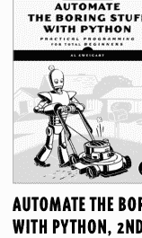
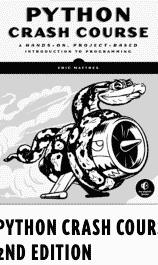
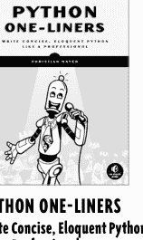
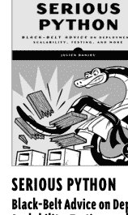
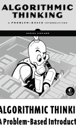
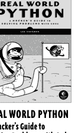

## INDEX

## Numbers and Symbols

256 objects and 257 objects, 154–155
./, 在 Ubuntu 中使用，42
/? command line argument, 25–26
= assignment operator, 113
== comparison operator, 113, 336
  chaining, 103, 105
  using to compare objects, 154
  using with None, 94–95
!= comparison operator, 336
* and ** syntax
  using to create variadic functions, 167–171
  using to create wrapper functions, 171–172
  using with arguments and functions, 166–167
* character, using as wildcard, 28–29
? character, using as wildcard, 28–29
[:] syntax, using, 104
< comparison operator, 337
<= comparison operator, 337
> comparison operator, 337
>= comparison operator, 337
-> (arrow), using with type hints, 191
\ (backslash)
  purpose of, 18
  using with strings, 95
: (colon), using with lists, 97–98, 104
, (comma), including in single-item tuples, 150
- (dash), using with command line arguments, 25
$ (dollar sign), using in macOS, 23
. (dot), using with commands, 31
-- (double dash), using with command line arguments, 25

__ (double underscore), using in dunder methods, 322. See also underscore (_)
/ (forward slash)
  purpose of, 18
  using with command line arguments, 25
# (hash mark)
  using with comments, 183
  using with docstrings, 188
[] (index operator), using, 117
; (semicolons), using with timeit module, 226–227
' (single quote), using, 46
~ (tilde), using in macOS, 23
- (unary operator), 155–157
+ (unary operator), 156–157
_ (underscore)
  PEP 8's naming conventions, 60–61
  as prefix for methods and attributes, 291–292
  private prefix, 81
  using with _spaces attribute, 290
  using with dunder methods, 120
  using with private attributes and methods, 283
  using with WizCoin class, 279

## A

- abcTraceback.py program, saving, 4
- __abs__() numeric dunder method, 328
- absolute versus relative paths, 20–21
- __add__() numeric dunder method, 327
- addToTotal() function, creating, 172–173
- algebra for big O, 236
- algorithm analysis. See big O algorithm
- aliases, defined, 121
- all() function, 157–158
- alphabetical sort, performing, 146–147
- ALT key. See keyboard shortcuts
- Amdahl’s Law, 229–230
- and operator, using, 103
- __and__() numeric dunder method, 328
- anonymous functions, 174–175
- answer archive, building with Stack Overflow, 12
- antigravity feature, enabling, 160
- API (application programming interface), 130
- API vs. library vs. framework vs. SDK vs. engine, 130
- append() method, using, 115
- applications, opening, 22
- arguments. See also positional arguments
- vs. parameters, 128
- passing to functions, 166–167
- setting defaults for parameters, 142–143
- arrow (->), using with type hints, 191
- ASCII (American Standard Code for Information Interchange), 146
- ASCII art, using in Four-in-a-Row game, 272
- AsciiArt class, creating, 304–305
- assignment and comparison operators, chaining, 103, 105
- atoms and literals, 110
- attributes
- as backing fields, 317–318
- defined, 278, 282–284
- vs. properties, 128–129
- turning into properties, 316–319
- vs. variable, 124

## B

- backing field, relationship to attributes, 317–318
- backporting type hints, 196
- backslash (\)
- purpose of, 18
- using with strings, 95
- base class, relationship to inheritance, 296
- Bash file, 22–23
- BFG Repo-Cleaner tool, 220
- big O algorithm
- algebra, 236
- algorithm analysis, 230
- analysis, 230
- analysis examples, 239–242
- analyzing, 243–244
- best practice, 244
- bookshelf metaphor for orders, 231–235
- determining order for code, 237–244
- doing analysis, 236
- function calls, 242–243
- lower and higher orders, 230–231
- lower orders and coefficients, 238–239
- math for analysis, 236
- measuring worst-case scenario, 235
- "n" is small, 244
- order of function calls, 242–243
- orders of notation, 245
- big Omega notation, 235
- big Theta notation, 235
- binary code, explained, 129
- Black code formatting tool
- adjusting line length setting, 55
- described, 45
- disabling double-quoted strings setting, 55–56
- disabling for parts of code, 57
- installing, 54
- previewing changes, 56–57
- running from command line, 54–57
- semantic decisions, 58
- syntactic decisions, 58
- block vs. clause vs. body, 123–124
- __bool__() numeric dunder method, 328
- Boolean values, 158–159. See also values
- Bourne Shells, 22–23
- bugs, types of, 109, 150–151
- bytecode vs. machine code, 129

## C

- c:\ part of path, 18
- -c switch, using to run code from command line, 26
- callables and first-class objects, 121–122
- camelCase, 60
- casing styles, 60
- Catalina version, 23
- cd (change directories) command, 29–30
- __ceil__() numeric dunder method, 328
- chaining operators, 103, 105, 159–160
- child class, creating, 294
- class attributes, 306
- class methods, 304–306
- class objects, 284
- classes. See also inheritance
  - creating, 77
  - creating objects from, 278
  - creating WizCoin, 279–284
  - defined, 276
  - designing for real world, 290–291
  - as functions or modules, 77
  - “is a” relationships, 299
- clause vs. block vs. body, 123–124
- CLI (command line interface), 22
- close() and open() functions, 93–94
- cls and clear (clear terminal) commands, 35
- code. See also source code
  - avoiding guesses, 90
  - beauty of, 88
  - commented out, 74–75
  - flat vs. nested, 89
  - formatting for readability, 12–13
  - implementation, 90
  - interrupting, 134
  - namespaces, 91
  - organizing, 77
  - readability of, 89
  - running from command line, 26
  - silenced errors, 89–90
  - simplicity and complexity of, 89
  - sparse vs. dense, 89
  - special cases, 89
  - speed of, 90
  - verbose and explicit, 89
- code formatting, defined, 45
- code point, getting for characters, 146–147
- code smells. See also source code
  - classes as functions or modules, 77
  - commented-out code, 74–75
  - dead code, 74–75
  - defined, 69
  - duplicate code, 70–71
  - empty except blocks, 79–80
  - error messages, 79–80
  - list comprehensions, 77–79
  - magic numbers, 71–73
  - myths, 80–84
  - print debugging, 75–76
  - summary, 84–85
  - variables with numeric suffixes, 76
- codetags and TODO comments, 187
- coercion, explained, 128
- collections module, contents of, 120
- collections.defaultdict, using for default values, 99–100
- colon (:), using with lists, 97–98, 104
- comma (,), including in single-item tuples, 150
- command history, viewing, 28
- command line
  - arguments, 24–26
  - options, 25
  - overview, 22–23, 42
  - running code with -c switch, 26
  - running programs from, 23–24
  - running py.exe program, 26–27
  - running Python programs from, 26
  - tab completion, 27–28
  - terminal window, 23
- Command Prompt shell, 23
- commands
  - canceling, 28
  - cd (change directories), 29–30
  - cls and clear (clear terminal), 35
  - copy and cp (copy files), 31–32
  - del (delete files and folders), 33–34
  - dir (list folder contents), 30
  - dir /s (list subfolder contents), 31
  - find (list subfolder contents), 31
  - ls (list folder contents), 30

命令（续）
md and mkdir (创建文件夹), 34
move and mv (移动文件), 32
mv (重命名文件和文件夹), 32–33
rd and rmdir (删除文件夹), 34–35
ren (重命名文件和文件夹), 32–33
rm (删除文件和文件夹), 33–34
从 Python 程序运行, 27
缩短的名称, 32
where (查找程序), 35
which (查找程序), 35
通配符, 28–29
注释掉的代码, 74–75
注释
最佳实践, 197
相关误区, 83–84
使用, 182–188
与类型提示一起使用, 196
提交历史, 在 Git 中重写, 220
提交日志, 在 Git 中查看, 216–217
提交, 在 Git 中回滚, 218–220
比较对象, 154–155
比较运算符。另请参阅序列比较
与赋值运算符链接, 103, 105
函数形式, 333
进行比较, 94–95
__complex__() 数值 dunder 方法, 328
组合 vs. 继承, 299–301
条件表达式, 三元运算符, 101–102
容器, 定义, 119–120
Cookiecutter, 用于创建项目, 200–202
copy 和 cp 命令, 31
使用 copy.copy() 和 copy.deepcopy() 处理可变值, 140–142
复制
文件和文件夹, 31
可变值, 140–142
cProfile 分析器, 154, 228–230
CPU, 指令集, 129
CPython 实现, 108
CTRL 键。另请参阅键盘快捷键
cwd (当前工作目录), 19–20, 31

## D
破折号 (-) 与命令行参数一起使用, 25
数据, 使用 setter 验证, 319
数据类型
定义, 276
与返回值, 177–178
死代码, 74–75
decimal.Decimal(), 传递整数给, 148–149
递减和递增运算符, 156–157
默认参数, 为参数设置, 142–143, 165–166
默认值, 使用 collections.defaultdict, 99–100
删除
文件和文件夹, 33–34
存储库中的文件, 214–215
文件夹, 34–35
列表中的项, 134–140
以及在存储库中移动文件, 215–216
派生类, 与继承的关系, 296
确定性函数, 173。另请参阅函数
字典
get() 和 setdefault() 方法, 104
键值对, 118
Python 邮件列表讨论, 131
为其设置类型提示, 195–196
使用, 98–101
用作默认参数, 143–144
diff 程序, 使用其查看更改, 211–212
dir 命令, 使用, 30
dir /s 命令, 31
显示和字面量, 110
__divmod__() 数值 dunder 方法, 327
docs 文件夹, 内容, 200
文档字符串
定义, 182
摘要, 197
使用, 188–190
美元符号 ($), 在 macOS 中使用, 23
doskey 程序, 28
点号 (.), 与命令一起使用, 31
双破折号 (--), 与命令行参数一起使用, 25
双重释放错误, 109
双下划线 (__), 在 dunder 方法中使用, 322。另请参阅下划线 (_)
dunder 方法。另请参阅方法；OOP（面向对象编程）
比较, 332–337
定义, 120
数值, 325–328
原地增量赋值, 330–332
反射数值, 328–330
字符串表示, 323–325
使用, 322–323
重复代码, 70–71
动态类型, 190

## E
彩蛋, The Zen of Python 作为, 88
封装, 解释, 307–308
编码定义, 与魔术注释一起使用, 187–188
引擎 vs. 库 vs. 框架 vs. SDK vs. API, 130
enumerate() vs. range(), 92–93, 104
环境设置, 过程, 17, 42
环境变量和 PATH, 35–39
__eq__() 比较 dunder 方法, 336
相等操作, 336
相等 (==) 运算符, 与 None 一起使用, 94–95
错误代码, 返回, 178–179
错误消息
与 except 块, 79–80
获取帮助, 11
解析, 15
追踪, 178
理解, 4–8
错误, 使用 linter 防止, 8–9
异常
捕获, 79–80
引发, 4, 90, 178–179
RecursionError, 318–319
解释性注释, 184–185
表达式 vs. 语句, 122–123

## F
False 和 True 关键字, 158–159
常见问题 (Frequently Asked Questions), 10
文件名, 作为命令行参数, 25
文件名和文件夹, 使用通配符匹配, 28–29
文件路径, 指定, 20–21
文件
复制, 31
删除, 33–34
移动, 32
重命名, 32–33
文件系统, 18–21, 42
使用列表推导式过滤, 175–176
find 命令, 31
查找功能, 访问, 64, 67
find() 字符串方法, 相关错误, 178
查找程序, 35
一等对象和可调用对象, 121–122。另请参阅对象
标志参数, 相关误区, 82
__float__() 数值 dunder 方法, 328
浮点数, 精度, 147–149, 151
__floor__() 数值 dunder 方法, 328
__floordiv__() 数值 dunder 方法, 327
文件夹
在 macOS 和 Linux 上添加到 PATH, 39
在 Windows 上添加到 PATH, 38–39
作为命令行参数, 25
复制, 31
删除, 33–34
在文件系统中, 18
文件夹（续）
主目录, 19
列出内容, 30
创建, 34
移动, 32
重命名, 32–33
文件夹和文件名, 使用通配符匹配, 28–29
for 表达式, 在列表推导式中包含, 79
for 循环
在大 O 分析中, 240
获取索引和值, 104
与列表, 134–140
多功能性, 125
表单, 填写, 276–278
format() 字符串方法, 96–97
为可读性格式化, 58
格式化字符串, 96–97
正斜杠 (/)
用途, 18
与命令行参数一起使用, 25
四子棋落子游戏
输出, 259–260
源代码, 260–264
摘要, 271–272
编写代码, 264–271
帧对象, 解释, 5
帧摘要, 解释, 5
框架 vs. 库 vs. SDK vs. 引擎 vs. API, 130
f-string, 使用其格式化字符串, 96–97
函数式编程
高阶函数, 174
lambda 函数, 174–175
列表推导式, 175–176
映射和过滤, 175–176
副作用, 172–174
函数调用, 大 O 中的顺序, 242–243
函数。另请参阅确定性函数；高阶函数；非确定性函数；纯函数；可变参数函数；包装函数
默认参数, 165–166
与方法对比, 82, 124
名称, 162
参数和参数, 165–172
向其传递参数, 166–167
与 return 语句, 80–81
大小权衡, 162–165
与 try 语句, 81–82

## G
垃圾回收, 109, 226
__ge__() 比较 dunder 方法, 337
get(), 与字典一起使用, 98–101
getPlayerMove() 函数, 163–165
getter 和 setter, 315, 318
Git。另请参阅 repo
添加文件以跟踪, 208–209
命令行工具, 207
提交和存储库, 200, 206–207
已提交状态, 204
提交更改, 210–214
配置用户名和电子邮件, 203
从存储库删除文件, 214–215
作为分布式版本控制系统, 206
提交更改的频率, 213–214
在存储库中忽略文件, 209–210
安装, 202–204
跟踪文件状态, 204–206
log 命令, 216–217
已修改状态, 204
恢复旧更改, 217–220
在存储库中重命名和移动文件, 215–216
重写提交历史, 220
使用 watch 命令运行状态, 207
已暂存状态, 205–206
在其中存储私有信息, 220
提交前查看更改, 211–212
查看提交日志, 216–217
工作流程, 204–206
git add 命令, 223
git clone 命令, 223
git commit 命令, 223
git diff, 使用, 211–213
git filter-branch 命令, 220
git init 命令, 223
GitHub 和 git push 命令, 221–223
glob 模式, 解释, 29
全局变量, 相关误区, 82–83
术语表, 访问, 108, 131
GrandchildClass, 创建, 294–295
大于操作, 337
大于或等于操作, 337
__gt__() 比较 dunder 方法, 337
GUI（图形用户界面）, 22
GUI Git 工具, 安装, 203–204

## H
井号 (#)
与注释一起使用, 183
与文档字符串一起使用, 188
哈希, 定义, 117–119
--help 命令行参数, 25–26
编程帮助, 请求, 9–14
高阶函数, 174。另请参阅函数
主目录, 19
Homebrew, 安装和配置, 213
水平间距, 47–51
匈牙利命名法, 63

## I
id() 函数, 调用, 111, 154
标识符, 定义, 59
标识, 定义, 111–114
IEEE 754 标准和浮点数, 147–148
if 语句作为子句头, 124
不可变和可变对象, 114–117, 144
in 运算符, 与变量值一起使用, 105
递增和递减运算符, 156–157
缩进, 使用空格字符, 47–48。另请参阅显著缩进
索引运算符 ([]), 使用, 117–118
index() 字符串方法, 相关异常, 179
索引, 定义, 117–119
不等号 != 运算符, 避免链式使用, 149–150
继承。另请参阅类；多重继承；OOP（面向对象编程）
基类, 296
最佳实践, 308–309
类属性, 306–307
类方法, 304–306
与组合对比, 299–301
创建子类, 294
派生类, 296
缺点, 301–303
解释, 293
isinstance() 和 issubclass() 函数, 303–304
MRO（方法解析顺序）, 310–312
重写方法, 296–297
静态方法, 306–307
子类, 296
超类, 296
super() 函数, 297–299
__init__(), 与 self, 280–282
__init__.py 文件和包, 121
内联注释, 183–184
原地增量赋值 dunder 方法, 330–332
安装
Black 代码格式化工具, 54
Git, 202–204
Homebrew, 213
Meld for Linux, 213
Mypy, 192–193
Pyflakes, 9
tkdiff, 213

## I
- __int__() 数值双下划线方法，328
- 整数，传递给 decimal.Decimal()，148–149。
- __invert__() 数值双下划线方法，328
- “is a” 类关系，299
- is 运算符，使用，113
- isinstance()。另请参阅 instances 和 issubclass() 函数，303–304，312
- 与 Boolean 值一起使用，158
- items
  - 处理的最佳实践，134–140
  - 定义，114
- 可迭代解包，用于交换变量，227
- 可迭代对象 vs. 迭代器，125–126
- iterating
  - 解释，134
  - 正向和反向，139
## J
- JDK (Java Development Kit)，130
- join() 运算符，与字符串一起使用，151
- JVM (Java Virtual Machine)，129
## K
- keyboard shortcuts
  - 取消命令，28
  - 查找功能，64，67
  - 中断代码，134
  - 中断无限循环，134
  - 打开应用程序，22
  - 打开终端窗口，23，41
  - Task Manager，22
  - 查看正在运行的进程，22
- keys，定义，117–119
- keywords
  - arguments，167
  - 定义，110–111
  - True 和 False，158–159
- Kompare，使用，213
## L
- lambda 函数，174–175。另请参阅 functions
- __le__() 比较双下划线方法，337
- 合法注释，186
- len() 函数，使用，92
- Less Than 操作，337
- Less than or Equal 操作，337
- “lessons learned” 注释，185–186
- library vs. framework vs. SDK vs. engine vs. API，130。另请参阅 Python Standard Library
- LICENSE.txt 文件，200
- 链接到 URL，包括在注释中，183
- linters，使用防止错误，8–9，15
- Linux
  - 为其安装 Meld，213
  - 在其上运行 Python 程序，41
- list comprehensions
  - 和 all() 函数，157
  - 使用进行映射和过滤，175–176
  - 使用，77–79，137
- list 拼接，115
- lists
  - 从中添加或删除项目，134–140
  - 处理的最佳实践，134–140
  - 内容，141–142
  - 创建浅拷贝，97–98
  - 设置类型提示，195–196
  - 用作默认参数，143–144
- literals，定义，109–110
- logfiles，设置，75–76
- logical error，定义，127
- looping，解释，134
- loops
  - 中断，134
  - 将重复代码移入，71
- ls 命令，使用，30
- __lshift__() 数值双下划线方法，328
- __lt__() 比较双下划线方法，337
## M
- machine code vs. bytecode，129
- macOS
  - 安装 tkdiff，213
  - 在其上运行 Python 程序，41
- magic comments and source file
  - encoding，187–188
- magic methods，定义，120
- magic numbers，71–73
- main() 函数，修改以覆盖方法，296–297
- mapping。另请参阅 objects
  - 定义，119–120
  - 和使用列表推导式进行过滤，175–176
- mapping 数据类型，传递，167
- math 双下划线方法，325–328
- __matmul__() 数值双下划线方法，327
- max() 和 min() 函数，169
- MCR (minimum, complete, reproducible) 示例，11
- md 和 mkdir 命令，34
- Meld，为 Linux 安装，213
- memory leaks，109
- memory usage，137–138
- metasyntactic variables，60。另请参阅 variables
- methods。另请参阅 dunder methods；private attributes and private methods
  - vs. functions，82，124
  - __init__()，和 self，280–282
  - 覆盖，296–297
- min() 和 max() 函数，169
- __mod__() 数值双下划线方法，327
- modules
  - 定义，120–121
  - 查找，14
  - 和 packages，120–121
  - requests，188–189
  - typing，195–196
- move 和 mv (move files) 命令，32
- moving files and folders，32
- MRO (method resolution order)，310–312
- __mul__() 数值双下划线方法，327
- multiple assignment trick，用于交换变量，227
- multiple inheritance，309–310。另请参阅 inheritance
- mutable and immutable objects，114–117，151
- mutable values
  - 处理的最佳实践，142–144
  - 复制，140–144
  - 和默认参数，142–144
- Mypy，使用，192–194
## N
- name length，考虑，61–64
- nameless functions，174–175
- names
  - 关于的建议，64–65
  - 避免覆盖，65–66
  - 选择，67
  - 使其可搜索，64
  - 中的前缀，63–64
  - 中的顺序数字后缀，64
- namespaces，90–91
- __ne__() 比较双下划线方法，336
- __neg__() 数值双下划线方法，328
- nested conditional expressions，102
- nested loops，在 big O 分析中使用，241
- next() 函数，调用，126
- no operation，解释，74
- nondeterministic function，173。另请参阅 functions
- None，使用 == (equality) 运算符，94–95
- Not Equal 操作，336
- NotImplementedError，引发，75
- numbers, magic，71–73。
- numeric 双下划线方法，325–328
## O
- objects。另请参阅 mapping
  - 和 classes，276
  - 比较，154–155，334
  - 从 classes 创建，278
  - 定义，111–114
  - mutable 和 immutable，114–117
  - 排序，336
- O(log n), Logarithmic，232
- O(n!), Factorial Time，234–235
- O(n), Linear Time，232
- O(n log n), N-Log-N Time，232–233
- O(n²), Polynomial Time，233
- O(2^n), Exponential Time，233–234
- OOP (object-oriented programming)
  - 另请参阅 dunder methods；inheritance
  - 从 classes 创建 objects，278
  - 定义，275
  - 设计 classes，290–291
  - encapsulation，307–308
  - 填写表单，276–278
  - 和 non-OOP examples，285–290
  - polymorphism，308
  - properties，316–322
  - summary，292
  - tic-tac-toe，285–290
  - type() 函数和 __qualname__ 属性，284–285
  - 使用 class 和 static 特性，307
  - WizCoin class，279–284
- open()
  - 和 close() 函数，93–94
  - 和 readlines() 函数，126
- operator module，333，336–337
- operators，chaining，103，105，151，159–160
- optimizations
  - preallocated integers，154
  - string interning，155
- __or__() 数值双下划线方法，328
- ordinal，获取字符的，146–147
- os.chdir()，使用，20
## P
- packages
  - 定义，120–121
  - 和 modules，120–121
- parameters vs. arguments，128
- ParentClass，创建，294–295
- PascalCase，60
- pass statement
  - 与 stubs 的关系，74–75
  - 与 except block 一起使用，79–80
- PATH 和 environment variables，35–39
- pathlib module，导入，18–19
- paths，指定，18–21
- p-code，解释，129
- PEP (Python Enhancement Proposal) 8
  - documentation，67
  - naming conventions，61
  - 和 style guides，46–47
- Perl programming language，90
- pip list，运行，14
- polymorphism，解释，308
- portable code，解释，129
- porting vs. backporting，196
- __pos__() 数值双下划线方法，328
- positional arguments，定义，166–167。另请参阅 arguments
- __pow__() 数值双下划线方法，328
- practice projects。另请参阅 projects
  - Four-in-a-Row，259–271
  - The Tower of Hanoi，248–259
- preallocated integers，154。
- premature optimization，226
- print debugging，75–76
- print() function
  - arguments，168
  - 传递 list，166
  - 与 wrapper functions 一起使用，171
- private attributes and private methods，282–284。另请参阅 methods
- processes and programs，21–22
- professional comments，186
- profiling，解释，228
- program vs. script，129–130
- programming help，请求，9–14
- programming language vs. scripting language，129–130
- programs。另请参阅 Python programs
  - 查找，35
  - 和 processes，21–22
  - 从 command line 运行，23–24，26
  - 无需 command line 运行，39–42
  - vs. scripts，129–130
- project folder，内容，200
- projects，使用 Cookiecutter 创建，200–202。另请参阅 practice projects
- properties
  - vs. attributes，128–129
  - best practices，322
  - read-only，320–321
  - 将 attributes 转换为，316–319
  - 使用，316
- public access attributes and methods，283
- pure function，173–174。另请参阅 functions
- push command，在 Git 中使用，221–223
- .py source code files，定位，200
- .pyc files，bytecode 在其中，129
- py.exe program，运行，26–27
- Pyflakes，安装，9
- PyPy just-in-time compiler，108
- Python
  - documentation，121
  - error messages，4–8
  - glossary，108，131
  - language and interpreter，108–109
  - programming language，109
- Python programs，无需 command line 运行，39–42。另请参阅 programs；The Zen of Python
- Python Standard Library，120–121。另请参阅 library vs. framework vs. SDK vs. engine vs. API
- pythonic code，核心，104
## Q
- __qualname__ attribute 和 type() 函数，284–285
- questions，提问，10–11，14–15
## R
- __radd__() 反射数值双下划线方法，330
- raising exceptions，90，178–179
- __rand__() 反射数值双下划线方法，330
- range() vs. enumerate()，92–93，103–104
- rd 和 rmdir 命令，34–35
- __rdivmod__() 反射数值双下划线方法，330
- readlines() 和 open() 函数，使用，126
- README files，200，211–212，215–216，218
- read-only properties，320–321
- RecursionError exception，引发，318–319
- references，解释，137–138
- reflected numeric 双下划线方法，328–330
- relative vs. absolute paths，20–21
- renaming files and folders，32–33
- repo。另请参阅 Git
  - 为 GitHub repo 克隆，222–223
  - 创建，223
  - 在计算机上创建，206–207
  - 在其中删除和移动文件，215–216
  - 从中删除文件，214–215
  - 在其中忽略文件，209–210
  - 和 version control systems，200
- __repr__() method，使用，325
- repr string，其中包含敏感信息，325
- requests module，sessions.py 文件，188–189
- return values 和 data types，177–178。另请参阅 values
- __rfloordiv__() 反射数值双下划线方法，330
- __rlshift__() 反射数值双下划线方法，330
- rm (removing files and folders) 命令，33–34
- __rmatmul__() 反射数值双下划线方法，330
- __rmod__() 反射数值双下划线方法，330
- __rmul__() 反射数值双下划线方法，330
- roll back，在 Git 中执行，217–220
- root folder，解释，18
- __ror__() 反射数值双下划线方法，330
- __round__() 数值双下划线方法，328
- __rpow__() 反射数值双下划线方法，330
- __rrshift__() 反射数值双下划线方法，330
- __rshift__() 数值双下划线方法，328

## S
__rsub__() 反射的数值双下划线方法，330
__rtruediv__() 反射的数值双下划线方法，330
查看正在运行的进程，22
运行时
  定义，226
  函数的加速，173
  与语法与语义错误对比，126–127
__rxor__() 反射的数值双下划线方法，330

%s 转换说明符，使用，96–97
脚本与程序，129–130
脚本语言与编程语言，129–130
SDK 与库与框架与引擎与 API，130
self 与 __init__()，280–282
语义与语法与运行时错误，126–127
分号 (;)，与 timeit 模块一起使用，227
repr 字符串中的敏感信息，325
序列比较，335–336。另见比较运算符
序列
  定义，119–120
  与可迭代对象，125
requests 模块中的 sessions.py 文件，188–189
集合类型，定义，119–120
使用 setdefault() 与字典，98–100
设置器
  与获取器，315, 318
  用于验证数据，319–320
sh 文件，22–23
shell 程序，22–23
副作用，172–174
显著缩进，91–92, 104。另见缩进
使用单引号 (')，46
切片语法，解释，97
snake_case，60
使用 Git 保存快照，200

软件许可证文件，200
sort() 函数的行为，146–147, 151, 332, 336
源代码，避免遗漏字母，62。另见代码；代码异味
源文件编码和魔术注释，187–188
空格字符，在屏幕上的渲染，47
行内间距，48–51
Stack Overflow，建立答案存档，12
堆栈跟踪，4–7
已暂存文件
  提交，211
  在 Git 中取消暂存，218
语句与表达式，122–123
静态分析，解释，8, 192–194
静态方法，306–307
字符串连接，144–146, 151
字符串驻留，155–156
字符串
  格式化，95–97
  作为不可变对象，144
  不可变特性，116
  插值，104
存根，与代码异味的关系，74
风格指南和 PEP（Python 增强提案）8，46–47
__sub__() 数值双下划线方法，327
子类，与继承的关系，296。另见 isinstance()
子文件夹，列出内容，31
Sublime Text 编辑器，193
subprocess.run() 函数，27
创建 subtract() 函数，172
sum() 函数，168
摘要注释，185
超类，与继承的关系，296
super() 函数，与方法重写的关系，297–299
switch 语句与字典，100–101
语法
  捕获错误，6

## T
## U
## V
误用，92–95
与运行时与语义错误对比，58, 126–127
sys.getsizeof() 函数，137–138
系统环境变量，38

标签补全，27–28
打开任务管理器，22
终端窗口
  清除，35
  打开，23, 41
三元运算符，101–102
tests 文件夹，内容，200
文本编辑器，Sublime Text，193
井字游戏程序
  创建，285–290
MRO（方法解析顺序），311–312
在 macOS 中使用波浪号 (~)，23
使用 timeit 模块测量性能，226–228。另见模块
time.time() 函数，72, 227
在 macOS 上安装 tkdiff，213
TODO 注释和 codetags，187
汉诺塔谜题
  getPlayerMove() 函数，163, 165, 254–257, 268
  输出，249–250
  限制，248
  源代码，250–252
  摘要，271–272
  编写代码，252–259
检查回溯，4–7
True 和 False 关键字，158–159
__truediv__() 数值双下划线方法，327
__trunc__() 数值双下划线方法，328
元组
  标识，119
  不可变特性，116–117
  与逗号一起使用，150
  值，116
类型强制转换与类型转换，128
type() 函数和 __qualname__ 属性，284–285

类型提示，182, 190–196
类型，定义，276
输入，使用标签补全最小化，27–28
typing 模块，195–196

在 Ubuntu Linux 上运行 Python 程序，41–42
下划线 (_)。另见双下划线 (__)
  PEP 8 的命名约定，60–61
  作为方法和属性的前缀，291–292
  私有前缀，81
与 _spaces 属性一起使用，290
与双下划线方法一起使用，120
与私有属性和方法一起使用，283
与 WizCoin 类一起使用，279
撤销功能，199, 217–220
Unicode 资源，188
单元测试文件夹，200
Unix 操作系统，shell 程序，22–23
URL 链接，包含在注释中，183
用户环境变量，38
UTF-8 编码，187–188

使用设置器验证数据，319–320
值。另见布尔值；返回值和数据类型
  定义，111–114
  原地修改，115
变量名，64, 66。另见名称
变量值，103–104
变量。另见元语法变量
  与属性对比，124
  盒子与标签隐喻，112–113
  检查值，103–104
  带数字后缀，76
  交换，227
创建可变参数函数，167–171。另见函数
版本控制系统，199–200
垂直间距，51–53
卷，解释，18

## W
使用 watch 命令与 Git，207
webbrowser 模块，160
where 命令，35
which 命令，35
while 关键字，110
while 循环
  在大 O 分析中，241
  与列表，134–140
通配符，28–29
Windows，运行 Python 程序
  在，40–41
下载 WinMerge，212–213
with 语句，93–94
创建 WizCoin 类，279–284
最坏情况，使用
  Big O 测量，235
创建包装函数，171–172。
  另见函数

## X
使用 XOR 算法，226–227
__xor__() 数值双下划线方法，328

## Z
Zakharenko, Nina，131
Python 之禅，88–91。另见
  程序；Python 程序
使用零基索引，117
Zsh 和 Z shell，23

*Beyond the Basic Stuff with Python* 使用 New Baskerville、Futura、Dogma 和 TheSansMono Condensed 字体排印。本书由 Sheridan Books, Inc. 在密歇根州切尔西印刷装订。纸张为 60# Finch Offset，经森林管理委员会（FSC）认证。

本书采用平摊装订，书页用冷固柔性胶水粘合在一起， resulting 书块的第一页和最后一页附着在封面上。封面实际上并未粘在书脊上，打开时书本平摊，书脊不会开裂。

## RESOURCES
访问 nostarch.com/beyond-basic-stuff-python/ 获取勘误和其他信息。

来自 NO STARCH PRESS 的更多不废话书籍

## AUTOMATE THE BORING STUFF WITH PYTHON, 2ND EDITION
Practical Programming for Total Beginners
BY AL SWEIGART
592 PP., $39.95
ISBN 978-1-59327-992-9

## PYTHON CRASH COURSE, 2ND EDITION
A Hands-On, Project-Based Introduction to Programming
BY ERIC MATTHES
544 PP., $39.95
ISBN 978-1-59327-928-8

## PYTHON ONE-LINERS
Write Concise, Eloquent Python Like a Professional
BY CHRISTIAN MAYER
216 PP., $39.95
ISBN 978-1-7185-0050-1

## SERIOUS PYTHON
Black-Belt Advice on Deployment, Scalability, Testing, and More
BY JULIEN DANJOU
240 PP., $39.95
ISBN 978-1-59327-878-6

## ALGORITHMIC THINKING
A Problem-Based Introduction
BY DANIEL ZINGARO
408 PP., $49.95
ISBN 978-1-7185-0080-8

## REAL WORLD PYTHON
A Hacker's Guide to Solving Problems with Code
BY LEE VAUGHAN
360 PP., $34.95
ISBN 978-1-7185-0062-4

PHONE:
800.420.7240 OR
415.863.9900

EMAIL:
SALES@NOSTARCH.COM

WEB:
WWW.NOSTARCH.COM

**The Electronic Frontier Foundation** (EFF) 是捍卫数字世界公民自由的领先组织。我们捍卫互联网上的言论自由，打击非法监控，促进创新者开发新数字技术的权利，并努力确保我们所享有的权利和自由在技术使用增长的同时得到增强——而不是被侵蚀。

你已经完成了基础的 Python 编程教程，或读完了 Al Sweigart 的畅销书《Automate the Boring Stuff with Python》。通往成为一名胜任且自信的软件开发者的下一步是什么？

欢迎阅读《Beyond the Basic Stuff with Python》。这本书不仅仅是一本收集精妙技巧来编写干净代码的书，它还会展示如何导航命令行并使用其他专业工具，包括代码格式化器、类型检查器、代码检查工具和版本控制。Sweigart 带你了解设置开发环境的最佳实践、命名变量以及提高可读性，然后涉及文档、组织、性能测量、面向对象设计，甚至 Big-O 算法分析。这些高级技能将显著提升你的编程能力——不仅限于 Python，而是任何语言。

你将学到：

- 编码风格，以及如何使用 Python 的 Black 自动格式化工具使代码更整洁
- 错误的常见来源，以及如何通过静态分析器检测它们
- 如何使用 Cookiecutter 模板工具来组织代码项目中的文件
- 类似 lambda 和高阶函数的函数式编程技术
- 如何使用 Python 内置的 timeit 和 cProfile 模块分析代码速度
- 如何使你的注释和 docstring 富有信息性，以及多久写一次

当然，没有一本书能让你成为专业的软件开发者。但《Beyond the Basic Stuff with Python》会让你在这条道路上更进一步，因为你将学会编写可读性强、易于调试且完全符合 Python 风格的代码。

## ABOUT THE AUTHOR

Al Sweigart 是一位备受赞誉的软件开发者、广受欢迎的 Udemy Python 课程的创建者，以及一名编程教师。作为 Python 软件基金会的 Fellow，Sweigart 也是 No Starch Press 出版的三本其他 Python 书籍的作者，其中包括全球畅销书《Automate the Boring Stuff with Python》。
