# GraphQL 基础


在本章中，我们将概述 GraphQL，包括它的存在原因以及其哪些特性使其对当今许多科技巨头具有吸引力。 你还将探索它与 RESTful API 的区别并发送你的第一个 GraphQL 查询。

## 基础知识

*GraphQL* 是一种用于应用程序编程接口（API）的数据查询和操作语言的开源。 API 允许两个应用程序通过遵循定义应用程序应如何连接和通信的一组规则，以请求和响应的形式交换信息。 通常，诸如 Google Chrome 或 Mozilla Firefox 之类的网络浏览器充当 API 客户端，或 *消费者*。 该消费者通过应用程序的 API 与应用程序服务器交互，以读取或更改服务器上的某些信息。 API 消费者并不总是浏览器； 机器，例如网络上的其他服务器，也可以是 GraphQL API 消费者。

与其它 API 格式不同，GraphQL 允许 API 消费者在不接收不必要信息的情况下从应用程序服务器请求特定数据。 将这种方法与传统的 REST API 架构形成对比，后者提供固定的数据结构，然后依赖客户端过滤掉它们不需要的任何不必要信息。 我们将在“GraphQL API 与 REST API”第 9 页中比较 REST 和 GraphQL API 响应结构，以说明两者之间的差异。

从安全角度来看，GraphQL 的设计提供了优势。 因为 GraphQL 不返回客户端未明确请求的数据，所以它的使用减少了信息泄露问题的机会。 返回比客户端所需更多的数据可能会导致敏感数据（例如个人身份信息 PII）被无意泄露，这可能会导致许多其他问题，尤其对于在严格监管规则下运营的公司而言。 然而，正如你很快就会看到的那样，GraphQL 也有我们作为黑客可以利用的安全弱点。

## 起源

Facebook 于 2012 年开发了 GraphQL，并在生产环境中使用了几年，然后于 2015 年将其作为开源软件发布。 同年，Facebook 还开发并发布了 GraphQL 规范和一个名为 GraphQL.js（https://github.com/graphql/graphql-js）的参考实现，使用 JavaScript 构建。

GraphQL 现在由 GraphQL 基金会（https://graphql.org/foundation/）维护，该组织由全球科技公司创立。 该基金会为 GraphQL 维护者提供指导和项目资助、管理 GraphQL 商标的政策、为项目提供法律支持并支持社区相关基础设施。

## 用例

几乎任何应用程序和设备都可以使用 GraphQL。 如果客户端经常同时请求大量信息，否则需要进行多次 REST API 调用，公司可能会考虑使用它。 使用 GraphQL 可以减少带宽使用并提高客户端性能。

例如，想象一个网站仪表板，它整合了来自多个第三方天气网站的天气信息，并且由在慢速数据网络上运行的移动客户端使用。 如果仪表板必须向各个天气网络发出一堆调用并筛选数据，这就不是一个优化的过程。 GraphQL 允许在单个请求中获取复杂的数据结构，从而显著减少所需的客户端和服务器往返次数。 你将在本章后面了解有关此带宽优化设计的更多信息。

今天，许多大型公司，例如 Facebook、Atlassian、GitHub 和 GitLab，都使用 GraphQL，为数亿客户在各种平台上提供服务，例如手机、台式电脑，甚至智能电视。

## 规范

2015 年，Facebook 公开发布了 GraphQL 规范文档，该文档定义了所有 GraphQL 实现必须遵守的规则、设计原则和标准实践。 该规范是为多种语言实现 GraphQL 的参考，类似于请求评论（RFC）文档。 你可以把它看作是一份蓝图。

因此，我们作为黑客，可以利用它来更好地了解 GraphQL 的预期实现方式，并验证我们正在攻击的目标应用程序是否符合这些预定义规则。 由于实现通常因各种原因而偏离标准，因此我们发现其中存在漏洞的机会增加，其中一些漏洞可能具有安全影响。

## 通信如何工作？

典型的 GraphQL 实现包含一些组件，如果你希望搜索其中的安全漏洞，就应该熟悉它们。 图 1-1 描述了这些。

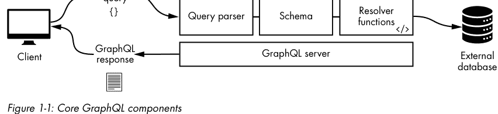

图 1-1：核心 GraphQL 组件

当客户端想要与 GraphQL 服务器通信时（例如，读取用户名和电子邮件列表），该客户端将使用超文本传输协议（HTTP）POST 方法向服务器发送 GraphQL 查询。 你可能已经注意到，这不符合标准的 HTTP 方法约定，因为数据读取通常使用 HTTP GET 方法实现； 你将在本章后面了解更多相关信息。

服务器反过来将使用查询解析器处理查询。 查询解析器读取并验证查询是否格式正确并且服务器是否可以支持它。 此验证涉及将查询与应用程序的 GraphQL 模式进行检查。 如果查询被认为有效，它将被解析器函数处理，解析器函数负责生成对客户端查询的响应。 谈论许多移动部件！ 让我们分解这些核心组件以更好地解释它们如何协同工作。

## 模式

GraphQL 模式表示客户端可以查询的数据类型。 模式使用模式定义语言（SDL）定义。 列表 1-1 显示了其用于定义两种对象类型的语法。

```
type User {
  username: String
  email: String
}

type Location {
  latitude: Int
  longitude: Int
}
```

列表 1-1：模式定义语言

对象类型是 GraphQL 模式的最基本组件； 它们代表可以从运行 GraphQL 的服务中获取的数据片段。 对象类型具有字段，它们是具有值的对象特定属性。 在列表 1-1 中，我们定义了一个名为 User 的对象类型和另一个名为 Location 的类型。 User 类型有两个字段，名为 username 和 email，两者都是 String 标量类型。 Location 类型也有两个字段，名为 latitude 和 longitude，它们是 Int（整数）标量类型。

到目前为止，我们示例模式中的对象和字段彼此之间没有连接。 然而，GraphQL 允许我们以各种方式在对象之间形成链接。 为了可视化其工作原理，我们可以将模式表示为由节点和边组成的图。 在我们的示例中，User 和 Location 对象类型是节点，如图 1-2 所示。

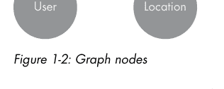

图 1-2：图节点

边是创建多个节点之间链接的一种方式。 例如，一个对象可以有一个引用另一个对象的字段。 假设你有一个用户列表，以及他们最后登录的物理位置列表，并且你希望在客户端查询该用户时返回用户的位置。 列表 1-2 显示了如何使用边来实现这一点。

```
type User {
  username: String
  email: String
  location: Location
}
```


```
② type Location {
  latitude: Int
  longitude: Int
}
```

## Listing 1-2: 节点的链接

我们向 User 对象类型 ① 添加了一个额外的 location 字段，并将其链接到 Location 对象类型 ②。在实践中，这意味着你可以请求一个 User 对象并获取其关联的位置数据。然而，你将无法通过 Location 对象类型来查询用户名，因为我们尚未在模式中定义该边。图 1-3 说明了两个节点现在具有单向链接关系。

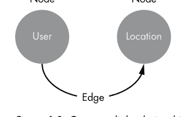

Figure 1-3: 节点之间单向链接关系

边并不局限于单向链接关系。事实上，你可以在同一对象之间创建双向链接关系，如图 1-4 所示。连接两个节点的方式存在合法的用例。在 User 和 Location 示例中，想象一下我们的 API 的客户端需要能够获取用户名并在返回的数据中查看其位置。此外，假设客户端应该能够获取特定位置并查看哪些用户在每个位置登录过。双向链接关系允许实现这一点。

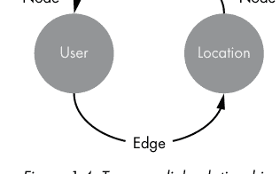

Figure 1-4: 节点之间双向链接关系

从安全角度来看，双向链接关系通常会导致不必要的拒绝服务（DoS）情况，这可能会完全使系统瘫痪。当存在双向链接关系时，API 开发者应引入安全控制来缓解这些漏洞，我们将在第 5 章中更详细地解释。

## Queries

一旦 API 的模式被定义，客户端就可以使用用声明式 GraphQL 查询语言编写的专门定制的查询从中获取信息。在 GraphQL 中，所有查询都以操作 *root type* 的定义开始，该定义指定以下其中一种操作：

- *Queries* 用于只读操作。这些操作不涉及数据操作。
- *Mutations* 用于数据操作，例如数据写入。这些操作涉及数据修改、数据添加、数据删除等。Mutations 可同时用于写入和读取数据。
- *Subscriptions* 用于客户端与 GraphQL 服务器之间的实时通信。它们允许 GraphQL 服务器在不同事件发生时将数据推送给客户端。Subscriptions 通常与 WebSocket 等传输协议结合使用。

这三种操作是我们编写的每个 GraphQL 查询的起点。例如，查询操作使用 query 关键字：

```
query {
}
```

mutation 操作类型使用 mutation 关键字：

```
mutation {
}
```

最后，subscription 操作类型使用 subscription 关键字：

```
subscription {
}
```

在客户端执行其中一种操作之前，开发者必须已在模式中定义该操作并指定客户端可使用的字段。例如，Listing 1-3 定义了 Query 类型并建立了允许客户端获取我们之前定义的对象类型之一 User 的路径。

```
type User {
  username: String
  email: String
  location: Location
}
```

```
type Location {
  latitude: Int
  longitude: Int
}

type Query {
  users: [User]
}

schema {
  query: Query
}
```

Listing 1-3: 完整的模式，包含查询 User 类型的入口点

通过查询 Query 类型中的 users 字段，客户端可以访问我们定义过的 User 对象类型。包围 User 对象类型的方括号 [] 表示此查询将返回 User 对象的数组。我们将在第 3 章讨论此语法。

NOTE
请注意，虽然字段名（如 users）为小写，但对象名（如 User）以大写字母开头。这是 GraphQL 模式中最常见的命名约定。

Listing 1-4 是客户端可能发送给实现 Listing 1-3 中模式的 GraphQL 服务器的示例查询。

```
query {
  users {
    username
    email
  }
}
```

Listing 1-4: 一个 GraphQL 查询

如你所见，GraphQL 查询很容易阅读：此查询所做的只是获取应用程序所有用户的用户名和电子邮件。我们使用 query 根操作定义查询。然后我们请求 users 作为查询的顶层字段，指定我们想要的 username 和 email 字段。由于此查询仅读取信息而不更改任何数据，我们执行查询操作而不是 mutation。

请注意，空白用于分隔名称和值等组件。使用的空格数量无关紧要；无论是单个空格还是多个空格，查询都将保持不变并返回一致的结果。

## The Query Parser and Resolver Functions

现在，当 GraphQL 服务器接收到查询时会发生什么呢？它会使用查询解析器来读取并提取执行传入查询所需的信息。查询解析器负责将查询字符串转换为抽象语法树（AST）并根据模式对其进行验证，以确保只接受有效查询。AST 是一个表示查询的层次化对象。它包括字段、参数和其他信息，可以被不同语言的解析器轻松遍历。

GraphQL 是强类型的，这意味着当客户端使用错误的数据类型时，服务器会返回错误。例如，如果某些数据被定义为 Int，使用 String 代替就会产生错误。这使得开发团队可以依赖 API 来执行类型验证。我们将在第 3 章更详细地讨论这些类型。

为了生成包含请求数据的客户端查询响应，服务器使用 resolver 函数，也称为 resolvers。Resolvers 负责为客户端查询中指定的每个字段填充响应数据。为此，resolvers 可能会实现代码逻辑来承担诸如查询关系数据库、缓存数据库或网络上其他服务器等任务。每个字段都有一个对应的 resolver 函数负责返回该字段的响应。

例如，为了完成我们在 Listing 1-4 中展示的查询，resolver 函数可能会连接到 MySQL 等外部数据库，并查询其 users 表以获取可用的用户名和电子邮件条目列表。由于 resolver 函数是负责查询解析的 GraphQL 组件，因此漏洞也可能存在于此。如果函数编写不佳，可能包含错误，从而导致安全缺陷。

Resolvers 不限于从数据库读取。它们可以从本地文件系统读取数据或通过 REST API 向其他系统发出 HTTP 请求。事实上，GraphQL API 通常在幕后进行 REST 调用，尤其是在公司逐步从 REST 过渡到 GraphQL 时。有时 GraphQL 被用作多个后端 REST 服务的整合 API 层，这些服务对客户端保持不可见。

总之，你可以将 GraphQL 视为位于客户端（例如运行在用户手机或笔记本电脑上的浏览器）和应用程序逻辑之间的查询层。寻求与 GraphQL API 交互的客户端可以使用各种可用的开源 GraphQL 客户端库，例如 Apollo Client（https://www.apollographql.com/docs/react），目前由 Apollo 为 TypeScript 维护，或 Relay（https://relay.dev），目前由 Facebook 为 JavaScript 维护。使用专用 GraphQL 客户端不是必需的；你也可以使用命令行 HTTP 客户端（如 cURL）查询 GraphQL API。在第 3 章中，我们将介绍 GraphQL 在较低层级的工作原理。

## What Problems Does GraphQL Solve?

GraphQL 通过让客户端无需多次请求即可从应用程序中检索所需完整的数据集，从而提高了客户端-服务器交互的速度。由于 GraphQL 允许客户端定义精确的查询结构，因此它避免了代价高昂的性能问题，例如


as over-fetching (返回给客户端未使用的数据) 或 under-fetching (返回数据太少，迫使客户端进行第二次请求)。你将在下一节了解这些差异以及它们对性能的重要性。

GraphQL 具有额外的有用功能，例如 schema stitching 和 schema federation。Schema stitching 是一种从多个底层 GraphQL 服务创建单个 GraphQL schema 的方法，使 GraphQL 能够用作统一网关。基本上，它将多个 schema 打包（缝合）成一个大的 schema，为客户端创建一个单一的集成点。因为多个微服务可以定义自己的 GraphQL schema 并拥有自己的 GraphQL 端点，所以允许单个 GraphQL API 网关将许多 schema 整合为一个，可以使客户端更容易与应用程序集成。

Schema federation 与 schema stitching 类似，只是它不需要你手动缝合 schema。相反，schema federation 让你可以告诉 GraphQL API 网关在哪里查找额外的 schema。网关然后自动进行缝合。Federation 是将多个 API 整合到单个网关的维护成本更低的方法。

复杂的 API 应用程序，例如需要 schema federation 或 schema stitching 的应用程序，可能会引入安全漏洞，可能允许黑客访问他们本不应该访问的数据。一般来说，应用程序越复杂，其内部复杂性导致漏洞的可能性就越高。

## GraphQL APIs vs. REST APIs

在前面的章节中，我们讨论了 GraphQL 试图解决的传统 API 的挑战。例如，REST API 通常提供客户端不需要的更多数据（over-fetching）或数据太少（under-fetching），迫使客户端进行额外的 API 请求。在本节中，我们将通过一个示例来演示由 REST API 前置的应用程序与使用 GraphQL 的应用程序之间的比较。

考虑表 1-1，一个包含应用程序用户基础信息的数据库表。简单的 Web 应用程序可能会将此信息作为管理员面板的一部分显示，让系统管理员列出所有可用账户及其状态。我们将称之为用户管理页面。

表 1-1：用户数据库表

| User ID | Username | Email | First name | Last name | State |
|---|---|---|---|---|---|
| 1 | dsmith | david@example.com | David | Smith | Disabled |
| 2 | clarry | chris@example.com | Chris | Larry | Enabled |

在下面的章节中，我们将描述客户端如果应用程序使用 REST API 需要进行哪些 API 请求来检索用户数据，以及它在应用程序使用 GraphQL 时如何做到这一点。

## The REST Example

在应用程序使用 REST API 的情况下，我们定义特定的端点或路由，客户端可以在其中使用特定的 HTTP 方法（例如 GET 或 POST）执行读取或写入数据等操作。表 1-2 为两个目的定义了两个 REST API 端点：一个用于获取用户列表，另一个用于获取用户登录历史信息。

表 1-2：REST API 定义

| HTTP method | API endpoint | Endpoint description |
|---|---|---|
| GET | /rest/v1/users | Returns a list of all available users and their information |
| GET | /rest/v1/history/<user_id> | Returns a list of the login timestamps for a given user |

当系统管理员想要查看用户管理页面时，他们的 Web 客户端，例如 Web 浏览器，将需要通过 Web 应用程序的 API 获取有关所有可用用户的信息。要使用表 1-2 中的 API 端点检索此数据，Web 浏览器需要向 /rest/v1/users 发送 GET 请求。清单 1-5 显示了此请求及其响应。

```
# curl http://lab.blackhatgraphql.com/rest/v1/users
[
  {
    "email": "david@example.com",
    "first_name": "David",
    "id": 1,
    "last_name": "Smith",
    "state": "disabled",
    "username": "dsmith"
  },
  {
    "email": "chris@example.com",
    "first_name": "Chris",
    "id": 2,
    "last_name": "Larry",
    "state": "enabled",
    "username": "clarry"
  }
]
```

清单 1-5：GET 请求到 /rest/v1/users 列出所有系统用户

正如你所见，此请求以 JavaScript Object Notation (JSON) 格式返回所有用户的列表，以及他们的电子邮件、姓名、ID 和账户状态。

但如果系统管理员只想检索用户某些信息，例如他们的电子邮件地址，而不返回任何其他信息呢？使用表 1-2 中的 API 定义，这是不可能的。相反，清单 1-5 中的响应需要完整处理，并且需要从响应中提取 email 字段。这是 REST API 中 over-fetching 问题的一个例子：客户端接收到比所需更多的数据，然后必须对其进行过滤。

现在，假设你是系统管理员，并被要求识别网络上的任何入侵尝试。你计划编写一个脚本，每晚运行并检查可疑行为。例如，它应该标记在正常工作时间，即上午 9 点至下午 5 点之后登录的用户。为了实现这一目标，脚本需要使用 GET 方法向 /rest/v1/history/<user_id> 端点发出 API 请求。然而，如果你仔细查看端点结构，你会注意到它要求客户端提供特定的用户 ID。脚本将如何知道应用程序用户的 ID？简短的回答：它不会，除非它首先获取所有可用的用户 ID。

实际上，这意味着为了脚本成功运行、读取用户的最后登录时间戳并识别可能的入侵，它首先需要使用 API 端点 /rest/v1/users 列出系统上的所有用户账户。这应该返回每个用户的用户名、电子邮件、名字、姓氏、状态和用户 ID。

接下来，它需要向 /rest/v1/history/1 发出第二个 API 请求，其中 1 是从第一次请求获得的用户 ID，如清单 1-6 所示。

```
# curl http://lab.blackhatgraphql.com/rest/v1/history/1

--snip--
["02:03:37", "03:05:55"]
--snip--
```

清单 1-6：来自 /rest/v1/history/1 的响应

要获取所有历史用户登录的完整列表，客户端需要发出额外的请求，直到获取所有用户 ID。如果我们有 1,000 个用户，这将需要 1,000 次请求。听起来像是一个低效的过程，不是吗？这是 REST API 倾向于出现的 under-fetching 问题的一个例子。RESTful API 可以设计为返回特定信息，但允许在各种 REST 端点之间进行此类查询灵活性所需的复杂性将使其难以长期维护。

虽然一开始乍一看，为单个用户检索登录信息需要两次请求可能不算大事，但想象一下应用程序同时为数百万客户端提供服务。在这种规模下，每一次请求都很重要；任何额外的跨网络调用都会导致服务器延迟增加并影响客户端体验。这将降低应用程序的整体速度和效率。

如果你想亲眼看看这些请求，可以通过将 Web 浏览器指向位于 http://lab.blackhatgraphql.com/start 的实时实验室来尝试此示例的 API。在那里，点击两个链接以在 Web 浏览器内导航到 REST，如图 1-5 所示。

图 1-5：一个实时的 REST API 示例

我们已经演示了 REST API 的 under-fetching 和 over-fetching 问题。GraphQL 将如何解决这些问题？让我们在 GraphQL 世界中探索完全相同的场景。

## The GraphQL Example

想象一下，我们的用户管理 Web 应用程序已经放弃了其 REST API，转而使用 GraphQL，并且我们已经建立了一个定义 users 和 history 节点之间数据图边的 schema。现在，当系统管理员查看用户管理页面时，他们的 Web 浏览器将使用应用程序的 GraphQL API 端点返回所需的所有数据。

浏览器可能会使用清单 1-7 中的查询来检索诸如用户 ID、电子邮件、名字、姓氏、历史信息如最后登录时间戳以及账户状态等信息：

```
query {
  users {
    id
    email
    first_name
    last_name
    state
    history {
      last_login_timestamp
    }
  }
}
```

清单 1-7：GraphQL 查询以获取有关用户的信息


A response to such a query can be seen in Listing 1-8.

```
"data": {
  "users": [
    {
      "id":1,
      "email": "david@example.com",
      "first_name": "David",
      "last_name": "Smith",
      "state": "disabled",
      "history": {
        "last_login_timestamp":["02:03:37", "03:05:55"]
      }
    },
    {
      "id": 2,
      "email": "chris@example.com"
      --snip--
    }
  ]
}
```

Listing 1-8: GraphQL query response containing all available users and their information

Notice that the response contains a data JSON field, which includes the users field, and that the users field is an array containing all users on the system.

NOTE GraphQL response data does not require a specific serialization format. However, JSON is the most commonly used format for GraphQL.

At this point, there aren’t any visible differences between the REST and GraphQL APIs. So, how does GraphQL address the over-fetching and under-fetching problems? Well, if we wanted to specifically request a certain field, such as the users’ email addresses, we could omit any irrelevant fields and include only the email field, as shown in Listing 1-9.

```
query {
  users {
    email
  }
}
```

Listing 1-9: GraphQL query that returns only email addresses

By explicitly including the fields we’re interested in returning, we limit the response to relevant data, as shown in Listing 1-10.

```
"data": {
  "users": [
    {
      "email": "david@example.com"
    },
    {
```

```
"email": "chris@example.com"
}
]
}
```

Listing 1-10: GraphQL server response containing only email addresses

As you can see, the response contains only the email addresses, as instructed by the query. If 100 email addresses were stored in the backend database, all of them would have been returned with such a query.

Now, remember when, earlier, we wanted to return users’ last login timestamps for our intrusion detection task? With GraphQL, we can do so using a query similar to the one shown in Listing 1-11.

```
query {
  users {
    email
    history {
      last_login_timestamp
    }
  }
}
```

Listing 1-11: GraphQL query that returns the timestamp of the last logins made by users, along with their emails

As expected, we receive only the relevant fields, as shown in Listing 1-12.

```
{
  "data":{
    "users":[
      {
        "email": "david@example.com",
        "history": {
          "last_login_timestamp":["02:03:37"]
        }
      },
      {
        "email": "chris@example.com",
        "history": {
          "last_login_timestamp":["02:03:37", "03:05:55"]
        }
      }
    ]
  }
}
```

Listing 1-12: GraphQL response containing only the email and last_login_timestamp fields

Using GraphQL’s powerful declarative language, we can craft very selective queries that fetch only the necessary information. In later chapters, you’ll learn how to leverage this query syntax to attack GraphQL servers.

## Other Differences

This section lists other significant differences between REST APIs and GraphQL APIs that security professionals should be aware of. These include the specific HTTP methods an application should use, which HTTP status codes to return in specific error scenarios, and more. Some of these differences might seem odd to anyone who has performed penetration tests of REST applications, as in certain cases GraphQL strays from the guidance of the HTTP RFC.

### HTTP Request Methods

Earlier in this chapter, we mentioned that GraphQL communications typically happen over the POST method, whether for writing data, deleting data, or simply reading data. By contrast, REST APIs use HTTP methods to indicate the client’s intention. For example, they would use GET for reading data and POST for creating or updating data.

It’s important to note that GraphQL can, in fact, accept queries over the GET method. Even though GraphQL applications mostly use POST, you should test a GraphQL application for the support of the GET method, as it can open up opportunities to identify and abuse vulnerabilities such as cross-site request forgery (CSRF). We’ll discuss CSRF in more detail in Chapter 9.

### API Endpoint Paths

In GraphQL, the endpoint exposed to the client is usually located at /graphql. Applications may also choose to offer multiple versions of an API, in which case you may see endpoints such as /v1/graphql or /v2/graphql.

No matter which endpoint the API uses, it will remain the same across all client requests. This differs from REST APIs, which expose each resource at a separate endpoint. Every REST endpoint could have its own set of controls and supported methods. For instance, a /history endpoint might allow only GET requests so that clients can fetch historical records, while a /users endpoint might support both GET- and POST-based requests, to allow clients to fetch the list of users as well as add new user accounts.

GraphQL instead defines client intentions in the query payload, through operations such as queries and mutations. The endpoint remains consistent no matter the resource accessed or action performed.

### HTTP Status Codes

HTTP status codes such as 200 OK, 404 Not Found, and 401 Unauthorized play a key role in REST APIs, because they signal to the client the outcome of their request. For example, when a user attempts to log in to a web page with an incorrect username or password, an application with a REST API may return the status code of 401 Unauthorized to signal to the client that they aren’t authorized.

In GraphQL APIs, the status code returned by the server will almost exclusively be 200 OK, even if the action failed because of authorization

errors or because the requested resource doesn’t exist on the server. GraphQL indicates errors to the client by returning an errors field as part of the response payload, as shown in Listing 1-13.

```
{
  "errors": [
    {
      "message": "Cannot query field \"usernam\" on type \"User\". Did you mean \"username\"?",
      "locations": [
        {
          "line": 3,
          "column": 5
        }
      ]
      --snip--
    }
  ]
}
```

Listing 1-13: The GraphQL response error format

You might see a status code other than 200 OK if the server fails to serve the request completely because of a critical server-side error, such as a database being down or another backend failure. In these cases, GraphQL may return the expected 500 Server Error status code.

### The Importance of Running GraphQL-Tailored Security Tools

These differences in HTTP status codes, request methods, and API endpoint paths necessitate a significant shift in our approach to security analysis, intrusion detection, and penetration testing. During traditional penetration tests, we often rely on hacking tools to handle the heavy lifting when it comes to vulnerability assessment and application scanning. When we test GraphQL applications, these security tools may report false-positive findings if they don’t have GraphQL support built in.

Traditional web application scanners are tailored to the RFC 2616 HTTP standard and assume that applications conform with this RFC when it comes to the status codes they return. For example, a web application vulnerability scanner that conducts a brute-force attack may report that a successful exploitation occurred if it ever receives a 200 OK status code from the target server. However, you shouldn’t interpret a 200 OK status code in the same way when it is returned from GraphQL-based applications.

When it comes to security analysis, security operators face a challenge when they attempt to interpret the access logs of a GraphQL application, especially if they are used to interacting with REST API applications. Consider the HTTP access log sample shown in Listing 1-14.

```
172.17.0.1 - - [04:31:01] "POST /graphql HTTP/1.1" 200 -
172.17.0.1 - - [04:31:05] "POST /graphql HTTP/1.1" 200 -
172.17.0.1 - - [04:31:37] "POST /graphql HTTP/1.1" 200 -
```

Listing 1-14: Access log patterns for a GraphQL application


如果一名安全运营人员正在分析这些日志数据以寻找可疑模式，那么如果日志是由 GraphQL 应用生成的，就不会特别有洞察力。获取有用的信息将需要实现专门的工具和日志基础设施。

非常常见的是，开发人员部署较新的技术，例如 GraphQL，而不做任何定制或事先研究。作为黑客，这给了我们一定的优势。GraphQL 不遵守标准 HTTP 状态码原则这一事实，可能使我们能够规避诸如 Web 应用防火墙（WAF）之类的安全控制，并在安全运营人员在 HTTP 错误代码中寻找异常模式时逃过他们的视线，尤其是当这些安全运营人员不知道 GraphQL 的行为与 REST 不同时。

## 你的第一个查询

现在你已经了解了 API 以及 GraphQL 与 REST 之间的差异，是时候让你尝试一个真实的 GraphQL 应用了。在本练习中，你将使用常用工具构建你的第一个查询，并从 GraphQL 服务器接收成功的响应。

本练习不需要你安装任何特殊工具。GraphQL 实现通常提供图形用户界面（GUI）用于运行查询的形式为集成开发环境（IDE）。其中有几种这样的工具，包括 GraphiQL Explorer（发音为 graphical；注意小写的 i）和 GraphQL Playground，它们可作为额外安装包或作为基础安装的一部分提供，具体取决于实现方式。

我们将使用 GraphiQL Explorer，它允许用户使用自动补全功能查询 GraphQL，阅读自动生成的模式文档，通过错误高亮识别查询中的语法错误，查看历史查询，并使用查询变量。这些功能使初次使用 GraphQL 的用户非常容易与应用交互。作为黑客，我们也可以从访问此类工具中受益。你将在第 4 章中了解更多关于我们如何查找和滥用这些类型的接口的信息。

让我们继续尝试编写 GraphQL 查询。打开任意浏览器并导航到 http://lab.blackhatgraphql.com/graphiql。你将看到与图 1-6 所示类似的屏幕。

在左侧窗格中，你可以输入查询。结果输出将显示在右侧窗格中。尝试输入清单 1-15 所示的简单查询。

```
query {
  users {
    email
    first_name
    last_name
  }
}
```

清单 1-15：显示用户信息 的 GraphQL 查询

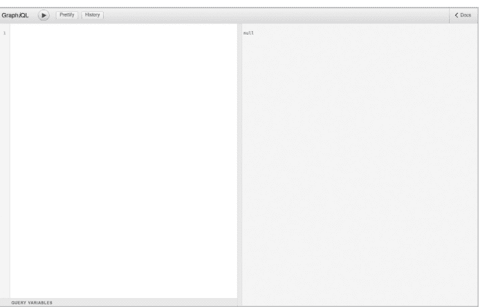

图 1-6：GraphiQL Explorer 面板

要将查询发送到服务器，请点击位于左上角的播放按钮。你应该会看到图 1-7 所示的结果。

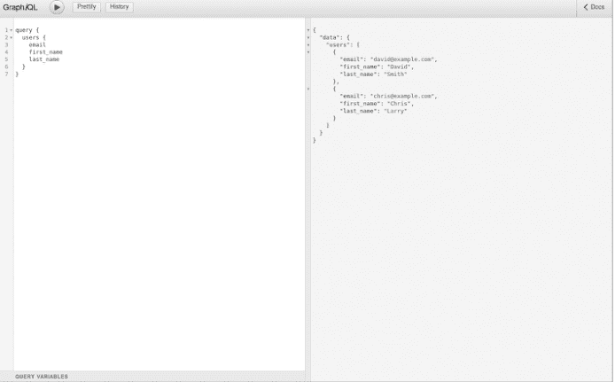

图 1-7：GraphQL 查询结果

你可能已经注意到，只要开始输入查询，就会弹出一个小下拉菜单。该菜单提供自动补全选项，如图 1-8 所示。

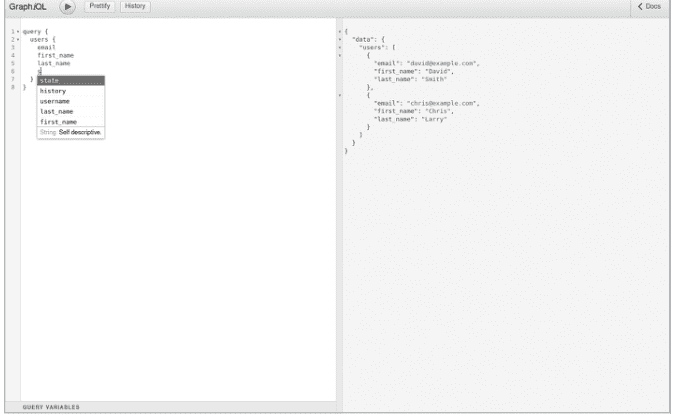

图 1-8：GraphiQL Explorer 自动补全建议

自动补全功能非常有用，尤其是在需要与具有复杂模式的 GraphQL 应用交互时。如果没有对模式的了解，猜测一个有效查询可能是什么样子会相当具有挑战性。自动补全功能在 GraphiQL Explorer 能够通过内省查询查询 GraphQL 服务器时可用，内省查询是 GraphQL 的自文档化 API 功能。你将在第 3 章中了解更多关于内省的信息。

要查看有关应用 GraphQL 模式的更多信息，请点击位于右侧窗格中的 Docs 选项卡。这将打开自动生成的文档，如图 1-9 所示。

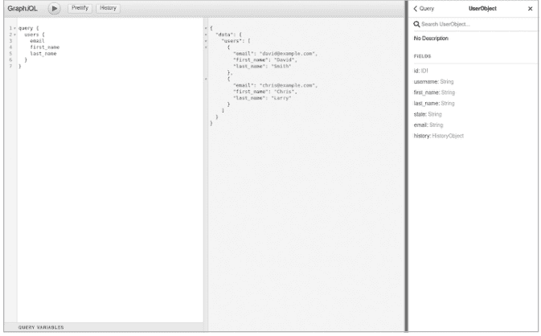

图 1-9：GraphiQL Explorer 自动生成的模式文档

GraphiQL Explorer 还为你提供所有先前发送查询的视图，如图 1-10 所示。你可以点击一个查询来重放它。

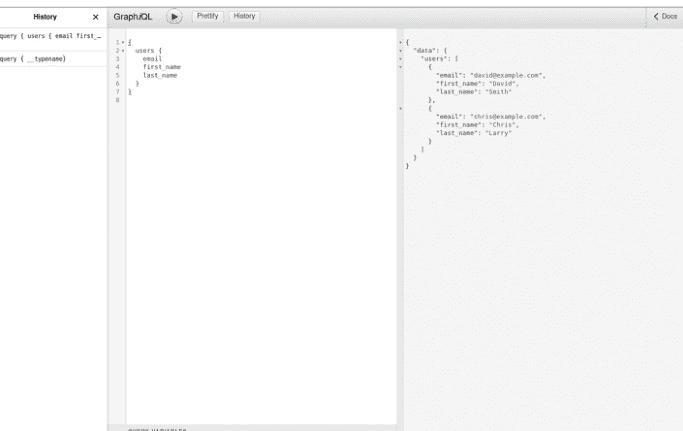

图 1-10：GraphiQL Explorer 中的历史查询

GraphQL 服务器默认情况下未经过身份验证，这允许诸如 GraphiQL Explorer 和 GraphQL Playground 之类的图形界面自由地与其交互。通常，保护这些图形界面并没有太多意义，因为它们只是 API 的简单前端，我们仍然可以使用其他客户端，例如 cURL，对服务器执行直接 API 调用。API 服务器本身应实现保护措施以避免未经授权的 API 查询。

## 总结

在本章中，你对 GraphQL 进行了介绍。我们介绍了 GraphQL 是什么以及它试图解决的问题。我们还通过示例演示了 REST 和 GraphQL API 之间的根本差异，以及在安全上下文中了解这些差异的重要性。此外，你还通过使用 GraphiQL Explorer 工具首次亲身体验了查询 GraphQL API。

## 2

## 设置 GraphQL 安全实验室


在本章中，你将开始构建你的 GraphQL 道场：一个配备 GraphQL 黑客工具的安全测试实验室环境，以及一个故意存在漏洞的服务器，你可以用它来安全地测试新获得的进攻性 GraphQL 技能。

当你测试底层技术尚未存在多年 的应用时，了解如何使用合适的工具设置黑客实验室变得比平时更重要。成熟的技术已经经历了多次安全审查和研究。对于较新的技术，可能需要一些时间才能形成类似的知识库，并使安全测试方法在安全社区中传播。

这种知识库的缺乏会带来问题。想象一下，你正在进行渗透测试时发现一台运行着你从未见过的应用的服务器。你可能会开始研究该软件并在诸如 Exploit Database（https://exploit-db.com）之类的网站上寻找已知的应用漏洞或公开可用的漏洞利用。

然而，当应用使用新的框架，例如 GraphQL 时，情况可能会变得更加复杂。测试该应用不仅需要了解框架，还需要了解如何重新配置相关的渗透测试工具，而这在渗透测试进行中是一项耗时的工作。

本章中你将构建的专用实验室将支持你在本书中的动手黑客活动，以便下次你在野外遇到 GraphQL 时，你就能准备好使用合适的工具来搜索和发现漏洞。在实验室中 tinkering 还有很多其他好处，例如通过实验提供实践经验。学习黑客攻击的最好方法是通过亲自动手。

> NOTE
> 在第 1 章中，你使用我们托管的实时应用来尝试 REST 和 GraphQL API。从现在开始，所有实验室练习都将在本地、你的计算机上进行。

## 采取安全预防措施

在个人设备上构建黑客实验室时，你应遵循以下几条准则：

- **避免将实验室直接连接到公共互联网。** 黑客实验室环境通常涉及安装易受攻击的代码或过时的软件。如果它们可以从互联网访问，这些可能会对你的网络、计算机和数据构成风险。你不希望互联网机器人将恶意软件部署到你的计算机上或将其用作攻击他人的跳板。
- **仅在受信任的本地网络上进行实验室操作。** 与你处于同一网络上的任何人也可以攻击实验室。因此，我们建议你仅在连接到你信任的网络时才进行本书的学习。
- **使用超visor，例如 Oracle VirtualBox，在虚拟环境中部署实验室。** 对于 VirtualBox（https://www.virtualbox.org/wiki/Downloads），请选择适用于你主计算机操作系统的平台包。如果你运行的是 Linux，请从 https://www.virtualbox.org/wiki/Linux_Downloads 上的列表中选择你正在使用的 Linux 发行版的包。VirtualBox 目前支持所有主要发行版，例如 Ubuntu、Debian 和 Fedora。将黑客实验室环境与你的主要操作系统分离通常是一个好主意，因为它可以防止可能破坏计算机上其他软件的软件冲突。
- **利用你选择的超visor 的虚拟机快照机制。** 这允许你对虚拟机进行 *快照*（指定时间点的版本）并将其恢复到原始状态，以防它将来发生损坏。将其视为在视频游戏中点击保存按钮，以便稍后恢复游戏。


牢记这些最佳实践，让我们动手搭建实验室吧！

## 安装 Kali

*Kali* 是一个专为渗透测试创建的 Linux 发行版。基于 Debian，由 Offensive Security (https://offensive-security.com) 设计。我们将使用 Kali 作为 GraphQL 攻击实验室的基础操作系统，因为它捆绑了我们所需的一些库、依赖项和工具。

你可以在 https://www.kali.org/get-kali 获取适用于 VMware Workstation 和 Oracle VirtualBox 超级管理程序的 Kali 虚拟机镜像。选择你喜欢的超级管理程序并按照 Offensive Security 提供的官方安装说明进行操作：https://www.kali.org/docs/installation。

完成安装过程后，你应该会看到图 2-1 所示的 Kali 登录屏幕。Kali 附带一个名为 *kali* 的默认用户账户，其密码为 *kali*。

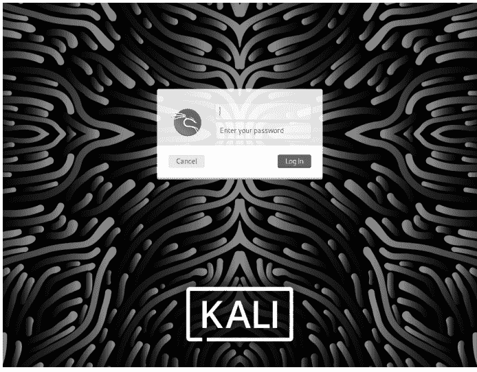

图 2-1：Kali Linux 登录屏幕

登录 Kali 后，你需要确保它是最新的。打开 Kali 的 **Applications** 菜单，并在搜索栏中输入 **terminal emulator**（图 2-2）。点击相应的应用程序。

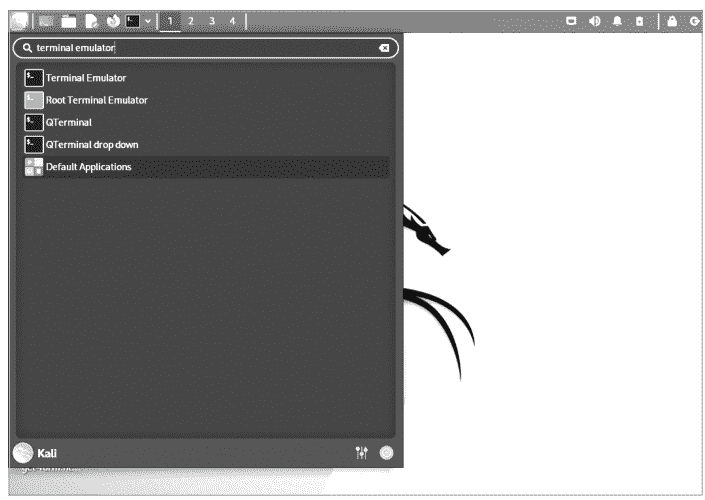

图 2-2：Kali Applications 菜单

让我们使用几个命令来更新你的软件仓库并升级已安装的软件包。在终端窗口中，输入以下命令：

```
# sudo apt update -y
# sudo apt upgrade -y
# sudo apt dist-upgrade -y
```

> NOTE 当你使用 sudo 命令时，Kali 会要求你输入密码。这与你登录虚拟机时使用的密码相同，即 kali。

从现在开始，我们将使用 Kali 机器来完成本书中涵盖的所有任务。我们建议保持终端窗口打开，因为你很快就需要它进行额外的安装。

## 安装 Web 客户端

在第 1 章中，我们提到 GraphQL API 可以使用各种专用工具进行查询，例如 GraphiQL Explorer，或简单的基于命令行 的 HTTP 客户端，例如 cURL。这些工具在幕后都会发出 HTTP 请求。

我们将安装并使用两个 Web 客户端：cURL 和 Altair。这些将允许你使用命令行工具和图形界面工具来试验构建和发送 GraphQL 查询。

## 使用 cURL 从命令行查询

最受欢迎的命令行 HTTP 客户端之一 cURL，可以像任何图形 Web 浏览器一样发出 HTTP 请求。因此，你可以使用它来查询 GraphQL API。

作为一名黑客，你应该习惯于从命令行操作。除了可以更轻松地自动化重复性任务外，熟悉命令行还能让你在没有图形界面的情况下高效工作，例如在渗透测试期间。

让我们继续安装 cURL。打开终端并输入以下命令：

```
# sudo apt install -y curl
```

你可以通过发出以下命令来验证 cURL 是否已成功安装并正常运行：

```
# curl lab.blackhatgraphql.com
Black Hat GraphQL - Hello!
```

如果看到 “Hello!” 消息，则意味着 cURL 成功向应用程序发送了 HTTP GET 请求并收到了响应。

## 使用 Altair 从 GUI 查询

在第 1 章中，我们通过使用 GraphiQL Explorer 并利用其自动补全功能来查询 GraphQL API。虽然 GraphiQL 是一个非常有用的工具，但在渗透测试期间它并不总是可用。为了解决这个问题，你可以在本地计算机上安装图形 GraphQL 客户端。这些客户端有能力连接到远程 GraphQL 服务器并返回结果，方式与 GraphiQL Explorer 类似。如果你向图形客户端提供远程服务器地址，它将在幕后处理与 GraphQL 的集成。

其中一个工具 Altair 可作为 Web 浏览器插件以及本地桌面应用程序使用。两个版本都提供相同的功能，选择其中任何一个都没有缺点。在本书中，我们将使用桌面应用程序。但是，如果你愿意，你也可以通过在浏览器地址栏中输入 about:addons 来找到的附加组件商店，为 Firefox 安装浏览器插件。

Altair 桌面客户端可在 macOS、Linux 和 Windows 上使用，地址为 https://altair.sirmuel.design/#download，如图 2-3 所示。选择代表你正在运行的操作系统的图标。对于 Kali，你需要安装 Linux 版本。

将 Altair 下载到 Kali 的 Desktop 目录。下载完成后，你应该会看到一个扩展名为 AppImage 的文件：

```
# cd ~/Desktop
# ls -l altair*
-rwxr-xr-- 1 kali kali 88819862 altair_x86_64_linux.AppImage
```

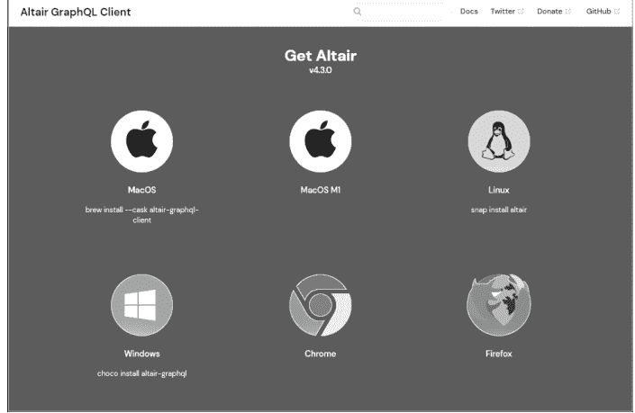

图 2-3：可用的 Altair Desktop 客户端版本

接下来，我们需要更改下载文件的权限以便运行它：

```
# chmod u+x altair_x86_64_linux.AppImage
```

现在我们可以执行该文件。它应该加载客户端，如图 2-4 所示。

```
# ./altair_x86_64_linux.AppImage
```

设置正确的权限后，你还应该能够通过点击 Kali 桌面上的 Altair Desktop 图标直接运行该应用程序。

让我们现在验证客户端是否按预期工作。打开它，并在 Enter URL 地址栏中输入 http://lab.blackhatgraphql.com/graphql。这将确保我们执行的任何查询都会直接发送到此地址。现在，在左侧的 Query 窗格中，删除现有的代码注释（以 # 符号开头的行），并改输入以下查询：

```
query {
  users {
    username
  }
}
```

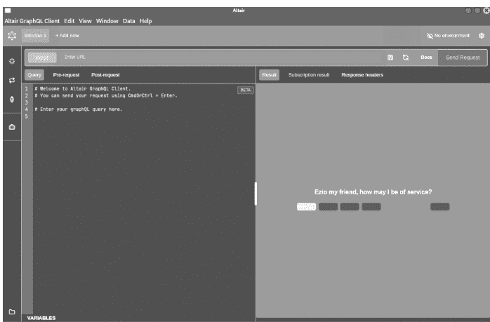

图 2-4：适用于 Linux 的 Altair Desktop 客户端

最后，点击 Send Request。你应该会看到与图 2-5 相似的输出。

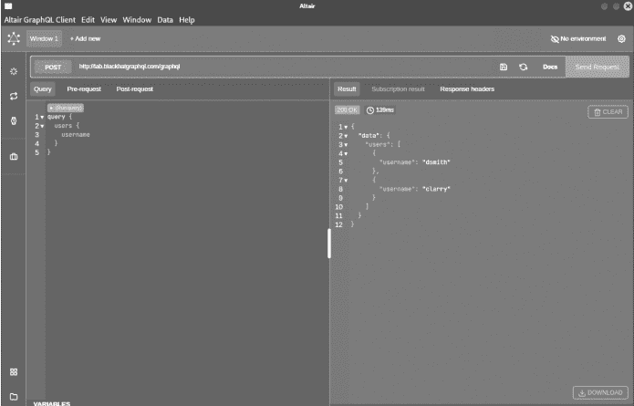

图 2-5：Altair Desktop 客户端中的 GraphQL 响应

Altair 是一个功能强大的工具；它将为我们提供查询自动补全建议、架构文档、已执行查询的历史记录以及其他功能，例如设置自定义 HTTP 头和将查询保存到集合中，让我们的生活变得更轻松。要了解有关 Altair 高级功能的更多信息，请参阅官方文档页面 https://altair.sirmuel.design/docs/features。

> NOTE
> 在渗透测试期间，你可能会遇到具有身份验证和授权控制的远程 GraphQL API 服务器。像 Altair 这样的 GraphQL 客户端需要设置特殊的 HTTP 头，以便它们能够向远程服务器进行身份验证。Altair 允许你通过左侧的 Set Headers 菜单项配置自定义头。在没有身份验证 HTTP 头的情况下，查询可能会因 401 Unauthorized 等错误而失败。在第 7 章中，我们将探索启用了身份验证和授权控制的 GraphQL 服务器。

## 设置易受攻击的 GraphQL 服务器

现在我们已经有了查询任何 GraphQL 服务器所需的客户端工具，下一步是安装一个易受攻击的 GraphQL 服务器，我们将在整本书中将其用作目标。我们将在第 3 章中对 GraphQL 进行更深入的探索，以及第 4 章至第 9 章的渗透测试练习中使用此易受攻击的服务器。

## 安装 Docker

Docker (https://www.docker.com) 是一个用于部署和管理容器的工具。容器是打包代码及其依赖项的软件单元，以便应用程序可以在各种环境中可靠运行。Docker 可在 Windows、macOS 和 Linux 上使用。

我们将使用 Docker 部署本书中我们将攻击的应用程序。让我们从 Kali 软件仓库安装它，运行以下命令：

```
# sudo apt install -y docker.io
```

接下来，我们希望确保 Docker 进程在系统重新启动时自动启动：

```
# sudo systemctl enable docker --now
```

最后，确保 Docker 已成功安装：

```
# sudo docker

Management Commands:
  builder      Manage builds
  completion   generate the autocompletion script for the specified shell
  config       Manage Docker configs
  container    Manage containers
  context      Manage contexts
```


# 部署 Damn Vulnerable GraphQL 应用

我们的目标应用必须能够模拟常见的 GraphQL 应用漏洞。为此，我们将使用 Damn Vulnerable GraphQL Application (DVGA)，这是一个 GraphQL 应用，其中故意内置了设计和配置层面的漏洞。我们于 2021 年 2 月开发了 DVGA，用以教育用户如何攻击和防御由 GraphQL 支持的应用，此后它已成为 GraphQL 安全领域学习如何攻击 GraphQL 的事实上的目标应用。

> NOTE
> Damn vulnerable 是一个通常与为教育目的而故意设计为不安全的应用相关联的短语。

DVGA 容易受到多种问题的攻击，包括 DoS、信息泄露、代码执行、身份验证绕过、结构化查询语言 (SQL) 注入、破坏的授权等。它提供多种工作模式，适用于初学者和专家，并内置恢复自身的功能，以防其损坏。我们将在第 3 章和第 4 章中更详细地介绍如何使用它。

DVGA 代码是开源的，可以在 GitHub 上找到，地址为 https://github.com/dolevf/Damn-Vulnerable-GraphQL-Application。让我们使用 Git 克隆 DVGA 仓库并使用 Docker 部署它。首先，确保已安装 Git，使用以下命令：

```
# sudo apt install git -y
# git --help

usage: git [--version] [--help] [-C <path>] [-c <name>=<value>]
       [--exec-path[=<path>]] [--html-path] [--man-path] [--info-path]
       [-p | --paginate | -P | --no-pager] [--no-replace-objects] [--bare]
--snip--
```

接下来，从 GitHub 克隆 DVGA 仓库：

```
# cd ~
# git clone -b blackhatgraphql https://github.com/dolevf/Damn-Vulnerable-GraphQL-Application.git
# ls -l

drwxr-xr-x 9 kali kali 4096 Damn-Vulnerable-GraphQL-Application
```

然后使用以下命令构建 DVGA Docker 镜像：

```
# cd Damn-Vulnerable-GraphQL-Application
# sudo docker build -t dvga .
```

最后，使用以下命令启动 DVGA 容器。请注意，如果在本书的任何阶段 DVGA 发生崩溃，你将希望运行此特定命令：

```
# sudo docker run -t --rm -d --name dvga -p 5013:5013 -e WEB_HOST=0.0.0.0 dvga
```

接下来，使用以下命令验证容器是否正在运行：

```
# sudo docker container ps
```

```
CONTAINER ID IMAGE COMMAND CREATED STATUS PORTS NAMES
7b33cca84fc1 dvga "python3 app.py" About a minute ago
Up 0.0.0.0:5013->5013/tcp, :::5013->5013/tcp dvga
```

此时，目标应用应该已启动并运行。通过打开网页浏览器并在地址栏输入 http://localhost:5013 来验证。你应该能够访问图 2-6 所示的应用。

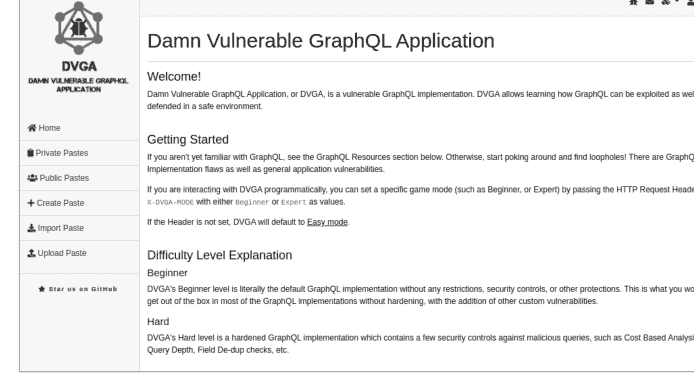

图 2-6：Damn Vulnerable GraphQL Application

正如你所见，DVGA 类似于 Pastebin (https://pastebin.com)，这是一个允许客户端提交随机文本片段（例如源代码或其他文本）并与其他人共享的网页应用。这些文本片段也称为 pastes，这是我们在本书中贯穿渗透测试场景使用 DVGA 时将使用的术语。Pastes 可以具有元数据，例如标题、内容、作者信息等。当我们对 DVGA 运行查询时，你将能够看到此信息。图 2-7 显示了 DVGA 中一个粘贴的示例。

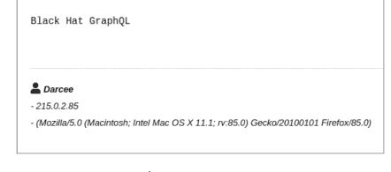

图 2-7：DVGA 中的一个示例粘贴

你可以看到粘贴的标题和内容，以及作者（Darcee）及其一些元数据，例如其互联网协议 (IP) 地址（215.0.2.85）和网页浏览器（Mozilla/5.0）。

## 测试 DVGA

现在你已在实验室环境中拥有目标应用，请通过简单的 GraphQL 查询验证应用是否已启动并且其 GraphQL API 在网络上可访问。为此，我们将使用之前安装的 Altair 客户端。

打开 Altair 客户端并在地址栏输入 http://localhost:5013/graphql。接下来，在左侧窗格中输入以下 GraphQL 查询：

```
query {
  systemHealth
}
```

此查询应产生与图 2-8 所示类似的输出。

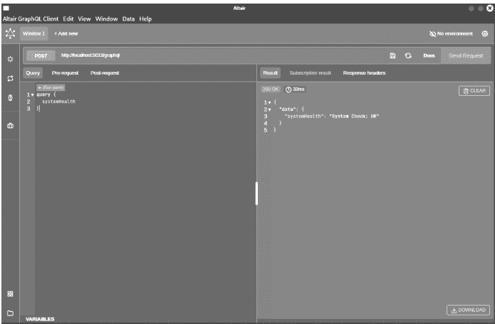

图 2-8：Altair 中的 DVGA 响应

GraphQL 中的名称区分大小写，因此请确保遵循 systemHealth 中的大写；否则，此查询将导致错误。

## 安装 GraphQL 攻击工具

在第 1 章中，我们强调了 REST 和 GraphQL API 之间的差异。这些差异要求安全行业将 GraphQL 支持构建到现有工具中。在某些情况下，黑客还创建了专门用于渗透测试 GraphQL 应用的新工具。我们将在实验室中安装并在后续章节的攻击练习中使用的攻击工具能够对 GraphQL 应用进行安全测试。

### Burp Suite

Burp Suite 是 PortSwigger (https://portswigger.net) 的应用安全测试软件，它在你的网页浏览器和目标应用之间代理流量，允许你拦截、修改和重放进出你计算机的请求。在我们的 GraphQL 安全实验室中，我们将使用 Burp Suite 通过观察和修改在发送到目标服务器之前发送的 GraphQL 查询来手动与目标交互。

更新版本的 Kali 应该默认已安装 Burp Suite。让我们通过打开终端并输入以下命令来验证这一点：

```
# sudo apt install burpsuite -y
```

现在我们将打开 Burp Suite 并检查它是否可以成功拦截流量。在 Kali Applications 菜单的搜索栏中，输入 Burp Suite 并点击该应用。如果这是你第一次加载该应用，请阅读条款和条件并点击 I Accept。

通过选择 Temporary Project 单选按钮创建临时项目，然后点击 Next。Burp Suite 将询问要为项目加载哪个配置文件。选择 Use Burp Defaults 并点击 Start Burp。

接下来，让我们确保 Burp Suite 可以代理 HTTP 流量到 DVGA。点击 Proxy ▸ Intercept ▸ Open Browser。在浏览器中，输入 http://localhost:5013/graphiql 并按 ENTER。这将向 DVGA 发起 GET 请求，Burp Suite 应该会自动拦截它。

> NOTE Burp Suite 中的 Open Browser 选项启动嵌入式浏览器，无需任何额外配置（例如将 Burp 的证书添加到受信任的证书存储中）。它应该可以立即开始拦截流量。

Burp Suite 现在应该突出显示 Intercept 选项卡（通常为橙色），表明它已拦截传出请求。你应该会看到一个正在进行的 HTTP GET 请求，与图 2-9 所示类似。

此请求尚未离开你的网页浏览器。Burp Suite 允许你在将其发送到服务器之前对其进行修改。继续点击 Intercept Is On 按钮。这将取消阻止请求并将其发送到 DVGA。

我们已验证 Burp Suite 已安装并配置，并且可以拦截从浏览器到 DVGA 的流量。干得好！Burp Suite 功能如此丰富，可以写一整本书来介绍它。要了解有关此工具的更多信息，我们建议参考其官方文档 (https://portswigger.net/burp/documentation/desktop/penetration-testing)。

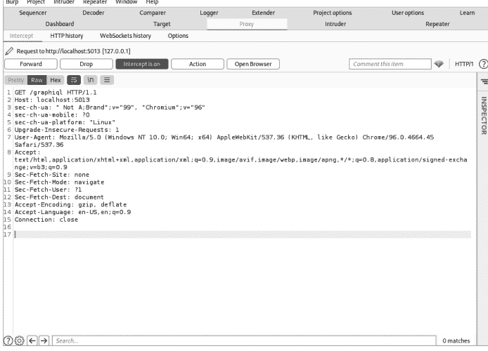

图 2-9：在 Burp Suite 中拦截请求

### Clairvoyance

在第 1 章中，我们介绍了 GraphQL 模式，它代表了应用数据模型的结构。想要与 GraphQL API 交互的开发人员需要知道他们可以访问什么数据，以及 API 支持哪些查询或变异。GraphQL 通过 introspection 查询公开此模式信息。

简单来说，introspection 是 GraphQL 中的一项功能，允许它向客户端描述自己的数据。清单 2-1 显示了一个基本的 introspection 查询，它返回模式中所有可用查询的列表。我们将在第 3 章中更详细地介绍这些查询。

```
{
  __schema {
    queryType {
      fields {
        name
      }
    }
  }
}
```

清单 2-1：一个基本的 introspection 查询


可以想象，允许客户端对 GraphQL API 执行内省查询的公司正在进行安全权衡。有关后端应用程序支持的各种字段和对象的信息只能帮助威胁行为者并增加他们成功发现漏洞的机会。因此，生产级实现通常会禁用内省。这意味着你可能需要在不允许执行内省查询的生产环境中测试 GraphQL 应用程序。在这些情况下，如何正确构造查询可能会构成挑战。

这时 Clairvoyance 就派上用场了。这款由 Nikita Stupin (@_nikitastupin) 和 Ilya Tsaturov (@itsaturov) 开发的用于 GraphQL API 的基于 Python 的侦察工具，允许你在内省被禁用的情况下发现模式信息。它通过滥用 GraphQL 的一个名为字段建议的功能来工作。基本上，它通过发送由常用英语单词词典构建的查询并观察服务器的响应来重建底层模式。我们将在第 6 章中更详细地介绍字段建议以及它们如何帮助我们提取有关 GraphQL 模式的信息。

让我们继续安装 Clairvoyance。打开终端并输入以下命令：

```
# cd ~
# git clone https://github.com/nikitastupin/clairvoyance.git
# cd clairvoyance
```

我们可以通过向 Clairvoyance 脚本传递 -h 标志来验证 Clairvoyance 是否能够运行：

```
# python3 -m clairvoyance -h

usage: __main__.py [-h] [-v] [-k] [-i <file>]
[-o <file>] [-d <string>] [-H <header>] -w <file> url

positional arguments:
  url

optional arguments:
  -h, --help      show this help message and exit
```

## InQL

直到最近，即使 GraphQL 的采用率不断提高，公开可用的 GraphQL 安全测试资源也不多。为了填补这一空白，安全公司 Doyensec 开发了 Introspection GraphQL (InQL)。

这款基于 Python 的安全测试工具依赖于内省查询。InQL 可以将它发现的有关 GraphQL 模式的任何信息导出到多种格式，从而使应用程序的模式更易于阅读和理解。InQL 还可以执行其他任务，例如检测潜在的 DoS 条件。

让我们安装 InQL。打开终端并输入以下命令：

```
# cd ~
# git clone https://github.com/doyensec/inql.git
# cd inql
# sudo python3 setup.py install
```

通过向其传递 -h 标志来验证安装是否成功并且 InQL 能够运行：

```
# inql -h

usage: inql [-h] [-t TARGET] [-f SCHEMA_JSON_FILE] [-k KEY]
[-p PROXY] [--header HEADERS HEADERS] [-d] [--no-generate-html]
[--no-generate-schema] [--no-generate-queries] [--generate-cycles]
[--cycles-timeout CYCLES_TIMEOUT] [--cycles-streaming] [--generate-tsv]
[--insecure] [-o OUTPUT_DIRECTORY]
```

如果看到类似的输出，则 InQL 已成功安装。我们将在本书后面的渗透测试练习中使用该工具。

NOTE InQL 也可作为 Burp Suite 扩展名为 Introspection GraphQL Scanner 使用，可从 Burp Suite 的 BApp Store (https://portswigger.net/bappstore) 下载。我们将改用你刚刚安装的命令行版本。

## Graphw00f

多年来，GraphQL 社区已在许多编程语言中开发了 GraphQL 服务器实现，例如 PHP 的 graphql-php，以及 Python 的 Graphene 和 Ariadne。对于我们黑客来说，识别目标服务器幕后运行的技术至关重要。一旦我们收集到这些信息，我们将能够根据所面对的技术定制攻击，从而提高整体成功率。

Graphw00f是我们开发的一款基于 Python 的 GraphQL 安全工具，用于识别 GraphQL API 的具体实现。我们主要构建它的原因是因为 GraphQL 通常不会宣传其底层使用的引擎类型。我们想知道是否仅凭 API 响应就能识别实现；事实证明可以。Graphw00f 通过向服务器发送混合的合法和格式错误的查询并观察返回的错误消息中的细微差异来完成实现指纹识别。它目前可以指纹识别超过 24 种实现，包括今天使用的绝大多数流行的 GraphQL 服务器。

这些实现信息尤其有趣，因为当今可用的并非所有 GraphQL 实现都开箱即支持相同的<|message|>安全功能。例如，一些实现提供用于实现授权控制的外部库，而另一些则没有。识别后端技术为我们提供了这些额外的数据点来指导我们的测试。

NOTE 有趣的事实：Graphw00f 的名称灵感来自另一个网络安全工具 WAFW00F (https://github.com/EnableSecurity/wafw00f)。WAFW00F 的工作方式与 Graphw00f 类似，只是它尝试指纹识别 WAF 而不是 GraphQL 实现。

要安装 Graphw00f，请打开终端并输入以下内容：

```
# cd ~
# git clone https://github.com/dolevf/graphw00f.git
# cd graphw00f
```

通过使用 -h 命令验证 Graphw00f 是否可以成功启动：

```
# python3 main.py --help
```

Usage: main.py -d -f -t http://example.com

Options:
  -h, --help          show this help message and exit
  -r, --noredirect    Do not follow redirections given by 3xx responses

## BatchQL

BatchQL 是由安全公司 Assetnote 开发的用 Python 编写的 GraphQL 安全审计脚本。该工具以 GraphQL 的一个名为批处理的功能命名，该功能允许客户端在单个 HTTP 请求中发送多个查询。你将在后面的章节中了解更多关于批处理查询的信息。

BatchQL 尝试识别与以下漏洞类别相关的 GraphQL 实现缺陷：DoS、CSRF 和信息泄露。通过执行以下命令安装它：

```
# cd ~
# git clone https://github.com/assetnote/batchql.git
```

通过向其传递 -h 标志来验证 BatchQL 是否正常工作：

```
# cd batchql
# python3 batch.py -h
```

usage: batch.py [-h] [-e ENDPOINT] [-v VARIABLE] [-P PREFLIGHT] [-q QUERY] [-w WORDLIST] [-H HEADER [HEADER ...]] [-p PROXY] [-s SIZE] [-o OUTPUT]

optional arguments:
  -h, --help          show this help message and exit
  -e ENDPOINT, --endpoint ENDPOINT
                      GraphQL Endpoint (i.e. https://example.com/graphql).

## Nmap

由 Gordon Lyon（也被称为“Fyodor”）开发的 Nmap 是端口扫描的瑞士军刀。它也是今天现存最古老的安全工具之一，创建于 1997 年 9 月。（它在数十年后仍然是事实上的端口扫描工具，这真是令人惊讶。）

我们将使用 Nmap 的端口扫描功能及其自定义脚本引擎，即 Nmap 脚本引擎（NSE）。NSE 使用用 Lua 语言编写的脚本将 Nmap 扩展为功能齐全的漏洞评估工具。我们将利用此功能来扫描 GraphQL 服务器并查找漏洞。

Kali 默认捆绑了 Nmap。通过以下命令验证你是否已安装：

```
# sudo apt install nmap -y
```

接下来，下载 Nmap 的 nmap-graphql-introspection-nse Lua 脚本并将其放置在 NSE 脚本文件夹中：

```
# cd ~
# git clone https://github.com/dolevf/nmap-graphql-introspection-nse.git
# cd nmap-graphql-introspection-nse
# sudo cp graphql-introspection.nse /usr/share/nmap/scripts
```

让我们现在通过传递 --script-help 命令参数来验证 Nmap 是否可以找到并读取该脚本：

```
# nmap --script-help graphql-introspection.nse

Starting Nmap ( https://nmap.org )

graphql-introspection
Categories: discovery fuzzer vuln intrusive
https://nmap.org/nsedoc/scripts/graphql-introspection.html
Identifies webservers running GraphQL endpoints and attempts an execution of an Introspection query for information gathering.

This script queries for common graphql endpoints and then sends an Introspection query and inspects the result.

Resources
* https://graphql.org/learn/introspection/
```

## Commix

命令注入利用工具（Commix）是由 Anastasios Stasinopoulos 开发的用 Python 编写的开源项目。Commix 尝试通过模糊 HTTP 请求的各个部分，例如查询参数或请求正文，使用专用有效负载，以自动化方式查找和利用命令注入漏洞。该工具还能够


利用这些漏洞可以生成一个自定义的交互式 shell，渗透测试人员可以利用它在远程服务器上获得立足点。

Commix 默认应在 Kali 中预装，但为确保它确实可用且正常工作，请运行以下命令集：

```
# sudo apt install commix -y
# commix -h

Usage: commix [option(s)]

Options:
  -h, --help              Show help and exit.

General:
  These options relate to general matters.

  -v VERBOSE              Verbosity level (0-4, Default: 0).
  --version               Show version number and exit.
```

## graphql-path-enum

graphql-path-enum 由 dee_see (@dee_see) 用 Rust 编写并开发，是一款安全测试工具，可找到构建查询以到达特定数据片段的各种方法。通过这样做，它为黑客提供了可能有助于识别授权缺陷的信息。我们将在第 7 章讨论 GraphQL 授权漏洞。

通过运行以下命令安装 graphql-path-enum：

```
# cd ~
# wget "https://gitlab.com/dee-see/graphql-path-enum/-/jobs/artifacts/v1.1/raw/target/release/graphql-path-enum?job=build-linux"
-O graphql-path-enum
# chmod u+x graphql-path-enum
```

通过传递 -h 标志验证其是否能成功运行并具有新的权限：

```
# ./graphql-path-enum -h

graphql-path-enum

USAGE:
  graphql-path-enum [FLAGS] --introspect-query-path <FILE_PATH> --type <TYPE_NAME>

FLAGS:
  --expand-connections    Expand connection nodes
    (with pageInfo, edges, etc. edges), they are skipped by default.
  -h, --help              Prints help information
  --include-mutations     Include paths from the Mutation node.
    Off by default because this often adds a lot of noise.
  -V, --version           Prints version information
```

## EyeWitness

EyeWitness 是由 Chris Truncer 和 Rohan Vazarkar 开发的网络扫描工具，能够捕获目标 Web 应用程序的屏幕截图。在渗透测试中扫描许多网站时，您通常会发现视觉识别其上运行的内容非常有用。EyeWitness 在内部使用基于命令行的网络浏览器（也称为无头浏览器），这使其能够加载动态 Web 内容，例如使用 JavaScript 动态加载的内容。

使用以下命令安装 EyeWitness：

```
# sudo apt install eyewitness -y
# eyewitness -h
```

Protocols:
  --web          HTTP Screenshot using Selenium

Input Options:
  -f Filename      Line-separated file containing URLs to capture
  -x Filename.xml  Nmap XML or .Nessus file
  --single Single URL  Single URL/Host to capture
  --no-dns

## GraphQL Cop

我们开发了 GraphQL Cop，这是一款基于 Python 的专用 GraphQL 安全审计实用程序。GraphQL Cop 对 GraphQL 服务器进行信息泄露和基于 DoS 的漏洞审计。在后面的章节中，我们将使用此工具检查 GraphQL 服务器是否已针对常见攻击得到保护。

使用以下命令集安装 GraphQL Cop：

```
# sudo apt install python3-pip -y
# git clone https://github.com/dolevf/graphql-cop.git
# cd graphql-cop
# pip3 install -r requirements.txt
# python3 graphql-cop.py -h
```

Options:
  -h, --help      show this help message and exit
  -t URL, --target=URL  target url with the path
  -H HEADER, --header=HEADER  Append Header to the request '{"Authorization": "Bearer eyjt}"' 
  -o FORMAT, --output=FORMAT  json
  -x, --proxy     Sends the request through http://127.0.0.1:8080 proxy
  -v, --version   Print out the current version and exit.

## CrackQL

我们开发了 CrackQL，这是一款专用于 GraphQL 的暴力破解工具，利用 GraphQL 语言特性更好地优化对可能需要身份验证的 API 操作的暴力破解攻击。我们将在第 7 章使用此工具对 GraphQL 目标执行基于字典的攻击。按如下方式安装 CrackQL：

```
# git clone https://github.com/nicholasaleks/CrackQL.git
# cd CrackQL
# pip3 install -r requirements.txt
# python3 CrackQL.py -h
```

```
Options:
  -h, --help              show this help message and exit
  -t URL, --target=URL    Target url with a path to the GraphQL endpoint
  -q QUERY, --query=QUERY Input query or mutation operation with variable payload markers
  -i INPUT_CSV, --input-csv=INPUT_CSV Path to a csv list of arguments (i.e. usernames, emails, ids, passwords, otp_tokens, etc.)
```

安装完所有这些工具后，我们强烈建议您对 Kali 虚拟机进行快照，以确保其状态已保存。这样，如果将来出现故障，您就可以恢复它。

## Summary

让我们总结一下您实验室中目前拥有的内容：可以与 GraphQL 交互的图形和命令行 HTTP 客户端、可用于部署容器的正在运行的 Docker 环境，以及 DVGA 目标应用程序。

本章简要讨论了这些工具在内部的工作原理以及它们满足的需求，例如信息收集、服务器指纹识别、网络和应用程序扫描、漏洞评估和 GraphQL 审计。您将在剩余章节中更深入地探索它们的使用。

此实验室是本书的重要组成部分，但也可能对您下一次真实世界的渗透测试有所帮助。我们鼓励您关注 Black Hat GraphQL GitHub 仓库（https://github.com/dolevjf/Black-Hat-GraphQL.git），我们在其中维护当前和未来 GraphQL 安全工具的列表，以帮助您保持实验室的最新状态。

## 3
