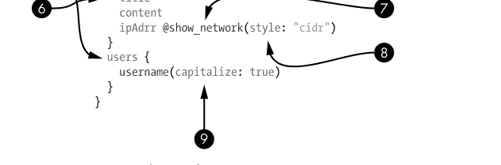
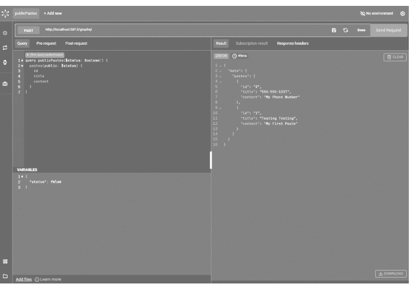
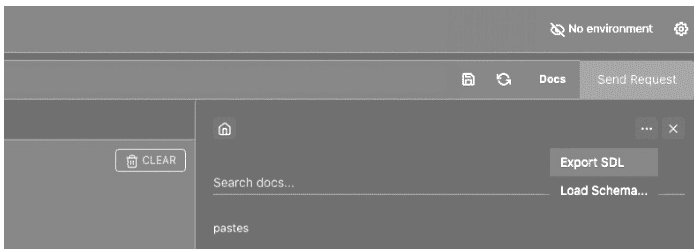

## THE GRAPHQL ATTACK SURFACE


在本章中，我们首先从黑客的角度探索 GraphQL 的语言和类型系统。然后我们概述 GraphQL 中常见的弱点。
我们希望您手边有想象中的黑帽子，因为您即将学习功能如何变成弱点、配置错误如何变成信息泄露，以及实现设计缺陷如何导致 DoS 机会。

## What Is an Attack Surface?

*攻击面* 是对手可用于破坏系统机密性、完整性和可用性的所有可能攻击向量的总和。例如，想象一栋有前门、侧门和多个窗户的物理建筑。作为攻击者，我们将这些窗户和门中的每一个都视为获得对建筑物未经授权访问的可能机会。

通常，当系统的攻击面较大时，例如由许多应用程序、数据库、服务器、端点等组成时，攻击成功的风险更高。建筑物拥有窗户和门越多，其中一个入口点未上锁或不安全的概率就越高。

攻击面会随着时间的推移而变化，尤其是在系统及其环境不断演进时。在云环境中尤其如此，因为基础设施具有弹性。例如，一台服务器可能仅存在有限的时间，或者 IP 地址可能会更改，有时一天更改多次。

让我们回顾 GraphQL 中的所有窗户和门，并突出显示我们可以用来解锁它们的可能攻击向量。理解这些概念将有助于您在下一章中，我们将深入研究进攻性安全。

## The Language

为了讨论 GraphQL 的攻击面，我们将规范分为两个部分；其语言和类型系统。我们首先介绍语言，即从客户端的角度向 GraphQL API 服务器发出请求所使用的语言。接下来，我们将从服务器的角度回顾其类型系统。您可以通过使用 GraphQL 规范来了解这些概念和其他 GraphQL 内部信息；在这里，我们旨在提炼出仅能为您提供足够知识来在未来章节中测试 GraphQL 攻击向量的部分。

GraphQL 语言包含客户端可以利用的许多有用组件。乍一看，这些元素在请求中的表示方式可能看起来令人困惑。图 3-1 是一个示例 GraphQL 查询，其组件在表 3-1 中进行了说明。



Figure 3-1: A sample GraphQL query


正如你所见，GraphQL 查询具有独特的结构，了解其各个部分非常重要。表 3-1 提供了每个组件的描述。

## 表 3-1：GraphQL 查询的组件

| # | 组件 | 描述 |
|---|---|---|
| 1 | 操作类型 | 定义与服务器交互的方法的类型（query、mutation 或 subscription） |
| 2 | 操作名称 | 客户端创建的任意标签，用于为操作提供唯一名称 |
| 3 | 顶层字段 | 在操作中请求单个信息单元或对象的函数（可能包含嵌套字段） |
| 4 | 参数（顶层字段的） | 用于向字段发送信息以定制该字段的行为和结果的参数名称 |
| 5 | 值 | 发送给字段与参数相关的数据 |
| 6 | 字段 | 在操作中请求单个信息单元或对象的嵌套函数 |
| 7 | 指令 | 用于装饰字段以改变其验证或执行行为，从而改变 GraphQL 服务器返回的值的功能 |
| 8 | 参数（指令的） | 用于向字段或对象发送信息以定制其行为和结果的参数名称 |
| 9 | 参数（字段的） | 用于向字段发送信息以定制该字段行为和结果的参数名称 |

以下各节将探讨这些组件，以及一些额外的 GraphQL 功能，重点在于它们如何有助于 GraphQL 的攻击面。

## 查询、变更和订阅

我们在第 1 章中讨论了根操作类型 query、mutation 和 subscription，并展示了使用 query 类型检索数据的示例。 （因此，我们在这里不会重新讨论 query 类型。）作为黑客，真正的乐趣往往发生在我们可以修改数据时。在目标平台内创建、更新和删除数据使我们能够暴露业务逻辑缺陷。

> NOTE 我们建议使用我们在第 2 章中部署的 GraphQL 安全实验室来跟随本章的示例请求。使用 Altair 向 DVGA (http://localhost:5013/graphql) 发送请求。

### 变更

在 GraphQL 中，我们可以通过使用 *mutations* 来解锁数据修改能力。以下是 mutation 查询的示例：

```
mutation {
  editPaste(id: 1, content: "My first mutation!") {
    paste {
      id
      title
      content
    }
  }
}
```

我们通过使用 *mutation* 关键字来定义 mutation 操作。然后我们调用顶层 editPaste 字段，该字段接受 id 和 content 参数。 （我们将在本章后面讨论参数。）此 mutation 本质上是获取 id 为 1 的 paste 并更新其内容。然后我们请求更新后的 paste。这是一个同时更改和读取数据的 mutation 示例。

> NOTE
> 正如在 REST 中，HTTP GET 请求通常用于读取信息，但也可能被用来修改数据一样，GraphQL 实现可能会忽略规范并以允许数据写入的方式实现 query 操作。在第 9 章中，我们将探讨为什么使用 GraphQL query 写入数据可能是一个坏主意。

### 订阅

*subscription* 操作是双向的：它允许客户端从服务器检索实时数据，并允许服务器向客户端发送更新。订阅不如查询和变更常见，但许多服务器确实使用它们，因此了解它们的工作方式很重要。

订阅通过传输协议承载，最常见的是 *WebSocket*，这是一种实时通信协议，允许客户端和服务器在长连接上随时交换消息。然而，由于 GraphQL 规范没有定义订阅应使用哪个传输协议，你可能会看到使用者使用其他协议。

当客户端和服务器希望通过 WebSocket 通信时，它们会执行握手，将现有的 HTTP 连接升级为 WebSocket 连接。WebSocket 内部超出了本书的范围，但你可以通过阅读 PortSwigger 关于该主题的技术博客文章 https://portswigger.net/web-security/websockets/what-are-websockets 来了解更多关于此技术的信息。

由于 DVGA 支持通过 WebSocket 的订阅，我们可以观察 DVGA 前端界面与 GraphQL 服务器之间的握手。客户端可以使用订阅从 DVGA 服务器获取信息，例如新创建的 paste。例如，当你浏览到 http://localhost:5013 上的 Public Pastes 页面时，你应该在浏览器开发者工具的 Network 选项卡中看到如下所示的传出 HTTP 请求：

```
GET /subscriptions HTTP/1.1
Host: 0.0.0.0:5013
Connection: Upgrade
Pragma: no-cache
Cache-Control: no-cache
Upgrade: websocket
Origin: http://localhost:5013
Sec-WebSocket-Version: 13
Sec-WebSocket-Key: MV5U8J3GH1UG8A1Eb181HiA==
```

GraphQL 服务器对该握手请求的响应如下所示：

```
HTTP/1.1 101 Switching Protocols
Upgrade: websocket
Connection: Upgrade
Sec-WebSocket-Accept: aRn1pG8XwzRHPVxYmGVdqJv3D7U=
```

正如你所见，握手导致客户端和服务器从 HTTP 切换到 WebSocket，正如响应代码 101 Switching Protocols 所指示的那样。Sec-WebSocket-Accept 响应头通知客户端服务器已接受协议切换。

握手完成后，DVGA 将通过新建立的 WebSocket 连接发送订阅请求：

```
subscription {
  paste {
    id
    title
    content
  }
}
```

我们通过使用 subscription 关键字来定义订阅操作，然后请求 paste 顶层字段并选择 id、title 和 content 字段。此订阅允许客户端订阅 paste 字段；每当 DVGA 中创建新的 paste 时，GraphQL 服务器将通知所有订阅者该事件。这消除了客户端不断询问服务器更新的需求，这尤其有用，因为服务器在那一刻可能没有任何新内容可返回。

如果你想使用 Altair 向 DVGA 发送此订阅请求，你需要分配一个订阅 URL。你可以在 Altair 中通过点击左侧边栏的双箭头图标并输入 WebSocket URL ws://localhost:5013/subscriptions 来完成。接下来，要从 DVGA 订阅接收数据，你需要创建一个 paste。你可以使用 DVGA 用户界面通过 Public Pastes 页面创建它，也可以通过另一个 Altair 标签发送如下 mutation：

```
mutation {
  createPaste(title: "New paste", content: "Test", public: false) {
    paste {
      id
      title
      content
    }
  }
}
```

WebSocket 连接容易受到跨站 WebSocket 劫持（CSWSH）漏洞的影响，当服务器在握手过程中未验证客户端来源时就会发生这种情况。WebSocket 连接在消息传输未通过 Transport Layer Security（TLS）等加密通道进行时也可能受到中间人（MITM）攻击的攻击。此类漏洞的存在可能会对通过 GraphQL 订阅进行的操作产生安全影响。在第 9 章中，我们将更详细地介绍基于 WebSocket 的攻击。

## 操作名称

GraphQL 操作名称是用于在特定上下文中唯一标识操作的标签。它们出现在客户端发送给 GraphQL 服务的可执行文档中。这些文档可以包含一个或多个操作的列表。例如，列表 3-1 中的文档显示了一个查询操作，请求 pastes 顶层字段并嵌套 title 字段。

```
query {
  pastes {
    title
  }
}
```

列表 3-1：可执行查询文档

如果文档只包含一个操作，并且该操作是一个未定义变量且不包含指令的查询，那么该操作可以用其简写形式表示，无需 query 关键字，如列表 3-2 所示。

```
{
  pastes {
    title
  }
}
```

列表 3-2：简写查询文档


然而，一个文档也可能包含多个操作。如果文档中存在一个以上相同类型的操作，则必须使用操作名称。

客户端定义这些操作名称，这意味着它们可以完全随机，这使得它们成为可能欺骗审查 GraphQL 应用日志的分析师的一种绝佳方式。例如，想象一下客户端使用操作名称 getPastes 发送一个文档，但它实际上删除了所有粘贴，而不是返回粘贴对象的列表。

列表 3-3 提供了将 getPasteTitles 和 getPasteContent 设置为查询操作名称的文档示例。虽然这些操作名称鉴于所请求的内容是合适的，但它们同样可能与查询的操作完全无关。只有底层操作逻辑和选择字段决定请求的输出。

```
query getPasteTitles {
  pastes {
    title
  }
}

query getPasteContent {
  pastes {
    content
  }
}
```

列表 3-3：带有多个操作、每个操作都标记有操作名称的查询文档

由于操作名称是客户端驱动的输入，因此它们也可能被用作注入攻击的攻击向量。某些 GraphQL 实现允许在操作名称中使用特殊字符。应用程序可能会将其存储在其审计日志、第三方应用程序或其他系统中。如果未正确清理，这些可能会造成混乱。

在查看列表 3-1、3-2 和 3-3 之后，你可能会注意到一个有趣的现象，即客户端可以通过使用不同的文档请求完全相同的信息。这种自由度为客户端提供了很大的权力；然而，它增加了可能请求的数目，进而增加了应用程序的攻击面。未考虑查询可以构建的各种方式的解析器容易出现意外错误。

## Fields

字段

字段是操作选择集中可用的单个信息片段，或用大括号 ({}) 括起来的列表。在以下示例中，id、title 和 content 是字段：

```
{
  id
  title
  content
}
```

由于这三个字段位于简写查询的根级别，因此也称为 *顶级字段*。字段还可能包含自己的选择集，从而允许表示复杂的数据关系。在以下示例中，顶级 owner 字段具有自己的选择集，其中包含一个嵌套字段：

```
{
  id
  title
  content
  owner {
    name
  }
}
```

因此，选择集由字段组成，而字段可以拥有自己的选择集并包含自己的字段。有什么安全问题会引起你的注意吗？在第 5 章中，我们将探讨循环字段关系如何导致递归且昂贵的请求，从而降低性能并可能导致 GraphQL 服务器崩溃。

字段在与 GraphQL 服务交互时非常重要。不知道有哪些字段可用会非常受限。幸运的是，实现已为我们部署了一个方便的工具，称为 *字段建议*。当客户端拼写错误字段时，实现字段建议的服务器返回的错误消息会引用它认为客户端试图调用的字段。例如，如果我们向 DVGA 发送一个查询粘贴的查询，字段名为 titl（注意拼写错误），服务器将响应建议的替代方案：

```
"Cannot query field \"titl\" on type \"PasteObject\". Did you mean \"title\"?"
```

此字段建议功能使 GraphQL 成为 API 消费者和黑客都方便、友好且简单的工具。我们可以利用此功能找到原本可能不知道的字段。我们将在第 6 章中讨论这种信息泄露技术。

## Arguments

参数

与 REST API 类似，GraphQL 允许客户端为查询中的各个字段发送 *参数*，以定制返回的结果。如果你再看一下图 3-1，你会注意到参数可以在各个层级实现——具体来说，在字段和指令中。

在以下查询中，users 字段有一个值为 1 的 id 参数。如果没有 id 参数，此查询将返回 DVGA 中所有用户的完整列表。参数将此列表过滤为具有相同标识符的用户：

```
query {
  users(id: 1) {
    id
```

```
username
}
}
```

如预期，此请求的响应将返回单个用户对象、其 ID 和其用户名：

```
{
  "data": {
    "users": [
      {
        "id": "1",
        "username": "admin"
      }
    ]
  }
}
```

参数也可以传递给嵌套字段。考虑此查询：

```
query {
  users(id: 1) {
    username(capitalize: true)
  }
}
```

嵌套的 username 字段现在有一个名为 capitalize 的参数。此参数接受布尔值，此处设置为 true。在 DVGA 中，此参数将使 GraphQL 将 username 字段的首字母大写并在响应中返回它，例如将 admin 转换为 Admin：

```
{
  "data": {
    "users": [
      {
        "username": "Admin"
      }
    ]
  }
}
```

参数是无序的，这意味着改变它们的顺序不会改变查询的逻辑。在以下示例中，无论你先传递 limit 参数还是 public 参数，都不会改变查询的含义：

```
query {
  pastes(limit: 1, public: true){
    id
  }
}
```

这些参数的处理和验证方式完全取决于应用程序，而实现差异可能导致漏洞。例如，由于 GraphQL 是强类型的，将整数值传递给期望字符串值的参数将导致验证错误。如果你改为传递字符串，GraphQL 级别的验证将通过，但应用程序仍应验证此输入的格式。如果该值是电子邮件地址，例如，应用程序可能会将该值与电子邮件格式正则表达式进行检查或查找 at (@) 符号。

如果应用程序使用提供电子邮件地址自定义标量类型的库，则库本身可以执行此验证，从而使应用程序维护人员更难犯错。外部 GraphQL 库，例如用于 JavaScript 的 graphql-scalars (https://github.com/Urigo/graphql-scalars)，为特定用例提供有用的自定义标量类型，例如时间戳、IP地址、网站 URL 等。当然，自定义标量类型中仍可能存在漏洞。例如，Python 的 ipaddress 库中发现的漏洞（CVE-2021-29921）可能使攻击者绕过基于 IP 的访问控制。

正如你所见，参数赋予客户端大量操纵其请求行为的权力，也是另一个很好的攻击向量。由于参数的值由客户端驱动，因此它可能在基于注入的攻击中被恶意内容填充。在第 8 章中，我们重点介绍了如果参数值未正确清理以用于注入目的时，可用于利用参数的工具和技术。

## Aliases

别名

别名允许客户端将字段的响应键更改为除原始字段名称之外的其他名称。例如，这里我们使用 myalias 作为 title 字段名称的别名：

```
query {
  pastes {
    myalias:title
  }
}
```

响应将包含 myalias 键而不是原始 title 字段名称：

```
{
  "data": {
    "pastes": [
      {
        "myalias": "My Title!"
      }
    ]
  }
}
```

当处理相同的响应键时，别名会很有用。考虑列表 3-4 中的查询。

```
query {
  pastes(public: false) {
    title
  }
  pastes(public: true) {
    title
  }
}
```

列表 3-4：具有不同参数值的重复查询

在此查询中，我们两次使用 pastes 字段。在每个查询中，我们都使用不同的值（false 和 true）传递 public 参数。public 参数是一种根据其权限过滤特定粘贴的方式：公共粘贴可供所有客户端查看，而私有粘贴只能由原始作者查看。将列表 3-4 中的查询复制到 Altair 并发送到 DVGA。你应该会看到以下输出：

```
{
  "errors": [
    {
      "message": "Fields \"pastes\" conflict because they have differing arguments. Use different aliases on the fields to fetch both if this was intentional.",
      --snip--
    }
}
```

GraphQL 服务器告诉我们在使用此查询时发生了冲突。由于我们使用不同的参数发送了相同的查询，因此 GraphQL 无法一起处理它们。这就是别名有用的地方：我们可以重命名我们的查询，以便服务器将其视为不同。列表 3-5 显示了如何使用别名避免键冲突。

```
Query {
  queryOne:pastes(public: false) {
    title
  }
  queryTwo:pastes(public: true) {
    title
  }
}
```

列表 3-5：为两个查询设置别名

在以下响应中，你会注意到两个 JSON 键，queryOne 和 queryTwo，对应于我们在列表 3-5 的查询中指定的每个别名。你可以将每个 JSON 键视为对不同查询的单独响应：

```
{
  "data": {
    "queryOne": [

```


{
    "title": "My Title!"
},
"queryTwo": [
    {
        "title": "Testing Testing"
    }
]
}

> NOTE While aliases can typically contain alphanumeric characters, most GraphQL servers will return a syntax error when aliases contain special characters.

So far, aliases look pretty innocent. Rest assured that we can weaponize them. In Chapter 5, we will teach you how to leverage aliases for a variety of DoS attacks, and in Chapter 7, we’ll use them to defeat authentication controls.

## Fragments

Fragments allow clients to reuse the same set of fields in a GraphQL query for readability and to avoid field repetition. Instead of repeating the fields, you can define a fragment once and use it whenever you need that particular set of fields.

Fragments are defined using the fragment keyword, followed by any name you desire, and declared using the on keyword on an object type name:

```
fragment CommonFields on PasteObject {
  title
  content
}
```

In this example, we define a fragment named CommonFields. Using the on keyword, we declare that this fragment is related to the PasteObject, which can give us access to fields that you are already familiar with by now, such as title and content. Listing 3-6 shows how to use this fragment in a query:

```
query {
  pastes {
    ...CommonFields
  }
}

fragment CommonFields on PasteObject {
  title
  content
}
```

Listing 3-6: Defining the CommonFields fragment and using it in a query

Using three dots (...), also called a *spread operator*, we can reference the `CommonFields` fragment in different parts of a query to access paste-related fields such as title and content. There is no limit to the number of times a fragment can be referenced in a query.

> NOTE
> The GraphQL Working Groups have been having ongoing discussions about introducing arguments to fragments (https://github.com/graphql/graphql-spec/issues/204). As of this writing, we don't know if or when fragment arguments will be introduced.

From a penetration testing perspective, fragments can be constructed such that they reference one another, allowing for a circular fragment condition that could lead to DoS conditions. You will learn how to abuse this in Chapter 5.

## Variables

You can supply *variables* to operations as argument values by declaring them within the GraphQL document. Variables are useful because they avoid costly string building during runtime.

Variables are defined at the top of an operation, after the operation name. Listing 3-7 shows a query that uses a variable.

```
query publicPastes($status: Boolean!){
  pastes(public: $status){
    id
    title
    content
  }
}
```

*Listing 3-7: The status variable passed to the public argument of the pastes object*

Using the dollar sign ($) symbol, we provide the variable name status and its type, Boolean. The ! after the variable type means that the variable is required for the operation.

To set the variable's value, you can either provide a default value when defining the variable type or send a JSON object with the variable name and value in the document. In Altair, you can define variables within the Variables pane located directly below the left-hand Query pane, as shown in Figure 3-2.

In this example, we pass a variable named status with a Boolean value of false. This value will be used wherever the variable exists in the document. Variables provide an easier way to reuse the values we pass to arguments in fields or directives.



Figure 3-2: The Altair Variables pane (in the bottom-left corner)

## Directives

Directives allow you to decorate, or change the behavior of, a field within a document. The behavior change could affect the way the particular field gets validated, processed, or executed by the application. Directives can be seen as arguments’ big brother, as they allow for higher-level control, such as conditionally including or skipping fields based on certain logic. They come in two flavors: query level and schema level. Both types are declared with @ and can leverage arguments (much like fields).

Implementations typically provide several out-of-the-box directives, and GraphQL API developers can also create their own custom directives as they please. Unlike operation names or aliases, clients can use only the directives defined by the server. Table 3-2 shows the common default directives you will often see in the wild, their use, and the location in which they are defined.

Table 3-2: Common Schema and Query-Level Directives

| # | Name | Description | Location |
|---|---|---|---|
| 1 | @skip | Conditionally omits a field from the response | Query |
| 2 | @include | Conditionally includes a field in the response | Query |
| 3 | @deprecated | Signals a deprecation of a schema component | Schema |
| 4 | @specifiedBy | Specifies a custom scalar type (such as RFCs) | Schema |

Clients can apply the @skip directive to a field to dynamically omit it from the response. When the if condition in the directive's argument is true, the field won't be included. Consider the query in Listing 3-8.

```
query pasteDetails($pasteOnly: Boolean!){
  pastes{
    id
    title
    content
    owner @skip(if: $pasteOnly) {
      name
    }
  }
}

--snip--

{
  "pasteOnly": true
}
```

Listing 3-8: Using the @skip directive to omit owner information from a query

We can see the use of the @skip directive, which includes an if condition, check for the value of the $pasteOnly Boolean variable ①. If this variable is set to true, the entire owner field (as well as its nested fields) will be skipped and hidden from the response.

The @include query directive is the opposite of the @skip directive. It will include only a field and its nested fields if the argument passed to it is set to true.

The @deprecated directive is different from the @skip and @include directives because clients do not use it in query documents. Known as a schema-level directive, @deprecated is used only in GraphQL schema definitions. It appears at the end of a field or type definition as a way to document that the field or type is no longer supported.

The @deprecated directive has an optional reason string argument that allows developers to specify a message to clients or developers who attempt to use the field. This information will appear in places such as the responses to the introspection query and the documentation section of GraphQL IDE tools such as GraphiQL Explorer and GraphQL Playground. Listing 3-9 is an example schema that shows how the @deprecated directive can be used.

```
type PasteObject {
  --snip--
  userAgent: String
  ipAddr: String @deprecated(reason: "We no longer log IP addresses")
  owner: OwnerObject
  --snip--
}
```

Listing 3-9: A deprecated schema-directive defined in an SDL

Finally, the more recently added @specifiedBy schema-level directive is used to provide a human-readable specification URL for a custom scalar type. We will discuss how @specifiedBy is typically used in “Scalars” on page 58.

The @skip, @include, @deprecated, and @specifiedBy directives are required; GraphQL server implementations must support them to be considered spec compliant.

> NOTE As the GraphQL specification develops and more features are introduced, we expect more default directives to be implemented over time. Discussions are ongoing about adding two more query-level directives, @stream and @defer, which clients would use to communicate the relative priority of their requested data and split data across multiple responses. More information can be found in the GraphQL Working Groups GitHub repository under RFCs (https://github.com/graphql/graphql-wg/blob/main/rfcs/DeferStream.md).

Custom directives empower GraphQL implementations to develop new features or augment functionality not currently supported, or widely used, by the ecosystem. One example of a widely adopted custom directive is @computed. This powerful schema-level directive saves implementers from having to create resolver functions for fields that can be computed from the values of other fields in the schema. Listing 3-10 shows how the @computed directive can merge the firstName and lastName fields into the fullName field.

```
type User {
  firstName: String
  lastName: String
  fullName: String @computed(value: "$firstName $lastName")
}
```

Listing 3-10: A computed directive used for the merger of two fields

The power of directives is also their greatest weakness: they are essentially unregulated. Other than describing their general syntax, the GraphQL spec doesn’t mention much about directives, allowing every server implementation the freedom to design their own architecture. Not every GraphQL server implementation will support the same directives. However, implementations that use directives to alter the underlying behavior of the GraphQL language could introduce risks if implemented incorrectly.

The use of custom directives to expand GraphQL opens implementations to customized attack vectors that we hackers can exploit. A vulnerability in a custom directive used by a popular GraphQL implementation could impact hundreds of organizations. In Chapter 5, we will explore how to use directives to attack GraphQL servers.

## Data Types

GraphQL’s types define the custom objects and data structures that make up a GraphQL schema. There are six kinds of types: object, scalar, enum,


union，interface 和 input。在本节中，我们将定义每种类型并解释其用途。

我们将 DVGA 模式中定义的 types 作为示例引用。如果你想要更多上下文，可以使用 Altair 下载 DVGA 的完整 SDL 文件。要下载它，请点击 Send Request 按钮旁边的 Docs 链接，然后选择省略号 (...) 按钮以显示 Export SDL 选项，如图 3-3 所示。



图 3-3：Altair 的 Export SDL 功能

## Objects

自定义对象类型是一组一个或多个字段，用于定义特定于领域或应用程序的对象。请考虑清单 3-11 中 DVGA 模式的片段。

```
type PasteObject {
  id: ID!
  title: String
  content: String
  public: Boolean
  userAgent: String
  ipAddr: String
  ownerId: Int
  burn: Boolean
  owner: OwnerObject
}
```

清单 3-11：DVGA PasteObject 类型

我们定义了一个名为 PasteObject 的新自定义对象类型。该对象在花括号之间描述的字段。 你可能认出了其中一些字段，因为我们在本章前面使用它们进行过 GraphQL 查询。这些字段中的每一个都使用 GraphQL 的开箱即用标量类型，除了 owner 字段，它也是一个自定义对象类型。

如果查看 id 字段，你会注意到它包含感叹号 (!) 字符。这意味着每个 Paste 对象都需要一个 ID，而其他每个字段都可以为空。这些必需字段被称为非空包装类型。还请注意我们 Paste 和 Owner 对象节点之间的一对一链接关系 ①。我们在第 1 章讨论过此类关系。实际上，这意味着我们可以通过 Paste 对象请求 Owner 对象及其关联字段。

## Scalars

Scalars 包括几种核心内置值类型，例如 ID、Int、Float、String 和 Boolean。与对象类型不同，它们没有自己的字段。

实现也可以定义自己的自定义标量。请考虑清单 3-12，它展示了 DVGA 如何在 Paste 对象中引入一个名为 createdAt 的新字段。

```
scalar DateTime

type PasteObject {
  id: ID!
  title: String
  content: String
  public: Boolean
  userAgent: String
  ipAddr: String
  ownerId: Int
  burn: Boolean
  owner: OwnerObject
  createdAt: DateTime!
}
```

清单 3-12：一个标量 SDL 定义

就像 ID 字段一样，这个 createdAt 字段可以在粘贴创建时自动分配，使用名为 DateTime 的自定义标量类型。此自定义标量可以帮助我们确保适当的序列化、格式化和验证。

自定义标量还可以使用 @specifiedBy 内置指令来描述其规范 URL 以供客户端使用。例如，自定义标量类型 UUID 可以将其规范 URL 设置为相关的互联网工程任务组 (IETF) 规范：

```
scalar UUID @specifiedBy(url: "https://tools.ietf.org/html/rfc4122")
```

## Enums

Enums，或枚举类型，是用于从可能值列表中返回单个字符串值的字段。例如，一个应用程序可能希望允许客户端选择如何在响应中对用户名列表进行排序。为此，他们可能会创建一个名为 UserSortEnum 的枚举来表示排序类型（例如按用户名、电子邮件、密码或用户加入日期排序）：

```
enum UserSortEnum {
  ID
  EMAIL
  USERNAME
  DATE_JOINED
}
```

此 UserSortEnum 枚举然后可以用作诸如 order 之类的参数的类型，通过名为 UserOrderedType 的输入类型公开。（我们将在本章后面讨论输入类型。）清单 3-13 显示了这样的模式可能是什么样子。

```
enum UserSortEnum {
  ID
  EMAIL
  USERNAME
  DATE_JOINED
}

input UserOrderType {
  sort: UserSortEnum!
}

type UserObject {
  id: Int!
  username: String!
}

type Query {
  users(limit: Int, order: UserOrderType): UserObject!
}
```

清单 3-13：基于使用枚举的输入类型的用户排序

在这个示例中，我们使用几个枚举字段（如 ID、EMAIL、USERNAME 和 DATE_JOINED）定义了 UserSortEnum。然后我们定义了一个名为 UserOrderType 的输入类型，其中包含一个名为 sort 的字段，其类型为 UserSortEnum。我们公开了一个名为 users 的查询，它接受两个参数 limit 和 order，其中 order 的类型为 UserOrderType。这允许客户端返回基于任何已定义枚举排序的用户列表。这样的查询可能如下所示：

```
query {
  users(limit: 100, order: {sort: ID})
}
```

允许客户端使用 UserSortEnum 中列出的选项进行排序可能存在风险。例如，如果客户端可以根据其 ID 对用户进行排序，攻击者可能会访问系统中创建的第一个用户的身份。该用户很可能是一个超级管理员或内置应用程序帐户，因此可以帮助将攻击集中在具有比其他帐户更广泛权限的高价值帐户上。

## Unions

联合是一种返回多种对象类型之一的类型。客户端可以利用联合向 GraphQL 服务器发送单个请求并获取对象列表。请考虑清单 3-14，它显示了使用 DVGA 中搜索功能的查询。此功能允许客户端搜索返回多个 Users 和 Paste 对象的关键字：

```
query {
  search(keyword: "p") {
    ... on UserObject {
      username
    }
    ... on PasteObject {
      title
      content
    }
  }
}
```

清单 3-14：DVGA 搜索功能

此搜索功能使客户端能够仅通过一次请求找到与关键字匹配的粘贴和用户。很不错！对查询的响应可以在以下代码中看到。它返回匹配的粘贴和用户字段列表，其中用户名或标题中包含字母 p：

```
{
  "data": {
    "search": [
      {
        "title": "This is my first paste",
        "content": "What does your room look like?"
      },
      {
        "id": "2",
        "username": "operator"
      }
    ]
  }
}
```

为了接受和解析这样的请求，模式可以使用联合类型。在清单 3-15 中，我们定义了一个名为 SearchResults 的联合。

```
union SearchResults = UserObject | PasteObject

type UserObject {
  id: ID!
  username: String!
}

type PasteObject {
  id: ID!
  title: String
  content: String
  --snip--
}

type Query {
  search(keyword: String): [SearchResults!]
}
```

清单 3-15：一个联合定义

正如你所见，SearchResults 联合类型将用户和粘贴对象合并为单个类型。然后该类型可以在接受关键字字符串参数的单个搜索查询操作中使用。

## Interfaces

返回同一字段中的多种类型的另一种方法是通过接口。接口定义必须包含在实现它们的每个对象类型中的字段列表。在上一节中介绍的联合请求示例中，你看到了我们如何检索任何 User 对象的 username 字段，以及任何 Paste 对象的 title 和 content 字段，只要这些字段与搜索模式匹配。接口的工作方式并非如此；它们要求两个对象中都存在相同的字段，以便对象可以合并到对客户端的响应中。

为了使用接口而不是联合实现我们的搜索功能，我们可以使用清单 3-16 中显示的模式。

```
interface SearchItem {
  keywords: [String!]
}

type UserObject implements SearchItem {
  id: ID!
  username: String!
  keywords: [String!]
}

type PasteObject implements SearchItem {
  id: ID!
  title: String
  content: String
  keywords: [String!]
  --snip--
}

type Query {
  search(keyword: String): [SearchItem!]!
}
```

清单 3-16：一个接口 SDL 定义

我们创建一个名为 SearchItem 的接口类型，其中包含一个 keywords 字符串列表字段。任何想要实现此接口的对象类型都需要包含 keywords 字段。然后我们在 UserObject 和 PasteObject 对象中定义此字段。现在客户端可以发送类似于清单 3-15 中概述的搜索查询，以检索使用特定关键字的所有用户和粘贴对象。

接口在实现授权不当的应用程序中可能存在问题。在 GraphQL 中实现授权的一种方法是使用自定义模式级指令。由于接口定义了供其他对象使用的字段，任何未正确装饰的敏感字段都可能被意外暴露。大型 SDL 文件可能包含数千行代码，开发人员可能会忘记添加相关的授权指令。你将在第 8 章了解更多关于授权的信息。

## Inputs

参数能够接受不同类型的值，例如标量，但当我们需要向服务器传递大型且复杂的输入时，我们可以利用输入类型来简化请求。输入类型本质上与对象类型相同，但它们只能用作参数的输入。它们有助于组织客户端请求，并使客户端更容易在多个参数中重用输入。成熟的 GraphQL 部署使用输入类型来更好地构建其 API，并使模式文档更易于阅读。

让我们看看输入类型在实际中的使用。在清单 3-17 中，我们声明一个 $input 变量并将其类型分配为 UserInput!。然后我们将此输入变量传递给我们 createUser 突变的 userData 参数。

```
mutation newUser($input: UserInput!) {
  createUser(userData: $input) {
    user {
      username
    }
  }
}
```

清单 3-17：突变中的输入类型

正如你在第 53 页的“Variables”中了解到的那样，要向应用程序提交输入，我们需要创建一个代表我们 UserInput! 的 JSON 对象并将其分配给 input 键，如清单 3-18 所示。

```
{
  "input": {
    "username": "tom",
    "password": "secret",
    "email": "tom@example.com"
  }
}
```

清单 3-18：一个输入定义


在诸如 Altair 或 GraphiQL Explorer 之类的工具中，Listing 3-18 的 JSON 将在客户端的 Variables 面板中定义。

输入类型为客户端提供了一种可能的方式来规避类型验证，而这些验证逻辑可能已损坏或未损坏。例如，本章前面我们讨论过自定义标量类型可能无法验证客户端发送的值，例如 IP 地址或电子邮件地址。与电子邮件地址相关的验证问题可能会允许攻击者绕过注册表单和登录流程或执行注入。

## Introspection

在回顾了 GraphQL 的语言和类型系统之后，你应该已经注意到 GraphQL API 和 REST API 在为客户端提供的内容方面存在显著差异。GraphQL 默认将大量权力交给了客户端。但等等，还有更多！

可以说 GraphQL 最强大的功能之一是 introspection，即内置的工具，使客户端能够发现使用 GraphQL API 可以执行的操作。Introspection 允许客户端查询 GraphQL 服务器以获取其底层模式的信息，其中包括查询、变更、订阅、指令、类型、字段等数据。作为黑客，这一功能在支持我们的侦察、画像、数据收集和攻击向量分析工作方面可以成为金矿。让我们深入了解一下如何使用它。

GraphQL introspection 系统有七种 introspection 类型可用于查询模式。表 3-3 列出了这些 introspection 类型。

## Table 3-3: The Introspection System Types

| Introspection type | Usage |
|---|---|
| __Schema | Provides all information about the schema of a GraphQL service |
| __Type | Provides all information about a type |
| __TypeKind | Provides the different kinds of types (scalars, objects, interface, union, enum, and so on) |
| __Field | Provides all information for each field of an object or interface type |
| __InputValue | Provides field and directive argument information |
| __EnumValue | Provides one of the possible values of an enum |
| __Directive | Provides all information on both custom and built-in directives |

考虑 Listing 3-19，它使用 __Schema introspection 类型针对 DVGA。

```
query {
  __schema {
    types {
```

```
name
}
}
}
```

*Listing 3-19: An introspection query for schema types*

__schema introspection 顶级字段将查询我们通过正在交互的 GraphQL 模式可获得的所有信息。我们通过告诉查询查找所有类型并选择其 name 字段来进一步细化调查。

以下是 GraphQL 对此请求的 introspection 响应的显示方式：

```
{
  "data": {
    "__schema": {
      "types": [
        --snip--
        {
          "name": "PasteObject"
        },
        {
          "name": "ID"
        }
        --snip--
        {
          "name": "String"
        },
        {
          "name": "OwnerObject"
        },
        {
          "name": "UserObject"
        }
        --snip--
      ]
    }
  }
}
```

在这里，我们可以看到许多返回的类型名称。其中一些你应该很熟悉，例如 ID、String 和 PasteObject。我们知道 ID 和 String 是 GraphQL 的内置标量类型，但像 PasteObject、OwnerObject 和 UserObject 这样的名称应该立即引起我们的注意，因为我们在探测模式以寻找宝物时，这些是由开发者引入的自定义对象类型，而不是内置的 GraphQL 类型。让我们更深入地研究这些。

我们可以使用 __type 来进一步调查我们感兴趣的类型的信息。Listing 3-20 为我们提供了一个强大的查询，用于发现我们选择的自定义对象类型中的所有字段及其类型。

```
query {
  __type(name: "PasteObject") {
    name
```

```
kind
fields {
  name
  type {
    name
    kind
  }
}
```

Listing 3-20: An introspection query for discovering fields within an object of interest

在这种情况下，我们决定更深入地研究 PasteObject 类型。你会注意到我们不仅选择了类型的名称，还选择了其 kind，它返回该对象的 __TypeKind introspection 类型。我们还选择了 PasteObject 的所有字段及其名称、类型和种类。让我们看看响应：

```
"__type": {
  "name": "PasteObject",
  "kind": "OBJECT",
  "fields": [
    {
      "name": "id",
      "type": {
        "name": null,
        "kind": "NON_NULL"
      }
    },
    {
      "name": "title",
      "type": {
        "name": "String",
        "kind": "SCALAR"
      }
    },
    --snip--
    {
      "name": "content",
      "type": {
        "name": "String",
        "kind": "SCALAR"
      }
    },
    {
      "name": "owner",
      "type": {
        "name": "OwnerObject",
        "kind": "OBJECT"
      }
    }
  ]
}
```

我们所做的 introspection 查询的结构与收到的响应相匹配。我们现在拥有可以请求的整个字段列表，以及它们的类型。

如果字段仅 intended for staff or internal use only，但如果它们包含在 GraphQL 模式中且 introspection 已启用，则很容易被公开给公众。但 introspection 不仅仅是字段发现；它相当于被递交了一份 REST API Swagger（OpenAPI）定义文件。它允许我们发现支持的查询、变更和订阅、它们接受的参数以及如何构造和执行它们。拥有这些情报在我们指尖下可能使我们能够发现和构建恶意操作。

我们将在第 6 章中深入探讨更多 introspection 的乐趣，该章专注于信息披露工具和技术。

## Validation and Execution

所有 GraphQL 查询请求在被服务器执行和解析之前都会针对模式和类型系统进行有效性测试。例如，当客户端发送查询某些字段的请求时，GraphQL 实现的验证将检查模式以验证所有请求的字段是否存在于给定类型上。如果字段不存在于模式中或与给定类型不相关联，则查询将被标记为无效且不会执行。

GraphQL 规范概述了几种验证类型。这些包括文档、操作、字段、参数、片段、值、指令和变量验证。我们刚刚提到的示例是字段验证；其他验证，例如指令验证，可以检查客户端发送的指令是否在模式中被识别并得到实现的支持。

GraphQL 实现在解释和遵循 GraphQL 规范的方式上存在显著差异，尤其是在处理对无效请求的响应方式上。这种差异正是 Graphw00f 等指纹工具（第 4 章中介绍）旨在检测的内容。由于服务器验证阶段的彻底程度揭示了其安全成熟度信息，因此分析这些实现弱点非常重要。这就是 GraphQL Threat Matrix 派上用场的地方。

GraphQL Threat Matrix（https://github.com/nicholasaleks/graphql-threat-matrix）是由本书作者开发的 GraphQL 安全框架。它被漏洞赏金猎人、安全研究人员和黑客用来协助在多个 GraphQL 实现中发现漏洞。图 3-4 显示了其界面。

该矩阵分析、跟踪并比较最常见的实现，查看其支持的验证、默认安全配置、功能和值得注意的漏洞。矩阵对黑客和防御者都很有用。知道如何攻击一个实现至关重要，但就数据驱动决策而言，选择实现本身同样重要。

## GraphQL Threat Matrix

| Implementation | Validations | Field Suggestions | Query Depth limit | Query Cost Analysis | Automatic Persisted Queries | Introspection | Debug Mode | Batch Requests |
|---|---|---|---|---|---|---|---|---|
| wp-graphql | 38 | ☑ | ⚠ | ✖ | ✖ | ⚠ | ⚠ | ☑ |
| graphql-php | 37 | ☑ | ⚠ | ⚠ | ✖ | ☑ | ⚠ | ⚠ |
| Apollo | 34 | ☑ | ⚠ | ⚠ | ✖ | ☑ | ⚠ | ☑ |
| graphql-yoga | 34 | ☑ | ⚠ | ✖ | ✖ | ⚠ | ⚠ | ⚠ |
| graphene | 34 | ☑ | ✖ | ✖ | ✖ | ☑ | ✖ | ⚠ |
| Ariadne | 34 | ☑ | ⚠ | ⚠ | ✖ | ☑ | ⚠ | ✖ |
| Strawberry | 34 | ☑ | ⚠ | ✖ | ✖ | ☑ | ✖ | ✖ |
| graphql-ruby | 28 | ☑ | ✖ | ⚠ | ⚠ | ☑ | ✖ | ☑ |
| Sangria | 27 | ☑ | ⚠ | ⚠ | ✖ | ☑ | ✖ | ⚠ |
| Tartiflette | 26 | ✖ | ✖ | ✖ | ✖ | ☑ | ✖ | ✖ |
| graphql-java | 26 | ☑ | ⚠ | ⚠ | ✖ | ☑ | ✖ | ⚠ |
| gqlgen | 25 | ☑ | ✖ | ⚠ | ⚠ | ☑ | ⚠ | ⚠ |
| Dgraph | 25 | ☑ | ✖ | ✖ | ⚠ | ☑ | ✖ | ✖ |
| graphql-go | 24 | ☑ | ✖ | ✖ | ✖ | ☑ | ⚠ | ✖ |
| juniper | 24 | ✖ | ✖ | ✖ | ✖ | ☑ | ✖ | ⚠ |
| Diana.jl | 10 | ☑ | ✖ | ✖ | ✖ | ☑ | ✖ | ✖ |
| gql-dart/gql | 9 | ☑ | ✖ | ✖ | ✖ | ☑ | ✖ | ✖ |
| Agoo | 0 | ✖ | ✖ | ✖ | ✖ | ☑ | ⚠ | ✖ |

Figure 3-4: The GraphQL Threat Matrix

一旦成功验证，GraphQL 请求将被服务器执行。我们在第 1 章中介绍的解析器函数负责返回对请求字段的响应。

## Common Weaknesses

在本节中，我们将对 GraphQL 中常见的弱点进行高层次概述。在后面的章节中，我们将针对每个漏洞类别进行渗透测试，并回顾相关的利用代码。

## Specification Rule and Implementation Weaknesses

GraphQL 规范定义了规则、设计原则和标准实践。如果你想开发自己的 GraphQL 实现，这就是你的实现应遵循的文档，包括其响应格式、验证参数的方式等等。

以下是从 GraphQL 规范中取出的两个规则示例：

- Arguments may be provided in any syntactic order and maintain identical semantic meaning.
- The data entry in the response will be the result of the execution of the requested operation.


这两个规则非常简单。第一条解释说，在查询中提供的参数顺序不应改变服务器的响应，第二条规则解释说 GraphQL 服务器响应必须作为数据 JSON 字段的一部分返回。

然而，遵守这些规则是开发者的责任，这正是差异可能发生的地方。事实上，GraphQL 规范并不关心实现如何符合规范：

> 表达为算法的符合性要求可以通过本规范的任何实现方式来满足，只要感知到的结果是等效的。

为了突出某些实现之间行为差异的示例，请看 graphql-php（https://github.com/webonyx/graphql-php）。这个开源实现用 PHP 编写，并基于 GraphQL 的参考实现库 GraphQL.js（https://github.com/graphql/graphql-js）。

然而，当你查看 graphql-php 如何处理别名时，你会注意到它与许多其他实现不同；它允许客户端提交包含特殊字符的别名，例如 $。这些实现之间的细微差异不仅有助于黑客识别 GraphQL API 服务背后的底层技术（正如你在第 4 章中将学到的），而且还可能允许我们制作特殊有效负载以影响使用某些实现的服务。最后，这些不同的执行行为意味着在一种实现中检测到的漏洞不一定会影响其他实现。

作为一名黑客，你经常会参考应用程序的设计文档，以便更好地了解它应该如何运行与实际运行方式的比较。经常，你会发现差异。例如，想象一个应用程序设计文档定义了以下规则：

> 应用程序必须能够从客户端接收一个 URL，通过网络获取它，并将响应返回给客户端。

这条规则并不具体；它没有解释如何保护此功能以及开发人员在实现时应注意什么。然而，在从用户控制的 URL 获取内容的特性中，可能会出现许多问题。攻击者可能能够执行以下任何操作：

- 在 URL 中指定私有 IP 地址（例如，10.1.1.1），这有效地允许访问应用程序所在服务器上的内部资源。
- 指定包含恶意代码的远程 URL。服务器将下载代码并在服务器上托管恶意软件。
- 指定指向非常大文件的 URL，耗尽服务器资源并影响其他用户使用应用程序的能力。

这只是有害可能性的一部分列表。如果开发人员在实现过程中没有考虑到这些场景，任何使用其应用程序的人都将暴露于这些漏洞之下。

构建无 bug 的软件是困难的（并且可能完全避免是不可能的）。你对应用程序了解得越多，挖掘得越深，找到漏洞的机会就越高。

## 拒绝服务

GraphQL 中最普遍的漏洞类别之一是基于 DoS 的漏洞。这些漏洞会降低目标系统的性能或完全耗尽其资源，使其无法履行客户端查询甚至崩溃。在本章中，我们暗示了字段和对象关系、别名、指令和片段如何都可能被用作针对 GraphQL 服务的攻击向量，因为这些功能为 API 客户端提供了对查询结构和执行行为的巨大控制。

在第 5 章中，你将学习这种权力如何也使客户端能够构建非常复杂的查询，如果没有适当的安全对策，这些查询有效地降低 GraphQL 服务器的性能。我们将回顾客户端创建昂贵查询的四种方式。这些可能会压倒 GraphQL 服务器并导致 DoS 条件。

## 信息泄露

许多 Web 应用程序的常见弱点是数据意外披露给公众，或披露给未被授权访问该数据的用户组。信息泄露有许多原因，受信任保护敏感信息（如 PII）的系统应部署多层检测和预防控制，以防止信息被暴露。

就 GraphQL 而言，黑客可以通过多种方式对 API 进行指纹识别并收集数据。在第 6 章中，我们将教你如何利用内省查询来寻找可能包含敏感信息的字段。我们将为你提供利用字段建议和错误消息的工作原理的工具，以帮助发现隐藏的数据模型并在内省可能被禁用的 GraphQL 环境中游走。

## 身份验证和授权缺陷

身份验证和授权是任何 API 系统架构中的复杂安全控制。GraphQL 规范不提供实现身份验证和授权指导的事实无助于此。这种空白通常导致工程师基于开源、内部或第三方解决方案实现自己的身份验证和授权机制。

你在 GraphQL 中找到的大多数身份验证和授权漏洞都源于你在传统 API 中会发现的相同问题，例如未能充分防止暴力攻击、逻辑缺陷或糟糕的编码导致控制完全被绕过。在第 7 章中，我们将回顾几种常见的 GraphQL 身份验证和授权策略，并教你如何利用别名、批量查询和老式的逻辑缺陷来击败它们。

## 注入

注入漏洞可能对应用程序数据造成毁灭性影响，而框架通过提供可重用的安全方法变得更擅长保护它们，但它们至今仍然普遍存在。就像其对应物 REST 和 SOAP 一样，GraphQL 并不能免疫开放 Web 应用程序安全项目（OWASP）十大风险，这是一份最常见的 Web 漏洞列表，如果应用程序接受并处理来自客户端的不受信任信息，就可能变得容易受到基于注入的攻击。

GraphQL 的语言支持恶意客户端向服务器发送注入数据的多种途径，例如查询参数、字段参数、指令参数和突变。GraphQL 的实现在符合 GraphQL 规范方面也各不相同，导致它们处理、清理和验证来自客户端的数据的方式存在差异。在第 8 章中，你将了解特定的 GraphQL 注入漏洞及其进入后端系统的各种入口点。

## 总结

到现在为止，你应该了解 GraphQL 是什么以及其攻击向量可能是什么样子。你也应该对 GraphQL 的语言相当熟悉，在回顾了查询的解剖结构并剖析了其内部组件（如操作、字段和参数）之后。你还开始通过使用 Altair 向 DVGA 发送大量查询来利用你在第 2 章中构建的 GraphQL 实验室。从服务器的角度来看，你被介绍了构成 GraphQL 类型系统的主要组件以及这些类型在支持 GraphQL 模式结构和内省查询方面的作用。

最后，我们创建了一个基地营，可以从这里发起我们未来的 GraphQL 黑客攻击。我们暗示了 GraphQL 规范中的弱点和漏洞，以及实现如何解释和扩展规范之外的不受监管功能。继续沿着这条面包屑的踪迹，继续你的 GraphQL 黑客之旅。

## 4
