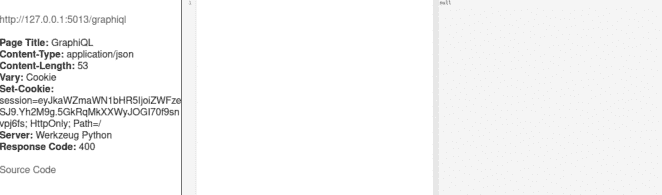
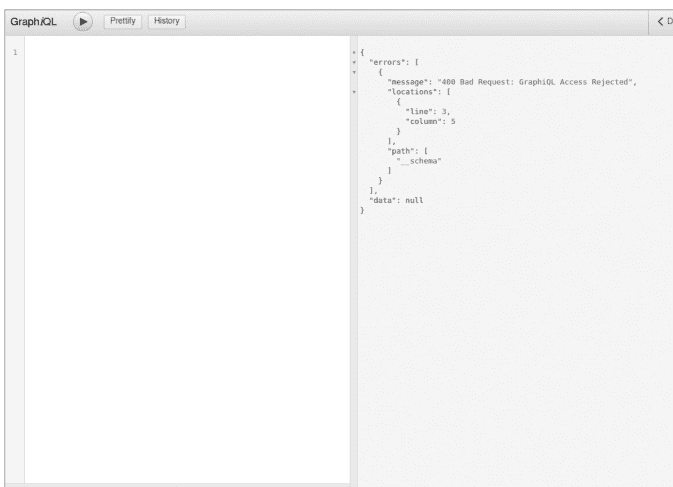
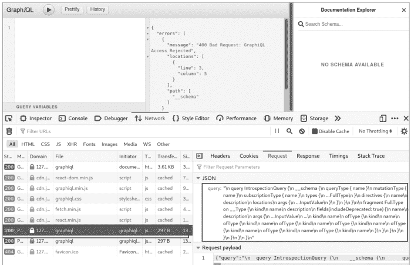
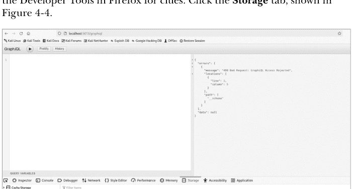
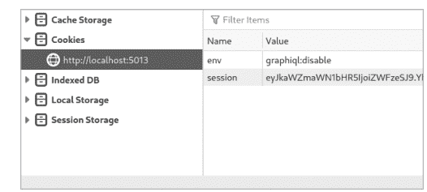
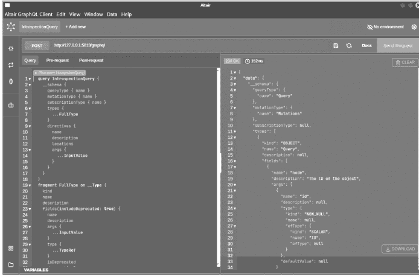
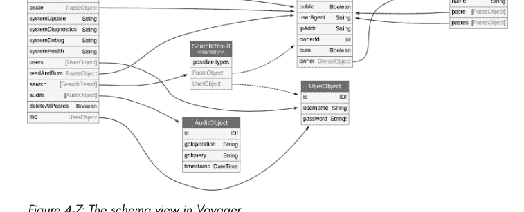
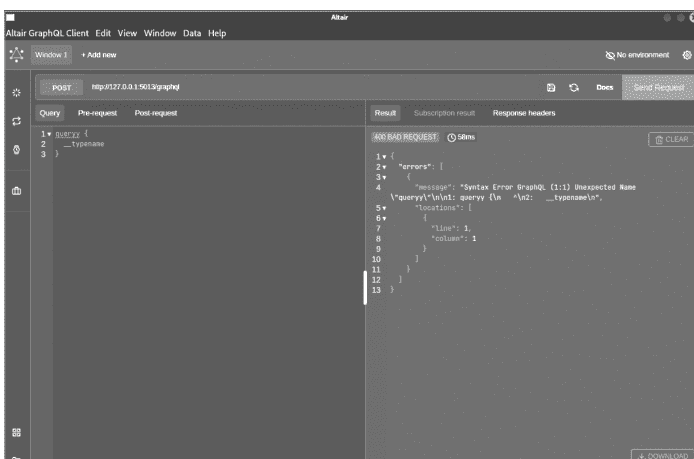
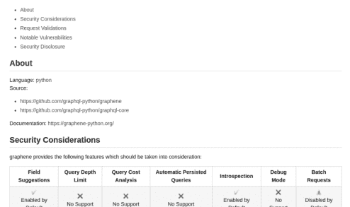

## 侦察


所有安全测试都始于 *侦察阶段*。在此阶段，我们尝试尽可能收集有关目标的尽可能多的信息。这些信息将帮助我们就如何攻击应用程序做出明智的决策并提高成功的机会。

你可能会问自己，关于 GraphQL 有什么可了解的，既然它只是一个 API 层？你将了解到，我们可以通过实验和使用专用工具，收集有关 GraphQL API 背后运行的应用程序以及 GraphQL 实现本身的大量信息。虽然 GraphQL 查询结构在所有 GraphQL 实现中是一致的，无论它们是用什么编程语言编写的，但你可能会看到可用操作、字段、参数、指令、安全控制、对精心制作查询的响应等方面的差异。


以下是我们在侦察阶段应努力回答的几个关键问题：Web 服务器是否甚至拥有 GraphQL API？GraphQL 配置在哪个端点接收查询？GraphQL 实现是用什么语言编写的？目标服务器上运行的是哪种 GraphQL 实现？该实现是否已知容易受到某些攻击？针对特定的 GraphQL 实现存在哪些类型的防御？该实现的开箱即用默认配置设置有哪些？GraphQL 服务器是否部署了任何额外的安全保护层？能够回答这些问题将使我们能够针对目标服务器制定更集中的攻击计划并发现其防御中的漏洞。

> NOTE
> 在本章以及后续章节中，我们将使用 DVGA 作为我们的目标易受攻击应用。你应该已经在第 2 章构建的 GraphQL 安全实验室中将其运行起来。

## 检测 GraphQL

要在渗透测试中检测 GraphQL，首先熟悉当今野外存在的 GraphQL 服务器实现非常重要。GraphQL 存在多种用各种编程语言编写的实现，每种实现都可能具有不同的默认配置或已知弱点。表 4-1 列出了几种 GraphQL 实现及其所使用的语言。

表 4-1：GraphQL 服务器实现及其编程语言

| Server implementation | Language |
|---|---|
| Apollo | TypeScript |
| Graphene | Python |
| Yoga | TypeScript |
| Ariadne | Python |
| graphql-ruby | Ruby |
| graphql-php | PHP |
| graphql-go | Go |
| graphql-java | Java |
| Sangria | Scala |
| Juniper | Rust |
| HyperGraphQL | Java |
| Strawberry | Python |
| Tartiflette | Python |

这些是当今使用最广泛的实现，以及更小众的实现，例如 Scala 的 Sangria、Rust 的 Juniper 和 Java 的 HyperGraphQL。稍后在本章中，我们将讨论如何在渗透测试期间区分它们。

检测 GraphQL API 可以通过几种方式进行：手动进行，如果网络上有超过几个主机，通常更难扩展；或自动进行，使用各种 Web 扫描器。使用 Web 扫描工具的优势在于可扩展性。它们是多线程的，并且通常能够读取外部文件作为程序输入，例如包含要扫描的主机名列表的文本文件。这些工具已内置了检测 Web 界面的逻辑，并且使用脚本语言（如 Bash 或 Python），你可以以编程方式针对数百个 IP 地址或子域运行它们。在本章中，我们将使用流行的扫描器，如 Nmap，以及 GraphQL 专用扫描工具，如 Graphw00f，进行侦察。

## 常见端点

在第 1 章中，我们强调了 REST 和 GraphQL API 之间的一些差异。其中一个与侦察阶段相关的差异是，GraphQL API 端点通常是静态的，最常见的是 /graphql。

然而，虽然 /graphql 通常是默认的 GraphQL 端点，但 GraphQL 实现可以重新配置为使用完全不同的路径。在这些情况下，我们该如何检测它？一种方法是手动尝试几个常见的 GraphQL API 替代路径，例如版本化端点：

+   /v1/graphql
+   /v2/graphql
+   /v3/graphql

你通常会在应用程序需要支持其 API 的多个版本时看到这些版本化 API 端点，无论是为了向后兼容，还是为了以不与客户可能仍在使用的稳定 API 版本冲突的方式引入新功能。

另一种找到 GraphQL 实现的方法是通过 IDE，例如 GraphQL Playground 或 GraphiQL Explorer，我们在第 1 章中使用它们来尝试 GraphQL 查询。当启用其中任一界面时，它通常会使用一个额外的专用端点。这意味着 GraphQL 也可以存在于以下端点下：

+   /graphiql
+   /playground

如果这些端点也恰好被版本化，它们可能在其路径前加上版本号，例如 /v1/graphiql、/v2/graphiql、/v1/playground、/v2/playground，等等。

清单 4-1 显示了 Graphene，一种基于 Python 的 GraphQL 实现，如何公开两个端点，一个用于 GraphQL，另一个用于内置于 Graphene 的 GraphiQL Explorer：

```
app.add_url_rule('/graphql', view_func=GraphQLView.as_view(
    'graphql',
    schema=schema
))

app.add_url_rule('/graphiql', view_func=GraphQLView.as_view(
    'graphiql',
    schema = schema,
    graphiql = True
))
```

清单 4-1：Graphene 的端点定义

Graphene 将 /graphql 端点定义为其主要的 GraphQL 查询端点。然后它将 /graphiql 定义为第二个端点，GraphiQL Explorer 将对其进行查询。最后，它启用了 GraphiQL Explorer 界面。当客户端浏览到 /graphiql 端点时，GraphQL 服务器会向客户端呈现 IDE。

请记住，每个端点可能具有不同的安全设置。例如，一个可能比另一个更严格。当你在同一目标主机上找到两个提供 GraphQL 查询的端点时，你需要分别测试它们。

NOTE 在本书的 GitHub 仓库中，你可以找到更全面的常见 GraphQL 端点列表：https://github.com/dolevf/Black-Hat-GraphQL/blob/master/ch04/common-graphql-endpoints.txt。你可以在渗透测试或漏洞赏金狩猎期间扫描 GraphQL 服务器时将其用作 wordlist 文件。

这里最重要的收获是，虽然 GraphQL 端点通常位于可预测的路径，但开发人员仍然可以自定义它以满足其需求，也许是为了将其隐藏在好奇的目光之外，或只是为了符合内部应用程序部署标准。

## 常见响应

现在你已经了解了 GraphQL 通常从哪些端点接收查询，下一步是学习 GraphQL API 如何响应数据包。GraphQL 在网络上很容易识别。这在执行零知识渗透测试或漏洞赏金狩猎时特别有帮助。

GraphQL 规范描述了查询响应结构应如何格式化。这允许 API 消费者在解析 GraphQL 响应时预期预定的格式。以下摘自 GraphQL 规范的摘录描述了查询响应的外观：

> If the operation is a query, the result of the operation is the result of executing the operation's top-level selection set with the query root operation type.

执行查询操作时可以提供初始值：

```
ExecuteQuery(query, schema, variableValues, initialValue)
```

+   1. Let queryType be the root Query type in the schema.
+   2. Assert: queryType is an Object type.
+   3. Let selectionSet be the top-level selection set in the query.
+   4. Let data be the result of running ExecuteSelectionSet(selectionSet, queryType, initialValue, variableValues) normally (allowing parallelization).
+   5. Let errors be any field errors produced while executing the selection set.
+   6. Return an unordered map containing data and errors.

在实践中，这意味着 GraphQL API 在有结果返回给客户端查询时将返回 data JSON 字段。当客户端查询执行期间发生错误时，它还将返回 errors JSON 字段。

提前知道这两条信息很有价值。简单来说，我们现在有了响应必须满足的两个条件，然后才能说它来自 GraphQL API：

+   1. 有效的查询响应应始终填充 data 字段，其中包含查询响应信息。
+   2. 无效的查询响应应始终填充 errors 字段，其中包含出错信息。

现在我们可以将这些作为扫描和检测逻辑的一部分，以自动化在网络上发现 GraphQL 服务器。所有我们需要做的就是发送一个有效或格式错误的查询并观察收到的响应。

让我们使用 HTTP POST 方法针对 DVGA 运行一个简单的 GraphQL 查询，以查看这些响应结构在实际中的表现。打开 Altair GraphQL 客户端并确保地址栏设置为 http://localhost:5013/graphql 地址；然后通过在 Altair 的左侧窗格中输入以下查询来运行查询：

```
query {
  pastes {
    id
  }
}
```

接下来，点击播放按钮将查询发送到 GraphQL 服务器。这应该返回 pastes 对象的 id 字段。你应该能够看到类似于以下输出的响应：

```
"data": {
  "pastes": [
  {
```


```
"id": "1"
}
]
}
```

正如你所见，GraphQL 将查询响应作为 data JSON 字段的一部分返回，正如 GraphQL 规范所述。我们得到了 pastes 对象和查询中指定的 id 字段。如果你在实验中看到返回的 id 字符串与此处显示的不同，请不要担心；这是预期的。

现在，让我们运行另一个查询来探索当向 GraphQL 发送无效查询时会发生什么。这将演示当查询执行期间出现问题时，GraphQL 服务器会返回 errors JSON 字段。以下查询格式错误，GraphQL 无法处理它。在 Altair 中运行它并观察响应：

```
query {
  badfield {
    id
  }
}
```

请注意，我们指定了一个名为 badfield 的顶层字段。因为该字段不存在，GraphQL 服务器无法满足该查询。GraphQL 响应如下所示：

```
{
  "errors": [
    {
      "message": "Cannot query field \"badfield\" on type \"Query\".",
      "locations": [
        {
          "line": 2,
          "column": 3
        }
      ]
    },
  ]
}
```

正如你所见，GraphQL 服务器无法成功处理我们的查询。它返回包含 errors JSON 字段的响应。message JSON 字段告诉我们服务器无法查询名为 badfield 的字段，因为它不存在于 GraphQL 架构中。

## Nmap 扫描

想象一下，你需要对包含数千台主机的网络进行渗透测试；手动逐台检查主机以找到可能提供有趣内容的主机，例如 API 或易受攻击的商业应用程序，将会相当困难。在这些情况下，渗透测试人员通常使用 Web 应用程序扫描器或自定义脚本来

自动从主机抓取信息。例如，诸如 <title> HyperText Markup Language (HTML) 标签、整个 <body> 标签，甚至服务器 HTTP 响应头等信息，都可能暗示远程服务器正在运行的特定应用程序。

需要注意的是，Web 应用程序可能并不总是具有用户界面，这意味着它们可能不会提供与应用程序相关的任何 HTML 内容，甚至不会公开可用于检测它们的 HTTP 头。它们通常会充当独立的 API 服务器，仅通过指定的 API 暴露数据。那么，在这些情况下我们如何检测 GraphQL 呢？幸运的是，在某些条件下，GraphQL API 通常会返回可预测的响应，例如使用的 HTTP 方法或发送到服务器的有效负载。列表 4-2 显示了客户端发出 GET 请求时返回的常见 GraphQL 响应。

```
# curl -X GET http://localhost:5013/graphql

{"errors":[{"message":"Must provide query string."}]}
```

列表 4-2：对 HTTP GET 请求的 GraphQL 响应

字符串 Must provide query string 通常用于 GraphQL 实现中，例如基于 Python 和 Node.js 的实现。（请记住，基于 GET 的查询通常不被 GraphQL 服务器支持。放心：即使遇到这种情况，我们也有许多其他方法来检测 GraphQL。）

有了这些信息，我们现在有能力自动化扫描并发现网络上可能存在的其他 GraphQL 服务器。列表 4-3 显示了如何使用 Nmap 来实现这一点，使用 http-grep NSE 脚本，该脚本使用模式匹配在给定的网页中查找关键字。

```
# nmap -p 5013 -sV --script=http-grep
--script-args='match="Must provide query string", ① http-grep.url="/graphql"' localhost ②

PORT     STATE SERVICE VERSION
5013/tcp open  http    Werkzeug httpd
| http-grep:
|   (1) http://localhost:5013/graphql:
|   (1) User Pattern 1:
|     + Must provide query string
```

列表 4-3：使用 Nmap 的 http-grep 进行单词匹配的 GraphQL 响应

在 ① 处，我们为 http-grep 指定了一个名为 match 的脚本参数，其值为 Must provide query string（我们在 GraphQL 响应中收到的消息）。在 ② 处，我们定义了另一个名为 http-grep.url 的参数，其值为 /graphql，这指示 Nmap 在 Web 应用程序内的特定页面中进行搜索。在内部，Nmap 将向 localhost 发出 HTTP GET 请求，并使用我们定义的参数字符串值作为其在从 Web 服务器响应中提取的文本中搜索的模式。在其输出中，Nmap 显示在网页上找到了模式，并指示它找到匹配的字符串。

你可能已经注意到，我们正在向 Nmap 传递一个特定端口 (-p)——即端口 5013。与任何 Web 服务器一样，GraphQL 服务器可以在任何端口上运行，但有一些端口相当常见，例如 80–89、443、4000–4005、8443、8000 和 8080。我们建议在可能的情况下扫描常用和不常用的端口范围。

## __typename 字段

到目前为止，我们确切地知道在查询中请求哪些字段，例如 pastes 及其 id 的选择集，正如我们之前请求的那样。你可能会想，如果我们不知道 GraphQL API 上存在哪些字段怎么办？没有这些信息我们如何识别 GraphQL 呢？幸运的是，有一种快速的方法可以查询 GraphQL 并在不知道应用程序架构的任何信息的情况下返回有效响应。

元字段是 GraphQL API 向客户端公开的内置字段。一个例子是 __schema（GraphQL 中内省的一部分）。另一个元字段的例子是 __typename。使用时，它会返回正在查询的对象类型的名称。列表 4-4 显示了使用此元字段的查询。

```
query {
  pastes {
    __typename
  }
}
```

列表 4-4：带有 __typename 元字段的 GraphQL 查询

当你使用 Altair 运行此查询时，响应将是 pastes 对象类型的名称：

```
"data": {
  "pastes": [
    {
      "__typename": "PasteObject"
    }
  ]
}
```

正如你所见，GraphQL 告诉我们 pastes 对象的类型名称是 PasteObject。这里的真正技巧是 __typename 元字段也可以用于查询根类型，如列表 4-5 所示。

```
query {
  __typename
}
```

列表 4-5：使用查询根类型的 GraphQL 元字段

此查询使用 __typename 来描述查询根类型，并且可以适用于几乎任何 GraphQL 实现，因为 __typename 是官方规范的一部分。

当你尝试从命令行查询 GraphQL 时，GraphQL 服务器期望一定的请求结构。对于基于 HTTP GET 的查询，请求应具有以下 HTTP 查询参数：

- query 用于 GraphQL 查询（必填参数）。
- operationName 用于操作名称，当单个文档中发送多个查询时使用。此参数告诉 GraphQL 服务器在存在多个操作时运行哪个特定操作（可选参数）。
- variables 用于查询变量（可选参数）。

对于基于 HTTP POST 的查询，相同的参数应以 JSON 形式传递在 HTTP 主体中。

当 GraphQL 服务器接受使用 GET 的查询时，你可以使用简写语法传递 query 参数以及 GraphQL 查询（在这种情况下，查询为 {__typename}）。有了这个想法，我们可以相当轻松地使用 Nmap 来自动化 GraphQL 的检测。列表 4-6 显示了如何使用 Nmap 运行 __typename 查询。

```
# nmap -p 5013 -sV --script=http-grep --script-args='match="__typename", http-grep.url="/graphql?query={__typename}"' localhost

PORT      STATE SERVICE VERSION
5013/tcp open  http    Werkzeug httpd
| http-grep:
|   (1) http://localhost:5013/graphql?query={__typename}:
|     (1) User Pattern 1:
|_        + __typename
```

列表 4-6：使用 Nmap 的基于 GET 的查询检测 GraphQL

在此示例中，Nmap 脚本 http-grep 在内部使用 GET 方法来完成其工作。

如果要扫描的主机不止少数几台，你可能希望利用 Nmap 的 -iL 标志指向包含主机名列表的文件，如列表 4-7 所示。

```
# nmap -p 5013 -iL hosts.txt -sV --script=http-grep --script-args='match="__typename", http-grep.url="/graphql?query={__typename}"'
```

列表 4-7：使用 Nmap 扫描文件中定义的多個目标

此示例中的 hosts.txt 文件将包含分别列在不同行上的 IP 地址或域名系统 (DNS) 主机名。

如果 GraphQL 服务器不支持基于 GET 的查询，我们可以使用 cURL 和 __typename 字段发出 POST 请求来检测 GraphQL，如列表 4-8 所示。

```
# curl -X POST http://localhost:5013/graphql -d '{"query":"{__typename }"}' -H "Content-Type: application/json"
```

列表 4-8：使用 cURL 发送基于 POST 的查询


To use this detection method against a list of hosts, you can use Bash scripting, as shown in Listing 4-9.

```
# for host in $(cat hosts.txt); do
    curl -X POST "$host" -d '{"query":"{__typename }"}' -H "Content-Type: application/json"
done
```

Listing 4-9: A Bash script to automate a POST-based GraphQL detection using cURL

The hosts.txt file in this example would contain a list of full target URLs on separate lines (including their protocol schemes, domains, ports, and endpoints).

## Graphw00f

In Chapter 2, we briefly discussed Graphw00f, a GraphQL tool based on Python for detecting GraphQL and performing implementation-level fingerprinting. In this section, we will use it to detect DVGA in our lab, walking you through how it does its detection magic.

We mentioned earlier in this chapter that GraphQL servers are found at the endpoint /graphql by default. When this is not the case, we might need an automated way to iterate through known endpoints in order to figure out where queries are served from. Graphw00f allows you to specify a custom list of endpoints when running a scan. If you don’t provide a list, Graphw00f will use its hardcoded list of common endpoints whenever it is tasked with detecting GraphQL, as shown in Listing 4-10.

```
def possible_graphql_paths():
    return [
        '/graphql',
        --snip--
        '/console',
        '/playground',
        '/gql',
        '/query',
        --snip--
    ]
```

Listing 4-10: A list of common GraphQL endpoints in Graphw00f's source code

To see Graphw00f in action, open your terminal and execute the command in Listing 4-11. We use command line parameters -t (target) and -d (detection). The -t flag in this case will be the remote URL http://localhost:5013, and the -d flag will turn on detection mode, which indicates to Graphw00f that it should run a GraphQL detection check against the target URL. If you have questions about Graphw00f's arguments, use the -h flag to read more about its options.

```
# cd ~/graphw00f
# python3 main.py -d -t http://localhost:5013
```

graphw00f
The fingerprinting tool for GraphQL

```
[*] Checking http://localhost:5013/
[*] Checking http://localhost:5013/graphql
[!] Found GraphQL at http://localhost:5013/graphql
```

### Listing 4-11: A GraphQL detection with Graphw00f

Run in detect mode, Graphw00f iterates through various web paths. It checks for the existence of GraphQL in the main web root folder and the /graphql folder. Then it signals to us that it found GraphQL under /graphql based on the HTTP response heuristics we discussed earlier.

To use your own list of endpoints, you can pass the -w (wordlist) flag and point it at a file containing your endpoints, as shown in Listing 4-12.

```
# cat wordlist.txt

/app/graphql
/dev/graphql
/v5/graphql

# python3 main.py -d -t http://localhost:5013 -w wordlist.txt

[*] Checking http://localhost:5013/app/graphql
[*] Checking http://localhost:5013/dev/graphql
[*] Checking http://localhost:5013/v5/graphql
```

### Listing 4-12: Using a custom endpoint list with Graphw00f

## Detecting GraphiQL Explorer and GraphQL Playground

The GraphiQL Explorer and GraphQL Playground IDEs are built using the JavaScript library React. Yet when performing reconnaissance, we will often rely on tools that are incapable of rendering web pages containing JavaScript, such as command line HTTP clients like cURL or web application scanners like Nikto. In the process, we might miss interesting web interfaces.

In general, you’ll find it beneficial to look for any signs of web interfaces available on the network, such as administration, debugging, or configuration panels, all of which are great candidates to hack. These panels tend to be data rich and often become a way to pivot to other networks or to escalate privileges. They also tend to be far less hardened than publicly facing applications. Companies assume that the external space (the internet) is riskier than the internal space (the corporate network). As such, they often have guidelines for securing publicly facing servers and applications via aggressive patching policies, configuration reviews, and frequent vulnerability scanning. Unfortunately, internal applications rarely get the same treatment, which often makes them an easier target for hackers.

An interesting and often overlooked technique to scan for graphical web interfaces is through the use of tools such as headless browsers. Headless browsers are fully functional command line web browsers that the user can program for a variety of purposes, such as retrieving page contents, submitting forms, or simulating real user behavior on a web page. For example, the headless browsers Selenium and PhantomJS can be handy when you need to render web pages containing JavaScript code.

One security tool in particular has incorporated a headless browser to solve this gap: EyeWitness. This web scanner is capable of taking screenshots of web pages by leveraging the Selenium headless browser driver engine behind the scenes. EyeWitness then generates a nice report, along with a screen capture of the page.

## Scanning for Graphical Interfaces with EyeWitness

Since the two GraphQL IDEs use JavaScript code, we need a capable scanner to help us identify them when we perform network-wide scans. Let’s use EyeWitness to identify these graphical interfaces.

EyeWitness offers many options for customizing its scanner behavior, and you can see them by running the tool with the -h option. To detect GraphQL IDE panels, we’ll use the --web option, which will attempt a screen capture of the scanned site with the headless browser engine, together with the --single option, which is suitable when you need to scan only a single target URL. We will then use the -d flag to indicate to EyeWitness the folder in which it should dump the report (in this case, the dvga-report folder). Listing 4-13 puts everything together.

```
# eyewitness --web --single http://localhost:5013/graphql -d dvga-report

Attempting to screenshot http://localhost:5013/graphql

[*] Done! Report written in the dvga-report folder!
Would you like to open the report now? [Y/n]
```

Listing 4-13: The runtime output of EyeWitness

In the output, EyeWitness indicates that it saved the collected web page source files in the dvga-report folder and asks us whether to open the report. Press Y and ENTER to open a web browser displaying the HTML report, including the screenshot it took during the scan. Figure 4-1 shows the report.



Figure 4-1: An HTML report produced by EyeWitness

Additionally, the dvga-report will contain several folders, as shown here:

```
# ls -l dvga-report/
total 112
-rw-r--r-- 1 kali kali 95957 Dec 15 15:19 jquery.min.js
-rw-r--r-- 1 kali kali 2356 Feb 11 15:10 report.html
drwxr-xr-x 2 kali kali 4096 Feb 11 15:09 screens
drwxr-xr-x 2 kali kali 4096 Feb 11 15:09 source
-rw-r--r-- 1 kali kali 684 Feb 11 15:09 style.css
```

The report.html file includes information about the target, such as the HTTP response headers it sent back to the client, a screen capture of the application running on the target, and a link to the web page’s source code. While you can visually identify the GraphiQL IDE by using the screen capture taken by EyeWitness, you can also confirm your finding by searching the source folder, where the source code files reside. Run the command shown in Listing 4-14 to search for any GraphiQL Explorer or GraphQL Playground strings within the source code.

```
# grep -Hnio "graphiql|graphql-playground" dvga-report/source/*
source/http.localhost.5013.graphiql.txt:18:graphiql
source/http.localhost.5013.graphiql.txt:18:graphiql
source/http.localhost.5013.graphiql.txt:18:graphiql
```

Listing 4-14: Keyword matches in the web page source code

Let’s break down the command to explain what’s happening here. We run a case-insensitive search using grep by passing it the i flag to find any instances of the words graphql or graphql-playground in the source folder. Using the -H flag, we tell grep to print the names of files containing any pattern matches. The -n flag indicates the line number at which the match is located (in this case, 18). The -o flag prints only the parts of matching lines that yielded positive results. As you can see, the search found multiple instances of the string graphiql at line number 18.

EyeWitness can run the same type of scan against a list of URLs, as opposed to a single URL, using the -f (file) flag. When you use this flag, EyeWitness will expect a text file containing a list of target URLs to scan. Listing 4-15 shows how to write a single URL (http://localhost:5013/graphiql) to a text file (urls.txt) and pass it on to EyeWitness as its custom URL list.

```
# echo 'http://localhost:5013/graphiql' > urls.txt
# eyewitness --web -f urls.txt -d dvga-report

Starting Web Requests (1 Hosts)
Attempting to screenshot http://localhost:5013/graphiql
Finished in 8 seconds

[*] Done! Report written in the dvga-report folder!
```

Listing 4-15: Scanning multiple URLs with EyeWitness


EyeWitness 会遍历文件中指定的 URL，对其进行扫描，并将输出保存到 dvwa-report 文件夹中以供进一步检查。

在本示例中，我们使用的是只包含单个 URL 的文件。通常，你可能希望在 /graphql 端点之外搜索其他 Web 路径，以检查 GraphQL 是否位于其他位置，特别是较为隐蔽的位置。你可以通过多种方式创建用于 EyeWitness 的 URL 列表。第一个选项是使用“第 73 页的‘常见端点’”中提到的常见 GraphQL 端点列表。

或者，使用 Kali 内置的目录词表之一，位于 /usr/share/wordlists。 dirbuster 词表就是一个例子。EyeWitness 需要完整的 URL，而该词表只包含 Web 路径，因此我们首先需要使用 Bash 脚本对其进行格式化，如清单 4-16 所示。

```
# for i in $(cat /usr/share/wordlists/dirbuster/directory-list-2.3-small.txt);
do echo http://localhost:5013/$i >> urls.txt; done

# cat urls.txt

http://localhost:5013/api
http://localhost:5013/apis
http://localhost:5013/apidocs
http://localhost:5013/apilist
```

清单 4-16：使用 Bash 和目录词表构建 URL 列表

此 Bash for 循环可确保词表 directory-list-2.3-small.txt 中的目录被追加到我们的目标主机 http://localhost:5013 上，以便 EyeWitness 在扫描时使用它们。剩下的就是使用新的词表文件 urls.txt 运行 EyeWitness。

## 使用图形客户端尝试查询

在渗透测试中发现 GraphiQL Explorer 或 GraphQL Playground 的实例，并不保证 GraphQL API 本身会允许你进行未授权查询。因为 GraphiQL Explorer 和 GraphQL Playground 只是 GraphQL API 的前端界面，它们本质上是与 GraphQL 服务器交互的 HTTP 客户端。

在某些情况下，这些图形界面可能由于多种原因无法查询 API。GraphQL API 中可能实现了身份验证或授权层，从而阻止未授权查询。API 也可能根据客户端属性（如地理位置或基于 IP 地址的允许列表）限制查询。客户端缓解措施也可能阻止客户端通过 GraphiQL Explorer 或 GraphQL Playground 运行查询。

> 注意 规范并未描述如何在 GraphQL 中实现安全措施，也未说明授权和身份验证是否应在 GraphQL 层存在。第 7 章介绍了在 GraphQL 中实现这些机制时如何识别它们，以及如何在黑盒渗透测试中对其进行测试。

为了确认我们可以使用该界面查询 GraphQL 服务器，我们需要发送某种形式的未认证 GraphQL 查询。该查询必须是可在任何 GraphQL API 上工作的查询。可以把这个查询看作是确认远程 GraphQL API 是否接受来自客户端的未认证查询的一种方式。我们可以称之为金丝雀 GraphQL 查询。

在你的实验机上打开 Firefox 网络浏览器并导航到 http://localhost:5013 以访问 DVWA。你应该会看到 DVWA 的主页面。接下来，浏览到我们之前发现的 GraphiQL Explorer 面板 http://localhost:5013/graphiql。你会注意到我们立即收到一个错误，表明访问被拒绝，消息为 400 Bad Request: GraphiQL Access Rejected，如图 4-2 所示。



图 4-2：GraphiQL Explorer 拒绝客户端访问

作为黑客，重要的是要了解事物在幕后是如何工作的。点击窗口右上角的 Docs 按钮。你应该会看到一条错误消息，No Schema Available。此错误意味着 GraphiQL Explorer 无法从 API 检索模式信息。因为 GraphiQL Explorer 在每次页面加载时都会自动向 GraphQL API 发送 introspection 查询以填充文档部分的模式信息，所以它依赖于该文档可用。

你可以通过在 Firefox 中使用开发者工具来看到这种行为。按 SHIFT-F9 或右键单击网页中的任意位置并选择检查元素以打开开发者工具控制台。点击网络标签；然后按 F5 重新加载页面。

你应该能够看到发送到 /graphiql 端点的 POST 请求。图 4-3 显示了此 introspection 查询。



图 4-3：在 Firefox 开发者工具中显示的 GraphiQL Explorer introspection 查询

如果 introspection 查询已成功发送，可能是什么原因导致我们无法访问 GraphiQL Explorer？让我们继续在 Firefox 中探索开发者工具以寻找线索。点击图 4-4 所示的存储标签。



图 4-4：Firefox 中的开发者工具存储标签

存储标签为我们提供了应用程序设置的 HTTP Cookie 的视图，以及访问浏览器本地存储和会话存储的功能。在左侧窗格中，点击 Cookie 下拉菜单并选择 http://localhost:5013 以查看该域的特定 Cookie，如图 4-5 所示。



图 4-5：HTTP Cookie

你会注意到，在右侧窗格中，我们的 HTTP Cookie 中设置了两个键：env 和 session。env 键尤其有趣，因为它似乎将字符串 graphql:disable 设置为其值。作为黑客，这应该会引起你的注意。有可能这个 Cookie 值导致了 GraphiQL Explorer 的拒绝访问？我们可以通过篡改其值来找到答案。

双击文本 graphql:disable，这将允许你修改它；然后只需删除 disable 并将其替换为 enable。接下来，刷新网页。你会注意到我们不再在 GraphiQL Explorer 中看到拒绝消息。为了确认篡改 Cookie 确实有效，请尝试运行一个 GraphQL 查询。你应该能够从 GraphQL API 获得响应！这是一个弱的客户端安全控制，可以很容易地被规避。

开发人员通常以信任客户端的心态创建 Web 应用程序，但并非所有人都会遵守规则。对漏洞感兴趣的威胁行为者会篡改应用程序并尝试击败任何已实施的对策。重要的是要记住，攻击者可以直接控制的任何内容都可能被规避。然而，在客户端实施的控制并不罕见；你可能会发现应用程序仅在客户端实施输入验证或文件上传验证。这些通常可以被绕过。在第 7 章中，你将了解更多关于击败 GraphQL 授权和身份验证机制的内容。

## 使用 Introspection 查询 GraphQL

Introspection 是 GraphQL 的关键特性之一，因为它提供了有关 GraphQL 模式支持的各种类型和字段的信息。自文档化的 API 对于需要使用它的任何人来说都非常有用，例如第三方企业或其他客户端。

作为黑客，我们在遇到 GraphQL 应用程序时首先想要测试的事情之一是其 introspection 机制是否已启用。许多 GraphQL 实现默认启用 introspection。某些实现可能有禁用 introspection 的选项，但其他实现可能没有。例如，Python GraphQL 实现 Graphene 不提供禁用 introspection 的选项。为此，消费者必须深入代码并找出防止 introspection 查询被处理的方法。另一方面，GraphQL PHP 实现 graphql-php 默认启用 introspection，但也记录了如何完全禁用此功能。表 4-2 显示了一些流行 GraphQL 服务器实现中 introspection 的状态。

### 表 4-2：GraphQL 实现中的 Introspection 状态

| Language | Implementation | Introspection configuration | Disable introspection option |
|---|---|---|---|
| Python | Graphene | Enabled by default | Not available |
| Python | Ariadne | Enabled by default | Available |
| PHP | graphql-php | Enabled by default | Available |
| Go | graphql-go | Enabled by default | Not available |
| Ruby | graphql-ruby | Enabled by default | Available |
| Java | graphql-java | Enabled by default | Not available |

任何直接影响安全的默认设置对黑客来说都是好消息。应用程序维护人员很少更改这些默认设置。有些维护人员可能甚至不知道它们的存在。在表 4-2 中，你可以看到在某些情况下，例如在 graphql-go、graphql-java 和 Graphene 中，introspection 只能在应用程序维护人员自行将其编码到 GraphQL API 中时才会被禁用；没有官方的、经过厂商验证的解决方案来禁用它。

虽然对此事的看法不一，尤其是在安全圈内，但 GraphQL 中的 introspection 通常被认为是一种功能而不是漏洞。采用 GraphQL 的公司可能会选择保持启用，而其他公司可能会禁用它以避免泄露可能被用于攻击的信息。如果没有外部消费者集成 GraphQL API，则有可能开发人员可以完全禁用 introspection 而不会影响正常的应用程序流程。

根据你的目标，introspection 查询的响应可能相当大。此外，如果你攻击的目标拥有成熟的安全计划，这些查询可能会被监控，以防来自不受信任客户端的任何尝试，例如来自新的地理位置或新 IP 地址的客户端。

要使用我们的易受攻击服务器尝试 introspection 查询，请在你的实验环境中打开 Altair 客户端，并确保地址栏设置为 http://localhost:5013/graphql。接下来，输入清单 4-17 中显示的 introspection 查询并在 Altair 中执行它。


```
query {
  __schema {
    types {
      name
    }
  }
}
```

Listing 4-17: An introspection query in its simplest form

This query uses the meta-field __schema, which is the type name of the GraphQL schema introspection system. It then requests the name of all types available in the GraphQL server. The following output shows the server's response to the query:

```
{
  "data": {
    "__schema": {
      "types": [
--snip--
        {
          "name": "PasteObject"
        },
        {
          "name": "CreatePaste"
        },
        {
          "name": "DeletePaste"
        },
        {
          "name": "UploadPaste"
        },
        {
          "name": "ImportPaste"
        },
--snip--
      ]
    }
  }
}
```

While we receive a valid response, this query in its current form gives us only a partial view of the features available through the API. The response is missing key information, such as query and mutation names, information about which queries allow arguments to be passed by clients, the data types of arguments (such as scalar types like String and Boolean), and so on. These are important, because queries that accept arguments could be prone to vulnerabilities, such as injections, server-side request forgeries, and so on.

We can craft a more specialized introspection query that would give us more data about the target application’s schema. A useful introspection query is one that will give us information on the entry points into the application, such as queries, mutations, subscriptions, and the type of data

that can be injected into them. Consider the introspection query shown in Listing 4-18.

```
query IntrospectionQuery {
  __schema {
    ① queryType { name }
    mutationType { name }
    subscriptionType { name }
    ② types {
      kind
      name
      ③ fields {
        name
        ④ args {
          name
        }
      }
    }
  }
}
```

Listing 4-18: A more useful introspection query

The introspection query in Listing 4-18 gives us a bit more insight into the API. At ① we get the name of all queries (queryType), mutations (mutationType), and subscriptions (subscriptionType) available in the GraphQL API. These names are typically self-explanatory, to make it easier for clients to use the API, so knowing these query names gives us an idea of the information we could receive.

At ② we get all the types in the schema, along with their kind (such as an object) and name (such as PasteObject). At ③ we get the fields along with the name of each one, which will allow us to know the types of fields we can fetch when we use different GraphQL objects. Next, we get the arguments (args) of these fields along with their name ④. Arguments could be any information the API is expecting the client to supply when it queries the API (typically, dynamic data). For example, when a client creates a new paste, it will supply an arbitrary title argument and a content argument containing the body of the paste, which might be a code snippet or other text.

In penetration tests, you may want to run an introspection query against an entire network, assuming a GraphQL server may be present. In this case, you would either need to write your own script or use the Nmap NSE script graphql-introspection.nse we installed in Chapter 2. This script is simple: it queries GraphQL by using the __schema meta-field to determine if it's fetchable.

Say you have a list of IP addresses in a text file such as hosts.txt. Using Nmap's -iL flag, you can tell Nmap to use it as its list of targets. Using the --script flag, you can then tell Nmap to run the graphql-introspection NSE script against any host that has port 5013 open (-p flag). The -sV flag performs a service and version scan. The command in Listing 4-19 shows how this is accomplished.

```
# nmap --script=graphql-introspection -iL hosts.txt -sV -p 5013

PORT      STATE SERVICE VERSION
5013/tcp open  http    Ajenti http control panel
| graphql-introspection:
|   VULNERABLE:
|   GraphQL Server allows Introspection queries at endpoint:
|   Endpoint: /graphql is vulnerable to introspection queries!
|       State: VULNERABLE
|       Checks if GraphQL allows Introspection Queries.
|   
|   References:
|       https://graphql.org/learn/introspection/
```

Listing 4-19: A GraphQL introspection detection with the Nmap NSE

Using nmap to detect when introspection is enabled is just the first step. The next step is to extract all possible schema information by using a more robust query.

In the book’s GitHub repository, you can find a comprehensive introspection query that, when executed, will extract a lot of useful information about the target’s schema: https://github.com/dolevf/Black-Hat-GraphQL/blob/master/queries/introspection_query.txt. This query will return information such as queries, mutations, and subscriptions names, with the arguments they accept; names of objects and fields, along with their types; names and descriptions of GraphQL directives; and object relationships. If you run that query in Altair, the server should return a fairly large response, as shown in Figure 4-6.



Figure 4-6: An introspection in Altair

The response is large enough (containing approximately 2,000 lines) that it would be challenging for any human to go through it manually and make sense of it without investing a significant amount of time. This is where GraphQL visualizers such as GraphQL Voyager come in handy.

## Visualizing Introspection with GraphQL Voyager

GraphQL Voyager, which can be found at either https://ivangoncharov.github.io/graphql-voyager or http://lab.blackhatgraphql.com:9000, is an open source tool that processes either introspection query responses or GraphQL SDL files and visualizes them, making it easy to identify the various queries, mutations, and subscriptions and the relationships between them.

The tool’s introspection query option is most suitable for scenarios such as black-box penetration tests, in which the application’s code base is not accessible to us. The SDL option is useful when we might have direct access to the GraphQL schema files, such as during a white-box penetration test in which the company provides us with full access to the source code.

Try visualizing the introspection query response you just received in Altair and importing it into GraphQL Voyager. Copy the response and then open your browser and navigate to GraphQL Voyager. Click the Change Schema button located at the top-left corner. Select the Introspection tab, paste in the response, and click the Display button. You should see a visualization similar to the one shown in Figure 4-7.



The visualization we receive from Voyager represents the queries, mutations, and subscriptions available in our target application and how they relate to the different objects and fields that exist in the schema.

Under Query, you can see that the application supports 12 queries. The arrows in the view represent the mapping between these queries and the schema objects. For example, when you use the pastes query, it will return an array of [PasteObject] objects, which is also the reason you’re seeing an

arrow pointing to the PasteObject table. The system queries (update, diagnostics, debug, and health) are not tied to any other schema objects; they simply return a string whenever you use them.

You can also see that we have relationships (edges) between fields. For example, the owner field in the PasteObject object is linked to OwnerObject, and the paste field in OwnerObject is linked back to PasteObject. This circular condition could lead to DoS conditions, as you will learn in Chapter 5.

> NOTE
> You can toggle between the Query view, Mutation view, and Subscription view by using the drop-down menu at the bottom of Voyager.

Now that we’ve experimented with visualizing an introspection response in Voyager, let’s do the same with SDL files. Voyager accepts SDL files and can process them just as well as it does introspection responses. To see this in action, click the Change Schema button located at the top-left corner in Voyager, select the SDL tab, and paste in the SDL file located at https://github.com/doleruf/Black-Hat-GraphQL/blob/master/ch04/sdl.graphql. Then click the Display button. You should see a similar visualization to the one generated in the Introspection tab.

## Generating Introspection Documentation with SpectaQL

SpectaQL (https://github.com/anvilco/spectaql) is an open source project that allows you to generate static documentation based on an SDL file. The document that gets generated will include information about how to construct queries, mutations, and subscriptions; the different types; and their fields. We’ve hosted an example SpectaQL-generated schema of DVGA at http://lab.blackhatgraphql.com:9001 so you can see how SpectaQL looks when it’s functional.

## Exploring Disabled Introspection

At some point, you’ll probably encounter a GraphQL API that has introspection disabled. To see what this looks like, let’s use one of the neat features of our vulnerable GraphQL server: turning on its hardened mode.

The DVGA works in two modes, a Beginner mode and an Expert (hardened) mode. Both versions are vulnerable; the only difference is that the Expert mode has a few security mechanisms to protect the application from any dangerous queries.

To change the application’s mode, open the Altair client and ensure that the address points to http://localhost:5013/graphql. In the left sidebar, click the Set Headers icon, which looks like a small sun symbol. Set Header Key to X-DVGA-MODE and set Header Value to Expert. This HTTP header set instructs DVGA to perform security checks on any incoming queries that include the headers as part of the request. Alternatively, you can toggle on Expert mode from within DVGA’s web interface by using the drop-down menu located at the top-right corner (the cubes icon).


现在尝试使用 Altair 执行一个简单的内省查询：

```
query {
  __schema {
    __typename
  }
}
```

你应该会看到一个错误响应，提示内省已被禁用，导致查询失败（清单 4-20）。

```
{
  "errors": [
    {
      "message": "400 Bad Request: Introspection is Disabled",
      "locations": [
        {
          "line": 2,
          "column": 7
        }
      ],
      "path": [
        "__schema"
      ]
    }
  ],
  "data": null
}
```

*清单 4-20：内省被禁用时返回的错误*

在这种情况下，你需要一个备选方案 B。在第 6 章中，你将学习如何在没有内省数据可用的情况下，仍发现有关 GraphQL 应用的信息。

## 指纹识别 GraphQL

本章前面我们强调了可用的众多 GraphQL 实现。如何判断我们试图攻击的服务器上运行的是哪一个？答案是服务器指纹识别，即识别目标运行服务的<|message|> 信息及其版本。例如，针对 Web 服务器进行指纹识别的一种常见且简单的技术是使用 cURL 等工具发出 HTTP HEAD 请求，并观察返回的 HTTP 响应头。

一旦我们知道运行应用的具体技术和版本，就能对服务进行更准确的漏洞评估。例如，我们可以查找针对目标版本的公开漏洞利用，或阅读软件文档以识别弱点。

Apache 或 Nginx 等流行的 Web 服务器就是易于指纹识别的服务的绝佳示例，因为两者在客户端向其发出请求时通常都会设置 server HTTP 响应头。清单 4-21 显示了 Apache 软件基金会网站背后的 Web 服务器如何通过使用 server 头来识别自身：

```
# curl -I https://apache.org/

HTTP/2 200
server: Apache
vary: Accept-Encoding
content-length: 73190
```

清单 4-21：使用 HEAD 请求进行 Apache Web 服务器指纹识别

不出所料，Apache 软件基金会的网站确实运行在 Apache Web 服务器上。（如果不是这样就有点奇怪了！）

在渗透测试中，指纹识别服务并不总是如此简单；有时准确的指纹识别需要仔细查看细节，因为并非所有软件都会自我识别，包括 GraphQL 服务器。用于指纹识别 GraphQL 实现的技术在安全行业中相对较新。我们（本书的作者）基于我们的研究开发了几种策略，并将其纳入 Graphw00f。

GraphQL 指纹识别依赖于对 GraphQL 服务器实现之间各种差异的观察。以下是一些示例：

- 错误消息的不一致
- 对格式错误的 GraphQL 查询的响应输出不一致
- 对结构良好的查询的响应输出不一致
- 对偏离 GraphQL 规范的查询的响应输出不一致

利用这四种因素，我们可以唯一地识别 GraphQL 支持的应用背后的实现。

让我们检查两种 GraphQL 服务器实现对格式错误查询的响应。此查询如清单 4-22 所示，在 queryy 这个词中引入了一个额外的 y 字符，这不符合 GraphQL 规范。我们想看看两种 GraphQL 实现对其的响应。第一个实现是 Sangria，一个基于 Scala 的 GraphQL 服务器。

```
queryy {
  __typename
}
```

清单 4-22：一个格式错误的 GraphQL 查询

清单 4-23 显示了 Sangria 对格式错误查询的响应。

```
{
  "syntaxError": "Syntax error while parsing GraphQL query. Invalid input \"queryy\", expected ExecutableDefinition or TypeSystemDefinition (line 1, column 1):\nqueryy {\n^",
  "locations": [
    {
      "line": 1,
      "column": 1
    }
  ]
}
```

清单 4-23：Sangria 对格式错误查询的响应

第二个实现是 HyperGraphQL，一个基于 Java 的 GraphQL 服务器。清单 4-24 显示了它对格式错误查询的响应。

```
{
  "extensions": {},
  "errors": [
    {
      "message": "Validation error of type InvalidSyntax: Invalid query syntax.",
      "locations": [
        {
          "line": 0,
          "column": 0,
          "sourceName": null
        }
      ],
      "description": "Invalid query syntax.",
      "validationErrorType": "InvalidSyntax",
      "queryPath": null,
      "errorType": "ValidationError",
      "extensions": null,
      "path": null
    }
  ]
}
```

清单 4-24：HyperGraphQL 对格式错误查询的响应

正如你所观察到的，这两个响应在每一种可能的方式上都不同，我们仅凭其响应就能区分这些实现。

接下来，我们将在实验室中针对 DVGA 尝试相同的格式错误查询，看看会得到什么样响应。打开 Altair 客户端并发送 GraphQL 查询。你应该会看到与图 4-8 相似的输出。

正如你所见，输出与 Sangria 和 HyperGraphQL 的响应都不同。这是因为 DVGA 基于 Graphene，一个 Python GraphQL 实现。



图 4-8：使用 Altair 发送格式错误的查询

手动运行查询并分析实现之间的差异并不能很好地扩展，这就是我们将服务器指纹识别功能构建到 Graphw00f 中的原因。在下一节中，我们将使用它进行服务器指纹识别。

## 使用 Graphw00f 检测服务器

Graphw00f 目前是用于 GraphQL 服务器指纹识别的唯一可用工具。它可以检测许多流行的 GraphQL 服务器实现，并在成功指纹识别服务器时提供有意义的信息。

在你的实验室中，打开终端模拟器。如果进入 graphw00f 目录并运行 python3 main.py -l，你会看到 Graphw00f 能够指纹识别超过 24 个 GraphQL 实现。这一列表构成了当前使用的大多数 GraphQL 目标。

让我们用它来指纹识别 DVGA。我们将使用 -f 标志启用指纹模式，并使用 -t 标志指定目标（清单 4-25）。你也可以将 -f 标志与 -d 标志（本章前面介绍过）结合使用，如果你想同时检测 GraphQL 并进行指纹识别。这里，我们单独使用 -f 标志，因为我们已经知道服务器上 GraphQL 的路径。

```
# cd ~/graphw00f
# python3 main.py -f -t http://localhost:5013/graphql

[*] Checking if GraphQL is available at http://localhost:5013/graphql...
[!] Found GraphQL.
[*] Attempting to fingerprint...
```

```
[*] Discovered GraphQL Engine: (Graphene)
[!] Attack Surface Matrix: https://github.com/nicholasaleks/graphql-threat-matrix/blob/master/implementations/graphene.md
[!] Technologies: Python
[!] Homepage: https://graphene-python.org
[*] Completed.
```

# 清单 4-25：GraphQL 服务器的指纹识别

该工具首先检查目标是否确实是 GraphQL 服务器。它通过发送几个查询并将其响应与自身签名数据库进行检查来做到这一点。如你所见，它能够发现运行在 Graphene 上的 GraphQL 服务器，并为我们提供了攻击面矩阵链接。攻击面矩阵本质上是 Graphw00f 可以指纹识别的各种 GraphQL 实现的安全态势知识。Graphw00f 使用我们在第 3 章中讨论的 GraphQL Threat Matrix 作为其实现安全态势数据库。

由于我们现在知道 DVGA 运行的是 Graphene，因此我们需要分析 Graphene 的弱点，以确定我们可以对该特定实现运行哪些攻击。有些实现比其他实现存在更久。因此，它们更成熟、更稳定，并提供更多安全功能。这就是为什么在攻击 GraphQL 目标时了解后端实现是一个优势。

## 分析结果

查看攻击面威胁矩阵，它提供了有关实现的默认行为及其可用安全控制的信息（例如，默认启用的设置、存在的<|message|> 安全控制以及我们可以用于攻击目的的其他有用功能）。图 4-9 显示了 Graphene 的攻击面矩阵。你也可以在 GitHub 上找到它，地址为 https://github.com/nicholasaleks/graphql-threat-matrix/blob/master/implementations/graphene.md。



# 图 4-9：Graphene 的攻击面矩阵


安全注意事项下的表格展示了各种 GraphQL 特性以及它们在 Graphene 中的可用性。如果存在，表格会列出它们默认是启用还是禁用。表格中的某些项目是安全控制，而其他则是原生的 GraphQL 特性：

- *字段建议* 会在客户端发送拼写错误的查询时通知客户端并建议替代选项。这可被利用进行信息泄露。
- *查询深度限制* 是一种安全控制，用于防止可能滥用模式中循环节点关系等条件的 DoS 攻击。
- *查询成本分析* 是一种安全控制，用于防止源于计算复杂的查询的 DoS 攻击。
- *自动持久化查询* 是一种缓存机制。它允许客户端传递代表查询的哈希以节省带宽，并且可通过允许列表的安全查询用作安全控制。
- * introspection* 通过 __schema 元字段提供对查询、变更、订阅、字段、对象等的访问信息。这可被滥用以泄露应用程序模式的信息。
- *调试模式* 是 GraphQL 中的一种模式，可在响应中提供额外的调试信息。这可能导致信息泄露问题。
- *批量请求* 是一种允许客户端在单个 HTTP 请求中发送一系列查询的功能。批量查询是 DoS 攻击的绝佳载体。

在后面的章节中，你将学习这些特性中的每一个如何让我们的黑客生活变得更容易（或更困难）。

## Summary

在本章中，你学习了如何通过使用各种安全工具对 GraphQL 服务器执行侦察的艺术。我们讨论了如何检测和指纹识别部署在标准和非标准位置的 GraphQL 服务器，以及如何使用 EyeWitness 安全工具查找 GraphQL IDE 客户端。我们还使用 GraphQL Voyager 可视化 introspection 查询和 SDL 文件，以更好地理解查询、变更和对象关系。
