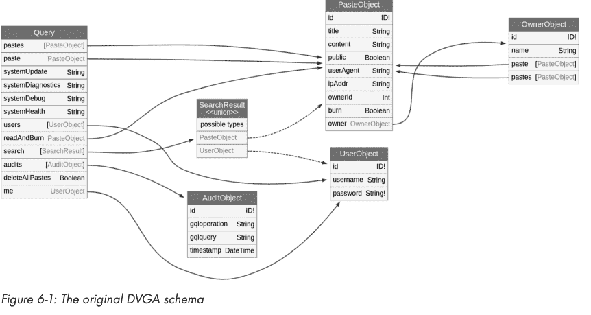
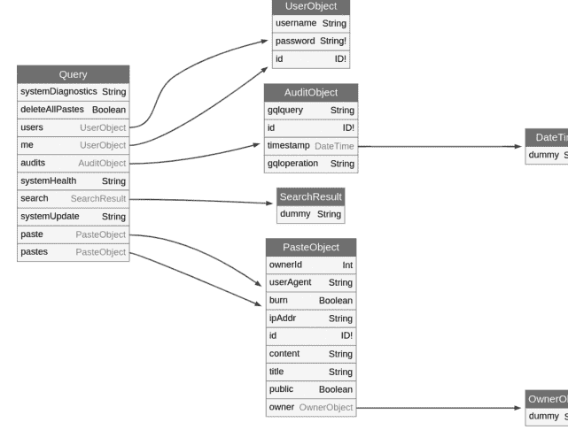
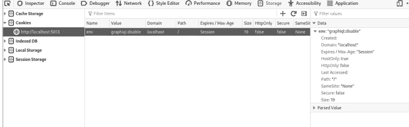

## 6

## 信息泄露


*信息泄露漏洞* 出现在软件系统，例如 API，向未经授权的用户泄露敏感信息时。与基于 REST 的应用程序一样，GraphQL 也并非免疫于此类问题。在本章中，我们将利用其内置功能来深入了解应用程序及其保护的数据。

敏感数据暴露是对 API 影响最大的攻击之一。毁灭性的漏洞可能会向潜在攻击者泄露各种信息，包括业务信息、知识产权、客户的个人身份信息等。即使无意中泄露技术信息，例如应用程序源代码、操作系统版本和文件系统路径，也可能同样严重。这些泄露可能会揭示我们可利用的额外攻击向量。

我们将探讨如何滥用字段建议来提取和映射 GraphQL 模式，而不管是否启用了 introspection。你还将学习通过探测 GraphQL 错误消息、调试日志和应用程序堆栈跟踪来发现本地用户、操作系统、文件系统结构和应用程序详细信息。

在搜索有用信息时，请记住漏洞通常可以串联使用。一个低严重性漏洞与另一个更高严重性漏洞结合使用可能会完全破坏一个应用程序。尽可能多地收集有关目标的信息，并确保跟踪记录；你永远不知道它何时会派上用场。

## 在 GraphQL 中识别信息泄露向量

许多架构、技术和流程层面的错误都可能引入信息泄露漏洞。常见失误包括不正确或缺少数据分类流程、敏感网络和应用程序中缺乏数据加密，以及对关键功能缺乏访问管理控制。

导致信息泄露攻击的另一个重要因素是软件系统存储并向 API 消费者提供不必要的数据。通常，当你检查由 API 支持的前端应用程序的响应时，你会注意到它们返回的信息比前端实际使用的数据更多。这通常表明应用程序可能包含额外的信息泄露漏洞。它还表明该应用程序在交付时未经过充分的安全审查。

在 GraphQL 中，提取应用程序敏感信息最有效的方法之一是探索其模式，该模式提供了有关应用程序数据结构和业务逻辑的上下文。最好的方式是使用 GraphQL introspection 功能。大多数 GraphQL 实现默认情况下都启用了 introspection。

然而，在你的黑客冒险中，你可能会遇到 introspection 被禁用的 GraphQL 实现。为克服此问题，你可以运行字段填充攻击并使用旨在滥用广泛采用的字段建议功能的自动化工具。你还可以通过主动探测 GraphQL 的调试、错误和堆栈跟踪日志来获取用户和操作系统级别的信息。我们将在本章中探讨所有这些内容。

## 使用 InQL 自动化模式提取

在之前的章节中，我们使用 introspection 查询手动发现 API 的可用查询和变更信息。为了让我们的生活更轻松，InQL 等工具（在第 2 章中安装）允许你自动提取模式。

InQL 使用一个与第 4 章中使用的查询非常相似的单个 introspection 查询。从结果中，它以多种格式生成模式文档，包括 HTML、JSON 和制表符分隔值（TSV）。你可以使用这些文档与 GraphQL Voyager 等工具一起进一步分析模式。

通过执行以下命令提取并分析 DVGA 的模式。-t（target）标志指向 DVGA 的网络地址。我们使用 TSV 格式生成报告（--generate-tsv）：

```
# inql -t http://localhost:5013/graphql --generate-tsv

[+] Writing Introspection Schema JSON
[+] DONE
[+] Writing HTML Documentation
[+] DONE
[+] Writing query Templates
Writing systemUpdate query
```

InQL 将使用目标域的名称自动创建目录。如果列出其内容，你应该会看到多个模式文件：

```
# cd localhost:5013/
# ls

endpoint_subscription.tsv
endpoint_query.tsv
endpoint_mutation.tsv
mutation
query
subscription
```

这些 TSV 文件以制表符分隔，便于查看 DVGA 中有哪些查询可用。使用 awk，我们可以仅解析查询名称：

```
# awk '{print $1}' endpoint_query.tsv | tail -n +2

audits
paste
readAndBurn
pastes
```

要查看各种查询支持哪些参数，你可以发出以下 awk 命令来解析制表符分隔的输出：

```
# awk -F'\t' '{print $1, $2}' endpoint_query.tsv

Operation Name Args Name
audits
paste id, title
readAndBurn id
pastes filter, limit, public
```

要查看变更或订阅相关查询，只需将相同的 awk 命令应用于 endpoint_mutation.tsv 和 endpoint_subscription.tsv 文件。在 InQL 生成的文档中搜索查询、变更或订阅，以及它们的 arguments、类型和其他模式相关信息，如果你想从命令行自动化某些任务，例如模糊测试、暴力破解或搜索敏感信息，这将很有用。


# 克服已禁用的内省

即使 GraphQL 实现默认使用内省，开发者也可能会禁用它，以避免向客户端暴露有关其模式的信息。这使得了解如何与 API 交互变得更加困难，但正如你很快就会看到的，并非完全不可能。我们可以使用各种技术和精心构造的查询来窥探应用程序模式的关键元素，即使内省已关闭。

NOTE 要跟随本章的大部分内容，你需要在 DVGA 中将其设置为专家模式来禁用内省。请参阅第 93 页的“探索已禁用的内省”以获取说明。

## 检测已禁用的内省

在第 4 章中，我们讨论了使用 __schema 元字段来检测内省。如果禁用了内省，此类查询应返回错误。每个 GraphQL 实现都会以不同的方式处理此错误响应。例如，一些实现可能会返回 400 Bad Request HTTP 响应代码而没有任何有用的错误消息，而其他实现可能会选择返回 200 OK 状态代码并附带类似 Introspection is Disabled 的消息。通常，GraphQL 服务器倾向于返回 200 OK 响应，并在 errors 响应键中包含错误消息。

Listing 6-1 是你在向 Apollo Server 发送内省查询时可能会遇到的错误消息，Apollo Server 是一个流行的 GraphQL 服务器实现。

```
{
  "errors": [
    {
      "message": "GraphQL introspection is not allowed by Apollo Server, but the query contained __schema or __type. To enable introspection, pass introspection: true to ApolloServer in production",
      "extensions": {
        "code": "GRAPHQL_VALIDATION_FAILED"
      }
    }
  ]
}
```

Listing 6-1: 来自 Apollo GraphQL 服务器的“不允许内省”消息

在接下来的两个部分中，我们测试披露技术，这些技术允许我们绕过未正确禁用的内省。

## 利用非生产环境

在某些应用程序中，开发和暂存环境的<|message|> 安全级别与生产环境不同。即使在生产环境中禁用了内省，你也可能在其他环境中找到它已启用，在那里它可以帮助工程师构建、更新、测试和维护他们的 API。

通常，非生产环境托管在 staging 或 dev 等子域上。值得检查这些环境是否可供我们访问，以及是否有任何 GraphQL 服务可能已启用内省。你可以在 https://github.com/dolevf/Black-Hat-GraphQL/blob/master/resources/non-production-graphql-urls.txt 找到潜在的 GraphQL 暂存和开发位置列表。

如果我们能够成功地针对暂存和开发环境运行内省查询，我们就可以将在那里学到的信息应用到生产环境。模式通常是相似的。

> NOTE 非生产 GraphQL 应用程序也可能在其环境中部署了 GraphiQL Explorer 或 GraphQL Playground。记住使用 EyeWitness 扫描图形 GraphQL 客户端，如第 4 章所述。

## 利用 __type 元字段

当 GraphQL 实现想要阻止内省查询执行时，它们通常会过滤掉包含关键字 __schema 的任何请求。然而，虽然大多数内省查询利用 __schema 元字段，但客户端也可以使用其他几个内省元字段。

例如，__type 代表系统中的所有类型，可用于从 GraphQL 模式中提取类型详细信息。

在 2022 年 5 月，我们在 AppSync 中发现了一个漏洞，AppSync 是亚马逊网络服务 AWS 提供的一种为开发者提供 GraphQL 接口的服务。为了保护 AppSync 免受恶意客户端的侵害，AWS 在内部使用 WAF。我们发现了一种绕过 WAF 并执行内省查询的方法。WAF 包含针对 GraphQL 应用程序量身定制的规则，其中一条阻止通过 __schema 元字段探测 GraphQL API 的尝试，但没有考虑其他内省元字段。

该规则本身以 JSON 的形式定义如下：

```
{
  "Name": "BodyRule",
  "Priority": 5,
  "Action": {
    "Block": {}
  },
  "VisibilityConfig" {
    "SampledRequestsEnabled": true,
    "CloudWatchMetricsEnabled": true,
    "MetricName": "BodyRule"
  },
  "Statement": {
    "ByteMatchStatement": {
      "FieldToMatch": {
        "Body": {}
      },
      "PositionalConstraint": "CONTAINS",
```

```
"SearchString": "__schema",
"TextTransformation": [
    {
        "Type": "NONE",
        "Priority": 0
    }
]
}
```

使用字符串搜索（SearchString），WAF 规则会在任何传入 HTTP 请求中查找 __schema 关键字并阻止其进入应用程序。因为规则使用 CONTAINS 作为位置约束（PositionalConstraint）并匹配 HTTP Body 字段（FieldToMatch），因此在正文负载中提及 __schema 的任何内容都会导致拒绝操作。

> NOTE
> 当我们向亚马逊安全团队披露安全问题时，他们迅速响应，通过更新 AWS AppSync 文档来解决该问题。

这个例子说明，如果 __schema 内省金丝雀查询被拒绝，我们可以使用另一个金丝雀查询来评估内省是否真正被禁用。Listing 6-2 中的 __type 内省金丝雀查询如果内省未被正确禁用，将返回预定的响应。此查询请求模式中根查询操作的 name 字段。尝试将其发送到你的本地 DVGA 实例。

```
{
  __type(name:"Query") {
    name
  }
}
```

Listing 6-2: 一个 __type 内省金丝雀查询

因为我们知道查询操作的名字始终为 Query，响应应与 Listing 6-3 所示完全相同。

```
{
  "data": {
    "__type": {
      "name": "Query"
    }
  }
}
```

Listing 6-3: __type 内省金丝雀查询的预定响应

作为黑客，如果我们注意到内省未被正确禁用，我们可以扩展 __type 内省金丝雀查询，填充一系列潜在的自定义对象类型名称并提取有价值的模式信息。

我们将在第 150 页的“在 __type 元字段中进行类型填充”中讨论这种填充技术。

## 使用字段建议

许多 GraphQL 实现采用的流行功能是字段建议，当客户端发送包含拼写错误的请求时激活。与大多数返回 400 Bad Request 状态代码的 REST API 不同，如果 HTTP 查询格式错误，GraphQL 会以更友好的方式响应，通过建议可能的更正。此功能不是 GraphQL 规范的一部分，但在今天可用的大多数 GraphQL 服务器实现中都很常见。

根据我们的经验，实现通常返回三到五个建议。然而，并非 GraphQL 请求的每个部分都会返回字段建议。例如，如果你在根查询操作中拼写错误，GraphQL 实现不会尝试自动纠正它。

让我们看看字段建议响应是什么样的。假设我们向 DVGA 发送一个查询，尝试请求 pastes 字段的 title 但拼写为 titlr。在错误消息中，GraphQL 会让客户端知道该字段无法查询，并建议模式中存在的字段：

```
{
  "errors": [
    {
      "message": "Cannot query field \"titlr\" on type \"PasteObject\". Did you mean \"title\"?",
      "locations": [
        {
          "line": 15,
          "column": 5
        }
      ]
    }
  ]
}
```

错误消息 Cannot query field . . . Did you mean . . . ? 很常见。如果 GraphQL 服务器实现支持字段建议，你应该会看到类似的消息。

虽然字段建议在大多数流行的 GraphQL 实现中都可用，但并非所有实现都提供禁用此功能的选项。以下是如何在 Graphene 中禁用字段建议的示例，Graphene 是 DVGA 基于的 Python GraphQL 实现：

```
graphql.pyutils.did_you_mean.MAX_LENGTH = 0
```

在此示例中，MAX_LENGTH 是在查询中出现拼写错误时返回给客户端的建议数量。将 MAX_LENGTH 设置为 0 意味着不会返回任何建议，从而完全禁用该功能。


# 理解编辑距离算法

为了确定拼写错误是否与模式中的有效对象、字段或参数相似，GraphQL 实现依赖于简单的编辑距离算法。理解编辑距离可以帮助我们优化用于从字段建议中发现名称的暴力破解脚本。

该匹配算法比较任意两个字符串，并根据使它们匹配所需的字符操作数量返回它们的相似度。从一个字符串中添加、替换或删除一个字符都算作一次操作。例如，要将错误的字段名 titlr 与正确的名称 title 匹配，我们需要将字符 r 替换为 e，由此得到的编辑距离为 1。表 6-1 显示了额外的字符串比较及其对应的编辑距离。

## 表 6-1：两个字符串之间的编辑距离

| String | Typo | Operations | Edit distance |
|---|---|---|---|
| title | titl | Add e | 1 |
| content | rntent | Replace r with c, add o | 2 |

GraphQL 实现使用可变的编辑距离阈值，根据清单 6-4 中所示的公式计算，以决定是否显示字段建议。此示例直接取自 GraphQL 参考实现 GraphQL.js 的源代码。

```
const threshold = Math.floor(input.length * 0.4) + 1;
```

清单 6-4：来自 GraphQL.js 的编辑距离阈值代码片段

此代码取字符串的长度，将其乘以 0.4，使用 Math.floor 函数向下取整，然后加 1。例如，像 content 这样七个字符的字符串必须具有 3 或更小的编辑距离阈值才能触发相关的字段建议。

## 优化字段建议使用

你会发现很有用的是，单个拼写错误可以返回多个字段名称。GraphQL 将返回所有可能与提供的拼写错误匹配的字段。例如，以下查询请求了来自 pastes 顶级字段的拼写错误的 owne 字段（owner）：

```
query {
  pastes {
    owne
  }
}
```

这个单个 owne 拼写错误在 owner 和 ownerId 字段的编辑距离阈值范围内。当这种情况发生时，GraphQL 实现不知道客户端想要请求哪个字段，因此它返回两者：

```
{
  "errors": [
    {
      "message": "Cannot query field \"owne\" on type \"PasteObject\". Did you mean \"owner\" or \"ownerId\"?",
      "locations": [
        {
          "line": 24,
          "column": 3
        }
      ]
    }
  ]
}
```

另一个有用的事实是，客户端在单个请求中发送的拼写错误数量没有限制。对于每个拼写错误，GraphQL 服务器都会尝试建议自动更正。例如，在以下请求中，我们发送了一个包含多个字段的查询，所有字段都有拼写错误：

```
query {
  pastes {
    tte
    tent
    bli
    urn
  }
}
```

GraphQL 服务器分析每个拼写错误并返回编辑距离阈值内的所有可能的字段建议列表。这种 GraphQL 响应行为允许批量信息收集：

```
{
  "errors": [
    {
      "message": "Cannot query field \"tte\" on type \"PasteObject\". Did you mean \"title\"?",
      --snip--
    },
    {
      "message": "Cannot query field \"tent\" on type \"PasteObject\". Did you mean \"content\"?",
      "locations": [
      --snip--
      ]
    },
    {
      "message": "Cannot query field \"bli\" on type \"PasteObject\". Did you mean \"public\"?",
      --snip--
    ]
  ]
}
```

```
},
{
  "message": "Cannot query field \"urn\" on type \"PasteObject\".\n    Did you mean \"burn\"?",
--snip--
  ]
}
```

第 5 章讨论的查询批处理可以让你通过在单个 HTTP 请求中批处理许多请求来进一步优化此类攻击。

## 考虑安全发展

截至本文撰写时，正在进行的安全发展可能会影响未来字段建议的使用。2019 年 11 月 5 日，针对 GraphQL 参考实现 GraphQL.js 中字段建议的使用提出了一个 GitHub 问题。

该问题指出，攻击者可以通过发送无效的 GraphQL 文档来探测服务器的模式详细信息。它引用了一个文件 didYouMean.ts，该文件被多个验证规则使用。此文件可以在开发 API 时为开发人员提供有用的建议，但也可以用于泄露信息。

作为回应，GraphQL 联合创始人 Lee Byron 评论如下：

> I would expect that a schema with introspection disabled would also disable didYouMean. I can’t think of a reason why you would want to disable introspection but enable didYouMean or vice versa.

在支持 Byron 对此事看法的评论线程之后，于 2022 年 1 月 28 日提出了一个拉取请求，以在禁用内省时禁用字段建议。如果合并，此拉取请求将使在禁用内省时滥用字段建议变得困难。

虽然这一变化是 GraphQL 安全性的积极发展，但我们黑客应该考虑几个要点。首先，在问题首次提出后，社区花了两年多时间才开发出潜在的解决方案。在像 GraphQL 这样以开源和社区驱动的技术中，重大安全问题不一定会迅速得到修补。

其次，虽然在 GraphQL 参考实现中得到解决，但此补丁在所有服务器实现和 GraphQL 使用的生产部署中获得广泛采用可能需要时间。

现在，如果同时禁用内省和字段建议，我们该如何继续探索目标的模式？在下一节中，我们将深入研究另一种技术，我们可以用它来潜在地发现看似无害的 GraphQL 查询背后的敏感信息。

## 使用字段填充

字段填充是一种 GraphQL 信息泄露技术，其中字段列表被插入到 GraphQL 查询中。我们可以使用字段填充来潜在地发现诸如密码、密钥和 PII 等敏感信息，通过猜测并将这些潜在的字段名称传递到我们知道有效的查询请求中。

例如，假设我们通过使用 Burp Suite 在观察目标上正常用户操作如何工作时拦截流量，从而捕获了以下查询。这是查找信息泄露漏洞的良好初始步骤。（第 2 章解释了如何使用 Burp Suite 拦截流量。）

```
query {
  user {
    name
  }
}
```

像这样的查询可能返回一些无害的内容，比如当前登录用户帐户的名称。而且由于内省被禁用，我们不能确定在这个 user 对象中还有哪些诱人的字段可供我们使用。

字段填充可能允许我们绕过这一点。从本质上讲，此技术利用了 GraphQL 模式中对象的字段可能与数据库列密切映射的可能性。表 6-2 显示了一个示例 MySQL 数据库模式，可能代表我们的用户表。

## 表 6-2：示例用户表 MySQL 数据库模式

| MySQL schema | GraphQL type and field |
|---|---|
| id BIGINT(20) | User.id (Int) |
| name VARCHAR(50) | User.name (String) |
| mobile VARCHAR(50) | User.mobile (String) |
| email VARCHAR(50) | User.email (String) |
| password_hash VARCHAR(32) | User.password_hash (String) |
| registered_at DATETIME | User.registered_at (custom DATETIME scalar type or String) |
| last_login DATETIME | User.last_login (custom DATETIME scalar type or String) |
| intro TEXT | User.intro (String) |
| profile TEXT | User.profile (String) |
| api_key VARCHAR(50) | User.api_key (String) |

为了表示整数和字符串，MySQL 使用 BIGINT 和 VARCHAR 等类型，而 GraphQL 使用 Int 和 String 等标量类型。MySQL 还有用于日期和时间等事物的内置类型，使用 DATETIME 数据类型。在 GraphQL 中，我们可能需要使用自定义标量类型，例如 DATETIME，或 String 标量类型。序列化为实际日期时间表示将由应用程序的逻辑完成。

作为攻击者，我们显然事先不知道数据库模式是什么，但我们可以对这些额外的数据库列可能是什么做出有根据的猜测，并开始将它们的可能字段名称填充到查询中。以下是添加到我们用户查询中的潜在字段名称列表：

```
query {
  user {
    name
    username
    address
    birthday
    age
    password
    sin
    ssn
    apiKey
    token
    emailAddress
    status
  }
}
```

请注意你尝试的字段名称的格式。SDL 文件中的字段和参数通常以 snake_case 样式设置，在这种样式中，每个空格被下划线 (_) 符号替换，并且每个单词的首字母为小写。例如，API 密钥字段很可能定义为 api_key。然而，当作为客户端查询 GraphQL API 时，这些字段和参数可能以 camelCase 显示，在这种样式中，由多个单词组成的名字连接成一个没有标点符号的单词，并且该单词的首字母为小写（也称为 lowerCamelCase）。这是因为某些 GraphQL 实现会自动转换字段和参数的样式。然而，命名约定可以更改，因为它们完全取决于应用程序维护者。有关命名约定的更多信息可以在 https://graphql-rules.com/rules/naming 上找到。

将数百个潜在字段名称填充到单个查询中，就像蒙着眼睛玩飞镖游戏并希望击中靶心一样。如果我们幸运的话，我们的一个或多个查询字段将解析并返回数据（或可能甚至建议一些在编辑距离阈值内的替代字段名称）。

## 类型填充在 __type 元字段中

在本章前面，我们提到某些应用程序在尝试禁用内省时可能无法拒绝使用 __type 元字段的查询。如果是这样，我们可以使用与字段填充类似的技术来获得


深入了解应用程序的 schema：即把潜在的类型名称塞进 __type 字段的 name 参数中。

让我们利用 DVGA 糟糕的禁用 introspection 方法，通过发送以下针对 PasteObject 的 __type introspection 查询来获取其 schema 中的字段列表：

```
{
  __type(name:"PasteObject") {
    name
    fields {
      name
    }
  }
}
```

此查询的响应应为我们提供 PasteObject 类型中所有字段名称的列表：

```
{
  "data": {
    "__type": {
      "name": "PasteObject",
      "fields": [
        {
          "name": "id"
        },
        {
          "name": "title"
        },
        {
          "name": "content"
        },
        {
          "name": "public"
        },
        {
          "name": "userAgent"
        },
        {
          "name": "ipAddr"
        },
        {
          "name": "ownerId"
        },
        {
          "name": "burn"
        },
        {
          "name": "owner"
        }
      ]
    }
  }
}
```

正如我们之前使用字段 stuffing 来识别字段名称一样，我们可以尝试不同的类型名称，直到找到一个存在的名称为止。就命名约定而言，GraphQL 中的类型名称通常以 UpperCamelCase 形式书写（例如，PrivatePasteProperties）。

我们现在已经具备了手动测试和分析 GraphQL 应用程序是否存在若干信息泄露弱点的理论知识。接下来，我们将研究如何将我们对 GraphQL 的新理解应用于利用自动化工具，使我们的攻击更高效。

## 使用 Clairvoyance 自动化字段建议和 Stuffing

Clairvoyance 可以利用字段建议和 stuffing 功能，从目标中发现有效的字段信息。在本节中，我们将使用 Clairvoyance 执行暴力请求。我们的目标是拼接多个建议，并在不依赖 introspection 的情况下尽可能多地发现 schema 信息。

Clairvoyance 以 wordlist 作为输入，并将其内容塞入多个 GraphQL 查询中，以识别任何有效的操作、字段、参数、输入类型和其他关键 schema 元素。在幕后，它使用正则表达式匹配错误消息中的有效字段，依赖于字段建议。一旦完成对整个 wordlist 的解析，它就会输出一个 schema。

我们可以使用此输出 schema 来探测敏感信息泄露的机会。

使用 Clairvoyance 等工具进行字段 stuffing 时，当使用的 wordlist 与我们针对的 GraphQL schema 的元素相匹配时效率最高。网上有许多 wordlist，但大多数是为猜测密码、目录或用户名而设计的。因为我们试图猜测字段、操作和参数的名称，所以我们可能使用通用英语词典单词列表会取得最大成功。

> NOTE
> 如果你针对的 GraphQL 应用程序不是用英语编写的，最好使用应用程序客户端或用户原生使用的语言的 wordlist。

一个合适的 wordlist 是 Derek Chuank 创建的高频词汇 wordlist。这个包含 30,000 个常见英语单词的列表是一个很好的起点。要获取此 wordlist，请运行以下命令：

```
# cd ~
# git clone https://github.com/nicholasaleks/high-frequency-vocabulary
```

现在我们有了可以使用的 wordlist，让我们将 Clairvoyance 投入行动并攻击 DVGA 实例。请记住，它应处于 Expert（加固）模式以禁用 introspection。

进入你安装 Clairvoyance 的目录，然后使用 -w（words）参数用 wordlist 对其执行 DVGA。-o 参数告诉 Clairvoyance 在运行时生成的 schema 应输出到何处：

```
# cd ~/clairvoyance
# python3 -m clairvoyance http://localhost:5013/graphql -w ~/high-frequency-vocabulary/30k.txt -o clairvoyance-dvga-schema.json
```

根据 wordlist 的大小，Clairvoyance 可能需要几分钟才能完成执行。完成后，你应该在 clairvoyance 目录中看到一个名为 clairvoyance-dvga-schema.json 的新文件。

让我们通过将 Clairvoyance 给我们的 schema 与从 introspection 查询生成的 schema 进行比较来测试我们 wordlist 的效率。为了最好地表示这些差异，我们可以利用位于 http://lab.blackhatgraphql.com:9000 或 https://ivangoncharov.github.io/graphql-voyager 的 GraphQL Voyager，并上传两个 schema。图 6-1 显示了 DVGA 的 schema，图 6-2 显示了 Clairvoyance 重建的 schema。

正如你所见，Clairvoyance 能够恢复 DVGA schema 的几乎每个字段和操作！对于一个未启用 introspection 的应用程序来说，这已经相当不错了。

另一个不错的选择是生成我们自己的 wordlist。如前所述，像 Clairvoyance 这样的工具的强大程度仅取决于我们提供的 wordlist。我们可以通过做出有根据的猜测，或通过从信息收集阶段收集的 HTTP 流量、静态文件和其他资源中提取关键字来扩展我们的列表。



图 6-1：原始 DVGA schema



图 6-2：由 Clairvoyance 重建的 DVGA schema

像 Custom Word List Generator（CeWL）这样的工具，可以从应用程序的前端 HTML 中提取关键字，它已预装在 Kali 中。尝试使用以下一行命令来分析和提取 DVGA 界面的信息：

```
# cewl http://localhost:5013/
```

此命令将返回一个单词列表，你可以在手动字段 stuffing 攻击中使用它。或者，将其与你的 30,000 个单词列表合并并与 Clairvoyance 一起使用。你可以通过简单的 Bash 命令合并两个文本文件：

```
# paste -d "\n" wordlist1.txt wordlist2.txt > merged_wordlist.txt
```

## 利用错误消息

通过错误消息进行信息泄露是一种安全弱点，即应用程序或系统在错误消息中向最终用户泄露敏感信息。这些消息如果应用程序未正确处理，可能泄露诸如密钥、用户凭据、用户信息、数据库详细信息、应用程序环境变量以及文件或操作系统详细信息等数据。

正如我们通过对字段建议的探索所发现的，GraphQL 错误消息可能非常冗长。默认情况下，GraphQL 倾向于向客户端过度分享，以改善整体开发体验。通过了解 GraphQL 错误消息，我们可以利用它们所揭示的信息来开展攻击。

我们已经提到，GraphQL 错误消息与使用标准 HTTP 状态码的 REST 错误消息不同。根据规范，GraphQL 错误响应不需要 HTTP 状态码，通常只包含三个唯一字段：Message、Location 和 Path。要亲眼看到这一点，请尝试发送以下 mutation 在 DVGA 中创建新 paste。此请求缺少必需的 title 参数：

```
mutation {
  createPaste(content:"Hi", public: false) {
    paste {
      id
    }
  }
}
```

如果我们向 DVGA 发送此不正确的 mutation 请求，它将返回一个标准的错误 JSON 对象供我们分析。此错误响应应包含查询中识别出的所有错误的数组：

```
{
  "errors": [
    {
      "message": "mutate() missing 1 required positional argument: 'title'",
      "locations": [
        {
          "line": 2,
          "column": 3
        }
      ],
      "path": [
        "createPaste"
      ]
    }
  ],
  "data": {
    "createPaste": null
  }
}
```

错误响应格式可能包含 message、location 和 path 等特殊键。这些键向客户端提供错误的描述，以及查询中错误发生的位置：

message  message 字段是每个 GraphQL 错误中必需的，包含错误的 high-level 描述。在本例中，message 字段让我们知道我们的 mutation 操作缺少一个必需的位置参数 title。大多数信息泄露弱点都发生在 message 字段中，因此请务必留意它。

location  对于长而复杂的 GraphQL 文档（例如大型 fuzzing 文档），返回的错误响应可能


解析起来会很困难。这时 location 字段就派上用场了。如果一个错误可以与 GraphQL 文档中的特定位置关联起来，该字段将包含该位置的行号和列号。在我们的示例中，错误位于第 2 行第 3 列，这指向了 createPaste  mutation。请注意，这些位置列中会计算缩进空格。

path path 字段引用特定字段，并用于确定 null 结果是故意为之还是由运行时错误引起。在此示例中，我们可以看到 path 错误发生的原因是我们无法在尝试创建新 paste 之后返回 id 响应。Path 错误也可能发生在字段以联合或接口返回值时，但该值无法解析为该联合或接口的成员时。然而，大多数实现，包括 DVGA，在验证错误引起的 path 错误时不会返回。

extensions extensions 字段用于在多个 GraphQL 服务中扩展我们刚刚提到的 message、location 和 path 字段。Extensions 保留给实现和插件使用，通常包含诸如错误代码、时间戳、堆栈跟踪和速率限制信息等信息。

## 探索过度错误信息

现在你已经了解了 GraphQL 错误数组的一些标准元素，就可以开始探测它们以获取敏感信息了。以下错误是在 DVGA 中在客户端尝试发送 createUser mutation 请求且用户名已存在于数据库时引发的：

```
{
  "errors": [
    {
      "message": "(sqlite3.IntegrityError) UNIQUE constraint failed: users.username\n[SQL: INSERT INTO users (username, password) VALUES (?, ?)]\n[parameters: ('tom', 'secret')]\n(Background on this error at: http://sqlalche.me/e/13/gkpj)",
      "locations": [
        {
          "line": 2,
          "column": 3
        }
      ],
      "path": [
        "createUser"
      ]
    }
  ],
  "data": {
    "createUser": null
  }
}
```

正如你所见，响应错误明显过度共享信息。message 字段直接来自 SQLite3 数据库，并向我们提供了用于将新用户记录插入 users 表的整个 SQL 语句。我们还看到了唯一的用户名数据库列和一个密码列，显然在插入时并未加密。

这条单一的错误信息可能使恶意行为者能够指纹识别 SQL 数据库，并可能枚举其中存储的所有有效用户账户。它还使应用程序暴露于 SQL 注入攻击，因为它向攻击者提供了有关 SQL 查询如何构建的洞察。

在通过错误消息测试信息泄露问题时，你可能希望以不同方式模糊测试 API，直到一系列操作或格式错误的输入使服务器抛出意外的错误。并非所有 GraphQL 服务器都相同，尝试各种测试用例直到有所收获是很重要的。

例如，如果你发送格式错误的查询，在查询中不应该存在的地方指定特殊字符，甚至通过 GraphQL 不常用的 HTTP 方法（如 PUT）发送查询，都可能导致意外的服务器处理错误。当这种情况发生时，你需要留意 errors 或 extensions GraphQL 响应 JSON 键中的任何非标准输出，以识别服务器可能在响应中包含的额外细节。

## 启用调试

开发人员在排查 GraphQL 应用程序问题时会使用调试信息。当启用调试模式时，GraphQL 服务器会以详细的消息响应客户端请求，这些消息与后端服务器错误相关，而在正常情况下不会显示。例如，客户端可能收到的不是标准错误，而是包含详细错误消息的堆栈跟踪。这些调试消息可能包含我们在后续攻击目标时可以利用的有价值信息。

NOTE 并非所有 GraphQL 实现都支持调试模式。GraphQL Threat Matrix（https://github.com/nicholasaleks/graphql-threat-matrix）指出了哪些实现支持它。

大多数支持调试的 GraphQL 实现可以通过使用环境变量来启用调试模式。许多实现还支持 tracing，这是一种有用的工具，可跟踪 GraphQL 完成查询所需的时间，并将该数据连同有关请求的其它元数据一起添加到响应中的 extensions 键中。

一些实现默认启用调试模式，甚至可能允许客户端通过 cookie 和 URL 参数启用它。例如，根据 Magento 的 GraphQL 实现文档，客户端可以通过在端点 URL 中添加 ?XDEBUG_SESSION_START=PHPSTORM 参数来开始调试。另一个常用的启用调试模式的参数是 debug 查询参数，其值为 1（表示 true），例如：

```
http://example.com/graphql?debug=1
```

开发人员最有可能在他们的 staging 或开发环境中使用调试模式。你可以使用非生产 GraphQL URL 列表（https://github.com/dolevjf/Black-Hat-GraphQL/blob/master/resources/non-production-graphql-urls.txt）来测试多个 GraphQL 子域和端点上的详细调试错误消息。

许多开发人员还可能通过在 JavaScript 中使用 console.log 函数将调试消息写入浏览器的控制台。在浏览器的开发者工具中，使用 Console 选项卡检查控制台消息，以查找可能归因于 GraphQL 功能的调试日志。

## 从堆栈跟踪推断信息

堆栈跟踪（也称为堆栈回溯和堆栈跟踪回溯）是应用程序在发生异常错误时执行的函数调用。这条面包屑轨迹对于开发人员尝试识别其源代码中的故障条件非常有用。但如果这些堆栈跟踪被暴露给黑客，我们就可以利用有关系统和源代码的敏感信息来提取数据并定制未来的攻击。

如前所述，同一服务器上的各种 GraphQL 端点可能具有不同的配置设置。例如，DVGA 的 /graphql 端点不会向引发错误的客户端请求抛出堆栈跟踪。然而，/graphiql 端点提供了图形查询工具的访问权限，其配置为在发生错误时返回堆栈跟踪。

如果你想想，这对每个端点设置不同的设置是有意义的。假设是开发人员使用图形界面进行调试和测试，因此他们可能需要详细的错误消息来识别错误，而这在生产端点如 /graphql 中是不必要的。

让我们练习利用此配置。使用浏览器，导航到 DVGA http://localhost:5013 并通过立方体菜单图标切换到 Beginner 模式。接下来，为了作为客户端访问 DVGA 的 /graphiql 端点，我们需要使用浏览器的开发者工具将 env cookie 从其默认值 graphiql:disable 修改为 graphiql:enable。你可以通过按 CTRL-SHIFT-I 或在浏览器窗口中的任何位置右键单击并选择 Inspect 来访问这些工具。图 6-3 显示了 Firefox 中的 Inspect 窗口。

你可以直接从浏览器修改 env cookie，方法是单击 Storage 选项卡，然后单击 Cookies，并从下拉菜单中选择 http://localhost:5013。你需要双击值字段。



图 6-3：显示 DVGA cookie 的 Firefox Inspect 窗口

修改 env cookie 后，你应该能够从 GraphiQL Explorer 面板发送包含拼写错误的查询。例如，尝试请求不存在的 pastes 字段 titled，如下所示：

```
query {
  pastes {
    titled
  }
}
```

响应应包含堆栈跟踪：

```
{
  "errors": [
    {
      "message": "Cannot query field \"titled\" on type \"PasteObject\".\nDid you mean \"title\"?",
      "extensions": {
        "exception": {
          "stack": [
            " File \"/Users/dvga-user/Desktop/Damn-Vulnerable-GraphQL-Application/venv/lib/python3.x/site-packages/gevent/baseserver.py\", line 34,\n in _handle_and_close_when_done\n  return handle(*args_tuple)\n",
            --snip--
            " File \"/Users/dvga-user/Desktop/Damn-Vulnerable-GraphQL-Application/venv/lib/python3.x/site-packages/flask/app.py\", line 2464,\n in __call__\n  return self.wsgi_app(environ, start_response)\n",
            --snip--
          ],
          "debug": "Traceback (most recent call last):\n File \"/Users/dvga-user/Desktop/Damn-Vulnerable-GraphQL-Application/venv/lib/python3.x/site-packages/flask_sockets.py\", line 40, in __call__\n ...",
          "path": "\\/Users/dvga-user/Desktop/Damn-Vulnerable-GraphQL-Application/core/view_override.py"
        }
      }
    }
  ]
}
```


The stack trace returns a wealth of information that we can use to uncover vulnerabilities, such as dependencies, software versions, software frameworks, and source code snippets. This stack trace also provides us with information such as user account, filesystem, and operating system details.

In DVGA, stack tracing is enabled only on the /graphql endpoint that GraphiQL Explorer uses to send queries to. This is to show you that GraphQL endpoints could have different configurations, so you want to test both if there is more than one.

## Leaking Data by Using GET-Based Queries

As we mentioned in Chapter 1, some GraphQL implementations allow clients to execute queries using the GET method, while others allow only POST requests. Mutation operations in particular should be sent using only POST methods. However, some implementations, like Scala-based Sangria, may allow GET requests for mutation operations as well.

Because GET requests transmit data as query parameters in the URL, they risk exposing sensitive information. For example, the following URL sends a GET request to DVGA. We pass a phone number in the variables GET parameter:

```
http://localhost:5013/graphql?query=query($phone: String)
{ paste(title: $phone) { id title } }&variables={"phone":"555-555-1337"}
```

The same query can also be sent in the following manner, by omitting the variables parameter and inserting the phone number directly into the query:

```
http://localhost:5013/graphql?query=query{ paste(title: "555-555-1337") { id title } }
```

In real applications, phone numbers are considered PII. These URLs will show up in the web server access logs of GraphQL servers (such as Apache or Nginx). Any sensitive information they contain may be logged in various locations, such as in referrer headers and any forward or reverse proxies between the requesting client and the server.

While this condition doesn’t directly give us information we don’t already have, it’s important to highlight such cases to clients in your penetration tests as something to be wary of.

## Summary

In this chapter, we explored how to extract valuable information from our targets by using a variety of tools and techniques. When introspection is enabled, you can use InQL to automatically extract the schema from GraphQL targets. When introspection is disabled, you can exploit a built-in

GraphQL feature known as field suggestions and “stuff” fields by using a tool called Clairvoyance.

You learned how to identify and bypass poor attempts at disabling introspection by using unblocked introspection meta-field queries. You also learned to uncover system details by using verbose GraphQL error and debug messages.

With all these GraphQL information disclosure tools and techniques, you should feel confident about your ability to extract application secrets, user details, PII, and system information that will propel your future GraphQL attacks.
