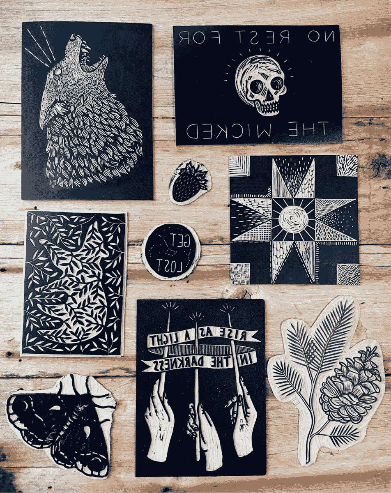

# 版画魔法：浮雕印刷设计、雕刻和进一步提升你的艺术作品的必备指南

## 指南
1. 封面
2. 内容开始
3. 页面
   1. 1
   2. 2
   3. 3
   4. 4
   5. 5
   6. 6
   7. 7
   8. 8
   9. 9
   10. 11
   11. 10
   12. 12
   13. 13
   14. 14
   15. 15
   16. 16
   17. 18
   18. 19
   19. 20
   20. 21
   21. 22
   22. 24
   23. 25
   24. 26
   25. 27
   26. 29
   27. 28
   28. 30
   29. 31
   30. 32
   31. 33
   32. 34
   33. 35
   34. 36
   35. 37
   36. 38
   37. 39
   38. 40
   39. 41
   40. 42
   41. 44
   42. 45
   43. 46
   44. 48
   45. 50
   46. 51
   47. 52
   48. 53
   49. 54
   50. 55
   51. 56
   52. 57
   53. 58
   54. 59
   55. 60
   56. 61
   57. 62
   58. 63
   59. 64
   60. 65
   61. 66
   62. 67
   63. 68
   64. 69
   65. 70
   66. 71
   67. 72
   68. 73
   69. 74
   70. 75
   71. 76
   72. 77
   73. 78
   74. 79
   75. 80
   76. 81
   77. 82
   78. 83
   79. 84
   80. 85
   81. 86
   82. 87
   83. 88
   84. 89
   85. 90
   86. 91
   87. 92
   88. 93
   89. 94
   90. 96
   91. 97
   92. 98
   93. 99
   94. 100
   95. 101
   96. 102
   97. 103
   98. 104
   99. 105
   100. 106
   101. 107
   102. 108
   103. 109
   104. 110
   105. 111
   106. 112
   107. 113
   108. 114
   109. 115
   110. 116
   111. 117
   112. 118
   113. 119
   114. 120
   115. 121
   116. 122
   117. 123
   118. 124
   119. 125
   120. 126
   121. 127
   122. 129
   123. 129
   124. 130
   125. 131
   126. 132
   127. 134
   128. 135
   129. 136
   130. 137
   131. 138
   132. 139
   133. 140
   134. 141
   135. 142
   136. 143
   137. 144

## 引言
亲爱的读者，

我们即将一起创造些美妙的东西。在这本书中，我将分享制作视觉上引人注目的油毡和橡胶版画的基本技巧和流程。我设计了一系列项目来磨练你的技能并激发你的创造力，其中包括一些有趣的方法来挽救你的失误并让错误获得第二次生命。本书旨在激励、鼓励你，并帮助你建立所需技能，将你所有的精彩想法变为现实。

从未拿起过雕刻工具？没关系——这本书就是为你准备的。在美术课上尝试过版画，并希望更认真地对待你的作品？这本书也适合你！在接下来的页面中，你将找到从工具和材料到良好构图要素等各方面的实用信息。我会向你展示如何制作一些自己的工作室用品，例如简单的上墨板和晾干架。每个印刷项目都旨在专注于特定的技能或多项技能——从基本纹理到多色套印再到彩虹滚印以及中间的一切。我们还将认识来自美国各地的几位版画家，他们慷慨地分享经验和秘诀来帮助我们。无论你的艺术背景或技能水平如何，这里都有适合你的内容。

我作为艺术家的背景是跨学科的：我的根基在于写生的古典绘画和素描，而我是在教育相对较晚的阶段才接触版画。我把雕塑当作创意上的味觉清洁剂，并喜欢为木工项目调整设计。我把刺绣作为一种减压方式来练习。每一种学科都相互影响。画家可以从雕塑家那里学到东西，就像足球运动员可以从芭蕾舞者那里学到东西一样。我最衷心的希望是，你能从我这里学到一些东西。

现在是时候了！感受手中雕刻工具的重量，并体会 *可能性* 带来的颤动感。倾听压墨辊滚开油墨时的轻吻声。让几句精选的脏话随着你的 V 形凿一起脱口而出（嘿，这对我们所有人都会发生）。多犯些错误，扎自己一两次，吸取教训，然后沉浸在你的第一张完美印版中。用你自己的意志力将某物拉入存在。这里有魔法可造。

墨迹团结致意，

Emily

