# 第一章
## 必备工具与材料

在本章中，你将了解从灵感构想到成功的油毡版画所需的基本材料。油毡版画是一种凸版印刷，通过雕刻的版块印出图像，油墨沉积在剩余（未雕刻）的版块区域。我最喜欢凸版印刷的一点是，你不需要昂贵的设备就能制作出工作室品质的印品，而且大多数工具相对负担得起。有很多品牌的工具、纸张、版块和油墨可供尝试，因此请研究并实验，找到最适合你的。

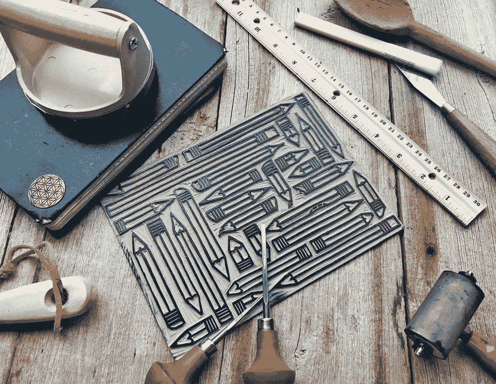

### 必备工具

#### 版块

##### 雕刻版块

虽然版画涵盖了许多不同类型的雕刻表面，但本书重点介绍油毡和橡胶版块的使用。软橡胶对于年纪较轻、经验较少的版画家来说通常是不错的选择，因为它用初学者的工具很容易切割。我在织物上印刷时也更喜欢软橡胶。更坚固的油毡更难切割，需要锋利的工具，但其密度能很好地保持精细的刻痕，并且在印刷过程中不太可能意外挤压和渗墨。

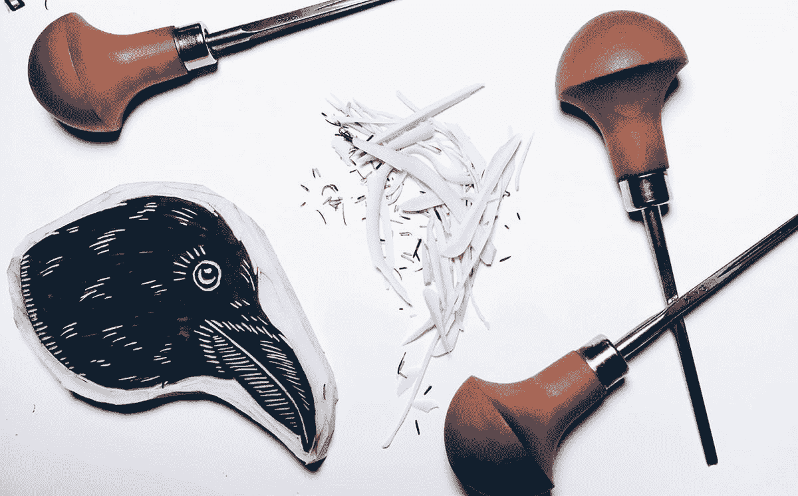

##### 油毡版块

由亚麻籽油、软木粉、木粉和松脂制成，油毡因其可再生成分而成为许多艺术家选择的媒介。它有多种中小标准尺寸以及大卷供应，并且由于其柔韧性，可以切割成任何形状。许多专业版画家更喜欢未装裱的“战舰灰”油毡。

油毡有时装在厚实的复合木块上，虽然这些不容易被塑造成不同形状，但木质背板为你的雕刻提供了额外的支撑和保护。装裱版块的重量也有助于在揭下印品时保持雕刻稳定。

油毡（装裱或未装裱）可以加热以帮助雕刻工具更顺畅地穿过：你可以将版块用毛巾覆盖，然后用中温的熨斗在上面滑动。或者你也可以用吹风机简单加热。我个人发现坐在版块上加热刚刚好。如果你保持雕刻工具锋利，则可能不需要加热版块。

油毡应始终平放存放，远离直射阳光和极端温度。光线、极端温度和时间最终会使你的油毡变硬、变形、易碎且令人恼火地难以雕刻。我不会囤太多油毡，因为新鲜的油毡切割效果最好。

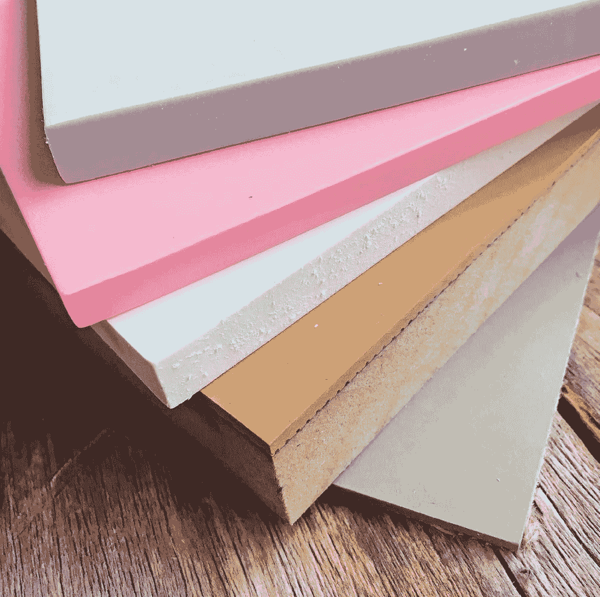

从上到下：MOO Carve 专业雕刻版块；Speedball Speedy-Carve；Speedball Speedy-Cut；Speedball 装裱油毡版块；Blick 战舰灰未装裱油毡。

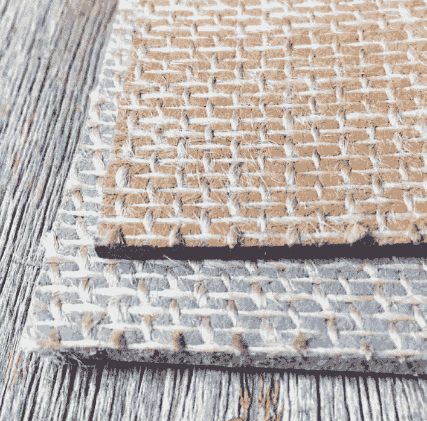

未装裱油毡背面的松散编织麻布，也称为 hessian 背衬。

##### 橡胶版块

如 Soft-Kut、MOO Carve 和 Speedy-Carve 等橡胶版块是传统油毡的良好替代品：它们通常更柔软，你的雕刻工具刀片更容易咬入。推动刀片穿过油毡所需的力量只需一小部分。最柔软的版块，如 MOO Carve，只需要刀片最轻的拨动，因此稳定的手非常有帮助。橡胶版块非常适合精细工作，并且不会像油毡有时那样变得易碎。

#### 雕刻工具与工具保养

大多数入门套件配有各种刀片宽度和形状，从最窄的 veiner 到最宽的 U 形刀片。Veiner 用于制作非常细薄的线条。V 形凿呈 45 度或 90 度角形成。U 形凿——你猜对了——形状像 U，很适合干净地挖出 lino。你还应考虑手的大小和能提供最佳握感的柄型——全尺寸工具可能更难操作，但能提供更大的杠杆作用，使切割更有力。蘑菇形掌式工具可以为雕刻精细细节提供更舒适、稳定的握感。

虽然我手边备有许多工具，但我通常反复使用同一四种工具：1 毫米 U 形凿、3 毫米 U 形凿、1 毫米 V 形凿和 0.5 毫米 veiner。这些是我的主力工具，适合大多数细节在 11 英寸 x 14 英寸（28 x 35.5 厘米）以下的项目。

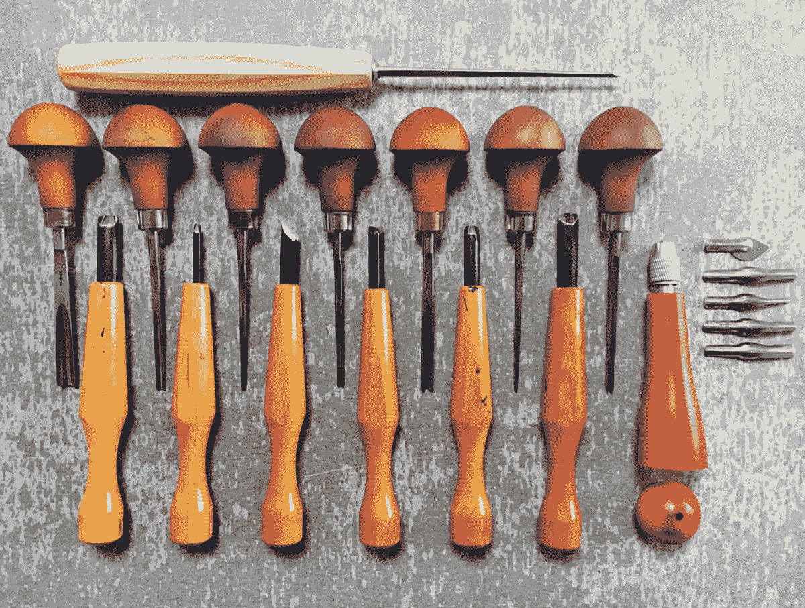

从上到下：Pfeil 全尺寸 11 号 veiner；Pfeil 掌式工具套装 C；Powergrip 套装；Speedball 油毡刻刀配可更换刀头。

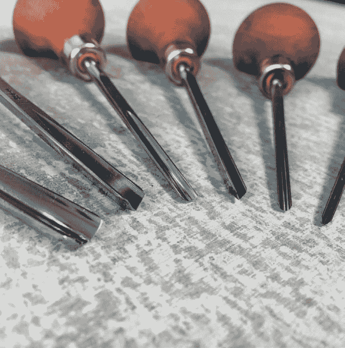

Pfeil 瑞士制造雕刻工具，套装 C

你的油毡的密度会影响你的工具。密度大的战舰灰 lino 会比其柔软的橡胶对应物更快地钝化刀片。因为刀片仅在常规使用中就会受到很大磨损，所以值得购买你能负担得起的最高质量刀片。然而不要忽视更便宜的入门套装——它们非常适合初学者，其中一些具有可互换刀片，可以方便地存放在工具柄内。

##### 磨利你的工具

随着时间的推移，雕刻工具的刀刃会失去锋利变得迟钝。钝刀是版画家的噩梦，因为它更难穿过油墨胶板。这会让你很快疲劳，也会使刀片更容易滑脱或撕裂胶板。良好的做法是定期磨利刀片，使其保持无缺口和毛刺，这些都是可能在刀刃边缘形成的粗糙小金属碎片。并且献给那些那个学期不得不忍受用一百个其他学生使用过的破烂工具雕刻挣扎的艺术学生，这就是为你准备的。

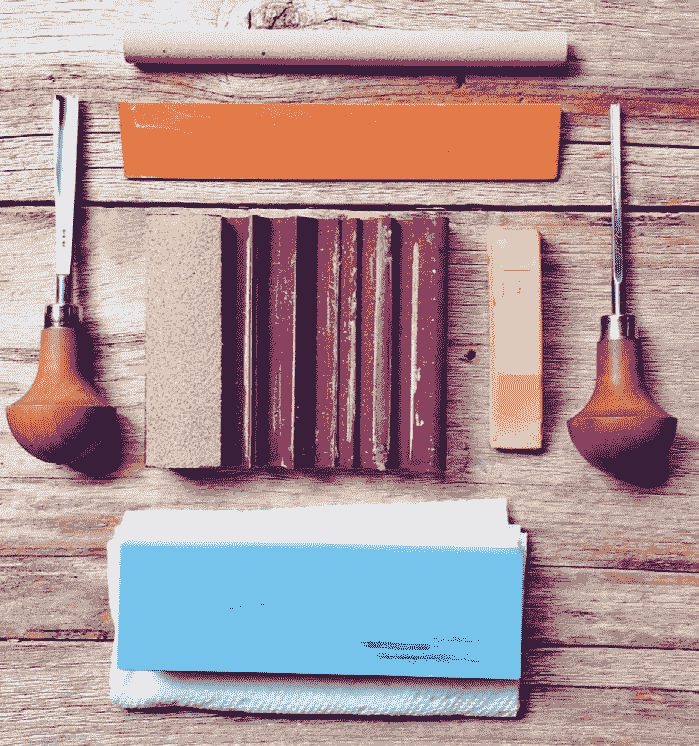
磨刀工具平铺图

##### 使用滑石条
以下是如何使用 Flexcut SlipStrop 磨利工具的方法。

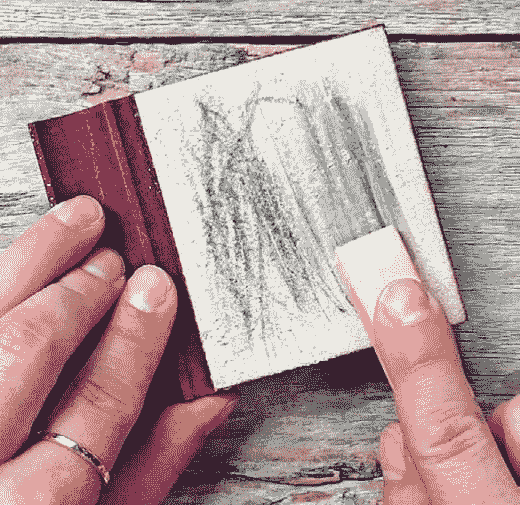
1 先从磨利工具的外侧开始。将套装中附带的黄色研磨膏涂抹在滑石条的平坦一侧，慷慨地涂抹在皮革表面。

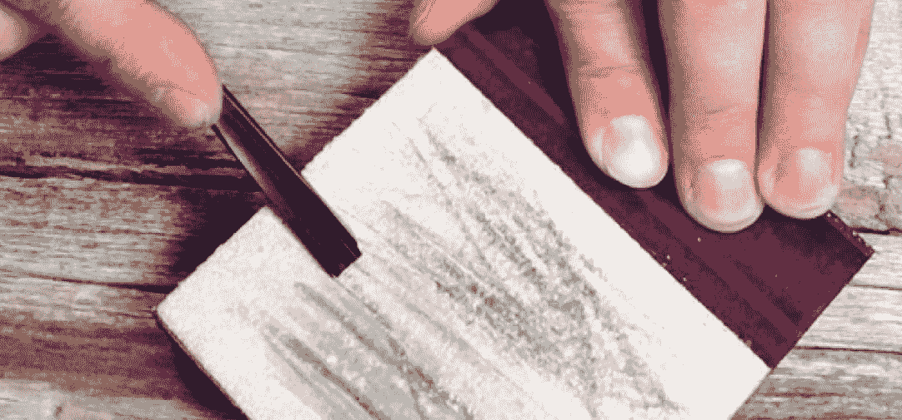
2 将工具以约 15 度角握住并放在皮革上，指向远离你的方向。向自己拉动时，轻轻将刀片的外缘推向皮革。如果你正在磨利 U 型凿，从凿子的一侧开始，并在向自己拉回时将其滚向另一侧。逐渐左右滚动工具可确保整个边缘都接触到。

3 如果你正在磨利 V 型分切工具，则一次磨一侧而不是滚动。不要来回摩擦工具；每次划动时将其拿起并放在滑石条的顶部。

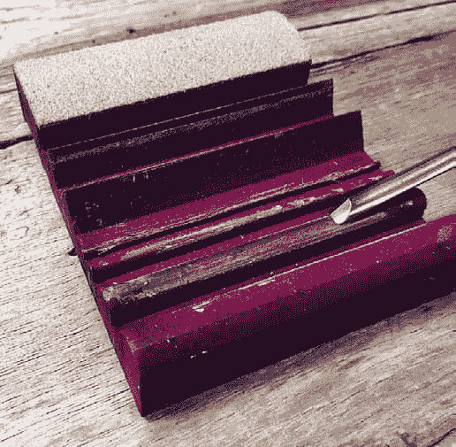
4 翻转滑石条以露出奇特的棱纹侧。这些弯曲的尖顶棱纹对应于大多数凿形工具的形状。选择与刀片相匹配的棱纹并慷慨地沿其涂抹黄色研磨膏。对刀片的内侧重复相同的过程，就像你对外部边缘所做的那样。

##### 使用油石和滑石
1 使用前将油石在水中浸泡 5 至 10 分钟。放在纸巾上。

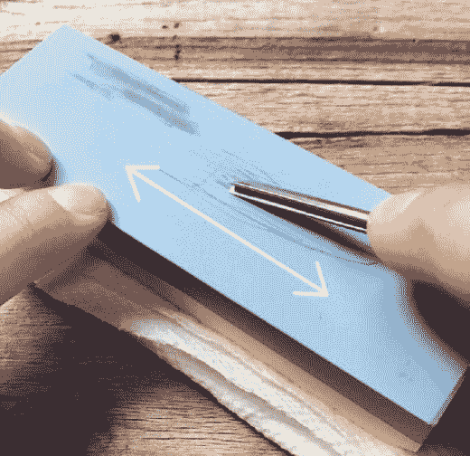
2 将工具以约 15 度角抵住油石的蓝色一侧放置（或使切削边缘与石面齐平）。如果你正在磨利 V 型分切工具，轻轻将其在石面上上下移动约 5 次，或直到看到边缘开始变锋利为止。

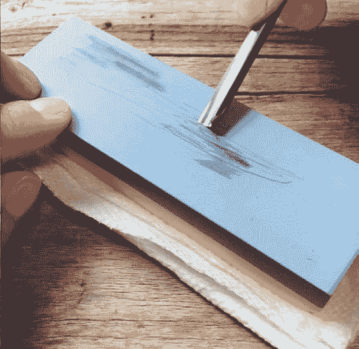
3 如果你正在磨利 U 型凿，在左右移动时通过转动手腕来摇动工具。

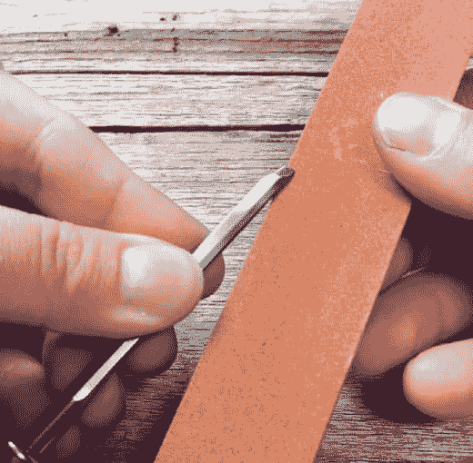
4 将滑石，也称为阿肯色石，沿着工具的内侧曲线运行，将石头推向刀刃边缘。U 型凿使用圆润的石头，V 型分切工具使用尖头的石头。

5 翻转油石并在更细的研磨侧重复该过程，以进一步[content]
随着时间的推移，雕刻工具的刀刃会失去锋利变得迟钝。钝刀是版画家的噩梦，因为它更难穿过油墨胶板。这会让你很快疲劳，也会使刀片更容易滑脱或撕裂胶板。良好的做法是定期磨利刀片，使其保持无缺口和毛刺，这些都是可能在刀刃边缘形成的粗糙小金属碎片。并且献给那些那个学期不得不忍受用一百个其他学生使用过的破烂工具雕刻挣扎的艺术学生，这就是为你准备的。

磨刀工具平铺图

## 使用滑石条
以下是如何使用 Flexcut SlipStrop 磨利工具的方法。

1 先从磨利工具的外侧开始。将套装中附带的黄色研磨膏涂抹在滑石条的平坦一侧，慷慨地涂抹在皮革表面。

2 将工具以约 15 度角握住并放在皮革上，指向远离你的方向。向自己拉动时，轻轻将刀片的外缘推向皮革。如果你正在磨利 U 型凿，从凿子的一侧开始，并在向自己拉回时将其滚向另一侧。逐渐左右滚动工具可确保整个边缘都接触到。

3 如果你正在磨利 V 型分切工具，则一次磨一侧而不是滚动。不要来回摩擦工具；每次划动时将其拿起并放在滑石条的顶部。

4 翻转滑石条以露出奇特的棱纹侧。这些弯曲的尖顶棱纹对应于大多数凿形工具的形状。选择与刀片相匹配的棱纹并慷慨地沿其涂抹黄色研磨膏。对刀片的内侧重复相同的过程，就像你对外部边缘所做的那样。

## 使用油石和滑石
1 使用前将油石在水中浸泡 5 至 10 分钟。放在纸巾上。

2 将工具以约 15 度角抵住油石的蓝色一侧放置（或使切削边缘与石面齐平）。如果你正在磨利 V 型分切工具，轻轻将其在石面上上下移动约 5 次，或直到看到边缘开始变锋利为止。

3 如果你正在磨利 U 型凿，在左右移动时通过转动手腕来摇动工具。

4 将滑石，也称为阿肯色石，沿着工具的内侧曲线运行，将石头推向刀刃边缘。U 型凿使用圆润的石头，V 型分切工具使用尖头的石头。

5 翻转油石并在更细的研磨侧重复该过程，以进一步研磨/完成刀片。

#### 滚筒、压纸工具、板材和刀具

### 滚筒
滚筒是用于将油墨均匀涂抹到雕刻版表面的滚轮。它们有多种尺寸，由硬橡胶或软橡胶制成。硬橡胶滚筒非常适合勾勒精细细节，而软橡胶滚筒能非常均匀地在版面上涂抹油墨。使用软橡胶滚筒在版上涂墨几乎不需要施加任何压力。

在选择滚筒时请考虑你将要印刷的版块大小。理想情况下，滚筒应略宽于版块的最短边。这将允许均匀涂抹油墨，而不会因滚轮边缘留下任何杂乱的痕迹。滚筒还应光滑，橡胶滚轮上没有任何凸起、凹陷或棱纹，因为这些滚轮上的不完美之处会直接转移到你的印刷品上。使用时请保持滚筒清洁，并在不使用时将其存放，使橡胶滚轮不接触任何东西。

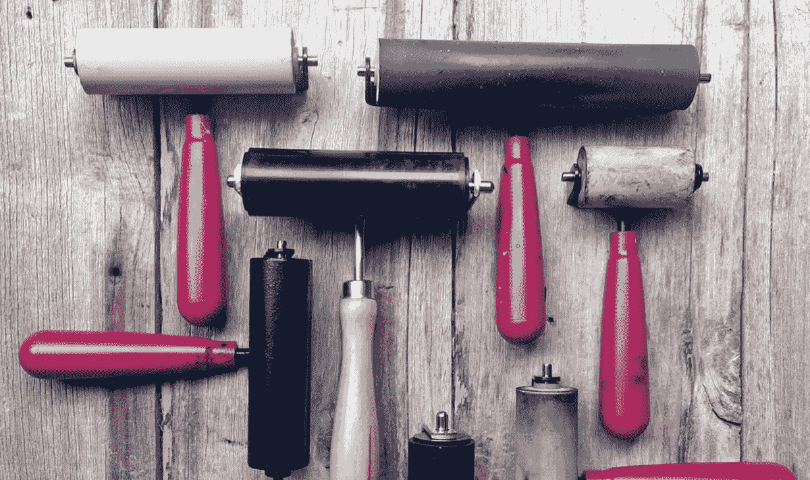

### 压纸工具
压纸工具是手工拉印成功印刷品必不可少的工具：你用它来[content]
随着时间的推移，雕刻工具的刀刃会失去锋利变得迟钝。钝刀是版画家的噩梦，因为它更难穿过油墨胶板。这会让你很快疲劳，也会使刀片更容易滑脱或撕裂胶板。良好的做法是定期磨利刀片，使其保持无缺口和毛刺，这些都是可能在刀刃边缘形成的粗糙小金属碎片。并且献给那些那个学期不得不忍受用一百个其他学生使用过的破烂工具雕刻挣扎的艺术学生，这就是为你准备的。

磨刀工具平铺图

## 使用滑石条
以下是如何使用 Flexcut SlipStrop 磨利工具的方法。

1 先从磨利工具的外侧开始。将套装中附带的黄色研磨膏涂抹在滑石条的平坦一侧，慷慨地涂抹在皮革表面。

2 将工具以约 15 度角握住并放在皮革上，指向远离你的方向。向自己拉动时，轻轻将刀片的外缘推向皮革。如果你正在磨利 U 型凿，从凿子的一侧开始，并在向自己拉回时将其滚向另一侧。逐渐左右滚动工具可确保整个边缘都接触到。

3 如果你正在磨利 V 型分切工具，则一次磨一侧而不是滚动。不要来回摩擦工具；每次划动时将其拿起并放在滑石条的顶部。

4 翻转滑石条以露出奇特的棱纹侧。这些弯曲的尖顶棱纹对应于大多数凿形工具的形状。选择与刀片相匹配的棱纹并慷慨地沿其涂抹黄色研磨膏。对刀片的内侧重复相同的过程，就像你对外部边缘所做的那样。

## 使用油石和滑石
1 使用前将油石在水中浸泡 5 至 10 分钟。放在纸巾上。

2 将工具以约 15 度角抵住油石的蓝色一侧放置（或使切削边缘与石面齐平）。如果你正在磨利 V 型分切工具，轻轻将其在石面上上下移动约 5 次，或直到看到边缘开始变锋利为止。

3 如果你正在磨利 U 型凿，在左右移动时通过转动手腕来摇动工具。

4 将滑石，也称为阿肯色石，沿着工具的内侧曲线运行，将石头推向刀刃边缘。U 型凿使用圆润的石头，V 型分切工具使用尖头的石头。

5 翻转油石并在更细的研磨侧重复该过程，以进一步研磨/完成刀片。

## 滚筒、压纸工具、板材和刀具

### 滚筒
滚筒是用于将油墨均匀涂抹到雕刻版表面的滚轮。它们有多种尺寸，由硬橡胶或软橡胶制成。硬橡胶滚筒非常适合勾勒精细细节，而软橡胶滚筒能非常均匀地在版面上涂抹油墨。使用软橡胶滚筒在版上涂墨几乎不需要施加任何压力。

在选择滚筒时请考虑你将要印刷的版块大小。理想情况下，滚筒应略宽于版块的最短边。这将允许均匀涂抹油墨，而不会因滚轮边缘留下任何杂乱的痕迹。滚筒还应光滑，橡胶滚轮上没有任何凸起、凹陷或棱纹，因为这些滚轮上的不完美之处会直接转移到你的印刷品上。使用时请保持滚筒清洁，并在不使用时将其存放，使橡胶滚轮不接触任何东西。

### 压纸工具
压纸工具是手工拉印成功印刷品必不可少的工具：你用它来[content]
随着时间的推移，雕刻工具的刀刃会失去锋利变得迟钝。钝刀是版画家的噩梦，因为它更难穿过油墨胶板。这会让你很快疲劳，也会使刀片更容易滑脱或撕裂胶板。良好的做法是定期磨利刀片，使其保持无缺口和毛刺，这些都是可能在刀刃边缘形成的粗糙小金属碎片。并且献给那些那个学期不得不忍受用一百个其他学生使用过的破烂工具雕刻挣扎的艺术学生，这就是为你准备的。

磨刀工具平铺图

## 使用滑石条
以下是如何使用 Flexcut SlipStrop 磨利工具的方法。

1 先从磨利工具的外侧开始。将套装中附带的黄色研磨膏涂抹在滑石条的平坦一侧，慷慨地涂抹在皮革表面。

2 将工具以约 15 度角握住并放在皮革上，指向远离你的方向。向自己拉动时，轻轻将刀片的外缘推向皮革。如果你正在磨利 U 型凿，从凿子的一侧开始，并在向自己拉回时将其滚向另一侧。逐渐左右滚动工具可确保整个边缘都接触到。

3 如果你正在磨利 V 型分切工具，则一次磨一侧而不是滚动。不要来回摩擦工具；每次划动时将其拿起并放在滑石条的顶部。

4 翻转滑石条以露出奇特的棱纹侧。这些弯曲的尖顶棱纹对应于大多数凿形工具的形状。选择与刀片相匹配的棱纹并慷慨地沿其涂抹黄色研磨膏。对刀片的内侧重复相同的过程，就像你对外部边缘所做的那样。

## 使用油石和滑石
1 使用前将油石在水中浸泡 5 至 10 分钟。放在纸巾上。

2 将工具以约 15 度角抵住油石的蓝色一侧放置（或使切削边缘与石面齐平）。如果你正在磨利 V 型分切工具，轻轻将其在石面上上下移动约 5 次，或直到看到边缘开始变锋利为止。

3 如果你正在磨利 U 型凿，在左右移动时通过转动手腕来摇动工具。

4 将滑石，也称为阿肯色石，沿着工具的内侧曲线运行，将石头推向刀刃边缘。U 型凿使用圆润的石头，V 型分切工具使用尖头的石头。

5 翻转油石并在更细的研磨侧重复该过程，以进一步研磨/完成刀片。

## 滚筒、压纸工具、板材和刀具

### 滚筒
滚筒是用于将油墨均匀涂抹到雕刻版表面的滚轮。它们有多种尺寸，由硬橡胶或软橡胶制成。硬橡胶滚筒非常适合勾勒精细细节，而软橡胶滚筒能非常均匀地在版面上涂抹油墨。使用软橡胶滚筒在版上涂墨几乎不需要施加任何压力。

在选择滚筒时请考虑你将要印刷的版块大小。理想情况下，滚筒应略宽于版块的最短边。这将允许均匀涂抹油墨，而不会因滚轮边缘留下任何杂乱的痕迹。滚筒还应光滑，橡胶滚轮上没有任何凸起、凹陷或棱纹，因为这些滚轮上的不完美之处会直接转移到你的印刷品上。使用时请保持滚筒清洁，并在不使用时将其存放，使橡胶滚轮不接触任何东西。

### 压纸工具
压纸工具是手工拉印成功印刷品必不可少的工具：你用它来[content]
随着时间的推移，雕刻工具的刀刃会失去锋利变得迟钝。钝刀是版画家的噩梦，因为它更难穿过油墨胶板。这会让你很快疲劳，也会使刀片更容易滑脱或撕裂胶板。良好的做法是定期磨利刀片，使其保持无缺口和毛刺，这些都是可能在刀刃边缘形成的粗糙小金属碎片。并且献给那些那个学期不得不忍受用一百个其他学生使用过的破烂工具雕刻挣扎的艺术学生，这就是为你准备的。

磨刀工具平铺图

## 使用滑石条
以下是如何使用 Flexcut SlipStrop 磨利工具的方法。

1 先从磨利工具的外侧开始。将套装中附带的黄色研磨膏涂抹在滑石条的平坦一侧，慷慨地涂抹在皮革表面。

2 将工具以约 15 度角握住并放在皮革上，指向远离你的方向。向自己拉动时，轻轻将刀片的外缘推向皮革。如果你正在磨利 U 型凿，从凿子的一侧开始，并在向自己拉回时将其滚向另一侧。逐渐左右滚动工具可确保整个边缘都接触到。

3 如果你正在磨利 V 型分切工具，则一次磨一侧而不是滚动。不要来回摩擦工具；每次划动时将其拿起并放在滑石条的顶部。

4 翻转滑石条以露出奇特的棱纹侧。这些弯曲的尖顶棱纹对应于大多数凿形工具的形状。选择与刀片相匹配的棱纹并慷慨地沿其涂抹黄色研磨膏。对刀片的内侧重复相同的过程，就像你对外部边缘所做的那样。

## 使用油石和滑石
1 使用前将油石在水中浸泡 5 至 10 分钟。放在纸巾上。

2 将工具以约 15 度角抵住油石的蓝色一侧放置（或使切削边缘与石面齐平）。如果你正在磨利 V 型分切工具，轻轻将其在石面上上下移动约 5 次，或直到看到边缘开始变锋利为止。

3 如果你正在磨利 U 型凿，在左右移动时通过转动手腕来摇动工具。

4 将滑石，也称为阿肯色石，沿着工具的内侧曲线运行，将石头推向刀刃边缘。U 型凿使用圆润的石头，V 型分切工具使用尖头的石头。

5 翻转油石并在更细的研磨侧重复该过程，以进一步研磨/完成刀片。

## 滚筒、压纸工具、板材和刀具

### 滚筒
滚筒是用于将油墨均匀涂抹到雕刻版表面的滚轮。它们有多种尺寸，由硬橡胶或软橡胶制成。硬橡胶滚筒非常适合勾勒精细细节，而软橡胶滚筒能非常均匀地在版面上涂抹油墨。使用软橡胶滚筒在版上涂墨几乎不需要施加任何压力。

在选择滚筒时请考虑你将要印刷的版块大小。理想情况下，滚筒应略宽于版块的最短边。这将允许均匀涂抹油墨，而不会因滚轮边缘留下任何杂乱的痕迹。滚筒还应光滑，橡胶滚轮上没有任何凸起、凹陷或棱纹，因为这些滚轮上的不完美之处会直接转移到你的印刷品上。使用时请保持滚筒清洁，并在不使用时将其存放，使橡胶滚轮不接触任何东西。

### 压纸工具
压纸工具是手工拉印成功印刷品必不可少的工具：你用它来在已上墨的版面上擦亮纸张背面。该工具允许你在版面上施加均匀的压力，而不会撕破纸张。最容易获得的（而且毫不夸张地说便宜！）压纸工具就是像我这样简单的木勺（见照片中的 2）。光滑坚硬的表面其实就是你所需要的！避开金属勺，因为印刷所需的摩擦会使它们变热。握住勺子靠近顶部，将食指和中指的指垫放在勺碗中；这将给你稳定的握持和足够的杠杆来擦亮纸张。

传统上用于日本木版印刷的压纸工具由构成手柄的竹叶覆盖（见 3）。随着时间的推移，竹子会磨损并需要更换。

Speedball 品牌的压纸工具（见 1）具有更高的手柄轮廓和柔软的垫子。我发现这非常适合用较软的橡胶版印刷。

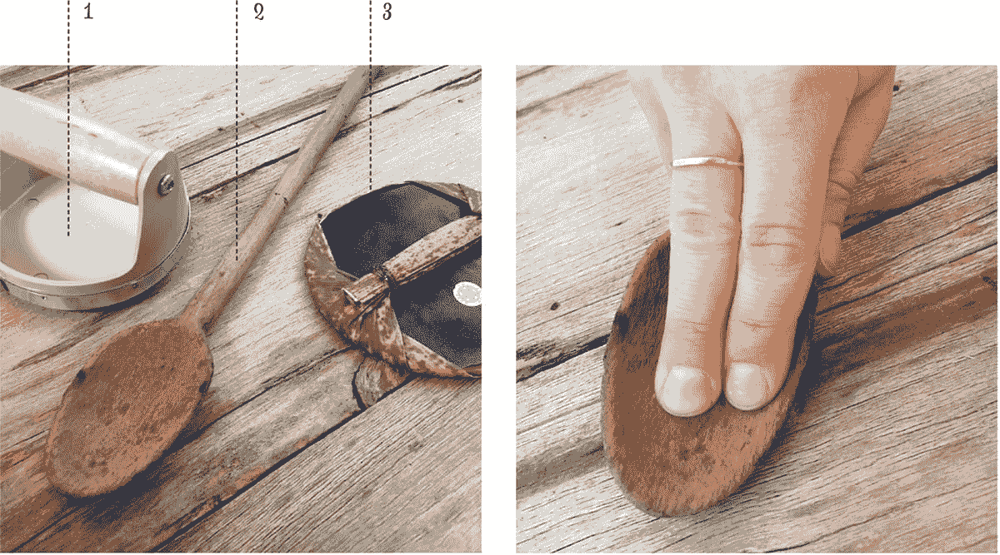

### 上墨板
每位版画家都需要一个上墨板或压板，这是一个干净、光滑、非多孔的表面，用于混合、涂抹和滚开油墨。各种材料都可以用作上墨板，例如金属托盘、金属工作台挂钩、一块带斜边的防爆玻璃，或一块边缘打磨或贴胶的有机玻璃。我只是通过将一块有机玻璃拧在一块同样大小的木板上，就制作了本书中出现的上墨板。当上墨板较重或固定时会有帮助，因为油墨有粘性，有时会使板粘在滚筒上。每次印刷完成后立即清洁上墨板，因为板上干掉的油墨会让你下次使用时无法均匀上墨。

### 调色刀
准备油墨必不可少的工具是调色刀，也称为刮刀，用于从容器中刮取油墨并在上墨板上涂抹和混合。调色刀有各种形状和柔韧程度。如果你计划进行大量印刷，即在同一时段内拉印许多张印刷品，那么较宽的刀就适合混合和涂抹大量油墨。我更喜欢柔韧且边缘圆润的刀，因为这样我不太可能刮伤上墨表面。

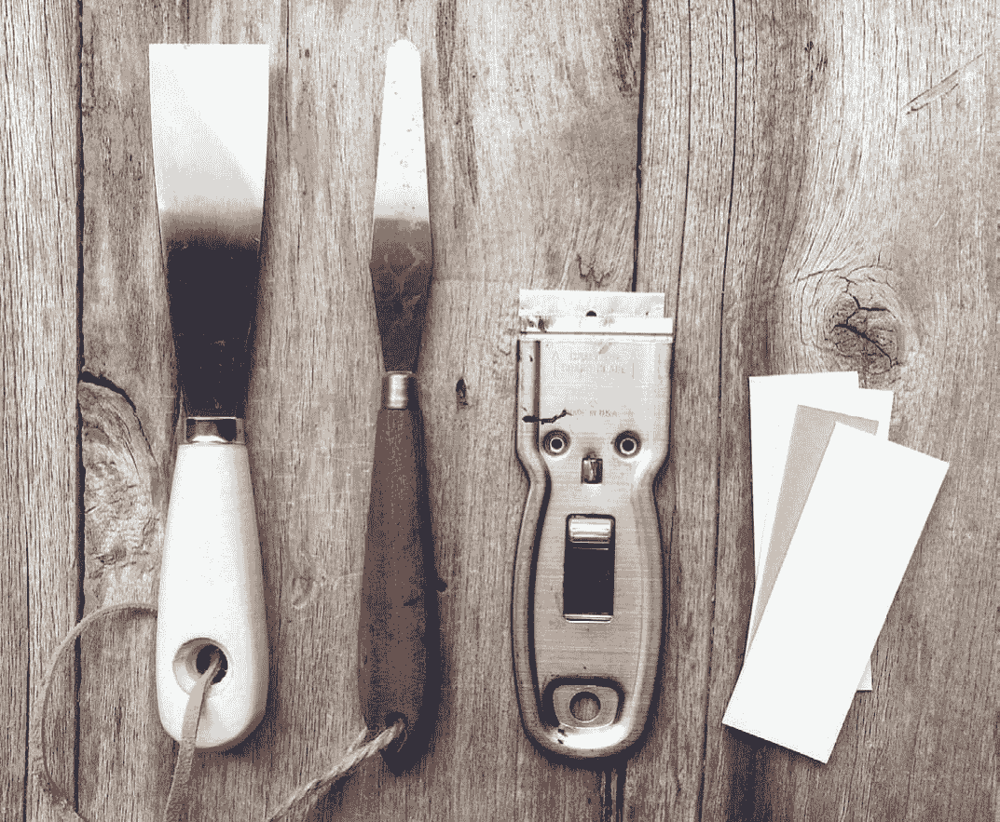

### 必备材料
除了合适的工具外，每位版画家都需要油墨和纸张。每种油墨都会产生不同的效果，而今天的纸张选择似乎无穷无尽。继续阅读以了解油墨、纸张以及几项其他材料，它们将完善你的工具包。

### 油墨
选择合适的油墨是印刷过程的重要组成部分，需要考虑许多因素。重要的是使用专门为凸版印刷配方的油墨，而不是随便使用任何旧油漆或油墨。油漆会毁坏你的滚筒和版块。合适的油墨既能延长版块的使用寿命，也能在纸上呈现出美丽的外观。

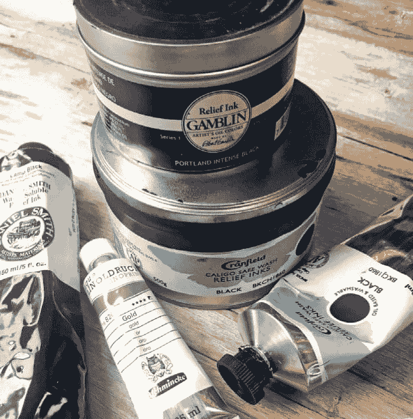

#### 水性油墨
水性油墨是初学者和儿童的好选择，也适合在狭小环境下印刷，因为它们可以用肥皂和水轻松清洁。此外，它们干燥速度快，当你时间紧迫或只印少量版次时很方便。然而，水性油墨干燥后往往有片状外观，并且通常难以均匀地滚涂在版块上。

#### 油性油墨

## 油性墨水

油性墨水有两种：一种需要溶剂清洁，另一种是水溶性/可水洗的。两者都能产生同样丝绒般的质感，并保持强烈的鲜艳色彩。松节油和煤油等溶剂是最有效的油性墨水清洁剂，但毒性相当大。更安全的清洁剂是普通的菜籽油。只需用纸巾充分浸湿后擦拭即可。这往往会在版块上留下残留物，所以我通常会再用消毒湿巾擦拭。我最喜欢的这类墨水是 Gamblin Relief Ink。

水溶性油性墨水以植物油为原料。非常无毒，这些墨水色彩鲜艳，具有使覆盖均匀的粘性。它们用肥皂和水或消毒湿巾即可轻松清洁。Caligo Safe Wash Relief Inks 是很好的选择，并且本书大部分项目都使用了它。

### 墨水改性剂

有很多种不同的添加剂可以混入墨水中以获得不同的效果。在墨水中加入一滴钴 **干燥剂** 会显著加快印刷品的干燥时间。然而，钴干燥剂毒性相当大，所以请戴手套操作。加入 **延展剂** 或 **透明基底** 会在不改变其粘度的情况下稀释墨水的颜色——可以把它想成是降低墨水的透明度。

加入 **缓干剂** 会减慢墨水的干燥时间，如果你喜欢慢慢工作或要印大量作品，这很不错。不过，请记住你也需要让印刷品在晾干架上停留更久。

## 纸张

从技术上讲，你几乎可以在任何平坦表面上印刷，但最便宜、最容易获得且最广泛的表面就是纸张。用手指摩擦一张奢华厚实、精美的纸张时，有一种如此触感丰富、细腻而且纯粹 *愉悦* 的感觉。幸运的是（对你也是），市场上今天有许多不同种类的纸张。艺术家用纸最常见的成分是木浆、棉麻、纸浆亚麻和桑皮/楮皮——所有这些都是手工印刷胶木版块的绝佳选择。在家学习时使用任何旧纸是可以的，但你会发现你选择的纸张质量越高，印刷品就越好。

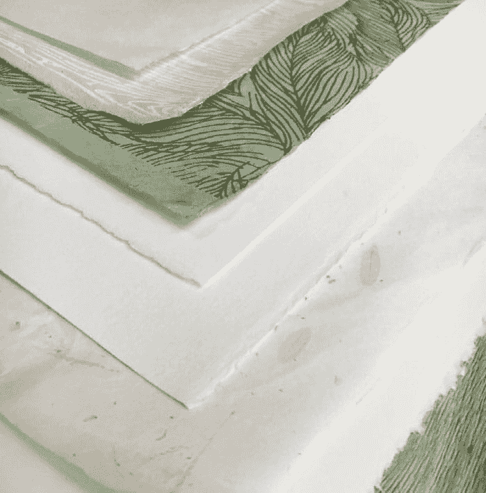

在实验并决定自己最喜欢什么时，关于纸张有一些有用的知识需要了解。

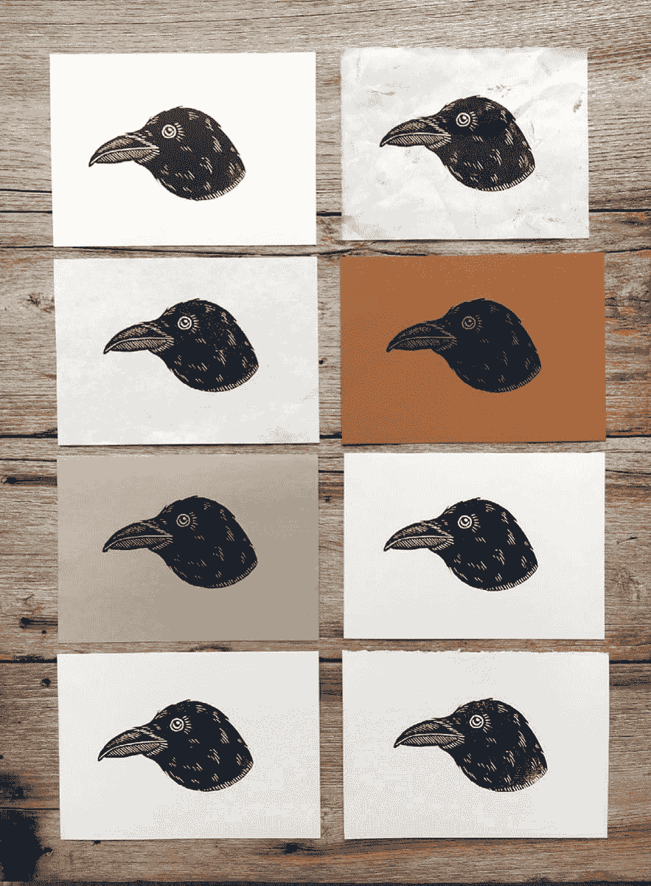

左栏

Blick Masterprinter 纸，74 gsm

Yasutomo 日本桑皮纸，71.5 gsm

Daler Rowney Canford 纸， dreadnought 灰色，150 gsm

Canson Edition 纸，古董白，250 gsm

右栏

Thai Tamarind Leaves 桑皮纸，30 gsm

Canson Mi-Teintes 绘图纸，编号 502 陶土色，160 gsm

Stonehenge 纸，暖白色，250 gsm

BFK Rives 纸，白色，280 gsm。

### 无酸与档案级

理想的纸张应不含木质素，这种存在于木浆中的酸性物质会随着时间推移使纸张变黄并变得脆弱。无酸纸被称为档案级，这基本上意味着它会非常持久。百分之百棉麻纸天然无酸，是一个很好的选择。专业版画家一定会选择档案级、无酸纸，以确保他们的作品能够保存多年。

### 重量

纸张的重量或厚度以每平方米克数（gsm）来衡量。gsm 越高，纸张越厚。在凸版印刷中，你可以根据使用的墨水和版块类型以及希望达到的最终效果使用各种厚度的纸张。较薄的纸张非常适合手工印刷，但有时会缺乏较厚纸张的奢华手感和外观。一些手工纸具有大量纹理，会极大地影响印刷的均匀度。尝试各种各样的纸张，你会逐渐了解哪种最适合你和你的特定项目。

### 热压与冷压

机制纸会经过一系列金属圆筒，这些圆筒被加热并压紧，或被冷却并松散压紧以创造不同的纹理。热压纸表面光滑，具有细腻的纹理。冷压纸表面略带颗粒感，或更具纹理。

## 杂项设备

### 绘图材料

素描本

铅笔

铅笔盒

橡皮擦

黑色永久性记号笔

描图纸

制图刷/除尘刷

复写纸

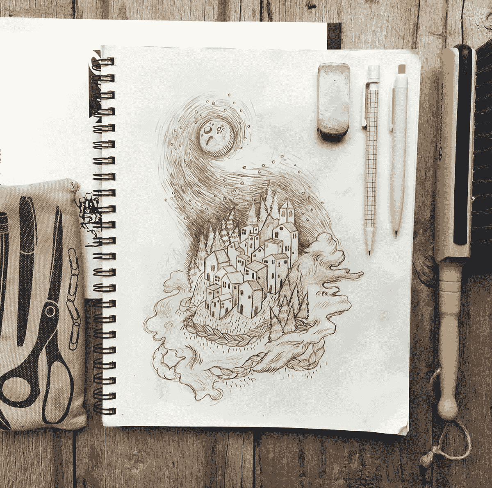

### 其他实用材料

围裙

美工刀

剪刀

一卷屠夫/牛皮纸

和纸胶带或遮蔽胶带

墨水刮刀

衬板条

消毒湿巾

纸巾

火山石皂

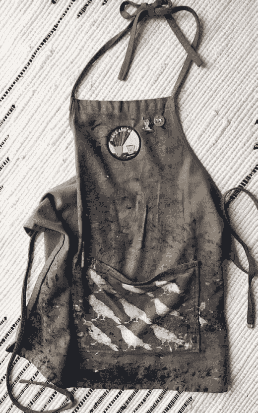

### 综合媒材材料

美工刀

自修复切割垫

一码（1 米）未漂白 100% 棉帆布（也称为鸭布）

基本缝纫套件（针套装、通用缝线）

刺绣框

刺绣线

刺绣针

一套珂勒油画颜料或水彩颜料

调色板、水杯、画笔

骨文件夹

粘合剂

#### 关于粘合剂的说明

本书中的多个项目需要将纸张粘合在一起，使用错误的粘合剂会对印刷品的命运造成灾难性的影响。一些胶水会导致纸张翘曲、起皱、变黄和劣化。然而，PVA 胶水无酸，不会随时间变黄。它们干燥后透明且保持柔韧。Yes Paste 和 Nori Paste 都是不错的选择，因为它们干燥缓慢（给你更多时间定位作品），并且不会导致纸张过度起皱。

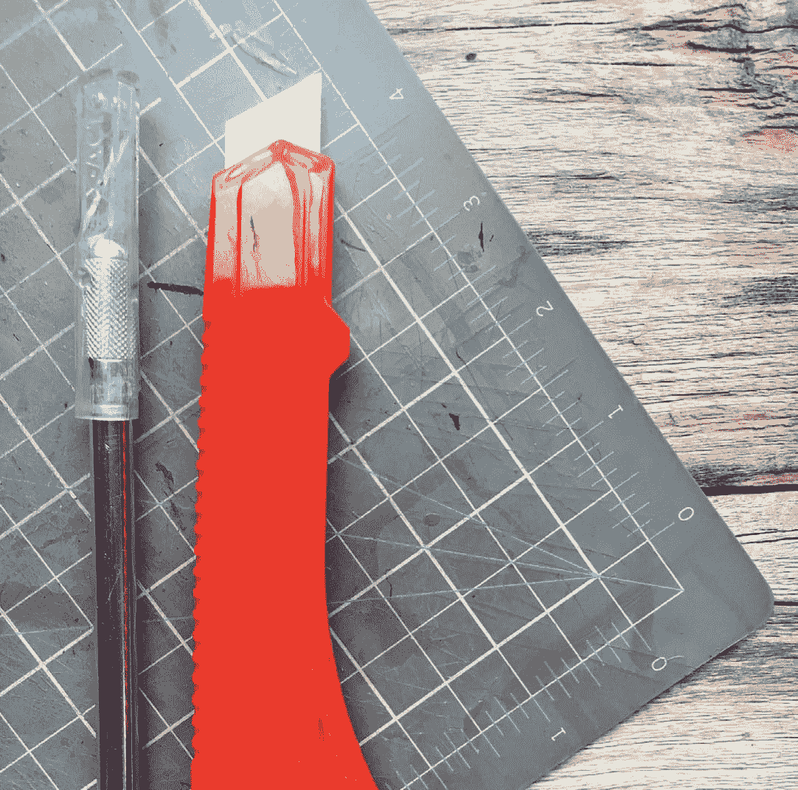

#### 印刷工作室的结构

现在所有材料都已整理好，下一个挑战是找到一个可以完成所有工作的空间。我在家里布置工作室时想起了约瑟夫·坎贝尔的以下名言：

*“\[一个神圣的地方\] 对今天的任何人来说都是绝对必要的。你必须有一个房间，或每天某个时段，在那里你不知道早上报纸上有什么新闻，你不知道你的朋友是谁，你不知道你欠任何人什么，你也不知道任何人欠你什么。这是一个你可以单纯体验并展现你是什么以及你可能成为什么的地方。这是创造性孵化的地方。一开始你可能会发现那里什么也没发生。但如果你有一个神圣的地方并使用它，最终总会发生一些事情。”*

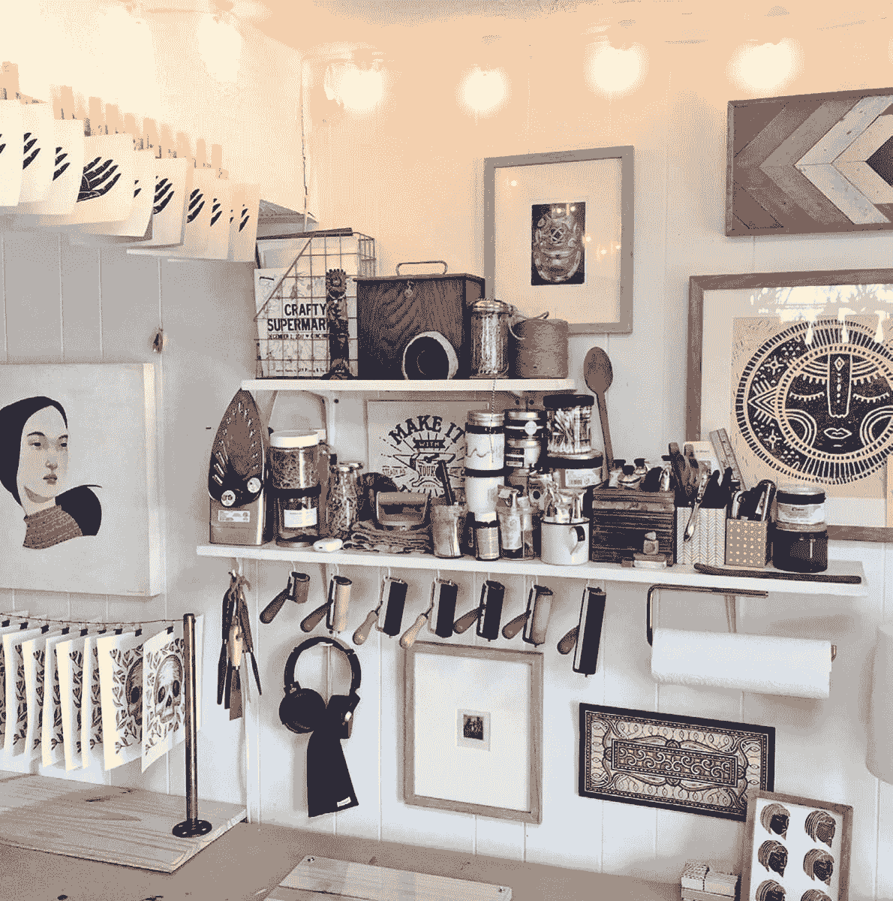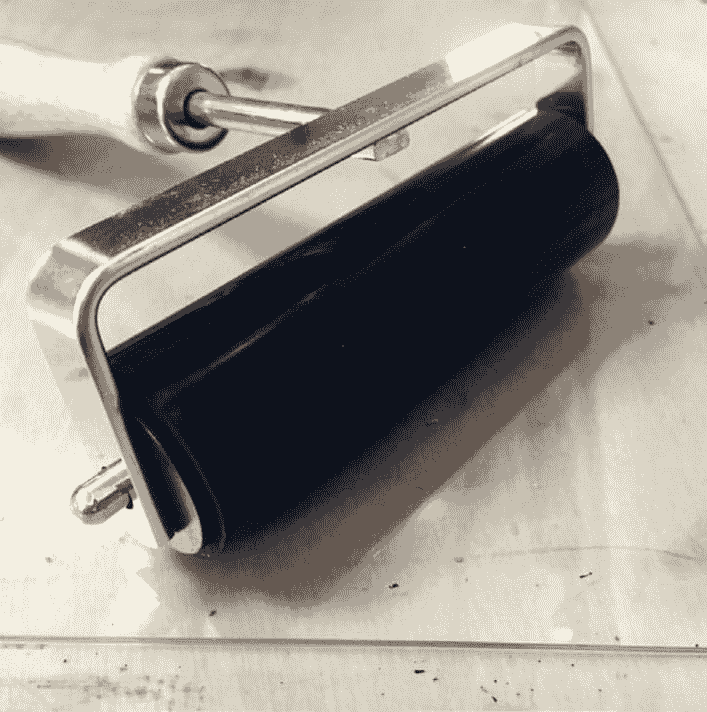

工作室与政治、账单以及整天轰炸我的无数琐碎担忧截然不同。那是一个魔法的栖息之地——我只需要出现并激活它。但首先我必须邀请魔法进来。我自己的简陋空间拥有一个 awkward 的 L 形布局，配有大量自制设备，点缀着太多纸张堆。但对我来说，它就是人间的天堂。你不需要一个能与罗德岛设计学院相媲美的工作室，也不需要让玛莎·斯图尔特因嫉妒而面色发绿。你的创意空间——无论是单独的房间、壁龛，还是只是临时的桌面——的主要目标是让印刷过程尽可能高效、舒适且富有灵感。

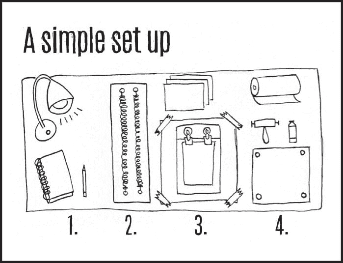

潜在的桌面布局

高效的工作室布局始于对你将要进行的活动的考虑，就我而言，是制作印刷品的基本步骤：

设计草图

雕刻版块

上墨

印刷

干燥

储存

The whole point of the studio is to be a space that is exclusive to artmaking, but sometimes you don’t have the luxury of having a whole room to yourself. The good news is that all you really need is one good-sized tabletop and a few key pieces of equipment. When planning your space, consider the following needs.

### 1. Clean space
For drafting designs, preparing printing papers, and carving blocks and signing prints. Keep this area completely free of ink in order to preserve the cleanliness of your papers. It would be sad to pull a five-color print only to ruin it with a big stray ink smudge picked up from the table!

### 2. Dry space
A place to keep your wet prints as you pull them. DIY drying rack plans can be found shown here.

### 3. Print space
This is the area where you’ll print your inked blocks. I like to cover this area with butcher paper and tape it down to the table for easy cleanup after a project. This is also where you will put any registration device/printing jig (see here) you may be using for your project. Keep a mini-clean zone above the jig so that there’s a safe place to stack your prepared papers.

### 4. Ink space
For making a mess! This is where your inking plate lives for mixing, rolling out, and applying ink to blocks. On one of my studio tables, I have a large sheet of plexiglass screwed directly into the tabletop as a permanent ink surface.
Underneath the shelf are hooks for hanging my brayers, which further help to corral the ink. Hanging brayers keeps the rubber roller from becoming dented or otherwise damaged over time. I also keep all of my essential ink cleaning supplies within easy reach: a roll of paper towels, a container of cotton swabs, disinfectant wipes, mat board strips, gloves, baby oil, a stack of old magazines, and a garbage can, which is tucked under the table.

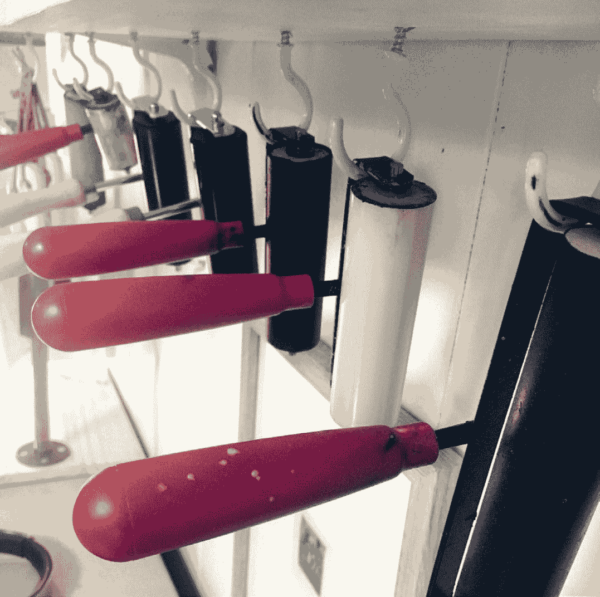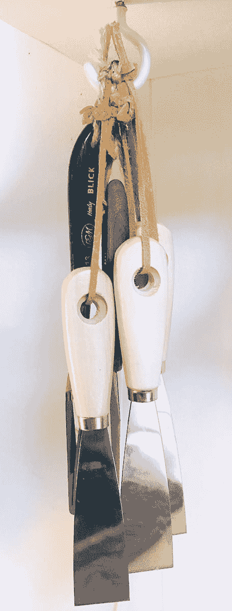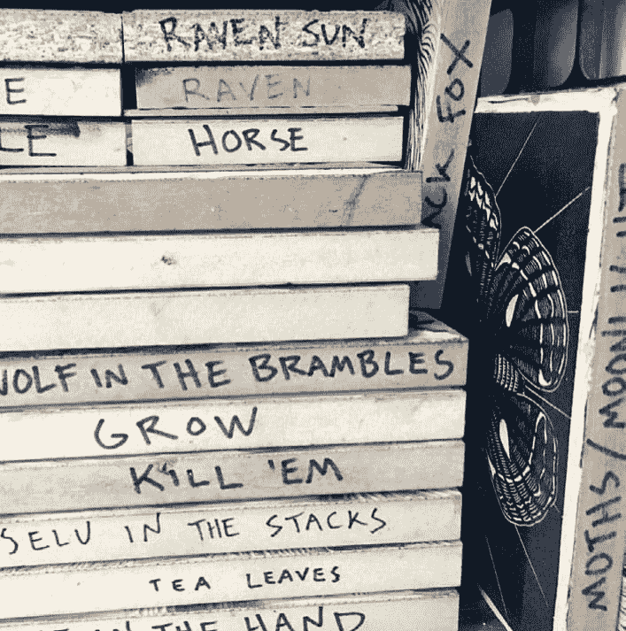
Blocks that have already been printed, cleaned, and dried are stacked in milk crates, with titles visible for easy access

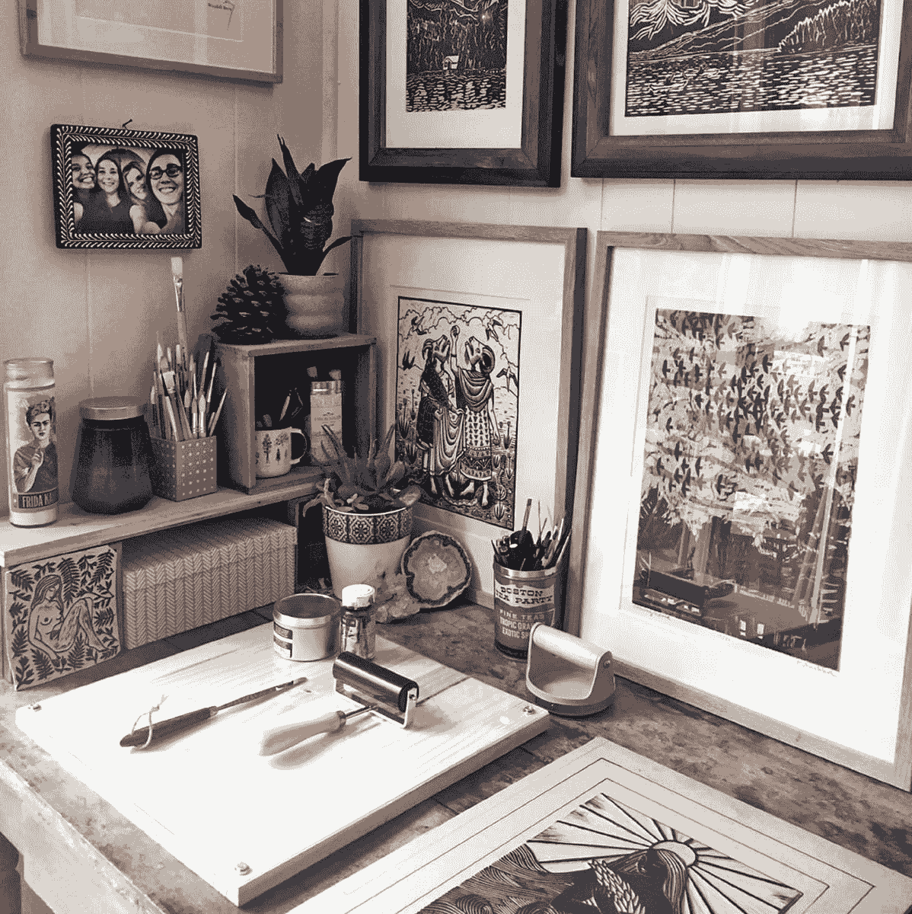
A second station, ready for printing

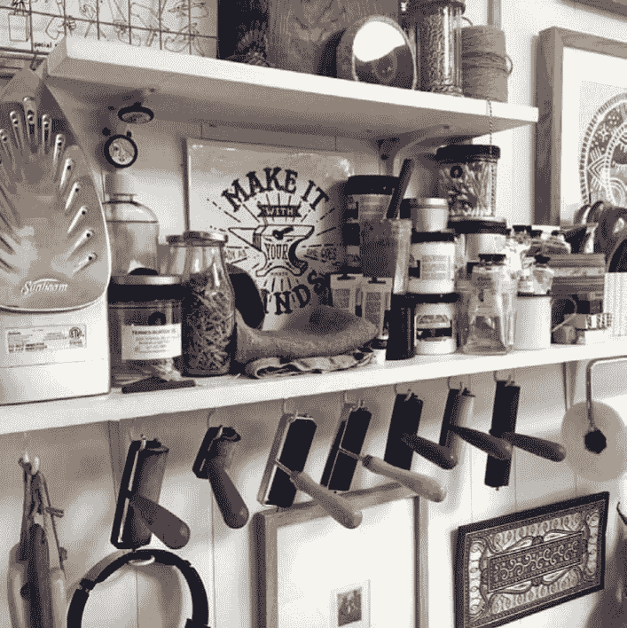
Inks, brayers, and other tools organized on a shelf above my worktable

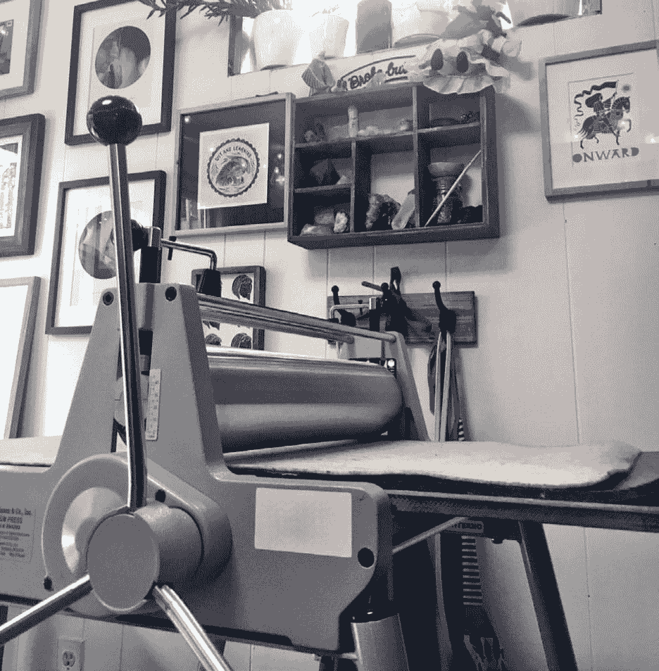
When I’m not pulling by hand I use my Richeson Medium Etching Press. Though expensive and bulky, pulling prints with a press takes a lot of the physical gruntwork for you.

### MAKE IT: TIGHTROPE DRYING RACK
One of the most challenging aspects of working in a small space is finding a convenient place to store prints as they dry. This tabletop drying rack is a cheap alternative to specialty racks. It takes under an hour to build and requires no special skills or equipment. Have your board and copper pipes cut to size at your local hardware store. Be sure to sand off any rough edges before you begin, and remember to observe basic studio safety procedures.

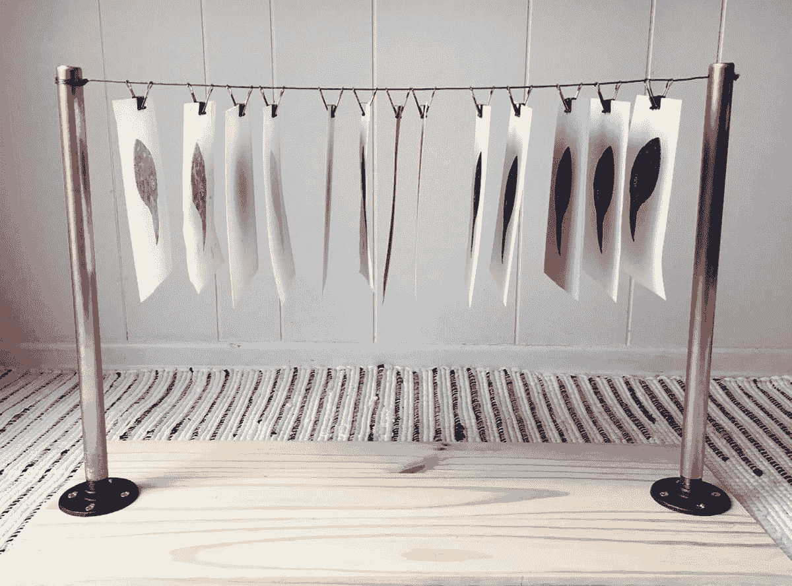

#### Tools and Materials
Ruler
Pencil
Drill
3/4" (2 cm) Phillips head screwdriver bit
1/8" (3 mm) drill bit
Two 1/2" (1.3 cm) floor flanges
Two 1/2" (1.3 cm) nipples
3/4" (2 cm) wood screws, Phillips head
Birch plywood board, 11 1/2" x 28" (29 x 73.5 cm)
Two 16" (40.5 cm) long pieces of 1/2" (1.3 cm) wide copper pipe
32" (81.5 cm) of heavy-duty picture hanging wire
15 small bulldog clips
Steel wool

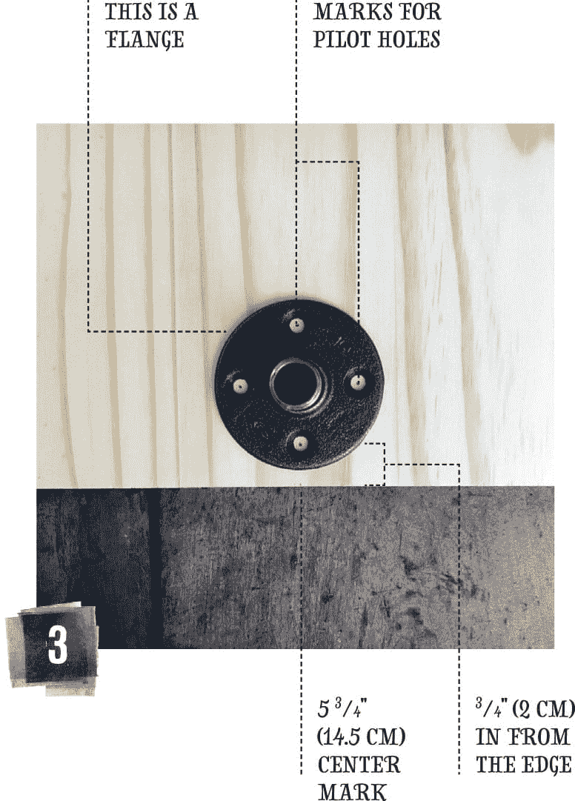

#### MAKE IT!
1 Make a center mark at the end of your board 5 3/4" (14.5 cm) along the shortest end.
2 Come in 3/4" (2 cm) from the center mark on the edge and make another mark. Repeat on the other end of the board.
3 Lay one of your floor flanges on the board as shown, centering one of the holes over your 3/4" (2 cm) mark. Make marks in the remaining three holes.
4 Remove the flange. Use each of the marks to drill pilot holes with your drill and 1/8" (3 mm) drill bit. This will keep your board from splitting.

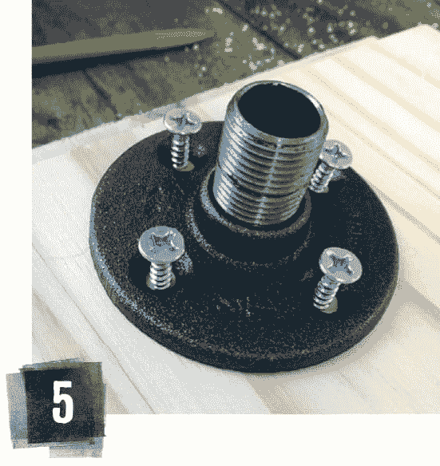

5 Replace the flange. Screw in place with four 3/4" (2 cm) wood screws.
6 Repeat steps 3 to 5 on the other end of the board.
7 Insert 1/2" (1.3 cm) nipple into each flange and screw in tightly.

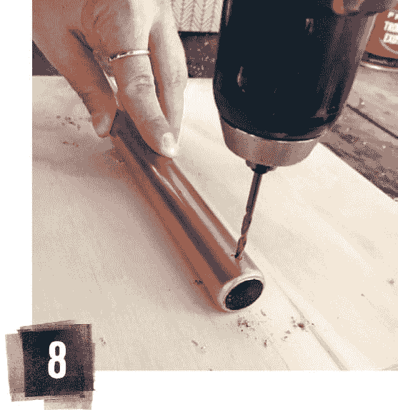

8 Take one of the copper pipe pieces. Measure and make a mark 1/2" (1.3 cm) from the end of the pipe. Holding the pipe steady with one hand, use your electric drill with a 1/8" (3 mm) drill bit to perforate two holes in the end of the copper pipe. Clean off any rough bits with steel wool.
9 Repeat step 8 with the second piece of pipe.
10 Take one of the copper pipes and attach the end without the hole onto the nipple set inside the flange. This may take a little bit of elbow grease and/or vise grips if you have them. Make sure that, as you screw it in, the two holes going through the top of the pipe are parallel with the grain of the board.
11 If you mark up or marr the pipe as you install them, a quick rub with steel wool will tidy them right back up.
12 Take your length of wire and thread it through one of the pipes. Tie a knot on the outside, trimming any excess wire (can be done with scissors or wire cutters).
13 Thread 15 small bulldog clips onto the wire.

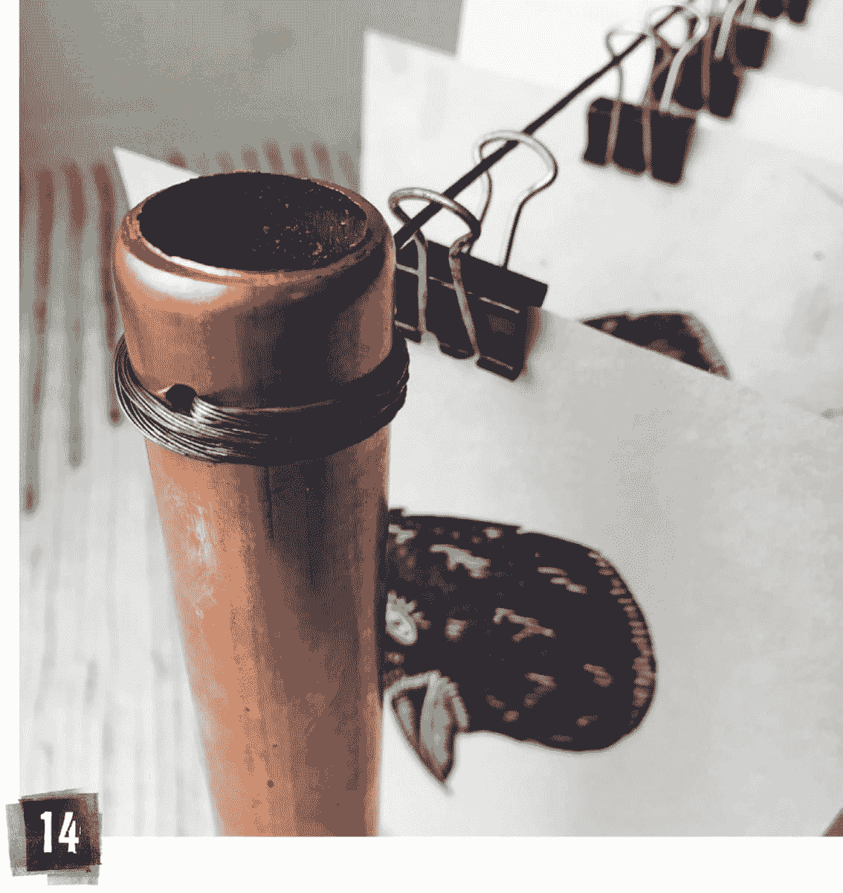

14 Thread the other end of the wire through the opposite pipe, pull gently until taut, and then wrap the excess wire around the pipe, twisting the wire to secure in place.
15 Install your finished drying rack in your studio space and proceed to fill it with gorgeous, handmade prints!
