# 第三章

## 基础
本章的项目将带你游览浮雕印刷工艺的基础概念。在这里你将学习如何：
  通过操纵工具实现多种纹理；
  使用三个独立版块制作三色印品；
  使用单个版块制作三色印品；
  操纵线条以呈现物体的三维效果；
  使用拼贴和手绘来装饰印品；
  使用文字印刷你自己的微型书
完成这些项目后，你将学会一点逆向思维。请记住，浮雕印刷本质上是一种**减法**或**减去**的过程——艺术家*去除*版块上的油印布以显现设计（与之对比，手捏陶艺是一种**加法**过程——元素会逐渐*添加到*造型上）。学会减法思维将帮助你更好地规划印品并实现更细腻的效果。
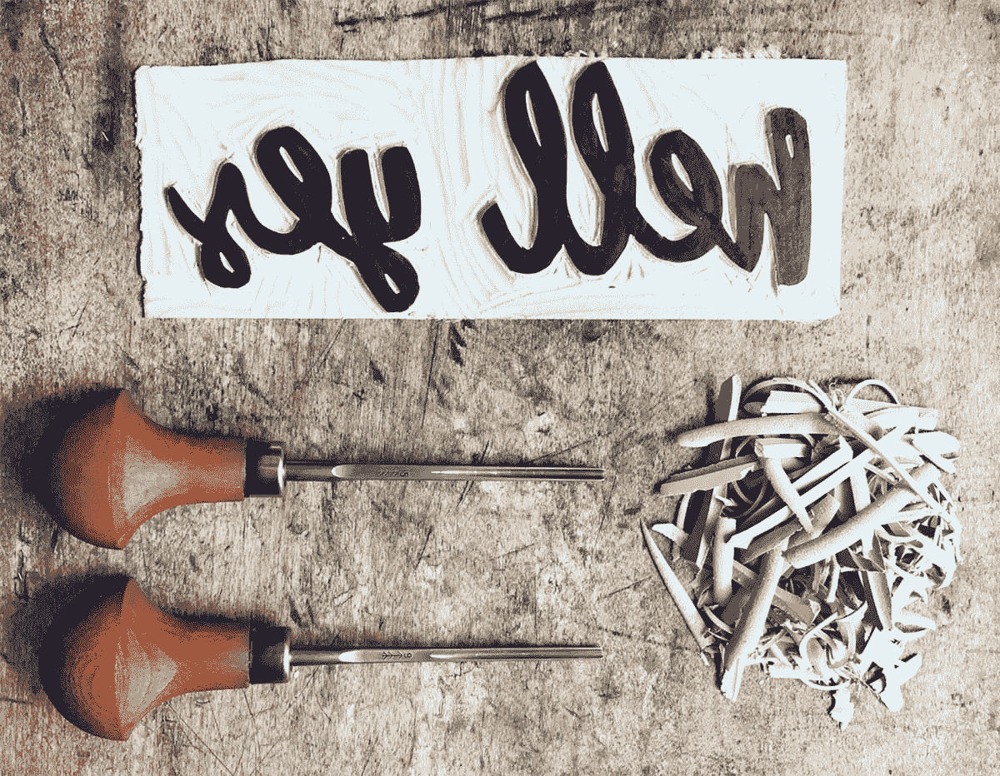

### 项目：纹理拼布块
了解你的雕刻工具并掌握其魔力的最好方式就是直接上手！这种经典的月光星拼布图案为在同一项目中尝试记号制作、纹理和明暗提供了完美的视觉结构。
在这个项目中，你将尝试使用尽可能多的雕刻工具来制作尽可能多的不同纹理和明暗。
这将涉及尝试：
  你每种工具或刀片所产生的形状
  刀片在油印布中的深度
  笔触的长度
  笔触的方向
  记号的间距
  切割是相交还是平行
我们不需要使用任何转印技术来进行这次纹理探索，因为我们将直接在版块上作画。我建议先用铅笔绘制完整设计，然后用永久性记号笔描过你的绘画，这样可以修改任何错误。
#### 工具和材料
9" x 9" (23 x 23 cm) 未装裱的油印布
铅笔
尺子
永久性记号笔
雕刻工具
上墨板
调色刀
压滚
12" x 12" (30.5 x 30.5 cm) 印刷纸
巴伦
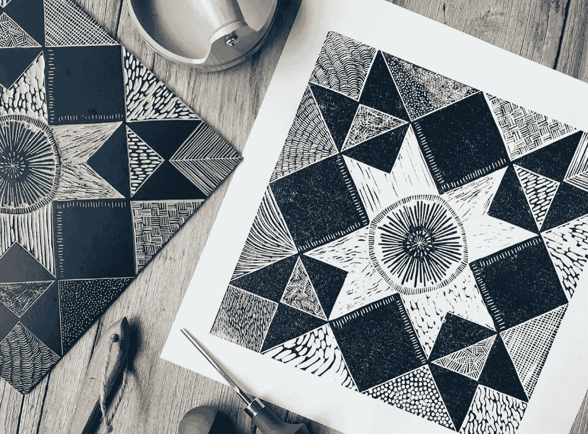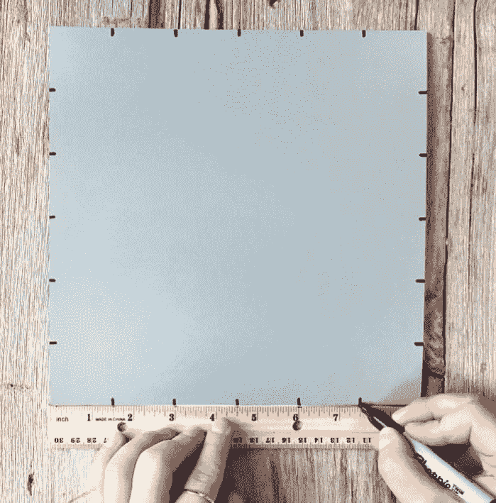
1 首先在油印布版块上制作一个 1 1/2" (4 cm) 的网格。使用尺子进行精确测量，在版块周边每隔 1 1/2" (4 cm) 做标记。
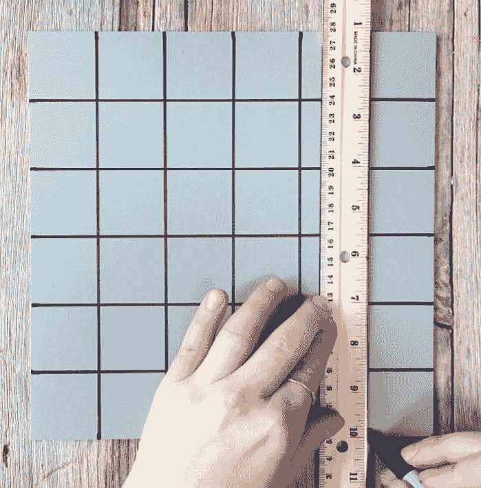
2 用尺子将相对边缘的标记对齐，以其为导向在版块上画出垂直线。你应该得到 36 个每个测量 1 1/2" (4 cm) 的正方形。
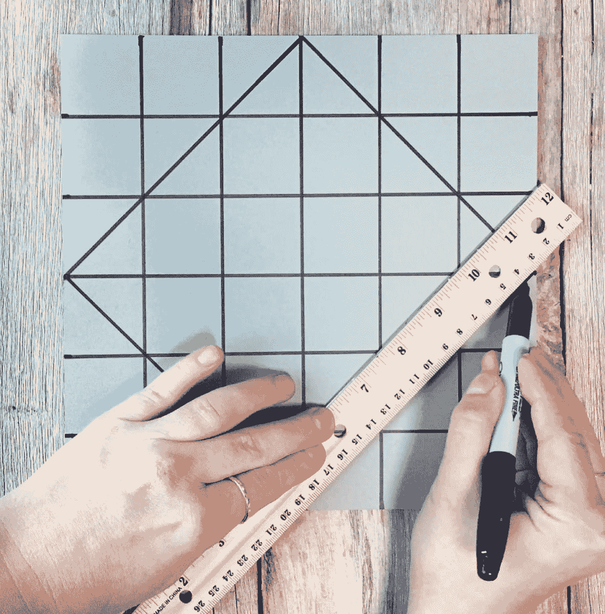
3 找到每条边缘的中点标记。用尺子连接四个中点标记以制作一个菱形。

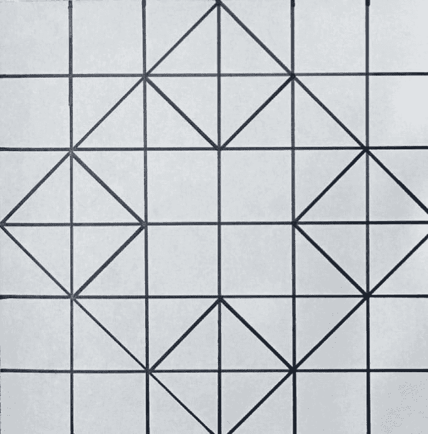

## 月光星图案

4 按照这些顺序图片作为[content]

## 月光星图案

4 以这些顺序图片为[content]

## 月光星图案

4 以这些顺序图片为指导，在你的网格上完成月光星图案的绘制。用永久性记号笔将指定的区域涂黑。这将帮助你记住要雕刻的位置。

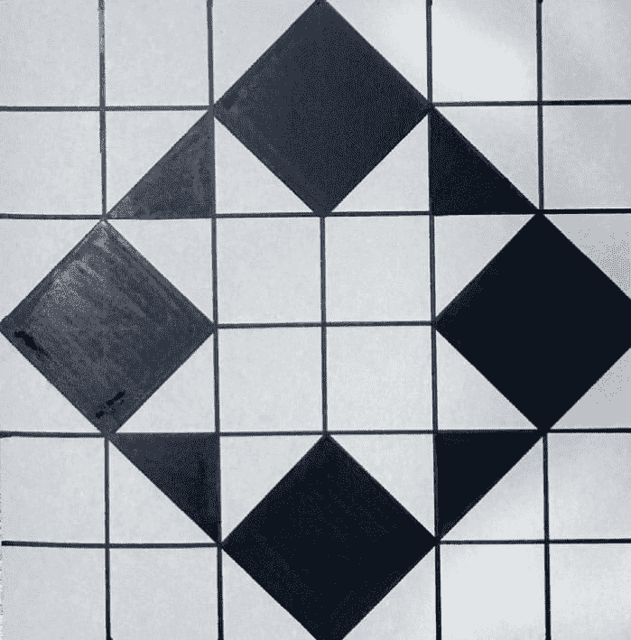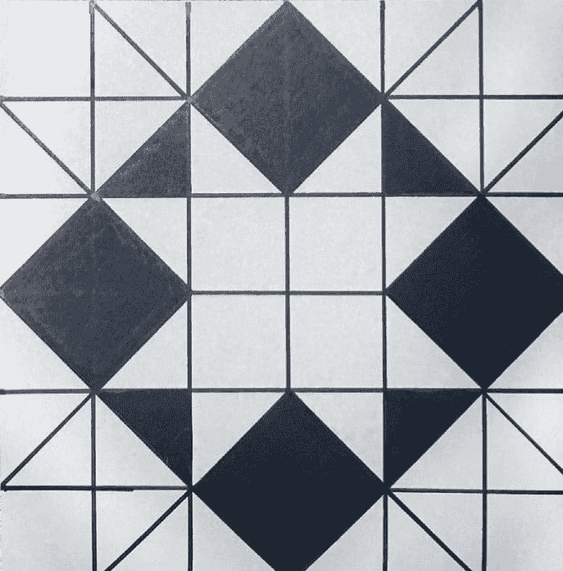

5 为了在视觉上锚定设计，你不会雕刻涂黑的区域。目标是使用尽可能多的工具，在设计的空白区域填充尽可能多的不同标记、线条和纹理。花点时间考虑你可以用工具创造不同效果的所有方法。

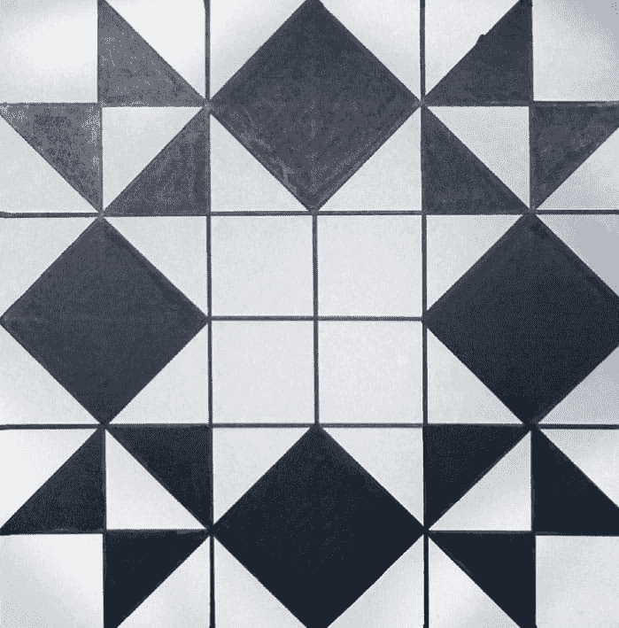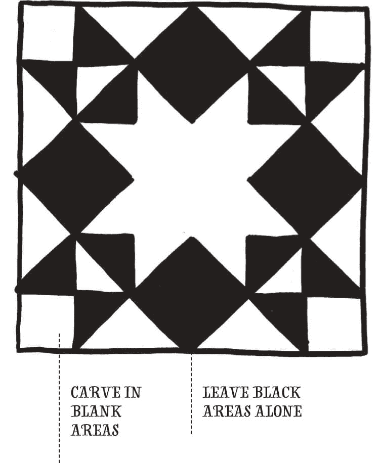

6 使用窄 V 形工具，沿着每个空白形状的内边缘雕刻。这将帮助你保持标记在想要的位置。然后用永久性记号笔填充同一个形状。这将使你在雕刻时更容易看到标记。

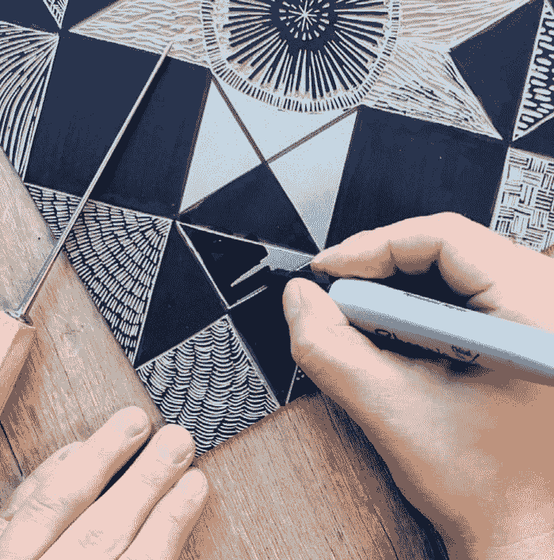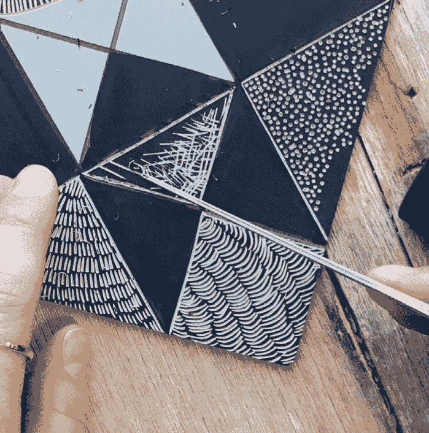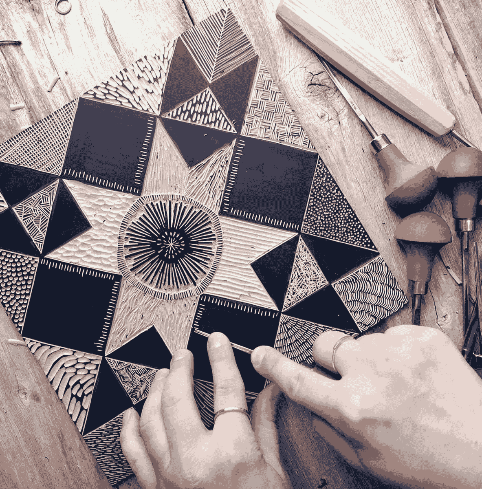

7 继续雕刻，直到所有空白区域都填满纹理。将中央的星星视为自由空间，你可以在其中创建任何图案、纹理或设计，使你的印花真正独一无二。如果你决定所有这些工作还不够，你也可以装饰黑色区域。

8 使用绘图员除尘刷刷掉所有切屑。彻底清洁将意味着日后更干净的印花。

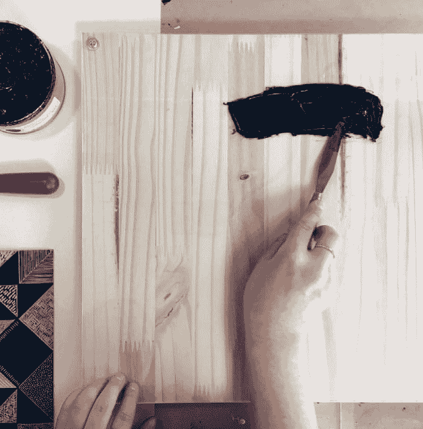

9 从你的锡罐中刮取一勺约四分之一大小的油墨，并在调墨板上用调色刀将其展开以加热。

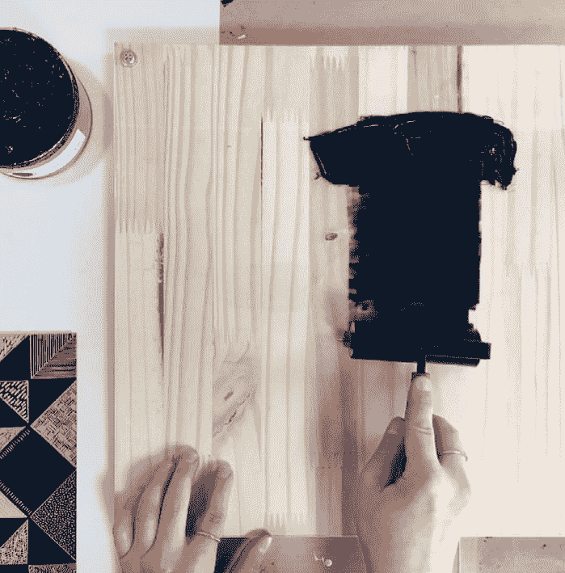

10 使用你能容纳该版块的最大滚筒，在调墨板上滚动油墨，直到滚筒上形成一层漂亮均匀的油墨层。

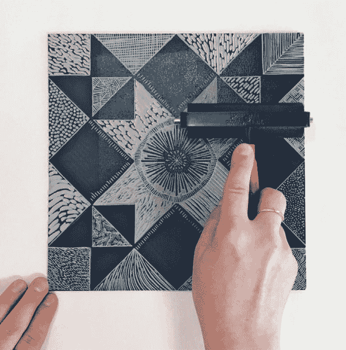

11 通过用滚筒在版块上多次涂抹来给版块上墨，必要时返回压台上的墨池。注意不要上墨过多而填满你可能雕刻的细纹。特别注意版块的边缘，很容易被遗漏。

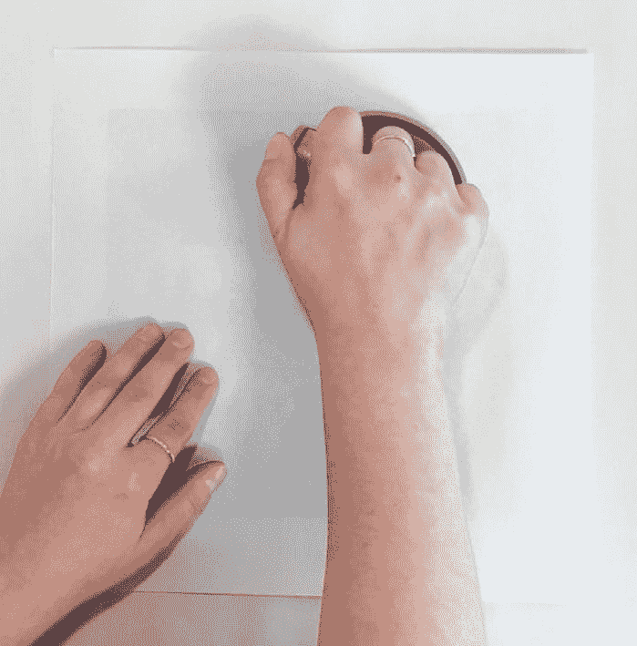

12 将你选择的纸张（此处为 Blick Masterprinter 纸）放在版块上，用手轻轻按压固定。紧握你的巴伦手柄，摩擦纸张背面，在整个版块上施加均匀的压力。你可能希望用木勺进一步[content]

## 月光星图案

4 以这些顺序图片为指导，在你的网格上完成月光星图案的绘制。用永久性记号笔将指定的区域涂黑。这将帮助你记住要雕刻的位置。

5 为了在视觉上锚定设计，你不会雕刻涂黑的区域。目标是使用尽可能多的工具，在设计的空白区域填充尽可能多的不同标记、线条和纹理。花点时间考虑你可以用工具创造不同效果的所有方法。

6 使用窄 V 形工具，沿着每个空白形状的内边缘雕刻。这将帮助你保持标记在想要的位置。然后用永久性记号笔填充同一个形状。这将使你在雕刻时更容易看到标记。

7 继续雕刻，直到所有空白区域都填满纹理。将中央的星星视为自由空间，你可以在其中创建任何图案、纹理或设计，使你的印花真正独一无二。如果你决定所有这些工作还不够，你也可以装饰黑色区域。

8 使用绘图员除尘刷刷掉所有切屑。彻底清洁将意味着日后更干净的印花。

9 从你的锡罐中刮取一勺约四分之一大小的油墨，并在调墨板上用调色刀将其展开以加热。

10 使用你能容纳该版块的最大滚筒，在调墨板上滚动油墨，直到滚筒上形成一层漂亮均匀的油墨层。

11 通过用滚筒在版块上多次涂抹来给版块上墨，必要时返回压台上的墨池。注意不要上墨过多而填满你可能雕刻的细纹。特别注意版块的边缘，很容易被遗漏。

12 将你选择的纸张（此处为 Blick Masterprinter 纸）放在版块上，用手轻轻按压固定。紧握你的巴伦手柄，摩擦纸张背面，在整个版块上施加均匀的压力。你可能希望用木勺进一步[content]

## 月光星图案

4 以这些顺序图片为指导，在你的网格上完成月光星图案的绘制。用永久性记号笔将指定的区域涂黑。这将帮助你记住要雕刻的位置。

5 为了在视觉上锚定设计，你不会雕刻涂黑的区域。目标是使用尽可能多的工具，在设计的空白区域填充尽可能多的不同标记、线条和纹理。花点时间考虑你可以用工具创造不同效果的所有方法。

6 使用窄 V 形工具，沿着每个空白形状的内边缘雕刻。这将帮助你保持标记在想要的位置。然后用永久性记号笔填充同一个形状。这将使你在雕刻时更容易看到标记。

7 继续雕刻，直到所有空白区域都填满纹理。将中央的星星视为自由空间，你可以在其中创建任何图案、纹理或设计，使你的印花真正独一无二。如果你决定所有这些工作还不够，你也可以装饰黑色区域。

8 使用绘图员除尘刷刷掉所有切屑。彻底清洁将意味着日后更干净的印花。

9 从你的锡罐中刮取一勺约四分之一大小的油墨，并在调墨板上用调色刀将其展开以加热。

10 使用你能容纳该版块的最大滚筒，在调墨板上滚动油墨，直到滚筒上形成一层漂亮均匀的油墨层。

11 通过用滚筒在版块上多次涂抹来给版块上墨，必要时返回压台上的墨池。注意不要上墨过多而填满你可能雕刻的细纹。特别注意版块的边缘，很容易被遗漏。

12 将你选择的纸张（此处为 Blick Masterprinter 纸）放在版块上，用手轻轻按压固定。紧握你的巴伦手柄，摩擦纸张背面，在整个版块上施加均匀的压力。你可能希望用木勺进一步[content]

## 月光星图案

4 以这些顺序图片为指导，在你的网格上完成月光星图案的绘制。用永久性记号笔将指定的区域涂黑。这将帮助你记住要雕刻的位置。

5 为了在视觉上锚定设计，你不会雕刻涂黑的区域。目标是使用尽可能多的工具，在设计的空白区域填充尽可能多的不同标记、线条和纹理。花点时间考虑你可以用工具创造不同效果的所有方法。

6 使用窄 V 形工具，沿着每个空白形状的内边缘雕刻。这将帮助你保持标记在想要的位置。然后用永久性记号笔填充同一个形状。这将使你在雕刻时更容易看到标记。

7 继续雕刻，直到所有空白区域都填满纹理。将中央的星星视为自由空间，你可以在其中创建任何图案、纹理或设计，使你的印花真正独一无二。如果你决定所有这些工作还不够，你也可以装饰黑色区域。

8 使用绘图员除尘刷刷掉所有切屑。彻底清洁将意味着日后更干净的印花。

9 从你的锡罐中刮取一勺约四分之一大小的油墨，并在调墨板上用调色刀将其展开以加热。

10 使用你能容纳该版块的最大滚筒，在调墨板上滚动油墨，直到滚筒上形成一层漂亮均匀的油墨层。

11 通过用滚筒在版块上多次涂抹来给版块上墨，必要时返回压台上的墨池。注意不要上墨过多而填满你可能雕刻的细纹。特别注意版块的边缘，很容易被遗漏。

12 将你选择的纸张（此处为 Blick Masterprinter 纸）放在版块上，用手轻轻按压固定。紧握你的巴伦手柄，摩擦纸张背面，在整个版块上施加均匀的压力。你可能希望用木勺进一步烧[content]

## 月光星图案

4 以这些顺序图片为指导，在你的网格上完成月光星图案的绘制。用永久性记号笔将指定的区域涂黑。这将帮助你记住要雕刻的位置。

5 为了在视觉上锚定设计，你不会雕刻涂黑的区域。目标是使用尽可能多的工具，在设计的空白区域填充尽可能多的不同标记、线条和纹理。花点时间考虑你可以用工具创造不同效果的所有方法。

6 使用窄 V 形工具，沿着每个空白形状的内边缘雕刻。这将帮助你保持标记在想要的位置。然后用永久性记号笔填充同一个形状。这将使你在雕刻时更容易看到标记。

7 继续雕刻，直到所有空白区域都填满纹理。将中央的星星视为自由空间，你可以在其中创建任何图案、纹理或设计，使你的印花真正独一无二。如果你决定所有这些工作还不够，你也可以装饰黑色区域。

8 使用绘图员除尘刷刷掉所有切屑。彻底清洁将意味着日后更干净的印花。

9 从你的锡罐中刮取一勺约四分之一大小的油墨，并在调墨板上用调色刀将其展开以加热。

10 使用你能容纳该版块的最大滚筒，在调墨板上滚动油墨，直到滚筒上形成一层漂亮均匀的油墨层。

11 通过用滚筒在版块上多次涂抹来给版块上墨，必要时返回压台上的墨池。注意不要上墨过多而填满你可能雕刻的细纹。特别注意版块的边缘，很容易被遗漏。

12 将你选择的纸张（此处为 Blick Masterprinter 纸）放在版块上，用手轻轻按压固定。紧握你的巴伦手柄，摩擦纸张背面，在整个版块上施加均匀的压力。你可能希望用木勺进一步烧[content]

## 月光星图案

4 以这些顺序图片为指导，在你的网格上完成月光星图案的绘制。用永久性记号笔将指定的区域涂黑。这将帮助你记住要雕刻的位置。

5 为了在视觉上锚定设计，你不会雕刻涂黑的区域。目标是使用尽可能多的工具，在设计的空白区域填充尽可能多的不同标记、线条和纹理。花点时间考虑你可以用工具创造不同效果的所有方法。

6 使用窄 V 形工具，沿着每个空白形状的内边缘雕刻。这将帮助你保持标记在想要的位置。然后用永久性记号笔填充同一个形状。这将使你在雕刻时更容易看到标记。

7 继续雕刻，直到所有空白区域都填满纹理。将中央的星星视为自由空间，你可以在其中创建任何图案、纹理或设计，使你的印花真正独一无二。如果你决定所有这些工作还不够，你也可以装饰黑色区域。

8 使用绘图员除尘刷刷掉所有切屑。彻底清洁将意味着日后更干净的印花。

9 从你的锡罐中刮取一勺约四分之一大小的油墨，并在调墨板上用调色刀将其展开以加热。

10 使用你能容纳该版块的最大滚筒，在调墨板上滚动油墨，直到滚筒上形成一层漂亮均匀的油墨层。

11 通过用滚筒在版块上多次涂抹来给版块上墨，必要时返回压台上的墨池。注意不要上墨过多而填满你可能雕刻的细纹。特别注意版块的边缘，很容易被遗漏。

12 将你选择的纸张（此处为 Blick Masterprinter 纸）放在版块上，用手轻轻按压固定。紧握你的巴伦手柄，摩擦纸张背面，在整个版块上施加均匀的压力。你可能希望用木勺进一步烧[content]

## 月光星图案

4 以这些顺序图片为指导，在你的网格上完成月光星图案的绘制。用永久性记号笔将指定的区域涂黑。这将帮助你记住要雕刻的位置。

5 为了在视觉上锚定设计，你不会雕刻涂黑的区域。目标是使用尽可能多的工具，在设计的空白区域填充尽可能多的不同标记、线条和纹理。花点时间考虑你可以用工具创造不同效果的所有方法。

6 使用窄 V 形工具，沿着每个空白形状的内边缘雕刻。这将帮助你保持标记在想要的位置。然后用永久性记号笔填充同一个形状。这将使你在雕刻时更容易看到标记。

7 继续雕刻，直到所有空白区域都填满纹理。将中央的星星视为自由空间，你可以在其中创建任何图案、纹理或设计，使你的印花真正独一无二。如果你决定所有这些工作还不够，你也可以装饰黑色区域。

8 使用绘图员除尘刷刷掉所有切屑。彻底清洁将意味着日后更干净的印花。

9 从你的锡罐中刮取一勺约四分之一大小的油墨，并在调墨板上用调色刀将其展开以加热。

10 使用你能容纳该版块的最大滚筒，在调墨板上滚动油墨，直到滚筒上形成一层漂亮均匀的油墨层。

11 通过用滚筒在版块上多次涂抹来给版块上墨，必要时返回压台上的墨池。注意不要上墨过多而填满你可能雕刻的细纹。特别注意版块的边缘，很容易被遗漏。

12 将你选择的纸张（此处为 Blick Masterprinter 纸）放在版块上，用手轻轻按压固定。紧握你的巴伦手柄，摩擦纸张背面，在整个版块上施加均匀的压力。你可能希望用木勺进一步烧[content]

## 月光星图案

4 以这些顺序图片为指导，在网格上完成月光星图案的绘制。用永久性记号笔将指定区域涂黑，这有助于记住雕刻位置。

5 为在视觉上锚定设计，涂黑的区域不雕刻。目标是用尽可能多的工具，在空白区域填充尽可能多的不同标记、线条和纹理。思考一下如何操控工具创造不同效果。

6 用窄 V 形工具沿每个空白形状的内边缘雕刻，帮助保持标记位置。然后用永久性记号笔填满同一形状，雕刻时更易看清标记。

7 继续雕刻直至所有空白区域填满纹理。将中央星星视为自由空间，可创作任意图案、纹理或设计使印花独一无二。若觉得工作还不够，也可装饰黑色区域。

8 用绘图员除尘刷刷掉所有切屑，彻底清洁意味着日后印花更干净。

9 从锡罐刮取约四分之一大小的油墨，用调色刀在调墨板上展开加热。

10 用能容纳版块的最大滚筒在调墨板上滚动油墨，直至滚筒上形成均匀的油墨层。

11 用滚筒多次在版块上涂抹上墨，必要时返回压台上的墨池。注意不要上墨过量填满雕刻的细纹，注意版块边缘易被遗漏。

12 将所选纸张如 Blick Masterprinter 纸放在版块上，用手轻压固定。紧握巴伦手柄摩擦纸背，在版块上施加均匀压力。可再用木勺进一步烧[content]

## 月光星图案

4 按顺序图片在网格上完成月光星图案绘制。用永久记号笔将指定区域涂黑，便于记住雕刻位置。

5 为视觉锚定设计，涂黑区域不雕刻。目标是用尽可能多工具在空白区填充多种标记、线条和纹理。思考工具的不同使用方式。

6 用窄 V 工具沿空白形状内缘雕刻，保持标记位置。然后用永久记号笔填满该形状，便于雕刻时看清标记。

7 继续雕刻直至空白区全部填满纹理。中央星星为自由空间，可任意创作图案纹理使印花独一无二。也可装饰黑色区域。

8 用绘图员除尘刷清理切屑，彻底清洁可得更干净印花。

9 从锡罐取约四分之一大小油墨，用调色刀在调墨板上展开加热。

10 用最大滚筒在调墨板上滚动油墨，直至滚筒上墨层均匀。

11 用滚筒多次在版块上涂墨，必要时回墨池。勿上墨过量填满细纹，注意边缘易遗漏。

12 将纸张如 Blick Masterprinter 纸置于版块上，轻压固定。紧握巴伦手柄摩擦纸背，均匀施压。可再用木勺进一步打磨纸背，使未雕刻区黑色更一致。

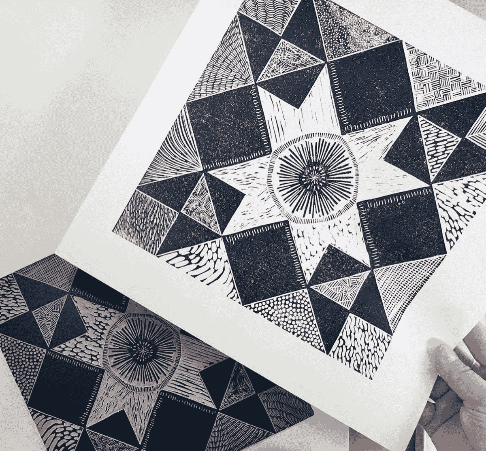

13 小心揭开纸张，置于安全处晾干。

## 需考虑的线条类型

直线
曲线
漩涡线
方向线
长线
短线
点
刮痕
毛发线
重叠线
表现线
抒情线
平行线
羽毛线
锯齿线
断线
连续线
编织线
间距大的标记
间距近的标记
有组织的线
随机线
宽线
细线
非有意线

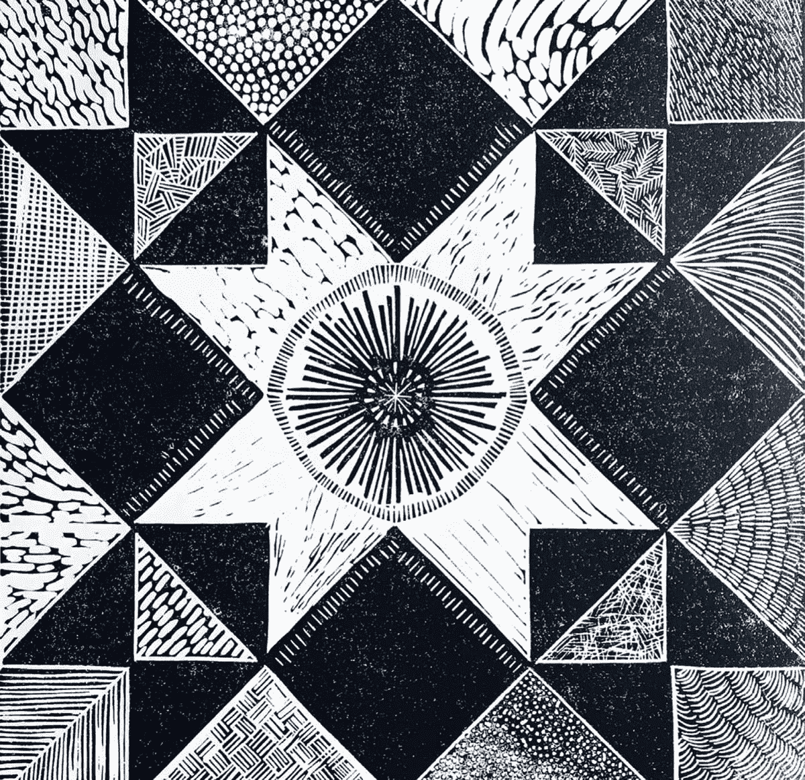

## 标记图

标记图：要重现上面完成示例中我所做的标记，请参考下方地图，了解哪些工具用于制作哪些标记。

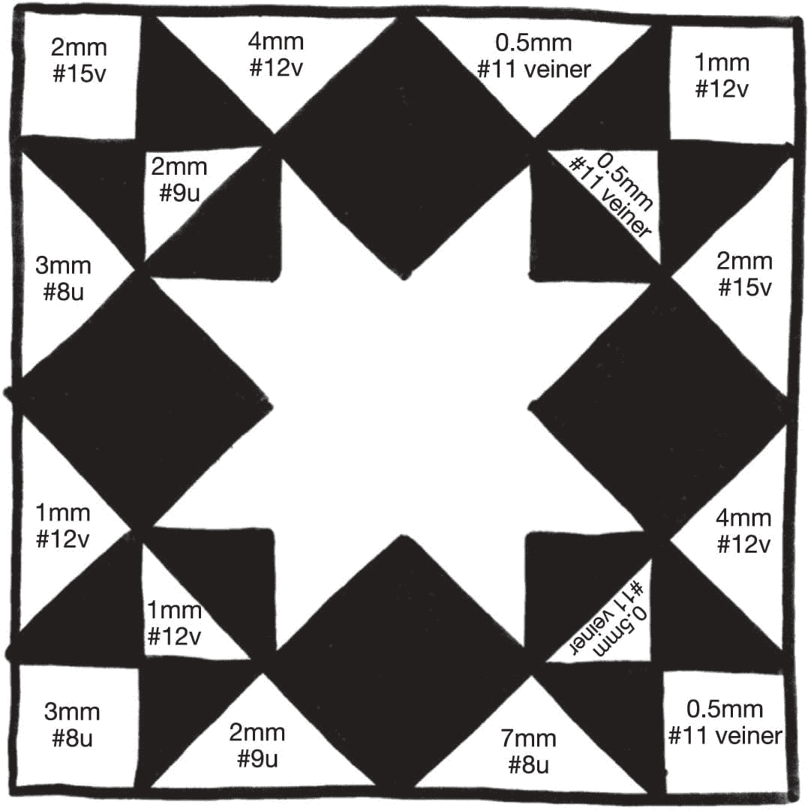

## 项目：多版块六角星

六角星——也称谷仓星，但不要与谷仓拼布混淆——是宾夕法尼亚州乡村景观中随处可见的一部分，装饰在谷仓的立面和山墙上。这些引人注目的、完美平衡的圆形设计是宾夕法尼亚荷兰人，即 1700 年代初移民到美国的德国移民带来的民间艺术传统的一部分。采用旋转对称或平行反射对称，当代六角星常融入象征性母题：星星和蔷薇代表好运，郁金香代表信仰，小麦束和雨滴代表丰收，橡叶代表品格力量等。

## 工具与材料

三块 6" x 6" 15 x 15 cm 未装裱的软木
三块 7 1/2" x 9 1/2" 19 x 24 cm 坚硬的夹板或裱板
木胶
铰链式定位装置
铅笔
尺子
多种颜色的永久性记号笔
至少两张描图纸
绘图纸
圆规
雕刻工具
三种颜色油墨
调墨板
调色刀
滚筒
9" x 12" 23 x 30.5 cm 印刷纸
巴伦
遮蔽/和纸胶带

我的六角星以八角蔷薇为主元素，加入雨滴、波浪边框和注视的眼睛。你可以用对你有意义或 pleasing 的符号和颜色设计自己的图案。

本项目将使用 **多版块技术**，三个不同颜色上墨的独立版块的印痕将形成三色印刷。记住你可以用自己选择的颜色随意实验。多版块印刷如果第一次做会有一点棘手，但请耐心对待自己，仔细测量，我们就能做出干净的作品！多版块印刷的关键是规划，从设计开始。

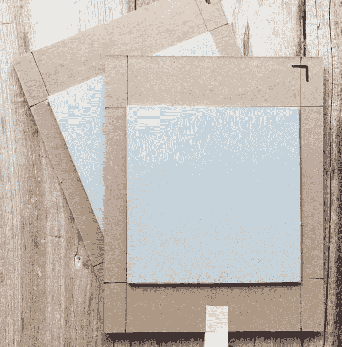

1 首先处理一些准备工作：每块未装裱的软木必须粘在一块 7 1/2" x 9 1/2" 19 x 24 cm 的板上，才能在铰链式定位装置中正常工作。我用的是夹板，你也可以用裱板或致密硬纸板。用尺子将版块居中放在夹板上，测量越精确越好，用木胶粘牢。放在重书堆下确保完全粘合。对其余两块重复。 在每块板的底部用遮蔽胶带加一个标签，便于从装置中取出。

2 等待版块粘合时，规划设计。我通常先做简单的线稿，然后做全彩草图。然后我将颜色视觉分离，以便看到版块应有的样子。

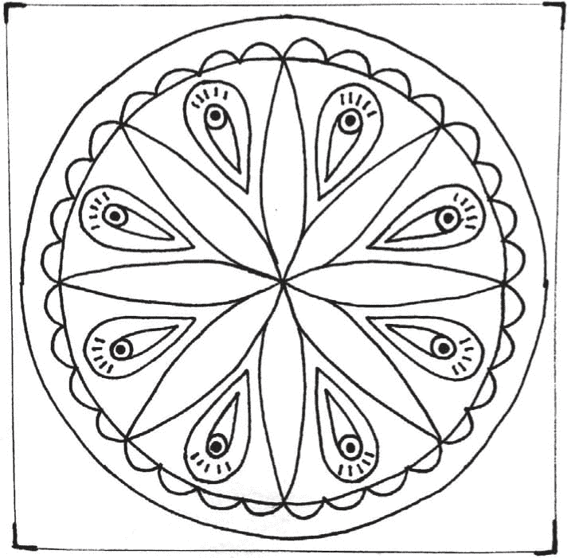

3 有了计划后，在绘图纸上制作设计的干净全尺寸线稿，我们称之为主稿。建议使用尺子和圆规使绘制完美圆形更容易。确保设计能放入 6" x 6" 15 x 15 cm 的版块。

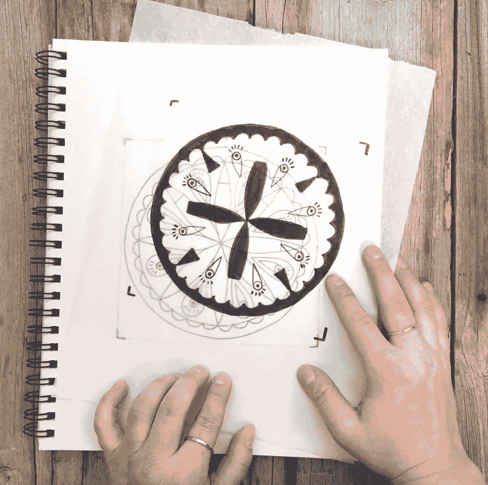

4 根据计划，蓝色版块信息最多，因此该版块为关键版块，将作为其他颜色的[content]

## 月光星图案

4 按顺序图在网格上完成月光星图案，用永久记号笔涂黑指定区，便于记住雕刻位置。

5 为视觉锚定，涂黑区不雕刻。目标是用尽可能多工具在空白区填入多种标记、线条和纹理。思考工具的不同用法。

6 用窄 V 工具沿空白形状内缘雕刻，保持标记位置。然后用永久记号笔填满该形状，便于雕刻时看清。

7 继续雕刻直至空白区全填纹理。中央星星为自由空间，可任意创作使印花独一无二。也可装饰黑色区。

8 用绘图员除尘刷清理切屑，彻底清洁可得更干净印花。

9 从锡罐取约四分之一油墨，用调色刀在调墨板上展开加热。

10 用最大滚筒在调墨板上滚动油墨，直至滚筒上墨均匀。

11 用滚筒多次在版块上涂墨，必要时回墨池。勿上墨过量填满细纹，注意边缘易遗漏。

12 将纸如 Blick Masterprinter 纸置于版块上轻压固定。紧握巴伦手柄摩擦纸背，均匀施压。可再用木勺打磨纸背，使未雕刻区黑色更一致。

13 小心揭开纸张，置于安全处晾干。

## 需考虑的线条类型

直线
曲线
漩涡线
方向线
长线
短线
点
刮痕
毛发线
重叠线
表现线
抒情线
平行线
羽毛线
锯齿线
断线
连续线
编织线
间距大的标记
间距近的标记
有组织的线
随机线
宽线
细线
非有意线

## 标记图

标记图：要重现上面完成示例中的标记，请参考下方地图，了解哪些工具制作了哪些标记。

## 项目：多版块六角星

六角星也称谷仓星，但不要与谷仓拼布混淆，是宾夕法尼亚乡村常见景观，装饰谷仓立面和山墙。这些引人注目、平衡的圆形设计是宾夕法尼亚荷兰人，即 1700 年代初移民美国的德国人带来的民间艺术传统。采用旋转对称或平行反射对称，当代六角星常融入象征母题：星星和蔷薇代表好运，郁金香代表信仰，小麦束和雨滴代表丰收，橡叶代表品格力量等。

## 工具与材料

三块 6" x 6" 15 x 15 cm 未装裱软木
三块 7 1/2" x 9 1/2" 19 x 24 cm 坚硬夹板或裱板
木胶
铰链式定位装置
铅笔
尺子
多种颜色永久记号笔
至少两张描图纸
绘图纸
圆规
雕刻工具
三种颜色油墨
调墨板
调色刀
滚筒
9" x 12" 23 x 30.5 cm 印刷纸
巴伦
遮蔽/和纸胶带

我的六角星以八角蔷薇为主，加入雨滴、波浪边框和注视眼睛。你可用有意义或 pleasing 的符号和颜色设计自己的图案。

本项目使用 **多版块技术**，三个不同颜色上墨的独立版块印痕形成三色印刷。可随意实验自选颜色。多版块印刷初次操作较棘手，但耐心并仔细测量即可做出干净作品。多版块印刷关键是规划，从设计开始。

1 先做准备：每块未装裱软木须粘在 7 1/2" x 9 1/2" 19 x 24 cm 板上才能在铰链定位装置中工作。我用夹板，也可用裱板或致密硬纸板。用尺子将版块居中粘牢，测量越准越好，用木胶粘合后压重书确保粘合。重复其余两块。在每块板底部用遮蔽胶带加标签便于取出。

2 等待粘合时规划设计。我通常先画简单线稿，再画全彩草图，然后视觉分离颜色以便看清版块效果。

3 有计划后在绘图纸上制作干净全尺寸线稿，即主稿。建议用尺和圆规便于画完美圆形。确保设计能放入 6" x 6" 15 x 15 cm 版块。

4 按计划蓝色版块信息最多，为关键版块，作为其他颜色[content]

## 月光星图案

4 按图在网格上完成月光星图案，用永久记号笔涂黑指定区，便于记住雕刻位。

5 为视觉锚定，涂黑区不雕刻。目标是用多工具在空白区填多种标记、线条、纹理。思考工具不同用法。

6 用窄 V 工具沿空白形状内缘雕刻，保持标记位。然后用永久记号笔填满该形状，便于雕刻时看清。

7 继续雕刻至空白区全填纹理。中央星为自由空间，可任意创作使印花独一无二。也可装饰黑色区。

8 用绘图员除尘刷清理切屑，彻底清洁得更干净印花。

9 从锡罐取约四分之一油墨，用调色刀在调墨板上展开加热。

10 用最大滚筒在调墨板上滚动油墨，至滚筒上墨均匀。

11 用滚筒多次在版块上涂墨，必要时回墨池。勿上墨过量填细纹，注意边缘易遗漏。

12 将纸如 Blick Masterprinter 纸置于版块上轻压固定。紧握巴伦手柄摩擦纸背，均匀施压。可再用木勺打磨纸背，使未雕刻区黑色更一致。

13 小心揭开纸张，置安全处晾干。

## 需考虑的线条类型

直线
曲线
漩涡线
方向线
长线
短线
点
刮痕
毛发线
重叠线
表现线
抒情线
平行线
羽毛线
锯齿线
断线
连续线
编织线
间距大标记
间距近标记
有组织线
随机线
宽线
细线
非有意线

## 标记图

标记图：要重现上面完成示例的标记，请参考下方地图，了解工具与标记对应。

## 项目：多版块六角星

六角星也称谷仓星，但非谷仓拼布，是宾夕法尼亚乡村常见景观，装饰谷仓立面和山墙。这些引人注目平衡的圆形设计是宾夕法尼亚荷兰人，即 1700 年代初移民美国的德国人带来的民间艺术传统。采用旋转对称或平行反射对称，当代六角星常融入象征母题：星星和蔷薇代表好运，郁金香代表信仰，小麦束和雨滴代表丰收，橡叶代表品格力量等。

## 工具与材料

三块 6"x6"15x15cm 未装裱软木
三块 7 1/2"x9 1/2"19x24cm 坚硬夹板或裱板
木胶
铰链式定位装置
铅笔
尺子
多种颜色永久记号笔
至少两张描图纸
绘图纸
圆规
雕刻工具
三种颜色油墨
调墨板
调色刀
滚筒
9"x12"23x30.5cm 印刷纸
巴伦
遮蔽/和纸胶带

我的六角星以八角蔷薇为主，加入雨滴、波浪边框和注视眼睛。可自选有意义或 pleasing 符号颜色设计。

本项目使用**多版块技术**，三个不同颜色上墨的独立版块印痕形成三色印刷。可随意实验自选颜色。多版块印刷初次较棘手，但耐心并仔细测量即可做出干净作品。多版块印刷关键是规划，从设计开始。

1 先做准备：每块未装裱软木须粘在 7 1/2"x9 1/2"19x24cm 板上才能在铰链定位装置中工作。我用夹板，也可用裱板或致密硬纸板。用尺子将版块居中粘牢，测量越准越好，用木胶粘合后压重书确保粘合。重复其余两块。在每块板底部用遮蔽胶带加标签便于取出。

2 等待粘合时规划设计。我通常先画简单线稿，再画全彩草图，然后视觉分离颜色以便看清版块效果。

3 有计划后在绘图纸上制作干净全尺寸线稿，即主稿。建议用尺和圆规便于画完美圆形。确保设计能放入 6"x6"15x15cm 版块。

4 按计划蓝色版块信息最多，为关键版块，作为其他颜色的[content]

## 月光星图案

4 按图在网格完成月光星图案，用永久记号笔涂黑指定区，便于记雕刻位。

5 为视觉锚定，涂黑区不雕刻。目标用多工具在空白区填多种标记线条纹理。思考工具不同用法。

6 用窄 V 工具沿空白形状内缘雕刻，保持标记位。然后用永久记号笔填满该形状，便于看清。

7 继续雕刻至空白区全填纹理。中央星为自由空间，可任意创作。也可装饰黑色区。

8 用绘图员除尘刷清理切屑，彻底清洁得更干净印花。

9 从锡罐取约四分之一油墨，用调色刀在调墨板展开加热。

10 用最大滚筒在调墨板滚动油墨，至滚筒上墨均匀。

11 用滚筒多次在版块涂墨，必要时回墨池。勿上墨过量填细纹，注意边缘。

12 将纸如 Blick Masterprinter 纸置于版块轻压固定。紧握巴伦手柄摩擦纸背，均匀施压。可再用木勺打磨纸背，使未雕刻区黑色一致。

13 小心揭开纸张，置安全处晾干。

## 需考虑的线条类型

直线
曲线
漩涡线
方向线
长线
短线
点
刮痕
毛发线
重叠线
表现线
抒情线
平行线
羽毛线
锯齿线
断线
连续线
编织线
间距大标记
间距近标记
有组织线
随机线
宽线
细线
非有意线

## 标记图

标记图：要重现上面示例的标记，请参考下方地图，了解工具与标记对应。

## 项目：多版块六角星

六角星也称谷仓星，非谷仓拼布，是宾夕法尼亚乡村常见景观，装饰谷仓立面山墙。这些圆形设计是宾夕法尼亚荷兰人即 1700 年代初移民美国的德国人带来的民间艺术传统。采用旋转对称或平行反射对称，当代六角星常融入象征母题：星星蔷薇代表好运，郁金香代表信仰，小麦束雨滴代表丰收，橡叶代表品格力量等。

## 工具与材料

三块 6"x6"15x15cm 未装裱软木
三块 7 1/2"x9 1/2"19x24cm 坚硬夹板或裱板
木胶
铰链式定位装置
铅笔
尺子
多种颜色永久记号笔
至少两张描图纸
绘图纸
圆规
雕刻工具
三种颜色油墨
调墨板
调色刀
滚筒
9"x12"23x30.5cm 印刷纸
巴伦
遮蔽/和纸胶带

我的六角星以八角蔷薇为主，加入雨滴、波浪边框和注视眼睛。可自选有意义符号颜色设计。

本项目使用**多版块技术**，三个不同颜色上墨的独立版块印痕形成三色印刷。可随意实验自选颜色。多版块印刷初次较棘手，但耐心并仔细测量即可做出干净作品。关键是规划，从设计开始。

1 先做准备：每块未装裱软木须粘在 7 1/2"x9 1/2"19x24cm 板上才能在铰链定位装置工作。我用夹板，也可用裱板或致密硬纸板。用尺子将版块居中粘牢，测量越准越好，用木胶粘合后压重书确保粘合。重复其余两块。在每块板底部用遮蔽胶带加标签便于取出。

2 等待粘合时规划设计。我通常先画简单线稿，再画全彩草图，然后视觉分离颜色以便看清版块效果。

3 有计划后在绘图纸上制作干净全尺寸线稿，即主稿。建议用尺和圆规便于画完美圆形。确保设计能放入 6"x6"15x15cm 版块。

4 按计划蓝色版块信息最多，为关键版块，作为其他颜色[content]
作为其他颜色的指导。铺一张描图纸在稿上，必要时固定。仔细描出设计中仅蓝色的部分。标记设计顶部以便知道方向，旋转设计转移时易混淆。

5 取一块已装裱版块。在板上做标记表示顶部。将描出的图像转移到版块上，见转移方法示于此处。用永久记号笔固定图纸，不必上色，只需描线即可。

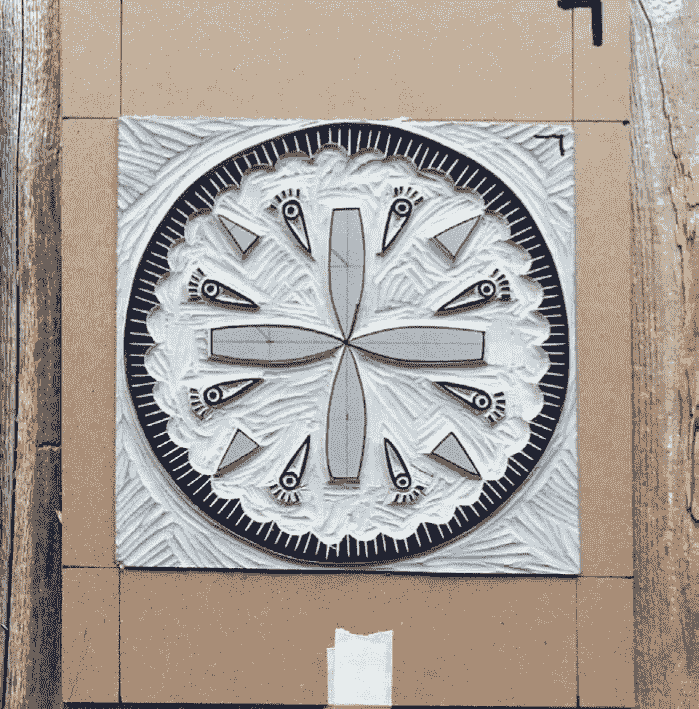

6 雕刻负空间。

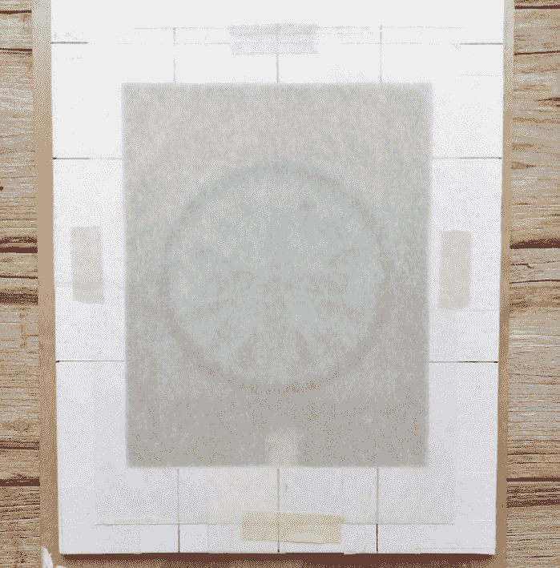

7 现在用已雕刻的关键版块将设计转移到其余版块。取铰链式定位装置。用永久胶带将干净描图纸牢牢贴在窗口上。

8 打开定位装置窗口，将关键版块放入夹具，确保紧密贴合且不移动。

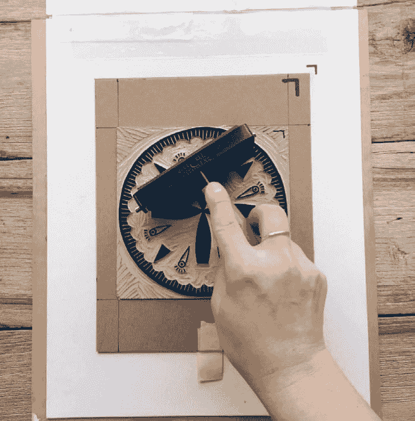

9 挤出一点浅色墨水并给主版上墨。（我使用的是深蓝色墨水，会弄脏版块；浅色墨水更容易清除。）

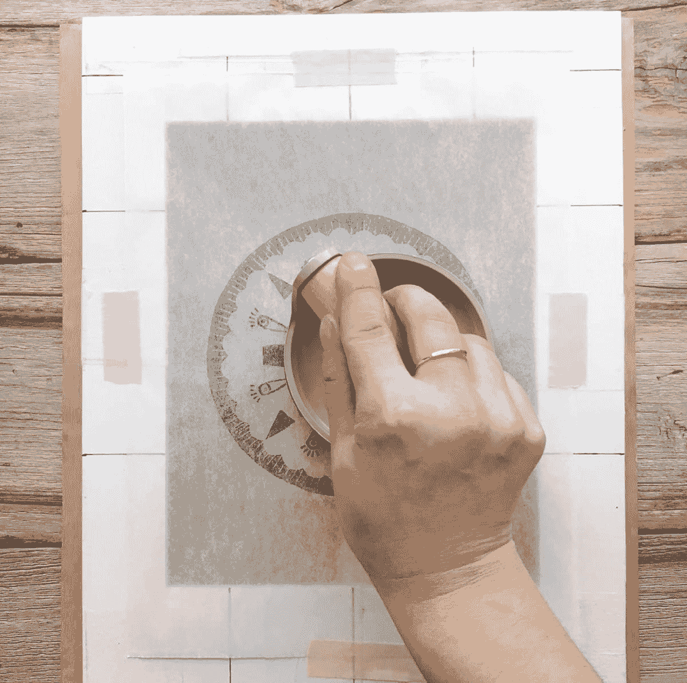

10 关闭窗口。用擦印棒轻轻按压并摩擦描图纸的背面，直到看到墨水转移。你可能会发现需要用勺子来提取细微细节。

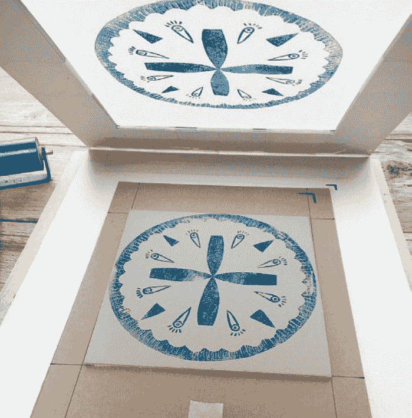

11 现在你将把设计从第一个版块转移到第二个版块。打开窗口并取下主版。用第二个装好的版块替换它，并标记顶部。

12 关闭窗口并再次摩擦描图纸的背面，将设计再次转移到版块上。

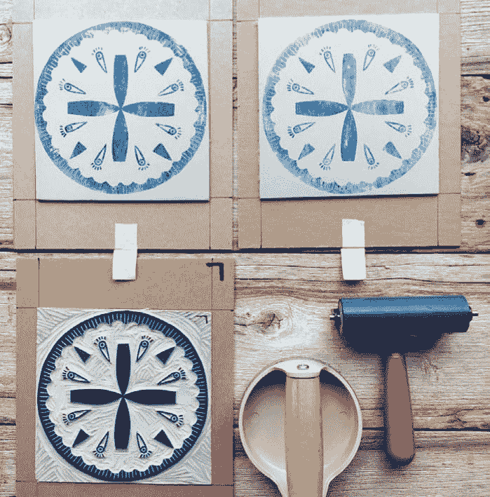

13 打开窗口，取下第二个版块，放在一旁晾干。用最终版块重复步骤 12，并标记顶部。放在一旁晾干。（我让它们过夜晾干。）

14 清除主版上的多余墨水并放在一旁晾干。取下窗口上的已印刷描图纸并丢弃。

15 取出现在已干的第二个版块。这将是黄色版块。以版块上转移的图像为[content]
9 挤出一点浅色墨水并给主版上墨。（我使用的是深蓝色墨水，会弄脏版块；浅色墨水更容易清除。）

10 关闭窗口。用擦印棒轻轻按压并摩擦描图纸的背面，直到看到墨水转移。你可能会发现需要用勺子来提取细微细节。

11 现在你将把设计从第一个版块转移到第二个版块。打开窗口并取下主版。用第二个装好的版块替换它，并标记顶部。

12 关闭窗口并再次摩擦描图纸的背面，将设计再次转移到版块上。

13 打开窗口，取下第二个版块，放在一旁晾干。用最终版块重复步骤 12，并标记顶部。放在一旁晾干。（我让它们过夜晾干。）

14 清除主版上的多余墨水并放在一旁晾干。取下窗口上的已印刷描图纸并丢弃。

15 取出现在已干的第二个版块。这将是黄色版块。以版块上转移的图像为指导，徒手描绘黄色元素。或者，你可以回到你的主稿，描出黄色元素，然后以这种方式转移。你不必担心清洗这个版块上的墨水，因为你会把大部分已上墨的部分都刻掉。

16 刻掉所有负空间——除了你想要印成黄色的部分之外的一切。标记后将雕刻好的版块放在一旁。

17 取出最终版块并描绘所有粉色元素。

18 刻掉所有负空间——除了你想要印成粉色的部分之外的一切。标记版块。

19 取一张干净的印刷纸，并使用注册装置闭合窗口顶部处的导线将其对齐。将其固定在原位。

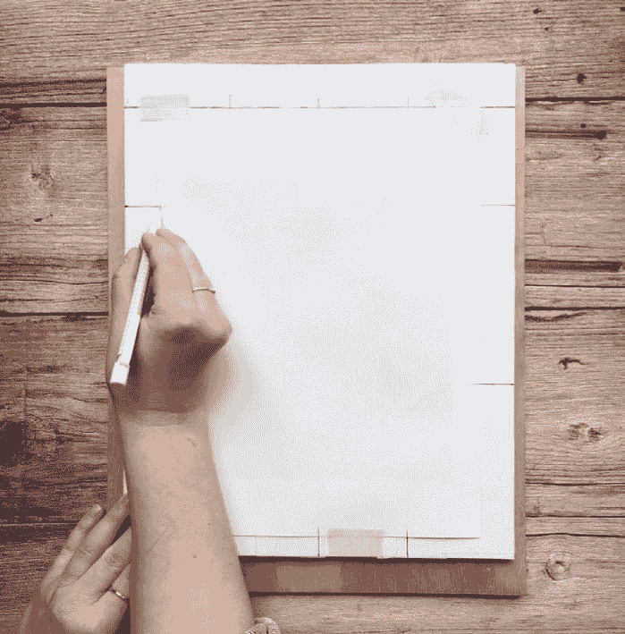

20 使用尖锐的铅笔标记纸张顶部，然后使用窗口上的导线在周边做出注册标记。这些线条将帮助你每次都把纸张放在完全相同的位置。

21 多色印刷时，最佳做法是始终先从最浅的颜色开始，然后再逐步过渡到最后的深色。首先使用粉色版块。打开注册装置上的窗口并将其牢固地放置在夹具内。

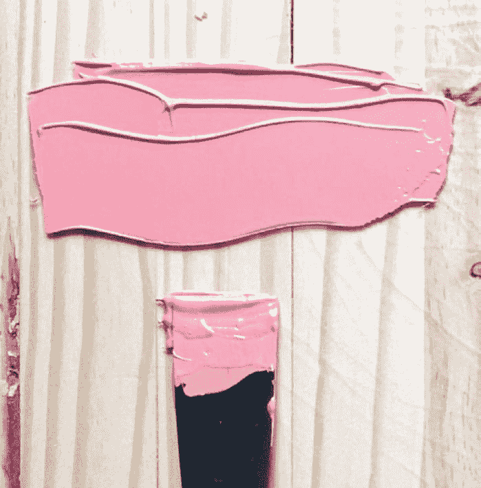

22 在上墨板上用调色刀混合墨水以获得想要的颜色。要实现这里所示的桃粉色，我混合了 Caligo Safe Wash Relief Inks 中的浅橙色、宝石红和不透明白色。

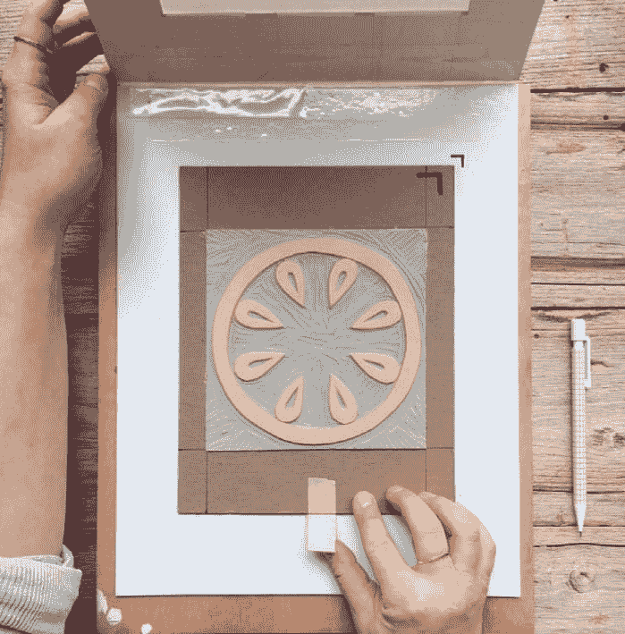

23 滚出少量粉色墨水并用压墨辊将其涂到版块上。用棉签或抹布清理任何飞溅的墨水。

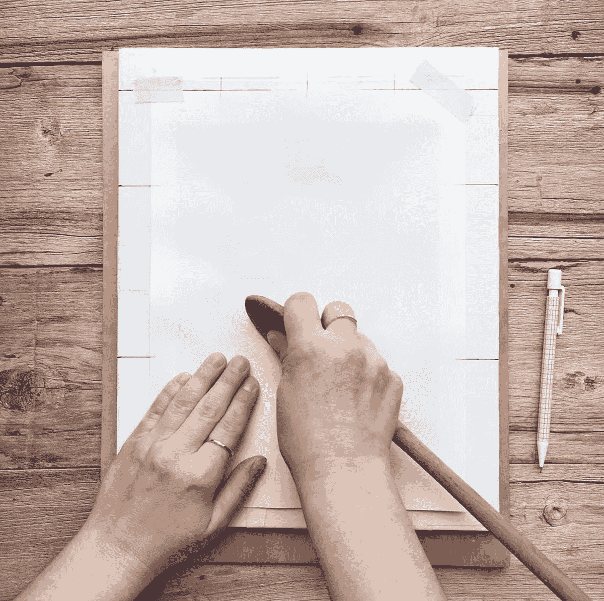

24 关闭窗口。小心地用擦印棒按压纸张背面，注意不要用力过猛，以免在锋利的雕刻边缘撕破纸张。

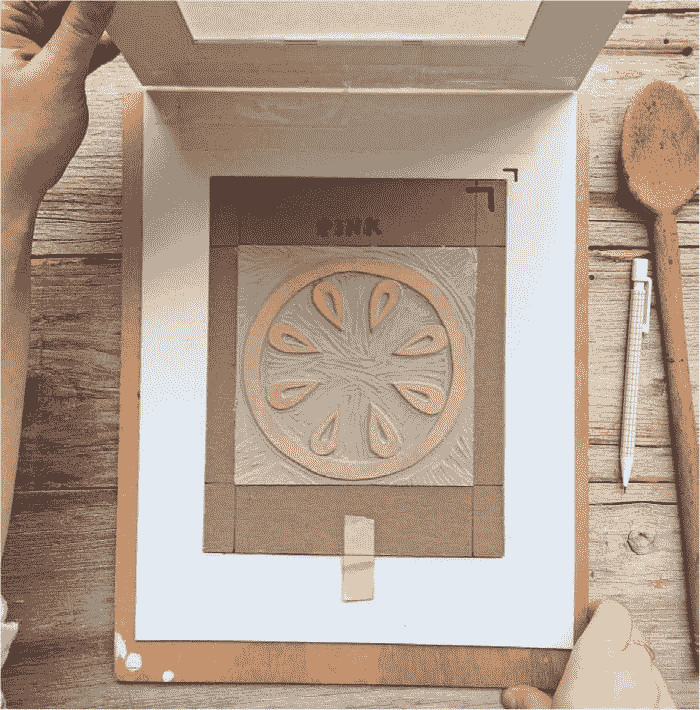

25 你可以抬起窗口查看墨水是否均匀转移到纸上。如果没有， simply 关闭窗口并再次按压，用擦印棒增加压力或用勺子进行擦拭。成功印刷粉色版块后，打开窗口并将其从夹具中取出。

26 通常我在印刷不同颜色的层次之间等待 2 到 3 天以让墨水干燥，但由于这种设计中粉色和黄色元素不相交，我可以在同一会话中同时印刷它们。这意味着我们可以让纸张留在窗口中。把黄色版块放入夹具。

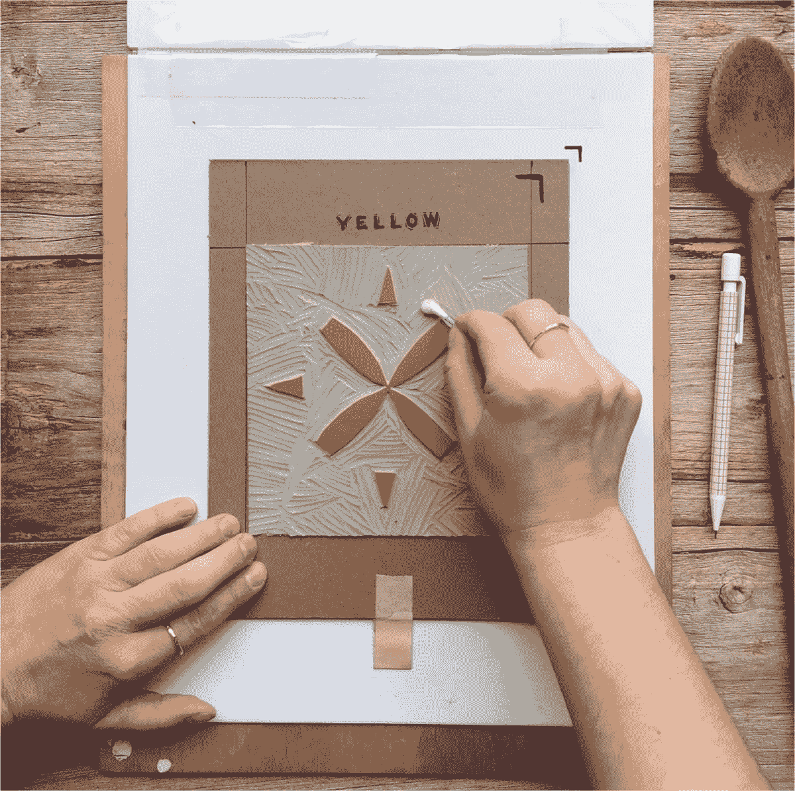

27 滚出墨水并用干净的压墨辊将其涂到黄色版块上。

28 关闭窗口并用擦印棒按压，印刷黄色版块。现在你已经在同一张纸上印上了粉色和黄色版块。

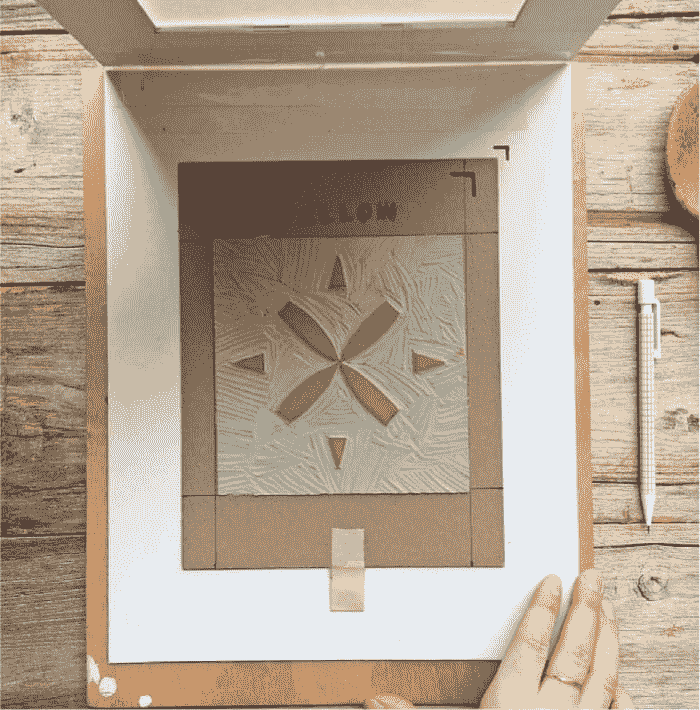

29 如果你要印刷自己原创设计的成套作品，你可以为想要的每张印刷品重复步骤 19 到 28。如果只印一张，可以让纸张留在注册装置中过夜晾干。清理工作台和工具，并将任何多余的墨水保存在小而密封的容器中。

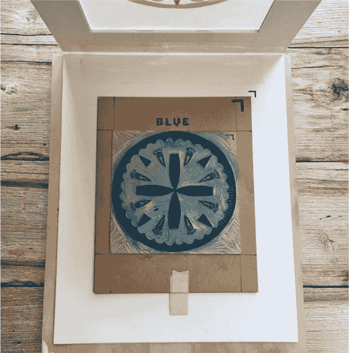

30 当印刷品充分干燥后（不再有粘性，手指触摸后干净）就可以印刷最后一层——主版了！在上墨板上用调色刀混合你想要使用的颜色。我使用了酞青蓝、黑色和不透明白色来获得这里所示的烟熏海军蓝。用压墨辊滚出墨水并涂到版块上，清理任何飞溅的墨水。

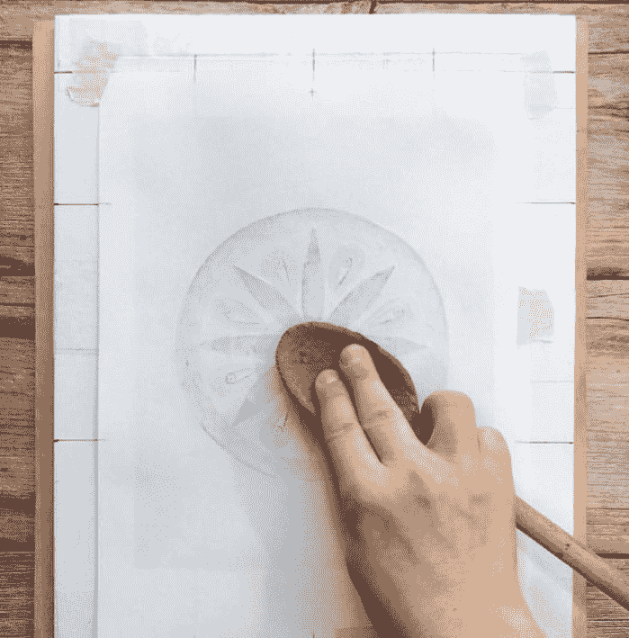

31 确保纸张仍与注册标记对齐。将版块放入夹具并关闭窗口。

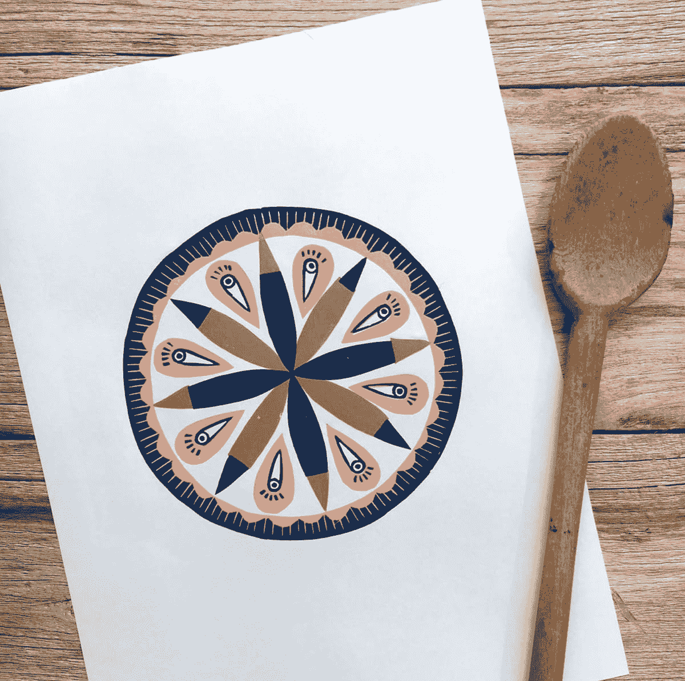

32 使用擦印棒按压纸张背面并印刷主版，打开检查是否覆盖了设计的全部区域。

33 恭喜！现在你拥有一张紧密套准的三色多版六角形标志印刷品！

### PROJECT: REDUCTION CUT SUNFLOWERS

在这个项目中，我们探索减版雕刻——一种色彩印刷方法，你反复使用同一块版，每增加一层颜色就雕刻掉更多部分。花朵一直是艺术家的永恒题材，它们的丰富色彩和形状使其成为研究减版雕刻的绝佳对象。

#### Tools and Materials
4" x 8" (10 x 20 cm) 未装裱的软木版
铅笔
彩色铅笔
尺子
永久性记号笔
描图纸
雕刻工具
针孔定位注册装置（见这里）
定位片
和纸/遮蔽胶带
上墨板
三种颜色的墨水
调色刀
压墨辊
9" x 12" (23 x 30.5 cm) 印刷纸
擦印棒

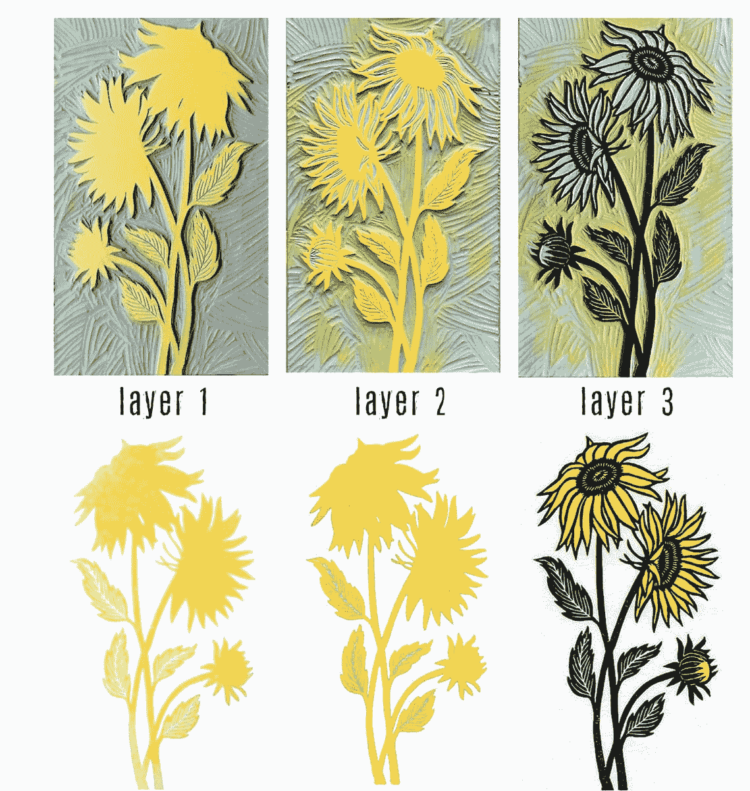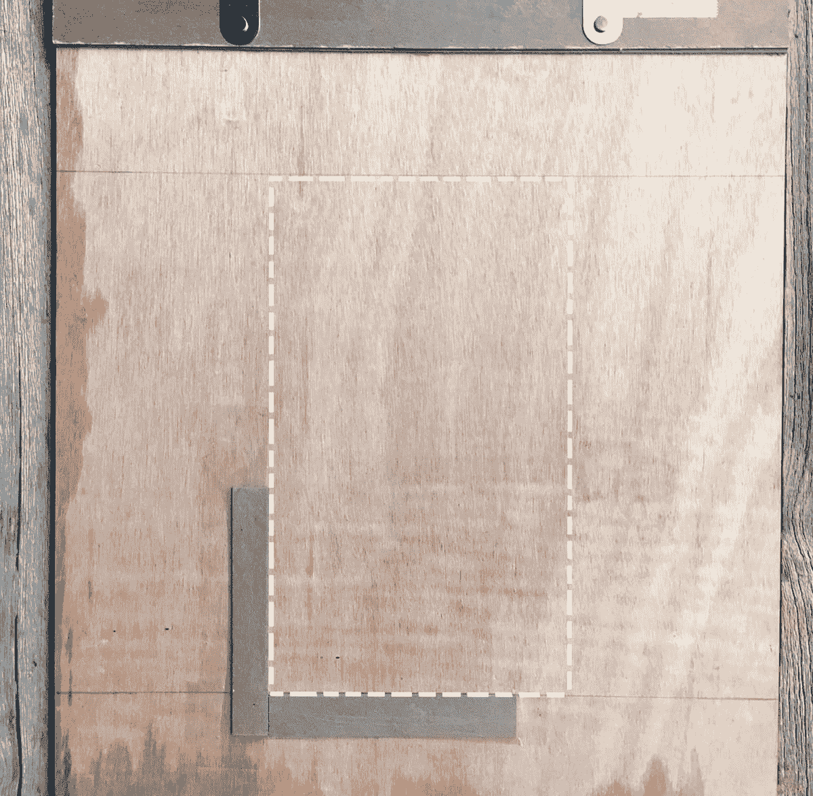

1 在开始起稿版块之前，让我们先准备印刷材料。首先，我们需要在针孔定位注册装置上添加一个定制夹具（见这里）。我希望版块在印刷纸上相对居中，所以用铅笔在注册装置上画了两条垂直居中的导线。然后凭目测使版块落在销钉之间，从而水平居中。

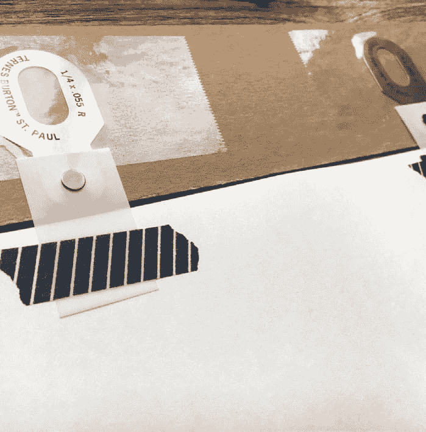

2 在版块上放一个重物（我用了一块石头）以防止其移位。取两条裱板、夹板或纸板条，使其相互垂直形成 90 度角。在版块左下角牢固地用胶带将这些条带固定在原位。

3 夹具准备好后，纸张必须进行准备。将纸裁剪或撕成 9" x 12" (23 x 30.5 cm)。取一张纸放在注册装置上。将纸张顶部边缘与凸起的条带（即定位片粘贴的板片）齐平对齐。纸张对齐后，将两个定位片连接到销钉上，它们会覆盖纸张顶部边缘。将定位片用胶带固定在原位。对其余纸张重复此过程（正如始终一样，印数由你决定）。这些定位片将一直附着在你的纸张上，直到你印刷第三种也是最后一种颜色。

#### AN IMPORTANT NOTE ON TAPES

测试胶带以及它们与纸张的粘合效果，然后再实际粘贴标签。照片中使用的和纸胶带可以干净地从 Blick 版画纸上取下，但却撕破了纤维更粗的楮纸。一些版画家更喜欢美纹纸胶带，但我发现有时它的粘性会太快消失。你可能需要在事先做一点试错。意外在取下标签时撕破纸张而毁掉一张完美的印刷品会非常遗憾！（不过如果真的发生了，你可以在第 5 章中的一个项目中使用该印刷品：物尽其用。）

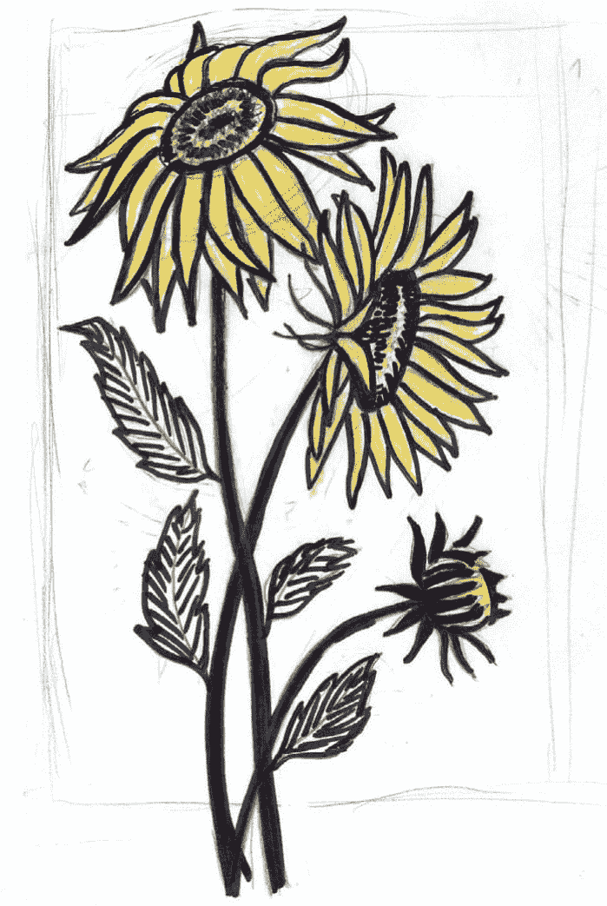

## 制作步骤

### 4 绘制你的设计草图，然后完成最终的线稿。使用彩色铅笔规划你想要的颜色位置。
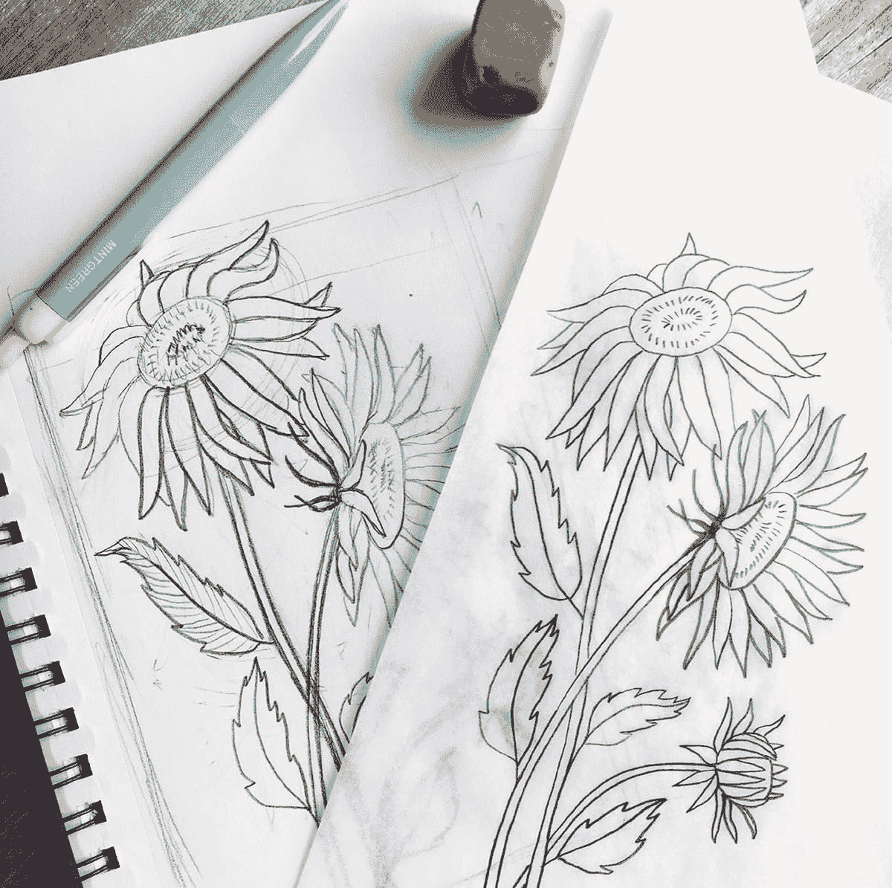

### 5 在你的画稿上贴上一层描图纸，小心地用锋利、柔软的石墨铅笔描摹设计。
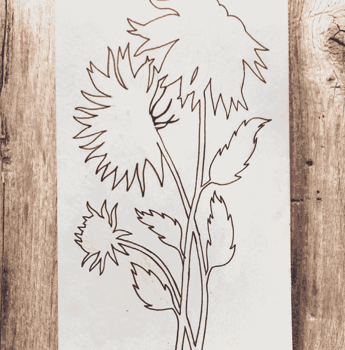

### 6 将描图纸翻转到版块上并贴牢。只描摹设计的轮廓。用细头永久性记号笔将画稿固定到位。

### 7 雕刻出负空间。这将为你的图像提供干净、空白的背景。
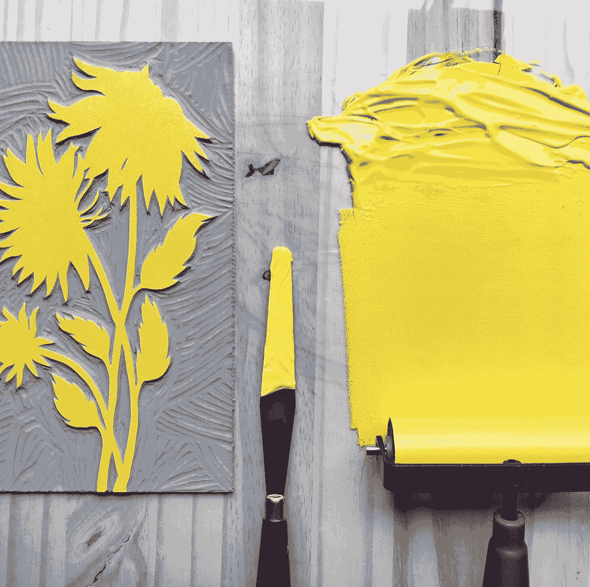

### 8 如同往常一样，我们先印刷最浅的颜色，这里是黄色。（为了制作出明亮、阳光般的黄色，我将 Caligo SafeWash Relief 油墨中的二芳基黄和不透明白混合。）用调色刀在上墨板上混合并涂抹油墨。
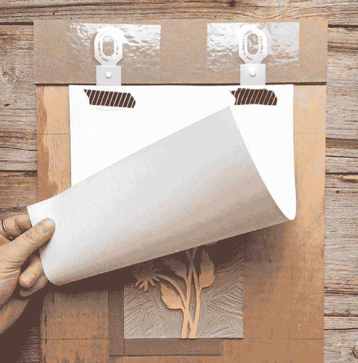

### 9 滚开油墨并将其涂到版块上。注意擦拭掉任何多余的油墨。
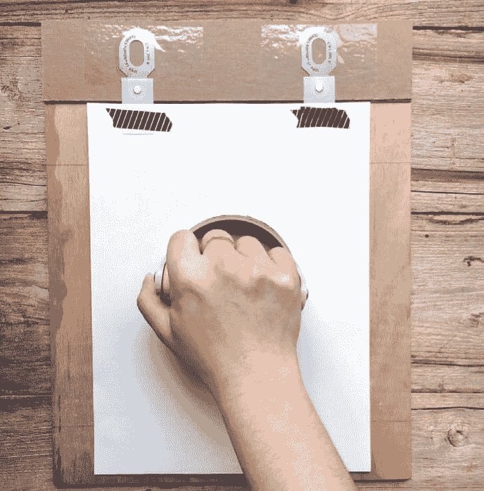

### 10 将版块放入针孔和标签套准装置中，确保它牢固地塞入夹具的角落。

### 11 将带标签的印刷纸装入销钉中，小心地铺好纸。用团印工具用力按压纸张背面，注意覆盖版块的每个区域。
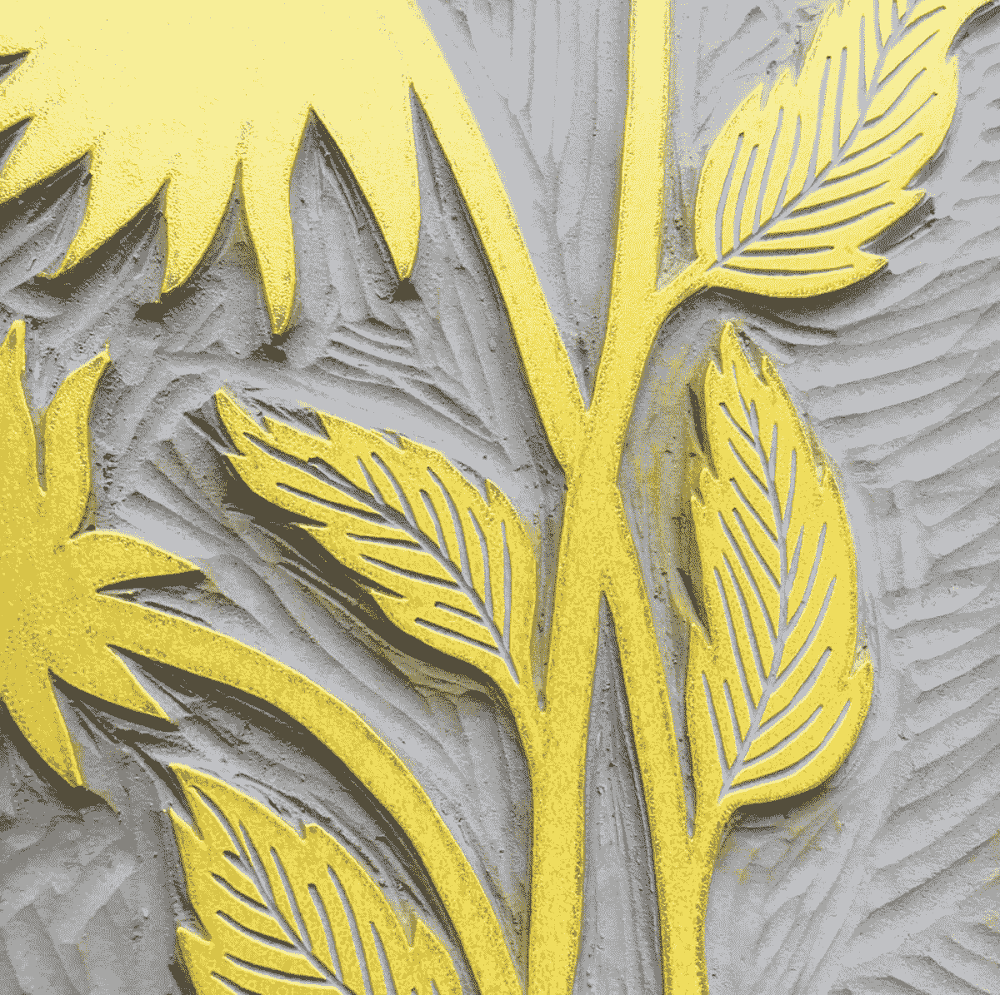

### 12 揭开纸张检查版块各区域是否均匀转印。使用更坚实的团印工具，如勺子，来处理顽固的细节。这也是重新检查设计的好时机。（此时，我意识到我希望叶脉呈现为白色线条，于是我回去雕刻了它们。）
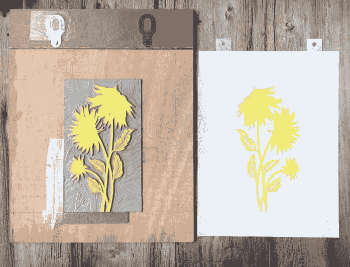

### 13 将印刷品放在一旁晾干，并根据版数重复步骤 9–12。即使加入钴干剂来加快干燥时间，我仍然喜欢在各层之间间隔三天，以确保油墨完全干燥。将湿油墨印在湿油墨上会导致细节丢失以及颜色不一致、斑驳。

### 14 先用废纸吸去版块上的多余油墨，然后擦拭干净。高度着色的油墨经常会污染版块，但只要彻底清洁，这些污渍就不会转印。

### 15 使用步骤 5 中的描摹图像，将图像与雕刻好的版块对齐并转移细节。你现在雕刻掉的部分在印刷品上会保留黄色。雕刻掉你希望保留黄色的所有部分。对于此设计，你主要会雕刻掉花朵的花瓣。

### 16 第二遍雕刻完成后，是时候印刷橙色了（我使用浅橙色、二芳基黄和不透明白来达到这种颜色）。滚开油墨，涂到版块上，并将版块放入夹具。

### 17 你将直接在之前已干的黄色层上印刷。印刷橙色版块并根据版数重复。把印刷品放在一旁晾干。

### 18 先用废纸吸去版块上的多余油墨，然后擦拭干净。

### 19 是时候进行第三次也是最后一次雕刻了。切除你希望保留橙色的版块部分。之后留在版块上的所有部分都会印成黑色。所以对于此设计，雕刻掉除轮廓外的所有部分。

### 20 最后一次雕刻完成后，滚开黑色油墨并涂到版块上。你将直接在之前已干的黄色和橙色层上印刷。印刷黑色版块并根据版数重复。放在一旁晾干。

你也可以尝试在彩色纸上印刷！

### 21 清洁你的版块、工作台和工具。

### 22 当最后一层完全干燥后，小心地将胶带和标签从印刷品上撕下。

## 关于减法雕刻版画的重要说明

减法版画你只能制作一次、限量的版次。因为你为每个版块使用同一块基材，你本质上是在制作第二个版块时摧毁第一个版块——然后为了制作第三个而摧毁第二个，以此类推。

## 艺术家聚焦：德里克·赖利

我的人生在肯塔基大学大四时永远改变了，当时我上了我的第一堂版画课，初级木刻，由德里克·赖利教授。拥有 MFA 学位并是著名 Outlaw Printmakers 肯塔基分部的成员，赖利自 2005 年起经营自己的印刷机，制作出史诗般规模的叙事版画，庆祝肯塔基最奇异的民间传说、放荡的机器人和奇异的生物混搭。他以大胆的图形风格和对形态的精细描绘而闻名。

独眼巨人猩猩

### EH：你是如何第一次对版画产生兴趣的？
DR：我本科主修绘画，版画课程是学位要求的一部分。在课程期间，2000 年大学博物馆举办了 Joel Feldman 的回顾展。展览中有这些巨大的横幅风格黑白木刻《伊索寓言》，令人惊叹。在那之前我从未意识到版画可以如此巨大。之后我就上瘾了。

### EH：是什么吸引你特别钟爱凸版？
DR：起初有几件事吸引我进入凸版印刷。首先，一整天玩刀子挺棒的。而且我对有限调色板——以及黑白鲜明对比的视觉力量——比全色调板更强大感到着迷。我也恰好手劲很大，而木块或油画胶板提供的阻力正好控制住我过重的力道。

### EH：你如何描述你的作品和创作过程？
DR：我从用铅笔绘制图像开始，每块版都先用铅笔再用 Sharpie 描一遍。我一丝不苟地绘制每个细节，直到它完全是我想要的最终印刷品的样子。我把版块染成红色，这样我就能看到雕刻过和未雕刻的地方——然后开始雕刻。我的作品非常精细且繁琐。连续工作一块版长达 6 个月的情况并不少见。

### EH：你如何在日常保持创造力？
DR：我给自己设定严格的目标和截止日期，并坚持执行。很多时候我会告诉朋友我不能做某事，因为我必须完成一块版。当他们问那块版是做什么用的时，我无法回答他们，没有截止日期，也不是专门为某事制作的，但我仍然能感受到完成它的需要和动力。

### EH：描述你创作艺术的空间。

DR：我家地下室有一个惊人的工作室，我非常为它自豪。它配备齐全，拥有制作木刻、胶版画和丝网印刷所需的一切。我有一台电动蚀刻压机，以及一台用于印刷凸版画的平版打样压机，还有全尺寸晾干架、一台可一次裁切 200 多张纸的吉洛丁式裁纸机、真空台、丝网曝光机和用于丝网印刷的 T 恤压机。我完全不需要离开家就能创作我的艺术。

### EH：说一件你讨厌印刷术的事和一件你喜欢的事。

DR：制作凸版画有五个情感阶段。
1\. 开始雕刻新版块的兴奋
2\. 雕刻版块几乎完成却又遥不可及的痛苦
3\. 揭开第一张印品的期待
4\. 第一次看到一切倒置的沮丧
5\. 接受并继续前进

### EH：你在创作过程中有没有学到什么有用的技巧或窍门''？

DR：很容易过度雕刻凸版画。经常休息很重要，不仅出于健康原因，也是为了视觉重置。完全规划好你的版块，不要留下任何“以后再想”的部分。仓促进入雕刻是最快导致出错的途径。
即使在制作黑白凸版画时，也可以通过雕刻图案、平行线和交叉线来呈现许多灰色。这些平行线和交叉线会赋予印品深度。重要的是给印品足够的对比度，使灰色突出。我发现一幅平衡的印品至少要有 20%的纯黑、20%的纯白，以及多达 60%的灰色。如果纯黑和纯白不足，灰色就会被冲淡而变得平淡。

Tunacorn

### EH：你做过的最喜欢的作品是什么？

DR：我花了三年时间制作了一系列关于肯塔基州怪物、神话和传说的木刻。它是一套由 14 件相互关联的印品组成的系列，可以完全重新排列并且边缘仍然对齐。全部加起来长达 32 1/2 英尺（9.9 米）。

### EH：你会给刚接触版画的人什么建议？

DR：我会给他们两个建议。首先，不要气馁，你体内有 100 张糟糕的印品。越快把它们做出来，越早能创作出特别的东西。
另一个建议很实际：时刻保持一切清洁。在脏乱的工作室里试图制作干净的印品是一场噩梦。我在印刷前总是预先清洁我的调色刀、滚筒、卷起的胶板、压机，尤其是我的双手。

Derrick Riley 在他的工作室

Jackalope

**访问 Derrick 的网站 [www.drockpress.com](http://www.drockpress.com)**
他的作品可在以下地方看到：Revelry Gallery（肯塔基州路易斯维尔）；Brickaloge Art Collective（肯塔基州帕迪卡）；City Gallery（肯塔基州列克星敦）；Gather（印第安纳州布卢明顿）；Conspire（印第安纳州格林卡斯尔）

## 项目：轮廓线骷髅

轮廓线是暗示物体形态的线条。这些线条可用于显示形态内的任何平面变化。
在图 1 中，你可以看到简单地添加直线然后是曲线如何将一个扁平的圆形转变为三维的球形。
图 2 分解了球体的轮廓线。要了解轮廓线如何暗示体积，先将圆四等分，然后画出线条，随着远离中心线而以不同程度弯曲。
一个绝佳的例子，可参见大师阿尔布雷希特·丢勒在这幅 1527 年的自画像木刻中的这些轮廓线。

### 工具和材料
8" x 8" (20.5 x 20.5 cm) 未装裱的胶版
10" x 10" (25 x 25 cm) 印刷纸
铅笔
细头永久性记号笔
描图纸
雕刻工具
和纸/遮蔽胶带
上墨板
黑色油墨
调色刀
滚筒
焙板

*阿尔布雷希特·丢勒，56 岁*，德国学派，1527 年

图 1

图 2

1 使用你选择的转印方法，将自己的设计转印到版块上。
2 用细头记号笔固定线条。

3 小心地雕刻出负空间。
4 雕刻出花卉细节。

a. 在叶片上雕刻出一条中心线。

b. 在叶片一侧雕刻出一条内边框线。

c. 从中心线开始，向下向左倾斜，雕刻叶片左侧的叶脉线，在边缘前停止。

d. 从内边框线开始，向中心线方向向上倾斜，雕刻叶片右侧的叶脉线。

这里是完全雕刻好的花卉背景。

5 使用轮廓线指南，用铅笔轻轻在骷髅上画出轮廓线。开始雕刻出跟随骷髅轮廓的线条，使用较小的凿子——我使用的是我的 1 毫米 V 形分切工具。

6 继续直到骷髅被薄薄的轮廓线覆盖。

7 再次进行雕刻，这次使用更大的工具。这里我使用的是我的 4 毫米 12 号 V 形分切工具。将你的刻痕集中在弯曲区域的顶点（最突出之处，如额头和颧骨）。这将有助于减轻这些区域的明度，使其看起来向前移动或更接近观者。

8 继续雕刻直到你在形态内实现了明度的范围（深黑、中灰和浅白）。

9 组装你的印刷工具并滚出油墨。

10 通过在更大的一张纸上描摹版块以及 10" x 10" (25 x 25 cm) 印刷纸的一块，制作一个简单的印刷夹具。这将有助于每张版的印品大致落在同一位置。

11 上墨后，将纸张贴到版块上并用焙板用力压实，如有必要，用更坚硬的焙板如勺子抛光区域。

12 小心地将纸张从版块上剥离。

13 将你的印品放在一旁晾干。

## 艺术家聚焦：KELLI MACCONNELL

一位无所畏惧的实验者、自然世界的学生和才华横溢的版画家，来自俄勒冈州波特兰的 Kelli MacConnell 创作了一些自然界最精美标本的亲密肖像。MacConnell 对树木的精湛描绘赋予了它们超越森林的生命，庄严而高贵，值得敬仰。她的印品唤起自然世界的宁静，并暗示了一种深思熟虑、经过研究的创作方法，提醒我们直接观察往往是最好的老师之一。

### EH：你是如何对版画产生兴趣的？

KM：艺术一直是我从记事起就热爱的。多年来我的专注点是风景素描和绘画，直到大学三年级我才发现了版画。我上了一门蚀刻入门课，意外发现版画感觉像是绘画、绘画和雕塑的完美结合，这让我非常兴奋。我感觉自己打开了一扇通往新世界的大门，在那里可以探索艺术创作真正的自发性。在很多方面，版画是一项非常精密的操作，但不可避免地存在不确定性，因为墨水转移到纸上的过程。直到印刷出来，我从不知道一件作品最终会是什么样子。我绝对喜欢在完成雕刻版块后等待我的神秘感、悬念和惊喜。

### EH：是什么特别吸引你使用凸版？

KM：我发现通过制作胶版画可以实现我想要创作的图形图像。例如，胶版画的色彩区域丰富，且不受木纹的干扰。我被凸版印刷品那种清晰、丝绒般的质感所吸引。

另外，这种以某种方式用光作画的行为具有我绝对热爱的内在图形力量。从一开始，减去材料来创作而不是添加东西的想法就吸引了我。在这种版画中，形状是通过雕刻工具在图像中刻出白色或亮部来形成的。正是通过从设计周围和内部去除材料，图像才开始形成。这个过程迫使我解构和抽象我正在使用的风景。对我来说，这比例如用石墨绘制图像要更具挑战性。我喜欢必须仔细思考用线条表现纹理、深度、阴影、流畅性和柔软度，同时在每件作品中尊重明暗平衡（因为我主要以黑白为主）。

我认为这是一种制作二维艺术作品的雕塑方式。这是一种冥想式的体验，令人非常满足的是看着图像在版块上以三维形式活起来。有些人可能会觉得用小刀和凿子雕刻数小时枯燥乏味，但我觉得这是一种极其平静且具有治疗性的练习。我觉得我几乎在潜意识层面被这个过程吸引。拿起工具的熟悉感令人平静和安心。花时间使用这些工具塑造和创造东西，让我感觉自己是在一个隐蔽的绿洲中度过时光，在那里我可以找到流畅和专注，一个增强感官同时清空头脑的地方。工具变得是我无意识的延伸。当我深陷于这个地方 \[where\] 切割/雕刻工艺发生的境地时，我沉浸在源自内心情感和创造力的直觉能量中。

我也很喜欢制作多件作品时的过程和重复的动作模式。我也觉得这个步骤同样令人平静和沉思。正是在这种节奏中，我注意到每件印刷品的美感和细微差别。让它们成为各自独立的存在，并赋予它们各自的个性。

### EH：你会如何描述你的作品和/或你的创作过程？

KM：我会将我的作品描述为图形化的、受自然启发的荒野印象。创作这些作品给我带来快乐，我也希望能让他人与自然世界产生联系。我希望这些印刷品能提醒人们我们建筑、窗户、手机、电脑之外所存在的事物。

我觉得我们中的许多人都与自然世界脱节了，并忘记了我们的健康会因此受到影响。我相信与自然接触能改善我们的身体、心理和情感健康。人们需要重新与周围的荒野建立联系，然后他们才会感到充实。然后他们将过上更令人满意的生活并感到满足，希望这反过来会促使人们保护土地和世界各地的荒野地区。

我目前的作品系列通过凸版印刷探索人类与树木及其形态的关系。我创作了我自己的对令我感动的物种的诠释，希望它们能迷住观者并唤起怀旧、惊奇和平静的感觉。这种媒介让我能够剔除不必要的部分，并利用创造性的减法在负空间和正空间之间形成微妙的舞蹈，设计出供沉思和反思的图像和空间。通过简单的对比使用以及线条的操控，我力求创作出受西海岸森林启发的引人入胜的构图。

我将体验转化为印刷品的过程涉及将草图中的图像反转到浮雕表面，然后雕刻掉负空间或我想要呈现白色的区域。版块完成后，我用滚筒在版块上滚上一层薄薄的墨水，轻轻将湿润的棉麻纸放在已上墨的版块表面，然后通过压印机将其压过，以将图像转移到纸上或在纸上留下图像的印记。我通常出版 20–100 件的版数。

Kelli MacConnell 为 Ford Gallery 创作的 *Giant Redwood* 和 *Vertical Tree Series*

### EH：有时候我们对自己的热情有爱恨交织的关系。说说你讨厌版画的一点和你喜欢版画的一点。

KM：我觉得版画令人沮丧的一点是，有时我感觉创作印刷品的过程和步骤与之前做过的一样，但却得不到我计划或预测的结果；这实际上正是我如此热爱版画的原因。同样地，我喜欢印刷时发生的意外惊喜，我可以从中学习。我想这取决于我是否对那个意外的结果感到兴奋！

MacConnell 的 *Juniper* 雕刻版块

**访问 Kelli 的 [www.kellimacconnell.com](http://www.kellimacconnell.com)。**

### 项目：装扮

有时在设计新印刷品时，我希望有一点色彩点缀，真正让我的构图闪耀。如此小的色彩区域很少值得单独制作一个版，这时我喜欢手工上色。本项目详细介绍了手工绘画和拼贴如何提升原本简单的黑墨印刷品。

注：通常最好使用更坚固、更厚的纸作为“支撑”纸，将较薄的纸拼贴其上。在本项目中，我在厚重的标签板上印刷，而拼贴元素则印在较轻、带纹理的珊瑚色剪贴簿纸上。

#### 工具和材料

10" x 10"（25 x 25 厘米）未装裱的油印胶

12" x 12"（30.5 x 30.5 厘米）印刷纸

额外的彩色纸

踪影纸

铅笔

细头永久性记号笔

雕刻工具

和纸/遮蔽胶带

上墨板

调色刀

滚筒

压印工具

胶水

丙烯颜料或水彩颜料及调色板

水杯和毛巾

小画笔

美工刀

自修复切割垫

1 设计并规划你的印刷品，标明哪些区域将通过绘画或拼贴上色。因为这个设计中央有一只黑色的乌鸦，我计划在花卉背景中上色——手工绘制蓝莓并拼贴花蕾。

2 使用你选择的方法将设计转移到版块上，并用细头永久性记号笔固定住绘画。

3 开始雕刻背景，先用小 V 形凿雕刻轮廓以保护细节（我使用的是 Pfeil 1 毫米 No. 12 V 分割工具），然后清理负空间。

## 雕刻过程

4 清除负空间后，开始雕刻花卉。注意花蕾已从构图中消失。它们将单独在不同纸上印刷。

5 在乌鸦身体上，使用有意的、方向性的线条突出羽毛的轮廓。一条直线可以暗示平坦的平面，而一条曲线则暗示弯曲的平面（使用你在《轮廓线骷髅》项目中获得的知识，该项目展示于这里）。用粗记号笔[content]
## 雕刻过程

4 清除负空间后，开始雕刻花卉。注意花蕾已从构图中消失。它们将单独在不同纸上印刷。

5 在乌鸦身体上，使用有意的、方向性的线条突出羽毛的轮廓。一条直线可以暗示平坦的平面，而一条曲线则暗示弯曲的平面（使用你在《轮廓线骷髅》项目中获得的知识，该项目展示于这里）。用粗记号笔涂过雕刻区域有助于检查你的作品，并了解印版印刷时会是什么样子。

6 使用 1 毫米 V 型刻刀的小而短的笔触，雕刻乌鸦身体羽毛的暗示。这会使其看起来像是羽毛正在捕捉光线，并使形态更具体积感。一旦印版完全雕刻完成，将其放在一旁。

7 设计需要八朵较大的花和七个小花蕾。将较大花朵和小花蕾的设计转移到一块废弃的未装裱油印胶板上并雕刻它们（由于构图中重复出现，你每个只需要一块）。现在我们准备好印刷了！

### 雕刻乌鸦的爪子

## 印刷过程

8 使用大张纸或一块废纸板搭建一个简单的印刷夹具。描出你的印刷纸模板（12" x 12" \[30.5 x 30.5 cm\] 方形）。将印版置于中央并描出其轮廓。

9 由于设计是圆形的，我已标明顶部，以便版样中每张印刷品的方向完全相同。用记号笔在印版顶部做一个标记，并将该标记延伸出印版到印刷夹具上。每次放置印版时，确保这些标记对齐。

10 在上墨板上涂抹少量黑色油墨并辊开。涂到印版上。

11 小心地将一张印刷纸铺在印版上，用擦墨刀压印，如有必要，可用更坚实的擦墨刀或勺子勾出精细细节。

12 轻轻将印品从印版上揭开，检查是否有遗漏的区域。将完成的印品放在一旁晾干。

## 完成

13 取出小花印版并上墨。你可能想为此使用较小的滚墨器，除非你不在意弄脏！

14 从印版上去除多余油墨并清洁所有工具和表面。在进行下一步之前让印品晾干。

15 我们可以开始装饰现在已干的印品，从绘画开始。用画笔在调色板上混合颜料，直到得到你想要的颜色。我建议使用水彩或珂乐颜料，并在开始在印品上作画前先在废纸上测试颜料。注意不要让画笔沾上太多颜料或水，小心地将每颗蓝莓涂上颜色。如果你使用油性油墨印刷，你会注意到颜料自然排斥油墨，使其更容易保持在轮廓内。绘画完成后，清洁材料并将印品放在一旁晾干。

16 使用美工刀和自愈切割垫或其他切割表面，小心地剪出八朵大花和七个小花蕾。使用时务必时刻注意刀片，切勿直接朝身体拉动。未使用时请盖上刀帽。

17 参考原始绘画作为地图，显示花朵的放置位置。将胶水涂在每朵花的背面，将其放置在印品上，并用（干净的）手指或（干净的）铅笔的（干净的）橡胶端压实。对每朵花和花蕾重复此操作。全部粘贴后，将印品放在一堆重书下，以防止胶水凝固时翘曲。

18 根据你的版数重复操作。

### 最终成品，稍作修饰

## 项目：单页口袋小志

印刷术最伟大的遗产之一在于其推动知识民主化的作用。约翰内斯·古腾堡于 1436 年发明的活字印刷机使欧洲印刷品的生产速度加快；书籍变得更易获得，工人阶级获得了识字能力。鉴于这一历史，我们在油印胶板印刷品中省略文字就说不过去了。

印刷术的吸引力之一在于几乎无限的复制潜力，因此它是制作你自己的小志进行分发的完美媒介。小志是一种自出版、发行量小的书籍或杂志，通常是影印并手工装订。对于本项目，你将使用一张标准美国信纸尺寸（或 A4）纸制作你自己的手工装订和手工印刷小志。

### 工具和材料

8 1/2" x 11" (21.5 x 28 cm) 未装裱油印胶板

绘图纸

描图纸

铅笔

和纸胶带/遮蔽胶带

雕刻工具

油墨

滚墨器

上墨板

调色刀

擦墨刀

剪刀

小志最初在 1930 年代作为科幻迷杂志出现，随着 *星际迷航* 的兴起再次流行，随后迅速传播到音乐界。1970 年代和 1980 年代复印店的普及以及朋克音乐的 DIY 美学导致小志的创作和交易因更快捷、更便宜的分发而扩展。如今的小志在尺寸、风格和内容上差异很大。

#### 制定计划

决定你的小志要关于什么，然后开始设计和规划每一页。请记住，我们只有六个可用的“内容”页——你总共有八页，但其中两页是封面和封底。每页最终尺寸为 4 1/4" x 2 3/4" (10.8 x 7 cm) 且为竖向。

想不出点子？以下是一些能激发你思维的潜在标题。

我确知的事

一个简单的食谱

一首关于希望的六行诗

一首关于分手的六字诗

一句忠告

一封写给我的黑粉的信

我喜欢你的地方

我希望我当时说的话

如何与婴儿交朋友

我撒过的谎

最喜欢食物清单

公共服务公告

我的狗会说的话

图 1

1 拿一张 8 1/2" x 11" (21.5 x 28 cm) 的纸。沿长度方向折一次（像热狗面包），再沿宽度方向折一次（像汉堡面包），然后再次（汉堡）折一次，如图 1 所示。

展开纸张。你应该得到八个相等的矩形，每个尺寸为 4 1/4" x 2 3/4" (11 x 7 cm)。

将纸张以横向方向放置，按图 2 所示标记封面和页面。纸张上半部分的矩形将是倒置的，下半部分的矩形将是正向的。

图 2

2 使用你选择的转印方法将你的绘画转印到印版上（参见转印方法，展示于这里）。

3 仔细检查印版上显示的文字是否倒读，然后用记号笔在印版上着墨。

4 雕刻出负空间。

5 将约一枚四分之一大小的油墨团铺在你的调墨板上。如需，可加入一滴钴干燥剂。用调墨刀将油墨摊开或将钴干燥剂混入，使其变暖。用滚筒将其滚至均匀的稠度。

6 小心地将油墨滚到版块上，注意不要用滚筒碰到大面积的空白区域。

7 将版块边缘与纸张边缘对齐，并将纸张牢牢压在版块上。版块在下、纸张在上，固定纸张的同时用吧仁施加均匀、坚实的压力。

8 将吧仁放下，小心地将纸张从版块上剥离。将纸张放在一旁晾干。

9 打印所需数量，清洁所有材料，并将印品放在一旁晾干。

10 待所有页面完全干燥后，你可以将其装订成小册子。就像你在图 1 之后用原始草图纸所做的那样，将纸张沿长度方向对折（热狗式）。

11 再沿宽度方向对折一次（汉堡式）。

12 再对折一次，然后将纸张重新展开。

13 将纸张沿宽度方向对折，然后用一对剪刀小心地仅沿中间页之间的折痕剪开。不要把纸剪成两半！

14 将纸张重新展开并沿长度方向重新折叠，使纸张的印刷面朝外。

15 用手指捏住纸张的两端，将双手推向一起，使切口张开，中间的页面弹出。

16 打开一端并将内部页面推入封面内。

17 合上，确保封面在外侧

18 对所有印品重复此操作，然后恭喜自己。你刚刚自出版了自己的小志！
