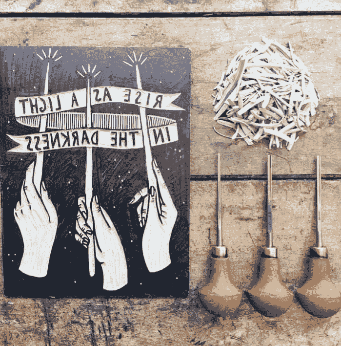

## 术语表

**Additive:** 通过添加元素来构建形态的雕塑方法。

**Appliqué:** 将较小的布片连接到较大布片表面。

**Artist’s proof (AP or A/P):** 从版数中预留给艺术家使用的印品。

**Baren:** 一种光滑、圆形的垫子，扁平或略微凸起，用于在纸张置于已上墨的版块上时，对纸背施加压力。

**Bench hook:** 一块木制或金属板，板的两侧有凸起的唇边，用于在桌面上工作时固定木块或油毡块。

**Block:** 一块厚实的平板材料（通常为木材、橡胶或油毡），表面雕刻有图案，用于印刷重复的印痕。

**Blockbook printing:** 在单个版块内结合图像和文字。

**Brayer:** 带手柄的硬质或软质橡胶辊，用于均匀涂抹油墨并直接涂在版块上。

**Burnish:** 擦拭或抛光。

**Burr:** 可能在刀刃边缘形成的金属粗糙部分。

**Depth:** 从近到远的表观距离。

**Edition:** 由同一版块制作的一组相同的印品，并进行编号和签名。 **Limited edition:** 数量有限的一组印品。 **Open edition:** 数量无限的一组印品。

**Embroidery:** 用针线装饰布料

**Hem:** 将布料边缘翻折并缝合。

**Inking plate:** 任何用于涂抹和滚开油墨的表面。

**Mood:** 艺术作品的整体感受。

**Noise:** 印品上因油墨接触到版块上先前雕刻的区域而产生的额外痕迹；噪点可以是有意的也可以是无意的。

**Print:** 由版块制作的每一份单独的复制品或印痕。

**Printing jig:** 用于印品套准的导向工具。

**Reduction cut:** 一种色彩印刷方法，反复使用同一版块，每增加一层颜色就雕刻掉更多部分。

**Registration:** 版画家使用的任何系统，以确保每次印刷时版块和纸张都在同一位置，通常涉及将两个或多个版块对齐到单幅图像上。

**Relief:** 雕塑技法，将元素雕刻到表面使其从背景中凸出。该术语源自拉丁语动词 *relevo*，意为抬起。

**Relief print:** 从雕刻版块上印制印品的过程，油墨沉积在剩余的（未雕刻）区域。

**Running stitch:** 小而均匀的针脚穿梭于布料进出，形成点线外观。

**Satin stitch:** 长而直的刺绣针脚，平行且紧密排列以填充空间。

**Seed stitch:** 用于背景填充的短而直的刺绣针脚。

**Space:** 构图中物体内部、周围或之间的区域。 **Negative space:** 物体/主体周围的区域。 **Positive space:** 物体/主体占据的区域。

**Split stitch:** 一种刺绣链针，针线穿回前一针脚，使其呈现不间断的线条外观。

**Subtractive (reductive):** 通过去除材料来展现形态的雕塑方法。

**Test print:** 从版块上拉出的第一张印品，用于确定印刷过程中的变量。

**纹理（或触感）：** 物体所暗示的物理粗糙度或光滑度。

**统一性：** 当整体构图感觉完整和谐时。

**明暗：** 或图像中明显的明暗范围。

