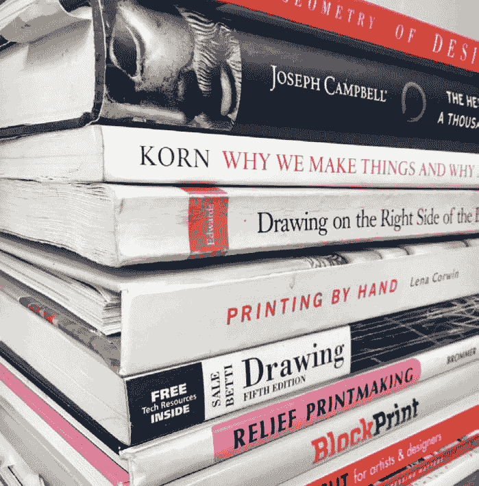
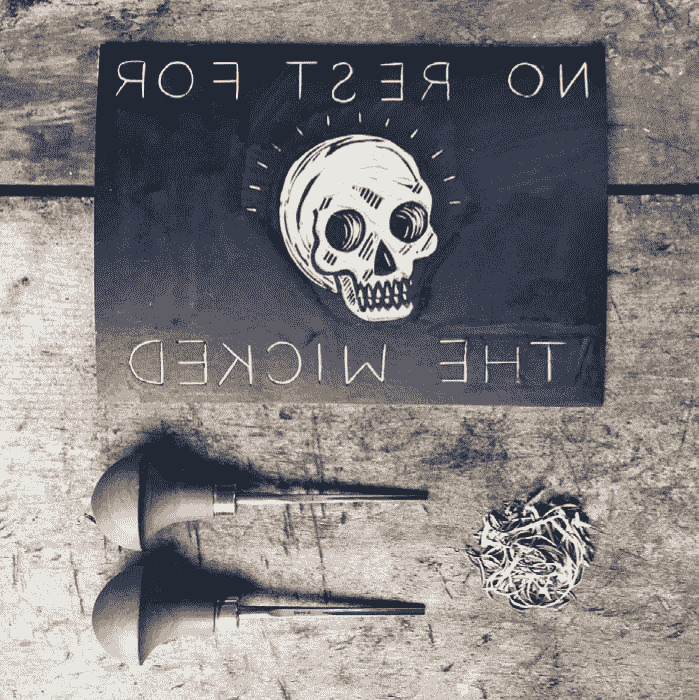
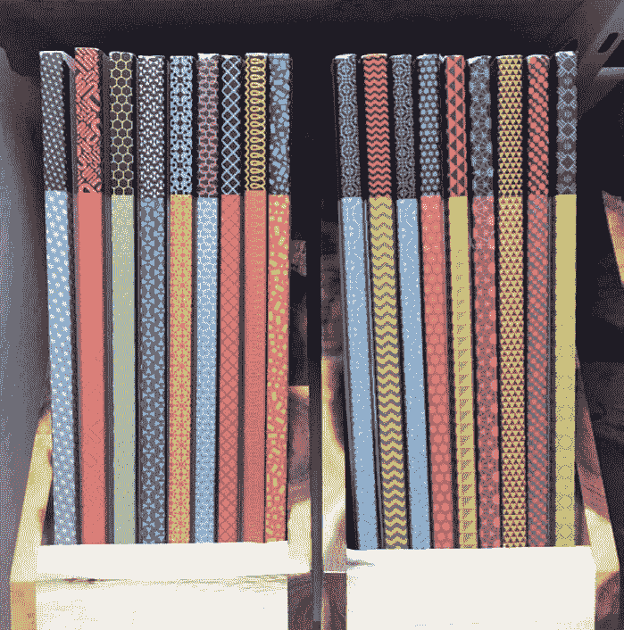

## 资源

### 推荐阅读

#### 版画书籍

Brommer, Gerald F. *凸版印刷*. Worcester, MA: Davis Publications, 1970.

Corwin, Lena, and Thayer Allyson Gowdy. *手工印刷：使用手工印章、模板和丝网印刷的现代指南*. New York: Stewart, Tabori, & Chang, 2008.

Hewett, Jen. *印花图案缝纫：块状印刷基础与灵感衣橱的简单缝纫项目*. Boulder, CO: Roost Books, 2018.

Hughes, Ann d'Arcy, and Hebe Vernon-Morris. *版画圣经：材料与技术的完整指南*. New York: Chronicle Books, 2008.

Jansdotter, Lotta, and Jenny Hallengren. *Lotta 印花：如何用任何东西印刷，从土豆到亚麻油布*. New York: Chronicle Books, 2008.

Lauren, Andrea. *块状印刷：使用油墨块、橡胶块、泡沫片和印章套装印刷所需了解的一切*. Beverly, MA: Rockport Publishers, 2016.

Morley, Nick. *艺术家和设计师的亚麻油布版画*. Ramsbury, UK: The Crowood Press, 2016.

Schmidt, Christine. *印刷工作坊：手工印刷技术与真正原创项目*. Potter Craft, 2008.

Westley, Ann. *凸版印刷*. New York: Watson-Guptill Publications, 2001.

#### 有关绘画、设计、创造力等有用的书籍

Archive for Research in Archetypal Symbolism (ARAS). *象征之书：原型图像的反思*. Los Angeles: TASCHEN, 2010.

Edwards, Betty. *画脑的右侧：提升创造力和艺术自信的课程*. New York: Penguin, 1979.

Elam, Kimberly. *设计的几何学：比例与构图的探索*. Princeton, NJ: Princeton Architectural Press, 2001.

Gilbert, Colin, Dylan Gilbert, Elizabeth T. Gilbert, Gabriel Guzman, Rebecca J. Raso, Sharon Robinson, Amy Runyen, and David J. Schmidt. *艺术每日书：365 篇教学、启发与娱乐的阅读*. Lake Forest, CA: Walter Foster Publishing, 2009.

Gilbert, Elizabeth. *大魔法：超越恐惧的创造性生活*. New York: Riverhead Books, 2016.

Korn, Peter. *我们为什么制作事物以及它为什么重要：工匠的教育*. Boston: David R. Godine, 2013.

Martha Stewart Living Magazine. *玛莎·斯图尔特缝纫与布艺百科全书：缝纫、拼布、刺绣、拼缝、染色和印刷的基础技术，以及从 A 到 Z 的 150 个灵感项目*. New York: Potter Craft, 2010.

Parks, John A. *艺术口袋通用原则：理解、分析和实践艺术的 100 个关键概念*. Beverly, MA: Rockport Publishers, 2018.

Ray, Aimee. *涂鸦刺绣：初学者的新鲜有趣刺绣*. New York: Lark Books, 2007.

Sale, Teel, and Claudia Betti. *绘画：当代方法*. Boston: Thomson Wadsworth, 2008.

我个人视觉艺术图书馆的书籍

#### 了解当代艺术家动态并获得深刻灵感的优秀期刊

*Pressing Matters 杂志*  
[www.pressingmattersmag.com](http://www.pressingmattersmag.com)

*UPPERCASE 杂志*  
[uppercasemagazine.com](http://uppercasemagazine.com)

*Maker’s 杂志*  
[makersmovement.ca](http://makersmovement.ca)

*Celebrating Print*  
[www.celebratingprint.com](http://www.celebratingprint.com)

*Art 21 杂志* magazine.art21.org

#### 本书所用材料的购买来源

Dick Blick Art Supplies [www.dickblick.com](http://www.dickblick.com)

McClain’s 版画用品  
[www.imcclains.com](http://www.imcclains.com)

Speedball 艺术用品  
[www.speedballart.com](http://www.speedballart.com)

Plaza 艺术家用品  
[www.plazaart.com](http://www.plazaart.com)

Utrecht 艺术用品  
[www.utrechtart.com](http://www.utrechtart.com)

Woodcraft 木工工具  
[www.woodcraft.com](http://www.woodcraft.com)

Artist & Craftsman 供应  
[www.artistcraftsman.com](http://www.artistcraftsman.com)

Jackson’s 艺术用品  
[www.jacksonsart.com](http://www.jacksonsart.com)

Paper Mojo  
[www.papermojo.com](http://www.papermojo.com)

The Japanese Paper Place  
[www.japanesepaperplace.com](http://www.japanesepaperplace.com)

*UPPERCASE 杂志* 的书脊——你甚至不必打开它就能获得灵感！（但请打开，你不会后悔的。）
