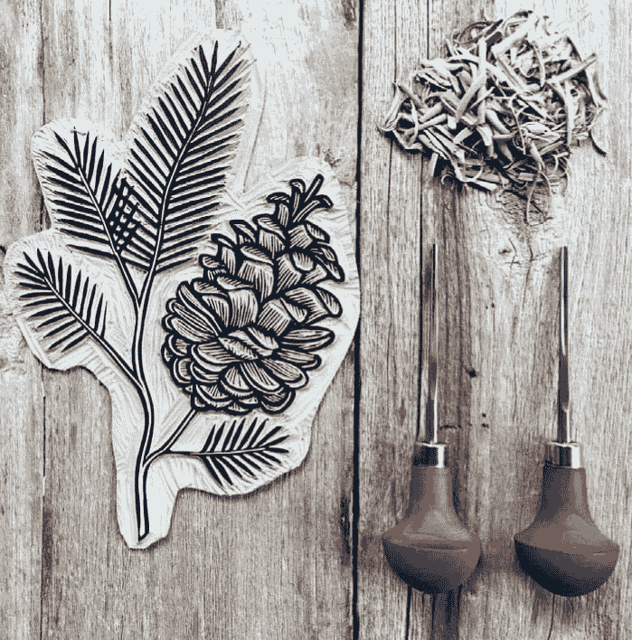

## 致谢

许多人促成了这本小小的魔法集。最先要感谢的是我慷慨的编辑 Judith，她在写作过程中始终鼓励我并保持专注，以及 Rockport Publishers，他们将我从一名艺术家转变为一名作者——这是一个长久以来的梦想。感谢我的撰稿人 Lili Arnold、Jen Hewett、Kelli MacConnell、Derrick Riley 和 Aftyn Shah——感谢你们让我们一窥你们的作品、你们的空间和你们的心灵。

感谢我不可思议的家庭和朋友支持系统，尤其是我的父母，他们在我自己相信自己之前就相信我，教我阅读，鼓励我的与众不同并培养我的好奇心。如果不是你们如此深爱我，这本书就不复存在。还要感谢在我整个过程中始终陪伴我的那群热情洋溢的闺蜜，尤其是 Kyle 和“The Aunties”——如果我发光，那只是因为我反射着你们的光芒。还有 David……感谢你的一切。

我的生命被许多老师触动过，他们像大多数人一样，为下一代的利益牺牲了很多。我在肯塔基州的公立教育在 Terri Schatzman 和 Roberta Schultz 等充满热情、有才华的老师的指导下，让我走上了终身好奇的道路。非常感谢肯塔基大学和辛辛那提大学艺术系的教职员工，他们让我在他们的项目中茁壮成长。

特别感谢（再次感谢）我的老师和朋友 Derrick Riley，是他把我带入了这场混乱。

## 作者简介

Emily Louise Howard 是一位出生于佛蒙特州伯灵顿、在肯塔基州埃尔兰格长大的版画家和插画家。自七岁起就认定自己是艺术家，她一生都在追求视觉表达和讲故事。Emily 在肯塔基大学获得本科学位，并在辛辛那提大学获得美术和视觉艺术教育两个硕士学位。在北肯塔基州公立学校担任艺术教师的几年丰富经历后，Emily 现在是一名全职版画家，她在自己家的工作室里经营着一个由她一人组成的美术版画业务和工作室实践 The Diggingest Girl，并得到她的猫 Selu 的帮助。Emily 细腻、叙事性的版画在国际上被收藏，灵感来源于自然世界、人体和各种各样的故事。

请通过她的网站跟随 Emily 的版画之旅：

[www.thediggingestgirl.com](http://www.thediggingestgirl.com)

想更亲密地了解版画家的日常生活，请在 Instagram 上以 @thediggingestgirl 查看 Emily 的作品。
