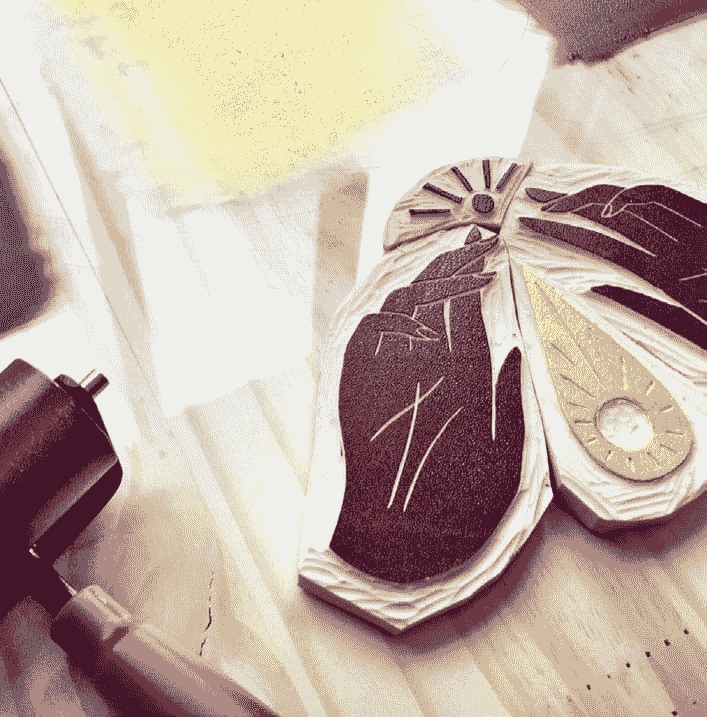
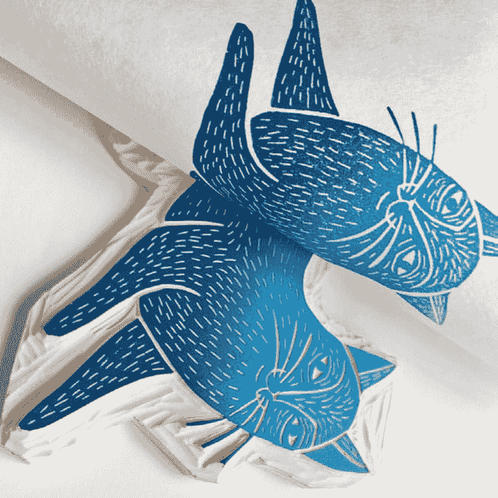
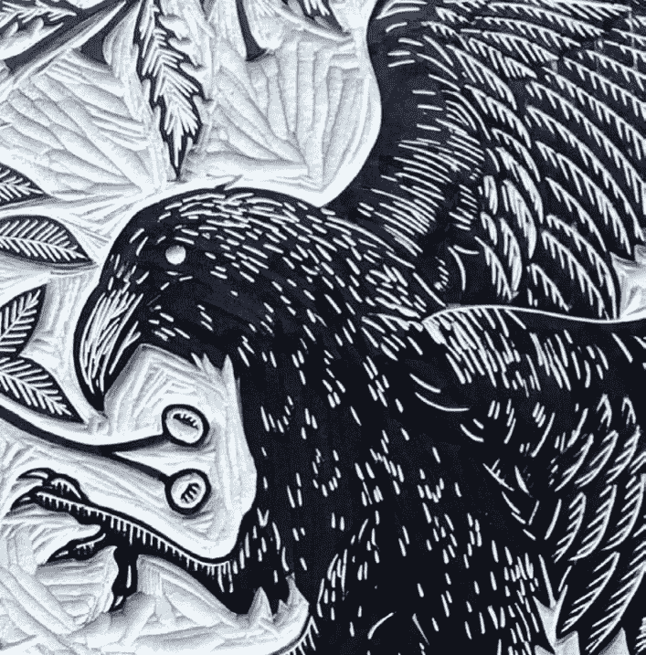

## 索引

A

无酸纸, 19

添加剂, 137

粘合剂, 21

美国学派, 31

A/P 或 AP（艺术家样张）, 47, 137

墨水应用, 42

拼布, 124, 137

# 索引

## A
档案纸，19
阿肯色石，16

### 艺术家简介
Arnold, Lili，112
Hewett, Jen，119
MacConnell, Kelli，79
Riley, Derrick，71
Shah, Aftyn，105

艺术工作室，22，72，107，114，121

## B
背景噪音。*参见* 噪音
平衡，31
Barens，17，137
棚屋星，56
战舰灰色块，12，14
工作台钩，39，137
BFK Rives 纸，19
刀片，磨利，15
混色笔，34
Blick Masterprinter 纸，19
块书印刷，137

### 块
清洁，47
定义，137
油毡，12
多块印刷，57
橡胶，12，13
与纸张相同位置，43
软 *与* 硬橡胶，42
储存，24
纹理拓印自块，102

骨文件夹，21
书页，作为印刷底，100
美工刀，21
方格网套准装置，44

### 滚筒
清洁，47
定义，137
上墨应用，42
储存，24
一个上两种不同颜色，116

烫光，17，34，54，137
毛刺，15，137
屠夫/牛皮纸，21

## C
Caligo Safe Wash Relief Ink，18
Campbell, Joseph，22
Canson Edition 纸，19
Canson Mi-Teintes 纸，19
Carr, Emily，107，108
雕刻块，12
雕刻技巧，36

### 雕刻工具
握持角度，38
握持和，37
磨利，15
类型，14

沟槽/沟槽处理，39
硬纸板，57

### 清理
印刷后，47
底稿和，104
上墨板，17，47

钴干剂，18，68，90，123
冷压纸，19
拼贴，131

### 颜色和彩色印刷
手工上色，82
作为设计元素，30
多块法，57
拼图块法，96
彩虹滚筒法，116
减法雕刻，65

轮廓线，74，76，84，109
轮廓线骷髅项目，74
对比，31
美工刀，21
切割垫，21

## D
Daler Rowney Canford 纸，19
*死神与农夫* (Lutzelburger)，30
深度，30，38，137
设计元素和原则，30
制图师除尘刷，53

### 绘图
直接在块上绘制（被子图案），50
从记忆中绘制风景，108
用于多块六角形标志项目，57
减法雕刻向日葵，66
转印方法，32

绘图材料，20
绘图转印纸，32
打扮项目，82
烘干架，26，47
鸭布，21

## E
版本，47，62，70，137
版本号，47
刺绣，125，137
刺绣圈，126
刺绣材料，21
延展剂，18

## F
布料，印刷在，119，122
Feldman, Joel，71
Flexcut Slipstrop，15
弗兰肯斯坦的怪物，130

## G
*风暴* (Vallotton)，31
Gamblin Relief Ink，18，123
厚涂水彩颜料，21，86，133
克/平方米 (gsm)，19
握持，14，37
底稿，99
Gutenberg, Johannes，88

## H
洗手，47
硬橡胶，16，42
加热油毡，13，39
缝边，125，137
Hewett, Jen，119
六角形标志，多块，56
铰链窗套准方法，45
热压纸，19
*火焰吞没的房屋* (American School)，31

## I
### 墨水
应用，42
类型，18

上墨板，17，47，137
喷墨打印机，35
墨水改性剂，18

## J
日本木版印刷，17
夹具，用于销钉和标签套准装置，65
印刷夹具。*参见* 印刷夹具

## K
凯夫拉袖套，37
关键块，57
*金缮*，129

## L
皮革护臂，37
限量版，70，137

### 线条
轮廓，74，76，84，109
作为设计元素，30
类型，55

油毡块，12，14，39
Liquid Stitch，124
生态景观项目，108
Lutzelburger, Hans，30

## M
MacConnell, Kelli，79

# 索引
## M
机造纸, 19
放大镜, 24
混合媒介材料, 21
Mod Podge, 35
Mod Podge Photo Transfer Medium, 35
MOO Carve Professional Carving Block, 13
情绪, 31, 137
镶嵌块, 13
运动, 31
多块六角形标志项目, 56
多块方法, 57

## N
叙事性图像, 31
负空间, 30, 137
噪点, 38, 41, 42, 132, 137
Nori Paste, 134
编号（版次）, 47

## O
油性墨水, 18
单页口袋小志, 88
开放版, 137

## P
画家胶带, 65
油漆，用于印刷底稿, 101
调色刀, 17
手掌工具, 14, 37
纸张
  底稿和, 99
  与块同位置, 43
  移动, 43
  类型, 19
图案, 31
Permatex Fast Orange, 47
Pfeil 全尺寸 No. II 雕刻刀, 14
Pfeil 瑞士制造雕刻工具, 14
复印，通过复印的转印方法, 35
销钉和标签套准方法, 46, 65, 67
压板, 17
正空间, 30, 137
Powergrip 套装, 14
印刷, 137
印刷品
  颜色中 (*参见* 颜色和彩色印刷)
  版次和, 47
  在织物上, 122
  在其上作画, 86
  减切, 64
  再利用, 130
  存放, 24
印刷夹具, 23, 43, 46, 61, 62, 63, 65, 67, 69, 78, 85, 98. 99, 118, 137
*Print Pattern Sew 块版印刷基础与灵感衣橱的简单缝纫项目* (Hewett), 119
印刷工作室, 22, 72, 107, 114, 121
印刷技术, 40
项目
  轮廓线骷髅, 74
  打扮, 82
  弗兰肯斯坦怪物, 130
  生动景观, 108
  多块六角形标志, 56
  单页口袋小志, 88
  彩虹卷, 116
  减切向日葵, 64
  关于套准, 44
  纹理拼布块, 50
  墙饰, 122
  编织印刷, 134
浮石皂, 21
拼图块方法, 96, 115

## R
彩虹卷项目, 116
减切方法, 65, 137
减切向日葵项目, 64
套准, 43
  方格网格装置, 44
  定义, 137
  铰链窗方法, 45
  销钉和标签装置, 46, 65, 67
浮雕，定义, 137
浮雕印刷，定义, 137
再利用印刷品, 130
缓凝剂, 18
Richeson 中型蚀刻压机, 25
Rise & Wander, 105, 106
橡胶块, 12, 13, 42
跑针缝, 125, 127, 137

## S
盐，在油漆上, 101
缎面缝, 125, 126, 137
比例（尺寸）, 30
种子缝, 125, 127, 137
缝纫套件, 21
Shah, Aftyn, 105
磨利雕刻工具, 15
皮带磨刀具, 15
Soft-Kut 块, 13, 116, 117
软橡胶, 12, 42
溶剂, 18
空间, 30
Speedball 品牌巴伦, 17
Speedball 油毡刀, 14
Speedball 镶嵌油毡, 13
Speedball Speedy-Carve, 13
Speedball Speedy-Cut, 13, 97
Speedy-Carve, 13
分针缝, 125, 137
缝线
  用于拼贴, 131
  刺绣, 125
  用于弗兰肯斯坦怪物项目, 131
  在印刷底稿中, 103
  类型，定义, 137
  用于墙饰项目, 125
储存
  块, 24
  墨水, 18
  油毡块, 13
  印刷品, 24
剥离标签, 46
工作室, 22, 72, 107, 114, 121
减法（还原）方法, 137

## T
粘性, 18
胶带, 65
茶包，用于印刷底稿, 100
技术
  雕刻, 36
  印刷, 40
Ternes-Burton 套准销, 46
测试印刷, 137
纺织品印刷, 119, 122
文字，在单页口袋小志项目中, 88
纹理, 30, 137
纹理拼布块项目, 50
泰国罗望子叶桑皮纸, 19
索道晾干架, 26
薄纸，用于印刷底稿, 100
描图纸, 33, 58, 66

# 索引

## T
转印方法，32
透明底板，18
透明图层，用于印刷底色，102

## U
U 凿，14，15，16，109，110
统一图像，31
统一性，137
肯塔基大学，71
未装衬的油毡，12，13

## V
Vallotton, Felix Edouard，31
明暗，30，137
Van Gogh, Vincent，108
Veiners，14，37，109，110
V 凿，14
虎钳，24，27
V 型分切工具，15，16，76，77，83，84，109，110
V 工具，52

## W
墙面挂饰项目，122
和纸/遮蔽胶带，21，65
水性墨水，18
水彩颜料，21，86，133
水溶性墨水，18
水溶性油基墨水，18
编织印刷品，134
重量，纸张，19
Welch, Gillian，115
*柏树间的麦田* (Van Gogh)，108
磨刀石，16
木勺，17，54
编织印刷项目，134

## Y
Yasutomo 日本桑皮纸，19

## Z
口袋一页小册子，88

## 献词
献给我的父母

© 2019 Quarto Publishing Group USA Inc.
艺术作品 © 2019 Emily Howard
首次于 2019 年由 Rockport Publishers 出版，该出版社为 The Quarto Group 的印记，地址为 100 Cummings Center, Suite 265-D, Beverly, MA 01915, USA.
T (978) 282-9590 F (978) 283-2742
[QuartoKnows.com](http://QuartoKnows.com)
版权所有。本书的任何部分未经版权所有者书面许可不得以任何形式复制。本书中的所有图像均在相关艺术家的知情并事先同意下复制，制作方、出版方或印刷方对因本出版物内容而产生的任何版权或其他侵权行为不承担责任。已尽最大努力确保署名准确符合所提供的信息。我们对可能出现的任何不准确之处表示歉意，并将在本书的后续重印中解决不准确或缺失的信息。
Rockport Publishers 的图书也可为零售、批发、促销和批量采购提供折扣。详情请通过电子邮件联系特种销售经理 specialsales@quarto.com，或通过邮寄方式联系 The Quarto Group，收件人：特种销售经理，地址：100 Cummings Center, Suite 265-D, Beverly, MA 01915, USA.
数字版：978-1-63159-616-2
平装版：978-1-63159-615-5
数字版于 2019 年出版
美国国会图书馆出版物编目数据
Howard, Emily Louise，作者。
Block print magic：设计、雕刻并通过凸版印刷让你的艺术作品更进一步的必备指南 / Emily Louise Howard of “The Diggingest Girl”。
ISBN 9781631596155（平装贸易版）
LCSH：油毡版画。
LCC NE1330 .H69 2019 | DDC 761/.3--dc23
LCCN 2018032482
设计和排版：Burge Agency
摄影：Emily Louise Howard，除艺术家聚光灯中的作品（由各艺术家提供）及以下内容外：
页 30 (上方)：*蝗灾*，发表于 *纽伦堡编年史*，1493 年（木刻），德国学派，（15 世纪） / Private Collection / Prismatic Pictures / Bridgeman Images DGC875286
页 30 (下方)：*死亡与农夫*，来自 *死亡之舞*，由 Hans Lutzelburger 雕刻，约 1538 年（木刻）（黑白照片），Holbein the Younger, Hans (1497/8-1543)（临摹） / Private Collection / Bridgeman Images XJF143243
页 31 (上方)：*被火焰吞噬的房屋*，1933 年（木刻印刷），美国学派，（20 世纪） / Photo © GraphicaArtis / Bridgeman Images GRC3035652
页 31 (下方)：*大风*，1894 年（木刻），Vallotton, Felix Edouard (1865-1925) / Private Collection / Photo © Christie’s Images / Bridgeman Images CH615511
页 56—Shutterstock
页 74 (上方)：*56 岁的阿尔布雷希特·丢勒*（木刻），德国学派，（16 世纪） / Private Collection / The Stapleton Collection / Bridgeman Images STC2962079
页 108 (下方)：*柏树间的麦田*，1889 年（布面油画），Gogh, Vincent van (1853-90) / 英国伦敦国家美术馆 / Bridgeman Images BAL3585
插图：Emily Louise Howard
