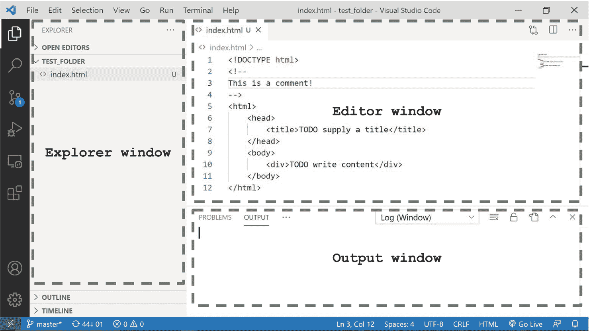
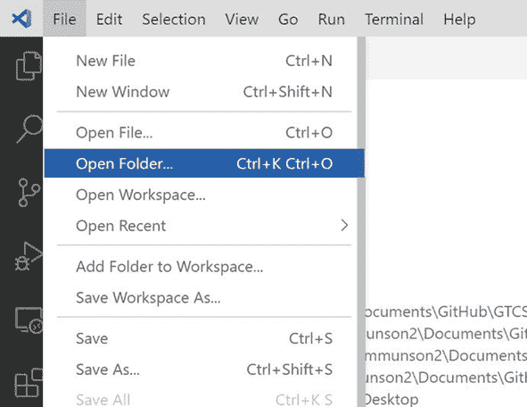
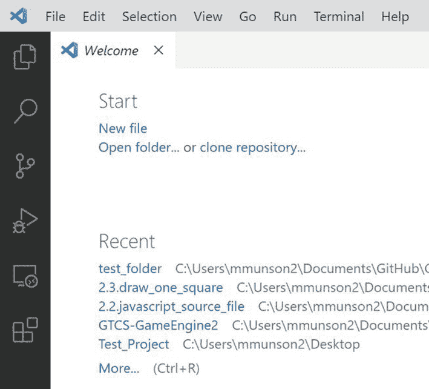
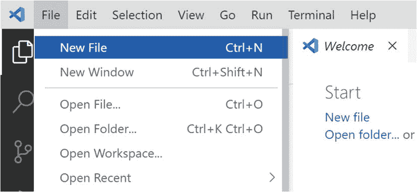
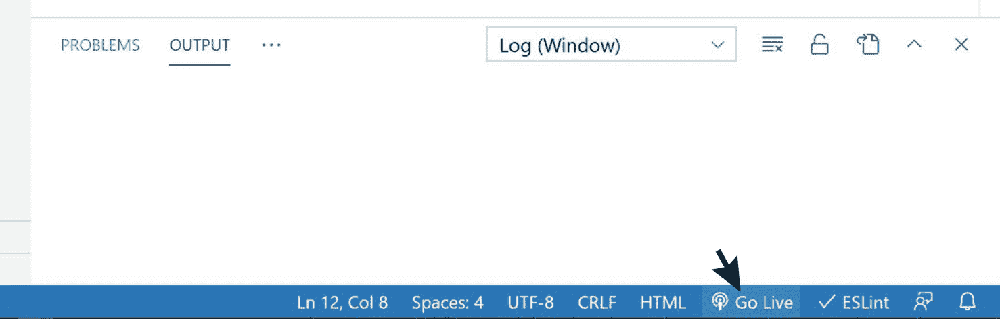
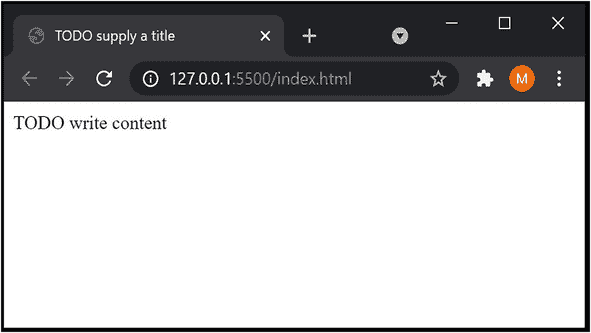

# 第 1 章：使用 JavaScript 进行 2D 游戏引擎开发简介

**Kelvin Sung**<sup>1</sup>、**Jebediah Pavleas**<sup>2</sup>、**Matthew Munson**<sup>3</sup> 和 **Jason Pace**<sup>4</sup>

1. 美国华盛顿州博塞尔  
2. 美国华盛顿州肯莫尔  
3. 美国华盛顿州莱克福雷斯特帕克  
4. 美国俄勒冈州波特兰

## 摘要

视频游戏是复杂、交互式、多媒体软件系统。它们必须实时处理玩家输入、模拟半自主对象的交互、生成高保真图形和音频输出，同时还要努力保持玩家的参与度。构建视频游戏的尝试可能会迅速变得令人不知所措，因为需要精通软件开发，同时还要懂得如何创造吸引人的玩家体验。第一个挑战可以通过软件库或游戏引擎来缓解，其中包含一组专门为开发视频游戏设计的连贯实用工具和对象。玩家参与度的目标通常通过在视频游戏开发过程中仔细的游戏玩法设计和微调来实现。本书讲述游戏引擎的设计与开发；它将专注于实现并隐藏引擎的繁琐操作，同时支持许多复杂的模拟。通过本书中的项目，您将构建一个实用的游戏引擎，用于开发可通过互联网访问的视频游戏。


游戏引擎使游戏开发者免于实现简单的例行任务，例如解码键盘上的特定按键、为常见操作设计复杂算法（如在二维世界中模拟阴影），以及理解实现细节中的细微差别（如强制物理模拟的精度容差）。成熟且成熟的商业游戏引擎，如 *Unity*、*Unreal Engine* 和 *Panda3D*，通过图形用户界面（GUI）展示其系统。友好的 GUI 不仅简化了游戏设计中一些繁琐的过程，例如在关卡中创建和放置对象，更重要的是，它确保了这些游戏引擎对具有不同背景的创意设计师也易于使用，这些设计师可能会觉得软件开发的细节令人分心。

本书专注于独立于 GUI 的游戏引擎核心功能。虽然全面的 GUI 系统可以改善最终用户体验，但其实现需求也可能分散并使游戏引擎的基础变得复杂。例如，用户界面系统中强制兼容数据类型的问题，如限制特定类的对象被指定为阴影接收者，这对 GUI 设计很重要，但与游戏引擎的核心功能无关。

本书从两个重要方面切入游戏引擎开发：可编程性和可维护性。作为一个软件库，游戏引擎的接口应通过良好抽象的实用方法和对象来促进游戏开发者的可编程性，这些方法和对象隐藏简单的例行任务并支持复杂但常见的操作。作为一个软件系统，游戏引擎的代码库应通过精心设计的基础设施和良好组织的源代码系统来支持可维护性，从而实现代码复用、持续的系统维护、改进和扩展。

本章描述了本书的实现技术和组织结构。讨论将引导您完成下载、安装和设置开发环境的步骤，指导您构建第一个 HTML5 应用程序，并利用这一首次应用程序开发经验，解释阅读和学习本书的最佳方法。

## 技术

构建一个允许游戏通过万维网访问的游戏引擎的目标，是由免费可用的技术实现的。

JavaScript 几乎被所有网页浏览器支持，因为解释器安装在世界上几乎每一台个人电脑上。作为一种编程语言，JavaScript 是动态类型的，支持继承和作为一等对象的函数，并且由于拥有成熟的用户和开发者社区，易于学习。凭借这一战略性技术选择，基于 JavaScript 开发的视频游戏可以通过适当的网页浏览器，让互联网上的任何人访问。因此，JavaScript 是面向大众开发视频游戏的最佳编程语言之一。

虽然 JavaScript 是实现游戏逻辑和算法的绝佳工具，但仍需要以软件库或应用程序编程接口（API）形式存在的额外技术，来支持用户输入和媒体输出需求。为了构建可通过网页浏览器在互联网上访问的游戏，HTML5 和 WebGL 提供了理想的互补输入和输出 API。

HTML5 旨在跨互联网构建和呈现内容。它包含详细的处理模型和相关 API，用于处理用户输入和多媒体输出。这些 API 是 JavaScript 原生的，非常适合实现基于浏览器的视频游戏。虽然 HTML5 提供了基本的可缩放矢量图形（SVG）API，但它不支持视频游戏所需的复杂效果，如实时光照、爆炸或阴影。Web 图形库（WebGL）是一个专门设计用于通过网页浏览器生成二维和三维计算机图形的 JavaScript API。凭借对 OpenGL 着色语言（GLSL）的支持以及访问客户端机器上图形处理单元（GPU）的能力，WebGL 能够实时生成高度复杂的图形效果，非常适合作为基于浏览器的视频游戏的图形 API。

本书讲述游戏引擎的概念与开发，其中 JavaScript、HTML5 和 WebGL 仅仅是实现工具。本书的讨论侧重于应用这些技术来实现所需功能，而不试图涵盖技术本身的细节。例如，在游戏引擎中，继承是通过基于对象原型链的 JavaScript 类功能实现的；然而，基于原型的脚本语言的优点并未讨论。引擎的音频提示和背景音乐功能基于 HTML5 `AudioContext` 接口，但其功能范围未作描述。游戏引擎对象基于 WebGL 纹理贴图绘制，而 WebGL 纹理子系统的特性未作展示。技术的具体细节会分散对游戏引擎讨论的注意力。本书的关键学习成果是游戏引擎的概念和实现策略，而非任何技术的细节。这样，读完本书后，您将能够基于任何可比较的技术集（如 C# 和 MonoGame、Java 和 JOGL、C++ 和 Direct3D 等）构建类似的游戏引擎。如果您想了解更多或复习 JavaScript、HTML5 或 WebGL，请参阅本章末尾“技术”部分的参考资料。

## 设置您的开发环境

您将构建的游戏引擎将可通过网页浏览器访问，这些浏览器可能运行在任何操作系统（OS）上。您即将设置的开发环境也是与操作系统无关的。为简单起见，以下说明基于 Windows 10 操作系统。您应该能够通过微小的修改在类 Unix 环境（如 MacOS 或 Ubuntu）中复现类似的环境。

您的开发环境包括一个集成开发环境（IDE）和一个能够托管运行中游戏引擎的运行时网页浏览器。我们发现最方便的系统是 Visual Studio Code (VS Code) IDE，搭配 Google Chrome 网页浏览器作为运行时环境。详情如下：

- **IDE**：本书中的所有项目均基于 VS Code IDE。您可以从 [`code.visualstudio.com/`](https://code.visualstudio.com/) 下载并安装该程序。
- **运行时环境**：您将在 Google Chrome 网页浏览器中执行视频游戏项目。您可以从 [www.google.com/chrome/browser/](http://www.google.com/chrome/browser/) 下载并安装此浏览器。
- `glMatrix` 数学库：这是一个实现基础数学运算的库。您可以从 [`glMatrix.net/`](http://glmatrix.net/) 下载此库。您将在第 3 章中将此库集成到您的游戏引擎中，届时将提供更多细节。

请注意，支持 JavaScript 编程语言、HTML5 或 WebGL 没有特定的系统要求。所有这些技术都嵌入在网页浏览器运行时环境中。

**注意**

如前所述，我们选择基于 VS Code 的开发环境是因为我们发现它最方便。还有许多其他免费的替代方案，包括但不限于 NetBeans、IntelliJ IDEA、Eclipse 和 Sublime。

### 下载并安装 JavaScript 语法检查器

我们发现 `ESLint` 是检测潜在 JavaScript 源代码错误的有效工具。您可以通过以下步骤将 `ESLint` 集成到 VS Code 中：


### 安装 ESLint

*   前往 [`marketplace.visualstudio.com/items?itemName=dbaeumer.vscode-eslint`](https://marketplace.visualstudio.com/items?itemName=dbaeumer.vscode-eslint) 并点击安装。
*   系统将提示打开 VS Code，您可能需要在应用程序内再次点击安装。

以下是一些使用 ESLint 的有用参考资料：

*   有关如何使用 ESLint 的说明，请参阅 [`eslint.org/docs/user-guide/`](https://eslint.org/docs/user-guide/)。
*   有关 ESLint 工作原理的详细信息，请参阅 [`eslint.org/docs/developer-guide/`](https://eslint.org/docs/developer-guide/)。

### 下载并安装 LiveServer

运行游戏引擎需要 VS Code 的 LiveServer 扩展。它通过 VS Code 在您的计算机本地启动一个 Web 服务器来托管开发的游戏。与 ESLint 非常相似，您可以通过以下步骤安装 LiveServer：

*   前往 [`marketplace.visualstudio.com/items?itemName=ritwickdey.LiveServer`](https://marketplace.visualstudio.com/items?itemName=ritwickdey.LiveServer) 并点击安装。
*   系统将提示打开 VS Code，您可能需要在应用程序内再次点击安装。

### 在 VS Code 开发环境中工作

VS Code IDE 易于使用，本书中的项目仅需要编辑器。在父文件夹下组织的相关源代码文件会被 VS Code 解释为一个项目。要打开项目，请选择 `File ➤ Open Folder`（文件 ➤ 打开文件夹），然后导航并选择包含项目源代码文件的父文件夹。项目打开后，您需要熟悉 VS Code 的基本窗口，如图 1-1 所示。

*   **`Explorer window`（资源管理器窗口）**：该窗口显示项目的源代码文件。如果您不小心关闭了此窗口，可以通过选择 `View ➤ Explorer`（视图 ➤ 资源管理器）将其调回。
*   **`Editor window`（编辑器窗口）**：该窗口显示并允许您编辑项目的源代码。您可以通过在资源管理器窗口中单击相应的文件名一次来选择要处理的源代码文件。
*   **`Output window`（输出窗口）**：我们的项目中不使用此窗口；您可以随意通过点击窗口右上角的“x”图标将其关闭。



图 1-1 ¶ VS Code IDE

#### 在 VS Code 中创建 HTML5 项目

您现在已准备好创建第一个 HTML5 项目：

*   使用文件资源管理器，在您想要保存项目的位置创建一个目录。该目录将包含与您的项目相关的所有源代码文件。在 VS Code 中，选择 `File ➤ Open Folder`（文件 ➤ 打开文件夹）并导航到您创建的目录。



图 1-2 ¶ 打开项目文件夹

*   VS Code 将打开项目文件夹。您的 IDE 应类似于图 1-3；请注意，当项目文件夹为空时，资源管理器窗口是空的。



图 1-3 ¶ 空的 VS Code 项目

*   您现在可以创建第一个 HTML 文件 `index.html`。选择 `File ➤ New File`（文件 ➤ 新建文件）并将文件命名为 `index.html`。当应用程序启动时，这将作为主页或着陆页。



图 1-4 ¶ 创建 index.html 文件

*   在编辑器窗口中，将以下文本输入到您的 `index.html` 中：

```html
<!DOCTYPE html> <!-- This is a comment! --> 
<html> 
    <head> 
        <title>TODO supply a title</title> 
    </head> 
    <body> 
        <div>TODO write content</div> 
    </body> 
</html>
```

第一行声明该文件为 HTML 文件。`<!--` 和 `-->` 标签内的块是注释块。成对的 `<html></html>` 标签包含所有 HTML 代码。在本例中，模板定义了 `<head>` 和 `<body>` 部分。`<head>` 设置网页标题，`<body>` 是网页所有内容的所在位置。

如图 1-5 所示，您可以通过点击 VS Code 右下角的“`Go Live`”按钮或按 `Alt+L` `Alt+O` 来运行此项目。您第一次输入上述 HTML 代码后，“`Go Live`”按钮可能不会立即出现。在这种情况下，只需在资源管理器窗口中右键点击 `index.html` 文件，然后点击“`Open with Live Server`”菜单项以启动网页。首次之后，“`Go Live`”按钮将出现在 IDE 右下角区域，如图 1-5 所示。



图 1-5 ¶ 点击 Go Live 按钮运行项目

> **Note（注意）**
>
> 要运行项目，当点击“`Go Live`”按钮或输入 `Alt+L` `Alt+O` 键时，该项目的 `index.html` 文件必须在编辑器中打开。这在后续章节中将变得很重要，因为那时项目中会有其他 JavaScript 源代码文件。

图 1-6 显示了运行时默认项目的外观示例。请注意，项目开始运行后，“`Go Live`”按钮会更新其标签以显示“`Port:5500`”。您可以再次点击此按钮，将 IDE 与网页断开连接，以再次观察“`Go Live`”标签。再次点击按钮将重新运行项目。



图 1-6 ¶ 运行简单的 HTML5 项目

要停止程序，只需关闭网页即可。您已成功运行第一个 HTML5 项目。通过开发这个非常简单的项目，您已经熟悉了 IDE 环境。

> **Note（注意）**
>
> 对于调试，我们推荐使用 Chrome 开发者工具。当项目运行时，可以在浏览器窗口中输入 `Ctrl+Shift+I`（或 `F12` 键）来访问这些工具。要了解有关这些工具的更多信息，请参阅 [`developer.chrome.com/docs/devtools/`](https://developer.chrome.com/docs/devtools/)。

## 如何使用本书

本书将指导您通过构建项目来开发游戏引擎，这些项目类似于您刚刚体验的项目。每一章涵盖典型游戏引擎的一个基本组件，每章中的各节描述了构建相应组件的重要概念和实现项目。全书中，每节的项目都建立在前面各节项目结果的基础之上。虽然这使得跳跃阅读本书略具挑战性，但它将为您提供实践经验，并让您扎实理解不同概念之间的联系。此外，您不再总是使用新的、极简的项目，而是在将新功能集成到不断扩展的游戏引擎中时，获得构建更大、更有趣项目的经验。


## 本书的编排方式

项目从演示简单概念入手，例如绘制一个简单的正方形，但会迅速过渡到展示更复杂的概念，例如使用用户定义的坐标系和实现像素级精确碰撞检测。最初，正如您在构建第一个 HTML5 应用程序时所经历的，您将通过详细的步骤和完整的源代码清单获得指导。随着您逐渐熟悉开发环境和相关技术，随每个项目提供的指南和源代码清单将转向重点突出重要的实现细节。最终，随着项目复杂度的增加，讨论将仅聚焦于关键且相关的问题，而简单直接的源代码更改将不再赘述。

您将在本书的学习过程中逐步开发出最终的代码库，它是一个完整且实用的游戏引擎；这是一个绝佳的平台，您可以在其基础上开始构建自己的 2D 游戏。这正是本书最后一章的内容，它将引导您从概念构想、设计到实现一款休闲 2D 游戏。

您有几种方式来跟随本书学习。最显而易见的方式是，在跟随书中每一步操作时，将代码输入到您的项目中。从学习角度来看，这是吸收所呈现信息最有效的方式；不过，我们理解由于这种方法可能需要大量代码编写或调试，它可能不是最现实的选择。或者，我们建议您在开始新章节时，运行并检查已完成项目的源代码。这样做可以让您预览当前章节的项目，明确最终目标，并了解项目旨在实现的功能。当您在自行构建代码时遇到问题，已完成的项目代码也可能派上用场，因为在棘手的调试情况下，您可以将自己的代码与已完成项目的代码进行比较。

> **注意**
>
> 我们发现 `WinMerge` 程序 (`http://winmerge.org/`) 是一个比较源代码文件和文件夹的优秀工具。Mac 用户可以尝试 `FileMerge` 实用程序，用于类似目的。

最后，完成一个项目后，我们建议您将您的实现行为与提供的已完成实现进行比较。通过这样做，您可以观察您的代码是否按预期运行。

## 如何制作一款优秀的电子游戏？

虽然本书的重点在于游戏引擎的设计与实现，但了解不同组件如何为创作一款有趣且引人入胜的电子游戏做出贡献非常重要。从第 4 章开始，每章末尾都包含一个“游戏设计考量”部分，旨在将引擎组件的功能与游戏设计要素联系起来。本节为这些讨论提供了框架。

这是一个复杂的问题，制作一款让人爱不释手的电子游戏没有确切的公式，正如制作一部让人爱不释手的电影也没有确切的公式一样。我们都见过制作精良、汇聚顶级演技、编剧和导演才华的大制作电影在票房上扑街，也都见过大工作室的大制作游戏未能俘获玩家的想象力。同理，无名导演的电影也能赚足眼球，籍籍无名的小工作室开发的游戏也能横扫市场。

虽然制作优秀游戏没有明确的说明书，但许多要素协同作用，创造出的最终体验大于部分之和，所有游戏设计师必须成功应对每一个要素，才能制作出值得一玩的作品。这些要素包括以下内容：

### 技术设计

这包括所有游戏代码和游戏平台，通常不直接面向玩家；相反，它构成了游戏体验各个方面的基础和框架。本书主要关注与游戏技术设计相关的问题，包括具体任务（如在屏幕上绘制元素所需的代码行数）以及更宏观的架构考量（如确定何时以及如何将资源加载到内存中的策略）。技术设计问题以多种方式影响玩家体验（例如，玩家在游戏过程中遇到“加载”延迟的次数，或游戏显示的每秒帧数），但技术设计通常对玩家不可见，因为它运行在所谓的表现层之下，即玩家在游戏过程中遇到的所有视听和/或触觉反馈之下。

### 游戏机制

游戏机制是对特定游戏体验的“玩法基础”所做的抽象描述。游戏机制的类型包括解谜、灵巧性挑战（如跳跃或瞄准）、限时事件、战斗遭遇等。游戏机制是一个框架；具体的谜题、遭遇和游戏交互是该框架的实现。例如，即时战略 (RTS) 游戏可能包含资源收集机制，该机制可描述为：“玩家需要收集特定类型的资源并将它们组合起来建造单位，用于战斗。”该机制的具体实现（玩家如何在游戏中定位和提取资源、如何将资源从一处运输到另一处、以及组合资源生产单位的规则）属于系统设计、关卡设计以及交互模型/游戏循环（本节稍后将介绍）的范畴。

### 系统设计

为核心游戏机制提供结构化挑战的内部规则和逻辑关系，被称为游戏的系统设计。沿用前面的 RTS 例子，游戏可能要求玩家收集一定量的金属矿石并与一定量的木材结合来制造游戏对象；制造对象所需的各资源具体数量、以及创建对象的独特流程（例如，对象只能在玩家基地的特定建筑中生产，且在玩家启动流程后需要 `x` 分钟才会出现）都是系统设计的范畴。休闲游戏可能拥有基础的系统设计。例如，Popcore Games 的简单益智游戏《拔针子》(*Pull the Pin*) 就是一个系统较少、复杂度低的游戏，而 RTS 等大类游戏可能拥有由整个设计师团队创建和平衡的深度复杂且相互关联的系统设计。游戏系统设计往往是游戏设计中隐藏复杂性最多的地方；当设计师着手定义所有促成游戏机制实现的变量时，很容易在复杂性和依赖平衡的大海中迷失方向。在玩家眼中看似相当简单的系统，可能需要许多组件协同工作并完美平衡，低估系统复杂性也许是新手（甚至资深！）游戏设计师遇到的最大陷阱之一。在您弄清楚自己要面对什么之前，请始终假设您创建的系统将证明比您预期的要复杂得多。


### 关卡设计

游戏的关卡设计反映了其他八大要素中的每一个在独立的游戏“片段”语境下结合的具体方式，玩家必须完成某个片段的目标才能继续下一部分（有些游戏可能只有一个关卡，而其他游戏可能有几十个）。单个游戏内的关卡设计可以都是同一核心机制和系统设计的变体（像《俄罗斯方块》和《宝石迷阵》这样的游戏就是拥有许多关卡且都专注于同一机制的例子），而其他游戏则会混合搭配机制和系统设计，以在关卡间创造多样性。大多数游戏以一种核心机制和贯穿全游戏的系统设计方法为特色，并会在关卡间增加细微变化以保持新鲜感（更换环境、改变难度、增加时间限制、提高复杂度等），尽管偶尔游戏会引入依赖完全独立的机制和系统的新关卡，以给玩家惊喜并保持他们的兴趣。优秀的游戏关卡设计在于平衡：既要创建能展示机制和系统设计的游戏“片段”，又要在这些片段间做出足够的改变，以在玩家推进游戏的过程中保持趣味性（但不能改变太多，以免游戏体验感觉支离破碎、脱节）。

### 交互模型

交互模型是用于与游戏互动以完成任务的按键、按钮、手柄摇杆、触控手势等的组合，以及支持游戏世界中这些交互的图形用户界面。一些游戏理论家将游戏的用户界面（UI）设计归为单独一类（游戏 UI 包括菜单设计、物品栏、抬头显示 [HUD] 等），但交互模型与 UI 设计有着深度关联，将这两个要素视为不可分割是一个好的实践。以之前提到的即时战略（RTS）游戏为例，交互模型包括在游戏中选择对象、移动对象、打开菜单和管理物品栏、保存进度、发起战斗以及排队建造任务所需的动作。交互模型完全独立于机制和系统设计，仅关注玩家为发起行为必须采取的物理动作（例如：点击鼠标按键、按下键盘键、移动摇杆、滚动滚轮）；UI 是与这些动作相关联的视听或触觉反馈（屏幕按钮、菜单、状态、音频提示、震动等）。

### 游戏背景设定

你是在外星球上？在奇幻世界中？还是在抽象环境里？游戏背景设定是游戏体验的关键部分，它与视听设计相辅相成，将原本脱节的一系列基本交互转化为具有语境的引人入胜的体验。游戏背景设定无需精雕细琢也能有效；长盛不衰的益智游戏《俄罗斯方块》拥有相当简单的背景设定，没有真正的叙事包装，但抽象背景、视听设计和关卡设计的结合独特地契合得非常好，并对玩家年复一年投入数百万小时的体验做出了重大贡献。

### 视觉设计

电子游戏主要存在于视觉媒介中，因此公司经常在游戏视觉设计上的花费与代码技术实现的花费持平甚至更多，这并不令人惊讶。大型游戏是数千个视觉资源的聚合，包括环境、角色、物体、动画和过场动画；即使是小型休闲游戏，通常也会附带数百或数千个单独的视觉元素。玩家在游戏中交互的每个对象都必须是一个独特的资源，如果该资源包含的动画比仅将其从屏幕上一处移动到另一处或改变缩放、不透明度更复杂，则该对象极有可能需要由美术师制作动画。游戏画面无需照片级真实感或风格上精雕细琢也能做到视觉卓越或有效呈现背景设定（许多游戏刻意采用简约的视觉风格），但最好的游戏将美术指导和视觉风格视为玩家体验的核心，视觉选择将是有意为之，并与游戏背景设定和机制完美契合。

### 音频设计

这包括音乐和音效、环境背景音，以及所有与玩家动作相关的声音（选择/使用/交换物品、打开物品栏、调出菜单等）。音频设计与视觉设计协同工作，共同传达和强化游戏背景设定，许多新设计师严重低估了声音让玩家沉浸于游戏世界的影响力。试想一下《星球大战》如果没有音乐、光剑音效、达斯·维达的呼吸声或 R2D2 标志性的哔哔声；音频效果和配乐与视觉效果一样，都是体验的基础。

### 元游戏

元游戏的核心在于单个目标如何汇聚在一起推动玩家完成游戏体验（通常通过计分、按顺序解锁关卡、体验叙事等）。在许多现代游戏中，元游戏就是叙事弧线或故事；玩家通常不会获得传统意义上的“分数”，而是随着关卡推进揭示线性或半线性的故事，驱动自己向前以完成故事。其他游戏（尤其是社交和竞技游戏）涉及玩家“升级”他们的角色，这可能是通过体验贯穿全游戏的叙事体验，也可能只是深入游戏世界承担赋予角色经验值的个别挑战而发生。当然，其他游戏继续专注于得分或在对战中击败其他玩家赢得回合。

### 游戏要素的相互作用

电子游戏的魅力通常源于这九大要素之间的相互作用，最成功的游戏会将每个要素作为统一愿景的一部分进行精细平衡，以确保和谐的体验；这种平衡对于每个作品来说永远是独一无二的，存在于从任天堂的《动物森友会》到 Rockstar 的《荒野大镖客 2》等各类游戏中。许多成功游戏的核心机制通常是一个或多个相当简单、常见主题的变体（例如，《拔针子》就是一款完全基于从容器中拔出虚拟针子以释放彩色球的游戏），但视觉设计、叙事语境、音频效果、交互和进度系统与游戏机制协同工作，创造出一种独特的体验，其吸引力远超其各个部分之和，让玩家想要一次又一次地回归。优秀的游戏从简单到复杂不等，但它们都具有优雅平衡的辅助设计要素。

## 参考资料

本书中的示例基于以下假设创建：你理解数据封装、继承和基本数据结构（如链表和字典），并且熟悉代数和几何基础，特别是线性方程和坐标系。本书中的许多示例应用并实现了计算机图形学和线性代数的概念。这些概念值得更深入的探讨。感兴趣的读者可以在其他书籍中了解更多关于这些主题的内容。

### 计算机图形学

- Marschner and Shirley. *Fundamentals of Computer Graphics*, 4th edition. CRC Press, 2016.
- Angle and Shreiner. *Interactive Computer Graphics: A Top Down Approach with WebGL*, 7th edition. Pearson Education, 2014.

### 线性代数

- Sung and Smith. *Basic Math for Game Development with Unity 3D: A Beginner’s Guide to Mathematical Foundations*. Apress, 2019.


## 参考文献

*   Johnson, Riess, and Arnold. *Introduction to Linear Algebra*, 5th edition. Addison-Wesley, 2002.
*   Anton and Rorres. *Elementary Linear Algebra: Applications Version*, 11th edition. Wiley, 2013.

## 技术

以下列表提供了获取本书所用技术更多信息的链接：

*   **JavaScript**: [www.w3schools.com/js](http://www.w3schools.com/js)
*   **HTML5**: [www.w3schools.com/html/html5_intro.asp](http://www.w3schools.com/html/html5_intro.asp)
*   **WebGL**: [www.khronos.org/webgl](http://www.khronos.org/webgl)
*   **OpenGL**: [www.opengl.org](http://www.opengl.org)
*   **Visual Studio Code**: [`code.visualstudio.com/`](https://code.visualstudio.com/)
*   **Chrome**: [www.google.com/chrome](http://www.google.com/chrome)
*   **glMatrix**: [`glmatrix.net`](http://glmatrix.net)
*   **ESLint**: [www.eslint.org](http://www.eslint.org)

© The Author(s), under exclusive license to APress Media, LLC, part of Springer Nature 2022  
K. Sung et al. *Build Your Own 2D Game Engine and Create Great Web Games*  
[`doi.org/10.1007/978-1-4842-7377-7_2`](https://doi.org/10.1007/978-1-4842-7377-7_2)
