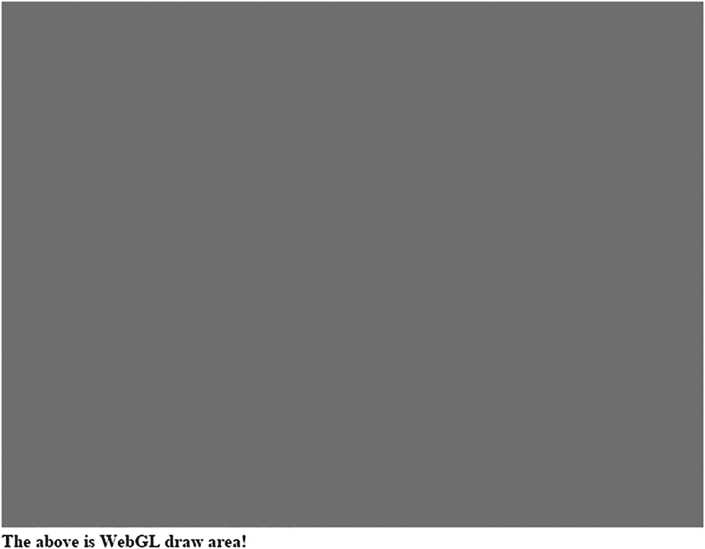
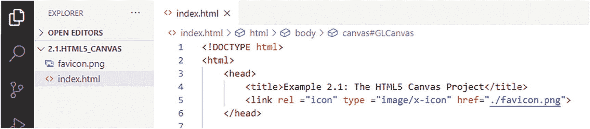
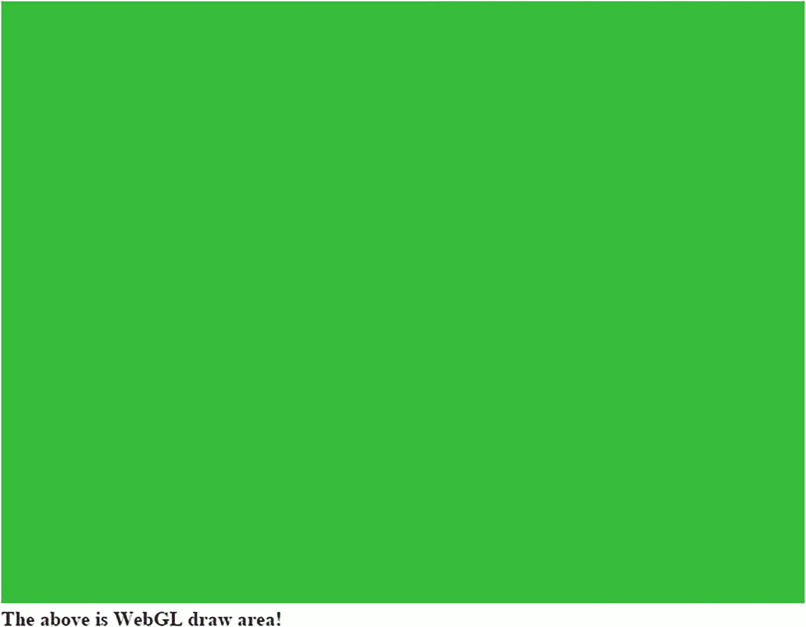
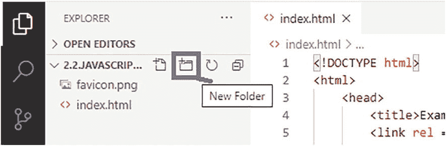
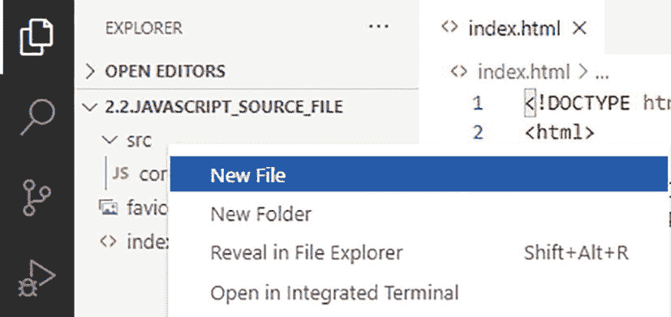
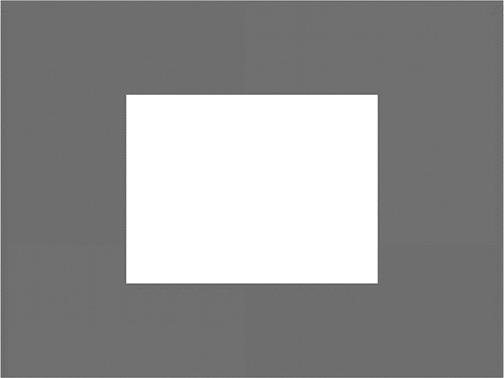
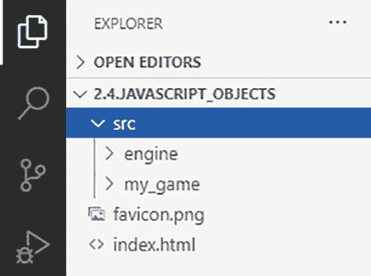
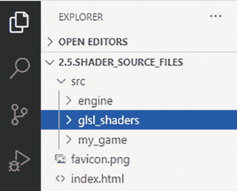
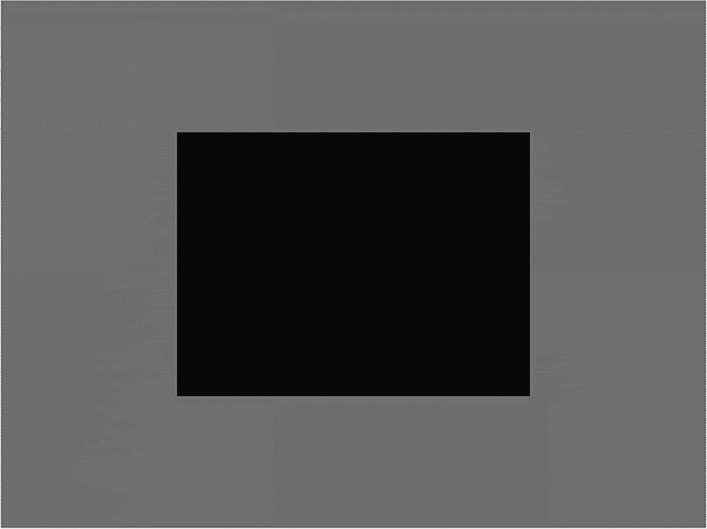

# 2. 使用 HTML5 和 WebGL

**Kelvin Sung**<sup>(1)</sup>, **Jebediah Pavleas**<sup>(2)</sup>, **Matthew Munson**<sup>(3)</sup>, 和 **Jason Pace**<sup>(4)</sup>  
(1) Bothell, WA, USA  
(2) Kenmore, WA, USA  
(3) Lake Forest Park, WA, USA  
(4) Portland, OR, USA

## 摘要

完成本章后，你将能够：

*   为你的简单游戏引擎创建一个新的 JavaScript 源代码文件
*   使用 WebGL 绘制一个简单的纯色正方形
*   定义 JavaScript 模块和类来封装并实现核心游戏引擎功能
*   理解抽象的重要性以及组织源代码结构以支持复杂度增长的重要性

## 简介

绘图是所有视频游戏共有的最基本功能之一。游戏引擎应为其绘图系统提供灵活且对程序员友好的接口。这样，在构建游戏时，设计师和开发者可以专注于游戏本身的重要方面，如机制、逻辑和美术。

WebGL 是一种现代 JavaScript 图形应用程序编程接口 (API)，专为基于 Web 浏览器的应用程序设计，通过直接访问图形硬件提供高质量和高效率。基于这些原因，WebGL 作为支持游戏引擎绘图的基础非常出色，特别是对于设计为通过互联网进行游玩的视频游戏。

本章探讨使用 WebGL 绘图的基础知识，设计抽象以封装无关细节从而便于编程，并构建基础设施来组织复杂的源代码系统以支持未来的扩展。

> **注意**  
> 本书中你将开发的游戏引擎基于最新版本的 WebGL 规范：版本 2.0。为简洁起见，术语 WebGL 将用于指代此 API。

## 用于绘图的 Canvas

要绘图，你必须首先在网页中定义并划出一个专用区域。你可以通过使用 HTML `<canvas>` 元素来轻松实现这一点，该元素用于定义一个用于 WebGL 绘图的区域。`<canvas>` 元素是一个绘图容器，你可以使用 JavaScript 访问和操作它。

### HTML5 Canvas 项目

该项目演示如何在网页上创建和清除 `<canvas>` 元素。图 2-1 显示了运行该项目的示例，该项目定义在 `chapter2/2.1.html5_canvas` 文件夹中。



**图 2-1** ¶ 运行 HTML5 Canvas 项目

项目目标如下：

*   学习如何设置 HTML `<canvas>` 元素
*   学习如何从 HTML 文档检索 `<canvas>` 元素以供 JavaScript 使用
*   学习如何从检索到的 `<canvas>` 元素创建 WebGL 引用上下文，并通过 WebGL 上下文操作 canvas

### 创建和清除 HTML Canvas

在第一个项目中，你将创建一个空的 HTML5 canvas 并使用 WebGL 将 canvas 清除为特定颜色：

1.  **创建一个新项目**，方法是在你选择的目录中创建一个名为 `html5_canvas` 的新文件夹，并复制粘贴你在第一章前一个项目中创建的 `index.html` 文件。

> **注意**  
> 从这一点开始，当要求创建新项目时，你应该遵循前面描述的过程。即，创建一个以项目名称命名的新文件夹，并复制/粘贴前一个项目的文件。这样，你的新项目可以在保留原有功能的基础上进行扩展。

2.  **在编辑器中打开 `index.html` 文件**，方法是打开 `html5_canvas` 文件夹，如果需要则展开它，然后点击 `index.html` 文件，如图 2-2 所示。



**图 2-2** ¶ 在项目中编辑 `index.html` 文件

3.  **创建用于绘图的 HTML canvas**，方法是在 `index.html` 文件的 `<body>` 元素中添加以下行：

```html
<canvas id="GLCanvas" width="640" height="480">
    Your browser does not support the HTML5 canvas.
</canvas>
```

该代码定义了一个名为 `GLCanvas` 的 `<canvas>` 元素，并指定了 `width` 和 `height` 属性。正如你稍后将体验到的，你将检索对 `GLCanvas` 的引用以绘制到该区域。元素内部的文本将在你的浏览器不支持使用 WebGL 绘图时显示。

> **注意**  
> `<body>` 和 `</body>` 标签之间的行被称为“在 body 元素内”。在本书其余部分，“在 *AnyTag* 元素内”将用于指代开始标签 (`<AnyTag>`) 和结束标签 (`</AnyTag>`) 之间的任何行。

4.  **创建一个用于包含 JavaScript 编程代码的 `<script>` 元素**，同样在 `<body>` 元素内：

```html
<script type="text/javascript">
    // JavaScript code goes here.
</script>
```

这完成了该项目的 HTML 部分。你现在将为示例的其余部分编写 JavaScript 代码。

5.  **在 JavaScript 代码中检索对 `GLCanvas` 的引用**，方法是在 `<script>` 元素内添加以下行：

```javascript
"use strict";
let canvas = document.getElementById("GLCanvas");
```

> **注意**  
> JavaScript 关键字 `let` 用于定义变量。  
> 第一行，`use strict`，是一条 JavaScript 指令，指示代码应在“严格模式”下执行，在该模式下使用未声明的变量会导致运行时错误。第二行创建一个名为 `canvas` 的新变量，并将该变量引用到 `GLCanvas` 绘图区域。

> **注意**  
> 所有局部变量名均以小写字母开头，如 `canvas`。

6.  **检索并绑定对 WebGL 上下文的引用到绘图区域**，方法是添加以下代码：

```javascript
let gl = canvas.getContext("webgl2") ||
         canvas.getContext("experimental-webgl2");
```

正如代码所示，检索到的 WebGL 版本 2 上下文引用存储在名为 `gl` 的局部变量中。通过此变量，你可以访问 WebGL 2.0 的所有功能。再次强调，在本书其余部分，术语 WebGL 将用于指代 WebGL 版本 2.0 API。

7.  **通过 WebGL 将 canvas 绘图区域清除为你喜欢的颜色**，方法是添加以下内容：


## WebGL 初始化与代码分离

```javascript
if (gl !== null) {
    gl.clearColor(0.0, 0.8, 0.0, 1.0);
    gl.clear(gl.COLOR_BUFFER_BIT);
}
```

这段代码检查 `WebGL` 上下文是否正确获取，设置清除颜色，并清除绘图区域。注意清除颜色采用 `RGBA` 格式，浮点数值范围为 `0.0` 到 `1.0`。`RGBA` 格式中的第四个数字是 `alpha` 通道。你将在后续章节了解更多关于 `alpha` 通道的内容。目前，始终将 `alpha` 通道赋值为 `1.0`。指定的颜色 `(0.0, 0.8, 0.0, 1.0)` 在红色和蓝色通道为零值，绿色通道强度为 `0.8`（即 80%）。因此，画布区域被清除为浅绿色。

## 步骤

1.  **添加简单的写入命令** 到文档中以标识画布，插入以下行：

```javascript
document.write("<br><b>The above is WebGL draw area!</b>");
```

你可以参考 `chapter2/2.1.html5_canvas` 项目中 `index.html` 文件的最终源代码。运行项目，你应该会在浏览器窗口中看到如图 2-1 所示的浅绿色区域。这是你定义的 `640×480` 画布绘图区域。

你可以尝试将清除颜色改为白色，通过将 `gl.clearColor()` 的 `RGBA` 设置为 `1`；或改为黑色，将颜色设置为 `0` 并保持 `alpha` 值为 `1`。注意如果将 `alpha` 通道设置为 `0`，画布颜色将消失。这是因为 `alpha` 通道为 `0` 表示完全透明，因此你将“透过”画布看到网页的背景色。你也可以尝试通过将 `640×480` 的值改为任何你喜欢的数字来改变画布分辨率。注意这两个数字指的是像素计数，因此必须始终为整数。

## 分离 HTML 与 JavaScript

在之前的项目中，你创建了一个 `HTML` 画布元素并使用 `WebGL` 清除了由画布定义的区域。注意所有功能都集中在 `index.html` 文件中。随着项目复杂度增加，这种功能聚类会迅速变得难以管理，并对系统的可编程性产生负面影响。因此，在本书的开发过程中，概念引入后，将花费精力将相关源代码分离到定义良好的源代码文件中，或以面向对象编程风格分离到类中。为了开始这个过程，将之前项目中的 `HTML` 和 `JavaScript` 源代码分离到不同的源代码文件中。

## JavaScript 源文件项目

该项目演示如何将源代码逻辑分离到适当的文件中。你可以通过创建一个名为 `core.js` 的独立 `JavaScript` 源代码文件来实现这一点，该文件实现 `index.html` 文件中的相应功能。网页将按照 `index.html` 文件中的代码指示加载 `JavaScript` 源代码。如图 2-3 所示，运行时该项目与之前的项目外观相同。该项目的源代码位于 `chapter2/2.2.javascript_source_file` 文件夹中。



**图 2-3 ¶ 运行 JavaScript 源文件项目**

项目目标如下：

*   学习如何将源代码分离到不同文件中
*   以逻辑结构组织代码

### 分离 JavaScript 源代码文件

本节详细说明如何创建和编辑新的 `JavaScript` 源代码文件。你应该熟悉这个过程，因为你将在本书中创建大量源代码文件。

1.  **创建一个名为 `javascript_source_file` 的 HTML5 项目**。回顾一下，创建新项目的方法是：创建一个具有适当名称的文件夹，从之前的项目复制文件，并编辑 `index.html` 的 `<Title>` 元素以反映新项目。

2.  **在项目文件夹内创建一个名为 `src` 的新文件夹**，方法是将鼠标悬停在项目文件夹上并点击新建文件夹图标，如图 2-4 所示。该文件夹将包含你所有的源代码。



**图 2-4 ¶ 创建新源代码文件夹**

3.  **在 `src` 文件夹中创建一个新的源代码文件**，方法是右键点击 `src` 文件夹，如图 2-5 所示。将新源文件命名为 `core.js`。



**图 2-5 ¶ 添加新 JavaScript 源代码文件**

> **Note**
> 在 `VS Code` 中，你可以使用资源管理器窗口中的右键菜单来创建/复制/重命名文件夹和文件。

4.  **打开新的 `core.js` 源文件进行编辑**。

5.  **定义一个用于引用 `WebGL` 上下文的变量，并添加一个允许访问该变量的函数**：

```javascript
"use strict";
let mGL = null;
function getGL() {
    return mGL;
}
```

> **Note**
> 在文件或模块中可访问的变量，其名称以小写字母 `m` 开头，如 `mGL`。

6.  **定义 `initWebGL()` 函数**，通过传入适当的画布 `id` 作为参数来获取 `GLCanvas`，将绘图区域绑定到 `WebGL` 上下文，将结果存储在定义的 `mGL` 变量中，并清除绘图区域：

```javascript
function initWebGL(htmlCanvasID) {
    let canvas = document.getElementById(htmlCanvasID);
    mGL = canvas.getContext("webgl2") ||
          canvas.getContext("experimental-webgl2");
    if (mGL === null) {
        document.write("<br><b>WebGL 2 is not supported!</b>");
        return;
    }
    mGL.clearColor(0.0, 0.8, 0.0, 1.0);
}
```

注意此函数与你在之前项目中输入的 `JavaScript` 源代码相似。这是因为在这种情况下，你所做的唯一不同就是将 `JavaScript` 源代码从 `HTML` 代码中分离出来。

> **Note**
> 所有函数名均以小写字母开头，如 `initWebGL()`。

7.  **定义 `clearCanvas()` 函数**，调用 `WebGL` 上下文来清除画布绘图区域：

```javascript
function clearCanvas() {
    mGL.clear(mGL.COLOR_BUFFER_BIT);
}
```

8.  **定义一个函数**，在网页浏览器完成 `index.html` 文件加载后执行画布区域的初始化和清除：

```javascript
window.onload = function() {
    initWebGL("GLCanvas");
    clearCanvas();
}
```

### 从 index.html 加载并运行 JavaScript 源代码

在 `core.js` 文件中定义了所有 `JavaScript` 功能后，你现在需要通过 `index.html` 文件加载此文件以在网页上运行：

1.  **打开 `index.html` 文件进行编辑**。

2.  **创建 `HTML` 画布 `GLCanvas`**，同之前的项目。

3.  **通过在 `head` 元素中包含以下代码来加载 `core.js` 源代码**：

```html
<script type="module" src="./src/core.js"></script>
```

有了这段代码，`core.js` 文件将作为 `index.html` 定义的网页的一部分被加载。回顾一下，你已经为 `window.onload` 定义了一个函数，当 `index.html` 加载完成时将调用该函数。

你可以参考 `chapter2/2.2.javascript_source_file` 项目文件夹中 `core.js` 和 `index.html` 文件的最终源代码。虽然该项目的输出与之前的项目相同，但代码的组织将使你能够在继续添加新功能时扩展、调试和理解游戏引擎。

> **Note**


## 使用 WebGL 进行基础绘图

回顾一下，要运行项目，你需要在打开 `index.html` 文件于编辑器窗口时，点击 VS Code 窗口右下角的“Go Live”按钮，或输入 `Alt+L Alt+O` 键。在这种情况下，如果在编辑器窗口中打开的是 `core.js` 文件时点击“Go Live”按钮，项目将无法运行。

## 观察

仔细检查你的 `index.html` 文件，并将其内容与上一个项目中的同名文件进行比较。你会注意到，上一个项目的 `index.html` 文件包含两类信息（HTML 和 JavaScript 代码），而本项目的同名文件仅包含前者，所有 JavaScript 代码均已提取至 `core.js`。这种清晰的信息分离便于理解源代码，并提升了对更复杂系统的支持能力。从现在起，所有 JavaScript 源代码都将添加到单独的源代码文件中。

一般来说，绘图涉及几何数据及处理这些数据的指令。在 WebGL 中，处理数据的指令用 OpenGL 着色语言（GLSL）指定，称为着色器。要使用 WebGL 绘图，程序员必须在 CPU 中定义几何数据和 GLSL 着色器，并将两者加载到绘图硬件，即图形处理单元（GPU）。此过程涉及大量的 WebGL 函数调用。本节将详细介绍 WebGL 绘图步骤。

重要的是要专注于学习这些基础步骤，避免被不那么重要的 WebGL 配置细节分散注意力，以便你能继续学习构建游戏引擎所涉及的整体概念。

在下一个项目中，你将通过专注于最基本的操作来学习使用 WebGL 绘图。这包括将正方形的简单几何数据从 CPU 加载到 GPU、创建常量颜色着色器，以及使用两个三角形绘制简单正方形的基本指令。

## 绘制一个正方形项目

该项目将引导你完成在画布上绘制单个正方形所需的步骤。图 2-6 展示了运行该项目的示例，该项目定义在 `chapter2/2.3.draw_one_square` 文件夹中。 

图 2-6 ¶ 运行绘制一个正方形项目

项目目标如下：

*   理解如何将几何数据加载到 GPU
*   了解用于 WebGL 绘图的简单 GLSL 着色器
*   学习如何编译并将着色器加载到 GPU
*   理解使用 WebGL 绘图所需的步骤
*   演示基于简单源代码文件实现类单例的 JavaScript 模块

### 设置并加载基础几何数据

为了高效地使用 WebGL 绘图，与待绘制几何体相关的数据（如正方形的顶点位置）应存储在 GPU 硬件中。在以下步骤中，你将在 GPU 中创建一个连续缓冲区，将单位正方形的顶点位置加载到该缓冲区，并将对 GPU 缓冲区的引用存储在一个变量中。汲取上一个项目的经验，相应的 JavaScript 代码将存储在一个新的源代码文件 `vertex_buffer.js` 中。

> **注意**
>
> 单位正方形是指以原点为中心、边长为 1×1 的正方形。

1.  在 `src` 文件夹中创建一个新的 JavaScript 源文件，命名为 `vertex_buffer.js`。

2.  使用 JavaScript `import` 语句，将 `core.js` 文件中所有导出的功能作为 `core` 导入：

```
"use strict";
import * as core from "./core.js";
```

> **注意**
>
> 通过 JavaScript 的 `import` 和即将遇到的 `export` 语句，文件中定义的特性和功能可以方便地封装和访问。在本例中，从 `core.js` 导出的功能被导入到 `vertex_buffer.js` 中，并可通过模块标识符 `core` 访问。例如，正如你将看到的，在本项目中，`core.js` 定义并导出了一个 `getGL()` 函数。通过给定的 `import` 语句，该函数可在 `vertex_buffer.js` 文件中作为 `core.getGL()` 访问。

3.  声明变量 `mGLVertexBuffer` 以存储对 WebGL 缓冲区位置的引用。记得定义一个用于访问此变量的函数。

```
let mGLVertexBuffer = null;
function get() {
    return mGLVertexBuffer;
}
```

4.  定义变量 `mVerticesOfSquare` 并用单位正方形的顶点对其进行初始化：

```
let mVerticesOfSquare = [
    0.5,  0.5,  0.0,
   -0.5,  0.5,  0.0,
    0.5, -0.5,  0.0,
   -0.5, -0.5,  0.0
];
```

在所示代码中，每行三个数字代表一个顶点的 x、y 和 z 坐标位置。请注意，z 维度设置为 `0.0`，因为你正在构建一个 2D 游戏引擎。另请注意，使用 `0.5` 是为了在 2D 空间中定义一个边长为 1 且以原点为中心的正方形，即单位正方形。

5.  定义 `init()` 函数，通过 `gl` 上下文在 GPU 中分配一个缓冲区，并将顶点加载到 GPU 中分配的缓冲区中：

```
function init() {
    let gl = core.getGL();
    // 步骤 A：在 gl 上下文中为我们的顶点位置创建一个缓冲区
    mGLVertexBuffer = gl.createBuffer();
    // 步骤 B：激活 vertexBuffer
    gl.bindBuffer(gl.ARRAY_BUFFER, mGLVertexBuffer);
    // 步骤 C：将 mVerticesOfSquare 加载到 vertexBuffer 中
    gl.bufferData(gl.ARRAY_BUFFER,
        new Float32Array(mVerticesOfSquare), gl.STATIC_DRAW);
}
```

这段代码首先通过 `core.getGL()` 函数获取 WebGL 绘图上下文的访问权限。随后，步骤 A 在 GPU 上创建一个用于存储正方形顶点位置的缓冲区，并将对 GPU 缓冲区的引用存储在变量 `mGLVertexBuffer` 中。步骤 B 激活新创建的缓冲区，步骤 C 将正方形的顶点位置加载到 GPU 上激活的缓冲区中。关键字 `STATIC_DRAW` 告知绘图硬件该缓冲区的内容不会改变。

> **提示**
>
> 请记住，通过 `getGL()` 函数访问的 `mGL` 变量是在 `core.js` 文件中定义并由 `initWebGL()` 函数初始化的。你将在接下来的步骤中在 `core.js` 文件中定义一个 `export` 语句，以提供对该函数的访问。

6.  通过以下代码导出 `init()` 和 `get()` 函数，使引擎的其他部分能够访问它们：

```
export {init, get}
```

随着顶点位置加载功能的定义完成，你现在可以准备定义和加载 GLSL 着色器了。

### 设置 GLSL 着色器

着色器一词指在 GPU 上运行的程序或指令集合。在游戏引擎的上下文中，着色器必须始终成对定义，由一个顶点着色器和一个相应的片段着色器组成。GPU 将为每个基元顶点执行一次顶点着色器，并为基元覆盖的每个像素执行一次片段着色器。例如，你可以用四个顶点定义一个正方形，并将其显示为覆盖 100×100 像素的区域。要绘制此正方形，WebGL 将调用顶点着色器 4 次（每个顶点一次），并执行片段着色器 10,000 次（每个 100×100 像素一次）！

在 WebGL 中，顶点着色器和片段着色器均用 OpenGL 着色语言（GLSL）实现。GLSL 是一种语法类似于 C 编程语言、专门为处理和显示图形基元而设计的语言。当需要时，你将学习足以支持游戏引擎绘图的 GLSL 知识。


在以下步骤中，你将把顶点着色器和片元着色器的源代码加载到 GPU 内存中，编译并链接它们成为一个着色器程序，然后将链接后的程序加载到 GPU 内存中用于绘制。在本项目中，着色器源代码定义在 `index.html` 文件中，而着色器的加载、编译和链接定义在 `shader_support.js` 源文件中。

> **注意**
>
> `WebGL` 上下文可视为 GPU 硬件的抽象。为便于阅读，`WebGL` 和 `GPU` 两个术语有时会交替使用。

## 定义顶点和片元着色器

GLSL 着色器就是由 GLSL 指令组成的程序：

### 1. 定义顶点着色器

打开 `index.html` 文件，在 `head` 元素中添加以下代码：

```html
<script type="x-shader/x-vertex" id="VertexShader">
    // this is the vertex shader
    attribute vec3 aVertexPosition;  // Expects one vertex position
    // naming convention, attributes always begin with "a"
    void main(void) {
        // Convert the vec3 into vec4 for scan conversion and
        // assign to gl_Position to pass vertex to the fragment shader
        gl_Position = vec4(aVertexPosition, 1.0);
    }
    // End of vertex shader
</script>
```

> **注意**
>
> 着色器属性变量的名称以小写字母 “a” 开头，如 `aVertexPosition`。

`script` 元素的 `type` 设置为 `x-shader/x-vertex`，因为这是着色器的常见约定。正如你将看到的，值为 `VertexShader` 的 `id` 字段允许你识别并将此顶点着色器加载到内存中。

GLSL `attribute` 关键字标识将传递给 GPU 中顶点着色器的逐顶点数据。在本例中，`aVertexPosition` 属性的数据类型为 `vec3` 或包含三个浮点数的数组。正如你在后续步骤中将看到的，`aVertexPosition` 将被设置为引用单位正方形的顶点位置。

`gl_Position` 是一个 GLSL 内置变量，具体为一个包含四个浮点数的数组，必须包含顶点位置。在本例中，数组的第四个位置始终为 `1.0`。代码展示了着色器将 `aVertexPosition` 转换为 `vec4` 并将信息传递给 WebGL。

### 2. 定义片元着色器

在 `index.html` 中通过在 `head` 元素内添加以下代码来定义片元着色器：

```html
<script type="x-shader/x-fragment" id="FragmentShader">
    // this is the fragment (or pixel) shader
    void main(void) {
        // for every pixel called (within the square) sets
        // constant color white with alpha-channel value of 1.0
        gl_FragColor = vec4(1.0, 1.0, 1.0, 1.0);
    }
    // End of fragment/pixel shader
</script>
```

注意不同的 `type` 和 `id` 字段。回想一下，片元着色器每像素调用一次。变量 `gl_FragColor` 是决定像素颜色的内置变量。在本例中，返回颜色 `(1,1,1,1)`，即白色。这意味着所有被覆盖的像素都将被着色为恒定的白色。

随着顶点和片元着色器均在 `index.html` 文件中定义完毕，你现在已准备好实现编译、链接并将生成的着色器程序加载到 GPU 的功能。

## 编译、链接并加载顶点和片元着色器

为将源代码维护在逻辑分离的源文件中，你将在一个新的源代码文件 `shader_support.js` 中创建着色器支持功能。

### 1. 创建新的 JavaScript 文件 `shader_support.js`

### 2. 从 `core.js` 和 `vertex_buffer.js` 文件导入功能：

```javascript
"use strict";  // Variables must be declared before used!
import * as core from "./core.js";        // access as core module
import * as vertexBuffer from "./vertex_buffer.js";  // vertexBuffer module
```

### 3. 定义两个变量 `mCompiledShader` 和 `mVertexPositionRef`，用于引用 GPU 中的着色器程序和顶点位置属性：

```javascript
let mCompiledShader = null;
let mVertexPositionRef = null;
```

### 4. 创建函数以加载和编译在 `index.html` 中定义的着色器：

```javascript
function loadAndCompileShader(id, shaderType) {
    let shaderSource = null, compiledShader = null;
    // Step A: Get the shader source from index.html
    let shaderText = document.getElementById(id);
    shaderSource = shaderText.firstChild.textContent;
    let gl = core.getGL();
    // Step B: Create shader based on type: vertex or fragment
    compiledShader = gl.createShader(shaderType);
    // Step C: Compile the created shader
    gl.shaderSource(compiledShader, shaderSource);
    gl.compileShader(compiledShader);
    // Step D: check for errors and return results (null if error)
    // The log info is how shader compilation errors are displayed.
    // This is useful for debugging the shaders.
    if (!gl.getShaderParameter(compiledShader, gl.COMPILE_STATUS)) {
        throw new Error("A shader compiling error occurred: " +
            gl.getShaderInfoLog(compiledShader));
    }
    return compiledShader;
}
```

代码的步骤 A 使用你在定义着色器时指定的 `id` 字段（`VertexShader` 或 `FragmentShader`）在 `index.html` 文件中查找着色器源代码。步骤 B 在 GPU 中创建指定类型（顶点或片元）的着色器。步骤 C 指定源代码并编译着色器。最后，步骤 D 检查并返回编译后着色器的引用，如果着色器编译失败则抛出错误。

### 5. 现在你可以通过定义 `init()` 函数来创建、编译并链接着色器程序：

```javascript
function init(vertexShaderID, fragmentShaderID) {
    let gl = core.getGL();
    // Step A: load and compile vertex and fragment shaders
    let vertexShader = loadAndCompileShader(vertexShaderID,
        gl.VERTEX_SHADER);
    let fragmentShader = loadAndCompileShader(fragmentShaderID,
        gl.FRAGMENT_SHADER);
    // Step B: Create and link the shaders into a program.
    mCompiledShader = gl.createProgram();
    gl.attachShader(mCompiledShader, vertexShader);
    gl.attachShader(mCompiledShader, fragmentShader);
    gl.linkProgram(mCompiledShader);
    // Step C: check for error
    if (!gl.getProgramParameter(mCompiledShader, gl.LINK_STATUS)) {
        throw new Error("Error linking shader");
        return null;
    }
    // Step D: Gets reference to aVertexPosition attribute in the shader
    mVertexPositionRef = gl.getAttribLocation(mCompiledShader,
        "aVertexPosition");
}
```

步骤 A 通过调用 `loadAndCompileShader()` 函数并传入相应参数，加载并编译你在 `index.html` 中定义的着色器代码。步骤 B 附加编译后的着色器并将两个着色器链接成一个程序。该程序的引用存储在变量 `mCompiledShader` 中。经过步骤 C 的错误检查后，步骤 D 定位并存储对你在顶点着色器中定义的 `aVertexPosition` 属性的引用。

### 6. 定义一个函数以激活着色器，使其可用于绘制正方形：


function activate() {
    // Step A: access to the webgl context
    let gl = core.getGL();
    // Step B: identify the compiled shader to use
    gl.useProgram(mCompiledShader);
    // Step C: bind vertex buffer to attribute defined in vertex shader
    gl.bindBuffer(gl.ARRAY_BUFFER, vertexBuffer.get());
    gl.vertexAttribPointer(this.mVertexPositionRef,
        3,              // each element is a 3-float (x,y.z)
        gl.FLOAT,       // data type is FLOAT
        false,          // if the content is normalized vectors
        0,              // number of bytes to skip in between elements
        0);             // offsets to the first element
    gl.enableVertexAttribArray(this.mVertexPositionRef);
}

在所示代码中，步骤 A 通过 `core` 模块将 `gl` 变量设置为 WebGL 上下文。步骤 B 将编译好的着色器程序加载到 GPU 内存中，而步骤 C 将在 `vertex_buffer.js` 中创建的顶点缓冲区绑定到顶点着色器中定义的 `aVertexPosition` 属性。`gl.vertexAttribPointer()` 函数体现了这样一个事实：顶点缓冲区加载了单位正方形的顶点，每个顶点位置由三个浮点值组成。

7. 最后，通过 `export` 语句导出 `init()` 和 `activate()` 函数，使游戏引擎的其余部分能够访问它们：

```
export { init, activate }
```

注意：请注意 `loadAndCompileShader()` 函数被排除在导出语句之外。该函数在其他地方不需要，因此遵循隐藏本地实现细节的良好开发实践，应保持为该文件的私有函数。

着色器加载和编译功能现已定义。您现在可以利用并激活这些函数通过 WebGL 进行绘制。

## 使用 WebGL 设置绘制

随着顶点数据和着色器功能的定义，您现在可以执行以下步骤通过 WebGL 进行绘制。回顾上一个项目，初始化和绘制代码定义在 `core.js` 文件中。现在打开此文件进行编辑。

1. 从 `vertex_buffer.js` 和 `shader_support.js` 文件导入定义的功能：

```
import * as vertexBuffer from "./vertex_buffer.js";
import * as simpleShader from "./shader_support.js";
```

2. 修改 `initWebGL()` 函数以包含顶点缓冲区和着色器程序的初始化：

```
function initWebGL(htmlCanvasID) {
    let canvas = document.getElementById(htmlCanvasID);
    // Get standard or experimental webgl and bind to the Canvas area
    // store the results to the instance variable mGL
    mGL = canvas.getContext("webgl2") ||
          canvas.getContext("experimental-webgl2");
    if (mGL === null) {
        document.write("<br><b>WebGL 2 is not supported!</b>");
        return;
    }
    mGL.clearColor(0.0, 0.8, 0.0, 1.0);  // set the color to be cleared
    // 1. initialize buffer with vertex positions for the unit square
    vertexBuffer.init(); // function defined in the vertex_buffer.js
    // 2. now load and compile the vertex and fragment shaders
    simpleShader.init("VertexShader", "FragmentShader");
    // the two shaders are defined in the index.html file
    // init() function is defined in shader_support.js file
}
```

如代码所示，在成功获取 WebGL 上下文引用并设置清除颜色后，您应该首先调用 `vertex_buffer.js` 中定义的 `init()` 函数，使用单位正方形顶点初始化 GPU 顶点缓冲区，然后调用 `shader_support.js` 中定义的 `init()` 函数来加载和编译顶点和片段着色器。

3. 添加 `drawSquare()` 函数以绘制定义的正方形：

```
function drawSquare() {
    // Step A: Activate the shader
    simpleShader.activate();
    // Step B. draw with the above settings
    mGL.drawArrays(mGL.TRIANGLE_STRIP, 0, 4);
}
```

此代码展示了使用 WebGL 绘制的步骤。步骤 A 激活要使用的着色器程序。步骤 B 发出 WebGL 绘制命令。在这种情况下，您发出的命令是将四个顶点绘制为两个相连的三角形以形成一个正方形。

4. 现在您只需要修改 `window.onload` 函数以调用新定义的 `drawSquare()` 函数：

```
window.onload = function() {
    initWebGL("GLCanvas");  // Binds mGL context to WebGL functionality
    clearCanvas();          // Clears the GL area
    drawSquare();           // Draws one square
}
```

5. 最后，通过导出 `getGL()` 函数，为引擎的其余部分提供对 WebGL 上下文的访问。请记住，此函数被导入并在 `vertex_buffer.js` 和 `simple_shader.js` 中被调用以访问 WebGL 上下文。

```
export { getGL }
```

回顾一下，绑定到 `window.onload` 的函数将在 Web 浏览器加载 `index.html` 后被调用。因此，WebGL 将被初始化，画布被清除为浅绿色，并绘制一个白色正方形。您可以参考 `chapter2/2.3.draw_one_square` 项目中的源代码以了解所描述的完整系统。

### 观察

运行项目，您将在绿色画布上看到一个白色矩形。正方形去哪了？请记住，您的 1×1 正方形的顶点位置定义在 (±0.5, ±0.5) 处。现在观察项目输出：白色矩形位于绿色画布的正中间，精确覆盖了画布宽度和高度的一半。事实上，WebGL 将 ±1.0 范围内的顶点绘制到整个定义的绘图区域上。在本例中，x 维度的 ±1.0 映射到 640 像素，而 y 维度的 ±1.0 映射到 480 像素（创建的画布尺寸为 640×480）。1x1 的正方形被绘制到 640x480 的区域上，即宽高比为 4:3 的区域。由于正方形的 1:1 宽高比与显示区域的 4:3 宽高比不匹配，正方形显示为 4:3 的矩形。此问题将在下一章中解决。

您可以尝试编辑 `index.html` 中的片段着色器，通过更改 `gl_FragColor` 函数中设置的颜色来改变白色正方形的颜色。请注意，alpha 通道中的值小于 1 不会导致白色正方形变得透明。绘制图元的透明度将在后续章节中讨论。

最后，请注意该项目定义了三个单独的文件，并使用 JavaScript `import`/`export` 语句隐藏信息。这些文件中通过相应的 `import` 和 `export` 语句定义的功能被称为 JavaScript 模块。模块可以被视为全局单例对象，非常适合隐藏实现细节。`shader_support` 模块中的 `loadAndCompileShader()` 函数是这一概念的绝佳示例。然而，模块不太适合支持抽象和专业化。在接下来的章节中，您将开始使用 JavaScript 类进一步封装此示例的部分内容，以形成游戏引擎框架的基础。

## 使用 JavaScript 类进行抽象

上一个项目将绘制正方形分解为逻辑模块，并将模块实现为包含全局函数的文件。在软件工程中，此过程称为功能分解，实现称为过程式编程。过程式编程通常产生结构良好且易于理解的解决方案。这就是为什么功能分解和过程式编程常用于原型设计或学习新技术。

本项目通过面向对象分析和编程增强了“绘制一个正方形”项目，以引入数据抽象。随着更多概念的引入和游戏引擎复杂性的增长，适当的数据抽象支持通过继承实现直接的设计、行为专业化和代码复用。

### JavaScript 对象项目


#### JavaScript 对象项目

本项目演示如何将“绘制一个正方形”项目中的全局函数抽象为 JavaScript 类和对象。这种面向对象的抽象将产生一个框架，为后续项目提供可管理性和可扩展性。如图 2-7 所示，运行时，该项目会在一个绿色的画布上显示一个白色矩形，这与“绘制一个正方形”项目的结果完全相同。本项目的源代码位于 `chapter2/2.4.javascript_objects` 文件夹中。


**图 2-7 ¶ 运行 JavaScript 对象项目**

## 目标

项目目标如下：

*   将游戏引擎代码与游戏逻辑代码分离
*   理解如何使用 JavaScript 类和对象构建抽象

## 步骤

创建该项目的步骤如下：

1.  创建单独的文件夹来组织游戏引擎的源代码和游戏的逻辑代码。
2.  定义一个 JavaScript 类来抽象 `simple_shader` 并使用该类的实例。
3.  定义一个 JavaScript 类来实现绘制一个正方形的功能，这目前是你的简单游戏的逻辑。

## 源代码组织

通过创建一个新文件夹并添加一个名为 `src` 的源代码文件夹，使用 VS Code 创建一个新的 HTML5 项目。在 `src` 中，创建 `engine` 和 `my_game` 作为子文件夹，如图 2-8 所示。



**图 2-8 ¶ 在 src 文件夹下创建 engine 和 my_game**

`src/engine` 文件夹将包含游戏引擎的所有源代码，而 `src/my_game` 文件夹将包含游戏逻辑的源代码。认真组织源代码非常重要，因为随着更多概念的引入，系统的复杂性和文件数量将迅速增加。良好的源代码结构有助于理解和扩展。

> **提示**
>
> `my_game` 文件夹中的源代码通过依赖 `engine` 文件夹中定义的游戏引擎提供的功能来实现游戏。因此，在本书中，`my_game` 文件夹中的源代码通常被称为游戏引擎的*客户端*。

## 抽象游戏引擎

一个完整的游戏引擎将包含许多自包含的子系统，以履行不同的职责。例如，您可能熟悉或听说过用于管理待绘制几何体的几何子系统、用于管理图像和音频剪辑的资源管理子系统、用于管理对象交互的物理子系统等。在大多数情况下，游戏引擎将包含这些子系统中每一个的唯一实例，即一个几何子系统实例、一个资源管理子系统实例、一个物理子系统实例，依此类推。

这些子系统将在本书后面的章节中介绍。本节重点建立基于您在上一个项目中使用的 JavaScript 模块，实现这种单实例或类单例功能的机制和组织。

> **注意**
>
> 所有模块和实例变量名均以“m”开头，后跟大写字母，如 `mVariable`。虽然 JavaScript 不强制要求，但您永远不应从模块/类外部访问模块或实例变量。例如，您永远不应直接访问 `core.mGL`；而应调用 `core.getGL()` 函数来访问该变量。

### Shader 类

尽管上一个项目中 `shader_support.js` 文件中的代码正确实现了所需功能，但其变量和函数不利于行为专用化和代码复用。例如，当需要不同类型的着色器时，要在实现行为和代码复用的同时修改实现可能会很困难。本节遵循面向对象设计原则，定义一个 `SimpleShader` 类来抽象行为并隐藏着色器的内部表示。除了能够创建多个 `SimpleShader` 对象实例外，基本功能基本保持不变。

> **注意**
>
> 模块标识符以小写字母开头，例如 `core` 或 `vertexBuffer`。类名以大写字母开头，例如 `SimpleShader` 或 `MyGame`。

1.  在 `src/engine` 文件夹中创建一个新的源文件，命名为 `simple_shader.js` 以实现 `SimpleShader` 类。
2.  导入 `core` 和 `vertex_buffer` 两个模块：

```javascript
import * as core from "./core.js";
import * as vertexBuffer from "./vertex_buffer.js";
```

3.  将 `SimpleShader` 声明为一个 JavaScript 类：

```javascript
class SimpleShader {
    // ... 后续实现 ...
}
```

4.  在 `SimpleShader` 类中定义构造函数，以加载、编译和链接顶点和片段着色器为一个程序，并创建对顶点着色器中 `aVertexPosition` 属性的引用，以便从 WebGL 顶点缓冲区加载正方形顶点位置进行绘制：

```javascript
constructor(vertexShaderID, fragmentShaderID) {
    // 实例变量
    // 约定：所有实例变量：mVariables
    this.mCompiledShader = null;  // 指向 webgl 中编译好的着色器的引用
    this.mVertexPositionRef = null; // 指向着色器中 VertexPosition 的引用
    let gl = core.getGL();
    // 步骤 A：加载并编译顶点和片段着色器
    this.mVertexShader = loadAndCompileShader(vertexShaderID,
        gl.VERTEX_SHADER);
    this.mFragmentShader = loadAndCompileShader(fragmentShaderID,
        gl.FRAGMENT_SHADER);
    // 步骤 B：创建并链接着色器为一个程序。
    this.mCompiledShader = gl.createProgram();
    gl.attachShader(this.mCompiledShader, this.mVertexShader);
    gl.attachShader(this.mCompiledShader, this.mFragmentShader);
    gl.linkProgram(this.mCompiledShader);
    // 步骤 C：检查错误
    if (!gl.getProgramParameter(this.mCompiledShader, gl.LINK_STATUS)) {
        throw new Error("Error linking shader");
        return null;
    }
    // 步骤 D：获取着色器中 aVertexPosition 属性的引用
    this.mVertexPositionRef = gl.getAttribLocation(
        this.mCompiledShader, "aVertexPosition");
}
```

请注意，此构造函数本质上与上一个项目中 `shader_support.js` 模块中的 `init()` 函数相同。

> **注意**
>
> JavaScript `constructor` 关键字定义类的构造函数。

5.  向 `SimpleShader` 类添加一个方法以激活着色器进行绘制。这同样类似于上一个项目中 `shader_support.js` 中的 `activate()` 函数。

```javascript
activate() {
    let gl = core.getGL();
    gl.useProgram(this.mCompiledShader);
    // 绑定顶点缓冲区
    gl.bindBuffer(gl.ARRAY_BUFFER, vertexBuffer.get());
    gl.vertexAttribPointer(this.mVertexPositionRef,
        3,          // 每个元素是一个 3-float (x,y.z)
        gl.FLOAT,   // 数据类型为 FLOAT
        false,      // 内容是否为归一化向量
        0,          // 元素间跳过的字节数
        0);         // 第一个元素的偏移量
    gl.enableVertexAttribArray(this.mVertexPositionRef);
}
```

6.  通过在 `SimpleShader` 类外部创建一个函数，添加一个私有方法（无法从 `simple_shader.js` 文件外部访问），以执行实际的加载和编译功能：


## 游戏引擎的核心：core.js

核心包含整个游戏引擎共享的通用功能。这可能包括 WebGL（或 GPU）的一次性初始化、共享资源、工具函数等。

## 函数：`loadAndCompileShader`

```javascript
function loadAndCompileShader(id, shaderType) {
    let shaderSource = null, compiledShader = null;
    let gl = core.getGL();
    // Step A: Get the shader source from index.html
    let shaderText = document.getElementById(id);
    shaderSource = shaderText.firstChild.textContent;
    // Step B: Create shader based on type: vertex or fragment
    compiledShader = gl.createShader(shaderType);
    // Step C: Compile the created shader
    gl.shaderSource(compiledShader, shaderSource);
    gl.compileShader(compiledShader);
    // Step D: check for errors and return results (null if error)
    // The log info is how shader compilation errors are displayed
    // This is useful for debugging the shaders.
    if (!gl.getShaderParameter(compiledShader, gl.COMPILE_STATUS)) {
        throw new Error("A shader compiling error occurred: " +
            gl.getShaderInfoLog(compiledShader));
    }
    return compiledShader;
}
```

请注意，此函数与你在 `shader_support.js` 中创建的函数完全相同。

> **注意**
>
> 本书不使用 JavaScript 的 `#` 前缀来定义私有成员，因为子类不可见会使继承中的行为特化变得复杂。

## 创建 `core.js` 的步骤

1.  在新文件夹 `src/engine` 下创建一份 `core.js` 的副本。

2.  定义一个函数来创建 `SimpleShader` 对象的新实例：

    ```javascript
    // The shader
    let mShader = null;
    function createShader() {
        mShader = new SimpleShader(
            "VertexShader",   // IDs of the script tag in the index.html
            "FragmentShader"); // 
    }
    ```

3.  修改 `initWebGL()` 函数，使其专注于仅初始化 WebGL，如下所示：

    ```javascript
    // initialize the WebGL
    function initWebGL(htmlCanvasID) {
        let canvas = document.getElementById(htmlCanvasID);
        // Get standard or experimental webgl and binds to the Canvas area
        // store the results to the instance variable mGL
        mGL = canvas.getContext("webgl2") ||
            canvas.getContext("experimental-webgl2");
        if (mGL === null) {
            document.write("<br><b>WebGL 2 is not supported!</b>");
            return;
        }
    }
    ```

4.  创建一个 `init()` 函数来执行引擎范围的系统初始化，包括初始化 WebGL 和顶点缓冲区，以及创建简单着色器的实例：

    ```javascript
    function init(htmlCanvasID) {
        initWebGL(htmlCanvasID);  // setup mGL
        vertexBuffer.init();      // setup mGLVertexBuffer
        createShader();           // create the shader
    }
    ```

5.  修改清空画布函数，将要清空的颜色参数化：

    ```javascript
    function clearCanvas(color) {
        mGL.clearColor(color[0], color[1], color[2], color[3]);
        mGL.clear(mGL.COLOR_BUFFER_BIT); // clear to the color set
    }
    ```

6.  导出相关函数以供游戏引擎的其余部分访问：

    ```javascript
    export { getGL, init, clearCanvas, drawSquare }
    ```

7.  最后，移除 `window.onload` 函数，因为实际游戏的行为应由游戏引擎的客户端定义，在本例中即 `MyGame` 类。

`src/engine` 文件夹现在包含整个游戏引擎的基本源代码。由于对源代码进行了这些结构性更改，游戏引擎现在可以作为一个简单的库来运行，提供创建游戏或简单应用程序编程接口（API）的功能。目前，你的游戏引擎由三个文件组成，它们支持 WebGL 的初始化和单位正方形的绘制：核心模块、`vertex_buffer` 模块和 `SimpleShader` 类。在后续项目中，新的源文件和功能将继续添加到此文件夹中。最终，该文件夹将包含一个完整且复杂的游戏引擎。然而，此处定义的核心库式框架将保持不变。

## 客户端源代码

`src/my_game` 文件夹将包含游戏的实际源代码。如前所述，该文件夹中的代码将被称为游戏引擎的*客户端*。目前，`my_game` 文件夹中的源代码将专注于利用你定义的简单游戏引擎的功能来绘制一个简单的正方形。

## 创建 `my_game.js` 的步骤

1.  在 `src/my_game` 文件夹（即*客户端*文件夹）中创建一个新的源文件，并将其命名为 `my_game.js`。

2.  按如下方式导入核心模块：

    ```javascript
    import * as engine from "../engine/core.js";
    ```

3.  将 `MyGame` 定义为一个 JavaScript 类，并添加一个构造函数来初始化游戏引擎、清空画布并绘制正方形：

    ```javascript
    class MyGame {
        constructor(htmlCanvasID) {
            // Step A: Initialize the game engine
            engine.init(htmlCanvasID);
            // Step B: Clear the canvas
            engine.clearCanvas([0, 0.8, 0, 1]);
            // Step C: Draw the square
            engine.drawSquare();
        }
    }
    ```

4.  将创建 `MyGame` 对象新实例的操作绑定到 `window.onload` 函数：

    ```javascript
    window.onload = function() {
        new MyGame('GLCanvas');
    }
    ```

5.  最后，修改 `index.html`，使其在 head 元素中加载游戏客户端，而不是引擎的 `core.js`：

    ```html
    <script type="module" src="./src/my_game/my_game.js"></script>
    ```

## 观察

虽然你完成的任务与上一个项目相同，但通过这个项目，你创建了一个支持游戏引擎后续修改和扩展的基础设施。你将源代码组织到独立且合乎逻辑的文件夹中，组织了类单例模块以实现引擎的核心功能，并获得了抽象 `SimpleShader` 类的经验，这将支持未来的设计和代码复用。现在引擎由定义良好、具有清晰接口方法的模块和对象组成，你可以专注于学习新概念、抽象概念，并将新的实现源代码集成到引擎中。

## 将 GLSL 与 HTML 分离

迄今为止在你的项目中，GLSL 着色器代码嵌入在 `index.html` 的 HTML 源代码中。这种组织方式意味着必须通过编辑 `index.html` 文件来添加新着色器。从逻辑上讲，GLSL 着色器应与 HTML 源文件分开组织；从实际操作上讲，持续向 `index.html` 添加内容会导致文件变得杂乱且难以管理，从而难以处理。基于这些原因，GLSL 着色器应存储在单独的源文件中。

## 着色器源文件项目

该项目演示了如何将 GLSL 着色器分离到单独的文件中。如图 2-9 所示，运行该项目时，会在绿色画布上显示一个白色矩形，这与之前的项目相同。该项目的源代码定义在 `chapter2/2.5.shader_source_files` 文件夹中。


**图 2-9 ¶ 运行着色器源文件项目**

该项目的目标如下：

*   将 GLSL 着色器与 HTML 源代码分离
*   演示如何在运行时加载着色器源代码文件

## 在 `SimpleShader` 中加载着色器

与将 GLSL 着色器作为 HTML 文档的一部分加载不同，`SimpleShader` 中的 `loadAndCompileShader()` 可以修改为将 GLSL 着色器作为单独的文件加载：

1.  [内容继续...]


## 继续之前的项目

打开 `simple_shader.js` 文件并编辑 `loadAndCompileShader()` 函数，使其接收文件路径而不是 HTML ID：

```javascript
function loadAndCompileShader(filePath, shaderType)
```

在 `loadAndCompileShader()` 函数内，用以下 `XMLHttpRequest` 替换步骤 A 中的 HTML 元素检索代码以加载文件：

```javascript
let xmlReq, shaderSource = null, compiledShader = null;
let gl = core.getGL();
// 步骤 A：从给定的文件位置请求文本。
xmlReq = new XMLHttpRequest();
xmlReq.open('GET', filePath, false);
try {
    xmlReq.send();
} catch (error) {
    throw new Error("Failed to load shader: "
        + filePath
        + " [Hint: you cannot double click to run this project. "
        + "The index.html file must be loaded by a web-server.]");
    return null;
}
shaderSource = xmlReq.responseText;
if (shaderSource === null) {
    throw new Error("WARNING: Loading of:" + filePath + " Failed!");
    return null;
}
```

请注意，文件加载将同步发生，浏览器实际上会停下来等待 `xmlReq.open()` 函数完成并返回打开文件的内容。如果文件丢失，打开操作将失败，响应文本将为 `null`。

`xmlReq.open()` 函数完成时的同步“停止并等待”效率低下，可能导致网页加载缓慢。这一缺点将在第 4 章中解决，届时你将学习游戏资源的异步加载。

> **注意**
>
> `XMLHttpRequest()` 对象需要一个正在运行的 Web 服务器来满足 HTTP GET 请求。这意味着你可以使用已安装的“Go Live”扩展在 VS Code 中测试此项目。然而，除非你的机器上运行着 Web 服务器，否则你无法通过直接双击 `index.html` 文件来运行此项目。这是因为没有服务器来满足 HTTP GET 请求，GLSL 着色器加载将会失败。

通过此修改，`SimpleShader` 构造函数现在可以修改为接收文件路径并将其转发给 `loadAndCompileShader()` 函数，而不是 HTML 元素 ID。

## 将着色器提取到单独的文件中

以下步骤从 `index.html` 文件中检索顶点和片段着色器的源代码，并创建单独的文件来存储它们：

1. 在 `src` 文件夹中创建一个新文件夹，用于包含所有 GLSL 着色器源代码文件，并将其命名为 `glsl_shaders`，如图 2-10 所示。

   

   **图 2-10 ¶ 创建 glsl_shaders 文件夹**

2. 在 `glsl_shaders` 文件夹中创建两个新文本文件，分别命名为 `simple_vs.glsl` 和 `white_fs.glsl`，对应简单顶点着色器和白色片段着色器。

   > **注意**
   >
   > 所有 GLSL 着色器源代码文件将以 `.glsl` 扩展名结尾。着色器文件名中的 `vs` 表示该文件包含顶点着色器，而 `fs` 表示片段着色器。

3. 通过编辑 `simple_vs.glsl` 并粘贴上一个项目中 `index.html` 文件中的顶点着色器代码，创建 GLSL 顶点着色器源代码：

   ```glsl
   attribute vec3 aVertexPosition;  // 顶点着色器期望一个位置
   void main(void) {
       // 将 vec3 转换为 vec4 以进行扫描转换并
       // 赋值给 gl_Position 以将顶点传递给片段着色器
       gl_Position = vec4(aVertexPosition, 1.0);
   }
   ```

4. 通过编辑 `white_fs.glsl` 并粘贴上一个项目中 `index.html` 文件中的片段着色器代码，创建 GLSL 片段着色器源代码：

   ```glsl
   precision mediump float; // 浮点计算的精度
   void main(void) {
       // 对于每个被调用的像素（在正方形内）设置
       // 常量白色，alpha 通道值为 1.0
       gl_FragColor = vec4(1.0, 1.0, 1.0, 1.0);
   }
   ```

## 清理 HTML 代码

由于顶点和片段着色器存储在单独的文件中，现在可以清理 `index.html` 文件，使其仅包含 HTML 代码：

1. 从 `index.html` 中移除所有 GLSL 着色器代码，使该文件变为如下所示：

   ```html
   <!DOCTYPE html>
   <html>
       <head>
           <title>Example 2.5: The Shader Source File Project</title>
           <link rel ="icon" type ="image/x-icon" href="./favicon.png">
           <!-- there are javascript source code contained in
                the external source files
           -->
           <!-- 客户端游戏代码 -->
           <script type="module" src="./src/my_game/my_game.js"></script>
       </head>
       <body>
           <canvas id="GLCanvas" width="640" height="480">
               <!-- GLCanvas 是我们将要绘制的区域：一个 640x480 的区域 -->
               Your browser does not support the HTML5 canvas.
               <!-- 仅当 WebGL 清除失败时才会显示此消息 -->
           </canvas>
       </body>
   </html>
   ```

   请注意，`index.html` 不再包含任何 GLSL 着色器代码，只有一个对 JavaScript 代码的引用。通过这种组织，`index.html` 文件可以恰当地被视为代表网页，从现在起你无需编辑此文件即可修改着色器。

2. 修改 `core.js` 中的 `createShader()` 函数以加载着色器文件，而不是 HTML 元素 ID：

   ```javascript
   function createShader() {
       mShader = new SimpleShader(
           "src/glsl_shaders/simple_vs.glsl", // 顶点着色器路径
           "src/glsl_shaders/white_fs.glsl"); // 片段着色器路径
   }
   ```

## 源代码组织

引擎源代码中逻辑组件的分离已进展到以下状态：

- **index.html**：此文件包含定义游戏网页画布的 HTML 代码，并加载游戏的源代码。
- **src/glsl_shaders**：此文件夹包含绘制游戏元素的所有 GLSL 着色器源代码文件。
- **src/engine**：此文件夹包含游戏引擎的所有源代码文件。
- **src/my_game**：这是客户端文件夹，包含实际游戏的源代码。

## 更改着色器并控制颜色

随着 GLSL 着色器存储在单独的源代码文件中，现在可以通过对其余源代码进行相对较小的更改来编辑或替换着色器。下一个项目通过将受限的常量白色片段着色器 `white_fs.glsl` 替换为可参数化以绘制任意颜色的着色器，演示了这种便利性。

### 参数化片段着色器项目

此项目用支持任意颜色绘制的 `simple_fs.glsl` 替换了 `white_fs.glsl`。图 2-11 显示了运行参数化片段着色器项目的输出；请注意，红色方块取代了之前项目中的白色方块。此项目的源代码定义在 `chapter2/2.6.parameterized_fragment_shader` 文件夹中。



**图 2-11 ¶ 运行参数化片段着色器项目**

项目目标如下：

- 获得在源代码结构中创建 GLSL 着色器的经验
- 了解 `uniform` 变量并定义带有颜色参数的片段着色器

### 定义 simple_fs.glsl 片段着色器


#### 创建片段着色器以支持颜色变化

需要创建一个新的片段着色器，以支持在每次绘制操作中改变像素颜色。这可以通过在 `src/glsl_shaders` 文件夹中创建一个新的 GLSL 片段着色器并命名为 `simple_fs.glsl` 来实现。编辑此文件以添加以下内容：

```
precision mediump float; // precision for float computation
// Color of pixel
uniform vec4 uPixelColor;
void main(void) {
    // for every pixel called sets to the user specified color
    gl_FragColor = uPixelColor;
}
```

回顾一下，GLSL `attribute` 关键字标识每个顶点位置都会变化的数据。在这种情况下，`uniform` 关键字表示一个变量对所有顶点都是常量。`uPixelColor` 变量可以从 JavaScript 设置，以控制最终的像素颜色。`precision mediump` 关键字定义了计算的浮点精度。

> **注意**
>
> 浮点精度用计算准确性换取性能。请参阅第 1 章的参考资料，了解更多关于 WebGL 的信息。

## 修改 SimpleShader 以支持颜色参数

现在可以修改 `SimpleShader` 类以访问新的 `uPixelColor` 变量：

1. 编辑 `simple_shader.js`，在构造函数中添加一个新的实例变量，用于引用 `uPixelColor`：

```
this.mPixelColorRef = null; // pixelColor uniform in fragment shader
```

2. 在构造函数末尾添加代码，创建对 `uPixelColor` 的引用：

```
// Step E: Gets uniform variable uPixelColor in fragment shader
this.mPixelColorRef = gl.getUniformLocation(
    this.mCompiledShader, "uPixelColor");
```

3. 修改着色器激活，允许通过 `uniform4fv()` 函数设置像素颜色：

```
activate(pixelColor) {
    let gl = core.getGL();
    gl.useProgram(this.mCompiledShader);
    // bind vertex buffer
    gl.bindBuffer(gl.ARRAY_BUFFER, vertexBuffer.get());
    gl.vertexAttribPointer(this.mVertexPositionRef,
        3,              // each element is a 3-float (x,y.z)
        gl.FLOAT,       // data type is FLOAT
        false,          // if the content is normalized vectors
        0,              // number of bytes to skip in between elements
        0);             // offsets to the first element
    gl.enableVertexAttribArray(this.mVertexPositionRef);
    // load uniforms
    gl.uniform4fv(this.mPixelColorRef, pixelColor);
}
```

`gl.uniform4fv()` 函数将四个浮点值从 `pixelColor` 浮点数组复制到由 `mPixelColorRef` 或 `simple_fs.glsl` 片段着色器中的 `uPixelColor` 引用的 WebGL 位置。

## 使用新着色器绘制

要测试 `simple_fs.glsl`，修改 `core.js` 模块以使用新的 `simple_fs` 创建 `SimpleShader`，并在使用新着色器绘制时使用参数化颜色：

```
function createShader() {
    mShader = new SimpleShader(
        "src/glsl_shaders/simple_vs.glsl", // Path to the VertexShader
        "src/glsl_shaders/simple_fs.glsl"); // Path to the FragmentShader
}
function drawSquare(color) {
    // Step A: Activate the shader
    mShader.activate(color);
    // Step B: Draw with currently activated geometry and shader
    mGL.drawArrays(mGL.TRIANGLE_STRIP, 0, 4);
}
```

最后，编辑 `MyGame` 类的构造函数，在绘制正方形时包含颜色，这里是红色：

```
// Step C: Draw the square in red
engine.drawSquare([1, 0, 0, 1]);
```

请注意，新的 `simple_fs.glsl`（而不是 `white_fs`）着色器现在需要一个颜色值（一个包含四个浮点数的数组），并且在激活着色器时传入绘制颜色很重要。有了新的 `simple_fs`，你现在可以尝试用任何所需的颜色绘制正方形。

正如你在该项目中所体验到的，源代码结构支持在游戏引擎扩展或修改时进行简单且局部的更改。在这种情况下，只需要更改 `simple_shader.js` 文件，并对 `core.js` 和 `my_game.js` 进行少量修改。这演示了适当的封装和源代码组织的好处。

## 概要

到此为止，游戏引擎很简单，仅支持 WebGL 初始化和绘制一个彩色正方形。然而，通过本章的项目，你已经获得了构建游戏引擎优秀基础所需技术的经验。你还构建了源代码结构，以支持在极少修改现有代码库的情况下进一步增加复杂性，现在你已准备好进一步封装游戏引擎的功能，以促进额外特性的开发。下一章将重点构建游戏引擎中的适当框架，以支持更灵活和可配置的绘制。

© 作者所有，独家授权 APress Media, LLC，Springer Nature 一部分，2022 K. Sung 等著. 《Build Your Own 2D Game Engine and Create Great Web Games》 [`doi.org/10.1007/978-1-4842-7377-7_3`](https://doi.org/10.1007/978-1-4842-7377-7_3)
