# 3. 在世界中绘制对象

**Kelvin Sung**<sup>(1)</sup>、**Jebediah Pavleas**<sup>(2)</sup>、**Matthew Munson**<sup>(3)</sup> 和 **Jason Pace**<sup>(4)</sup>  
(1) 美国华盛顿州 Bothell (2) 美国华盛顿州 Kenmore (3) 美国华盛顿州 Lake Forest Park (4) 美国俄勒冈州 Portland

完成本章后，你将能够：

* 创建并绘制多个矩形对象
* 控制创建的矩形对象的位置、大小、旋转和颜色
* 定义用于绘制的坐标系
* 定义画布上的目标子区域进行绘制
* 使用渲染对象、变换操作符和相机的抽象表示

## 简介

理想情况下，视频游戏引擎应提供适当的抽象，以支持在有意义的上下文中设计和构建游戏。例如，在设计足球游戏时，游戏引擎不应只提供一个具有固定 ±1.0 绘制范围的单个正方形，而应提供适当的工具，以支持在足球场上奔跑的球员的上下文中进行设计。这种高级抽象要求将基本操作与数据隐藏和用于设置和接收所需结果的有意义的函数封装起来。

虽然本书是关于构建游戏引擎的抽象，但本章重点是创建支持绘制的基本抽象。基于足球游戏示例，有效游戏引擎对绘制的支持可能包括轻松创建足球运动员、控制他们的大小和方向，并允许他们在足球场上移动和绘制。此外，为了支持适当的展示，游戏引擎必须允许绘制到画布上的特定子区域，以便在不同的子区域显示不同的游戏状态，例如一个子区域显示足球场，另一个子区域显示球员统计数据和得分。

本章确定了基本绘制操作的适当抽象实体，介绍了基于基础数学的控制绘制的操作符，概述了用于配置画布以支持子区域绘制的 WebGL 工具，定义了实现这些概念的 JavaScript 类，并将这些实现集成到游戏引擎中，同时保持源代码的有组织结构。

## 封装绘制


虽然绘图能力是游戏引擎最基本的功能之一，但绘图实现的细节通常会干扰游戏玩法编程。例如，在足球游戏中，创建、控制位置和绘制足球运动员非常重要。然而，暴露每个玩家实际定义方式的细节（由形成三角形的顶点集合定义）会迅速让游戏开发过程变得难以应付且复杂。因此，游戏引擎为绘图操作提供定义良好的抽象接口非常重要。

通过结构良好的源代码，可以通过对相应文件夹进行局部更改来实现新概念，从而逐步且系统地增加游戏引擎的复杂性。第一项任务是扩展引擎以支持绘图的封装，从而可以将绘图操作作为逻辑实体或可渲染对象进行操作。

> **注意**
>
> 在计算机图形学和视频游戏的语境中，*render*（渲染）一词是指改变与抽象表示相对应的像素颜色的过程。例如，在上一章中，你学习了如何渲染一个正方形。

## 可渲染对象项目

该项目引入 `Renderable` 类来封装绘图操作。在接下来的几个项目中，你将学习更多支持概念来完善 `Renderable` 类的实现，以便可以创建和操作多个实例。图 3-1 显示了运行可渲染对象项目的输出。该项目的源代码定义在 `chapter3/3.1.renderable_objects` 文件夹中。

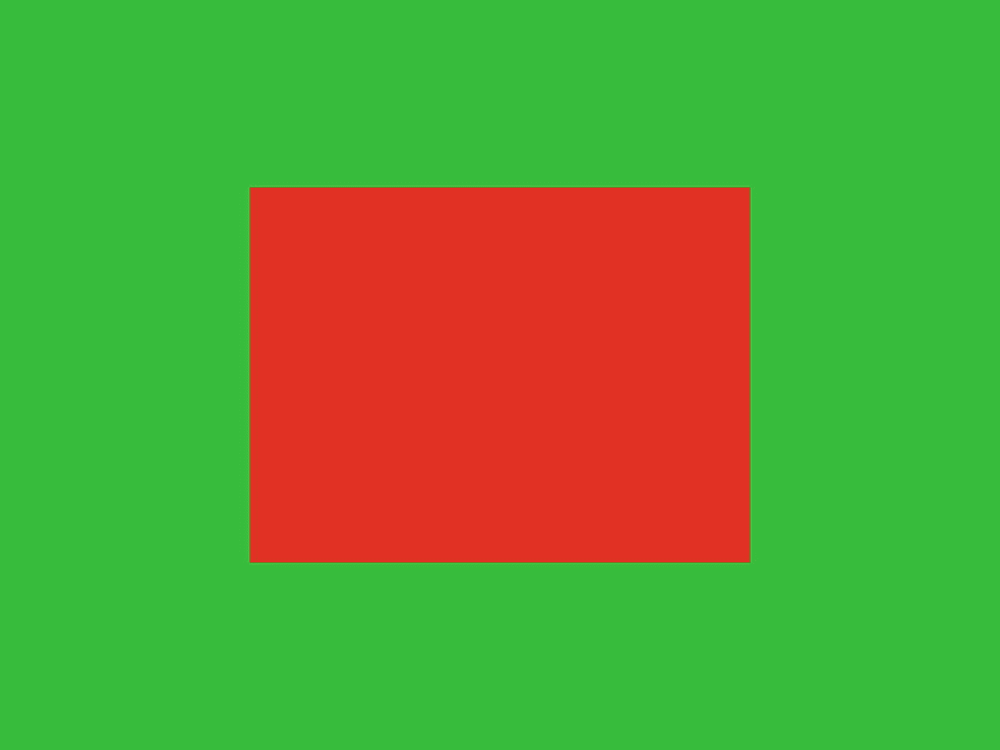

**图 3-1 ¶ 运行可渲染对象项目**

项目目标如下：

*   重组源代码结构，以预期功能的增加
*   支持游戏引擎内部资源共享
*   通过 `index.js` 文件为游戏开发者引入系统化的接口
*   首先抽象相关的绘图功能，开始构建封装绘图操作的类的过程
*   演示创建多个 `Renderable` 对象的能力

### 源代码结构重组

在向游戏引擎引入额外功能之前，认识到上一个项目中引擎源代码组织的一些不足非常重要。特别请注意以下几点：

1.  `core.js` 源代码文件包含 WebGL 接口、引擎初始化和绘图功能。这些应该模块化以支持预期的系统复杂性增加。
2.  应定义一个系统来支持游戏引擎内部资源的共享。例如，`SimpleShader` 负责从游戏引擎到由 `simple_vs.glsl` 和 `simple_fs.glsl` 源代码文件编译而成的 GLSL 着色器的接口。由于编译后的着色器只有一份副本，因此只需要一个 `SimpleShader` 对象实例。游戏引擎应通过允许方便地创建和共享该对象来促进这一点。
3.  正如你所经历的，JavaScript `export` 语句可以成为隐藏详细实现的绝佳工具。然而，在大型复杂系统（如你即将开发的游戏引擎）中，从众多文件中确定要导入哪些类或模块可能会令人困惑且难以应付。应提供一个易于使用且系统化的接口，使游戏开发者（游戏引擎的用户）能够免受这些细节的干扰。

在下一节中，将重组游戏引擎源代码以解决这些问题。

#### 定义特定于 WebGL 的模块

源代码重组的第一步是识别并隔离内部功能，这些功能不应被游戏引擎的客户端访问：

1.  在你的项目中，在 `src/engine` 文件夹下创建一个新文件夹并命名为 `core`。从现在起，该文件夹将包含所有游戏引擎内部功能，并且不会导出给游戏开发者。
2.  你可以将上一个项目中的 `vertex_buffer.js` 源代码文件剪切并粘贴到 `src/engine/core` 文件夹中。图元顶点的细节是游戏引擎内部的，不应被游戏引擎的客户端看到或访问。
3.  在 `src/engine/core` 文件夹中创建一个新的源代码文件，命名为 `gl.js`，并定义 WebGL 的初始化和访问方法：

```javascript
"use strict"
let mCanvas = null;
let mGL = null;
function get() {
    return mGL;
}
function init(htmlCanvasID) {
    mCanvas = document.getElementById(htmlCanvasID);
    if (mCanvas == null)
        throw new Error("Engine init [" + htmlCanvasID + "] HTML element id not found");
    // Get standard or experimental webgl and binds to the Canvas area
    // store the results to the instance variable mGL
    mGL = mCanvas.getContext("webgl2") ||
          mCanvas.getContext("experimental-webgl2");
    if (mGL === null) {
        document.write("<br><b>WebGL 2 is not supported!</b>");
        return;
    }
}
export {init, get}
```

注意 `init()` 函数与上一个项目 `core.js` 中的 `initWebGL()` 函数相同。与之前的 `core.js` 源代码文件不同，`gl.js` 文件仅包含特定于 WebGL 的功能。

#### 定义内部着色器资源共享系统

由于 GLSL 着色器仅从 `simple_vs.glsl` 和 `simple_fs.glsl` 源代码文件创建和编译一份副本，因此游戏引擎内仅需要一个 `SimpleShader` 对象副本即可与编译后的着色器进行接口交互。你现在将创建一个简单的资源共享系统，以支持未来添加不同类型的着色器。

在 `src/engine/core` 文件夹中创建一个新的源代码文件，命名为 `shader_resources.js`，并定义 `SimpleShader` 的创建和访问方法。

> **注意**
>
> 回顾上一章，`SimpleShader` 类定义在位于 `src/engine` 文件夹中的 `simple_shader.js` 文件中。请记得从上一个项目复制所有相关源代码文件。

```javascript
"use strict";
import SimpleShader from "../simple_shader.js";
// Simple Shader
let kSimpleVS = "src/glsl_shaders/simple_vs.glsl"; // to VertexShader
let kSimpleFS = "src/glsl_shaders/simple_fs.glsl"; // to FragmentShader
let mConstColorShader = null;
function createShaders() {
    mConstColorShader = new SimpleShader(kSimpleVS, kSimpleFS);
}
function init() {
    createShaders();
}
function getConstColorShader() {
    return mConstColorShader;
}
export {init, getConstColorShader}
```

> **注意**
>
> 引用常量值的变量名称以小写 "k" 开头，如 `kSimpleVS`。

由于 `shader_resources` 模块位于 `src/engine/core` 文件夹中，因此定义的着色器在内部共享，无法从游戏引擎的客户端访问。

#### 为游戏开发者定义访问文件

你将定义一个引擎访问文件 `index.js`，以实现游戏引擎的基本功能，其目的类似于 C++ 头文件、Java 中的 `import` 语句或 C# 中的 `using` 语句，即无需深入了解引擎源代码结构即可随时访问功能。也就是说，通过导入 `index.js`，客户端可以访问引擎的所有组件和功能来构建他们的游戏。

1.  


### 创建 index.js 文件

在 `src/engine` 文件夹中创建 `index.js` 文件；从 `gl.js`、`vertex_buffer.js` 和 `shader_resources.js` 导入；并定义 `init()` 函数，通过调用三个导入模块对应的 `init()` 函数来初始化游戏引擎：

```javascript
// 仅限本文件内部
import * as glSys from "./core/gl.js";
import * as vertexBuffer from "./core/vertex_buffer.js";
import * as shaderResources from "./core/shader_resources.js";

// 通用引擎工具
function init(htmlCanvasID) {
    glSys.init(htmlCanvasID);
    vertexBuffer.init();
    shaderResources.init();
}
```

## 定义 clearCanvas() 函数

定义 `clearCanvas()` 函数以清除绘图画布：

```javascript
function clearCanvas(color) {
    let gl = glSys.get();
    gl.clearColor(color[0], color[1], color[2], color[3]);
    gl.clear(gl.COLOR_BUFFER_BIT); // 清除为设置的颜色
}
```

## 导出 Renderable 符号

现在，为了正确地将 `Renderable` 符号暴露给游戏引擎的客户端，请确保以一种可以正确导出类的方式导入。`Renderable` 类将在下一节中详细介绍。

```javascript
// 通用工具
import Renderable from "./renderable.js";
```

## 导出引擎符号

最后，记得为游戏引擎的客户端导出适当的符号和功能：

```javascript
export default {
    // 工具类
    Renderable,
    // 函数
    init,
    clearCanvas
};
```

通过正确维护和更新此 `index.js` 文件，您的游戏引擎的客户端（即游戏开发者）可以简单地从 `index.js` 文件导入，从而获得对整个游戏引擎功能的访问权限，而无需了解源代码结构。最后，请注意，定义在 `engine/src/core` 文件夹中的 `glSys`、`vertexBuffer` 和 `shaderResources` 内部功能未被 `index.js` 导出，因此游戏开发者无法访问它们。

## Renderable 类

最后，您已准备好定义 `Renderable` 类以封装绘制过程：

## 1. 创建 renderable.js 文件

在 `src/engine` 文件夹中创建一个新的源代码文件，并将其命名为 `renderable.js`，以在游戏引擎中定义 `Renderable` 类。

## 2. 定义 Renderable 类

打开 `renderable.js`，从 `gl.js` 和 `shader_resources.js` 导入，并定义带有构造函数的 `Renderable` 类，以初始化对着色器的引用和颜色实例变量。请注意，着色器是对 `shader_resources` 中定义的共享 `SimpleShader` 实例的引用。

```javascript
import * as glSys from "./core/gl.js";
import * as shaderResources from "./core/shader_resources.js";

class Renderable {
    constructor() {
        this.mShader = shaderResources.getConstColorShader();
        this.mColor = [1, 1, 1, 1]; // 像素颜色
    }
    // 后续实现...
}
```

## 3. 定义 draw() 函数

为 `Renderable` 定义 `draw()` 函数：

```javascript
draw() {
    let gl = glSys.get();
    this.mShader.activate(this.mColor);
    gl.drawArrays(gl.TRIANGLE_STRIP, 0, 4);
}
```

请注意，在使用 `gl.drawArrays()` 函数发送顶点之前，通过调用 `activate()` 函数激活 GPU 中适当的 GLSL 着色器非常重要。

## 4. 定义颜色实例变量的 getter 和 setter 函数

```javascript
setColor(color) {
    this.mColor = color;
}

getColor() {
    return this.mColor;
}
```

## 5. 导出 Renderable 符号

将 `Renderable` 符号作为默认导出，以确保此标识符不能被重命名：

```javascript
export default Renderable;
```

虽然这个示例很简单，但现在可以创建并绘制多个具有不同颜色的 `Renderable` 对象实例。

## 测试 Renderable 对象

要在 `MyGame` 中测试 `Renderable` 对象，创建并绘制白色和红色实例，如下所示：

```javascript
// 从 engine/index.js 导入所有引擎符号
import engine from "../engine/index.js";

class MyGame {
    constructor(htmlCanvasID) {
        // 步骤 A：初始化 WebGL 上下文
        engine.init(htmlCanvasID);
        // 步骤 B：创建 Renderable 对象：
        this.mWhiteSq = new engine.Renderable();
        this.mWhiteSq.setColor([1, 1, 1, 1]);
        this.mRedSq = new engine.Renderable();
        this.mRedSq.setColor([1, 0, 0, 1]);
        // 步骤 C：绘制！
        engine.clearCanvas([0, 0.8, 0, 1]);  // 清除画布
        // 步骤 C1：使用白色着色器绘制 Renderable 对象
        this.mWhiteSq.draw();
        // 步骤 C2：使用红色着色器绘制 Renderable 对象
        this.mRedSq.draw();
    }
}
```

请注意，`import` 语句已修改为从引擎访问文件 `index.js` 导入。此外，`MyGame` 构造函数已修改为包含以下步骤：

1. **步骤 A** 初始化引擎。
2. **步骤 B** 创建两个 `Renderable` 实例，并相应地设置对象的颜色。
3. **步骤 C** 清除画布；步骤 C1 和 C2 只需分别调用白色和红色正方形的 `draw()` 函数。虽然两个正方形都被绘制了，但目前您只能在画布中看到最后绘制的正方形。有关详细信息，请参阅以下讨论。

### 观察结果

运行项目，您会注意到只有红色正方形可见！发生的情况是两个正方形都被绘制在同一位置。由于大小相同，两个正方形完全重叠。由于红色正方形最后绘制，它覆盖了白色正方形的所有像素。您可以通过注释掉红色正方形的绘制（注释掉 `mRedSq.draw()` 这一行）并重新运行项目来验证这一点。一个有趣的观察是，出现在前面的对象是最后绘制的（红色正方形）。稍后在处理透明度时，您将利用这一观察。

这一简单的观察引出了您的下一个任务——允许多个 `Renderable` 实例同时可见。每个 `Renderable` 对象实例都需要支持在不同位置、以不同大小和方向绘制的能力，以便它们不会相互重叠。

## 转换 Renderable 对象

需要一种机制来操纵 `Renderable` 对象的位置、大小和方向。在接下来的几个项目中，您将学习如何使用矩阵变换来平移或移动对象的位置、缩放对象的大小，以及改变对象的方向或在画布上旋转对象。这些操作是对象操作中最直观的。然而，在实现变换矩阵之前，需要快速回顾矩阵的操作和功能。

## 矩阵作为变换算子

在开始之前，重要的是要认识到矩阵和变换是数学中的通用主题领域。以下讨论并不试图全面涵盖这些主题。相反，重点是从游戏引擎所需的角度出发，关注一小部分相关概念和算子。这样，涵盖的重点是如何利用这些算子，而不是理论。如果您对矩阵的具体细节及其与计算机图形学的关系感兴趣，请参阅第 1 章中的讨论，您可以通过深入研究线性代数和计算机图形学的相关书籍来了解更多关于这些主题的信息。

矩阵是一个 *m* 行 *n* 列的二维数字数组。就本游戏引擎而言，您将专门使用 4×4 矩阵。虽然 2D 游戏引擎可以使用 3×3 矩阵，但使用 4×4 矩阵是为了支持后续章节中将引入的功能。在许多强大的应用中，4×4 矩阵可以构建为顶点位置的变换算子。其中最重要且最直观的算子是平移、缩放、旋转和单位算子。


### 矩阵变换操作符

## 平移操作符

平移操作符 `T(tx,ty)`，如图 3-2 所示，将给定顶点位置从 `(x, y)` 平移或移动到 `(x+tx, y+ty)`。注意 `T(0,0)` 不会改变给定顶点位置的值，并且是累积平移操作的方便初始值。

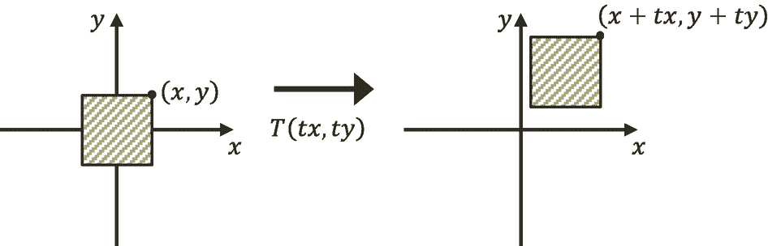

## 缩放操作符

缩放操作符 `S(sx, sy)`，如图 3-3 所示，将给定顶点位置从 `(x, y)` 缩放或调整大小到 `(x×sx, y×sy)`。注意 `S(1, 1)` 不会改变给定顶点位置的值，并且是累积缩放操作的方便初始值。

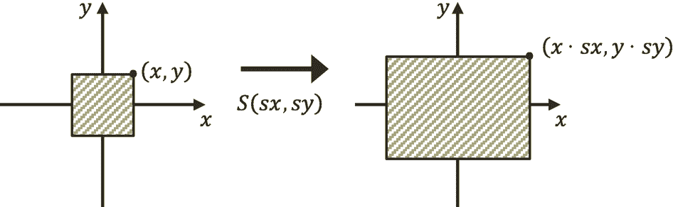

## 旋转操作符

旋转操作符 `R(θ)`，如图 3-4 所示，绕原点旋转给定顶点位置。

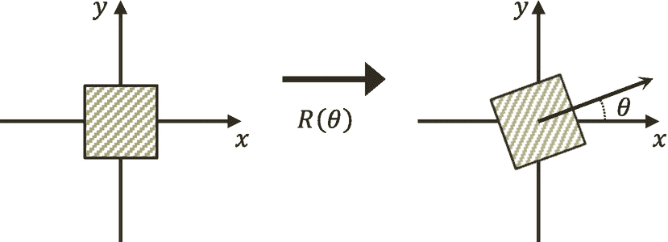

对于旋转，`R(0)` 不会改变给定顶点的值，并且是累积旋转操作的方便初始值。`θ` 的值通常用弧度表示（而非角度）。

## 单位操作符

单位操作符 `I` 不影响给定顶点位置。此操作符主要用于初始化。

例如，一个 4×4 单位矩阵如下所示：

```
I=\left[\begin{array}{llll}1& 0& 0& 0\\ 0& 1& 0& 0\\ 0& 0& 1& 0\\ 0& 0& 0& 1\end{array}\right]
```

数学上，矩阵变换操作符通过矩阵-向量乘法作用于顶点。为支持此操作，顶点位置 `p` = (`x`, `y`, `z`) 必须表示为如下的 4x1 向量：

```
p=\left[\begin{array}{l}x\\ y\\ z\\ 1\end{array}\right]
```

> **注意**
>
> `z` 分量是顶点位置的第三维度，即深度信息。在大多数情况下，您应将 `z` 分量保留为 0。

例如，如果位置 `p'` 是平移操作符 `T` 作用于顶点位置 `p` 的结果，从数学上讲，`p'` 将通过以下方式计算：

```
p' = T × p = Tp
```

## 矩阵操作符的连接

多个矩阵操作符可以*连接*或组合成单个操作符，同时保留与原始操作符相同的变换特性。例如，您可能希望在给定顶点位置上依次应用缩放操作符 `S`、旋转操作符 `R`，最后是平移操作符 `T`，或者通过以下方式计算 `p'`：

```
p' = TRSp
```

或者，您可以通过连接所有变换操作符来计算一个新的操作符 `M`，如下所示：

```
M = TRS
```

然后对顶点位置 `p` 应用 `M`，如下所示，以产生相同的结果：

```
p' = Mp
```

`M` 操作符是记录和重新应用多个操作符结果的一种方便高效的方式。

最后，请注意，在使用变换操作符时，操作顺序很重要。例如，缩放操作后跟平移操作通常不同于平移后跟缩放，一般来说：

```
ST ≠ TS
```

## glMatrix 库

矩阵操作符和运算的细节至少是非平凡的。开发一个完整的矩阵库既耗时又不是本书的重点。幸运的是，公共领域有许多开发完善且文档齐全的矩阵库可用。`glMatrix` 库就是其中一个例子。要将此库集成到您的源代码结构中，请遵循以下步骤：

1. 在 `src` 文件夹下创建一个新文件夹，并将新文件夹命名为 `lib`。
2. 访问 `http://glmatrix.net`，如图 3-5 所示，下载、解压，并将生成的 `glMatrix.js` 源文件存储到新的 `lib` 文件夹中。

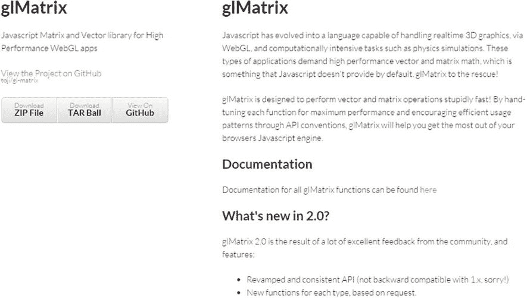

本书中的所有项目均基于 `glMatrix` 2.2.2 版本。

3. 作为一个必须同时被游戏引擎和客户端游戏开发者访问的库，您将通过在加载 `my_game.js` 之前添加以下内容，在主 `index.html` 中加载源文件：

```html
<!-- external library -->
<script type="text/javascript" src="src/lib/gl-matrix.js"></script>
<!-- our game -->
<script type="module" src="./src/my_game/my_game.js"></script>
```

## 矩阵变换项目

该项目介绍并演示如何使用变换矩阵作为操作符来操纵在画布上绘制的 `Renderable` 对象的位置、大小和方向。这样，`Renderable` 现在可以绘制到任意位置、具有任意大小和任意方向。图 3-6 显示了运行矩阵变换项目的输出。该项目的源代码定义在 `chapter3/3.2.matrix_transform` 文件夹中。


项目目标如下：

- 介绍变换矩阵作为绘制 `Renderable` 的操作符
- 理解如何使用变换操作符来操纵 `Renderable`

### 修改顶点着色器以支持变换

如前所述，矩阵变换操作符作用于几何体的顶点。顶点着色器是从 `WebGL` 上下文传入所有顶点的地方，也是应用变换操作最方便的位置。

您将继续基于之前的项目，在顶点着色器中支持变换操作符：

1. 编辑 `simple_vs.glsl` 以声明一个统一的 4×4 矩阵：

> **注意**
>
> 回顾第 2 章的讨论，`glsl` 文件包含将被加载并由 `GPU` 执行的 OpenGL 着色语言 (`GLSL`) 指令。您可以参考第 1 章末尾提供的 `WebGL` 和 `OpenGL` 参考资料了解更多关于 `GLSL` 的信息。

```glsl
// to transform the vertex position
uniform mat4 uModelXformMatrix;
```

回想一下，`GLSL` 着色器中的 `uniform` 关键字声明的变量值在该着色器的所有顶点中均不改变。在这种情况下，`uModelXformMatrix` 变量是所有顶点的变换操作符。

> **注意**
>
> `GLSL` uniform 变量名总是以小写 "u" 开头，如 `uModelXformMatrix`。

2. 在 `main()` 函数中，将 `uModelXformMatrix` 应用于当前引用的顶点位置：

```glsl
gl_Position = uModelXformMatrix * vec4(aVertexPosition, 1.0);
```

请注意，该操作直接源自矩阵变换操作符的讨论。将 `aVertexPosition` 转换为 `vec4` 的原因是为了支持矩阵-向量乘法。


通过这个简单的修改，单位正方形的顶点位置将由 `uModelXformMatrix` 算子操作，因此正方形可以绘制到不同的位置。现在的任务是设置 `SimpleShader` 以将适当的变换算子加载到 `uModelXformMatrix` 中。

## 修改 SimpleShader 以加载变换算子

请遵循以下步骤：

1. 编辑 `simple_shader.js` 并添加一个实例变量以保存对顶点着色器中 `uModelXformMatrix` 矩阵的引用：

```
this.mModelMatrixRef = null;
```

2. 在 `SimpleShader` 构造函数的末尾，在步骤 E 下，设置对 `uPixelColor` 的引用后，添加以下代码以初始化此引用：

```
// Step E: Gets a reference to uniform variables in fragment shader
this.mPixelColorRef = gl.getUniformLocation(this.mCompiledShader, "uPixelColor");
this.mModelMatrixRef = gl.getUniformLocation(this.mCompiledShader, "uModelXformMatrix");
```

3. 修改 `activate()` 函数以接收第二个参数，并通过 `mModelMatrixRef` 将值加载到 `uModelXformMatrix`：

```
activate(pixelColor, trsMatrix) {
    let gl = glSys.get();
    gl.useProgram(this.mCompiledShader);
    ... identical to previous code ...
    // load uniforms
    gl.uniform4fv(this.mPixelColorRef, pixelColor);
    gl.uniformMatrix4fv(this.mModelMatrixRef, false, trsMatrix);
}
```

`gl.uniformMatrix4fv()` 函数将 `trsMatrix` 中的值复制到由 `this.mModelMatrixRef` 或顶点着色器中的 `uModelXformMatrix` 算子标识的顶点着色器位置。变量名 `trsMatrix` 表示它应该是一个包含平移 (T)、旋转 (R) 和缩放 (S) 连接结果的矩阵算子，即 TRS。

## 修改 Renderable 类以设置变换算子

编辑 `renderable.js` 以修改 `draw()` 函数，使其接收并转发一个变换算子给 `mShader.activate()` 函数，以便加载到 GLSL 着色器中：

```
draw(trsMatrix) {
    let gl = glSys.get();
    this.mShader.activate(this.mColor, trsMatrix);
    gl.drawArrays(gl.TRIANGLE_STRIP, 0, 4);
}
```

这样，当单位正方形的顶点被顶点着色器处理时，`uModelXformMatrix` 将包含用于变换顶点的适当算子，从而在所需的位置、大小和旋转角度绘制正方形。

## 测试变换

现在游戏引擎支持变换，你需要修改客户端代码以使用它进行绘制：

1. 编辑 `my_game.js`；在步骤 C 之后，不再激活并绘制两个正方形，而是替换步骤 C1 和 C2 以创建一个新的单位变换算子 `trsMatrix`：

```
// create a new identity transform operator
let trsMatrix = mat4.create();
```

2. 计算矩阵的连接，形成一个实现平移 (T)、旋转 (R) 和缩放 (S) 或 TRS 的单一变换算子：

```
// Step D: compute the white square transform
mat4.translate(trsMatrix, trsMatrix, vec3.fromValues(-0.25, 0.25, 0.0));
mat4.rotateZ(trsMatrix, trsMatrix, 0.2);        // rotation is in radian
mat4.scale(trsMatrix, trsMatrix, vec3.fromValues(1.2, 1.2, 1.0));
// Step E: draw the white square with the computed transform
this.mWhiteSq.draw(trsMatrix);
```

步骤 D 连接了 T(-0.25, 0.25)，向左和向上移动；R(0.2)，顺时针旋转 0.2 弧度；以及 S(1.2, 1.2)，将大小增加 1.2 倍。连接顺序先应用缩放算子，然后是旋转，最后是平移，即 `trsMatrix = TRS`。在步骤 E 中，`Renderable` 对象使用 `trsMatrix` 算子绘制，即一个 1.2×1.2 的白色矩形，略微旋转并位于中心左上方。

3. 最后，步骤 F 定义 `trsMatrix` 算子以绘制一个 0.4×0.4 的正方形，旋转 45 度并位于画布中心右下方，步骤 G 绘制红色正方形：

```
// Step F: compute the red square transform
mat4.identity(trsMatrix); // restart
mat4.translate(trsMatrix, trsMatrix, vec3.fromValues(0.25, -0.25, 0.0));
mat4.rotateZ(trsMatrix, trsMatrix, -0.785);   // about -45-degrees
mat4.scale(trsMatrix, trsMatrix, vec3.fromValues(0.4, 0.4, 1.0));
// Step G: draw the red square with the computed transform
this.mRedSq.draw(trsMatrix);
```

## 观察

运行项目，你应该能在画布上看到相应的白色和红色矩形。你可以通过更改数值来获得对算子的一些直观理解；例如，将正方形移动和缩放到不同位置和大小。你可以尝试通过移动相应的代码行来更改连接顺序；例如，将 `mat4.scale()` 移到 `mat4.translate()` 之前。你会注意到，通常变换结果不符合你的直觉。在本书中，你将始终按固定的 TRS 顺序应用变换算子。这种变换算子的顺序符合典型的人类直觉。大多数（如果不是全部）支持变换操作的图形 API 和应用程序都遵循 TRS 操作顺序。

现在你已经了解如何使用矩阵变换算子，是时候对它们进行抽象并隐藏其细节了。

## 封装变换算子

在之前的项目中，变换算子是直接基于矩阵计算的。虽然结果很重要，但计算过程涉及分散注意力的细节和重复代码。本项目将指导你遵循良好的编码实践，通过使用类隐藏详细计算来封装变换算子。这样，你可以在支持进一步扩展的同时保持可编程性，从而维护游戏引擎的模块化和易用性。

## Transform 对象项目

本项目定义了 `Transform` 类，以提供一个逻辑接口来操作矩阵变换算子并隐藏其细节。图 3-7 显示了运行矩阵变换项目的输出。请注意，该项目的输出与前一个项目相同。该项目的源代码定义在 `chapter3/3.3.transform_objects` 文件夹中。

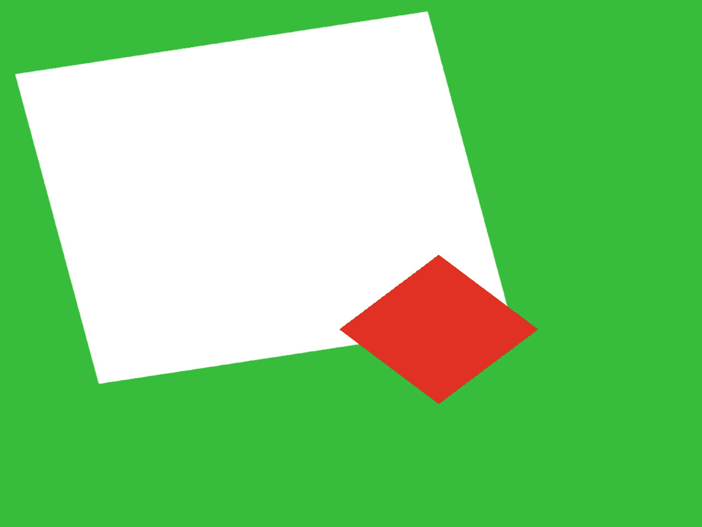

**图 3-7 ¶ 运行 Transform 对象项目**

项目目标如下：

*   创建 `Transform` 类以封装矩阵变换功能
*   将 `Transform` 类集成到游戏引擎中
*   演示如何使用 `Transform` 对象

## Transform 类

继续基于前一个项目工作：

1. 在游戏引擎中定义 `Transform` 类，方法是在 `src/engine` 文件夹中创建一个新的源代码文件，并将其命名为 `transform.js`。

2. 定义构造函数以初始化对应算子的实例变量：`mPosition` 用于平移，`mScale` 用于缩放，`mRotationInRad` 用于旋转。

```
class Transform {
    constructor() {
        this.mPosition = vec2.fromValues(0, 0); // translation
        this.mScale = vec2.fromValues(1, 1);    // width (x), height (y)
        this.mRotationInRad = 0.0;              // in radians!
    }
    ... implementation to follow ...
}
```

3. 为每个算子的值添加 getter 和 setter：


## Transform 类实现

## Position Getters and Setters

```javascript
setPosition(xPos, yPos) {
    this.setXPos(xPos);
    this.setYPos(yPos);
}
getPosition() {
    return this.mPosition;
}
// ... additional get and set functions for position not shown
```

## Size Getters and Setters

```javascript
setSize(width, height) {
    this.setWidth(width);
    this.setHeight(height);
}
getSize() {
    return this.mScale;
}
// ... additional get and set functions for size not shown
```

## Rotation Getters and Setters

```javascript
setRotationInRad(rotationInRadians) {
    this.mRotationInRad = rotationInRadians;
    while (this.mRotationInRad > (2 * Math.PI)) {
        this.mRotationInRad -= (2 * Math.PI);
    }
}
setRotationInDegree(rotationInDegree) {
    this.setRotationInRad(rotationInDegree * Math.PI / 180.0);
}
// ... additional get and set functions for rotation not shown
```

## Define `getTRSMatrix()` Function

```javascript
getTRSMatrix() {
    // Creates a blank identity matrix
    let matrix = mat4.create();
    // Step A: compute translation, for now z is always at 0.0
    mat4.translate(matrix, matrix,
        vec3.fromValues(this.getXPos(), this.getYPos(), 0.0));
    // Step B: concatenate with rotation.
    mat4.rotateZ(matrix, matrix, this.getRotationInRad());
    // Step C: concatenate with scaling
    mat4.scale(matrix, matrix,
        vec3.fromValues(this.getWidth(), this.getHeight(), 1.0));
    return matrix;
}
```

此代码与前一个项目中 `my_game.js` 的步骤 D 和 F 类似。连接运算符 TRS 首先执行缩放，然后是旋转，最后是平移。

## Export Transform Class

```javascript
export default Transform;
```

### The Transformable Renderable Class

通过集成 `Transform` 类，`Renderable` 对象现在可以拥有位置、大小（缩放）和方向（旋转）。这种集成可以通过以下步骤轻松完成：

#### Step 1: Add Transform Instance Variable

编辑 `renderable.js`，在构造函数中添加一个新的实例变量来引用 `Transform` 对象：

```javascript
this.mXform = new Transform();  // transform operator for the object
```

#### Step 2: Define Accessor for Transform Operator

```javascript
getXform() { return this.mXform; }
```

#### Step 3: Modify `draw()` Function

修改 `draw()` 函数，在绘制单位正方形之前传递 `mXform` 对象的 `trsMatrix` 运算符以激活着色器：

```javascript
draw() {
    let gl = glSys.get();
    this.mShader.activate(this.mColor, this.mXform.getTRSMatrix());
    gl.drawArrays(gl.TRIANGLE_STRIP, 0, 4);
}
```

通过这个简单的修改，`Renderable` 对象将根据其自身变换运算符的值所定义的特性进行绘制。

### Modify the Engine Access File to Export Transform

保持引擎访问文件 `index.js` 的最新状态很重要，以便新定义的 `Transform` 类可以被游戏开发者访问：

#### Step 1: Import Transform

编辑 `index.js`；从新定义的 `transform.js` 文件导入：

```javascript
// general utilities
import Transform from "./transform.js";
import Renderable from "./renderable.js";
```

#### Step 2: Export Transform for Client Access

```javascript
export default {
    // Util classes
    Transform, Renderable,
    // functions
    init, clearCanvas
}
```

### Modify Drawing to Support Transform Object

为了测试 `Transform` 和改进后的 `Renderable` 类，可以修改 `MyGame` 构造函数，以相应地设置每个 `Renderable` 对象中的变换运算符：

```javascript
// Step D: sets the white Renderable object's transform
this.mWhiteSq.getXform().setPosition(-0.25, 0.25);
this.mWhiteSq.getXform().setRotationInRad(0.2);  // In Radians
this.mWhiteSq.getXform().setSize(1.2, 1.2);
// Step E: draws the white square (transform behavior in the object)
this.mWhiteSq.draw();
// Step F: sets the red square transform
this.mRedSq.getXform().setXPos(0.25);  // alternative to setPosition
this.mRedSq.getXform().setYPos(-0.25); // setX/Y separately
this.mRedSq.getXform().setRotationInDegree(45);  // this is in Degree
this.mRedSq.getXform().setWidth(0.4);  // alternative to setSize
this.mRedSq.getXform().setHeight(0.4); // set width/height separately
// Step G: draw the red square (transform in the object)
this.mRedSq.draw();
```

运行项目以观察与前一个项目相同的输出。现在你可以在画布的任何位置创建和绘制 `Renderable`，变换运算符现已被妥善封装。

## 摄像机变换和视口

在设计和构建视频游戏时，游戏设计师和程序员必须能够专注于内在逻辑和表现。为了促进这些方面，设计师和程序员能够在方便的维度和空间中制定解决方案非常重要。

例如，继续沿用足球游戏的想法，考虑创建足球场的任务。球场有多大？计量单位是什么？通常，在构建游戏世界时，参考现实世界设计解决方案往往更容易。在现实世界中，足球场长约 100 米。然而，在游戏或图形世界中，单位是任意的。因此，一个简单的解决方案可能是创建一个长 100 个单位（米）的场地，以及一个原点位于足球场中心的坐标空间。这样，场地的对立面可以简单地通过 x 值的符号来确定，在位置 (0, 1) 绘制玩家意味着从足球场中心向右 1 米处绘制玩家。

一个对比的例子是构建类似国际象棋的棋盘游戏。基于一个无单位的 n×n 网格进行设计可能更方便，该网格的原点位于棋盘的左下角。在这种情况下，在位置 (0, 1) 绘制棋子意味着从棋盘左下角向右一个单元格或单位的位置绘制棋子。正如将要讨论的，定义特定坐标系的能力通常通过计算和使用表示摄像机视图的矩阵来实现。

在所有情况下，为了支持游戏的适当呈现，允许程序员控制将内容绘制到画布上的任何位置非常重要。例如，你可能想将足球场和玩家绘制到一个子区域，将小地图绘制到另一个子区域。这些与轴对齐的矩形绘制区域或画布的子区域被称为视口。

在本节中，你将了解坐标系以及如何使用矩阵变换作为工具来定义符合 WebGL 固定 ±1 绘制范围的绘制区域。

## 坐标系和变换

二维坐标系唯一标识二维平面上的每个位置。本书中的所有项目都遵循笛卡尔坐标系，其中位置是根据从称为*原点*的参考点的垂直距离来定义的，如图 3-8 所示。用于测量距离的垂直方向称为*主轴*。在二维空间中，这些是熟悉的 x 轴和 y 轴。

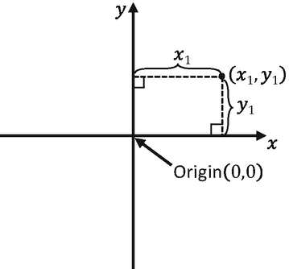

**图 3-8** ¶ 使用二维笛卡尔坐标系

### 建模和归一化设备坐标系


迄今为止，在本书中，您已经体验了两种不同的坐标系统。第一种是定义顶点缓冲区中 1×1 正方形顶点的坐标系统。这被称为**建模坐标系**，它定义了**模型空间**。模型空间对于每个几何对象都是唯一的，就像单位正方形的情况一样。模型空间被定义用来描述单个模型的几何形状。您使用的第二个坐标系统是 WebGL 绘制的目标坐标系，其中 x/y 轴范围被限制在 ±1.0。这被称为**归一化设备坐标系**。正如您所体验的，WebGL 总是绘制到 NDC 空间，而 ±1.0 范围内的内容覆盖画布中的所有像素。

**建模变换**通常由矩阵变换算子定义，是将几何体从其模型空间变换到另一个便于绘制的坐标空间的操作。在之前的项目中，`simple_vs.glsl` 中的 `uModelXformMatrix` 变量就是建模变换。如图 3-9 所示，在这种情况下，建模变换将单位正方形变换到了 WebGL 的 NDC 空间。图 3-9 中指向 *画布坐标* 的、标记为 *固定映射* 的最右侧箭头表示 WebGL 总是在画布中显示 NDC 空间的全部内容。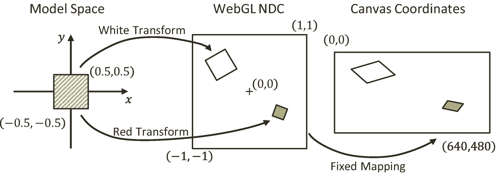

图 3-9 将正方形从模型空间变换到 NDC 空间

## 世界坐标系

虽然可以使用建模变换绘制到任何位置，但将正方形绘制为矩形的非比例缩放问题依然存在。此外，固定的 -1.0 和 1.0 NDC 空间并不是一个便于游戏设计的坐标空间。**世界坐标系**描述了一个方便的**世界空间**，解决了这些问题。为了方便和可读性，在本书的其余部分，WC 也将用来指代由特定世界坐标系定义的世界空间。

如图 3-10 所示，有了 WC 代替固定的 NDC 空间，建模变换可以将模型变换到一个便于游戏设计的坐标系统中。以足球游戏为例，世界空间的维度可以是足球场的大小。与任何笛卡尔坐标系一样，WC 系统由一个参考位置及其宽度和高度定义。参考位置可以是 WC 的左下角，也可以是中心。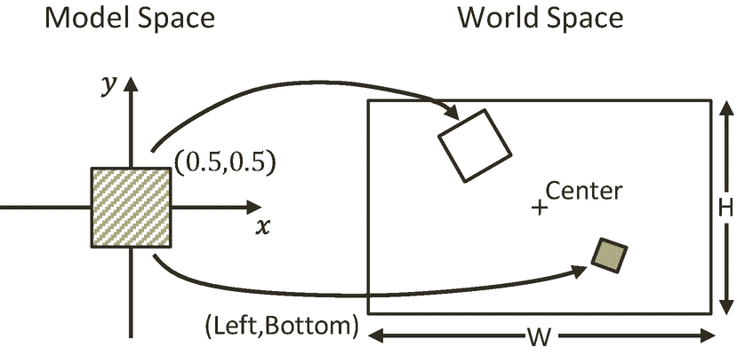

图 3-10 使用世界坐标 (WC) 系统

WC 是一个便于游戏设计的坐标系统。然而，它不是 WebGL 绘制的目标空间。因此，从 WC 变换到 NDC 非常重要。在本书中，这种变换被称为**相机变换**。要完成这种变换，您必须构建一个算子，将 WC 中心与 NDC 的中心（原点）对齐，然后将 WC 的 W×H 维度缩放以匹配 NDC 的宽度和高度。请注意，NDC 空间具有 -1 到 +1 的恒定范围，因此具有固定的 2×2 维度。这样，相机变换就是一个平移操作后跟一个缩放操作：

```
M = S(2/W, 2/H) * T(-center.x, -center.y)
```

在这种情况下，`(center.x, center.y)` 和 `W×H` 分别是 WC 系统的中心和维度。

## 视口

**视口**是要绘制的区域。正如您所体验的，默认情况下，WebGL 将整个画布定义为绘制的视口。方便的是，WebGL 提供了一个函数来覆盖此默认行为：

```
gl.viewport(
    x,      // 要绘制区域左下角的 x 位置
    y,      // 要绘制区域左下角的 y 位置
    width,  // 要绘制区域的宽度
    height  // 要绘制区域的高度
);
```

`gl.viewport()` 函数为所有后续绘制定义一个视口。图 3-11 说明了相机变换和使用视口绘制。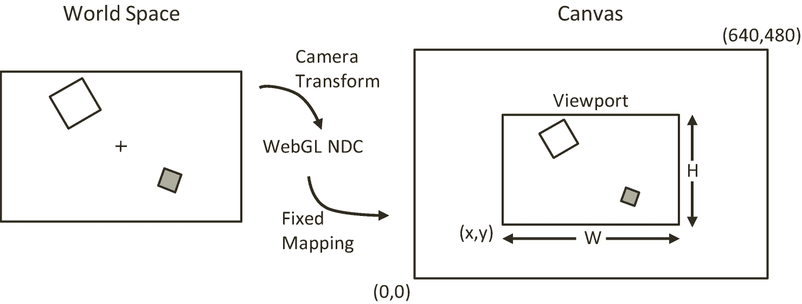

图 3-11 使用 WebGL 视口

## 相机变换和视口项目

该项目演示了如何使用相机变换从任意所需的坐标位置绘制到画布的任意子区域或视口。图 3-12 显示了运行相机变换和视口项目的输出。该项目的源代码定义在 `chapter3/3.4.camera_transform_and_viewport` 文件夹中。

图 3-12 运行相机变换和视口项目

该项目的目标如下：

*   理解不同的坐标系统
*   体验使用 WebGL 视口在画布内定义并绘制到不同的子区域
*   理解相机变换
*   开始绘制到用户定义的世界坐标系统

您现在准备好修改游戏引擎以支持相机变换，定义您自己的 WC 和用于绘制的相应视口。第一步是修改着色器以支持新的变换算子。

### 修改顶点着色器以支持相机变换

添加相机变换支持只需要相对较小的更改：

1.  编辑 `simple_vs.glsl` 以添加一个新的统一矩阵算子来表示相机变换：

```
uniform mat4 uCameraXformMatrix;
```

2.  确保在顶点着色器程序中将该算子应用于顶点位置：

```
gl_Position = uCameraXformMatrix * uModelXformMatrix * vec4(aVertexPosition, 1.0);
```

回想一下，矩阵运算的顺序很重要。在这种情况下，`uModelXformMatrix` 首先将顶点位置从模型空间变换到 WC，然后 `uCameraXformMatrix` 将其从 WC 变换到 NDC。`uModelXformMatrix` 和 `uCameraXformMatrix` 的顺序不能互换。

### 修改 SimpleShader 以支持相机变换

`SimpleShader` 对象必须被修改以访问并将相机变换矩阵传递给顶点着色器：

1.  编辑 `simple_shader.js`，在构造函数中添加一个实例变量，用于存储对 `simple_vs.glsl` 中相机变换算子的引用：

```
this.mCameraMatrixRef = null;
```

2.  在 `SimpleShader` 构造函数的末尾，在检索 `uModelXformMatrix` 和 `uPixelColor` 的引用之后，检索对相机变换算子 `uCameraXformMatrix` 的引用：

```
// Step E: Gets reference to uniform variables in fragment shader
this.mPixelColorRef = gl.getUniformLocation(this.mCompiledShader, "uPixelColor");
this.mModelMatrixRef = gl.getUniformLocation(this.mCompiledShader, "uModelXformMatrix");
this.mCameraMatrixRef = gl.getUniformLocation(this.mCompiledShader, "uCameraXformMatrix");
```

3.  修改 `activate` 函数以接收相机变换矩阵并将其传递给着色器：


## 修改 Renderable 以支持相机变换

```javascript
activate(pixelColor, trsMatrix, cameraMatrix) {
    let gl = glSys.get();
    gl.useProgram(this.mCompiledShader);
    // ... identical to previous code ...
    // load uniforms
    gl.uniform4fv(this.mPixelColorRef, pixelColor);
    gl.uniformMatrix4fv(this.mModelMatrixRef, false, trsMatrix);
    gl.uniformMatrix4fv(this.mCameraMatrixRef, false, cameraMatrix);
}
```

正如你之前所见，`gl.uniformMatrix4fv()` 函数将 `cameraMatrix` 的内容复制到 `uCameraXformMatrix` 操作符中。

回想一下，着色器是在 `Renderable` 类的 `draw()` 函数中激活的；因此，`Renderable` 也必须被修改以接收并传递 `cameraMatrix` 来激活着色器：

```javascript
draw(cameraMatrix) {
    let gl = glSys.get();
    this.mShader.activate(this.mColor,
        this.mXform.getTRSMatrix(),
        cameraMatrix);
    gl.drawArrays(gl.TRIANGLE_STRIP, 0, 4);
}
```

现在可以设置一个用于绘制的世界坐标系 (WC)，并在画布上定义一个子区域进行绘制。

## 设计场景

如图 3-13 所示，出于测试目的，世界坐标系 (WC) 将被定义为以 (20, 60) 为中心，尺寸为 20×10。两个旋转的正方形，一个 5x5 的蓝色正方形和一个 2×2 的红色正方形，将被绘制在 WC 的中心。为了验证坐标边界，一个具有独特颜色的 1×1 正方形将被绘制在 WC 的每个角落。

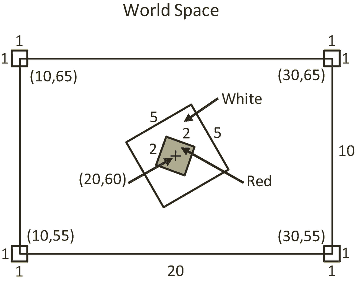

**图 3-13 ¶ 设计用于支持绘制的 WC**

如图 3-14 所示，WC 将被绘制到一个视口中，该视口的左下角位于 (20, 40)，尺寸为 600×300 像素。重要的是要注意，为了使正方形按比例显示，WC 的宽高比必须与视口的宽高比匹配。在这种情况下，WC 具有 20:10 的宽高比，这个 2:1 的比例与视口的 600:300 相匹配。

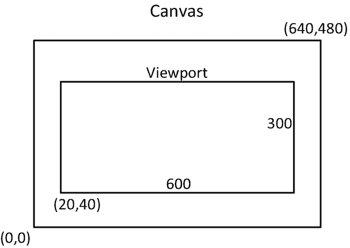

**图 3-14 ¶ 将 WC 绘制到视口**

请注意，WC 的细节（以 (20, 60) 为中心，尺寸 20x10）和视口的细节（左下角位于 (20, 40)，尺寸 600x300）的选择是相当随意的。这些只是能够演示实现正确性的合理值。

### 实现设计

`MyGame` 类将被修改以实现该设计：

#### 1. 编辑 `my_game.js`

在构造函数中，执行步骤 A 初始化游戏引擎，以及步骤 B 创建六个 `Renderable` 对象（两个绘制在中心，四个绘制在 WC 的每个角落），并设置相应的颜色。

```javascript
constructor(htmlCanvasID) {
    // Step A: Initialize the game engine
    engine.init(htmlCanvasID);
    // Step B: Create the Renderable objects:
    this.mBlueSq = new engine.Renderable();
    this.mBlueSq.setColor([0.25, 0.25, 0.95, 1]);
    this.mRedSq = new engine.Renderable();
    this.mRedSq.setColor([1, 0.25, 0.25, 1]);
    this.mTLSq = new engine.Renderable();
    this.mTLSq.setColor([0.9, 0.1, 0.1, 1]);
    this.mTRSq = new engine.Renderable();
    this.mTRSq.setColor([0.1, 0.9, 0.1, 1]);
    this.mBRSq = new engine.Renderable();
    this.mBRSq.setColor([0.1, 0.1, 0.9, 1]);
    this.mBLSq = new engine.Renderable();
    this.mBLSq.setColor([0.1, 0.1, 0.1, 1]);
    // ... implementation to follow ...
}
```

#### 2. 步骤 C 和 D

步骤 C 和 D 清除整个画布，设置视口，并用不同的颜色清除视口：

```javascript
// Step C: Clear the entire canvas first
engine.clearCanvas([0.9, 0.9, 0.9, 1]);
// get access to the gl connection to the GPU
let gl = glSys.get();
// Step D: Setting up Viewport
// Step D1: Set up the viewport: area on canvas to be drawn
gl.viewport(
    20,     // x position of bottom-left corner of the area to be drawn
    40,     // y position of bottom-left corner of the area to be drawn
    600,    // width of the area to be drawn
    300     // height of the area to be drawn
);
// Step D2: set up the corresponding scissor area to limit clear area
gl.scissor(
    20,     // x position of bottom-left corner of the area to be drawn
    40,     // y position of bottom-left corner of the area to be drawn
    600,    // width of the area to be drawn
    300     // height of the area to be drawn
);
// Step D3: enable scissor area, clear and then disable the scissor area
gl.enable(gl.SCISSOR_TEST);
engine.clearCanvas([0.8, 0.8, 0.8, 1.0]);  // clear the scissor area
gl.disable(gl.SCISSOR_TEST);
```

步骤 D1 定义视口，步骤 D2 定义相应的裁剪区域。裁剪区域测试并限制要清除的区域。由于 `gl.scissor()` 涉及的测试在计算上开销较大，因此在使用后立即禁用它。

#### 3. 步骤 E：使用相机变换定义 WC

步骤 E 通过连接适当的缩放和平移操作符，使用相机变换定义 WC：

```javascript
// Step E: Set up camera transform matrix
// assume camera position and dimension
let cameraCenter = vec2.fromValues(20, 60);
let wcSize = vec2.fromValues(20, 10);
let cameraMatrix = mat4.create();
// Step E1: after translation, scale to: -1 to 1: a 2x2 square at origin
mat4.scale(cameraMatrix, mat4.create(),
    vec3.fromValues(2.0/wcSize[0], 2.0/wcSize[1], 1.0));
// Step E2: first to perform is to translate camera center to origin
mat4.translate(cameraMatrix, cameraMatrix,
    vec3.fromValues(-cameraCenter[0], -cameraCenter[1], 0));
```

步骤 E1 定义缩放操作符 `S(2/W, 2/H)`，将 WC 的 WxH 缩放到 NDC 的 2x2 尺寸，步骤 E2 定义平移操作符 `T(-center.x, -center.y)`，将 WC 与 NDC 中心对齐。请注意，连接顺序实现了先平移后缩放的操作符。这正是前面描述的相机变换，它定义 WC 如下：

- **中心**：(20,60)
- **左上角**：(10, 65)
- **右上角**：(30, 65)
- **右下角**：(30, 55)
- **左下角**：(10, 55)

回想一下，乘法顺序很重要，缩放和平移操作符的顺序不能互换。

#### 4. 步骤 F：绘制蓝色正方形

在 WC 中心设置略微旋转的 5x5 蓝色正方形，并使用相机变换操作符 `cameraMatrix` 进行绘制：

```javascript
// Step F: Draw the blue square
// Center Blue, slightly rotated square
this.mBlueSq.getXform().setPosition(20, 60);
this.mBlueSq.getXform().setRotationInRad(0.2); // In Radians
this.mBlueSq.getXform().setSize(5, 5);
this.mBlueSq.draw(cameraMatrix);
```

#### 5. 步骤 G：绘制中心和角落正方形

现在绘制其他五个正方形，首先是中心的 2x2 正方形，以及 WC 每个角落的一个正方形：

```javascript
// Step G: Draw the center and the corner squares
// center red square
this.mRedSq.getXform().setPosition(20, 60);
this.mRedSq.getXform().setSize(2, 2);
this.mRedSq.draw(cameraMatrix);
// top left
this.mTLSq.getXform().setPosition(10, 65);
this.mTLSq.draw(cameraMatrix);
// top right
this.mTRSq.getXform().setPosition(30, 65);
this.mTRSq.draw(cameraMatrix);
// bottom right
this.mBRSq.getXform().setPosition(30, 55);
this.mBRSq.draw(cameraMatrix);
// bottom left
this.mBLSq.getXform().setPosition(10, 55);
this.mBLSq.draw(cameraMatrix);
```


运行此项目并观察四个角落的不同颜色：左上角（`mTLSq`）为红色，右上角（`mTRSq`）为绿色，右下角（`mBRSq`）为蓝色，左下角（`mBLSq`）为深灰色。更改角落正方形的位置以验证这些正方形的中心位置位于 `WC` 的边界内，因此实际上只有四分之一的正方形可见。例如，将 `mBlSq` 设置为 (12, 57) 以观察深灰色正方形实际上是四倍大小。这一观察验证了正方形在视口/裁剪区域之外的区域被 `WebGL` 裁剪。

尽管缺乏适当的抽象，但现在可以定义任何方便的 `WC` 系统和画布的任意矩形子区域用于绘图。通过建模和相机变换，游戏程序员现在可以根据游戏的语义需求设计游戏解决方案，而忽略无关的 `WebGL` `NDC` 绘图范围。然而，`MyGame` 类中的代码复杂且容易分散注意力。正如你迄今所见，重要的下一步是定义一个抽象来隐藏相机变换矩阵计算的细节。

## 相机

相机变换允许定义 `WC`。在物理世界中，这类似于用相机拍照。相机取景器的中心是 `WC` 的中心，通过取景器可见的世界的宽度和高度是 `WC` 的尺寸。用这个类比，拍照的动作等同于计算 `WC` 中每个对象的绘制。最后，视口描述了显示计算出的图像的位置。

### 相机对象项目

该项目演示了如何抽象相机变换和视口，以隐藏矩阵计算和 `WebGL` 配置的细节。图 3-15 显示了运行相机对象项目的输出；请注意，该项目的输出与前一个项目相同。该项目的源代码定义在 `chapter3/3.5.camera_objects` 文件夹中。 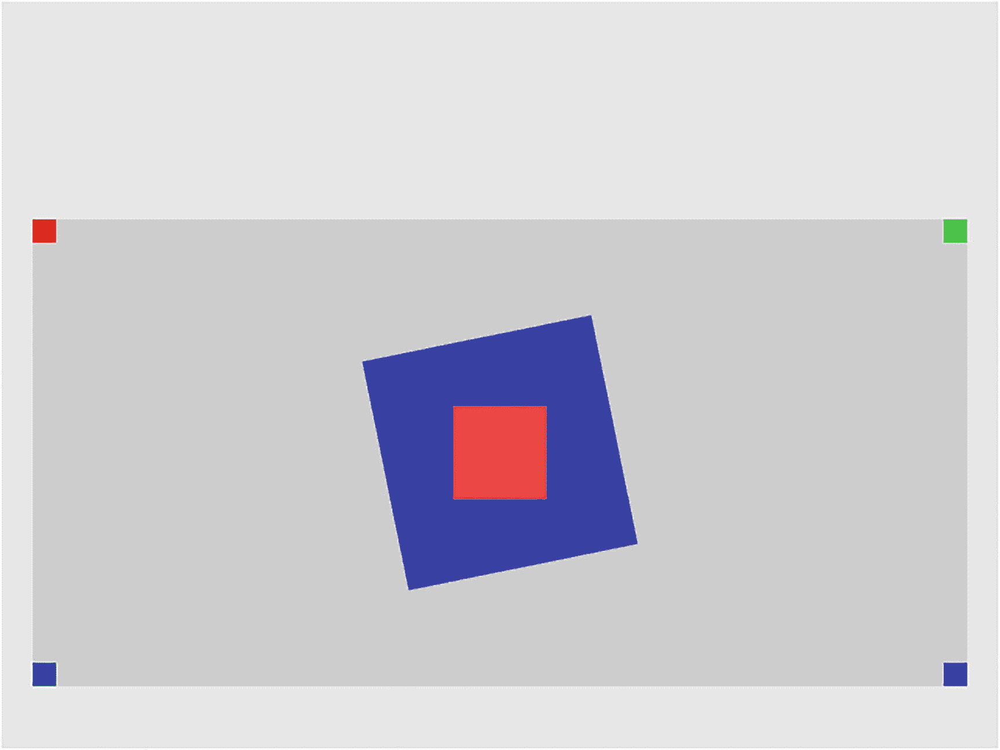

图 3-15 ¶ 运行相机对象项目

项目目标如下：

*   定义 `Camera` 类以封装 `WC` 的定义和视口功能
*   将 `Camera` 类集成到游戏引擎中
*   演示如何使用 `Camera` 对象

#### Camera 类

`Camera` 类必须封装前一个示例中 `MyGame` 构造函数中缩放和变换运算符定义的功能。一个整洁且可复用的类设计应配备适当的 getter 和 setter 函数完成。

1.  在游戏引擎中通过在 `src/engine` 文件夹中创建一个新源文件来定义 `Camera` 类，并将文件命名为 `camera.js`。

2.  为 `Camera` 添加构造函数：

```javascript
class Camera {
    constructor(wcCenter, wcWidth, viewportArray) {
        // WC and viewport position and size
        this.mWCCenter = wcCenter;
        this.mWCWidth = wcWidth;
        this.mViewport = viewportArray; // [x, y, width, height]
        // Camera transform operator
        this.mCameraMatrix = mat4.create();
        // background color
        this.mBGColor = [0.8, 0.8, 0.8, 1]; // RGB and Alpha
    }
    ... implementation to follow ...
}
```

`Camera` 定义了 `WC` 中心和宽度、视口、相机变换运算符和背景颜色。请注意以下几点：

1.  `mWCCenter` 是一个 `vec2`（`vec2` 在 `glMatrix` 库中定义）。它是一个包含两个元素的浮点数组。`vec2` 的第一个元素（索引位置 0）是 x，第二个元素（索引位置 1）是 y 位置。

2.  `viewportArray` 的四个元素依次是左下角的 x 和 y 位置以及视口的宽度和高度。这种视口的紧凑表示将实例变量的数量保持在最小，并有助于保持 `Camera` 类的可管理性。

3.  `mWCWidth` 是 `WC` 的宽度。为了保证 `WC` 和视口之间匹配的宽高比，`WC` 的高度总是根据视口的宽高比和 `mWCWidth` 计算得出。

4.  `mBgColor` 是一个包含四个浮点数的数组，分别表示颜色的红、绿、蓝和 alpha 分量。

3.  在 `Camera` 类定义之外，定义用于访问 `viewportArray` 的枚举索引：

```javascript
const eViewport = Object.freeze({
    eOrgX: 0,
    eOrgY: 1,
    eWidth: 2,
    eHeight: 3
});
```

> **注意**
>
> 枚举元素的名称以小写“e”开头，如 `eViewport` 和 `eOrgX`。

4.  定义基于视口宽高比计算 `WC` 高度的函数：

```javascript
getWCHeight() {
    // viewportH/viewportW
    let ratio = this.mViewport[eViewport.eHeight] /
                this.mViewport[eViewport.eWidth];
    return this.getWCWidth() * ratio;
}
```

5.  为实例变量添加 getter 和 setter：

```javascript
setWCCenter(xPos, yPos) {
    this.mWCCenter[0] = xPos;
    this.mWCCenter[1] = yPos;
}
getWCCenter() { return this.mWCCenter; }
setWCWidth(width) { this.mWCWidth = width; }
setViewport(viewportArray) { this.mViewport = viewportArray; }
getViewport() { return this.mViewport; }
setBackgroundColor(newColor) { this.mBGColor = newColor; }
getBackgroundColor() { return this.mBGColor; }
```

6.  创建一个函数来设置视口并计算此 `Camera` 的相机变换运算符：

```javascript
// Initializes the camera to begin drawing
setViewAndCameraMatrix() {
    let gl = glSys.get();
    // Step A: Configure the viewport
    ... implementation to follow ...
    // Step B: compute the Camera Matrix
    ... implementation to follow ...
}
```

请注意，此函数称为 `setViewAndCameraMatrix()`，因为它配置 `WebGL` 以绘制到所需的视口并设置相机变换运算符。以下解释了步骤 A 和 B 的详细信息。

7.  步骤 A 下配置视口的代码如下：

```javascript
// Step A1: Set up the viewport: area on canvas to be drawn
gl.viewport(this.mViewport[0], // x of bottom-left of area to be drawn
            this.mViewport[1], // y of bottom-left of area to be drawn
            this.mViewport[2], // width of the area to be drawn
            this.mViewport[3]); // height of the area to be drawn
// Step A2: set up the corresponding scissor area to limit the clear area
gl.scissor(this.mViewport[0], // x of bottom-left of area to be drawn
           this.mViewport[1], // y of bottom-left of area to be drawn
           this.mViewport[2], // width of the area to be drawn
           this.mViewport[3]);// height of the area to be drawn
// Step A3: set the color to be clear
gl.clearColor(this.mBGColor[0], this.mBGColor[1],
              this.mBGColor[2], this.mBGColor[3]); // set the color to be cleared
// Step A4: enable scissor area, clear and then disable the scissor area
gl.enable(gl.SCISSOR_TEST);
gl.clear(gl.COLOR_BUFFER_BIT);
gl.disable(gl.SCISSOR_TEST);
```

请注意这些步骤与前一个示例中 `MyGame` 的视口设置代码的相似性。唯一的区别是通过 `this` 正确引用实例变量。

8.  步骤 B 下设置相机变换运算符的代码如下：


## 摄像机实现

## 步骤 B：计算摄像机矩阵

```javascript
// Step B: Compute the Camera Matrix
let center = this.getWCCenter();
// Step B1: after translation, scale to -1 to 1: 2x2 square at origin
mat4.scale(this.mCameraMatrix, mat4.create(),
    vec3.fromValues(2.0 / this.getWCWidth(),
        2.0 / this.getWCHeight(), 1.0));
// Step B2: first translate camera center to the origin
mat4.translate(this.mCameraMatrix, this.mCameraMatrix,
    vec3.fromValues(-center[0], -center[1], 0));
```

再次强调，这段代码与前一个示例中的 `MyGame` 构造函数相似。

### 定义一个函数以访问计算出的摄像机矩阵

```javascript
getCameraMatrix() {
    return this.mCameraMatrix;
}
```

### 导出摄像机类

```javascript
export default Camera;
```

## 修改 Renderable 以支持摄像机类

`Renderable` 类的 `draw()` 函数必须修改为接收新定义的 `Camera`，以便访问计算出的摄像机矩阵：

```javascript
draw(camera) {
    let gl = glSys.get();
    this.mShader.activate(this.mColor, this.mXform.getTRSMatrix(),
        camera.getCameraMatrix());
    gl.drawArrays(gl.TRIANGLE_STRIP, 0, 4);
}
```

## 修改引擎访问文件以导出摄像机

保持引擎访问文件 `index.js` 的更新很重要，以便新定义的 `Camera` 类可以被游戏开发者访问：

1. 编辑 `index.js`；从新定义的 `camera.js` 文件导入：

```javascript
// general utilities
import Camera from "./camera.js";
import Transform from "./transform.js";
import Renderable from "./renderable.js";
```

2. 导出 `Camera` 供客户端访问：

```javascript
export default {
    // Util classes
    Camera, Transform, Renderable,
    // functions
    init, clearCanvas
}
```

## 测试摄像机

摄像机类正确定义后，从 `my_game.js` 测试它非常简单：

1. 编辑 `my_game.js`；在步骤 A 初始化游戏引擎后，创建一个 `Camera` 对象实例，其设置定义了步骤 B 中前一个项目的 WC 和视口：

```javascript
class MyGame {
    constructor(htmlCanvasID) {
        // Step A: Initialize the game engine
        engine.init(htmlCanvasID);
        // Step B: Setup the camera
        this.mCamera = new engine.Camera(
            vec2.fromValues(20, 60),  // center of the WC
            20,                       // width of WC
            [20, 40, 600, 300]        // viewport: orgX, orgY, W, H
        );
        // ... implementation to follow ...
    }
}
```

2. 继续在步骤 C 和 D 中创建六个 `Renderable` 对象并清除画布：

```javascript
// Step C: Create the Renderable objects:
this.mBlueSq = new engine.Renderable();
this.mBlueSq.setColor([0.25, 0.25, 0.95, 1]);
this.mRedSq = new engine.Renderable();
this.mRedSq.setColor([1, 0.25, 0.25, 1]);
this.mTLSq = new engine.Renderable();
this.mTLSq.setColor([0.9, 0.1, 0.1, 1]);
this.mTRSq = new engine.Renderable();
this.mTRSq.setColor([0.1, 0.9, 0.1, 1]);
this.mBRSq = new engine.Renderable();
this.mBRSq.setColor([0.1, 0.1, 0.9, 1]);
this.mBLSq = new engine.Renderable();
this.mBLSq.setColor([0.1, 0.1, 0.1, 1]);
// Step D: Clear the canvas
engine.clearCanvas([0.9, 0.9, 0.9, 1]);  // Clear the canvas
```

3. 现在，调用 `Camera` 对象的 `setViewAndCameraMatrix()` 函数以在步骤 E 中配置 WebGL 视口并计算摄像机矩阵，并在步骤 F 和 G 中使用 `Camera` 对象绘制所有 `Renderable` 对象。

```javascript
// Step E: Starts the drawing by activating the camera
this.mCamera.setViewAndCameraMatrix();
// Step F: Draw the blue square
// Center Blue, slightly rotated square
this.mBlueSq.getXform().setPosition(20, 60);
this.mBlueSq.getXform().setRotationInRad(0.2);  // In Radians
this.mBlueSq.getXform().setSize(5, 5);
this.mBlueSq.draw(this.mCamera);
// Step G: Draw the center and the corner squares
// center red square
this.mRedSq.getXform().setPosition(20, 60);
this.mRedSq.getXform().setSize(2, 2);
this.mRedSq.draw(this.mCamera);
// top left
this.mTLSq.getXform().setPosition(10, 65);
this.mTLSq.draw(this.mCamera);
// top right
this.mTRSq.getXform().setPosition(30, 65);
this.mTRSq.draw(this.mCamera);
// bottom right
this.mBRSq.getXform().setPosition(30, 55);
this.mBRSq.draw(this.mCamera);
// bottom left
this.mBLSq.getXform().setPosition(10, 55);
this.mBLSq.draw(this.mCamera);
```

`mCamera` 对象被传递给 `Renderable` 对象的 `draw()` 函数，以便检索并使用 `Camera` 变换矩阵操作符来激活着色器。

## 总结

在本章中，你学习了如何创建一个支持绘制多个对象的系统。该系统由三部分组成：对象、每个对象的细节、以及在浏览器画布上显示对象。对象由 `Renderable` 封装，它使用 `Transform` 来捕获其细节——位置、大小和旋转。显示对象的细节由 `Camera` 定义，特定位置的对象可以显示在画布上的理想子区域中。

你还了解到，所有对象都是相对于世界空间（WC）绘制的，这是一个方便的坐标系。WC 是基于坐标变换为场景构图定义的。最后，`Camera` 变换用于选择 WC 的哪一部分实际显示在浏览器的画布上。这可以通过定义一个 `Camera` 可视区域并使用 WebGL 提供的视口功能来实现。

当你构建绘制系统时，游戏引擎源代码结构已持续重构为抽象和封装的组件。这样，源代码结构继续支持进一步扩展，包括将在下一章讨论的额外功能。

© The Author(s), under exclusive license to APress Media, LLC, part of Springer Nature 2022 K. Sung et al. *构建你自己的 2D 游戏引擎并创建伟大的 Web 游戏* [`doi.org/10.1007/978-1-4842-7377-7_4`](https://doi.org/10.1007/978-1-4842-7377-7_4)
