# 4. 实现视频游戏的常见组件

**Kelvin Sung**<sup>(1)</sup>, **Jebediah Pavleas**<sup>(2)</sup>, **Matthew Munson**<sup>(3)</sup> 和 **Jason Pace**<sup>(4)</sup>

1. Bothell, WA, USA
2. Kenmore, WA, USA
3. Lake Forest Park, WA, USA
4. Portland, OR, USA

## 摘要

完成本章后，你将能够：

- 控制 `Renderable` 对象的位置、大小和旋转，以构建复杂的运动和动画
- 接收玩家的键盘输入以控制和制作 `Renderable` 对象动画
- 处理外部资源的异步加载和卸载
- 从场景文件定义、加载并执行一个简单的游戏关卡
- 通过加载新场景来切换游戏关卡
- 处理用于背景音乐和音频提示的声音片段

## 简介

在前几章中，构建了一个骨架游戏引擎以支持基本绘制操作。绘制是构建游戏引擎的第一步，因为它允许你在继续扩展游戏引擎功能的同时观察输出。在本章中，将探讨并添加两个重要机制——交互性和资源支持——到游戏引擎中。交互性使引擎能够接收和解释玩家输入，而资源支持是指处理外部文件（如 GLSL 着色器源代码文件、音频片段和图像）的功能。


本章首先向您介绍游戏循环，这是一个关键组件，能在几乎所有视频游戏中创造出实时交互和即时响应的感觉。基于游戏循环的基础，将通过集成相应的 HTML5 功能来支持玩家键盘输入。将从头构建资源管理基础设施，以支持外部文件的高效加载、存储、检索和使用。处理外部文本文件（例如 GLSL 着色器源代码文件）和音频片段的功能将结合相应的示例项目进行集成。此外，还将设计游戏场景架构，以支持处理多个场景和场景过渡，包括在外部场景文件中定义的场景。在本章结束时，您的游戏引擎将支持通过键盘进行玩家交互，具备提供音频反馈的能力，并能在不同的游戏关卡之间进行过渡，包括从外部文件加载关卡。

## 游戏循环

任何视频游戏最基本的操作之一，是支持玩家输入与图形游戏元素之间看似即时的交互。实际上，这些交互是作为一个持续运行的循环来实现的，该循环接收并处理玩家输入、更新游戏状态并渲染游戏。这个持续运行的循环被称为 `game loop`（游戏循环）。

为了传达恰当的即时感，游戏循环的每个周期必须在普通人的反应时间内完成。这通常被称为实时，即人类无法通过视觉察觉的极短时间量。通常，当游戏循环以每秒 40-60 个周期以上的速率运行时，即可实现实时。由于每个游戏循环周期通常包含一次绘制操作，因此该周期的速率也被称为每秒帧数（FPS）或帧率。FPS 60 是性能的一个良好目标。也就是说，您的游戏引擎必须在 1/60 秒内接收玩家输入、更新游戏世界，然后绘制游戏世界！

游戏循环本身（包括实现细节）是游戏最基础的控制结构。以维持实时性能为主要目标，游戏循环操作的细节与游戏引擎的其余部分无关。因此，游戏循环的实现应被紧密封装在游戏引擎的核心中，其详细操作对其他游戏元素隐藏。

### 典型的游戏循环实现

游戏循环是逻辑和绘制持续执行的机制。一个简单的游戏循环包括绘制所有对象、处理玩家输入和更新这些对象的状态，如下面的伪代码所示：

```
initialize();
while (game running) {
    draw();
    input();
    update();
}
```

如前所述，需要 FPS 60 来维持实时交互感。当游戏复杂度增加时，可能出现的一个问题是：有时单次循环完成时间可能超过 1/60 秒，导致游戏以降低的帧率运行。当这种情况发生时，整个游戏看起来会变慢。一种常见的解决方案是优先处理某些操作。也就是说，引擎可以被设计为专注于完成引擎认为更重要的操作，同时跳过其他操作。由于正确的输入和更新是游戏按设计运行所必需的，因此在必要时通常会跳过 `draw()` 操作。这被称为跳帧，下面的伪代码展示了此类实现之一：

```
elapsedTime = now;
previousLoop = now;
while (game running) {
    elapsedTime += now - previousLoop;
    previousLoop = now;
    draw();
    input();
    while (elapsedTime >= UPDATE_TIME_RATE) {
        update();
        elapsedTime -= UPDATE_TIME_RATE;
    }
}
```

在上述伪代码清单中，`UPDATE_TIME_RATE` 是所需的实时更新速率。当游戏循环周期之间的逝去时间大于 `UPDATE_TIME_RATE` 时，`update()` 将被调用直到追上进度。这意味着当游戏循环运行过慢时，`draw()` 操作实质上会被跳过。当这种情况发生时，整个游戏看起来会运行缓慢，游戏玩法输入响应滞后且出现跳帧。然而，游戏逻辑将继续正确运行。

请注意，包含 `update()` 函数调用的 `while` 循环模拟了一个固定的更新时间步长 `UPDATE_TIME_RATE`。这种固定时间步长更新允许以直接的方式实现确定性游戏状态的维护。这是确保游戏引擎无论运行最佳还是缓慢都能按预期运行的重要组成部分。

为了确保重点仅放在理解核心游戏循环的 `draw()` 和 `update()` 操作上，`input()` 将被忽略，直到下一个项目。

### 游戏循环项目

该项目演示了如何将游戏循环集成到您的游戏引擎中，并通过绘制和更新 `Renderable` 对象来支持实时动画。您可以在图 4-1 中看到该项目运行的示例。该项目的源代码定义在 `chapter4/4.1.game_loop` 文件夹中。


图 4-1 ¶ 运行游戏循环项目

项目目标如下：

*   理解游戏循环的内部操作
*   实现并封装游戏循环的操作
*   获得持续 `draw()` 和 `update()` 以创建动画的经验

#### 实现游戏循环组件

游戏循环组件是游戏引擎功能的核心，因此其位置应类似于 `vertex_buffer`，作为一个定义在 `src/engine/core` 文件夹中的文件：

1.  在 `src/engine/core` 文件夹中为循环模块创建一个新文件，并将该文件命名为 `loop.js`。

2.  定义以下实例变量，以跟踪帧率、每帧处理时间（毫秒）、游戏循环的当前运行状态，以及对当前场景的引用，如下所示：

```javascript
"use strict"
const kUPS = 60; // Updates per second
const kMPF = 1000 / kUPS; // Milliseconds per update.
// Variables for timing gameloop.
let mPrevTime;
let mLagTime;
// The current loop state (running or should stop)
let mLoopRunning = false;
let mCurrentScene = null;
let mFrameID = -1;
```

请注意，`kUPS` 是每秒更新次数，类似于前面讨论的 FPS，设置为 60，即每秒 60 次更新。每次更新可用的时间就是 1/60 秒。由于一秒有 1000 毫秒，因此每次更新可用的时间（以毫秒为单位）是 1000 * (1/60)，即 `kMPF`。

> **注意**
> 当游戏运行最佳时，帧绘制和更新都保持在相同的速率；`FPS` 和 `kUPS` 可以互换考虑。然而，当出现延迟时，循环会跳过帧绘制并优先处理更新。在这种情况下，`FPS` 会下降，而 `kUPS` 将保持不变。

3.  添加一个函数来运行核心循环，如下所示：


## 游戏循环实现

## `loopOnce()` 函数

```javascript
function loopOnce() {
    if (mLoopRunning) {
        // 步骤 A：为下一次调用 LoopOnce 做准备
        mFrameID = requestAnimationFrame(loopOnce);
        // 步骤 B：现在开始绘制
        // draw() 必须在 update() 之前调用
        // 因为 update() 可能会停止循环！
        mCurrentScene.draw();
        // 步骤 C：计算自上次执行 loopOnce 以来经过的时间
        let currentTime = performance.now();
        let elapsedTime = currentTime - mPrevTime;
        mPrevTime = currentTime;
        mLagTime += elapsedTime;
        // 步骤 D：按适当的次数更新游戏。
        // 仅每 kMPF (1/60 秒) 更新一次
        // 如果延迟大于更新帧数，则更新直到追上。
        while ((mLagTime >= kMPF) && mLoopRunning) {
            mCurrentScene.update();
            mLagTime -= kMPF;
        }
    }
}
```

> **注意**
>
> `performance.now()` 是一个 JavaScript 函数，返回以毫秒为单位的时间戳。

请注意，之前检查的伪代码与 `loopOnce()` 函数的步骤 B、C 和 D 之间的相似性，即步骤 B 中场景或游戏的绘制，步骤 C 中自上次更新以来经过时间的计算，以及如果引擎落后则优先进行更新。

主要区别在于，最外层的 while 循环是基于步骤 A 处的 HTML5 `requestAnimationFrame()` 函数调用实现的。`requestAnimationFrame()` 函数将以每秒约 60 次的速率，调用作为其参数传入的函数指针。在本例中，`loopOnce()` 函数将以每秒约 60 次的速度被连续调用。请注意，每次调用 `requestAnimationFrame()` 函数将导致相应的 `loopOnce()` 函数恰好执行一次，因此每帧仅绘制一次。然而，如果系统出现延迟，则在此单帧期间可能会发生多次更新。

> **注意**
>
> `requestAnimationFrame()` 函数是托管你游戏的浏览器提供的 HTML5 实用程序。该函数的精确行为取决于浏览器的实现。

步骤 D 中 while 循环的 `mLoopRunning` 条件目前是一个冗余检查。当 `update()` 可以调用 `stop()` 来停止循环时（例如，用于关卡过渡或游戏结束），该条件将在后续章节中变得重要。

## 启动游戏循环

### 4. 声明一个启动游戏循环的函数

该函数在使用 `loopOnce` 函数作为参数调用第一个 `requestAnimationFrame()` 以开始游戏循环之前，初始化游戏或场景、帧时间变量和循环运行标志。

```javascript
function start(scene) {
    if (mLoopRunning) {
        throw new Error("loop already running")
    }
    mCurrentScene = scene;
    mCurrentScene.init();
    mPrevTime = performance.now();
    mLagTime = 0.0;
    mLoopRunning = true;
    mFrameID = requestAnimationFrame(loopOnce);
}
```

## 停止游戏循环

### 5. 声明一个停止游戏循环的函数

该函数仅通过将 `mLoopRunning` 设置为 false 并取消最后请求的动画帧来停止循环。

```javascript
function stop() {
    mLoopRunning = false;
    // 确保不再有动画帧
    cancelAnimationFrame(mFrameID);
}
```

## 导出功能

### 6. 导出所需功能

最后，别忘了将所需功能导出给游戏引擎的其余部分，在本例中仅为 `start` 和 `stop` 函数：

```javascript
export {start, stop}
```

## 使用游戏循环

为了测试游戏循环实现，你的游戏类现在必须实现 `draw()`、`update()` 和 `init()` 函数。这是因为为了协调游戏的开始和持续运行，这些函数正从游戏循环的核心——`loop.start()` 调用 `init()` 函数，而 `draw()` 和 `update()` 函数则从 `loop.loopOnce()` 调用。

### 1. 编辑你的 `my_game.js` 文件以提供对循环的访问

允许游戏开发者访问游戏循环模块是一种临时措施，将在后续章节中修正。

```javascript
// 访问引擎内部并不理想，
// 这必须解决！(稍后)
import * as loop from "../engine/core/loop.js";
```

### 2. 替换 `MyGame` 构造函数

```javascript
constructor() {
    // 方块的变量
    this.mWhiteSq = null;       // 这些是 Renderable 对象
    this.mRedSq = null;
    // 查看场景的相机
    this.mCamera = null;
}
```

### 3. 添加初始化函数

设置相机和两个 Renderable 对象：

```javascript
init() {
    // 步骤 A：设置相机
    this.mCamera = new engine.Camera(
        vec2.fromValues(20, 60),  // 相机的位置
        20,                       // 相机的宽度
        [20, 40, 600, 300]        // 视口 (orgX, orgY, width, height)
    );
    this.mCamera.setBackgroundColor([0.8, 0.8, 0.8, 1]); // 将背景设为灰色
    // 步骤 B：创建 Renderable 对象：
    this.mWhiteSq = new engine.Renderable();
    this.mWhiteSq.setColor([1, 1, 1, 1]);
    this.mRedSq = new engine.Renderable();
    this.mRedSq.setColor([1, 0, 0, 1]);
    // 步骤 C：初始化白色 Renderable：居中，5x5，旋转
    this.mWhiteSq.getXform().setPosition(20, 60);
    this.mWhiteSq.getXform().setRotationInRad(0.2); // 弧度制
    this.mWhiteSq.getXform().setSize(5, 5);
    // 步骤 D：初始化红色 Renderable 对象：居中 2x2
    this.mRedSq.getXform().setPosition(20, 60);
    this.mRedSq.getXform().setSize(2, 2);
}
```

### 4. 绘制场景

清除画布，设置相机，并绘制每个方块：

```javascript
draw() {
    // 步骤 A：清除画布
    engine.clearCanvas([0.9, 0.9, 0.9, 1.0]); // 清除为浅灰色
    // 步骤 B：激活绘图相机
    this.mCamera.setViewAndCameraMatrix();
    // 步骤 C：激活白色着色器进行绘制
    this.mWhiteSq.draw(this.mCamera);
    // 步骤 D：激活红色着色器进行绘制
    this.mRedSq.draw(this.mCamera);
}
```

### 5. 添加 `update()` 函数

为移动的白色方块和脉动的红色方块添加动画：

```javascript
update() {
    // 简单游戏：移动白色方块并脉动红色方块
    let whiteXform = this.mWhiteSq.getXform();
    let deltaX = 0.05;
    // 步骤 A：旋转白色方块
    if (whiteXform.getXPos() > 30) // 窗口的右边界
        whiteXform.setPosition(10, 60);
    whiteXform.incXPosBy(deltaX);
    whiteXform.incRotationByDegree(1);
    // 步骤 B：脉动红色方块
    let redXform = this.mRedSq.getXform();
    if (redXform.getWidth() > 5)
        redXform.setSize(2, 2);
    redXform.incSizeBy(0.05);
}
```

回想一下，`update()` 函数每秒被调用约 60 次，每次发生以下情况：

- **白色方块的步骤 A：** 旋转增加 1 度，x 位置增加 0.05，如果结果 x 位置大于 30 则重置为 10。
- **红色方块的步骤 B：** 尺寸增加 0.05，如果结果尺寸大于 5 则重置为 2。
- 由于之前的操作以每秒约 60 次的频率连续执行，你可以期望看到以下情况：
    1. 一个白色方块在旋转的同时向右移动，到达右边界后环绕到左边界。
    2. 一个红色方块尺寸增大，当尺寸达到 5 时缩小到尺寸 2，从而呈现脉动效果。

### 6. 从 `window.onload` 启动游戏循环

请注意，`MyGame` 的实例引用被传递给了循环。

```javascript
window.onload = function () {
    engine.init("GLCanvas");
    let myGame = new MyGame();
    // new 开始游戏
    loop.start(myGame);
}
```


## 键盘输入

显然，对于交互式视频游戏而言，妥善支持接收玩家输入至关重要。对于典型的个人计算设备（如 PC 或 Mac），两种常见的输入设备是键盘和鼠标。键盘输入以字符流的形式接收，而鼠标输入则包含位置信息，并与摄像机视图相关。因此，在引擎开发的这个阶段，键盘输入的支持更为直接。本节将介绍并把键盘支持集成到你的游戏引擎中。鼠标输入将在第 7 章的“鼠标输入”项目中进行探讨，那是在讲解同一游戏中支持多摄像机之后。

## 键盘支持项目

本项目考察键盘输入支持，并将该功能集成到游戏引擎中。本项目中游戏对象的位置、旋转和大小均由你的输入控制。你可以在图 4-2 中看到该项目运行的示例。该项目的源代码定义在 `chapter4/4.2.keyboard_support` 文件夹中。


**图 4-2 ¶ 运行键盘支持项目**

该项目的控制方式如下：

- **右箭头键**：将白色方块向右移动，并将其环绕至游戏窗口的左侧
- **上箭头键**：旋转白色方块
- **下箭头键**：增大红色方块的尺寸，并在达到阈值时重置尺寸

项目目标如下：

- 实现一个引擎组件以接收键盘输入
- 理解按键状态（按键是释放还是按下）与按键事件（按键状态何时改变）的区别
- 理解如何在游戏循环中集成输入组件

### 向引擎添加输入组件

回顾一下，循环组件是游戏引擎核心的一部分，不应被客户端游戏开发者访问。相反，一个定义良好的输入模块应支持客户端游戏开发者查询键盘状态，而不必被任何细节分散注意力。因此，输入模块将定义在 `src/engine` 文件夹中。

1. **在 `src/engine` 文件夹中创建一个新文件**，并将其命名为 `input.js`。

2. **定义一个 JavaScript 字典**以捕获按键代码映射：

```javascript
"use strict"
// 按键代码常量
const keys = {
    // 方向键
    Left: 37,
    Up: 38,
    Right: 39,
    Down: 40,
    // 空格键
    Space: 32,
    // 数字键
    Zero: 48,
    One: 49,
    Two: 50,
    Three: 51,
    Four: 52,
    Five: 53,
    Six: 54,
    Seven: 55,
    Eight: 56,
    Nine: 57,
    // 字母键
    A: 65,
    D: 68,
    E: 69,
    F: 70,
    G: 71,
    I: 73,
    J: 74,
    K: 75,
    L: 76,
    Q: 81,
    R: 82,
    S: 83,
    W: 87,
    LastKeyCode: 222
}
```

按键代码是代表每个键盘字符的唯一数字。注意最多有 222 个唯一按键。在上述列表中，仅定义了与本项目相关的一小部分按键。

> **注意**
>
> 字母键的按键代码是连续的，从 `A` 的 65 开始，到 `Z` 的 90 结束。你可以随意为自己的游戏引擎添加任何字符。有关按键代码的完整列表，请参阅 [www.cambiaresearch.com/articles/15/javascript-char-codes-key-codes](http://www.cambiaresearch.com/articles/15/javascript-char-codes-key-codes)。

3. **创建数组实例变量**以跟踪每个按键的状态：

```javascript
// 上一帧按键状态
let mKeyPreviousState = []; // 一个新数组
// 被按下的按键。
let mIsKeyPressed = []; // 点击事件：一旦事件被设置，将保持直到被轮询
let mIsKeyClicked = [];
```

这三个数组均将每个按键的状态定义为布尔值。`mKeyPreviousState` 记录上一个更新周期的按键状态，`mIsKeyPressed` 记录按键的当前状态。当对应的键盘按键被按下时，这两个数组中对应按键代码的条目为 `true`，否则为 `false`。`mIsKeyClicked` 数组捕获按键点击事件。仅当对应的键盘按键在两个连续的更新周期中从释放变为按下时，该数组中对应按键代码的条目才为 `true`。

重要的是要注意 `KeyPress` 是按键的状态，而 `KeyClicked` 是一个事件。例如，如果玩家按住 `A` 键一秒钟然后释放，那么那整整一秒钟 `A` 的 `KeyPress` 都是 `true`，而 `A` 的 `KeyClick` 仅在按键按下后的那个更新周期为 `true` 一次。

4. **定义函数**以捕获实际的键盘状态变化：

```javascript
// 事件处理函数
function onKeyDown(event) {
    mIsKeyPressed[event.keyCode] = true;
}
function onKeyUp(event) {
    mIsKeyPressed[event.keyCode] = false;
}
```

当调用这些函数时，参数中的按键代码用于记录相应的键盘状态变化。预期调用者会在参数中传递适当的按键代码。

5. **添加一个函数以初始化**所有按键状态，并向浏览器注册按键事件处理程序。`window.addEventListener()` 函数将 `onKeyUp`/`onKeyDown()` 事件处理程序注册到浏览器，以便当玩家按下或释放键盘按键时调用相应的函数。

```javascript
function init() {
    let i;
    for (i = 0; i < keys.LastKeyCode; i++) {
        mIsKeyPressed[i] = false;
        mKeyPreviousState[i] = false;
        mIsKeyClicked[i] = false;
    }
    // 注册处理程序
    window.addEventListener('keyup', onKeyUp);
    window.addEventListener('keydown', onKeyDown);
}
```

6. **添加一个 `update()` 函数**以推导按键点击事件。`update()` 函数使用 `mIsKeyPressed` 和 `mKeyPreviousState` 来确定是否发生了按键点击事件。


### 键盘输入实现

## Update 函数

```javascript
function update() {
    let i;
    for (i = 0; i < keys.LastKeyCode; i++) {
        mIsKeyClicked[i] = (!mKeyPreviousState[i]) && mIsKeyPressed[i];
        mKeyPreviousState[i] = mIsKeyPressed[i];
    }
}
```

## 公共查询函数

添加公共函数以查询当前键盘状态，从而支持客户端游戏开发者：

```javascript
// 游戏引擎程序员用于测试某键是否被按下的函数
function isKeyPressed(keyCode) {
    return mIsKeyPressed[keyCode];
}

function isKeyClicked(keyCode) {
    return mIsKeyClicked[keyCode];
}
```

## 导出公共函数和常量

最后，导出公共函数和按键常量：

```javascript
export {keys, init, update, isKeyClicked, isKeyPressed};
```

## 修改引擎以支持键盘输入

为了正确支持输入，在游戏循环开始前，引擎必须初始化 `mIsKeyPressed`、`mIsKeyClicked` 和 `mKeyPreviousState` 数组。为了正确捕获玩家操作，在游戏循环核心的游戏过程中，必须相应地更新这些数组。

## 输入状态初始化 (index.js)

通过导入 `input.js` 模块、将输入初始化添加到引擎的 `init()` 函数中、并将输入模块添加到导出列表中以允许客户端游戏开发者访问，来修改 `index.js`。

```javascript
import * as input from "./input.js";

function init(htmlCanvasID) {
    glSys.init(htmlCanvasID);
    vertexBuffer.init();
    shaderResources.init();
    input.init();
}

export default {
    // 输入支持
    input,
    // 工具类
    Camera, Transform, Renderable,
    // 函数
    init, clearCanvas
};
```

## 游戏循环集成 (loop.js)

为了准确捕获键盘状态变化，输入组件必须与游戏循环的核心集成。通过向 `loop.js` 添加以下行，将输入的 `update()` 函数包含在核心游戏循环中。请注意其余代码保持不变。

```javascript
import * as input from "../input.js";

function loopOnce() {
    if (mLoopRunning) {
        ... identical to previous code ...
        // 步骤 D：按适当的次数更新游戏。
        //         仅每 kMPF (1/60 秒) 更新一次
        //         如果延迟大于更新帧数，则更新直到追上。
        while ((mLagTime >= kMPF) && mLoopRunning) {
            input.update();
            mCurrentScene.update();
            mLagTime -= kMPF;
        }
    }
}
```

## 测试键盘输入

您可以通过修改 `MyGame` 类中的 `Renderable` 对象来测试输入功能。将 `MyGame` `update()` 函数中的代码替换为以下内容：

```javascript
update() {
    // 简单游戏：移动白色方块并脉动红色方块
    let whiteXform = this.mWhiteSq.getXform();
    let deltaX = 0.05;
    // 步骤 A：测试白色方块移动
    if (engine.input.isKeyPressed(engine.input.keys.Right)) {
        if (whiteXform.getXPos() > 30) { // 窗口的右边界
            whiteXform.setPosition(10, 60);
        }
        whiteXform.incXPosBy(deltaX);
    }
    // 步骤 B：测试白色方块旋转
    if (engine.input.isKeyClicked(engine.input.keys.Up)) {
        whiteXform.incRotationByDegree(1);
    }
    let redXform = this.mRedSq.getXform();
    // 步骤 C：测试红色方块脉动
    if (engine.input.isKeyPressed(engine.input.keys.Down)) {
        if (redXform.getWidth() > 5) {
            redXform.setSize(2, 2);
        }
        redXform.incSizeBy(0.05);
    }
}
```

在上述代码中，步骤 A 确保按住右箭头键会将白色方块向右移动。步骤 B 检测上箭头键的按下然后释放事件。检测到此类事件时，白色方块会旋转。请注意，按住上箭头键不会产生持续的按键事件，因此不会导致白色方块持续旋转。步骤 C 测试按住下箭头键以使红色方块脉动。

您可以运行项目并包含用于操纵方块的其他控制。例如，增加对 `WASD` 键的支持以控制红色方块的位置。请再次注意，通过增加/减少位置变化量，您实际上是在控制对象移动的速度。

> **注意**
>
> “`WASD` 键”一词用于指代流行游戏控制的按键绑定：键 `W` 向上移动，`A` 向左移动，`S` 向下移动，`D` 向右移动。

## 资源管理与异步加载

视频游戏通常利用大量的美术资产或资源，包括音频片段和图像。支持游戏所需的资源可能非常庞大。此外，保持资源与实际游戏之间的独立性非常重要，以便它们可以独立更新，例如，在不更改游戏本身的情况下更改背景音频。出于这些原因，游戏资源通常存储在系统硬盘或网络上的服务器上。由于存储在游戏外部，这些资源有时被称为*外部资源*或*资产*。

游戏开始后，必须显式加载外部资源。为了高效利用内存，游戏应根据必要性动态加载和卸载资源。然而，加载外部资源可能涉及输入/输出设备操作或网络数据包延迟，因此可能耗时较长并潜在地影响实时交互。出于这些原因，在游戏的任何时刻，只有一部分资源保留在内存中，加载操作会被策略性地执行以避免中断游戏。在大多数情况下，每个关卡所需的资源会在该关卡的游戏过程中保留在内存中。通过这种方法，外部资源加载可以发生在关卡转换期间，此时玩家期待新的游戏环境，更有可能容忍加载造成的轻微延迟。

一旦加载完成，资源必须随时可访问以支持交互。资源的高效且有效管理对任何游戏引擎都至关重要。请注意游戏引擎负责的资源管理与资源实际所有权之间的明确区别。例如，游戏引擎必须支持高效加载和播放游戏的背景音乐，而实际拥有并提供背景音乐音频文件的是游戏本身（或游戏引擎的客户端）。在实现外部资源管理支持时，重要的是要记住实际资源不是游戏引擎的一部分。

此时，您一直在构建的游戏引擎仅处理一种资源——GLSL 着色器文件。回想一下，`SimpleShader` 对象在其构造函数中加载并编译 `simple_vs.glsl` 和 `simple_fs.glsl` 文件。到目前为止，着色器文件加载是通过同步 `XMLHttpRequest.open()` 完成的。这种同步加载是低效资源管理的一个例子，因为在浏览器尝试打开和加载着色器文件时，无法进行任何其他操作。一种高效的替代方案是发出异步加载命令，并在文件打开和加载时允许其他操作继续进行。

本节构建一个基础设施，以支持异步加载和对已加载资源的高效访问。基于此基础设施，在接下来的几个项目中，游戏引擎将扩展为支持场景转换期间的批量资源加载。

## 资源映射与着色器加载器项目


### 资源映射与着色器加载器项目

本项目将指导你开发 `resource_map` 组件，这是一个用于资源管理的基础设施模块，并演示如何使用该模块异步加载着色器文件。你可以在图 4-3 中看到该项目运行的示例。该项目乍看之下与前一个项目完全相同，唯一的区别在于 GLSL 着色器的加载方式。本项目的源代码定义在 `chapter4/4.3.resource_map_and_shader_loader` 文件夹中。


**图 4-3** ¶ 运行资源映射与着色器加载器项目

## 项目概览

本项目的控制方式与前一个项目完全相同，如下所示：

- **右箭头键**：将白色方块向右移动，并从游戏窗口左侧环绕回来
- **上箭头键**：旋转白色方块
- **下箭头键**：增大红色方块的尺寸，并在达到阈值时重置尺寸

项目目标如下：

- 理解异步加载的处理
- 构建支持未来资源加载与访问的基础设施
- 通过加载 GLSL 着色器文件来体验异步资源加载

> **注意**  
> 有关 JavaScript 异步操作的更多信息，你可以参考网上许多优秀的资源，例如 <https://developer.mozilla.org/en-US/docs/Learn/JavaScript/Asynchronous>。

## 向引擎添加资源映射组件

`resource_map` 引擎组件负责管理资源的加载、存储以及加载完成后的检索。这些操作属于游戏引擎内部，不应被游戏引擎客户端访问。与所有核心引擎组件（例如游戏循环）一样，其源代码文件创建在 `src/engine/core` 文件夹中。详情如下。

### 步骤 1：创建资源映射文件

在 `src/engine/core` 文件夹中创建一个新文件，命名为 `resource_map.js`。

### 步骤 2：定义 MapEntry 类

定义 `MapEntry` 类以支持已加载资源的引用计数。引用计数对于避免资源重复加载或过早卸载至关重要。

```javascript
class MapEntry {
    constructor(data) {
        this.mData = data;
        this.mRefCount = 1;
    }
    decRef() { this.mRefCount--; }
    incRef() { this.mRefCount++; }
    set(data) { this.mData = data; }
    data() { return this.mData; }
    canRemove() { return (this.mRefCount == 0); }
}
```

### 步骤 3：定义存储结构

定义一个键值对映射 `mMap`，用于资源的存储与检索；以及一个数组 `mOutstandingPromises`，用于捕获所有未完成的异步加载操作：

```javascript
let mMap = new Map();
let mOutstandingPromises = [];
```

> **注意**  
> JavaScript `Map` 对象保存键值对集合。

### 步骤 4：定义资源访问函数

定义用于查询存在性、检索和设置资源的函数。请注意，正如参数变量名 `path` 所暗示的，预期将外部资源文件的完整路径作为访问对应资源的键（例如，使用 `src/glsl_shaders/simple_vs.glsl` 文件的路径作为键来访问该文件的内容）。

```javascript
function has(path) { return mMap.has(path) }
function get(path) {
    if (!has(path)) {
        throw new Error("Error [" + path + "]: not loaded");
    }
    return mMap.get(path).data();
}
function set(key, value) { mMap.get(key).set(value); }
```

### 步骤 5：定义资源生命周期函数

定义函数以指示已请求加载、增加已加载资源的引用计数，并正确卸载资源。由于加载操作的异步性质，加载请求将导致一个空的 `MapEntry`，该条目将在未来某个时候加载操作完成时更新。请注意，每次卸载请求都会减少引用计数，但可能导致也可能不导致资源被卸载。

```javascript
function loadRequested(path) {
    mMap.set(path, new MapEntry(null));
}
function incRef(path) {
    mMap.get(path).incRef();
}
function unload(path) {
    let entry = mMap.get(path);
    entry.decRef();
    if (entry.canRemove())
        mMap.delete(path)
    return entry.canRemove();
}
```

### 步骤 6：定义 Promise 跟踪函数

定义一个函数，将正在进行的异步加载操作追加到 `mOutstandingPromises` 数组中：

```javascript
function pushPromise(p) { mOutstandingPromises.push(p); }
```

### 步骤 7：定义通用加载函数

定义一个加载函数 `loadDecodeParse()`。如果资源已加载，则增加相应的引用计数。否则，该函数首先发出 `loadRequest()` 以在 `mMap` 中创建一个空的 `MapEntry`。然后该函数创建一个 HTML5 `fetch` Promise，使用资源路径作为键，异步获取外部资源，解码网络封装，将结果解析为合适的格式，并将结果更新到创建的 `MapEntry` 中。然后将创建的 Promise 推入 `mOutstandingPromises` 数组。

```javascript
// 通用加载函数，
//  步骤 1：从服务器获取
//  步骤 2：对加载的包进行 decodeResource
//  步骤 3：对解码后的资源进行 parseResource
//  步骤 4：将结果存入映射
// 将承诺的操作推入数组
function loadDecodeParse(path, decodeResource, parseResource) {
    let fetchPromise = null;
    if (!has(path)) {
        loadRequested(path);
        fetchPromise = fetch(path)
            .then(res => decodeResource(res) )
            .then(data => parseResource(data) )
            .then(data => { return set(path, data) } )
            .catch(err => { throw err });
        pushPromise(fetchPromise);
    } else {
        incRef(path);  // 增加引用计数
    }
    return fetchPromise;
}
```

请注意，解码和解析函数作为参数传入，因此它们取决于正在获取的实际资源类型。例如，简单文本、XML（可扩展标记语言）格式文本、音频片段和图像的解码与解析都有各自不同的要求。定义这些函数是实际资源加载器的责任。

HTML5 `fetch()` 函数返回一个 JavaScript Promise 对象。一个典型的 JavaScript Promise 对象包含将在未来完成的操作。当操作完成时，Promise 即兑现。在本例中，当 `path` 被正确获取、解码、解析并更新到对应的 `MapEntry` 时，`fetchPromise` 即告兑现。该 Promise 被保存在 `mOutstandingPromises` 数组中。请注意，在 `loadDecodeParse()` 函数结束时，异步 `fetch()` 加载操作已发起并正在进行，但不保证已完成。这样，`mOutstandingPromises` 就是一个进行中且未兑现（即未完成）的 Promise 数组。

### 步骤 8：定义异步等待函数

定义一个 JavaScript `async` 函数，阻塞执行并等待所有未完成的 Promise 兑现，或等待所有正在进行的异步加载操作完成：

```javascript
// 将阻塞，等待所有未完成的 Promise 完成
// 然后继续
async function waitOnPromises() {
    await Promise.all(mOutstandingPromises);
    mOutstandingPromises = []; // 移除所有
}
```

> **注意**  
> JavaScript `async`/`await` 关键字成对使用，只有 `async` 函数才能 `await` 一个 Promise。`await` 语句会阻塞并将执行权返回给 `async` 函数的调用者。当被等待的 Promise 兑现时，执行将继续到 `async` 函数的末尾。

### 步骤 9：导出引擎功能

最后，向游戏引擎的其余部分导出功能：

```javascript
export {has, get, set,
    loadRequested, incRef, loadDecodeParse,
    unload,
    pushPromise, waitOnPromises}
```


请注意，尽管特定于存储的功能——`query`、`get` 和 `set`——已定义完善，但 `resource_map` 实际上无法加载任何特定资源。该模块旨在供特定资源类型的模块使用，在这些模块中可以正确定义解码和解析函数。在下一小节中，将定义一个文本资源加载器来演示这一想法。

## 定义文本资源模块

本节将定义一个文本模块，该模块利用 `resource_map` 模块异步加载文本文件。该模块是如何利用 `resource_map` 设施的绝佳示例，并允许你替换 GLSL 着色器文件的同步加载。用异步加载支持替换同步加载是对游戏引擎的重大升级。

1.  在 `src/engine/` 中创建一个新文件夹并将其命名为 `resources`。创建此新文件夹是为了预留必要的支持以适应多种资源类型，并保持源代码组织的整洁。

2.  在 `src/engine/resources` 文件夹中创建一个新文件并将其命名为 `text.js`。

3.  导入核心资源管理并从 `resource_map` 复用相关功能：

```
"use strict"
import * as map from "../core/resource_map.js";
// functions from resource_map
let unload = map.unload;
let has = map.has;
let get = map.get;
```

4.  为 `loadDecodeParse()` 定义文本解码和解析函数。请注意，加载的文本没有解析要求，因此文本解析函数不执行任何有用操作。

```
function decodeText(data) {
    return data.text();
}
function parseText(text) {
    return text;
}
```

5.  定义 `load()` 函数以调用 `resource_map` 的 `loadDecodeParse()` 函数来触发异步 `fetch()` 操作：

```
function load(path) {
    return map.loadDecodeParse(path, decodeText, parseText);
}
```

6.  导出功能以提供对游戏引擎其余部分的访问：

```
export {has, get, load, unload}
```

7.  最后，记得更新 `index.js` 中为客户端定义的功能：

```
import * as text from "./resources/text.js";
// ... identical to previous code ...
export default {
    // resource support
    text,
    // ... identical to previous code ...
}
```

## 异步加载着色器

文本资源模块现在可用于协助将着色器文件作为纯文本文件异步加载。由于无法预测异步加载操作何时完成，因此*在*需要资源*之前*发出加载命令，并确保在继续检索资源*之前*加载操作已*完成*，这至关重要。

### 修改着色器资源以支持异步

为避免同步加载 GLSL 着色器文件，必须在创建 `SimpleShader` 对象*之前*加载这些文件。回想一下，`SimpleShader` 对象的单个实例是在 `shader_resources` 模块中创建并由所有 `Renderables` 共享的。现在可以在创建 `SimpleShader` 对象*之前*异步加载 GLSL 着色器文件。

1.  编辑 `shader_resources.js` 并从 `text` 和 `resource_map` 模块导入功能：

```
import * as text from "../resources/text.js";
import * as map from "./resource_map.js";
```

2.  替换 `init()` 函数的内容。定义一个 JavaScript Promise `loadPromise` 以异步加载两个 GLSL 着色器文件，加载完成后触发 `createShaders()` 函数的调用。通过调用 `map.pushPromise()` 函数将 `loadPromise` 存储在 `resource_map` 的 `mOutstandingPromises` 数组中：

```
function init() {
    let loadPromise = new Promise(
        async function(resolve) {
            await Promise.all([
                text.load(kSimpleFS),
                text.load(kSimpleVS)
            ]);
            resolve();
        }
    ).then(
        function resolve() { createShaders(); }
    );
    map.pushPromise(loadPromise);
}
```

请注意，在 `shader_resources` 的 `init()` 函数之后，两个 GLSL 着色器文件的加载将会开始。此时，无法保证加载操作已完成，`SimpleShader` 对象可能尚未创建。然而，基于这些操作完成的 Promise 存储在 `resource_map` 的 `mOutstandingPromises` 数组中。因此，可以保证这些操作必须在 `resource_map` 的 `waitOnPromises()` 函数结束时已完成。

### 修改 SimpleShader 以检索着色器文件

既然了解到 GLSL 着色器文件已经加载，`SimpleShader` 类的更改就很简单了。不再在 `loadAndCompileShader()` 函数中同步加载着色器文件，而是可以直接通过文本资源检索这些文件的内容。

1.  编辑 `simple_shader.js` 文件并添加从 `text` 模块导入以检索 GLSL 着色器的内容：

```
import * as text from "./resources/text.js";
```

2.  由于不需要加载操作，你应该将 `loadAndCompileShader()` 函数名改为简单的 `compileShader()`，并用文本资源检索替换文件加载命令。请注意，同步加载操作被替换为单次调用 `text.get()`，以根据 `filePath` 或着色器文件的唯一资源名称检索文件内容。

```
function compileShader(filePath, shaderType) {
    let shaderSource = null, compiledShader = null;
    let gl = glSys.get();
    // Step A: Access the shader textfile
    shaderSource = text.get(filePath);
    if (shaderSource === null) {
        throw new Error("WARNING:" + filePath + " not loaded!");
        return null;
    }
    // ... identical to previous code ...
}
```

3.  请记住，在 `SimpleShader` 构造函数中，对 `loadAndCompileShader()` 函数的调用应替换为新修改的 `compileShader()` 函数，如下所示：

```
constructor(vertexShaderPath, fragmentShaderPath) {
    // ... identical to previous code ...
    // Step A: load and compile vertex and fragment shaders
    this.mVertexShader = compileShader(vertexShaderPath,
        gl.VERTEX_SHADER);
    this.mFragmentShader = compileShader(fragmentShaderPath,
        gl.FRAGMENT_SHADER);
    // ... identical to previous code ...
}
```

### 等待异步加载完成

由于存在未完成的加载操作和未完成的着色器创建，客户端的游戏无法初始化，因为没有 `SimpleShader`，`Renderable` 对象无法被正确创建。因此，游戏引擎必须在继续初始化客户端游戏之前等待所有未完成的 Promise 兑现。回想一下，客户端游戏初始化是在游戏循环 `start()` 函数中执行的，就在第一次循环迭代开始之前。

1.  编辑 `loop.js` 文件并从 `resource_map` 模块导入：

```
import * as map from "./resource_map.js";
```

2.  将 `start()` 函数修改为 `async` 函数，这样就可以发出 `await` 并通过调用 `map.waitOnPromises()` 来暂停执行，以等待所有未完成 Promise 的兑现：

```
async function start(scene) {
    if (mLoopRunning) {
        throw new Error("loop already running")
    }
    // Wait for any async requests before game-load
    await map.waitOnPromises();
    mCurrentScene = scene;
    mCurrentScene.init();
    mPrevTime = performance.now();
    mLagTime = 0.0;
    mLoopRunning = true;
    mFrameID = requestAnimationFrame(loopOnce);
}
```

## 测试异步着色器加载


## 从场景文件加载游戏关卡

从场景文件启动游戏关卡所涉及的操作，有助于推导和完善游戏引擎与其客户端之间的正式接口。当游戏关卡在场景文件中定义后，游戏引擎必须首先启动异步加载，等待加载完成，然后为游戏循环初始化客户端。这些步骤呈现了游戏引擎与客户端之间完整的功能接口。通过检查并推导对这些步骤的适当支持，可以完善游戏引擎与其客户端之间的接口。

### 场景文件项目

本项目利用场景文件的加载作为切入点，来探讨典型游戏关卡所需的公共方法。您可以在图 4-4 中看到该项目运行的示例。该项目的外观和交互与前一个项目完全相同，唯一的区别在于场景定义是从文件中异步加载的。该项目的源代码定义在 `chapter4/4.4.scene_file` 文件夹中。


**图 4-4 ¶ 运行场景文件项目**

该项目的控制方式与前一个项目相同，如下所示：

*   **右箭头键**：将白色方块向右移动，并使其从游戏窗口左侧环绕回来
*   **上箭头键**：旋转白色方块
*   **下箭头键**：增大红色方块的尺寸，并在达到阈值时重置尺寸

项目目标如下：

*   引入支持游戏资源异步加载的协议
*   开发引擎对该协议的适当支持
*   识别并定义通用游戏关卡的公共接口方法

虽然场景文件的解析和加载过程对游戏引擎设计者很有吸引力，但客户端永远不需要关心这些细节。本项目旨在开发引擎与客户端之间定义良好的接口。该接口将引擎内部核心的复杂性对客户端隐藏，从而避免出现诸如在本章第一个项目中要求从 `MyGame` 访问 `loop` 模块的情况。

#### 场景文件

与在 `init()` 函数中硬编码创建游戏的所有对象不同，相关信息可以编码在文件中，并在运行时加载和解析该文件。这种外部文件编码方式的优势在于无需更改游戏源代码即可修改场景，灵活性高；劣势在于加载和解析所需的复杂性和时间。一般来说，灵活性的重要性决定了大多数游戏引擎都支持从文件加载游戏场景。

游戏场景中的对象可以通过多种方式定义。关键决策因素是该格式能否恰当地描述游戏对象且易于解析。可扩展标记语言 (XML) 非常适合作为场景文件的编码方案。

#### 定义 XML 资源模块

为了支持 XML 编码的场景文件，您首先需要扩展引擎以支持 XML 文件资源的异步加载。与文本资源模块类似，XML 资源模块也应基于 `resource_map`：将加载的 XML 内容存储在 `resource_map` 的 `mMap` 中，并为调用 `resource_map` 的 `loadDecodeParse()` 函数定义解码和解析的具体细节。

1.  **在 `src/engine/resources` 文件夹中定义一个新文件并将其命名为 `xml.js`。编辑此文件并从 `resource_map` 导入核心资源管理功能。**

    ```
    "use strict"
    import * as map from "../core/resource_map.js";
    // functions from resource_map
    let unload = map.unload;
    let has = map.has;
    let get = map.get;
    ```

2.  **实例化一个 XML `DOMParser`，定义解码和解析函数，并使用相应参数调用 `resource_map` 的 `loadDecodeParse()` 函数以启动 XML 文件的加载：**

    ```
    let mParser = new DOMParser();
    function decodeXML(data) {
        return data.text();
    }
    function parseXML(text) {
        return mParser.parseFromString(text, "text/xml");
    }
    function load(path) {
        return map.loadDecodeParse(path, decodeXML, parseXML);
    }
    ```

3.  **别忘了导出定义的功能：**

    ```
    export {has, get, load, unload}
    ```

4.  **最后，记得在 `index.js` 中为客户端导出定义的功能：**

    ```
    import * as xml from "./resources/xml.js";
    // ... identical to previous code ...
    export default {
        // resource support
        text,
        xml,
        // ... identical to previous code ...
    }
    ```

新定义的 `xml` 模块可以方便地被客户端访问，并可像 `text` 模块加载外部 XML 编码文本文件一样使用。

> **注意**
>
> JavaScript `DOMParser` 提供了解析 XML 或 HTML 文本字符串的能力。

#### 修改引擎以整合客户端资源加载

场景文件是由客户端加载的外部资源。由于异步操作，游戏引擎必须停下来等待加载过程完成，然后才能初始化游戏。这是因为游戏初始化很可能需要已加载的资源。

##### 在循环模块中协调客户端加载和引擎等待

由于所有资源加载和存储都基于同一个 `resource_map`，客户端发出的加载请求和引擎对加载完成的等待可以在 `loop.start()` 函数中按如下方式协调：

```
async function start(scene) {
    if (mLoopRunning) {
        throw new Error("loop already running")
    }
    mCurrentScene = scene;
    mCurrentScene.load();
    // Wait for any async requests before game-load
    await map.waitOnPromises();
    mCurrentScene.init();
    mPrevTime = performance.now();
    mLagTime = 0.0;
    mLoopRunning = true;
    mFrameID = requestAnimationFrame(loopOnce);
}
```

请注意，此函数与前一个项目相比仅有两行不同——`mCurrentScene` 被赋值为参数的引用，并且在引擎等待所有异步加载操作完成之前，调用了客户端的 `load()` 函数。

##### 为客户端推导公共接口

虽然 XML 解析的具体细节稍微复杂一些，但 XML 文件现在可以被加载这一事实比这些细节更重要。现在可以利用外部资源的异步加载，来探讨将游戏关卡与游戏引擎连接所需的公共方法。

##### MyGame 的公共方法

虽然游戏引擎旨在促进游戏构建，但游戏的实际状态因各个客户端而异。一般来说，引擎无法预知初始化、更新或绘制任何特定游戏所需的操作。因此，这些操作被定义为游戏引擎与客户端之间公共接口的一部分。此时，已确定 `MyGame` 应定义以下内容：

*   `constructor()`：用于声明变量和定义常量。


## 公共方法

- `init()`：用于实例化变量和设置游戏场景。此函数在游戏循环的第一次迭代之前由 `loop.start()` 调用。
- `draw()`/`update()`：用于与游戏循环交互，这两个函数在 `loop.loopOnce()` 函数中被核心游戏循环持续调用。

鉴于加载场景文件或任何外部资源的需求，应定义两个额外的公共方法：

- `load()`：用于启动外部资源的异步加载（本例中为场景文件）。此函数由 `loop.start()` 在引擎等待所有异步加载操作完成之前调用。
- `unload()`：游戏结束时卸载外部资源。目前引擎不尝试释放资源，这将在下一个项目中修复。

## 实现客户端

现在您已准备好创建一个 XML 编码的场景文件，以测试客户端的外部资源加载，并根据描述的公共方法与基于游戏引擎的客户端进行交互。

### 定义场景文件

定义一个简单的场景文件以捕获上一个项目的游戏状态：

1. **创建资源文件夹**  
   在与 `src` 文件夹同级的位置创建一个新文件夹，命名为 `assets`。这是存放游戏所有外部资源（资产）的文件夹，包括场景文件、音频片段、纹理图像和字体。

> **提示**  
> 区分 `src/engine/resources` 文件夹（用于组织游戏引擎源代码文件）和刚创建的 `assets` 文件夹（用于存储客户端资源）非常重要。虽然 GLSL 着色器也在运行时加载，但它们被视为源代码，将继续存储在 `src/glsl_shaders` 文件夹中。

2. **创建场景文件**  
   在 `assets` 文件夹中创建一个新文件，命名为 `scene.xml`。该文件将存储客户端的游戏场景。添加以下内容。列出的 XML 内容描述的场景与之前 `MyGame` 类中 `init()` 函数定义的场景相同。

```xml
<MyGameLevel>
  <!-- *** be careful!! comma (,) is not a supported syntax!! -->
  <!-- make sure there are no comma in between attributes -->
  <!-- e.g., do NOT do: PosX="20", PosY="30" -->
  <!-- notice the "comma" between PosX and PosY: Syntax error! -->
  <!-- cameras -->
  <!-- Viewport: x, y, w, h -->
  <Camera CenterX="20" CenterY="60" Width="20"
          Viewport="20 40 600 300"
          BgColor="0.8 0.8 0.8 1.0"
  />
  <!-- Squares Rotation is in degree -->
  <Square PosX="20" PosY="60" Width="5" Height="5"
          Rotation="30" Color="1 1 1 1" />
  <Square PosX="20" PosY="60" Width="2" Height="2"
          Rotation="0" Color="1 0 0 1" />
</MyGameLevel>
```

> **提示**  
> JavaScript XML 解析器不支持使用逗号分隔属性。

### 解析场景文件

必须为列出的 XML 场景文件定义特定的解析器以提取场景信息。由于场景文件特定于游戏，解析器也应特定于游戏，并在 `my_game` 文件夹中创建。

1. **创建解析器文件**  
   在 `src/my_game` 文件夹中创建一个名为 `util` 的新文件夹。在 `util` 文件夹中添加一个新文件，命名为 `scene_file_parser.js`。该文件将包含解码列出的场景文件的特定解析逻辑。

2. **定义 SceneFileParser 类**  
   定义一个新类，命名为 `SceneFileParser`，并添加如下构造函数：

```javascript
import engine from "../../engine/index.js";

class SceneFileParser {
  constructor(xml) {
    this.xml = xml;
  }
  // ... implementation to follow ...
}
```

> **注意**  
> `xml` 参数是加载的 XML 文件的实际内容。

> **注意**  
> 以下 XML 解析基于 JavaScript XML API。更多详情请参考 [`www.w3schools.com/xml`](https://www.w3schools.com/xml)。

3. **添加 parseCamera 方法**  
   向 `SceneFileParser` 添加一个函数，用于解析您创建的 XML 文件中 Camera 的详细信息：

```javascript
parseCamera() {
  let camElm = getElm(this.xml, "Camera");
  let cx = Number(camElm[0].getAttribute("CenterX"));
  let cy = Number(camElm[0].getAttribute("CenterY"));
  let w = Number(camElm[0].getAttribute("Width"));
  let viewport = camElm[0].getAttribute("Viewport").split(" ");
  let bgColor = camElm[0].getAttribute("BgColor").split(" ");
  // make sure viewport and color are number
  let j;
  for (j = 0; j < 4; j++) {
    bgColor[j] = Number(bgColor[j]);
    viewport[j] = Number(viewport[j]);
  }
  let cam = new engine.Camera(
    vec2.fromValues(cx, cy), // position of the camera
    w,                       // width of camera
    viewport                 // viewport (orgX, orgY, width, height)
  );
  cam.setBackgroundColor(bgColor);
  return cam;
}
```

Camera 解析器查找 Camera 元素并使用检索到的信息构建 `Camera` 对象。请注意，`viewport` 和背景颜色是包含四个数字的数组。它们作为由空格分隔的四个数字的字符串输入。字符串可以按空格分隔符分割成数组。JavaScript `Number()` 函数确保所有字符串都转换为数字。

4. **添加 parseSquares 方法**  
   向 `SceneFileParser` 添加一个函数，用于解析您创建的 XML 文件中 Square 的详细信息：

```javascript
parseSquares(sqSet) {
  let elm = getElm(this.xml, "Square");
  let i, j, x, y, w, h, r, c, sq;
  for (i = 0; i < elm.length; i++) {
    x = Number(elm.item(i).attributes.getNamedItem("PosX").value);
    y = Number(elm.item(i).attributes.getNamedItem("PosY").value);
    w = Number(elm.item(i).attributes.getNamedItem("Width").value);
    h = Number(elm.item(i).attributes.getNamedItem("Height").value);
    r = Number(elm.item(i).attributes.getNamedItem("Rotation").value);
    c = elm.item(i).attributes.getNamedItem("Color").value.split(" ");
    sq = new engine.Renderable();
    // make sure color array contains numbers
    for (j = 0; j < 4; j++) {
      c[j] = Number(c[j]);
    }
    sq.setColor(c);
    sq.getXform().setPosition(x, y);
    sq.getXform().setRotationInDegree(r); // In Degree
    sq.getXform().setSize(w, h);
    sqSet.push(sq);
  }
}
```

此函数解析 XML 文件以创建 `Renderable` 对象，并将它们放入作为参数传入的数组中。

5. **添加 getElm 辅助函数**  
   在 `SceneFileParser` 类外部添加一个函数，用于解析 XML 元素的内容：

```javascript
function getElm(xmlContent, tagElm) {
  let theElm = xmlContent.getElementsByTagName(tagElm);
  if (theElm.length === 0) {
    console.error("Warning: Level element:[" +
      tagElm + "]: is not found!");
  }
  return theElm;
}
```

6. **导出 SceneFileParser**  
   最后，导出 `SceneFileParser`：

```javascript
export default SceneFileParser;
```

### 实现 MyGame

本项目描述的公共函数实现如下：

1. **导入 SceneFileParser**  
   编辑 `my_game.js` 文件并导入 `SceneFileParser`：

```javascript
import SceneFileParser from "./util/scene_file_parser.js";
```

2. **修改 MyGame 构造函数**  
   修改 `MyGame` 构造函数以定义场景文件路径、用于存储 `Renderable` 对象的数组 `mSqSet` 和相机：

```javascript
constructor() {
  // scene file name
  this.mSceneFile = "assets/scene.xml";
  // all squares
  this.mSqSet = [];        // these are the Renderable objects
  // The camera to view the scene
  this.mCamera = null;
}
```

3. **修改 init 函数**  
   更改 `init()` 函数以根据场景解析器创建对象。注意通过 `engine.xml.get()` 函数检索 XML 文件内容，其中场景文件路径用作键。

```javascript
init() {
  let sceneParser = new SceneFileParser(
    engine.xml.get(this.mSceneFile)
  );
  // Step A: Read in the camera
  this.mCamera = sceneParser.parseCamera();
  // Step B: Read all the squares
  sceneParser.parseSquares(this.mSqSet);
}
```

4. 


## 场景对象：游戏引擎的客户端接口

此时，在您的游戏引擎中，正在发生以下情况：

*   `window.onload` 函数初始化游戏引擎并调用 `loop.start()` 函数，将 `MyGame` 作为参数传入。
*   `loop.start()` 函数通过 `resource_map` 等待所有异步加载操作完成，然后调用初始化 `MyGame` 并启动实际的游戏循环周期。

从这个讨论中，有趣的是要认识到，任何具有适当定义的公共方法的对象都可以替换 `MyGame` 对象。实际上，在任何时候，都可以调用 `loop.start()` 函数来启动新场景的加载。本节将通过引入用于连接游戏引擎及其客户端的 `Scene` 对象来扩展这一想法。

## 场景对象项目

该项目将 `Scene` 定义为一个抽象超类，用于与您的游戏引擎进行交互。从该项目开始，所有客户端代码都必须封装在抽象 `Scene` 类的子类中，游戏引擎将能够以连贯且定义良好的方式与这些类进行交互。您可以在图 4-5 中看到该项目运行的示例。该项目的源代码定义在 `chapter4/4.5.scene_objects` 文件夹中。

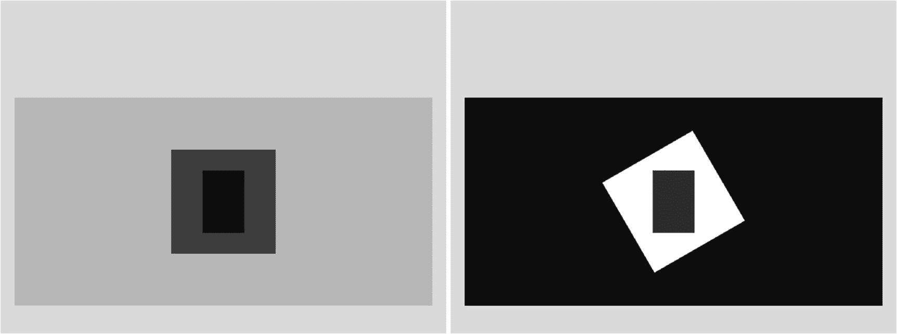

**图 4-5 ¶ 运行同时包含两个场景的场景对象项目**

该项目中有两个不同的关卡：`MyGame` 关卡在灰色背景上绘制了一个位于红色正方形上方的蓝色矩形，而 `BlueLevel` 关卡在深蓝色背景上绘制了一个位于旋转白色正方形上方的红色矩形。为简单起见，两个关卡的控制方式相同。

*   **左/右箭头键**：使前景矩形左右移动
*   **Q 键**：退出游戏

请注意，在每个关卡中，将前景矩形向左移动以触碰左边界将导致加载另一个关卡。`MyGame` 关卡将导致加载 `BlueLevel`，而 `BlueLevel` 将导致加载 `MyGame` 关卡。

项目目标如下：

*   定义抽象 `Scene` 类以连接游戏引擎
*   体验游戏引擎对场景转换的支持
*   创建特定于场景的加载和卸载支持

### 抽象 Scene 类

基于前一个项目的经验，用于封装游戏引擎接口的抽象 `Scene` 类至少必须定义以下函数：`init()`、`draw()`、`update()`、`load()` 和 `unload()`。此列表中缺少对关卡转换的支持，包括开始、进入下一关卡，以及如果需要的话停止游戏。

#### 1. 创建 Scene 文件和导入

在 `src/engine` 文件夹中创建一个新的 JavaScript 文件，将其命名为 `scene.js`，并从 `loop` 模块和引擎访问文件 `index.js` 导入。这两个模块都是必需的，因为 `Scene` 对象必须在游戏关卡开始和结束时启动和停止游戏循环，并且如果关卡决定终止游戏，则必须清理引擎。

```javascript
import * as loop from "./core/loop.js";
import engine from "./index.js";
```

> **注意**
>
> 在 `Scene` 开始之前，游戏循环绝不能运行。这是因为在正在运行的游戏循环从 `Scene` 调用 `update()` 函数之前，所需的资源必须被正确加载。同样，关卡的卸载只能在游戏循环停止运行后执行。

#### 2. 定义错误对象

定义 JavaScript `Error` 对象，以便在客户端误用时发出警告：

```javascript
const kAbstractClassError = new Error("Abstract Class");
const kAbstractMethodError = new Error("Abstract Method");
```

#### 3. 创建并导出 Scene 类

创建一个名为 `Scene` 的新类并将其导出：

```javascript
class Scene {
    // ... 后续实现 ...
}
export default Scene;
```

#### 4. 实现构造函数

实现构造函数以确保仅实例化 `Scene` 类的子类：

```javascript
constructor() {
    if (this.constructor === Scene) {
        throw kAbstractClassError;
    }
}
```

#### 5. 定义场景转换函数

定义场景转换函数：`start()`、`next()` 和 `stop()`。`start()` 函数是一个 `async` 函数，因为它负责启动游戏循环，而游戏循环又在等待所有异步加载完成。`next()` 和 `stop()` 函数都会停止游戏循环并调用 `unload()` 函数来卸载已加载的资源。区别在于，`next()` 函数预期会被子类重写并调用，在卸载当前场景后，子类可以继续前进到下一关卡。卸载后，`stop()` 函数假定游戏已终止，并继续清理游戏引擎。

```javascript
async start() {
    await loop.start(this);
}
next() {
    loop.stop();
    this.unload();
}
stop() {
    loop.stop();
    this.unload();
    engine.cleanUp();
}
```

#### 6. 定义派生接口函数

定义其余的派生接口函数。请注意，`Scene` 类是一个抽象类，因为所有接口函数都是空的。虽然子类可以选择仅实现接口函数的一个选定子集，但 `draw()` 和 `update()` 函数不是可选的，因为它们共同构成了关卡的核心核心。

```javascript
init() { /* 初始化关卡（由 loop.start() 调用） */ }
load() { /* 加载必要资源 */ }
unload() { /* 卸载所有资源 */ }
// draw/update 必须由子类重写
draw() { throw kAbstractMethodError; }
update() { throw kAbstractMethodError; }
```

这些函数共同呈现了一种与游戏引擎交互的协议。预期子类将重写这些函数以实现实际的游戏行为。

> **注意**
>
> JavaScript *不* 支持抽象类。该语言不会阻止游戏程序员实例化 `Scene` 对象；然而，创建的实例将完全无用，错误消息将为他们提供适当的警告。

### 修改游戏引擎以支持 Scene 类


## 游戏引擎修改

游戏引擎必须以两种重要方式进行修改。首先，游戏引擎访问文件 `index.js` 必须被修改，以将新引入的符号导出给客户端，这与所有新功能的做法一致。其次，`Scene.stop()` 函数引入了停止游戏的可能性，并处理所需的清理和资源释放工作。

### 向客户端导出 Scene 类

编辑 `index.js` 文件，从 `scene.js` 导入并为客户端导出 `Scene`：

```javascript
// ... identical to previous code ...
import Scene from "./scene.js";
// ... identical to previous code ...
export default {
    // ... identical to previous code ...
    Camera,
    Scene,
    Transform,
    Renderable,
    // ... identical to previous code ...
}
```

### 实现引擎清理支持

当游戏引擎关闭时，释放已分配的资源非常重要。清理过程相当复杂，且按系统组件初始化的**逆序**进行。

1. **再次编辑 `index.js`**，这次是为了实现游戏引擎清理的支持。从 loop 模块导入，然后定义并导出 `cleanUp()` 函数。

```javascript
// ... identical to previous code ...
import * as loop from "./core/loop.js";
// ... identical to previous code ...
function cleanUp() {
    loop.cleanUp();
    input.cleanUp();
    shaderResources.cleanUp();
    vertexBuffer.cleanUp();
    glSys.cleanUp();
}
// ... identical to previous code ...
export default {
    // ... identical to previous code ...
    init,
    cleanUp,
    clearCanvas
    // ... identical to previous code ...
}
```

> **注意**  
> 与其他核心引擎内部组件（如 `gl` 或 `vertex_buffer`）类似，`loop` **不应**被客户端访问。因此，`loop` 模块被 `index.js` 导入但**不导出**——导入是为了调用游戏循环清理，不导出是为了让客户端免受引擎内部无关复杂性的干扰。

请注意，目前没有任何组件定义其对应的清理函数。现在你将解决这个问题。在以下每种情况下，请务必记得在适当的时候导出新定义的 `cleanUp()` 函数。

2. **编辑 `loop.js`** 以定义并导出一个 `cleanUp()` 函数，用于停止游戏循环并卸载当前活动场景：

```javascript
// ... identical to previous code ...
function cleanUp() {
    if (mLoopRunning) {
        stop();
        // unload all resources
        mCurrentScene.unload();
        mCurrentScene = null;
    }
}
export {start, stop, cleanUp}
```

3. **编辑 `input.js`** 以定义并导出一个 `cleanUp()` 函数。目前，无需释放特定资源。

```javascript
// ... identical to previous code ...
function cleanUp() {}  // nothing to do for now
export {keys, init, cleanUp, ...}
// ... identical to previous code ...
```

4. **编辑 `shader_resources.js`** 以定义并导出一个 `cleanUp()` 函数，用于清理创建的着色器并卸载其源代码：

```javascript
// ... identical to previous code ...
function cleanUp() {
    mConstColorShader.cleanUp();
    text.unload(kSimpleVS);
    text.unload(kSimpleFS);
}
export {init, cleanUp, getConstColorShader}
```

5. **编辑 `simple_shader.js`** 以定义 `SimpleShader` 类的 `cleanUp()` 函数，释放已分配的 WebGL 资源：

```javascript
cleanUp() {
    let gl = glSys.get();
    gl.detachShader(this.mCompiledShader, this.mVertexShader);
    gl.detachShader(this.mCompiledShader, this.mFragmentShader);
    gl.deleteShader(this.mVertexShader);
    gl.deleteShader(this.mFragmentShader);
    gl.deleteProgram(this.mCompiledShader);
}
```

6. **编辑 `vertex_buffer.js`** 以定义并导出一个 `cleanUp()` 函数，删除已分配的缓冲区内存：

```javascript
// ... identical to previous code ...
function cleanUp() {
    if (mGLVertexBuffer !== null) {
        glSys.get().deleteBuffer(mGLVertexBuffer);
        mGLVertexBuffer = null;
    }
}
export {init, get, cleanUp}
```

7. **最后，编辑 `gl.js`** 以定义并导出一个 `cleanUp()` 函数，通知玩家引擎现已关闭：

```javascript
// ... identical to previous code ...
function cleanUp() {
    if ((mGL == null) || (mCanvas == null))
        throw new Error("Engine cleanup: system is not initialized.");
    mGL = null;
    // let the user know
    mCanvas.style.position = "fixed";
    mCanvas.style.backgroundColor = "rgba(200, 200, 200, 0.5)";
    mCanvas = null;
    document.body.innerHTML +=
        "<br><br><h1>End of Game</h1><h1>GL System Shut Down</h1>";
}
export {init, get, cleanUp}
```

### 测试 Scene 类对游戏引擎的接口

有了抽象 `Scene` 类的定义以及游戏引擎核心组件的资源管理修改，现在可以随意停止现有场景并加载新场景。本节在 `Scene` 类的两个子类 `MyGame` 和 `BlueLevel` 之间循环切换，以演示场景的加载和卸载。

为简单起见，这两个测试场景几乎与上一个项目中的 `MyGame` 场景相同。在本项目中，`MyGame` 在 `init()` 函数中显式定义场景，而 `BlueScene` 则与上一个项目中的情况相同，从 `assets` 文件夹中的 `blue_level.xml` 文件加载场景内容。XML 场景文件的内容和解析与上一个项目完全相同，因此不再重复。

#### MyGame 场景

如前所述，该场景在 `init()` 函数中定义，内容与上一个项目中的场景文件相同（除相机背景颜色外）。在下一节中，请注意 `next()` 和 `stop()` 函数的定义与调用。

1. **编辑 `my_game.js`** 以从 `index.js` 和新定义的 `blue_level.js` 导入。注意，有了 `Scene` 类的支持，你不再需要从 loop 模块导入。

```javascript
import engine from "../engine/index.js";
import BlueLevel from "./blue_level.js";
```

2. **定义 `MyGame`** 为引擎 `Scene` 类的子类，并记得导出 `MyGame`：

```javascript
class MyGame extends engine.Scene {
    // ... implementation to follow ...
}
export default MyGame;
```

> **注意**  
> JavaScript `extends` 关键字定义了父/子关系。

3. **定义 `constructor()`、`init()` 和 `draw()` 函数。** 注意 `init()` 函数中定义的场景内容（除相机背景颜色外）与上一个项目相同。

```javascript
constructor() {
    super();
    // The camera to view the scene
    this.mCamera = null;
    // the hero and the support objects
    this.mHero = null;
    this.mSupport = null;
}
init() {
    // Step A: set up the cameras
    this.mCamera = new engine.Camera(
        vec2.fromValues(20, 60),  // position of the camera
        20,                       // width of camera
        [20, 40, 600, 300]        // viewport (orgX, orgY, width, height)
    );
    this.mCamera.setBackgroundColor([0.8, 0.8, 0.8, 1]);
    // Step B: Create the support object in red
    this.mSupport = new engine.Renderable();
    this.mSupport.setColor([0.8, 0.2, 0.2, 1]);
    this.mSupport.getXform().setPosition(20, 60);
    this.mSupport.getXform().setSize(5, 5);
    // Step C: Create the hero object in blue
    this.mHero = new engine.Renderable();
    this.mHero.setColor([0, 0, 1, 1]);
    this.mHero.getXform().setPosition(20, 60);
    this.mHero.getXform().setSize(2, 3);
}
draw() {
    // Step A: clear the canvas
    engine.clearCanvas([0.9, 0.9, 0.9, 1.0]);
    // Step B: Activate the drawing Camera
    this.mCamera.setViewAndCameraMatrix();
    // Step C: draw everything
    this.mSupport.draw(this.mCamera);
    this.mHero.draw(this.mCamera);
}
```

4. **定义 `update()` 函数**；注意当 `mHero` 对象从右侧越过 x=11 边界时调用 `this.next()`，以及按下 Q 键时调用 `this.stop()`。


## 场景更新与转换

## update() 方法实现

```javascript
update() {
    // let's only allow the movement of hero,
    // and if hero moves too far off, this level ends, we will
    // load the next level
    let deltaX = 0.05;
    let xform = this.mHero.getXform();
    // Support hero movements
    if (engine.input.isKeyPressed(engine.input.keys.Right)) {
        xform.incXPosBy(deltaX);
        if (xform.getXPos() > 30) { // right-bound of the window
            xform.setPosition(12, 60);
        }
    }
    if (engine.input.isKeyPressed(engine.input.keys.Left)) {
        xform.incXPosBy(-deltaX);
        if (xform.getXPos() < 11) {  // left-bound of the window
            this.next();
        }
    }
    if (engine.input.isKeyPressed(engine.input.keys.Q))
        this.stop();  // Quit the game
}
```

### 1.5 定义 next() 函数以过渡到 BlueLevel 场景

```javascript
next() {
    super.next();  // this must be called!
    // next scene to run
    let nextLevel = new BlueLevel();  // next level to be loaded
    nextLevel.start();
}
```

> **注意**  
> `super.next()` 调用至关重要，父类可以停止游戏循环并卸载当前场景，这是实现场景转换的必要条件。

### 1.6 修改 window.onload() 函数

```javascript
window.onload = function () {
    engine.init("GLCanvas");
    let myGame = new MyGame();
    myGame.start();
}
```

---

## BlueLevel 场景

`BlueLevel` 场景与上一个项目中的 `MyGame` 对象几乎相同，区别在于支持新的 `Scene` 类和场景转换。

### 1.1 创建并编辑 blue_level.js 文件

在 `my_game` 文件夹中创建并编辑 `blue_level.js` 文件，从引擎的 `index.js`、`MyGame` 和 `SceneFileParser` 导入。定义并导出 `BlueLevel` 为 `engine.Scene` 类的子类。

```javascript
// Engine Core stuff
import engine from "../engine/index.js";
// Local stuff
import MyGame from "./my_game.js";
import SceneFileParser from "./util/scene_file_parser.js";

class BlueLevel extends engine.Scene {
    // ... implementation to follow ...
}
export default BlueLevel;
```

### 1.2 定义 init()、draw()、load() 和 unload() 函数

这些函数与上一个项目中 `MyGame` 类中的实现完全相同。

### 1.3 定义 update() 函数

类似于 `MyGame` 场景的 `update()`。再次注意：当对象从右侧穿过 `x=11` 边界时调用 `this.next()`，按下 `Q` 键时调用 `this.stop()`。

```javascript
update() {
    // For this very simple game, let's move the first square
    let xform = this.mSQSet[1].getXform();
    let deltaX = 0.05;
    /// Move right and swap over
    if (engine.input.isKeyPressed(engine.input.keys.Right)) {
        xform.incXPosBy(deltaX);
        if (xform.getXPos() > 30) { // right-bound of the window
            xform.setPosition(12, 60);
        }
    }
    // test for white square movement
    if (engine.input.isKeyPressed(engine.input.keys.Left)) {
        xform.incXPosBy(-deltaX);
        if (xform.getXPos() < 11) { // this is the left-boundary
            this.next(); // go back to my game
        }
    }
    if (engine.input.isKeyPressed(engine.input.keys.Q))
        this.stop();  // Quit the game
}
```

### 1.4 定义 next() 函数以过渡到 MyGame 场景

再次强调，调用 `super.next()` 是必要的，因为它对于停止游戏循环并在继续下一个场景之前卸载当前场景至关重要。

```javascript
next() {
    super.next();
    let nextLevel = new MyGame();  // load the next level
    nextLevel.start();
}
```

现在可以运行项目，查看场景的卸载和加载，并在交互过程中随时退出游戏。游戏引擎现在拥有了一个明确定义的接口来与其客户端配合工作。该接口遵循 `Scene` 类的明确定义协议。

### Scene 类接口规范

- **`constructor()`**：用于声明变量和定义常量。
- **`start()` / `stop()`**：用于启动场景和停止游戏。这两个方法不应被子类重写。

以下接口方法旨在由子类重写：

- **`init()`**：用于实例化变量和设置游戏场景。
- **`load()` / `unload()`**：用于启动外部资源的异步加载和卸载。
- **`draw()` / `update()`**：用于持续显示游戏状态、接收玩家输入并实现游戏逻辑。
- **`next()`**：用于实例化并过渡到下一个场景。

最后提醒一下，子类**必须**调用 `super.next()` 以停止游戏循环并卸载场景，这绝对至关重要。

任何定义了这些方法的对象都可以被游戏引擎加载并交互。你可以尝试创建其他关卡。

---

## 音频

音频是所有视频游戏的重要元素。一般来说，游戏中的音频效果分为两类：

1. **背景音频**：包括背景音乐或环境音效，常用于为游戏的不同部分带来氛围或情感。
2. **音效**：用于各种目的，从通知用户游戏动作到听到主角的脚步声。通常，音效代表特定动作，由用户或游戏本身触发。这类音效通常被视为音频提示。

这两类音频的一个重要区别在于控制方式：**音效或提示一旦开始就无法停止或调整音量**，因此提示通常很短。而**背景音频可以随意启动和停止**，这些功能对于完全停止背景音轨并开始另一段很有用。

## 音频支持项目

该项目拥有与前一个项目相同的 `MyGame` 和 `BlueLevel` 场景。可以用方向键左右移动前面的矩形，与左边界相交触发另一个场景的加载，`Q` 键退出游戏。然而，在这个版本中，每个场景都播放背景音乐，并在按下左/右方向键时触发简短的音频提示。注意每种音频片段的音量各不相同。该项目的实现也强化了外部资源加载和卸载以及音频片段本身的概念。可以在图 4-6 中看到该项目运行的示例。该项目的源代码定义在 `chapter4/4.6.audio_support` 文件夹中。


**Figure 4-6 ¶ Running the Audio Support project with both scenes**

### 项目控制

- **左/右方向键**：左右移动前面的矩形以增加和减小背景音乐的音量
- **Q 键**：退出游戏

### 项目目标

- 向资源管理系统添加音频支持
- 为游戏提供播放音频的接口

### 音频文件

在 `assets/sounds` 文件夹中可以找到以下音频文件：

- `bg_clip.mp3`
- `blue_level_cue.wav`
- `my_game_cue.wav`

注意音频文件有两种格式：`mp3` 和 `wav`。虽然两者都支持，但使用时应谨慎：
- **`.mp3` 格式**为压缩格式，适合存储较长时长的音频内容，例如背景音乐。
- **`.wav` 格式**为未压缩格式，应仅包含非常短的音频片段，例如提示音效。

## 定义音频资源模块


### 实现音频组件

虽然音频和文本文件完全不同，但从游戏引擎实现的角度来看，有两个重要的相似之处。首先，两者都是外部资源，因此将在 `src/engine/resources` 文件夹中以引擎组件的形式类似地实现。其次，两者都涉及具有定义良好的 API 实用程序的标准化文件格式。将使用 Web Audio API 来实际检索和播放声音文件。尽管该 API 提供了广泛的功能，但为了专注于游戏引擎开发的其他部分，这里仅讨论对背景音频和效果提示的基本支持。

## 注意

感兴趣的读者可以从 [www.w3.org/TR/webaudio/](http://www.w3.org/TR/webaudio/) 了解更多关于 Web Audio API 的信息。

## 浏览器音频策略

包括 Chrome 在内的某些浏览器的最新策略是，在用户首次交互之前，不允许播放音频。这意味着上下文创建将导致 Chrome 发出初始警告，并输出到运行时浏览器控制台。音频仅在用户输入（例如鼠标点击或键盘事件）后才会播放。

## 实现步骤

### 步骤 1：创建 `audio.js`

在 `src/engine/resources` 文件夹中，创建一个新文件并将其命名为 `audio.js`。该文件将实现音频组件的模块。该组件必须支持两类功能：音频文件的加载和卸载，以及为游戏开发者提供音频文件内容的播放和控制。

### 步骤 2：导入核心资源管理

加载和卸载与文本和 xml 模块的实现类似，其中核心资源管理功能从 `resource_map` 导入：

```javascript
"use strict";
import * as map from "../core/resource_map.js";
// functions from resource_map
let unload = map.unload;
let has = map.has;
```

### 步骤 3：定义解码和解析函数

定义解码和解析函数，并调用 `resource_map.loadDecodeParse()` 函数来加载音频文件。注意，在 `resource_map` 和引擎其余基础设施的支持下，外部资源的加载和卸载变得简单直接。

```javascript
function decodeResource(data) {
    return data.arrayBuffer();
}
function parseResource(data) {
    return mAudioContext.decodeAudioData(data);
}
function load(path) {
    return map.loadDecodeParse(path, decodeResource, parseResource);
}
```

### 步骤 4：声明音频控制变量

随着加载功能的完成，现在可以定义音频控制和操作函数了。声明变量以维护对 Web Audio 上下文和背景音乐的引用，并控制音量。

```javascript
let mAudioContext = null;
let mBackgroundAudio = null;
// volume control support
let mBackgroundGain = null; // background volume
let mCueGain = null;        // cue/special effects volume
let mMasterGain = null;     // overall/master volume
let kDefaultInitGain = 0.1;
```

### 步骤 5：定义 `init()` 函数

定义 `init()` 函数以创建并存储对 Web Audio 上下文的引用在 `mAudioContext` 中，并初始化背景、提示以及影响两者的主音量增益控制。在所有情况下，音量增益 0 对应无音频，1 表示最大响度。

```javascript
function init() {
    try {
        let AudioContext = window.AudioContext ||
                           window.webkitAudioContext;
        mAudioContext = new AudioContext();
        // connect Master volume control
        mMasterGain = mAudioContext.createGain();
        mMasterGain.connect(mAudioContext.destination);
        // set default Master volume
        mMasterGain.gain.value = kDefaultInitGain;
        // connect Background volume control
        mBackgroundGain = mAudioContext.createGain();
        mBackgroundGain.connect(mMasterGain);
        // set default Background volume
        mBackgroundGain.gain.value = 1.0;
        // connect Cue volume control
        mCueGain = mAudioContext.createGain();
        mCueGain.connect(mMasterGain);
        // set default Cue volume
        mCueGain.gain.value = 1.0;
    } catch (e) {
        throw new Error("...");
    }
}
```

### 步骤 6：定义 `playCue()` 函数

定义 `playCue()` 函数以在适当的音量控制下播放音频剪辑的整个持续时间。此函数使用音频文件路径作为资源名称，从 `resource_map` 中查找已加载的资源，然后调用 Web Audio API 播放音频剪辑。注意，不保留对 source 变量的引用，因此一旦开始，就无法停止相应的音频剪辑。游戏应调用此函数播放短小的音频片段作为提示。

```javascript
function playCue(path, volume) {
    let source = mAudioContext.createBufferSource();
    source.buffer = map.get(path);
    source.start(0);
    // volume support for cue
    source.connect(mCueGain);
    mCueGain.gain.value = volume;
}
```

### 步骤 7：定义背景音乐控制

定义播放、停止、查询和控制背景音乐音量的功能。在这种情况下，`mBackgroundAudio` 变量保存对当前正在播放音频的引用，因此可以停止剪辑或更改其音量。

```javascript
function playBackground(path, volume) {
    if (has(path)) {
        stopBackground();
        mBackgroundAudio = mAudioContext.createBufferSource();
        mBackgroundAudio.buffer = map.get(path);
        mBackgroundAudio.loop = true;
        mBackgroundAudio.start(0);
        // connect volume accordingly
        mBackgroundAudio.connect(mBackgroundGain);
        setBackgroundVolume(volume);
    }
}
function stopBackground() {
    if (mBackgroundAudio !== null) {
        mBackgroundAudio.stop(0);
        mBackgroundAudio = null;
    }
}
function isBackgroundPlaying() {
    return (mBackgroundAudio !== null);
}
function setBackgroundVolume(volume) {
    if (mBackgroundGain !== null) {
        mBackgroundGain.gain.value = volume;
    }
}
function incBackgroundVolume(increment) {
    if (mBackgroundGain !== null) {
        mBackgroundGain.gain.value += increment;
        // need this since volume increases when negative
        if (mBackgroundGain.gain.value < 0) {
            setBackgroundVolume(0);
        }
    }
}
```

### 步骤 8：定义主音量控制

定义控制主音量的函数，它同时调整提示音和背景音乐的音量：

```javascript
function setMasterVolume(volume) {
    if (mMasterGain !== null) {
        mMasterGain.gain.value = volume;
    }
}
function incMasterVolume(increment) {
    if (mMasterGain !== null) {
        mMasterGain.gain.value += increment;
        // need this since volume increases when negative
        if (mMasterGain.gain.value < 0) {
            mMasterGain.gain.value = 0;
        }
    }
}
```

### 步骤 9：定义 `cleanUp()` 函数

定义 `cleanUp()` 函数以释放分配的 HTML5 资源：

```javascript
function cleanUp() {
    mAudioContext.close();
    mAudioContext = null;
}
```

### 步骤 10：导出模块函数

记得导出该模块的函数：

```javascript
export {init, cleanUp,
        has, load, unload,
        playCue,
        playBackground, stopBackground, isBackgroundPlaying,
        setBackgroundVolume, incBackgroundVolume,
        setMasterVolume, incMasterVolume }
```

## 将音频模块导出给客户端

编辑 `index.js` 文件以从 `audio.js` 导入，相应地初始化和清理模块，并导出给客户端：

```javascript
... identical to previous code ...
import * as audio from "./resources/audio.js";
... identical to previous code ...
function init(htmlCanvasID) {
    glSys.init(htmlCanvasID);
    vertexBuffer.init();
    shaderResources.init();
    input.init();
    audio.init();
}
function cleanUp() {
    loop.cleanUp();
    audio.cleanUp();
    input.cleanUp();
    shaderResources.cleanUp();
    vertexBuffer.cleanUp();
    glSys.cleanUp();
}
... identical to previous code ...
export default {
    // resource support
    audio, text, xml
    ... identical to previous code ...
}
```

## 测试音频组件


要测试音频组件，您必须将必要的音频文件复制到您的游戏项目中。在 `assets` 文件夹中创建一个新文件夹并将其命名为 `sounds`。将 `bg_clip.mp3`、`blue_level_cue.wav` 和 `my_game_cue.wav` 文件复制到 `sounds` 文件夹中。现在您需要更新 `MyGame` 和 `BlueLevel` 的实现以加载并使用这些音频资源。

### 修改 MyGame.js

更新 `MyGame` 场景以加载音频剪辑、播放背景音频，并在按下方向键时提示玩家：

1.  **在构造函数中声明指向音频文件的常量文件路径。** 回想一下，这些文件路径被用作加载、存储和检索的资源名称。将这些声明为常量以供后续引用是一种良好的软件工程实践。

    ```javascript
    constructor() {
        super();
        // audio clips: supports both mp3 and wav formats
        this.mBackgroundAudio = "assets/sounds/bg_clip.mp3";
        this.mCue = "assets/sounds/my_game_cue.wav";
        ... identical to previous code ...
    }
    ```

2.  **在 `load()` 函数中请求加载音频剪辑，并确保定义相应的 `unload()` 函数。** 请注意，背景音乐的卸载前面会先停止音乐。通常情况下，必须在卸载资源之前停止该资源的操作。

    ```javascript
    load() {
        // loads the audios
        engine.audio.load(this.mBackgroundAudio);
        engine.audio.load(this.mCue);
    }
    unload() {
        // Step A: Game loop not running, unload all assets
        // stop the background audio
        engine.audio.stopBackground();
        // unload the scene resources
        engine.audio.unload(this.mBackgroundAudio);
        engine.audio.unload(this.mCue);
    }
    ```

3.  **在 `init()` 函数末尾启动背景音频。**

    ```javascript
    init() {
        ... identical to previous code ...
        // now start the Background music ...
        engine.audio.playBackground(this.mBackgroundAudio, 1.0);
    }
    ```

4.  **在 `update()` 函数中，当按下右、左方向键时提示玩家，并增加和减小背景音乐的音量：**

    ```javascript
    update() {
        ... identical to previous code ...
        // Support hero movements
        if (engine.input.isKeyPressed(engine.input.keys.Right)) {
            engine.audio.playCue(this.mCue, 0.5);
            engine.audio.incBackgroundVolume(0.05);
            xform.incXPosBy(deltaX);
            if (xform.getXPos() > 30) { // right-bound of the window
                xform.setPosition(12, 60);
            }
        }
        if (engine.input.isKeyPressed(engine.input.keys.Left)) {
            engine.audio.playCue(this.mCue, 1.5);
            engine.audio.incBackgroundVolume(-0.05);
            xform.incXPosBy(-deltaX);
            if (xform.getXPos() < 11) {  // left-bound of the window
                this.next();
            }
        }
        ... identical to previous code ...
    }
    ```

### 修改 BlueLevel.js

对 `BlueLevel` 场景的更改与 `MyGame` 场景类似，但使用不同的音频提示：

1.  **在 `BlueLevel` 构造函数中，添加以下音频资源的路径名称：**

    ```javascript
    constructor() {
        super();
        // audio clips: supports both mp3 and wav formats
        this.mBackgroundAudio = "assets/sounds/bg_clip.mp3";
        this.mCue = "assets/sounds/blue_level_cue.wav";
        ... identical to previous code ...
    }
    ```

2.  **修改音频剪辑的 `load()` 和 `unload()` 函数：**

    ```javascript
    load() {
        engine.xml.load(this.mSceneFile);
        engine.audio.load(this.mBackgroundAudio);
        engine.audio.load(this.mCue);
    }
    unload() {
        // stop the background audio
        engine.audio.stopBackground();
        // unload the scene file and loaded resources
        engine.xml.unload(this.mSceneFile);
        engine.audio.unload(this.mBackgroundAudio);
        engine.audio.unload(this.mCue);
    }
    ```

3.  **以与 `MyGame` 相同的方式，在 `init()` 函数中启动背景音频，并在 `update()` 函数中按下左右键时提示玩家。** 请注意，在这种情况下，音频提示以不同的音量设置播放。

    ```javascript
    init() {
        ... identical to previous code ...
        // now start the Background music ...
        engine.audio.playBackground(this.mBackgroundAudio, 0.5);
    }
    update() {
        ... identical to previous code ...
        // Move right and swap over
        if (engine.input.isKeyPressed(engine.input.keys.Right)) {
            engine.audio.playCue(this.mCue, 0.5);
            xform.incXPosBy(deltaX);
            if (xform.getXPos() > 30) { // right-bound of the window
                xform.setPosition(12, 60);
            }
        }
        // Step A: test for white square movement
        if (engine.input.isKeyPressed(engine.input.keys.Left)) {
            engine.audio.playCue(this.mCue, 1.0);
            xform.incXPosBy(-deltaX);
            if (xform.getXPos() < 11) { // this is the left-boundary
                this.next(); // go back to my game
            }
        }
        ... identical to previous code ...
    }
    ```

现在您可以运行项目并聆听美妙的音频反馈。如果您按住方向键不放，将会反复播放许多提示音。事实上，回响的提示音太多了，以至于音效模糊成了一阵恼人的轰鸣声。这很好地说明了谨慎使用音频提示并确保每个单独的提示音简短悦耳的重要性。您可以尝试轻敲方向键来聆听更清晰、更悦耳的提示音，或者直接将 `isKeyPressed()` 函数替换为 `isKeyClicked()` 函数，来聆听每个单独的提示音。

## 总结

在本章中，您学习了游戏引擎的几个常见组件是如何结合在一起的。从至关重要的游戏循环开始，您了解了它如何实现输入、更新和绘制模式，以超越人类感知或欺骗我们的感官，使我们相信系统是连续且实时运行的。这种模式是任何游戏引擎的核心。您学习了如何灵活且可复用地实现完整的键盘支持，为引擎提供可靠的输入组件。此外，您还了解了如何实现资源管理器以异步加载文件，以及如何抽象场景以支持从文件加载场景，这可以大幅减少代码重复。最后，您学习了音频支持如何为客户端提供接口，以加载和播放环境背景音频和音频提示。

这些组件单独来看几乎没有共同点，但它们共同构成了几乎所有游戏的核心基础。当您将这些核心组件实现到游戏引擎中时，使用该引擎创建的游戏将无需担心每个组件的具体细节。相反，游戏程序员可以专注于利用这些功能来加速和简化开发过程。在下一章中，您将学习如何使用外部图像创建动画的错觉。

### 游戏设计考量

在本章中，我们讨论了*游戏循环*以及玩家所做的事情与游戏如何响应之间连接的技术基础。例如，如果玩家选择屏幕上绘制的一个方块，并通过使用方向键将其从位置 A 移动到位置 B，您通常希望该动作在按下方向键时立即表现为平滑的运动，没有卡顿、延迟或明显的滞后。游戏循环对游戏设计中所谓的*临场感*有重要贡献；临场感是指玩家感觉自己与游戏世界相连的能力，而响应性在让玩家感到相连方面起着关键作用。当现实世界中的动作（如按下方向键）无缝转化为游戏世界中的响应（如移动物体、翻转开关、跳跃等）时，临场感得到增强；当现实世界中的动作遭受转化错误（如延迟和滞后）时，临场感就会受损。


正如第 1 章所述，有效的游戏机制设计可以仅从几个简单的元素开始。例如，当你完成本章的 *Keyboard Support*（键盘支持）项目时，许多构建游戏关卡所需的要素就已经就绪：你已赋予玩家操控屏幕上两个独立元素（红色和白色方块）的能力，而要创建一个基本的游戏循环，只剩下利用这些元素设计一个因果链，使其在完成时产生一个新事件。设想 *Keyboard Support* 项目就是你的游戏：你该如何利用现有条件来创建一个因果链？你可以选择利用方块之间的关系，例如要求将红色方块完全移入白色方块内以解锁下一个挑战；一旦玩家成功将红色方块放入白色方块，关卡即告完成。这种基本机制本身可能不足以创造引人入胜的体验，但只要加入其他八大游戏设计要素中的几个（系统设计、背景设定、视觉设计、音乐与音频等），就能将这一基本互动转化为近乎无限的引人入胜的体验，并为玩家创造那种临场感。随着后续章节的深入，你将为这些练习添加更多游戏设计要素。

*Resource Map and Shader Loader*（资源映射与着色器加载器）项目、*Scene File*（场景文件）项目和 *Scene Objects*（场景对象）项目旨在帮助你开始处理硬盘读取时间和可能需要传输和处理的大量数据，加载图像可能需要明显可感的时间。这加上图像的实用性通常与单个游戏关卡相关联（就像图像所代表的对象一样）这一事实，使得图像的加载和卸载操作通常发生在游戏关卡转换期间。为了优化加载和卸载操作的数量，将多张低分辨率图像合并为一张大图像是一种常见做法。这张较大的图像被称为 *sprite sheet*（精灵表/精灵图集）。

为了表示对象，带有有意义绘图的图像被粘贴或 *mapped*（映射）到简单的几何体上。例如，游戏中的一匹马可以用一张映射了马图像的正方形来表示。这样，游戏开发者就可以通过操控正方形的变换来控制马。在计算机图形学中，这种将图像映射到几何体上的过程被称为 *texture mapping*（纹理映射）。

通过在同一几何体上循环策略性地映射选定图像，可以创造出运动的错觉，即动画。例如，在后续的游戏循环更新中，将同一匹马不同腿部姿势的策略性绘制图像映射到同一个正方形上，就能产生马在奔跑的错觉。通常，这些不同动画姿势的图像存储在一张精灵表或动画精灵表中。通过排序这些图像来创建动画的过程被称为 *sprite animation*（精灵动画）或 *sprite sheet animation*（精灵表动画）。

本章首先向你介绍纹理坐标的概念，以便你能够理解并使用 `WebGL` 纹理映射接口进行编程。然后，你将构建一个核心纹理组件及其相关类，以支持简单纹理映射、处理包含多个对象的精灵表、利用动画精灵表创建和控制运动，以及从精灵表中提取字母字符以显示文本消息。

> **Note**  
> 纹理是加载到图形系统中并准备好映射到几何体上的图像。在讨论纹理映射过程时，“一幅图像”和“一个纹理”常被交替使用。像素是图像中的颜色位置，而 *texel*（纹素）是纹理中的颜色位置。

## Texture Mapping and Texture Coordinates（纹理映射与纹理坐标）


## 纹理映射

正如所讨论的，纹理映射是将一张图像贴到几何体上的过程，就像给物体贴贴纸一样。在你的游戏引擎中，你不再为单位正方形占据的每个像素绘制恒定颜色，而是会创建 `GLSL` 着色器，从纹理中策略性地选择纹素，并将相应的纹素颜色显示在单位正方形覆盖的屏幕像素位置上。选择一个纹素，或将一组纹素转换为单一颜色以显示在屏幕像素位置的过程，称为纹理采样。要渲染一个纹理映射的像素，必须对纹理进行采样以提取相应的纹素颜色。

将任意分辨率的纹理映射到固定大小的几何体上可能令人望而生畏。指定**纹理空间**的**纹理坐标系**旨在隐藏纹理的分辨率，以促进这一映射过程。如图 5-1 所示，**纹理坐标系**是一个定义在整个纹理上的归一化系统，原点位于左下角，(1,1) 位于右上角。无论分辨率如何，归一化的 0 到 1 范围始终定义在整个纹理上，这一简单事实正是**纹理坐标系**的优雅之处。给定任意分辨率的纹理，(0.5, 0.5) 始终是中心，(0, 1) 始终是左上角，以此类推。请注意，在图 5-1 中，水平轴标记为 `u` 轴，垂直轴标记为 `v` 轴。通常，纹理坐标，或与纹理坐标关联的 `uv` 值，可互换地用来指代**纹理坐标系**中的一个位置。

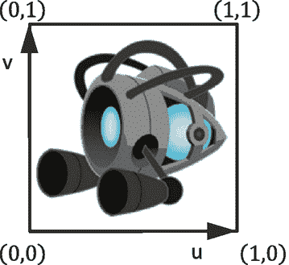

**图 5-1** ¶ 为所有图像定义的纹理坐标系及其对应的 uv 值

> **注意**
>
> 存在一些约定，定义 `v` 轴向上或向下增加。在本书的所有示例中，你将编程 `WebGL` 遵循图 5-1 中的约定，即 `v` 轴向上增加。

要将纹理映射到单位正方形上，必须为每个顶点位置定义相应的 `uv` 值。如图 5-2 所示，除了为正方形的四个角定义 `xy` 位置值外，要将图像映射到此正方形上，还必须定义相应的 `uv` 坐标。在这种情况下，左上角具有 `xy=(-0.5, 0.5)` 和 `uv=(0, 1)`，右上角具有 `xy=(0.5, 0.5)` 和 `uv=(1, 1)`，依此类推。给定此定义，通过线性插值顶点处定义的 `uv` 值，可以为正方形内部的任意位置计算出唯一的 `uv` 值。例如，给定图 5-2 所示的设置，你知道正方形顶边中点映射到**纹理空间**中的 `uv` (0.5, 1.0)，左边中点映射到 `uv` (0, 0.5)，以此类推。

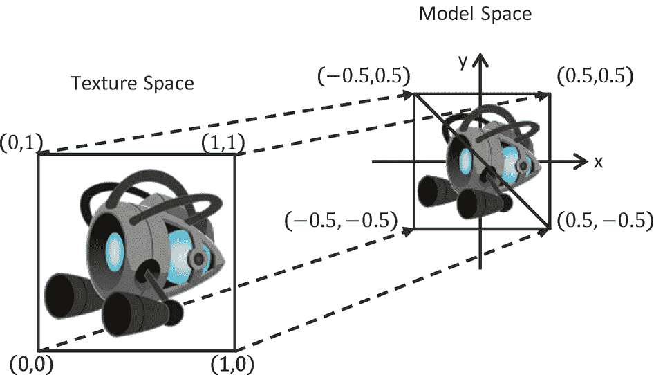

**图 5-2** ¶ 定义纹理空间 uv 值以将整个图像映射到模型空间中的几何体上

### 纹理着色器项目

该项目演示了使用 `WebGL` 进行纹理的加载、渲染和卸载。你可以在图 5-3 中看到该项目运行的示例，左侧和右侧的屏幕截图分别来自实现的两个场景。请注意左侧截图中没有白色边框、外观自然的物体，以及右侧截图中带有白色背景的图像。该项目还将突出显示带有和不带有 Alpha 通道（即 `透明度`）的图像之间的差异。该项目的源代码定义在 `chapter5/5.1.texture_shaders` 文件夹中。

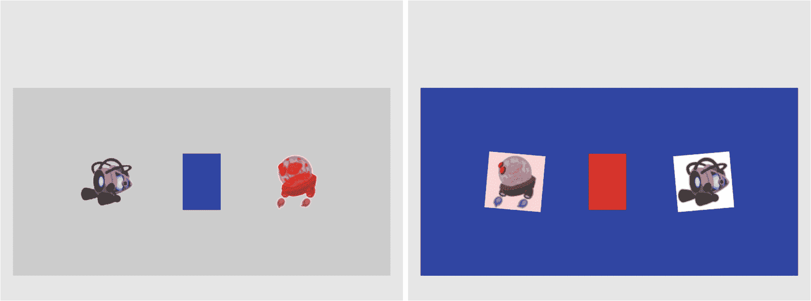

**图 5-3** ¶ 运行包含两个场景的纹理着色器项目

该项目的控制方式如下，两个场景通用：

*   `右箭头键`：将中间的矩形向右移动。如果该矩形越过右窗口边界，它将环绕到窗口左侧。
*   `左箭头键`：将中间的矩形向左移动。如果该矩形越过左窗口边界，游戏将过渡到下一个场景。

项目目标如下：

*   演示如何使用 `WebGL` 为几何体定义 `uv` 坐标
*   在图形系统中使用 `WebGL` 创建纹理坐标缓冲区
*   构建 `GLSL` 着色器以渲染纹理几何体
*   定义 `Texture` 核心引擎组件，以加载和处理图像为纹理，并卸载纹理
*   实现简单的纹理着色，即使用程序员指定的颜色修改所有纹素

你可以在 `assets` 文件夹中找到以下外部资源文件：一个场景级文件 (`blue_level.xml`) 和四张图片 (`minion_collector.jpg`、`minion_collector.png`、`minion_portal.jpg` 和 `minion_portal.png`)。

#### 概述

创建和集成纹理涉及相对重大的更改和需要添加到游戏引擎的新类。以下概述将这些更改的背景和原因进行了说明：

*   `texture_vs.glsl` 和 `texture_fs.glsl`：这些是新创建的文件，用于定义支持使用 `uv` 坐标绘制的 `GLSL` 着色器。回想一下，`GLSL` 着色器必须在游戏引擎初始化期间加载到 `WebGL` 中并进行编译。
*   `vertex_buffer.js`：此文件被修改以创建相应的 `uv` 坐标缓冲区，用于定义单位正方形顶点的纹理坐标。
*   `texture_shader.js`：这是一个新文件，定义 `TextureShader` 作为 `SimpleShader` 的子类，以将游戏引擎与相应的 `GLSL` 着色器 (`TextureVS` 和 `TextureFS`) 连接起来。
*   `texture_renderable.js`：这是一个新文件，定义 `TextureRenderable` 作为 `Renderable` 的子类，以方便创建、操作和绘制多个纹理对象实例。
*   `shader_resources.js`：回想一下，此文件定义 `SimpleShader` 的单个实例来包装相应的 `GLSL` 着色器，以便系统范围内所有 `Renderable` 对象实例共享。以类似的方式，此文件被修改为定义 `TextureShader` 的一个实例，以供所有 `TextureRenderable` 对象实例共享。
*   `gl.js`：此文件被修改以配置 `WebGL` 以支持使用纹理贴图进行绘制。
*   `texture.js`：这是一个新文件，定义能够加载、激活（用于渲染）和卸载纹理图像的核心引擎组件。
*   `my_game.js` 和 `blue_level.js`：这些游戏引擎客户端文件被修改以测试新的纹理映射功能。

创建了两个新的源代码文件夹 `src/engine/shaders` 和 `src/engine/renderables`，用于组织引擎源代码。创建这些文件夹是为了预期支持相应纹理相关功能所需的许多新着色器和渲染器类型。再一次，持续的源代码重组对于支持相应的复杂性增加非常重要。系统且合乎逻辑的源代码结构对于维护和扩展大型软件系统的功能至关重要。

#### SimpleShader/Renderable 架构的扩展


## GLSL 纹理着色器

回顾一下，`SimpleShader`/`Renderable` 对象对旨在支持将相关游戏引擎数据加载到 `SimpleVS`/`FS` GLSL 着色器中，并支持游戏引擎客户端实例化多个 `Renderable` 几何体副本。如图 5-4 所示，水平虚线将游戏引擎与 WebGL 分隔开。注意 `GLSL` 着色器 `SimpleVS` 和 `SimpleFS` 是 WebGL 中的模块，位于游戏引擎之外。`SimpleShader` 对象维护对 GLSL 着色器中所有属性和 uniform 变量的引用，并充当将所有变换和顶点信息发送到 `SimpleVS`/`FS` 着色器的管道。虽然图 5-4 中未明确描绘，但在游戏引擎的 `shader_resources` 中仅创建了一个 `SimpleShader` 对象实例，该实例由所有 `Renderable` 对象共享。

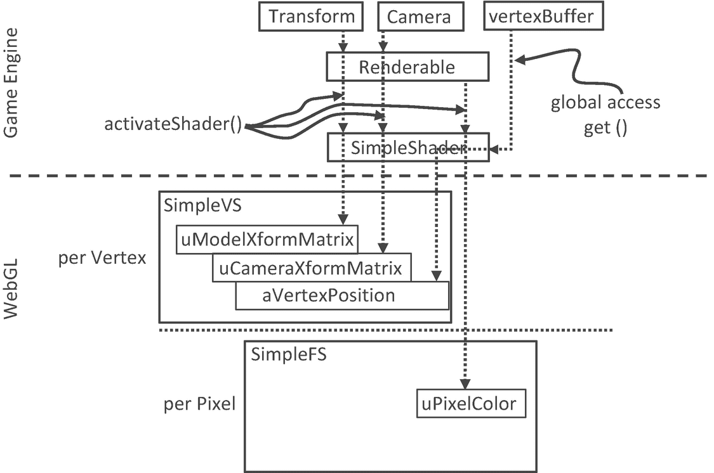

**图 5-4 ¶ SimpleShader 和 Renderable 架构**

纹理映射的正确支持需要新的 GLSL 顶点和片段着色器，因此要求在游戏引擎中定义相应的着色器和可渲染对象对。如图 5-5 所示，`GLSL TextureVS`/`FS` 着色器和 `TextureShader`/`TextureRenderable` 对象对都是相应现有对象的扩展（或子类）。`TextureShader`/`TextureRenderable` 对象对从相应的 `SimpleShader`/`Renderable` 对象扩展而来，用于将纹理坐标传递给 GLSL 着色器。`TextureVS`/`FS` 着色器是相应 `SimpleVS`/`FS` 着色器的扩展，用于在计算像素颜色时从提供的纹理贴图读取纹素。注意，由于 GLSL 不支持子类化，`TextureVS`/`FS` 源代码是从 `SimpleVS`/`FS` 文件复制的。

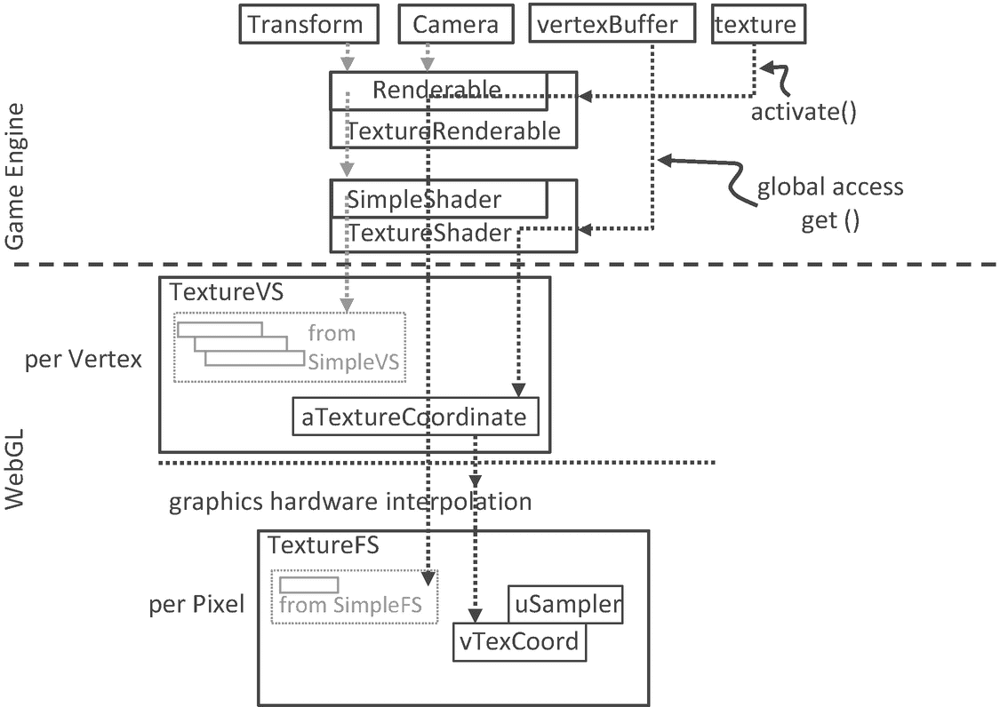

**图 5-5 ¶ TextureVS/FS GLSL 着色器及对应的 TextureShader/TextureRenderable 对象对**

为了支持带纹理的绘制，必须创建一个着色器，它在每个顶点处同时接受几何（`xy`）和纹理（`uv`）坐标。您将通过复制并修改相应的 `SimpleVS` 和 `SimpleFS` 程序来创建新的 GLSL 纹理顶点和片段着色器。现在可以开始创建纹理顶点着色器了。

1. 在 `src/glsl_shaders` 文件夹中创建一个新文件，命名为 `texture_vs.glsl`。
2. 向 `texture_vs.glsl` 文件添加以下代码：

```glsl
attribute vec3 aVertexPosition; // expects one vertex position
attribute vec2 aTextureCoordinate; // texture coordinate attribute
// texture coordinate that maps image to the square
varying vec2 vTexCoord; // to transform the vertex position
uniform mat4 uModelXformMatrix;
uniform mat4 uCameraXformMatrix;
void main(void) {
    // Convert the vec3 into vec4 for scan conversion and
    // transform by uModelXformMatrix and uCameraXformMatrix before
    // assign to gl_Position to pass the vertex to the fragment shader
    gl_Position = uCameraXformMatrix *
                  uModelXformMatrix *
                  vec4(aVertexPosition, 1.0);
    // pass the texture coordinate to the fragment shader
    vTexCoord = aTextureCoordinate;
}
```

您可能会注意到 `TextureVS` 着色器与 `SimpleVS` 着色器相似，仅增加了三行代码：

1. 第一行增加了 `aTextureCoordinate` 属性。这定义了一个顶点包含 `vec3`（`aVertexPosition`，顶点的 xyz 位置）和 `vec2`（`aTextureCoordinate`，顶点的 uv 坐标）。
2. 第二行声明了 `varying vTexCoord` 变量。GLSL 中的 `varying` 关键字表示相关变量将被线性插值并传递给片段着色器。如前所述并如图 5-2 所示，`uv` 值仅在顶点位置定义。在这种情况下，`varying vTexCoord` 变量指示图形硬件线性插值 `uv` 值，以计算片段着色器每次调用的纹理坐标。
3. 第三行将顶点 `uv` 坐标值赋给 `varying` 变量，以便插值并传递给片段着色器。

定义好顶点着色器后，现在可以创建相关的片段着色器：

1. 在 `src/glsl_shaders` 文件夹中创建一个新文件，命名为 `texture_fs.glsl`。
2. 向 `texture_fs.glsl` 文件添加以下代码以声明变量。`sampler2D` 数据类型是一种 GLSL 实用工具，能够从 2D 纹理读取纹素值。在这种情况下，`uSampler` 对象将绑定到一个 GLSL 纹理，以便为每个渲染的像素采样纹素值。`uPixelColor` 与 `SimpleFS` 中的相同。`vTexCoord` 是每个像素的插值 `uv` 坐标值。

```glsl
// The object that fetches data from texture.
// Must be set outside the shader.
uniform sampler2D uSampler;
// Color of pixel
uniform vec4 uPixelColor;
// "varying" keyword signifies that the texture coordinate will be
// interpolated and thus varies.
varying vec2 vTexCoord;
```

3. 添加以下代码以计算每个像素的颜色：

```glsl
void main(void) {
    // texel color look up based on interpolated UV value in vTexCoord
    vec4 c = texture2D(uSampler, vec2(vTexCoord.s, vTexCoord.t));
    // tint the textured. transparent area defined by the texture
    vec3 r = vec3(c) * (1.0 - uPixelColor.a) +
             vec3(uPixelColor) * uPixelColor.a;
    vec4 result = vec4(r, c.a);
    gl_FragColor = result;
}
```

`texture2D()` 函数使用来自 `vTexCoord` 的插值 `uv` 值，从与 `uSampler` 关联的纹理中采样并读取纹素值。在本例中，纹素颜色根据对应 alpha 通道的*透明度*或值，通过 `uPixelColor` 中定义的颜色值的加权和进行修改或着色。通常，对于着色纹理颜色没有公认的定义。您可以自由尝试不同的方式来组合 `uPixelColor` 和采样的纹素颜色。例如，您可以尝试将两者相乘。在提供的源代码文件中建议了一些替代方案，请务必进行实验。

## 定义并设置纹理坐标

回顾一下，所有着色器共享在 `vertex_buffer.js` 文件中定义的单位正方形的相同 `xy` 坐标缓冲区。同样，必须定义相应的缓冲区以向 GLSL 着色器提供纹理坐标。

1. 修改 `vertex_buffer.js` 以定义单位正方形的 `xy` 和 `uv` 坐标。如图 5-2 所示，`mTextureCoordinates` 变量定义了与 `mVerticesOfSquare` 中顺序定义的单位正方形的四个 `xy` 值对应的 `uv` 值。例如，`(1, 1)` 是与 `(0.5, 0.5, 0)` `xy` 位置关联的 `uv` 值，`(0, 1)` 对应 `(-0.5, 0.5, 0)`，依此类推。

```javascript
// First: define the vertices for a square
let mVerticesOfSquare = [
    0.5, 0.5, 0.0,
    -0.5, 0.5, 0.0,
    0.5, -0.5, 0.0,
    -0.5, -0.5, 0.0
];
// Second: define the corresponding texture coordinates
let mTextureCoordinates = [
    1.0, 1.0,
    0.0, 1.0,
    1.0, 0.0,
    0.0, 0.0
];
```

2. 定义变量 `mGLTextureCoordBuffer`，以保存对 `mTextureCoordinates` 纹理坐标值的 WebGL 缓冲区存储的引用，以及相应的 getter 函数：

```javascript
let mGLTextureCoordBuffer = null;
function getTexCoord() {
    return mGLTextureCoordBuffer;
}
```

3.


## 修改 init() 函数以初始化纹理坐标

修改 `init()` 函数以包含步骤 D，将纹理坐标初始化为 WebGL 缓冲区。请注意，初始化过程与顶点 xy 坐标的初始化过程相同，不同之处在于：对新缓冲区的引用存储在 `mGLTextureCoordBuffer` 中，传输的数据是 uv 坐标值。

```javascript
function init() {
    let gl = glSys.get();
    ... identical to previous code ...
    // Step D: Allocate and store texture coordinates
    // Create a buffer on the gl context for texture coordinates
    mGLTextureCoordBuffer = gl.createBuffer();
    // Activate texture coordinate buffer
    gl.bindBuffer(gl.ARRAY_BUFFER, mGLTextureCoordBuffer);
    // Loads textureCoordinates into the mGLTextureCoordBuffer
    gl.bufferData(gl.ARRAY_BUFFER,
        new Float32Array(mTextureCoordinates), gl.STATIC_DRAW);
}
```

### 4. 清理时释放已分配的缓冲区

记得在最终清理期间释放已分配的缓冲区：

```javascript
function cleanUp() {
    ... identical to previous code ...
    if (mGLTextureCoordBuffer !== null) {
        gl.deleteBuffer(mGLTextureCoordBuffer);
        mGLTextureCoordBuffer = null;
    }
}
```

### 5. 导出变更

最后，记得导出变更：

```javascript
export {init, cleanUp, get, getTexCoord}
```

## 将 GLSL 着色器接入引擎

正如 `SimpleShader` 对象被定义为与 `SimpleVS` 和 `SimpleFS` 着色器交互的接口一样，需要在游戏引擎中创建一个相应的着色器对象，以与 `TextureVS` 和 `TextureFS` GLSL 着色器交互。正如本项目概述中提到的，你还将创建一个新文件夹来组织日益增多的不同着色器。

### 1. 创建 shaders 文件夹

在 `src/engine` 中创建一个名为 `shaders` 的新文件夹。将 `simple_shader.js` 文件移入此文件夹，别忘了更新 `index.js` 中的引用路径。

### 2. 创建 texture_shader.js

在 `src/engine/shaders` 文件夹中创建一个新文件，命名为 `texture_shader.js`。

```javascript
class TextureShader extends SimpleShader {
    constructor(vertexShaderPath, fragmentShaderPath) {
        // Call super class constructor
        super(vertexShaderPath, fragmentShaderPath);
        // reference to aTextureCoordinate within the shader
        this.mTextureCoordinateRef = null;
        // get the reference of aTextureCoordinate within the shader
        let gl = glSys.get();
        this.mTextureCoordinateRef = gl.getAttribLocation(
            this.mCompiledShader,
            "aTextureCoordinate");
        this.mSamplerRef = gl.getUniformLocation(this.mCompiledShader,
            "uSampler");
    }
    ... implementation to follow ...
}
```

在上述代码中，请注意以下几点：

- **a.** 定义的 `TextureShader` 类是 `SimpleShader` 类的扩展或子类。
- **b.** 构造函数实现首先调用 `super()`，即 `SimpleShader` 的构造函数。回想一下，`SimpleShader` 构造函数将加载并编译由 `vertexShaderPath` 和 `fragmentShaderPath` 参数定义的 GLSL 着色器，并设置 `mVertexPositionRef` 以引用着色器中定义的 `aVertexPosition` 属性。
- **c.** 在构造函数的其余部分，`mTextureCoordinateRef` 保存对 `texture_vs.glsl` 中定义的 `aTextureCoordinate` 属性的引用。
- **d.** 这样，顶点位置 (`aVertexPosition`) 和纹理坐标 (`aTextureCoordinate`) 这两个属性都由 JavaScript `TextureShader` 对象引用。

### 3. 重写 activate() 函数

重写 `activate()` 函数以启用纹理坐标数据。父类 `super.activate()` 函数设置 xy 顶点位置，并将 `pixelColor`、`trsMatrix` 和 `cameraMatrix` 的值传递给着色器。其余代码将 `mTextureCoordinateRef`（在 `vertex_buffer` 模块中定义的纹理坐标缓冲区）绑定到 GLSL 着色器中的 `aTextureCoordinate` 属性，并将 `mSampler` 绑定到纹理单元 0（稍后详述）。

```javascript
// Overriding the Activation of the shader for rendering
activate(pixelColor, trsMatrix, cameraMatrix) {
    // first call the super class's activate
    super.activate(pixelColor, trsMatrix, cameraMatrix);
    // now our own functionality: enable texture coordinate array
    let gl = glSys.get();
    gl.bindBuffer(gl.ARRAY_BUFFER, this._getTexCoordBuffer());
    gl.vertexAttribPointer(this.mTextureCoordinateRef, 2,
        gl.FLOAT, false, 0, 0);
    gl.enableVertexAttribArray(this.mTextureCoordinateRef);
    // bind uSampler to texture 0
    gl.uniform1i(this.mSamplerRef, 0);
    // texture.activateTexture() binds to Texture0
}
```

结合 `SimpleShader` 和 `TextureShader` 的功能，在调用 `activate()` 函数后，GLSL `texture_vs` 着色器中的两个属性变量（`aVertexPosition` 和 `aTextureCoordinate`）都将连接到 WebGL 内存中的相应缓冲区。

## 通过 shader_resources 实现共享

正如 `SimpleShader` 是可复用资源一样，只需创建一个 `TextureShader` 实例，该实例即可共享。`shader_resources` 模块应修改以反映这一点。

### 1. 在 shader_resources.js 中添加变量以保存纹理着色器

```javascript
// Texture Shader
let kTextureVS = "src/glsl_shaders/texture_vs.glsl"; // VertexShader
let kTextureFS = "src/glsl_shaders/texture_fs.glsl"; // FragmentShader
let mTextureShader = null;
```

### 2. 定义获取纹理着色器的函数

```javascript
function getTextureShader() {
    return mTextureShader;
}
```

### 3. 在 createShaders() 函数中创建纹理着色器实例

```javascript
function createShaders() {
    mConstColorShader = new SimpleShader(kSimpleVS, kSimpleFS);
    mTextureShader = new TextureShader(kTextureVS, kTextureFS);
}
```

### 4. 修改 init() 函数以追加 loadPromise，包含纹理着色器源文件的加载

```javascript
function init() {
    let loadPromise = new Promise(
        async function(resolve) {
            await Promise.all([
                text.load(kSimpleFS),
                text.load(kSimpleVS),
                text.load(kTextureFS),
                text.load(kTextureVS)
            ]);
            resolve();
        }).then(
        function resolve() {
            createShaders();
        }
    );
    map.pushPromise(loadPromise);
}
```

### 5. 清理时释放新分配的资源

```javascript
function cleanUp() {
    mConstColorShader.cleanUp();
    mTextureShader.cleanUp();
    text.unload(kSimpleVS);
    text.unload(kSimpleFS);
    text.unload(kTextureVS);
    text.unload(kTextureFS);
}
```

### 6. 导出新定义的功能

```javascript
export {init, cleanUp, getConstColorShader, getTextureShader}
```

## TextureRenderable 类

正如 `Renderable` 类封装并便于多个 `SimpleShader` 对象实例的定义和绘制一样，需要定义相应的 `TextureRenderable` 类以支持多个 `TextureShader` 对象实例的绘制。

### Renderable 类的更改

正如项目概述中提到的，出于与在 Shaders 文件夹中创建和组织着色器类相同的原因，应创建一个 `renderables` 文件夹来组织日益增多的不同种类的 `Renderable` 对象。此外，必须修改 `Renderable` 类以支持其作为所有 `Renderable` 对象的基类。

#### 1. 创建 renderables 文件夹

创建 `src/engine/renderables` 文件夹并将 `renderable.js` 移入此文件夹。记得更新 `index.js` 以反映文件位置的变化。

#### 2. 定义 _setShader() 函数以设置 Renderable 的着色器

这是一个受保护的函数，允许子类修改 `mShader` 变量以引用每个相应子类的适当着色器。

```javascript
// this is private/protected
_setShader(s) {
    this.mShader = s;
}
```

**注意**


## 以“_”开头命名的函数为私有或受保护函数

以“_”开头命名的函数为私有或受保护函数，不应在类外部调用。这是本书遵循的约定，而非 JavaScript 强制要求的。

## 定义 TextureRenderable 类

您现在可以定义 `TextureRenderable` 类了。如前所述，`TextureRenderable` 派生自 `Renderable` 类，并扩展了其功能以渲染纹理映射对象。

### 1. 创建类文件和构造函数

在 `src/engine/renderables` 文件夹中创建一个新文件，并将其命名为 `texture_renderable.js`。添加构造函数。回顾一下，`super()` 是对超类（`Renderable`）构造函数的调用；同样，`super.setColor()` 和 `super._setShader()` 是对超类函数的调用。正如在讨论引擎纹理资源模块时将详述的那样，`myTexture` 参数是包含纹理图像的文件路径。

```javascript
class TextureRenderable extends Renderable {
    constructor(myTexture) {
        super();
        super.setColor([1, 1, 1, 0]); // Alpha 0: 无纹理着色
        super._setShader(shaderResources.getTextureShader());
        this.mTexture = myTexture;  // 不能为 "null"
    }
    ... 后续实现 ...
}
```

### 2. 定义 `draw()` 函数

定义 `draw()` 函数以追加 `Renderable` 类中定义的功能来支持纹理。`texture.activate()` 函数激活特定纹理并允许使用该纹理进行绘制。该函数的细节将在下一节讨论。

```javascript
draw(camera) {
    // 激活纹理
    texture.activate(this.mTexture);
    super.draw(camera);
}
```

### 3. 定义纹理引用的 getter 和 setter

```javascript
getTexture() { return this.mTexture; }
setTexture(newTexture) { this.mTexture = newTexture; }
```

### 4. 导出类

```javascript
export default TextureRenderable;
```

## 引擎中的纹理支持

为了支持使用纹理进行绘制，游戏引擎的其余部分需要进行两项主要修改：WebGL 上下文配置和一个专用的引擎组件，用于支持与纹理相关的操作。

### 配置 WebGL 以支持纹理

必须更新 WebGL 上下文的配置以支持纹理。在 `gl.js` 中，根据以下内容更新 `init()` 函数：

```javascript
function init(htmlCanvasID) {
    mCanvas = document.getElementById(htmlCanvasID);
    if (mCanvas == null)
        throw new Error("Engine init [" + htmlCanvasID + "] HTML element id not found");
    // 标准或实验性的 webgl 并绑定到 Canvas 区域
    // 将结果存储到实例变量 mGL
    mGL = mCanvas.getContext("webgl2", {alpha: false}) ||
          mCanvas.getContext("experimental-webgl2", {alpha: false});
    if (mGL === null) {
        document.write("<br><b>WebGL 2 is not supported!</b>");
        return;
    }
    // 允许纹理透明度。
    mGL.blendFunc(mGL.SRC_ALPHA, mGL.ONE_MINUS_SRC_ALPHA);
    mGL.enable(mGL.BLEND);
    // 设置图像翻转 y 轴以匹配纹理坐标空间。
    mGL.pixelStorei(mGL.UNPACK_FLIP_Y_WEBGL, true);
}
```

传递给 `mCanvas.getContext()` 的参数通知浏览器 Canvas 应该是不透明的。这可以加快透明内容和图像的绘制速度。`blendFunc()` 函数在绘制带有 Alpha 通道的图像时启用透明度。`pixelStorei()` 函数将 uv 坐标的原点定义在左下角。

### 创建纹理资源模块

与文本和音频文件类似，必须定义一个新的引擎组件来支持相应的纹理操作，包括从服务器文件系统加载、通过 WebGL 上下文存储到 GPU 内存、激活纹理缓冲区以进行绘制，以及从 GPU 中移除。

#### 1. 创建纹理资源文件

在 `src/engine/resources` 文件夹中创建一个新文件，并将其命名为 `texture.js`。该文件将实现 `Texture` 引擎组件。

#### 2. 定义 `TextureInfo` 类

定义 `TextureInfo` 类以在游戏引擎中表示纹理。`mWidth` 和 `mHeight` 是纹理图像的像素分辨率，`mGLTexID` 是对 WebGL 纹理存储的引用。

```javascript
class TextureInfo {
    constructor(w, h, id) {
        this.mWidth = w;
        this.mHeight = h;
        this.mGLTexID = id;
    }
}
```

> **Note**
>
> 出于效率原因，许多图形硬件仅支持图像分辨率为 2 的幂的纹理，例如 2x4 (2¹×2²)、4x16 (2²×2⁴)、64x256 (2⁶×2⁸) 等。WebGL 也是这种情况。本书中的所有示例仅适用于分辨率为 2 的幂的纹理。

#### 3. 导入核心资源管理功能

从 `resource_map` 导入核心资源管理功能：

```javascript
import * as map from "../core/resource_map.js"; // 来自 resource_map 的函数
let has = map.has;
let get = map.get;
```

#### 4. 定义 `load()` 函数

定义一个函数，以 Promise 形式异步加载图像，并将该 Promise 推入 map 中的待处理 Promise 队列。不同于文本和音频资源，JavaScript Image API 支持直接的图像文件加载，因此此处不需要 `map.loadDecodeParse()`。一旦图像加载完成，它将连同其文件路径（作为名称）一起传递给 `processLoadedImage()` 函数。

```javascript
// 加载纹理以便绘制。
function load(textureName) {
    let image = new Image();
    let texturePromise = new Promise(
        function(resolve) {
            image.onload = resolve;
            image.src = textureName;
        }
    ).then(
        function resolve() {
            processLoadedImage(textureName, image);
        }
    );
    map.pushPromise(texturePromise);
    return texturePromise;
}
```

#### 5. 定义 `unload()` 函数

添加 `unload()` 函数以清理引擎并释放 WebGL 资源：

```javascript
// 移除引用以允许关联内存
// 可用于后续的垃圾回收
function unload(textureName) {
    let texInfo = get(textureName);
    if (map.unload(textureName)) {
        let gl = glSys.get();
        gl.deleteTexture(texInfo.mGLTexID);
    }
}
```

#### 6. 定义 `processLoadedImage()` 函数

现在定义 `processLoadedImage()` 函数以转换图像格式并将其存储到 WebGL 上下文中。`gl.createTexture()` 函数创建一个 WebGL 纹理缓冲区并返回一个唯一 ID。`texImage2D()` 函数将图像存储到 WebGL 纹理缓冲区中，`generateMipmap()` 为纹理计算多级渐远纹理。最后，实例化一个 `TextureInfo` 对象来引用 WebGL 纹理，并根据纹理图像文件的文件路径将其存储到 `resource_map` 中。

```javascript
function processLoadedImage(path, image) {
    let gl = glSys.get();
    // 生成对 webGL 上下文的纹理引用
    let textureID = gl.createTexture();
    // 将纹理引用与 webGL 中的当前纹理绑定
    gl.bindTexture(gl.TEXTURE_2D, textureID);
    // 将纹理加载到带有描述信息的纹理数据结构中。
    // 参数：
    //  1: 纹理加载目标的“绑定点”或 target。
    //  2: 细节层级。用于多级渐远纹理。0 为基本纹理层级。
    //  3: 内部格式。每个元素的组成。即像素。
    //  4: 纹素数据格式。必须与内部格式匹配。
    //  5: 纹素数据的数据类型。
    //  6: 纹理数据。
    gl.texImage2D(gl.TEXTURE_2D, 0,
                  gl.RGBA, gl.RGBA, gl.UNSIGNED_BYTE, image);
    // 为此纹理创建多级渐远纹理。
    gl.generateMipmap(gl.TEXTURE_2D);
    // 告诉 WebGL 完成对 mGL.TEXTURE_2D 目标的数据操作。
    gl.bindTexture(gl.TEXTURE_2D, null);
    let texInfo = new TextureInfo(image.naturalWidth,
                                  image.naturalHeight, textureID);
    map.set(path, texInfo);
}
```

> **Note**


## 纹理映射功能

## Mipmap 表示

`mipmap` 是一种纹理图像的表示形式，有助于实现高质量渲染。请参阅计算机图形学参考书，以了解更多关于 mipmap 表示及其相关纹理映射算法的信息。

## 激活 WebGL 纹理

### 步骤 7：定义 `activate()` 函数

定义一个用于激活 WebGL 纹理以进行绘制的函数：

```javascript
function activate(textureName) {
    let gl = glSys.get();
    let texInfo = get(textureName);
    // 将纹理引用绑定到当前的 webGL 纹理功能
    gl.activeTexture(gl.TEXTURE0);
    gl.bindTexture(gl.TEXTURE_2D, texInfo.mGLTexID);
    // 防止纹理环绕
    gl.texParameteri(gl.TEXTURE_2D, gl.TEXTURE_WRAP_S, gl.CLAMP_TO_EDGE);
    gl.texParameteri(gl.TEXTURE_2D, gl.TEXTURE_WRAP_T, gl.CLAMP_TO_EDGE);
    // 处理放大和缩小过滤器的工作方式。
    gl.texParameteri(gl.TEXTURE_2D, gl.TEXTURE_MAG_FILTER, gl.LINEAR);
    gl.texParameteri(gl.TEXTURE_2D, gl.TEXTURE_MIN_FILTER,
        gl.LINEAR_MIPMAP_LINEAR);
    // 要使纹理看起来“清晰”，请执行以下操作：
    // gl.texParameteri(gl.TEXTURE_2D, gl.TEXTURE_MAG_FILTER, gl.NEAREST);
    // gl.texParameteri(gl.TEXTURE_2D, gl.TEXTURE_MIN_FILTER, gl.NEAREST);
}
```

### 步骤 7a：`get()` 函数

`get()` 函数根据 `textureName` 从 `resource_map` 中定位 `TextureInfo` 对象。定位到的 `mGLTexID` 用于 `bindTexture()` 函数中，以激活相应的 WebGL 纹理缓冲区进行渲染。

### 步骤 7b：`texParameteri()` 函数

`texParameteri()` 函数定义纹理的渲染行为。`TEXTURE_WRAP_S/T` 参数确保纹素值不会在纹理边界处环绕。`TEXTURE_MAG_FILTER` 参数定义如何放大纹理，换句话说，当低分辨率纹理被渲染到游戏窗口的许多像素上时。`TEXTURE_MIN_FILTER` 参数定义如何缩小纹理，换句话说，当高分辨率纹理被渲染到少量像素上时。

### 步骤 7c：过滤器配置

`LINEAR` 和 `LINEAR_MIPMAP_LINEAR` 配置通过模糊原始图像的细节来生成平滑的纹理，而被注释掉的 `NEAREST` 选项将导致未经处理的纹理，最适合像素化效果。请注意，在这种情况下，纹理图像的颜色边界可能会出现锯齿。

## 关于纹理分辨率的说明

通常，最好使用分辨率与游戏中对象所占像素数量相似的纹理图像。例如，占据 64x64 像素空间的正方形，理想情况下应使用 64x64 纹素的纹理。

## 停用纹理

### 步骤 8：定义 `deactivate()` 函数

按如下方式定义一个停用纹理的函数。此函数将 WebGL 上下文设置为不使用任何纹理的状态。

```javascript
function deactivate() {
    let gl = glSys.get();
    gl.bindTexture(gl.TEXTURE_2D, null);
}
```

## 导出功能

### 步骤 9：导出语句

最后，别忘了导出功能：

```javascript
export {has, get, load, unload,
    TextureInfo,
    activate, deactivate}
```

## 向客户端导出新功能

将纹理功能集成到引擎中的最后一步涉及修改引擎访问文件 `index.js`。编辑 `index.js` 并添加以下导入和导出语句，以授予客户端访问纹理资源模块和 `TextureRenderable` 类的权限：

```javascript
... identical to previous code ...
import * as texture from "./resources/texture.js";
// renderables
import Renderable from "./renderables/renderable.js";
import TextureRenderable from "./renderables/texture_renderable.js";
... identical to previous code ...
export default {
    // resource support
    audio, text, xml, texture,
    // input support
    input,
    // Util classes
    Camera, Scene, Transform,
    // Renderables
    Renderable, TextureRenderable,
    // functions
    init, cleanUp, clearCanvas
}
```

## 测试纹理映射功能

通过上述修改，游戏引擎现在可以渲染纯色对象以及具有有趣且不同类型纹理的对象。以下测试代码类似于之前的示例，其中使用两个场景 `MyGame` 和 `BlueLevel` 来演示新添加的纹理映射功能。主要修改包括纹理图像的加载和卸载，以及 `TextureRenderable` 对象的创建和绘制。此外，`MyGame` 场景使用 PNG 图像突出显示了带有 Alpha 通道的透明纹理贴图，而 `BlueScene` 场景则展示了 JPEG 格式图像对应的纹理。

与构建游戏的所有情况一样，确保所有外部资源都正确组织至关重要。回想一下，`assets` 文件夹是专门为组织外部资源而创建的。请注意 `assets` 文件夹中新增的四个纹理文件：`minion_collector.jpg`、`minion_collector.png`、`minion_portal.jpg` 和 `minion_portal.png`。

## 修改 BlueLevel 场景文件以支持纹理

`blue_level.xml` 场景文件已从之前的示例修改而来，以支持纹理映射：

```xml
<MyGameLevel>
    <!-- cameras -->
    <!-- Viewport: x, y, w, h -->
    <Camera CenterX="20" CenterY="60" Width="20"
        Viewport="20 40 600 300"
        BgColor="0 0 1 1.0"/>
    <!-- The red rectangle -->
    <Square PosX="20" PosY="60" Width="2" Height="3"
        Rotation="0"  Color="1 0 0 1" />
    <!-- Textures Square -->
    <TextureSquare PosX="15" PosY="60" Width="3" Height="3"
        Rotation="-5" Color="1 0 0 0.3"
        Texture="assets/minion_portal.jpg" />
    <TextureSquare PosX="25" PosY="60" Width="3" Height="3"
        Rotation="5" Color="0 0 0 0"
        Texture="assets/minion_collector.jpg"/>
    <!-- without tinting, alpha should be 0 -->
</MyGameLevel>
```

`TextureSquare` 元素类似于 `Square`，但增加了一个 `Texture` 属性，用于指定哪个图像文件应用作正方形的纹理贴图。请注意，正如在 `texture_fs.glsl` 中实现的那样，`Color` 元素的 Alpha 值用于给纹理贴图着色。XML 场景描述旨在支持对 `minion_portal.jpg` 纹理进行轻微着色，而对 `minion_collector.jpg` 纹理不进行着色。这种纹理着色效果可以在图 5-3 的右侧图像中观察到。此外，请注意指定的两个图像均为 JPEG 格式。由于 JPEG 格式不支持存储 Alpha 通道，因此两个图像中传送门和收集者小兵外部的未使用区域在图 5-3 的右侧图像中显示为白色区域。

## 修改 SceneFileParser

场景文件解析器 `scene_file_parser.js` 已修改以支持解析更新后的 `blue_scene.xml`，特别是将 `Square` 元素解析为 `Renderable` 对象，将 `TextureSquare` 元素解析为 `TextureRenderable` 对象。有关更改的详细信息，请参阅 `src/my_game/util` 文件夹中的源代码文件。

## 使用 JPEG 测试 BlueLevel

对 `blue_level.js` 的修改位于 `constructor`、`load()`、`unload()`、`next()` 和 `init()` 函数中，这些函数负责加载和卸载纹理图像以及解析新的 `TextureRenderable` 对象：

### 步骤 1：修改构造函数

编辑 `blue_level.js` 并修改构造函数，以定义表示纹理图像的常量：

```javascript
class BlueLevel extends engine.Scene {
    constructor() {
        super();
        // scene file name
        this.kSceneFile = "assets/blue_level.xml";
        // textures: (Note: jpg does not support transparency)
        this.kPortal = "assets/minion_portal.jpg";
        this.kCollector = "assets/minion_collector.jpg";
        // all squares
        this.mSqSet = [];
        // these are the Renderable objects
        // The camera to view the scene
        this.mCamera = null;
    }
    ... implementation to follow ...
}
```

### 步骤 2：


## 纹理映射实现指南

## BlueLevel 纹理加载

### 步骤 3：在 `load()` 中加载纹理

```javascript
load() {
    // load the scene file
    engine.xml.load(this.kSceneFile);
    // load the textures
    engine.texture.load(this.kPortal);
    engine.texture.load(this.kCollector);
}
```

### 步骤 4：在 `unload()` 中卸载纹理

```javascript
unload() {
    // unload the scene file and loaded resources
    engine.xml.unload(this.kSceneFile);
    engine.texture.unload(this.kPortal);
    engine.texture.unload(this.kCollector);
}
```

### 步骤 5：使用 `next()` 加载下一场景

```javascript
next() {
    super.next();
    let nextLevel = new MyGame(); // load the next level
    nextLevel.start();
}
```

### 步骤 6：在 `init()` 中解析纹理方块

```javascript
init() {
    let sceneParser = new SceneFileParser(this.kSceneFile);
    // Step A: Read in the camera
    this.mCamera = sceneParser.parseCamera();
    // Step B: Read all the squares and textureSquares
    sceneParser.parseSquares(this.mSqSet);
    sceneParser.parseTextureSquares(this.mSqSet);
}
```

### 步骤 7：在 `update()` 中更新传送门着色

```javascript
update() {
    ... identical to previous code ...
    // continuously change texture tinting
    let c = this.mSqSet[1].getColor();
    let ca = c[3] + deltaX;
    if (ca > 1) {
        ca = 0;
    }
    c[3] = ca;
}
```

#### 传送门着色详情

1. `mSqSet` 的 **索引 1** 是传送门 `TextureRenderable` 对象，颜色数组的索引 3 是 alpha 通道。
2. 列出的代码持续增加并循环 `TextureRenderable` 对象中 `mColor` 变量的 alpha 值。回想一下，该变量的值被传递给 `TextureShader`，然后加载到 `TextureFS` 的 `uPixelColor` 中，用于着色纹理映射结果。
3. 正如在 `blue_scene.xml` 文件中第一个 `TextureSquare` 元素所定义的，传送门对象的颜色被定义为红色。因此，运行此项目时，在蓝色关卡中，传送门对象呈现为红色闪烁。

## 使用 PNG 测试 MyGame

与 `BlueLevel` 场景类似，`MyGame` 是对前一个示例的直接修改，更改了加载和卸载纹理图像以及创建 `TextureRenderable` 对象。

### 步骤 1：在构造函数中定义纹理路径

```javascript
class MyGame extends engine.Scene {
    constructor() {
        super();
        // textures:
        this.kPortal = "assets/minion_portal.png"; // with transparency
        this.kCollector = "assets/minion_collector.png";
        // The camera to view the scene
        this.mCamera = null;
        // the hero and the support objects
        this.mHero = null;
        this.mPortal = null;
        this.mCollector = null;
    }
}
```

### 步骤 2：在 `load()` 中加载纹理

```javascript
load() {
    // loads the textures
    engine.texture.load(this.kPortal);
    engine.texture.load(this.kCollector);
}
```

### 步骤 3：在 `unload()` 中卸载纹理

```javascript
unload() {
    // Game loop not running, unload all assets
    engine.texture.unload(this.kPortal);
    engine.texture.unload(this.kCollector);
}
```

### 步骤 4：为 BlueLevel 定义 `next()`

```javascript
next() {
    super.next();
    // starts the next level
    let nextLevel = new BlueLevel(); // next level to be loaded
    nextLevel.start();
}
```

### 步骤 5：在 `init()` 中创建 `TextureRenderable` 对象

```javascript
init() {
    // Step A: set up the cameras
    this.mCamera = new engine.Camera(
        vec2.fromValues(20, 60), // position of the camera
        20,                      // width of camera
        [20, 40, 600, 300]       // viewport (X, Y, width, height)
    );
    this.mCamera.setBackgroundColor([0.8, 0.8, 0.8, 1]); // sets the background to gray
    // Step B: Create the game objects
    this.mPortal = new engine.TextureRenderable(this.kPortal);
    this.mPortal.setColor([1, 0, 0, 0.2]); // tints red
    this.mPortal.getXform().setPosition(25, 60);
    this.mPortal.getXform().setSize(3, 3);
    this.mCollector = new engine.TextureRenderable(this.kCollector);
    this.mCollector.setColor([0, 0, 0, 0]); // No tinting
    this.mCollector.getXform().setPosition(15, 60);
    this.mCollector.getXform().setSize(3, 3);
    // Step C: Create the hero object in blue
    this.mHero = new engine.Renderable();
    this.mHero.setColor([0, 0, 1, 1]);
    this.mHero.getXform().setPosition(20, 60);
    this.mHero.getXform().setSize(2, 3);
}
```

请记住，纹理文件路径被用作 `resource_map` 中的唯一标识符。因此，文件纹理的加载和卸载以及 `TextureRenderable` 对象的创建必须引用相同的文件路径至关重要。在给定的代码中，所有三个函数都引用构造函数中定义的相同常量。

### 步骤 6：修改 `draw()` 和 `update()`

对 `draw()` 函数的修改通过调用它们相应的 `draw()` 函数来绘制两个新的 `TextureRenderable` 对象，而对 `update()` 函数的修改类似于前面讨论的 `BlueLevel`。详情请参阅 `src/my_game` 文件夹中的 `my_game.js` 源代码文件。

当在 `chapter5/5.1.texture_shaders` 文件夹中运行此项目的示例时，请再次注意持续改变纹理着色的结果——红色传送门小兵的闪烁。此外，请注意 `MyGame` 关卡中基于 PNG 的纹理与 `BlueLevel` 中带有白色边框的相应 JPEG 纹理之间的差异。使用带有 alpha（或透明度）通道的纹理来表示对象在视觉上更美观且更准确。PNG 是支持 alpha 通道的最流行的图像格式之一。

## 观察

这是你迄今为止处理过的最长、最复杂的项目。这是因为使用纹理映射要求你理解纹理坐标，实现跨越引擎中的许多文件，并且实际图像必须被加载、转换为纹理，并通过 WebGL 存储/访问。为了帮助总结这些变化，图 5-6 显示了游戏引擎状态与用于纹理映射的图像状态以及一些主要游戏引擎操作之间的关系。

图 5-6 的左列标识了主要的游戏引擎状态，从 WebGL 初始化到场景初始化，到游戏循环，最终到场景卸载。中间列显示了将用作纹理的图像的相应状态。最初，此图像存储在服务器文件系统上。在场景初始化期间，`Scene.load()` 函数将调用 `engine/resources/texture.load()` 函数来加载图像，并使加载的图像由 `engine/resources/texture.processLoadedImage()` 函数处理成相应的 WebGL 纹理，存储在 GPU 纹理缓冲区中。在游戏循环周期中，`TextureRenderable.draw()` 函数通过 `engine/resources/texture.activate()` 函数激活适当的 WebGL 纹理。这使得相应的 GLSL 片段着色器能够在渲染期间从正确的纹理中采样。最后，当游戏不再需要纹理时，`Scene.unload()` 函数将调用 `engine/resources/texture.unload()` 从系统中移除加载的图像。

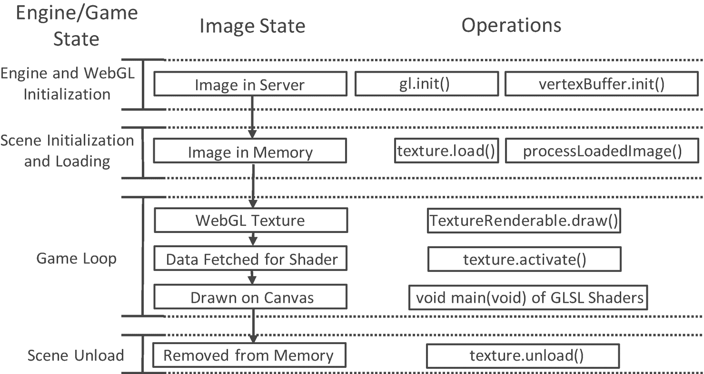


**图 5-6** ¶ 图像文件状态及其对应 WebGL 纹理的概览

## 使用精灵表绘制

如前所述，精灵表是由多个低分辨率图像组成的图像，每个低分辨率图像单独代表不同的对象。这些单独的图像中的每一个被称为 `sprite sheet element`（精灵表元素）。例如，图 5-7 是一个包含 13 个元素的精灵表，这些元素来自 4 个不同的对象。前两行中的每一行包含同一对象在不同动画位置下的五个元素，而在最后一行，有三个不同对象的元素：角色 Dye、传送门爪牙和收集者爪牙。创建精灵表的美术人员或软件程序必须将每个精灵元素的像素位置传达给游戏开发者，方式与图 5-7 所示大致相同。

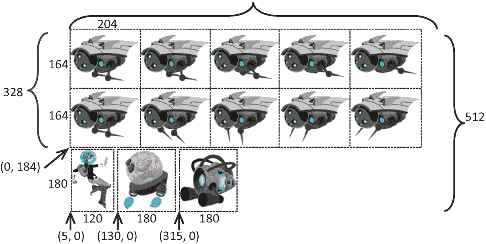

*图 5-7 ¶ 精灵表示例：`minion_sprite.png` 由不同对象的低分辨率图像组成*

定义精灵表是为了优化内存和处理需求。例如，回想一下 WebGL 仅支持由分辨率为 2^(*x*) × 2^(*y*) 的图像定义的纹理。这一要求意味着，分辨率为 120x180 的 Dye 角色必须存储在 128x256 (2⁷ × 2⁸) 的图像中，才能将其创建为 WebGL 纹理。此外，如果图 5-7 的 13 个元素作为单独的图像文件存储，则需要 13 次缓慢的文件系统访问来加载所有图像，而不是一次系统访问即可加载精灵表。

使用精灵表及其关联元素的关键在于记住：无论实际图像分辨率如何，纹理坐标 uv 值都定义在 0 到 1 的归一化范围内。例如，图 5-8 重点展示了图 5-7 中收集者爪牙的 uv 值，即第三行最右侧的精灵元素。图 5-8 的顶部、中部和底部行显示了传送门元素的坐标值。

*   **像素位置**：左下角为 (315, 0)，右上角为 (495, 180)。
*   **UV 值**：左下角为 (0.308, 0.0)，右上角为 (0.483, 0.352)。
*   **在** **模型空间中使用**：通过将相应的 uv 值与每个顶点位置处的 xy 值关联，实现元素的纹理映射。

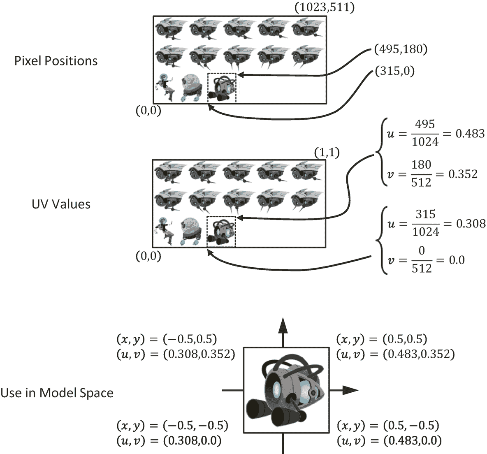

*图 5-8 ¶ 从像素位置到 uv 值的坐标转换及其用于几何体映射*

### 精灵着色器项目

该项目演示了如何通过定义适当的抽象和类，使用精灵表元素绘制对象。您可以在图 5-9 中看到该项目运行的示例。该项目的源代码定义在 `chapter5/5.2.sprite_shaders` 文件夹中。

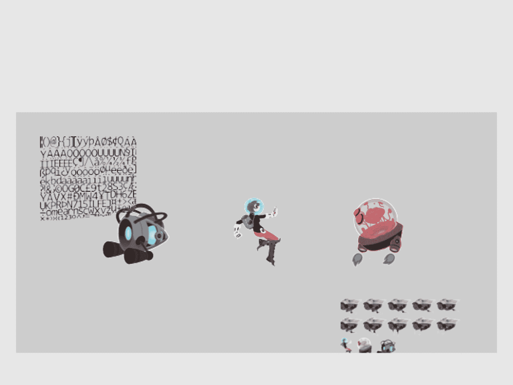

*图 5-9 ¶ 运行精灵着色器项目*

项目控制如下：

*   **右箭头键**：向右移动 Dye 角色（英雄），到达右边界时循环至左边界
*   **左箭头键**：向左移动英雄，到达左边界时将位置重置为窗口中间

项目目标如下：

*   深入理解纹理坐标
*   体验定义图像内的子区域以进行纹理映射
*   通过从精灵表元素映射来绘制正方形
*   为使用精灵动画和位图字体做准备

您可以在 `assets` 文件夹中找到以下外部资源文件：`consolas-72.png` 和 `minion_sprite.png`。请注意，`minion_sprite.png` 是图 5-7 中显示的图像。

如图 5-5 所示，上一节定义的纹理支持的主要优点和缺点之一是：通过 `getTexCoord()` 函数访问的纹理坐标是在 `vertex_buffer.js` 文件中静态定义的。这是一个优点，因为在将整个图像映射到正方形的情况下，所有 `TextureShader` 对象实例都可以共享相同的默认 uv 值。这也是一个缺点，因为静态纹理坐标缓冲区不允许处理图像的不同子区域，因此不支持使用精灵表元素。如图 5-10 所示，本节的示例通过在 `SpriteShader` 和 `SpriteRenderable` 对象中定义逐对象纹理坐标克服了这一缺点。请注意，没有定义新的 GLSL 着色器，因为其功能与 `TextureVS/FS` 保持相同。

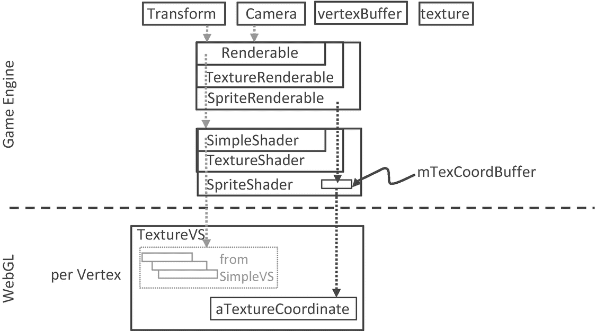

*图 5-10 ¶ 在 SpriteShader 中定义纹理坐标缓冲区*

#### 使用 SpriteShader 将 GLSL 纹理着色器接入引擎

支持使用精灵表元素进行纹理映射的着色器必须能够识别图像的不同子区域。为支持此功能，您将实现 `SpriteShader` 以定义其自己的纹理坐标。由于此新着色器扩展了 `TextureShader` 的功能，将其作为子类实现是合乎逻辑的。

1.  在 `src/engine/shaders` 文件夹中创建一个新文件，命名为 `sprite_shader.js`。

2.  定义 `SpriteShader` 类及其构造函数以扩展 `TextureShader` 类：

```javascript
class SpriteShader extends TextureShader {
    constructor(vertexShaderPath, fragmentShaderPath) {
        // 调用超类构造函数
        super(vertexShaderPath, fragmentShaderPath);
        this.mTexCoordBuffer = null; // 包含纹理坐标的 gl 缓冲区
        let initTexCoord = [
            1.0, 1.0,
            0.0, 1.0,
            1.0, 0.0,
            0.0, 0.0
        ];
        let gl = glSys.get();
        this.mTexCoordBuffer = gl.createBuffer();
        gl.bindBuffer(gl.ARRAY_BUFFER, this.mTexCoordBuffer);
        gl.bufferData(gl.ARRAY_BUFFER,
            new Float32Array(initTexCoord), gl.DYNAMIC_DRAW);
        // DYNAMIC_DRAW：表示缓冲区内容可能会改变！
    }
    // ... 后续实现 ...
}
```

`SpriteShader` 在 WebGL 中定义了自己的纹理坐标缓冲区，并通过 `mTexCoordBuffer` 保存对该缓冲区的引用。请注意，在 WebGL `bufferData()` 函数中创建此缓冲区时，指定了 `DYNAMIC_DRAW` 选项。这与在 `vertex_buffer.js` 中定义系统默认纹理坐标缓冲区时使用的 `STATIC_DRAW` 选项形成对比。动态选项通知 WebGL 图形系统，该缓冲区的内容将发生变化。

3.  定义一个函数以设置 WebGL 纹理坐标缓冲区：


## SpriteShader 和 SpriteRenderable 实现指南

## SpriteShader 类

### 1. 实现 `setTextureCoordinate()` 方法

```javascript
setTextureCoordinate(texCoord) {
    let gl = glSys.get();
    gl.bindBuffer(gl.ARRAY_BUFFER, this.mTexCoordBuffer);
    gl.bufferSubData(gl.ARRAY_BUFFER, 0, new Float32Array(texCoord));
}
```

**注意**：`texCoord` 参数是一个包含 8 个浮点数的数组，用于指定纹理坐标位置给 WebGL 上下文。该数组的格式和内容由 WebGL 接口定义为：右上角、左上角、右下角、左下角。在你的案例中，这些应该是精灵图元素的四个角。

### 2. 重写 `_getTexCoordBuffer()` 方法

使得当着色器激活时，返回局部分配的动态缓冲区，而不是全局静态缓冲区。注意 `activate()` 函数是从 `TextureShader` 继承的。

```javascript
_getTexCoordBuffer() {
    return this.mTexCoordBuffer;
}
```

### 3. 导出类

```javascript
export default SpriteShader;
```

## SpriteRenderable 类

类似于 `Renderable` 类（使用 `SimpleShader` 渲染）和 `TextureRenderable` 类（使用 `TextureShader` 渲染），需要定义对应的 `SpriteRenderable` 类来表示将使用 `SpriteShader` 渲染的对象。

### 1. 创建文件

在 `src/engine/renderables` 文件夹下创建新文件，命名为 `sprite_renderable.js`。

### 2. 定义类和构造函数

继承自 `TextureRenderable` 类。注意四个实例变量 `mElmLeft`、`mElmRight`、`mElmTop` 和 `mElmBottom` 共同标识纹理空间中的一个子区域。这些是精灵图元素的边界。

```javascript
class SpriteRenderable extends TextureRenderable {
    constructor(myTexture) {
        super(myTexture);
        super._setShader(shaderResources.getSpriteShader());
        // 精灵坐标
        this.mElmLeft = 0.0;   // 纹理坐标边界
        this.mElmRight = 1.0;  // 0-左，1-右
        this.mElmTop = 1.0;    // 1-上，0-下
        this.mElmBottom = 0.0; // 图像的
    }
    // ... 后续实现 ...
}
```

### 3. 定义枚举数据类型

用于标识 WebGL 纹理坐标规范数组中对应的偏移位置：

```javascript
// 纹理坐标数组是一个包含 8 个浮点数的数组，其中元素：
// [0] [1]: 右上角的 u/v 坐标
// [2] [3]: 左上角的 u/v 坐标
// [4] [5]: 右下角的 u/v 坐标
// [6] [7]: 左下角的 u/v 坐标
const eTexCoordArrayIndex = Object.freeze({
    eLeft: 2,
    eRight: 0,
    eTop: 1,
    eBottom: 5
});
```

**注意**：枚举数据类型的名称以 "e" 开头，如 `eTexCoordArrayIndex`。

### 4. 定义设置 UV 值的函数

支持在纹理坐标空间（归一化到 0-1 之间）和像素位置（转换为 UV 值）中指定精灵图元素区域：

```javascript
// 通过纹理坐标指定元素区域（0 到 1 之间）
setElementUVCoordinate(left, right, bottom, top) {
    this.mElmLeft = left;
    this.mElmRight = right;
    this.mElmBottom = bottom;
    this.mElmTop = top;
}

// 通过像素位置定义元素区域（0 到图像分辨率）
setElementPixelPositions(left, right, bottom, top) {
    let texInfo = texture.get(this.mTexture);
    // 整个图像的宽度、高度
    let imageW = texInfo.mWidth;
    let imageH = texInfo.mHeight;
    this.mElmLeft = left / imageW;
    this.mElmRight = right / imageW;
    this.mElmBottom = bottom / imageH;
    this.mElmTop = top / imageH;
}
```

**注意**：`setElementPixelPositions()` 函数在存储结果到对应实例变量前，会将像素转换为纹理坐标。

### 5. 构建纹理坐标规范数组

用于传递给 WebGL 上下文：

```javascript
getElementUVCoordinateArray() {
    return [
        this.mElmRight,  this.mElmTop,     // 右上角的 x,y
        this.mElmLeft,   this.mElmTop,     // 左上角
        this.mElmRight,  this.mElmBottom,  // 右下角
        this.mElmLeft,   this.mElmBottom   // 左下角
    ];
}
```

### 6. 重写 `draw()` 函数

在实际绘制前将特定的纹理坐标值加载到 WebGL 上下文：

```javascript
draw(camera) {
    // 设置当前纹理坐标
    // 激活纹理
    this.mShader.setTextureCoordinate(this.getElementUVCoordinateArray());
    super.draw(camera);
}
```

### 7. 导出类和枚举类型

```javascript
export default SpriteRenderable;
export { eTexCoordArrayIndex };
```

## 在 shader_resources 中实现共享

类似于 `SimpleShader` 和 `TextureShader`，`SpriteShader` 是一个可共享的资源，因此应添加到引擎的 `shaderResources` 中。

### 1. 导入并定义获取器

在 `engine/core/shader_resources.js` 文件中，导入 `SpriteShader`，添加存储变量，并定义相应的获取器函数：

```javascript
import SpriteShader from "../shaders/sprite_shader.js";
let mSpriteShader = null;
function getSpriteShader() {
    return mSpriteShader;
}
```

### 2. 修改 `createShaders()` 函数

创建 `SpriteShader` 实例：

```javascript
function createShaders() {
    mConstColorShader = new SimpleShader(kSimpleVS, kSimpleFS);
    mTextureShader = new TextureShader(kTextureVS, kTextureFS);
    mSpriteShader = new SpriteShader(kTextureVS, kTextureFS);
}
```

**注意**：`SpriteShader` 实际上封装了 `texture_vs.glsl` 和 `texture_fs.glsl` 文件中定义的现有 GLSL 着色器。从 WebGL 角度看，带纹理绘制的功能保持不变。`SpriteShader` 的唯一区别在于纹理坐标值现在是可编程的。

### 3. 更新 `cleanUp()` 函数

确保正确释放资源：

```javascript
function cleanUp() {
    mConstColorShader.cleanUp();
    mTextureShader.cleanUp();
    mSpriteShader.cleanUp();
    // ... 与之前代码相同 ...
}
```

### 4. 导出新功能

```javascript
export { init, cleanUp,
    getConstColorShader, getTextureShader, getSpriteShader };
```

## 导出新功能给客户端

将精灵元素功能集成到引擎的最后一步是修改引擎访问文件 `index.js`。编辑 `index.js` 并添加以下导入和导出语句，授予客户端访问 `SpriteRenderable` 和 `eTexCoordArrayIndex`（用于访问 WebGL 纹理坐标数组的枚举数据类型）的权限。

```javascript
// renderables
import Renderable from "./renderables/renderable.js";
import TextureRenderable from "./renderables/texture_renderable.js";
import SpriteRenderable from "./renderables/sprite_renderable.js";
import { eTexCoordArrayIndex } from "./renderables/sprite_renderable.js";
// ... 与之前代码相同 ...
export default {
    // ... 与之前代码相同 ...
    // Renderables
    Renderable, TextureRenderable, SpriteRenderable,
    // constants
    eTexCoordArrayIndex,
    // functions
    init, cleanUp, clearCanvas
};
```

## 测试 SpriteRenderable

精灵元素和纹理坐标有两个重要功能需要测试：作为对象正确提取、绘制和控制精灵图元素；以及在对象上改变和控制 UV 坐标。为正确测试新增功能，必须修改 `my_game.js` 文件。

### 1. 构建、加载、卸载和绘制

`MyGame` 的构建、加载、卸载和绘制与之前的示例类似，此处不再重复详情。请参考 `src/my_game` 文件夹中的源代码获取详细信息。

### 2. 修改 `init()` 函数

按如下方式修改 `init()` 函数。


## 初始化 (`init()`)

```javascript
init() {
    // Step A: set up the cameras
    this.mCamera = new engine.Camera(
        vec2.fromValues(20, 60),   // position of the camera
        20,                        // width of camera
        [20, 40, 600, 300]         // viewport (orgX, orgY, width, height)
    );
    this.mCamera.setBackgroundColor([0.8, 0.8, 0.8, 1]);
    // sets the background to gray
    // Step B: Create the support objects
    this.mPortal = new engine.SpriteRenderable(this.kMinionSprite);
    this.mPortal.setColor([1, 0, 0, 0.2]);  // tints red
    this.mPortal.getXform().setPosition(25, 60);
    this.mPortal.getXform().setSize(3, 3);
    this.mPortal.setElementPixelPositions(130, 310, 0, 180);
    this.mCollector = new engine.SpriteRenderable(this.kMinionSprite);
    this.mCollector.setColor([0, 0, 0, 0]);  // No tinting
    this.mCollector.getXform().setPosition(15, 60);
    this.mCollector.getXform().setSize(3, 3);
    this.mCollector.setElementUVCoordinate(0.308, 0.483, 0, 0.352);
    // Step C: Create the font and minion images using sprite
    this.mFontImage = new engine.SpriteRenderable(this.kFontImage);
    this.mFontImage.setColor([1, 1, 1, 0]);
    this.mFontImage.getXform().setPosition(13, 62);
    this.mFontImage.getXform().setSize(4, 4);
    this.mMinion = new engine.SpriteRenderable(this.kMinionSprite);
    this.mMinion.setColor([1, 1, 1, 0]);
    this.mMinion.getXform().setPosition(26, 56);
    this.mMinion.getXform().setSize(5, 2.5);
    // Step D: Create hero object with texture from lower-left corner
    this.mHero = new engine.SpriteRenderable(this.kMinionSprite);
    this.mHero.setColor([1, 1, 1, 0]);
    this.mHero.getXform().setPosition(20, 60);
    this.mHero.getXform().setSize(2, 3);
    this.mHero.setElementPixelPositions(0, 120, 0, 180);
}
```

### 步骤说明

1. **步骤 A**：摄像机设置完成后，注意在步骤 B 中，`mPortal` 和 `mCollector` 均基于同一张图片 `kMinionSprite` 创建，通过分别调用 `setElementPixelPositions()` 和 `setElementUVCoordinate()` 来指定用于渲染的实际精灵元素。

2. **步骤 C**：创建了两个额外的 `engine.SpriteRenderable` 对象：`mFontImage` 和 `mMinion`。精灵元素的 UV 坐标设置为默认值，即纹理图像将覆盖整个几何体。

3. **步骤 D**：与步骤 B 类似，创建主角对象 `mHero` 作为基于同一 `kMinionSprite` 图像的 `engine.SpriteRenderable` 对象。对应主角的精灵表元素通过 `setElementPixelPositions()` 调用来标识。

    注意：在本例中，创建的五个 `engine.SpriteRenderable` 对象中有四个都是基于同一 `kMinionSprite` 图像。

## 更新函数 (`update()`)

```javascript
update() {
    // let's only allow the movement of hero
    let deltaX = 0.05;
    let xform = this.mHero.getXform();
    // Support hero movements
    if (engine.input.isKeyPressed(engine.input.keys.Right)) {
        xform.incXPosBy(deltaX);
        if (xform.getXPos() > 30) { // right-bound of the window
            xform.setPosition(12, 60);
        }
    }
    if (engine.input.isKeyPressed(engine.input.keys.Left)) {
        xform.incXPosBy(-deltaX);
        if (xform.getXPos() < 11) {  // left-bound of the window
            xform.setXPos(20);
        }
    }
    // continuously change texture tinting
    let c = this.mPortal.getColor();
    let ca = c[3] + deltaX;
    if (ca > 1) {
        ca = 0;
    }
    c[3] = ca;
    // New update code for changing the sub-texture regions being shown
    let deltaT = 0.001;
    // The font image:
    // zoom into the texture by updating texture coordinate
    // For font: zoom to the upper left corner by changing bottom right
    let texCoord = this.mFontImage.getElementUVCoordinateArray();
    // The 8 elements:
    //      mTexRight,  mTexTop,          // x,y of top-right
    //      mTexLeft,   mTexTop,
    //      mTexRight,  mTexBottom,
    //      mTexLeft,   mTexBottom
    let b = texCoord[engine.eTexCoordArrayIndex.eBottom] + deltaT;
    let r = texCoord[engine.eTexCoordArrayIndex.eRight] - deltaT;
    if (b > 1.0) {
        b = 0;
    }
    if (r < 0) {
        r = 1.0;
    }
    this.mFontImage.setElementUVCoordinate(
        texCoord[engine.eTexCoordArrayIndex.eLeft],
        r,
        b,
        texCoord[engine.eTexCoordArrayIndex.eTop]
    );
    //
    // The minion image:
    // For minion: zoom to the bottom right corner by changing top left
    texCoord = this.mMinion.getElementUVCoordinateArray();
    // The 8 elements:
    //      mTexRight,  mTexTop,          // x,y of top-right
    //      mTexLeft,   mTexTop,
    //      mTexRight,  mTexBottom,
    //      mTexLeft,   mTexBottom
    let t = texCoord[engine.eTexCoordArrayIndex.eTop] - deltaT;
    let l = texCoord[engine.eTexCoordArrayIndex.eLeft] + deltaT;
    if (l > 0.5) {
        l = 0;
    }
    if (t < 0.5) {
        t = 1.0;
    }
    this.mMinion.setElementUVCoordinate(
        l,
        texCoord[engine.eTexCoordArrayIndex.eRight],
        texCoord[engine.eTexCoordArrayIndex.eBottom],
        t
    );
}
```

### 更新函数说明

1. **键盘控制**：观察到键盘控制和主角对象的绘制与之前的项目相同。

2. **UV 坐标动画**：注意对 `mFontImage` 和 `mMinion` 调用 `setElementUVCoordinate()`。这些调用持续减少并重置对应底部的 V 值、对应右侧的 U 值（针对 `mFontImage`）、对应顶部的 V 值和对应左侧的 U 值（针对 `mMinion`）。最终结果是纹理持续变化，在这两个对象上产生缩放动画的视觉效果。

## 精灵动画

在游戏中，你通常希望创建能够反映角色移动或动作的动画。在上一章中，你学习了如何使用变换操作符移动这些对象的几何体。然而，正如你在前面的示例中控制主角角色时所观察到的，如果这些对象上的纹理不以对应控制的方式发生变化，交互传达的将是移动静态图像的感觉，而不是让角色动起来的感觉。因此，需要在期望时能够在几何体上创建动画的错觉。

在前面的示例中，你从 `mFontImage` 和 `mMinion` 对象观察到，通过在纹理映射几何体上不断改变 UV 值，可以创建出动画的外观。正如本章开头所讨论的，控制此类动画的一种方法是使用动画精灵表。

### 动画精灵表概述

回顾一下，动画精灵表是包含对象动画图像序列的精灵表，通常按一行或多行、一列或多列组织。例如，在图 5-11 中，你可以看到一个 2x5 的动画精灵表，包含按两行组织的两个独立动画。这些动画描绘了顶行中物体向右收回尖刺、底行中物体向左伸出尖刺的过程。在本例中，动画被分离到不同的行中。动画精灵表也可以定义沿列组织的动画。精灵表的组织方式和元素像素位置的细节通常由其创建者处理，并必须明确传达给游戏开发者以便在游戏中使用。

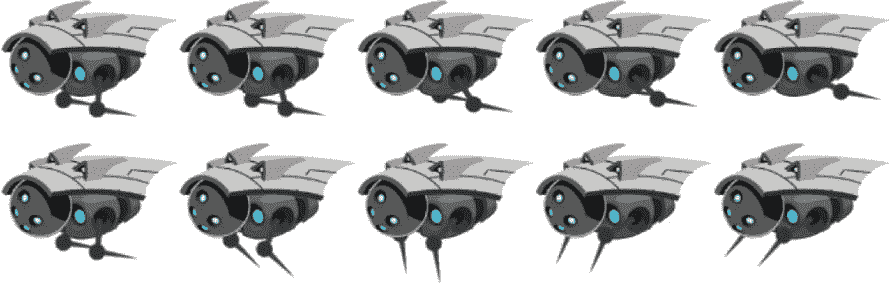

**图 5-11** 组织成两行、表示同一物体两个动画序列的动画精灵表


## 图 5-12：精灵动画序列

图 5-12 展示了如何实现物体向右收回尖刺的动画效果，如图 5-11 顶行所示，你需要按 1、2、3、4、5 的顺序将元素从左向右映射。当这些图像被映射到同一几何体上、排序并以适当的速率循环播放时，会传达出物体确实在重复收回尖刺这一动作的感觉。或者，如果序列反转，按从右向左的顺序映射元素，则会创建出物体向左伸出尖刺的相应动画。也可以按从左向右、再从右向左的摆动循环方式映射序列。在这种情况下，动画将对应物体连续进行收回和伸出尖刺的动作。

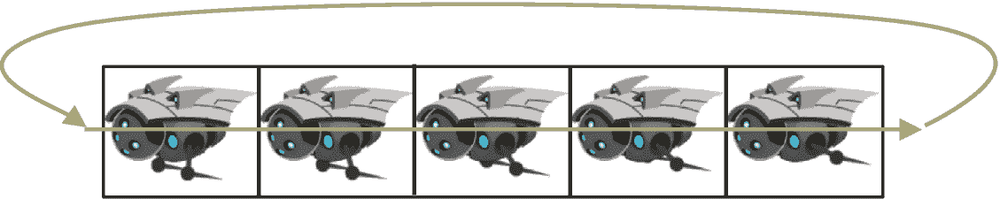

*图 5-12 ¶ 循环播放的精灵动画序列*

## 精灵动画项目

本项目演示如何使用动画精灵表并生成连续的精灵动画。你可以在图 5-13 中看到该项目运行的示例。项目场景包含上一场景中的对象以及两个动画对象。该项目的源代码定义在 `chapter5/5.3.sprite_animate_shaders` 文件夹中。

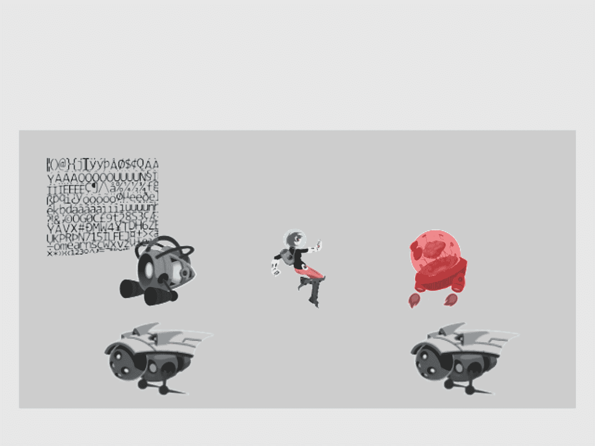

*图 5-13 ¶ 运行精灵动画着色器项目*

### 控制

- **右箭头键**：向右移动主角；当越过右边界时，主角会被包裹回左边界
- **左箭头键**：与右箭头键相反的移动
- **数字 1 键**：通过从右向左连续显示精灵元素来制作动画
- **数字 2 键**：通过从左向右、再从右向左连续来回显示精灵元素来制作动画
- **数字 3 键**：通过从左向右连续显示精灵元素来制作动画
- **数字 4 键**：增加动画速度
- **数字 5 键**：降低动画速度

### 目标

- 理解动画精灵表
- 体验精灵动画的创建
- 定义实现精灵动画的抽象

你可以在 `assets` 文件夹中找到与上一个项目相同的文件。

### SpriteAnimateRenderable 类

可以通过策略性地控制 `SpriteRenderable` 的 `uv` 值，在期望的时间段内显示合适的精灵元素，从而实现精灵动画。因此，只需定义一个类 `SpriteAnimateRenderable` 即可支持精灵动画。

为简单易懂起见，以下实现假设与某个动画关联的所有精灵元素始终沿同一行排列。例如，在图 5-11 中，尖刺向右收回和向左伸出的动作分别沿一行排列；两者均不跨越多行，也不沿列排列。不支持沿列排列的动画精灵元素。

#### 步骤 1：创建文件

在 `src/engine/renderables` 文件夹中创建一个新文件，并将其命名为 `sprite_animate_renderable.js`。

#### 步骤 2：定义动画类型枚举

为三种不同的动画序列定义一个枚举数据类型：

```javascript
// Assumption: first sprite is always the leftmost element.
const eAnimationType = Object.freeze({
    eRight: 0, // from left to right, when ended, start from left again
    eLeft: 1,  // from right animate left-wards
    eSwing: 2  // left to right, then, right to left
});
```

`eAnimationType` 枚举定义了三种动画模式：

1. **eRight**：从最左侧元素开始，沿同一行向右迭代制作动画。到达最后一个元素时，动画通过再次从最左侧元素开始继续播放。
2. **eLeft**：`eRight` 的反向；从右侧开始，向左制作动画，到达最左侧元素后，通过从最右侧元素开始继续播放。
3. **eSwing**：从左向右、再从右向左的连续循环。

#### 步骤 3：定义 SpriteAnimateRenderable 类

定义 `SpriteAnimateRenderable` 类以继承自 `SpriteRenderable` 并定义构造函数：

```javascript
class SpriteAnimateRenderable extends SpriteRenderable {
    constructor(myTexture) {
        super(myTexture);
        super._setShader(shaderResources.getSpriteShader());
        // All coordinates are in texture coordinate (UV between 0 to 1)
        // Information on the sprite element
        this.mFirstElmLeft = 0.0;    // 0.0 is left corner of image
        this.mElmTop = 1.0;          // image top corner (from SpriteRenderable)
        this.mElmWidth = 1.0;
        this.mElmHeight = 1.0;
        this.mWidthPadding = 0.0;
        this.mNumElems = 1;          // number of elements in an animation
        // per animation settings
        this.mUpdateInterval = 1;    // how often to advance
        this.mAnimationType = eAnimationType.eRight;
        this.mCurrentAnimAdvance = -1;
        this.mCurrentElm = 0;
        this._initAnimation();
    }
    // ... implementation to follow ...
}
```

`SpriteAnimateRenderable` 构造函数定义了三组变量：

1. **精灵元素几何信息**：包括 `mFirstElmLeft`、`mElmTop`、`mElmWidth`、`mElmHeight`、`mWidthPadding` 和 `mNumElems`。这些定义了每个精灵元素的位置和尺寸以及动画中的元素数量。当元素按行和列排序时，这些信息可用于精确计算每个精灵元素的纹理坐标。请注意，所有坐标均在纹理坐标空间中（0 到 1）。

2. **动画设置**：包括 `mAnimationType`（左、右或摆动）和 `mUpdateInterval`（推进到下一个精灵元素前等待的时间）。这些信息可在运行时更改，以反转、循环或控制角色移动的速度。

3. **内部动画状态**：包括 `mCurrentAnimAdvance` 和 `mCurrentElm`。这些描述了推进的偏移量和当前帧号。这两个变量均以元素计数为单位，并非设计为供游戏程序员访问，因为它们在内部用于计算要显示的下一个精灵元素。

`_initAnimation()` 函数计算 `mCurrentAnimAdvance` 和 `mCurrentElm` 的值以初始化动画序列。

#### 步骤 4：定义 _initAnimation() 函数

定义 `_initAnimation()` 函数，根据当前动画类型计算 `mCurrentAnimAdvance` 和 `mCurrentElm` 的合适值：

```javascript
_initAnimation() {
    // Currently running animation
    this.mCurrentTick = 0;
    switch (this.mAnimationType) {
    case eAnimationType.eRight:
        this.mCurrentElm = 0;
        this.mCurrentAnimAdvance = 1; // either 1 or -1
        break;
    case eAnimationType.eSwing:
        this.mCurrentAnimAdvance = -1 * this.mCurrentAnimAdvance;
        this.mCurrentElm += 2 * this.mCurrentAnimAdvance;
        break;
    case eAnimationType.eLeft:
        this.mCurrentElm = this.mNumElems - 1;
        this.mCurrentAnimAdvance = -1; // either 1 or -1
        break;
    }
    this._setSpriteElement();
}
```

`mCurrentElm` 是相对于最左侧元素的偏移元素数，`mCurrentAnimAdvance` 记录在每次更新时 `mCurrentElm` 偏移量应增加（用于向右动画）还是减少（用于向左动画）。调用 `_setSpriteElement()` 函数以设置对应于当前确定的用于显示的精灵元素的 `uv` 值。


## 5. 定义 `_setSpriteElement()` 函数

定义 `_setSpriteElement()` 函数以计算并加载当前标识的精灵元素的 UV 值用于渲染：

```javascript
_setSpriteElement() {
    let left = this.mFirstElmLeft +
               (this.mCurrentElm * (this.mElmWidth + this.mWidthPadding));
    super.setElementUVCoordinate(left, left + this.mElmWidth,
                                 this.mElmTop - this.mElmHeight, this.mElmTop);
}
```

变量 `left` 是 `mCurrentElm` 的左侧 u 值，用于计算右侧 u 值，假设所有动画序列都在精灵元素的同一行上，且顶部和底部 v 值是常数，在给定的动画序列中不发生变化。这些 UV 值被设置给超类 `SpriteRenderable` 用于绘制。

## 6. 定义设置动画类型的函数

定义一个函数来设置动画类型。注意，当动画类型（左、右或摆动）改变时，动画总是重置为从头开始。

```javascript
setAnimationType(animationType) {
    this.mAnimationType = animationType;
    this.mCurrentAnimAdvance = -1;
    this.mCurrentElm = 0;
    this._initAnimation();
}
```

## 7. 定义指定精灵动画序列的函数

定义一个用于指定精灵动画序列的函数。函数的输入单位是像素，通过除以图像的宽度和高度转换为纹理坐标。

```javascript
// 始终将最左侧的元素设置为第一个
setSpriteSequence(
    topPixel,       // 从左上角的偏移
    leftPixel,      // 从左上角的偏移
    elmWidthInPixel,
    elmHeightInPixel,
    numElements,    // 序列中的元素数量
    wPaddingInPixel // 左/右填充
) {
    let texInfo = texture.get(this.mTexture);
    // 整个图像的宽度、高度
    let imageW = texInfo.mWidth;
    let imageH = texInfo.mHeight;
    this.mNumElems = numElements;   // 动画中的元素数量
    this.mFirstElmLeft = leftPixel / imageW;
    this.mElmTop = topPixel / imageH;
    this.mElmWidth = elmWidthInPixel / imageW;
    this.mElmHeight = elmHeightInPixel / imageH;
    this.mWidthPadding = wPaddingInPixel / imageW;
    this._initAnimation();
}
```

## 8. 定义更改动画速度的函数

定义函数以直接或通过偏移量更改动画速度：

```javascript
setAnimationSpeed(tickInterval) {
    this.mUpdateInterval = tickInterval;
}
incAnimationSpeed(deltaInterval) {
    this.mUpdateInterval += deltaInterval;
}
```

## 9. 定义推进动画的函数

定义一个函数，在每次游戏循环更新时推进动画：

```javascript
updateAnimation() {
    this.mCurrentTick++;
    if (this.mCurrentTick >= this.mUpdateInterval) {
        this.mCurrentTick = 0;
        this.mCurrentElm += this.mCurrentAnimAdvance;
        if ((this.mCurrentElm >= 0) && (this.mCurrentElm < this.mNumElems)) {
            this._setSpriteElement();
        } else {
            this._initAnimation();
        }
    }
}
```

每次调用 `updateAnimation()` 函数时，`mCurrentTick` 计数器递增，当 tick 数达到 `mUpdateInterval` 值时，动画由 `_initAnimation()` 函数重新初始化。重要的是要注意，控制动画的时间单位是 `updateAnimation()` 函数被调用的次数，而不是现实世界的流逝时间。回想一下，引擎的 `loop.loopOnce()` 函数确保系统范围的更新以 `kMPF` 间隔发生，即使帧率滞后。游戏引擎架构确保 `updateAnimation()` 函数调用间隔为 `kMPF` 毫秒。

## 10. 导出定义的类和枚举动画类型

最后，记得导出定义的类和枚举动画类型：

```javascript
export default SpriteAnimateRenderable;
export { eAnimationType };
```

## 向客户端导出新功能

将动画精灵元素功能集成到引擎中的最后一步涉及修改引擎访问文件 `index.js`。编辑 `index.js` 并添加以下导入和导出语句，以授予客户端对 `SpriteAnimateRenderable` 和 `eAnimationType` 的访问权限：

```javascript
// renderables
import Renderable from "./renderables/renderable.js";
import SpriteRenderable from "./renderables/sprite_renderable.js";
import SpriteAnimateRenderable from "./renderables/sprite_animate_renderable.js";
import { eTexCoordArrayIndex } from "./renderables/sprite_renderable.js";
import { eAnimationType } from "./renderables/sprite_animate_renderable.js";
// ... identical to previous code ...
export default {
    // ... identical to previous code ...
    // Renderables
    Renderable, TextureRenderable,
    SpriteRenderable, SpriteAnimateRenderable,
    // constants
    eTexCoordArrayIndex, eAnimationType,
    // functions
    init, cleanUp, clearCanvas
}
```

## 测试精灵动画

`SpriteAnimateRenderable` 对象的测试用例必须展示游戏程序员对模式（左、右、摆动）和动画速度的控制。`MyGame` 对象被修改以实现这些目的。

### 1. 构造、加载、卸载和绘制

`MyGame` 的构造、加载、卸载和绘制与前一个示例相似，细节不再重复。

### 2. 在 `init()` 函数中创建和初始化对象

在 `init()` 函数中，在步骤 C 和 D 之间添加代码以创建和初始化 `SpriteAnimateRenderable` 对象：

```javascript
init() {
    // ... identical to previous code ...
    // 右侧小兵
    this.mRightMinion = new engine.SpriteAnimateRenderable(
        this.kMinionSprite);
    this.mRightMinion.setColor([1, 1, 1, 0]);
    this.mRightMinion.getXform().setPosition(26, 56.5);
    this.mRightMinion.getXform().setSize(4, 3.2);
    this.mRightMinion.setSpriteSequence(
        512, 0,      // 第一个元素像素位置：top: 512 left: 0
        204, 164,    // 宽 x 高（像素）
        5,           // 此序列中的元素数量
        0);          // 元素间的水平填充
    this.mRightMinion.setAnimationType(engine.eAnimationType.eRight);
    this.mRightMinion.setAnimationSpeed(50);
    // 左侧小兵
    this.mLeftMinion = new engine.SpriteAnimateRenderable(
        this.kMinionSprite);
    this.mLeftMinion.setColor([1, 1, 1, 0]);
    this.mLeftMinion.getXform().setPosition(15, 56.5);
    this.mLeftMinion.getXform().setSize(4, 3.2);
    this.mLeftMinion.setSpriteSequence(
        348, 0,      // 第一个元素像素位置：top: 164 left: 0
        204, 164,    // 宽 x 高（像素）
        5,           // 此序列中的元素数量
        0);          // 元素间的水平填充
    this.mLeftMinion.setAnimationType(engine.eAnimationType.eRight);
    this.mLeftMinion.setAnimationSpeed(50);
    // ... identical to previous code ...
}
```

`SpriteAnimateRenderable` 对象的创建方式与 `SpriteRenderable` 对象类似，以精灵表作为纹理参数。在这种情况下，必须调用 `setSpriteSequence()` 函数来标识动画涉及的元素，包括位置、尺寸和元素总数。

### 3. 在 `update()` 函数中调用更新动画

`update()` 函数必须调用 `SpriteAnimateRenderable` 对象的 `updateAnimation()` 函数以推进精灵动画。


```
update() { 
    ... identical to previous code ... 
    // remember to update the minion's animation 
    this.mRightMinion.updateAnimation(); 
    this.mLeftMinion.updateAnimation(); 
    // Animate left on the sprite sheet 
    if (engine.input.isKeyClicked(engine.input.keys.One)) { 
        this.mRightMinion.setAnimationType(engine.eAnimationType.eLeft); 
        this.mLeftMinion.setAnimationType(engine.eAnimationType.eLeft); 
    } 
    // swing animation 
    if (engine.input.isKeyClicked(engine.input.keys.Two)) { 
        this.mRightMinion.setAnimationType(engine.eAnimationType.eSwing); 
        this.mLeftMinion.setAnimationType(engine.eAnimationType.eSwing); 
    } 
    // Animate right on the sprite sheet 
    if (engine.input.isKeyClicked(engine.input.keys.Three)) { 
        this.mRightMinion.setAnimationType(engine.eAnimationType.eRight); 
        this.mLeftMinion.setAnimationType(engine.eAnimationType.eRight); 
    } 
    // decrease duration of each sprite element to speed up animation 
    if (engine.input.isKeyClicked(engine.input.keys.Four)) { 
        this.mRightMinion.incAnimationSpeed(-2); 
        this.mLeftMinion.incAnimationSpeed(-2); 
    } 
    // increase duration of each sprite element to slow down animation 
    if (engine.input.isKeyClicked(engine.input.keys.Five)) { 
        this.mRightMinion.incAnimationSpeed(2); 
        this.mLeftMinion.incAnimationSpeed(2); 
    } 
    ... identical to previous code ... 
}
```

按键 1、2 和 3 可更改动画类型，按键 4 和 5 可更改动画速度。请注意，动画速度的限制是游戏循环的更新速率。

## 字体与文本绘制

许多游戏用于各种任务的一个宝贵工具是文本输出。绘制文本消息是向用户以及作为开发者的您进行高效沟通的一种方式。例如，文本消息可用于传达游戏剧情、玩家得分或开发过程中的调试信息。遗憾的是，WebGL 不支持文本绘制。本节简要介绍位图字体，并引入 `FontRenderable` 对象以支持文本绘制。

## 位图字体

必须定义字体，以便提取单个字符来绘制文本消息。顾名思义，位图字体是一个简单的映射，描述必须开启哪个位（或像素）来表示字体中的字符。将位图字体的所有字符组合到一张图像中，并定义一个配套的解码描述文档，可为文本输出绘制提供一个直接的解决方案。例如，图 5-14 展示了一张位图字体精灵图，其中所有定义的字符都紧凑地组织在同一张图像中。图 5-15 是配套的 XML 格式解码描述的片段。

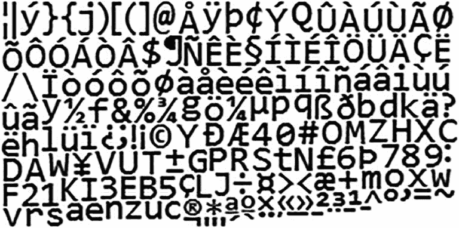

图 5-14 ¶ 位图字体精灵图示例

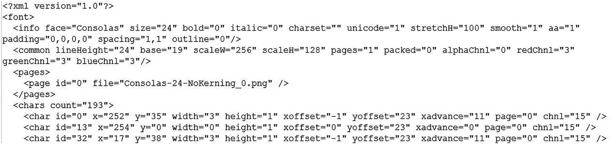

图 5-15 ¶ 图 5-14 所示位图字体图像的解码信息 XML 文件片段

请注意，如图 5-15 所示的解码信息唯一地定义了图像中每个字符的 uv 坐标位置，如图 5-14 所示。这样，`SpriteRenderable` 对象就可以直接从位图字体精灵图像中显示单个字符。

> **注意**
> 
> 存在许多位图字体文件格式。本书使用的是兼容 AngleCode `BMFont` 的 XML 格式字体。`BMFont` 是一款开源软件，可将矢量字体（如 `TrueType` 和 `OpenType`）转换为位图字体。详情请访问 [www.angelcode.com/products/bmfont/](http://www.angelcode.com/products/bmfont/)。

## 字体支持项目

该项目演示了如何使用 `SpriteRenderable` 对象从位图字体绘制文本。您可以在图 5-16 中看到该项目运行的示例。该项目的源代码定义在 `chapter5/5.4.font_support` 文件夹中。

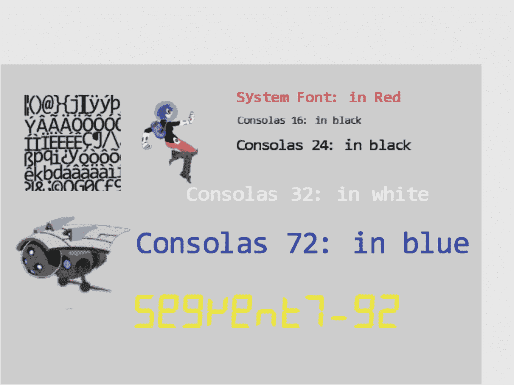

图 5-16 ¶ 运行字体支持项目

项目控制方式如下：

- **数字键 0、1、2 和 3**：分别选择 Consolas、16、24、32 或 72 字体以进行大小修改。
- **按住 X/Y 键的同时按上/下键**：增加或减少（方向键）所选字体的宽度（X 键）或高度（Y 键）。
- **左/右方向键**：使英雄向左或向右移动。如果英雄超出边界，将会环绕。

项目目标如下：

- 理解位图字体
- 基本掌握在游戏中绘制文本字符串
- 在游戏引擎中实现文本绘制支持

您可以在 `assets` 文件夹中找到以下外部资源文件：`consolas-72.png` 和 `minion_sprite.png`。在 `assets/fonts` 文件夹中包含位图字体精灵图像文件和包含解码信息的关联 XML 文件：`consolas-16.fnt`、`consolas-16.png`、`consolas-24.fnt`、`consolas-24.png`、`consolas-32.fnt`、`consolas-32.png`、`consolas-72.fnt`、`consolas-72.png`、`segment7-96.fnt`、`segment7-96.png`、`system-default-font.fnt` 和 `system-default-font.png`。

请注意，`.fnt` 和 `.png` 文件是成对出现的。前者包含后者的解码信息。这些文件对必须放在同一文件夹中，引擎才能正确加载字体。`system-default-font` 是游戏引擎的默认字体，假定该字体始终存在于 `asset/fonts` 文件夹中。

> **注意**
> 
> 从 `.fnt` 文件解析、解码和提取字符信息的操作独立于游戏引擎的基础操作。因此，这些操作的细节不作介绍。如果您感兴趣，请参阅源代码。

### 在引擎中加载和存储字体

加载字体文件比较特殊，因为字体是成对定义的：包含解码信息的 `.fnt` 文件和对应的 `.png` 精灵图像文件。然而，由于 `.fnt` 文件是 XML 文件，而 `.png` 文件是简单的纹理图像，引擎已经支持这两种文件类型的加载。在引擎中加载和存储字体的细节由一个新的引擎组件 `font` 封装。

1. 在 `src/engine/resources` 文件夹中创建一个新文件，命名为 `font.js`。

2. 从 `xml` 模块导入资源管理功能以加载 `.fnt` 文件，从 `texture` 模块导入以加载 `.png` 精灵图像文件，并为这些文件扩展名定义局部常量：

```
import * as xml from "./xml.js";
import * as texture from "./texture.js";
let kDescExt = ".fnt";   // 位图字体描述的扩展名
let kImageExt = ".png";  // 位图字体图像的扩展名
```

3. 定义一个类，用于存储与字符相关的 uv 坐标位置和大小。此信息可根据 `.fnt` 文件的内容计算得出。


## 字体系统实现

## CharacterInfo 类

```javascript
class CharacterInfo {
    constructor() {
        // 纹理坐标（0 到 1）映射到整个图像
        this.mTexCoordLeft = 0;
        this.mTexCoordRight = 1;
        this.mTexCoordBottom = 0;
        this.mTexCoordTop = 0;
        // 标称字符大小，1 代表字符的“标准宽度/高度”
        this.mCharWidth = 1;
        this.mCharHeight = 1;
        this.mCharWidthOffset = 0;
        this.mCharHeightOffset = 0;
        // 字符宽高比参考值
        this.mCharAspectRatio = 1;
    }
}
```

## 字体模块函数

### 1.4 扩展函数

定义两个函数，根据不带文件扩展名的路径返回合适的扩展名。注意 `fontName` 是字体文件的路径，但不带任何文件扩展名。例如，`assets/fonts/system-default-font` 就是该字符串，这两个函数分别识别出关联的 `.fnt` 和 `.png` 文件。

```javascript
function descName(fontName) { return fontName + kDescExt; }
function imageName(fontName) { return fontName + kImageExt; }
```

### 1.5 加载/卸载函数

定义 `load()` 和 `unload()` 函数。注意每个函数中实际上调用了两次文件操作：一次针对 `.fnt` 文件，另一次针对 `.png` 文件。

```javascript
function load(fontName) {
    xml.load(descName(fontName));
    texture.load(imageName(fontName));
}
function unload(fontName) {
    xml.unload(descName(fontName));
    texture.unload(imageName(fontName));
}
```

### 1.6 Has 函数

定义一个函数来查询给定字体的加载状态：

```javascript
function has(fontName) {
    return texture.has(imageName(fontName)) &&
           xml.has(descName(fontName));
}
```

### 1.7 GetCharInfo 函数

定义一个函数，根据 `.fnt` 文件中提供的信息计算 `CharacterInfo`：

```javascript
function getCharInfo(fontName, aChar) {
    // ... 因与游戏引擎其余实现无关，此处省略细节
    returnInfo = new CharacterInfo();
    // 计算并填充 CharacterInfo 的内容
    // ... 因与游戏引擎其余实现无关，此处省略细节
    return returnInfo;
};
```

由于解码和提取给定字符信息的细节与游戏引擎其余部分的实现无关，故予以省略。

> **注意**：有关 `.fnt` 格式信息的详细内容，请参阅 [www.angelcode.com/products/bmfont/doc/file_format.html](http://www.angelcode.com/products/bmfont/doc/file_format.html)。

### 1.8 导出函数

最后，别忘了从该模块导出这些函数：

```javascript
export { has, load, unload,
         imageName, descName,
         CharacterInfo,
         getCharInfo }
```

## 向引擎添加默认字体

游戏引擎应提供一个默认系统字体，以方便游戏程序员使用。为此，应定义一个引擎工具来加载并初始化与游戏开发者共享的默认资源。回顾一下，`src/engine/core` 文件夹中的 `shader_resources` 模块被定义用于支持引擎范围内的着色器共享。这种模式可以复制用于与客户端共享默认资源。可以在 `src/engine/resources` 文件夹中定义一个 `default_resources` 模块来实现这种共享。

### 1.1 创建 default_resources.js

在 `src/engine/resources` 文件夹中创建一个文件，命名为 `default_resources.js`，从 `font` 和 `resource_map` 模块导入功能，并为默认系统字体的路径定义一个常量字符串及其获取函数：

```javascript
import * as font from "./font.js";
import * as map from "../core/resource_map.js";
// 默认字体
let kDefaultFont = "assets/fonts/system_default_font";
var getDefaultFont = function() { return kDefaultFont; }
```

### 1.2 Init 函数

定义一个 `init()` 函数，以 JavaScript `Promise` 的形式发出默认系统字体加载请求，并将该 `Promise` 添加到 `resource_map` 中未完成加载请求的数组中。回顾一下，`loop` 模块中的 `loop.start()` 函数会在启动游戏循环前等待所有 `resource_map` 加载 Promise 完成。因此，与其他所有异步加载资源的情况一样，当游戏循环开始时，默认系统字体将已被正确加载。

```javascript
function init() {
    let loadPromise = new Promise(
        async function (resolve) {
            await Promise.all([
                font.load(kDefaultFont)
            ]);
            resolve();
        }).then(
            function resolve() { /* 字体无需额外操作 */ }
        );
    map.pushPromise(loadPromise);
}
```

### 1.3 CleanUp 函数

定义 `cleanUp()` 函数以释放所有已分配资源，在此情况下即卸载字体：

```javascript
// 卸载所有资源
function cleanUp() {
    font.unload(kDefaultFont);
}
```

### 1.4 导出函数

最后，记得导出所有定义的功能：

```javascript
export {
    init, cleanUp,
    // 默认系统字体名称：保证已加载
    getDefaultFontName
}
```

## 定义 FontRenderable 对象以绘制文本

定义好的 `font` 模块能够加载字体文件并提取每个字符的 UV 坐标和大小信息。利用这些功能，可以通过识别字符串中的每个字符、检索相应的纹理映射信息，并使用 `SpriteRenderable` 对象渲染字符，从而实现文本字符串的绘制。将定义 `FontRenderable` 对象来完成此任务。

### 1.1 创建 font_renderable.js

在 `src/engine/renderables` 文件夹中创建一个新文件，命名为 `font_renderable.js`。

### 1.2 FontRenderable 类

定义 `FontRenderable` 类及其构造函数，接受一个字符串作为参数：

```javascript
class FontRenderable {
    constructor(aString) {
        this.mFontName = defaultResources.getDefaultFontName();
        this.mOneChar = new SpriteRenderable(
            font.imageName(this.mFontName));
        this.mXform = new Transform(); // 用于移动该对象
        this.mText = aString;
    }
    // ... 后续实现 ...
}
```

#### 1.2.a aString 变量

`aString` 变量是要绘制的消息文本。

#### 1.2.b 组合优于继承

请注意，`FontRenderable` 对象并未自定义 `SpriteRenderable` 对象的行为。相反，它依赖一个 `SpriteRenderable` 对象来绘制字符串中的每个字符。因此，`FontRenderable` 不是 `SpriteRenderable` 的子类，而是包含一个 `SpriteRenderable` 对象实例，即 `mOneChar` 变量。

### 1.3 Draw 函数

定义 `draw()` 函数，使用 `mOneChar` 变量解析并绘制字符串中的每个字符：

```javascript
draw(camera) {
    // 我们将通过为 mText 字符串中的每个字符调用 mOneChar 来绘制文本字符串。
    let widthOfOneChar = this.mXform.getWidth() / this.mText.length;
    let heightOfOneChar = this.mXform.getHeight();
    let yPos = this.mXform.getYPos();
    // 第一个字符的中心位置
    let xPos = this.mXform.getXPos() -
               (widthOfOneChar / 2) + (widthOfOneChar * 0.5);
    let charIndex, aChar, charInfo, xSize, ySize, xOffset, yOffset;
    for (charIndex = 0; charIndex < this.mText.length; charIndex++) {
        aChar = this.mText.charCodeAt(charIndex);
        charInfo = font.getCharInfo(this.mFontName, aChar);
        // 设置纹理坐标
        this.mOneChar.setElementUVCoordinate(
            charInfo.mTexCoordLeft, charInfo.mTexCoordRight,
            charInfo.mTexCoordBottom, charInfo.mTexCoordTop);
        // 现在设置字符大小
        xSize = widthOfOneChar * charInfo.mCharWidth;
        ySize = heightOfOneChar * charInfo.mCharHeight;
        this.mOneChar.getXform().setSize(xSize, ySize);
        // 相对于中心的偏移量
        xOffset = widthOfOneChar * charInfo.mCharWidthOffset * 0.5;
        yOffset = heightOfOneChar * charInfo.mCharHeightOffset * 0.5;
        this.mOneChar.getXform().setPosition(xPos - xOffset, yPos - yOffset);
        this.mOneChar.draw(camera);
        xPos += widthOfOneChar;
    }
}
```

每个字符的尺寸由 `widthOfOneChar` 和 `heightOfOneChar` 定义，其中宽度就是将 `FontRenderable` 的总宽度除以字符串中的字符数量。`for` 循环随后执行以下操作：

#### 1.3.a 字符处理循环


## FontRenderable 实现步骤

## 字符处理

1. 提取字符串中的每个字符。

2. 调用 `getCharInfo()` 函数，在 `charInfo` 中接收字符的 uv 值和大小信息。

3. 使用 `charInfo` 中的 uv 值来确定 `mOneChar` 的精灵元素位置（通过调用并将信息传递给 `mOneChar.setElementUVCoordinate()` 函数）。

4. 使用 `charInfo` 中的大小信息计算字符的实际大小（`xSize` 和 `ySize`）和位置偏移（`xOffset` 和 `yOffset`），并使用适当的设置绘制字符 `mOneChar`。

## Getter 和 Setter

实现用于变换、要绘制的文本消息、绘制所用字体和颜色的 getter 和 setter：

```javascript
getXform() { return this.mXform; }
getText() { return this.mText; }
setText(t) {
    this.mText = t;
    this.setTextHeight(this.getXform().getHeight());
}
getFontName() { return this.mFontName; }
setFontName(f) {
    this.mFontName = f;
    this.mOneChar.setTexture(font.imageName(this.mFontName));
}
setColor(c) { this.mOneChar.setColor(c); }
getColor() { return this.mOneChar.getColor(); }
```

## setTextHeight() 函数

定义 `setTextHeight()` 函数以定义要输出的消息的高度：

```javascript
setTextHeight(h) {
    let charInfo = font.getCharInfo(this.mFontName, "A".charCodeAt(0));
    let w = h * charInfo.mCharAspectRatio;
    this.getXform().setSize(w * this.mText.length, h);
}
```

请注意，要绘制的整个消息的宽度会根据消息字符串长度自动计算，同时保持字符的宽高比。

## 导出类

最后，记得导出定义的类：

```javascript
export default FontRenderable;
```

> **注意**：`FontRenderable` 不支持整个消息的旋转。文本消息始终从左向右水平绘制。

## 初始化、清理和导出字体功能

与所有引擎功能一样，更新引擎访问文件 `index.js` 以授予游戏开发者访问权限非常重要。在这种情况下，初始化和清理与默认系统字体相关的资源也至关重要。

## 编辑 index.js

编辑 `index.js` 以从 font 和 `default_resources` 模块以及 `FontRenderable` 类导入功能：

```javascript
// resources
import * as audio from "./resources/audio.js";
import * as text from "./resources/text.js";
import * as xml from "./resources/xml.js";
import * as texture from "./resources/texture.js";
import * as font from "./resources/font.js";
import * as defaultResources from "./resources/default_resources.js";
// ... identical to previous code ...

// renderables
import Renderable from "./renderables/renderable.js";
import SpriteRenderable from "./renderables/sprite_renderable.js";
import SpriteAnimateRenderable from "./renderables/sprite_animate_renderable.js";
import FontRenderable from "./renderables/font_renderable.js";
// ... identical to previous code ...
```

## 添加初始化和清理

在引擎的 `init()` 和 `cleanUp()` 函数中添加默认资源的初始化和清理：

```javascript
function init(htmlCanvasID) {
    glSys.init(htmlCanvasID);
    vertexBuffer.init();
    input.init();
    audio.init();
    shaderResources.init();
    defaultResources.init();
}

function cleanUp() {
    loop.cleanUp();
    shaderResources.cleanUp();
    defaultResources.cleanUp();
    audio.cleanUp();
    input.cleanUp();
    vertexBuffer.cleanUp();
    glSys.cleanUp();
}
```

## 导出功能

记得导出新定义的功能：

```javascript
export default {
    // resource support
    audio, text, xml, texture, font, defaultResources,
    // ... identical to previous code ...
    // Renderables
    Renderable, TextureRenderable,
    SpriteRenderable, SpriteAnimateRenderable, FontRenderable,
    // ... identical to previous code ...
}
```

## 测试字体

现在你可以修改 `MyGame` 场景，以打印在 `assets` 文件夹中找到的各种字体的消息。

## 修改构造函数和 Draw 函数

在 `my_game.js` 文件中，修改构造函数以定义用于打印消息的相应变量，并修改 `draw()` 函数以相应地绘制所有对象。请参考 `src/my_game/my_game.js` 文件了解代码详情。

## 修改 Load 函数

修改 `load()` 函数以加载纹理和字体。再次注意，字体路径（例如 `assets/fonts/consolas-16`）不包含文件扩展名。回想一下，该路径将追加 `.fnt` 和 `.png`，这两个独立文件将被加载以支持字体绘制。

```javascript
load() {
    // Step A: loads the textures
    engine.texture.load(this.kFontImage);
    engine.texture.load(this.kMinionSprite);
    // Step B: loads all the fonts
    engine.font.load(this.kFontCon16);
    engine.font.load(this.kFontCon24);
    engine.font.load(this.kFontCon32);
    engine.font.load(this.kFontCon72);
    engine.font.load(this.kFontSeg96);
}
```

## 修改 Unload 函数

修改 `unload()` 函数以卸载纹理和字体：

```javascript
unload() {
    engine.texture.unload(this.kFontImage);
    engine.texture.unload(this.kMinionSprite);
    // unload the fonts
    engine.font.unload(this.kFontCon16);
    engine.font.unload(this.kFontCon24);
    engine.font.unload(this.kFontCon32);
    engine.font.unload(this.kFontCon72);
    engine.font.unload(this.kFontSeg96);
}
```

## 初始化文本

定义一个私有的 `_initText()` 函数来设置 `FontRenderable` 对象的颜色、位置和高度。修改 `init()` 函数以设置适当的 WC 系统并初始化字体。注意对 `setFont()` 函数的调用，以更改每条消息的字体类型。


## 代码实现

### `_initText()` 与 `init()` 方法

```javascript
_initText(font, posX, posY, color, textH) {
    font.setColor(color);
    font.getXform().setPosition(posX, posY);
    font.setTextHeight(textH);
}

init() {
    // Step A: set up the cameras
    this.mCamera = new engine.Camera(
        vec2.fromValues(50, 33),  // position of the camera
        100,                      // width of camera
        [0, 0, 600, 400]          // viewport (orgX, orgY, width, height)
    );
    this.mCamera.setBackgroundColor([0.8, 0.8, 0.8, 1]); // sets the background to gray

    // Step B: Create the font and minion images using sprite
    this.mFontImage = new engine.SpriteRenderable(this.kFontImage);
    this.mFontImage.setColor([1, 1, 1, 0]);
    this.mFontImage.getXform().setPosition(15, 50);
    this.mFontImage.getXform().setSize(20, 20);

    // The right minion
    this.mMinion = new engine.SpriteAnimateRenderable(this.kMinionSprite);
    this.mMinion.setColor([1, 1, 1, 0]);
    this.mMinion.getXform().setPosition(15, 25);
    this.mMinion.getXform().setSize(24, 19.2);
    this.mMinion.setSpriteSequence(
        512, 0,     // first element: top, left
        204, 164,   // width x height in pixels
        5,          // number of elements in this sequence
        0           // horizontal padding in between
    );
    this.mMinion.setAnimationType(engine.eAnimationType.eSwing);
    this.mMinion.setAnimationSpeed(15); // show each element for mAnimSpeed updates

    // Step D: Create hero object with texture from lower-left corner
    this.mHero = new engine.SpriteRenderable(this.kMinionSprite);
    this.mHero.setColor([1, 1, 1, 0]);
    this.mHero.getXform().setPosition(35, 50);
    this.mHero.getXform().setSize(12, 18);
    this.mHero.setElementPixelPositions(0, 120, 0, 180);

    // Create the fonts
    this.mTextSysFont = new engine.FontRenderable("System Font: in Red");
    this._initText(this.mTextSysFont, 50, 60, [1, 0, 0, 1], 3);

    this.mTextCon16 = new engine.FontRenderable("Consolas 16: in black");
    this.mTextCon16.setFontName(this.kFontCon16);
    this._initText(this.mTextCon16, 50, 55, [0, 0, 0, 1], 2);

    this.mTextCon24 = new engine.FontRenderable("Consolas 24: in black");
    this.mTextCon24.setFontName(this.kFontCon24);
    this._initText(this.mTextCon24, 50, 50, [0, 0, 0, 1], 3);

    this.mTextCon32 = new engine.FontRenderable("Consolas 32: in white");
    this.mTextCon32.setFontName(this.kFontCon32);
    this._initText(this.mTextCon32, 50, 40, [1, 1, 1, 1], 4);

    this.mTextCon72 = new engine.FontRenderable("Consolas 72: in blue");
    this.mTextCon72.setFontName(this.kFontCon72);
    this._initText(this.mTextCon72, 30, 30, [0, 0, 1, 1], 6);

    this.mTextSeg96 = new engine.FontRenderable("Segment7-92");
    this.mTextSeg96.setFontName(this.kFontSeg96);
    this._initText(this.mTextSeg96, 30, 15, [1, 1, 0, 1], 7);

    this.mTextToWork = this.mTextCon16;
}
```

### 修改 `update()` 函数

```javascript
update() {
    // ... identical to previous code ...
    // choose which text to work on
    if (engine.input.isKeyClicked(engine.input.keys.Zero)) {
        this.mTextToWork = this.mTextCon16;
    }
    if (engine.input.isKeyClicked(engine.input.keys.One)) {
        this.mTextToWork = this.mTextCon24;
    }
    if (engine.input.isKeyClicked(engine.input.keys.Three)) {
        this.mTextToWork = this.mTextCon32;
    }
    if (engine.input.isKeyClicked(engine.input.keys.Four)) {
        this.mTextToWork = this.mTextCon72;
    }
    let deltaF = 0.005;
    if (engine.input.isKeyPressed(engine.input.keys.Up)) {
        if (engine.input.isKeyPressed(engine.input.keys.X)) {
            this.mTextToWork.getXform().incWidthBy(deltaF);
        }
        if (engine.input.isKeyPressed(engine.input.keys.Y)) {
            this.mTextToWork.getXform().incHeightBy(deltaF);
        }
        this.mTextSysFont.setText(
            this.mTextToWork.getXform().getWidth().toFixed(2) + "x" +
            this.mTextToWork.getXform().getHeight().toFixed(2));
    }
    if (engine.input.isKeyPressed(engine.input.keys.Down)) {
        if (engine.input.isKeyPressed(engine.input.keys.X)) {
            this.mTextToWork.getXform().incWidthBy(-deltaF);
        }
        if (engine.input.isKeyPressed(engine.input.keys.Y)) {
            this.mTextToWork.getXform().incHeightBy(-deltaF);
        }
        this.mTextSysFont.setText(
            this.mTextToWork.getXform().getWidth().toFixed(2) + "x" +
            this.mTextToWork.getXform().getHeight().toFixed(2));
    }
}
```

上述代码展示了运行时可执行的以下操作：

1. 根据键盘 `0` 到 `4` 的输入，选择要操作的 `FontRenderable` 对象。
2. 当同时按下左/右方向键与 `X`/`Y` 键时，控制选中 `FontRenderable` 对象的宽度和高度。

现在你可以与 `Font Support` 项目交互，修改每个显示字体消息的大小，并让英雄向左右移动。

## 总结

在本章中，你学习了如何将图像粘贴或纹理映射到单位正方形上，以更好地表示游戏中的对象。你还学习了如何识别图像的选定子区域，并基于归一化范围的纹理坐标系将纹理映射到单位正方形。随后本章解释了精灵表如何减少加载纹理图像所需的时间，同时便于创建动画。这些知识随后被推广并应用于位图字体的绘制。

纹理映射和精灵表渲染的实现利用了游戏引擎架构的一个重要方面：`SimpleShader`/`Renderable` 对象对。其中 JavaScript `SimpleShader` 对象被定义为与相应的 GLSL 着色器接口，而 `Renderable` 对象则便于创建和交互多个对象实例。例如，你创建了 `TextureShader` 来与 `TextureVS` 和 `TextureFS` GLSL 着色器接口，并创建了 `TextureRenderable` 供游戏程序员使用。这一模式在 `SpriteShader` 和 `SpriteRenderable` 中重复出现。`SpriteShader` 对象与 `SpriteAnimateRenderable` 的搭配经验表明，在适当情况下，同一个着色器对象可以支持游戏引擎中的多种可渲染对象类型。这种 `SimpleShader`/`Renderable` 对实现模式将在第 8 章再次出现，届时你将学习创建 3D 光照效果。

在本章开始时，你的游戏引擎支持玩家通过键盘操作对象，并以各种大小和方向绘制这些对象。有了本章的功能，你现在可以用有趣的图像表示这些对象，并在需要时创建这些对象的动画。在下一章中，你将学习定义和支持这些对象的行为，包括追逐和碰撞检测等伪自主行为。

### 游戏设计考量


## 视觉设计、动画与字体：增强游戏临场感

在第 4 章中，你了解到响应式游戏反馈对于让玩家感受到与游戏世界的连接至关重要，这种连接感在游戏设计中被称为**临场感**（*presence*）。随着你阅读本书后续章节，你会发现大多数游戏设计最终都致力于以各种方式增强临场感，而视觉设计是增强临场感最重要的因素之一。

例如，设想一个游戏：玩家控制的对象（也称为**英雄**对象）必须在 2D 平台游戏风格的世界中穿梭；玩家的目标可能是使用鼠标和键盘让英雄在游戏渲染的各个表面之间跳跃，而不掉入表面间的缝隙。英雄和环境中其他物体的视觉表现决定了玩家如何认同游戏设定，进而决定了游戏创造临场感的效果：英雄是表现为生物，还是仅仅是方形、圆形等抽象形状？表面是表现为建筑屋顶、外星球漂浮的岩石，还是仅仅是抽象矩形？选择视觉表现或游戏设定没有对错之分，但为所有游戏元素设计一种统一且融入所选游戏设定的视觉风格非常重要（例如，如果游戏设定是热带雨林，抽象矩形平台可能会削弱临场感）。

## Texture Shaders 项目

**Texture Shaders** 项目演示了带透明度的 `.png` 图像比不支持透明度的 `.jpg` 等格式能更有效地将游戏元素融入游戏环境。如果将英雄（此处仅表现为矩形）向右移动，屏幕上没有任何变化；但如果向左移动英雄，最终会触发状态变化，改变显示的视觉元素，就像你在第 4 章的 **Scene Objects** 项目中所做的那样。注意，当机器人精灵是带透明度的 `.png` 文件置于灰色背景上时，它们比作为无透明度的 `.jpg` 图像置于蓝色背景上时，更有效地融入游戏场景。

## Sprite Shaders 项目

**Sprite Shaders** 项目引入了一个更贴合游戏设定中其他元素的英雄：你用一个与屏幕上的飞行机器人风格相匹配的人形图像替换了 **Texture Shaders** 项目中的矩形，且矩形英雄图像中未被人形占据的区域是透明的。如果将 **Sprite Shaders** 项目的英雄与 **Texture Shaders** 项目中的屏幕变化动作结合，想象一下：当英雄向屏幕右侧的机器人移动时，英雄靠得太近，机器人可能会变红。此时编码的事件仍然很简单，但你可以看到视觉设计和一些简单的触发动作已经开始传达游戏设定并增强临场感。

## 视觉设计理念

请注意，作为游戏设计师，我们往往会迷恋高度细节化和精美的视觉设计，并开始认为更高保真度和更精美的视觉元素是制作最佳游戏的必要条件；这种对越来越强大图形的追求是许多 3A 大作与其竞争对手之间熟悉的军备竞赛。虽然优秀的美术指导确实能显著增强游戏体验和临场感，但卓越并不总是需要精美和复杂。优秀的美术指导依赖于开发一种统一的视觉语言，其中所有元素相互协调并共同推动游戏前进，这种和谐可以通过从 2D 平面上的简单形状和颜色到超写实 3D 环境以及两者之间的每一种组合来实现。

## 动画与临场感

为游戏视觉元素添加动画动作可以进一步增强游戏临场感，因为动画为游戏玩法带来了电影般的动态感，进一步将玩家与游戏世界连接起来。我们通常将现实世界中的运动体验为相互关联的系统；例如，当你穿过房间时，你不会只是滑行而不移动身体，而是以不同方式协同移动身体的不同部位。通过为屏幕上的对象添加有针对性的动画，使这些对象以你预期的复杂系统移动或行动的方式表现，你能以更沉浸和更令人信服的方式将玩家与游戏世界中发生的事情连接起来。**Sprite Animation** 项目演示了动画如何通过让你控制飞行机器人尖刺的方向和速度来增加临场感。再次想象将 **Sprite Animation** 项目与本章前面的项目结合；当英雄靠近机器人时，机器人可能首先变红，最终触发机器人的动画，使其朝向或远离玩家移动。动画通常在游戏设计过程的后期才加入，因为通常需要先明确游戏机制和其他系统，以避免随着环境和关卡设计更新而需要耗时的更改。设计师通常在开发早期使用简单的占位资源，只有在所有其他游戏玩法元素最终确定后才添加精美和动画化的最终资源，以最大程度减少返工需求。

## 动画方法

与视觉设计一样，动画方法不必复杂也能有效。虽然动画需要是有意图的、统一的，并且应该感觉平滑无卡顿（除非有意设计为其他方式），但可以在屏幕上如何表现运动方面采用广泛的艺术自由度。

## Font Support 项目

**Font Support** 项目向你介绍了游戏字体。虽然字体很少直接影响游戏玩法，但它们会对临场感产生巨大影响。字体是一种视觉传达形式，字体风格在设定基调和氛围方面往往与其传达的文字同样重要，它可以支持或削弱游戏设定和视觉风格。请特别注意该项目中显示的字体，注意黄色字体如何传达出与英雄和机器人科幻风格视觉风格相匹配的数字感，而 Consolas 字体系列的圆润字形在这种游戏设定中（尽管游戏设定可能仍很稀疏）感觉有点格格不入。作为一个更极端的例子，想象一下流动的书法脚本字体（通常用于高奇幻游戏）出现在发生在宇宙飞船上的未来游戏中会显得多么脱节。

## 总结

游戏的视觉风格可能性与人和想法一样多，优秀的游戏可以具有极其简单的图形。请记住，优秀的游戏设计是九个贡献要素的组合（如果需要回顾请返回简介），作为游戏设计师最重要的一点是保持关注这些要素中的每一个如何与其他要素协调并相互提升，创造出大于部分之和的整体。

---

© The Author(s), under exclusive license to APress Media, LLC, part of Springer Nature 2022  
K. Sung et al. *Build Your Own 2D Game Engine and Create Great Web Games*  
[`doi.org/10.1007/978-1-4842-7377-7_6`](https://doi.org/10.1007/978-1-4842-7377-7_6)
