# 6. 定义行为与检测碰撞


## Kelvin Sung, Jebediah Pavleas, Matthew Munson, and Jason Pace

**隶属机构：**
1. Bothell, WA, USA
2. Kenmore, WA, USA
3. Lake Forest Park, WA, USA
4. Portland, OR, USA

## 学习目标

完成本章后，您将能够：

*   实现自主行为，如目标锁定追逐和渐进转向
*   准确实现纹理对象碰撞
*   理解像素级精确碰撞的效率问题
*   高效且有效地使用像素级精确碰撞进行编程

## 简介

此时，您的游戏引擎已能在便捷的坐标系统中实现游戏，并呈现和动画化视觉上吸引人的对象。然而，缺乏对对象行为的抽象支持。您可以在所有先前项目中 `MyGame` 对象的 `init()` 和 `update()` 函数中直接看到这一缺陷的后果：`init()` 函数常被繁琐的逐游戏对象设置填满，而 `update()` 函数常被控制对象的条件语句填满，例如检测按键以移动英雄。

一个设计良好的系统应使用适当的面向对象抽象或类来隐藏单个对象的初始化和控制。应引入抽象的 `GameObject` 类来封装并隐藏其初始化和行为的细节。这种方法有两个主要优势。首先，游戏关卡的 `init()` 和 `update()` 函数可以专注于管理单个游戏对象及其交互，而不被不同类型对象的特定细节所困扰。其次，正如您在 `Renderable` 和 `SimpleShader` 类层次结构中所体验的，适当的面向对象抽象创建了标准化接口，并促进了代码共享和重用。

当您从仅绘制对象（即 `Renderable`）转向编程对象行为（即 `GameObject`）时，您会立即注意到，为了使游戏有趣或好玩，对象需要相互作用。对象的有趣行为，如面向或躲避敌人，通常需要了解游戏中其他对象的相对位置。一般来说，解析 2D 世界中所有对象的相对位置并非易事。幸运的是，典型视频游戏只需了解那些相互靠近、即将碰撞或已碰撞的对象。

一种高效但略显粗糙的碰撞检测近似方法是计算对象的边界，并基于碰撞边界框来近似对象碰撞。在最简单的情况下，边界框是边缘与 x/y 轴对齐的矩形框。这些被称为轴对齐边界框，即 AABB。由于轴对齐，检测两个 AABB 何时重叠或即将发生碰撞在计算上很高效。

许多 2D 游戏引擎还可以通过比较两个对象的像素位置，检测至少一个非透明像素重叠的情况，来检测两个纹理对象之间的实际碰撞。这一计算密集型过程被称为逐像素精确碰撞检测、像素级精确碰撞或逐像素碰撞。

本章首先介绍 `GameObject` 类，为抽象游戏对象行为提供平台。然后将 `GameObject` 类泛化，引入包括速度、移动方向和目标锁定追逐在内的常见行为属性。本章其余部分重点在于推导一种高效的逐像素精确碰撞实现，支持纹理和动画精灵对象。

## 游戏对象

如前所述，应引入一种封装典型游戏对象内在行为的抽象，以最小化游戏关卡 `init()` 和 `update()` 函数中的代码聚集，并促进重用。本节介绍简单的 `GameObject` 类，以说明更清晰、整洁的 `init()` 和 `update()` 函数如何清晰地反映游戏内逻辑，并演示用于抽象对象行为的基本平台如何促进设计和代码重用。

### 游戏对象项目

该项目定义简单的 `GameObject` 类，作为构建抽象以表示游戏中具有行为的实际对象的第一步。您可以在图 6-1 中看到该项目运行的示例。注意许多小兵从右向左冲锋，并在到达左边界时环绕。该项目将引导您创建基础设施以支持众多小兵，同时保持 `MyGame` 关卡逻辑简单。该项目的源代码定义在 `chapter6/6.1.game_objects` 文件夹中。

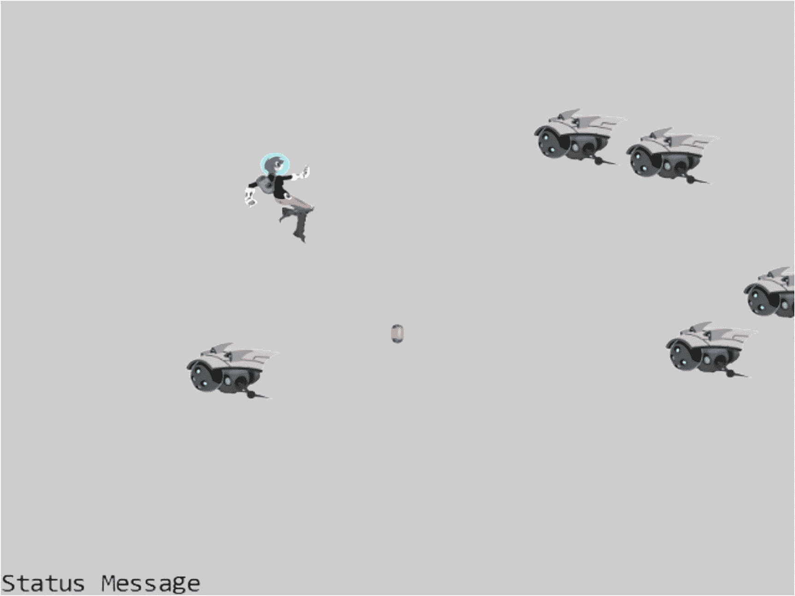

**图 6-1 ¶ 运行游戏对象项目**

项目控制如下：

*   **WASD 键**：上、左、下、右移动英雄

项目目标如下：

*   开始定义 `GameObject` 类以封装游戏中的对象行为
*   演示创建 `GameObject` 类的子类，以保持 `MyGame` 关卡 `update()` 函数的简洁性
*   引入 `GameObjectSet` 类，演示对具有相同接口的一组同质对象的支持

您可以在 `assets` 文件夹中找到以下外部资源文件：`minion_sprite.png`；您还将找到包含默认系统字体的 `fonts` 文件夹。注意，如图 6-2 所示，`minion_sprite.png` 图像文件已从上一个项目更新，以包含两个额外的精灵元素：DyePack 和 Brain 小兵。

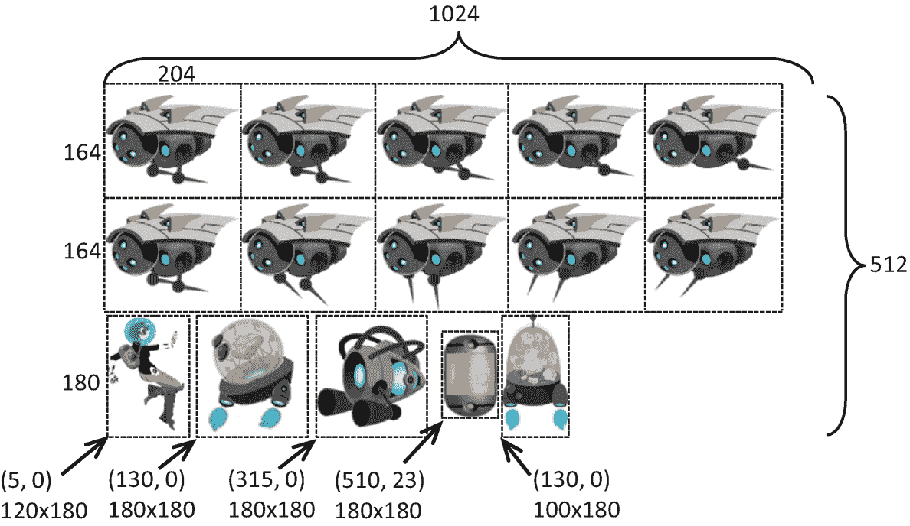

**图 6-2 ¶ minion_sprite.png 图像的新精灵元素**

#### 定义 GameObject 类

目标是定义一个逻辑抽象，以封装游戏中典型对象的所有相关行为特征，包括控制位置、绘制等能力。正如前一章中的 `Scene` 对象一样，主要结果是提供一个定义良好的接口，以管辖子类实现的函数。更复杂的行为将在下一节介绍。此示例仅演示定义了最小行为的 `GameObject` 类的潜力。

1.  添加新文件夹 `src/engine/game_objects` 用于存储 `GameObject` 相关文件。
2.  在此文件夹中创建一个新文件，命名为 `game_object.js`，并添加以下代码：

```javascript
class GameObject {
    constructor(renderable) {
        this.mRenderComponent = renderable;
    }
    getXform() { return this.mRenderComponent.getXform(); }
    getRenderable() { return this.mRenderComponent; }
    update() { }
    draw(aCamera) {
        this.mRenderComponent.draw(aCamera);
    }
}
export default GameObject;
```

随着对 `Renderable` 和 `Transform` 对象的访问器的定义，所有 `GameObject` 实例都可以被绘制，并具有定义的位置和大小。注意，`update()` 函数设计为供子类用特定于每个对象的行为重写，因此留空。

#### 成套管理游戏对象

因为大多数游戏由许多相互作用的对象组成，定义一个实用程序类来支持处理一组 `GameObject` 实例很有用：


## 创建 GameObjectSet 类

在 `src/engine/game_objects` 文件夹中创建一个新文件，命名为 `game_object_set.js`。定义 `GameObjectSet` 类及其构造函数，初始化一个数组用于存放 `GameObject` 实例。

```javascript
class GameObjectSet {
    constructor() {
        this.mSet = [];
    }
    // ... implementation to follow ...
    export default GameObjectSet;
}
```

## 定义集合管理函数

```javascript
size() { return this.mSet.length; }
getObjectAt(index) { return this.mSet[index]; }
addToSet(obj) { this.mSet.push(obj); }
removeFromSet(obj) {
    let index = this.mSet.indexOf(obj);
    if (index > -1)
        this.mSet.splice(index, 1);
}
```

## 定义更新和绘制函数

更新和绘制集合中的每个 `GameObject` 实例：

```javascript
update() {
    let i;
    for (i = 0; i < this.mSet.length; i++) {
        this.mSet[i].update();
    }
}
draw(aCamera) {
    let i;
    for (i = 0; i < this.mSet.length; i++) {
        this.mSet[i].draw(aCamera);
    }
}
```

## 导出类到客户端

将新功能集成到引擎的最后一步是修改引擎访问文件 `index.js`。编辑 `index.js` 并添加以下导入和导出语句，以授予客户端访问 `GameObject` 和 `GameObjectSet` 类的权限：

```javascript
// ... identical to previous code ...
// game objects
import GameObject from "./game_objects/game_object.js";
import GameObjectSet from "./game_objects/game_object_set.js";
// ... identical to previous code ...
export default {
    // ... identical to previous code ...
    // Game Objects
    GameObject, GameObjectSet,
    // ... identical to previous code ...
}
```

> **注意**
>
> 通过引擎访问文件 `index.js` 导入/导出类的过程必须为每个新定义的功能重复执行。从现在起，将只提供提醒，不再展示简单的代码更改。

## 测试 GameObject 和 GameObjectSet

本项目的目标是确保新 `GameObject` 类正常运行，演示通过单个对象类型自定义行为，并观察更清晰的 `MyGame` 实现，明确反映游戏内逻辑。为实现这些目标，定义了三种对象类型：`DyePack`、`Hero` 和 `Minion`。在开始检查这些对象的详细实现之前，遵循良好的源代码组织实践，在 `src/my_game/objects` 中创建一个新文件夹用于存储新对象类型。

## DyePack GameObject

`DyePack` 类继承自 `GameObject` 类，演示最基本的 `GameObject` 示例：一个没有行为、仅绘制到屏幕的对象。

在 `src/my_game/objects` 文件夹中创建一个新文件，命名为 `dye_pack.js`。从引擎访问文件 `index.js` 导入以获取所有游戏引擎功能。将 `DyePack` 定义为 `GameObject` 的子类，并按如下方式实现构造函数：

```javascript
import engine from "../../engine/index.js";
class DyePack extends engine.GameObject {
    constructor(spriteTexture) {
        super(null);
        this.kRefWidth = 80;
        this.kRefHeight = 130;
        this.mRenderComponent =
            new engine.SpriteRenderable(spriteTexture);
        this.mRenderComponent.setColor([1, 1, 1, 0.1]);
        this.mRenderComponent.getXform().setPosition(50, 33);
        this.mRenderComponent.getXform().setSize(
            this.kRefWidth / 50, this.kRefHeight / 50);
        this.mRenderComponent.setElementPixelPositions(510, 595, 23, 153);
    }
}
export default DyePack;
```

请注意，即使没有特定行为，`DyePack` 也在实现过去位于 `MyGame` 关卡 `init()` 函数中的代码。这样，`DyePack` 对象隐藏了特定的几何信息并简化了 `MyGame` 关卡。

> **注意**
>
> 几乎所有客户端源代码文件都需要从引擎访问文件 `index.js` 导入，这一点将不再重复。

## Hero GameObject

`Hero` 类支持直接的用户键盘控制。该对象演示了从 `MyGame` 的 `update()` 函数中隐藏游戏对象控制逻辑。

### 1. 创建 Hero 类

在 `src/my_game/objects` 文件夹中创建一个新文件，命名为 `hero.js`。将 `Hero` 定义为 `GameObject` 的子类，并实现构造函数以初始化精灵 UV 值、大小和位置。确保导出并共享此类。

```javascript
class Hero extends engine.GameObject {
    constructor(spriteTexture) {
        super(null);
        this.kDelta = 0.3;
        this.mRenderComponent =
            new engine.SpriteRenderable(spriteTexture);
        this.mRenderComponent.setColor([1, 1, 1, 0]);
        this.mRenderComponent.getXform().setPosition(35, 50);
        this.mRenderComponent.getXform().setSize(9, 12);
        this.mRenderComponent.setElementPixelPositions(0, 120, 0, 180);
    }
    // ... implementation to follow ...
    export default Hero;
}
```

### 2. 添加更新函数

添加一个函数以支持通过用户键盘控制更新此对象。`Hero` 对象根据键盘的 WASD 输入以 `kDelta` 速率移动。

```javascript
update() {
    // control by WASD
    let xform = this.getXform();
    if (engine.input.isKeyPressed(engine.input.keys.W)) {
        xform.incYPosBy(this.kDelta);
    }
    if (engine.input.isKeyPressed(engine.input.keys.S)) {
        xform.incYPosBy(-this.kDelta);
    }
    if (engine.input.isKeyPressed(engine.input.keys.A)) {
        xform.incXPosBy(-this.kDelta);
    }
    if (engine.input.isKeyPressed(engine.input.keys.D)) {
        xform.incXPosBy(this.kDelta);
    }
}
```

## Minion GameObject

`Minion` 类演示了简单的自主行为也可以被隐藏。

### 1. 创建 Minion 类

在 `src/my_game/objects` 文件夹中创建一个新文件，命名为 `minion.js`。将 `Minion` 定义为 `GameObject` 的子类，并实现构造函数以初始化精灵 UV 值、精灵动画参数、大小和位置，如下所示：

```javascript
class Minion extends engine.GameObject {
    constructor(spriteTexture, atY) {
        super(null);
        this.kDelta = 0.2;
        this.mRenderComponent =
            new engine.SpriteAnimateRenderable(spriteTexture);
        this.mRenderComponent.setColor([1, 1, 1, 0]);
        this.mRenderComponent.getXform().setPosition(
            Math.random() * 100, atY);
        this.mRenderComponent.getXform().setSize(12, 9.6);
        // first element pixel position: top-left 512 is top of image
        // 0 is left of the image
        this.mRenderComponent.setSpriteSequence(512, 0,
            204, 164,   // width x height in pixels
            5,          // number of elements in this sequence
            0);         // horizontal padding in between
        this.mRenderComponent.setAnimationType(
            engine.eAnimationType.eSwing);
        this.mRenderComponent.setAnimationSpeed(15);
        // show each element for mAnimSpeed updates
    }
    // ... implementation to follow ...
}
export default Minion;
```

### 2. 添加更新函数

添加一个函数以更新精灵动画，支持简单的从右向左移动，并提供环绕功能：

```javascript
update() {
    // remember to update this.mRenderComponent's animation
    this.mRenderComponent.updateAnimation();
    // move towards the left and wraps
    let xform = this.getXform();
    xform.incXPosBy(-this.kDelta);
    // if fly off to the left, re-appear at the right
    if (xform.getXPos() < 0) {
        xform.setXPos(100);
        xform.setYPos(65 * Math.random());
    }
}
```

## MyGame 场景

与所有情况一样，`MyGame` 关卡在 `my_game.js` 文件中实现。定义了三个特定的 `GameObject` 子类后，请遵循以下步骤：

### 1. 导入新定义的对象

除了引擎访问文件 `index.js` 外，为了访问新定义的对象，必须导入相应的源代码：


## 游戏对象初始化

```javascript
import engine from "../engine/index.js"; // 用户代码
import DyePack from "./objects/dye_pack.js";
import Minion from "./objects/minion.js";
import Hero from "./objects/hero.js";
```

> **注意**
>
> 与其他 import/export 语句一样，除非有其他特定原因，否则此提醒将不再显示。

### 步骤 2：构造函数与生命周期

`constructor`、`load()`、`unload()` 和 `draw()` 函数与之前的项目类似，因此此处不展示详细内容。

### 步骤 3：`init()` 函数

编辑 `init()` 函数并添加以下代码：

```javascript
init() {
    ... identical to previous code ...
    // 步骤 B：染料包：仅仅是另一个 GameObject
    this.mDyePack = new DyePack(this.kMinionSprite);
    // 步骤 C：一组 Minion
    this.mMinionset = new engine.GameObjectSet();
    let i = 0, randomY, aMinion;
    // 在随机 Y 值处创建 5 个 minion
    for (i = 0; i < 5; i++) {
        randomY = Math.random() * 65;
        aMinion = new Minion(this.kMinionSprite, randomY);
        this.mMinionset.addToSet(aMinion);
    }
    // 步骤 D：创建英雄对象
    this.mHero = new Hero(this.kMinionSprite);
    // 步骤 E：创建并初始化消息输出
    this.mMsg = new engine.FontRenderable("Status Message");
    this.mMsg.setColor([0, 0, 0, 1]);
    this.mMsg.getXform().setPosition(1, 2);
    this.mMsg.setTextHeight(3);
}
```

步骤 A 的细节（相机的创建和背景颜色的初始化）未展示，因为它们与之前的项目完全相同。步骤 B、C 和 D 展示了三种对象类型的实例化，其中步骤 C 展示了从右向左移动的 `Minion` 对象的创建及其插入到 `GameObjectSet` 类的实例 `mMinionset` 中。请注意，`init()` 函数不再包含设置每个对象纹理、几何体等杂乱的代码。

### 步骤 4：`update()` 函数

编辑 `update()` 函数以更新游戏状态：

```javascript
update() {
    this.mHero.update();
    this.mMinionset.update();
    this.mDyePack.update();
}
```

由于每种对象类型的行为都已明确定义并抽象化，简洁的 `update()` 函数清晰地表明游戏由三个非交互对象组成。

### 观察

你现在可以运行项目，注意到六个 minion 稍微复杂一些的运动是通过更简洁的 `init()` 和 `update()` 函数实现的。`init()` 函数仅包含在游戏世界中放置创建对象的逻辑和控制，不包含针对不同对象类型的任何特定设置。随着 `Minion` 对象在其自身的 `update()` 函数中定义运动行为，`MyGame` 的 `update()` 函数中的逻辑可以专注于关卡的细节。请注意，该函数的结构清晰地表明这三个对象是独立更新的，彼此之间没有交互。

> **注意**
>
> 全书几乎所有情况下，`MyGame` 类的设计都是为了展示引擎功能。因此，大多数 `MyGame` 类中的源代码组织可能不代表实现游戏的最佳实践。

## 创建追逐行为

仔细观察之前的项目会发现，虽然屏幕上有不少 minion 在移动，但它们的运动简单且枯燥。尽管速度和方向有变化，但这些运动缺乏目的性，也无法感知场景中的其他游戏对象。为了支持更复杂或有趣的运动，`GameObject` 需要感知其他对象的位置，并根据该信息确定运动。

追逐行为就是一个这样的例子。追逐对象的目标通常是捕获其锁定的游戏对象。这需要通过编程操控追逐者的朝向和速度，使其能够锁定目标。然而，通常重要的是要避免实现一个瞄准完美、总能命中目标的追逐者——因为如果玩家无法避免被击中，游戏就会变得难以取胜。尽管如此，这并不意味着如果你的游戏设计需要，你就不应该实现一个完美的追逐者。你将在下一个项目中实现一个追逐者。

向量及其相关运算是实现对象运动和行为的基础。在使用向量编程之前，先进行快速回顾。与矩阵和变换操作符一样，以下讨论并不旨在全面覆盖向量理论。相反，重点在于与游戏引擎实现相关的一小部分概念的应用。这不是对数学背后理论的研究。如果你对向量的具体细节及其与游戏的关系感兴趣，请参阅第 1 章的讨论，你可以通过深入研读线性代数和游戏相关书籍，更深入地了解这些主题。

### 向量回顾

向量广泛应用于数学、物理学、计算机科学和工程学等许多研究领域。它们在游戏中尤为重要；几乎每个游戏都以某种方式使用向量。由于它们的应用如此广泛，本节专门用于理解和在游戏中利用向量。

> **注意**
>
> 关于向量的入门和全面介绍，可参考 [www.storyofmathematics.com/vectors](http://www.storyofmathematics.com/vectors)。关于向量在游戏中的详细应用，可参考 *Basic Math for Game Development with Unity 3D: A Beginner’s Guide to Mathematical Foundations*，Apress，2019。

向量最常见的用途之一是表示对象的位移和方向或*速度*。这很容易实现，因为向量由其大小和方向定义。仅使用这少量信息，你就可以表示对象的速度或加速度等属性。如果你拥有对象的位置、方向和速度，就拥有了在无需用户输入的情况下在游戏世界中移动它的充分信息。

在进一步深入之前，回顾向量的概念很重要，从如何定义向量开始。向量可以用两个点来指定。例如，给定任意位置 *P*[*a*] = (*x*[*a*], *y*[*a*]) 和 *P*[*b*] = (*x*[*b*], *y*[*b*])，你可以定义从 *P*[*a*] 到 *P*[*b*] 的向量，即 ，计算为 *P*[*b*] − *P*[*a*]。你可以在以下公式和图 6-3 中看到这一点：

*   *P*[*a*] = (*x*[*a*], *y*[*a*])
*   *P*[*b*] = (*x*[*b*], *y*[*b*])
*   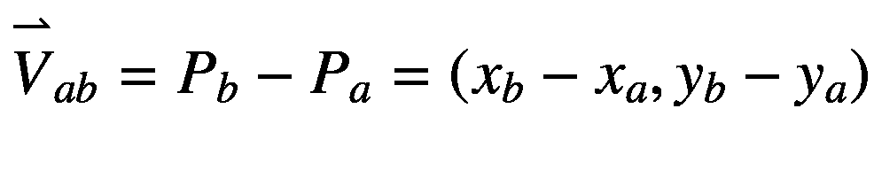

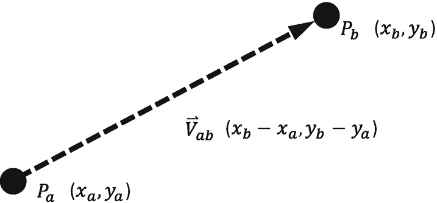

**图 6-3** ¶ 由两个点定义的向量

现在你有了向量 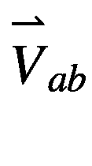，你可以轻松确定其长度（或大小）和方向。向量的长度等于创建它的两点之间的距离。在本例中， 的长度等于 *P*[*a*] 和 *P*[*b*] 之间的距离，而  的方向是从 *P*[*a*] 指向 *P*[*b*]。

> **注意**
>
> 向量的大小通常称为其长度或*模*。


## gl-matrix 中的向量运算

## 概述

在 `gl-matrix` 库中，`vec2` 对象实现了二维向量的功能。方便的是，你也可以使用 `vec2` 对象来表示空间中的二维点或位置。在前面的示例中，*P*[*a*]、*P*[*b*] 和  都可以作为 `vec2` 对象的实例来实现。然而， 才是数学上定义的向量。*P*[*a*] 和 *P*[*b*] 代表用于创建向量的位置或点。

回顾一下，向量也可以被归一化。*归一化* 向量（也称为*单位向量*）的大小始终为 1。你可以通过以下函数看到归一化向量，如图 6-4 所示。注意，普通向量的数学符号是 ，而归一化向量的符号是 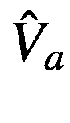：

*   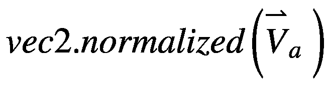: 归一化向量 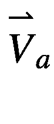 并将结果存储到 `vec2` 对象中

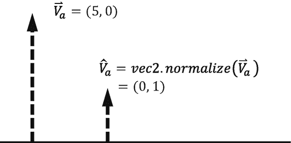

图 6-4 ¶ 向量归一化

指向位置的向量也可以被旋转。例如，如果向量 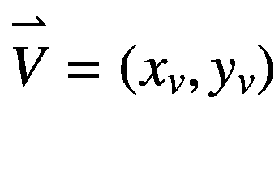 表示从原点指向位置 (*x*[*v*], *y*[*v*]) 的方向，并且你想将其旋转 θ 角度，则如图 6-5 所示，你可以使用以下公式来求出 *x*[*r*] 和 *y*[*r*]：

*   *x*[*r*] = *x*[*v*] cos *θ* − *y*[*v*] sin *θ*
*   *y*[*r*] = *x*[*v*] sin *θ* + *y*[*v*] cos *θ*

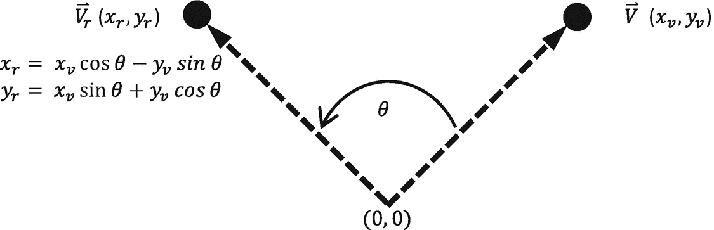

图 6-5 ¶ 从原点指向位置 (*x*[*v*], *y*[*v*]) 的向量被角度 theta 旋转

> **注意**
>
> JavaScript 三角函数，包括 `Math.sin()` 和 `Math.cos()` 函数，假设输入为弧度而非角度。回顾一下，1 度等于 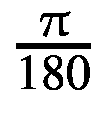 弧度。

始终重要的是要记住，向量由其方向和大小定义。换句话说，两个向量可以相等，而与向量的位置无关。图 6-6 显示了两个向量  和 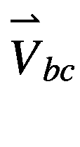，它们位于不同的位置，但具有相同的方向和大小，因此它们相等。相比之下，向量 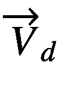 不同，因为它的方向和大小与其他向量不同。

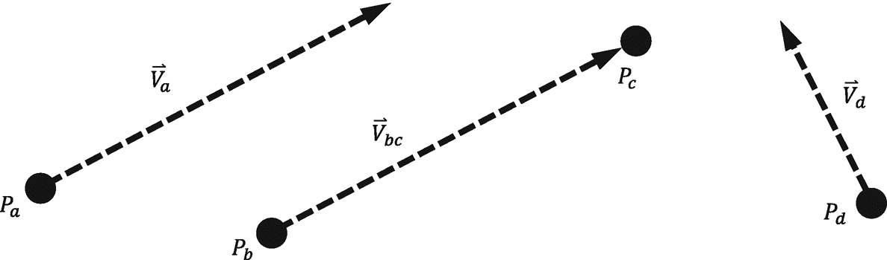

图 6-6 ¶ 二维空间中表示的三个向量，其中两个向量相等

## 点积

两个归一化向量的点积提供了求这两个向量夹角的方法。例如，给定以下内容：

*   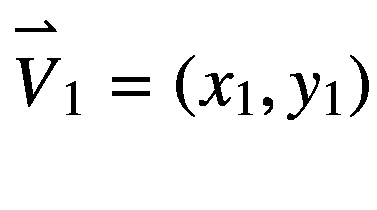
*   

则以下成立：

*   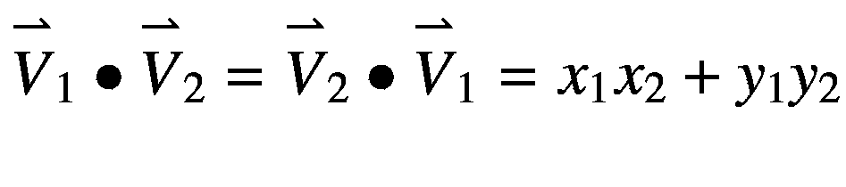。

此外，如果向量 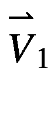 和 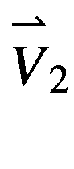 都是归一化的，则

*   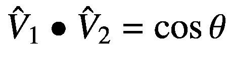

图 6-7 描绘了  和  向量及其夹角 *θ* 的示例。同样重要的是要认识到，如果 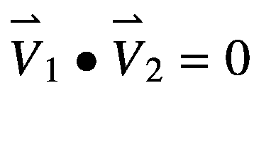，则这两个向量垂直。

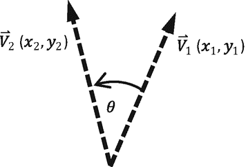

图 6-7 ¶ 两个向量之间的夹角，可通过点积求得

> **注意**
>
> 如果你需要复习或温习点积的概念，请参考 [www.mathsisfun.com/algebra/vectors-dot-product.html](http://www.mathsisfun.com/algebra/vectors-dot-product.html)。

## 叉积

两个向量的叉积产生一个与原始两个向量都 *正交*（即垂直）的向量。在二维游戏中，二维维度平铺在屏幕上，叉积的结果是一个指向内部（朝向屏幕）或外部（远离屏幕）的向量。这可能看起来很奇怪，因为在二维或 x/y 平面上叉乘两个向量会产生一个位于第三维度或 z 轴上的向量，这不符合直觉。然而，第三维度中的结果向量包含关键信息。例如，该向量在第三维度中的方向可用于确定游戏对象需要顺时针还是逆时针旋转。仔细看看以下内容：

*   
*   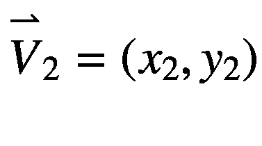

鉴于上述内容，以下成立：

*   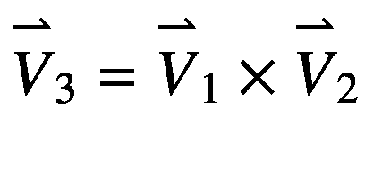 是一个同时垂直于  和  的向量。


此外，您知道 x/y 平面上两个向量的叉积会产生一个指向 z 方向的向量。当 $\vec{V}_1 \times \vec{V}_2 > 0$ 时，您知道 $\vec{V}_1$ 相对于 $\vec{V}_2$ 在**顺时针**方向；类似地，当 $\vec{V}_1 \times \vec{V}_2 < 0$ 时，您知道 $\vec{V}_1$ 在**逆时针**方向。图 6-8 应有助于阐明这一概念。

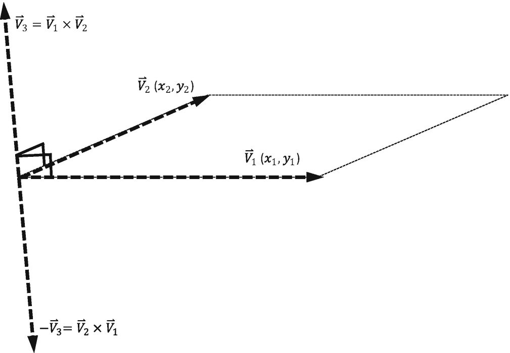

**图 6-8** ¶ 两个向量的叉积

> **注意**
>
> 如果您需要复习或温习叉积的概念，请参阅 [www.mathsisfun.com/algebra/vectors-cross-product.html](http://www.mathsisfun.com/algebra/vectors-cross-product.html)。

## “正向与追逐”项目

该项目基于已回顾的向量概念，实现了更有趣、更复杂的行为。您将不再局限于恒定且无目的的运动，而是会体验定义和改变物体前进方向，以及引导场景中的一个物体去追逐另一个物体的过程。您可以在图 6-9 中看到该项目运行的示例。该项目的源代码定义在 `chapter6/6.2.front_and_chase` 文件夹中。

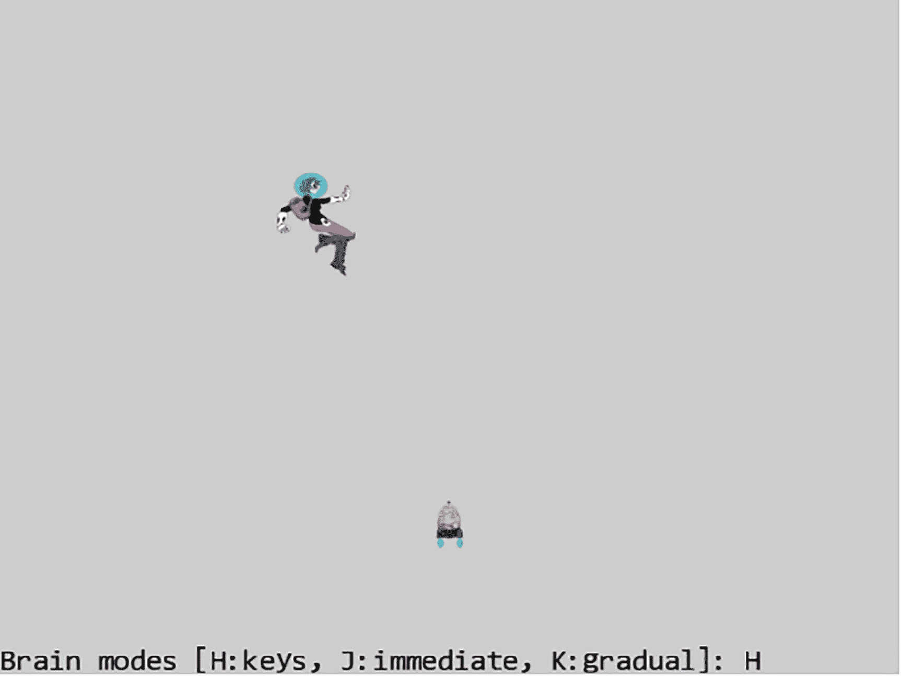

**图 6-9** ¶ 运行“正向与追逐”项目

项目控制方式如下：

*   **`WASD` 键**：移动 `Hero`（英雄）对象
*   **左/右箭头键**：当 `Brain`（大脑）对象处于用户控制下时，改变其前进方向
*   **上/下箭头键**：增加/减少 `Brain` 对象的速度
*   **`H` 键**：将 `Brain` 对象切换为用户箭头键控制模式
*   **`J` 键**：将 `Brain` 对象切换为始终指向并移动至当前 `Hero` 对象位置模式
*   **`K` 键**：将 `Brain` 对象切换为逐渐转向并移动至当前 `Hero` 对象位置模式

项目目标如下：

*   体验速度与方向的配合使用
*   练习沿预定义方向移动
*   使用向量点积和叉积实现算法
*   检查并实现追逐行为

您可以在 `assets` 文件夹中找到与上一个项目相同的外部资源文件。

### 向 `gl-matrix` 库添加向量旋转功能

`gl-matrix` 库不支持在二维空间中旋转位置。可以通过向 `lib` 文件夹中的 `gl-matrix.js` 文件添加以下代码来修复此问题：

```javascript
vec2.rotate = function(out, a, c) {
    var r = [];
    // 执行旋转
    r[0] = a[0] * Math.cos(c) - a[1] * Math.sin(c);
    r[1] = a[0] * Math.sin(c) + a[1] * Math.cos(c);
    out[0] = r[0];
    out[1] = r[1];
    return r;
};
```

> **注意**
>
> 从现在开始，所有项目都必须包含对 `gl-matrix` 库的此修改。

### 修改 `GameObject` 以支持有趣的行为

`GameObject` 类抽象并实现了所需的新对象行为：

1.  编辑 `game_object.js` 文件并修改 `GameObject` 构造函数，以定义可见性、前进方向和速度：

```javascript
constructor(renderable) {
    this.mRenderComponent = renderable;
    this.mVisible = true;
    this.mCurrentFrontDir = vec2.fromValues(0, 1); // 前进方向
    this.mSpeed = 0;
}
```

2.  为实例变量添加访问器和设置器函数：

```javascript
getXform() { return this.mRenderComponent.getXform(); }
setVisibility(f) { this.mVisible = f; }
isVisible() { return this.mVisible; }
setSpeed(s) { this.mSpeed = s; }
getSpeed() { return this.mSpeed; }
incSpeedBy(delta) { this.mSpeed += delta; }
setCurrentFrontDir(f) { vec2.normalize(this.mCurrentFrontDir, f); }
getCurrentFrontDir() { return this.mCurrentFrontDir; }
getRenderable() { return this.mRenderComponent; }
```

3.  实现一个函数，以指定速率 `rate` 将前进方向旋转朝向位置 `p`：

```javascript
rotateObjPointTo(p, rate) {
    // 步骤 A：确定是否到达目标位置 p
    let dir = [];
    vec2.sub(dir, p, this.getXform().getPosition());
    let len = vec2.length(dir);
    if (len < Number.MIN_VALUE) {
        return; // 已到达。
    }
    vec2.scale(dir, dir, 1 / len);
    // 步骤 B：计算旋转角度
    let fdir = this.getCurrentFrontDir();
    let cosTheta = vec2.dot(dir, fdir);
    if (cosTheta > 0.999999) { // 方向几乎完全相同
        return;
    }
    // 步骤 C：将 cosTheta 限制在 -1 到 1 之间
    // 在理想世界中，这永远不会发生！但是……
    if (cosTheta > 1) {
        cosTheta = 1;
    } else {
        if (cosTheta < -1) {
            cosTheta = -1;
        }
    }
    // 步骤 D：利用叉积结果判断是顺时针还是逆时针旋转
    let dir3d = vec3.fromValues(dir[0], dir[1], 0);
    let f3d = vec3.fromValues(fdir[0], fdir[1], 0);
    let r3d = [];
    vec3.cross(r3d, f3d, dir3d);
    let rad = Math.acos(cosTheta);  // 需旋转的弧度
    if (r3d[2] < 0) {
        rad = -rad;
    }
    // 步骤 E：根据角度和速率旋转朝向方向
    rad *= rate;  // 从对象前方向开始实际需要旋转的角度
    vec2.rotate(this.getCurrentFrontDir(), this.getCurrentFrontDir(), rad);
    this.getXform().incRotationByRad(rad);
}
```

`rotateObjPointTo()` 函数以参数 `rate` 指定的速率，将 `mCurrentFrontDir` 旋转使其指向目标位置 `p`。以下是各操作步骤的详细说明：

1.  **步骤 A** 计算当前对象与目标位置 `p` 之间的距离。如果该值很小，意味着当前对象和目标位置很接近。函数直接返回，不再进行后续处理。

2.  **步骤 B**，如图 6-10 所示，计算点积以确定对象当前前进方向 (`fdir`) 与指向目标位置 `p` 的方向 (`dir`) 之间的夹角 θ。如果这两个向量指向相同方向（cosθ 接近 1 或 θ 接近零），函数返回。

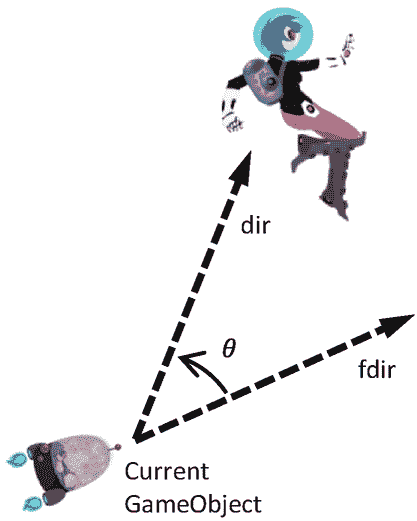

**图 6-10** ¶ 一个 `GameObject` (`Brain`) 正在追逐目标 (`Hero`)

3.  **步骤 C** 检查 `cosTheta` 的范围。由于 JavaScript 中浮点运算的不准确性，必须执行此步骤。

4.  **步骤 D** 利用叉积的结果，判断当前 `GameObject` 应该顺时针还是逆时针转向，以面向目标位置 `p`。

5.  **步骤 E** 旋转 `mCurrentFrontDir` 并在 `Renderable` 对象的 `Transform` 中设置旋转。重要的是要认识到这两个独立的对象旋转控制。`Transform` 控制绘制内容的旋转，而 `mCurrentFrontDir` 控制移动方向。在这种情况下，两者是同步的，因此必须同时用新值更新它们。

4.  [内容继续...]


## 追踪功能与碰撞检测

添加一个函数，根据对象的方向和速度更新其位置。请注意，如果 `mCurrentFrontDir` 被 `rotateObjPointTo()` 函数修改，则此 `update()` 函数将使对象朝向目标位置 `p` 移动，对象的行为将如同在追踪目标。

```javascript
update() {
    // 简单的默认行为
    let pos = this.getXform().getPosition();
    vec2.scaleAndAdd(pos, pos, this.getCurrentFrontDir(), this.getSpeed());
}
```

添加一个函数，根据可见性设置绘制对象：

```javascript
draw(aCamera) {
    if (this.isVisible()) {
        this.mRenderComponent.draw(aCamera);
    }
}
```

## 测试追踪功能

此测试用例的策略和目标是创建一个可转向的 `Brain` 对象，以演示沿预定义前方向移动，并指挥 `Brain` 追踪 `Hero` 以演示追踪功能。

### 定义 Brain 游戏对象

`Brain` 对象将在用户左/右箭头键的控制下沿其前方向移动：

#### 1. 创建 Brain 类

在 `src/my_game/objects` 文件夹中创建一个新文件，命名为 `brain.js`。将 `Brain` 定义为 `GameObject` 的子类，并实现构造函数以初始化外观和行为参数。

```javascript
class Brain extends engine.GameObject {
    constructor(spriteTexture) {
        super(null);
        this.kDeltaDegree = 1;
        this.kDeltaRad = Math.PI * this.kDeltaDegree / 180;
        this.kDeltaSpeed = 0.01;
        this.mRenderComponent =
            new engine.SpriteRenderable(spriteTexture);
        this.mRenderComponent.setColor([1, 1, 1, 0]);
        this.mRenderComponent.getXform().setPosition(50, 10);
        this.mRenderComponent.getXform().setSize(3, 5.4);
        this.mRenderComponent.setElementPixelPositions(600, 700, 0, 180);
        this.setSpeed(0.05);
    }
    // ... 后续实现 ...
}
export default Brain;
```

#### 2. 重写 Update 函数

重写 `update()` 函数以支持用户转向和控制速度。请注意，必须调用 `GameObject` 中的默认 `update()` 函数，以支持对象根据其速度沿前方向进行基本移动。

```javascript
update() {
    super.update();
    let xf = this.getXform();
    let fdir = this.getCurrentFrontDir();
    if (engine.input.isKeyPressed(engine.input.keys.Left)) {
        xf.incRotationByDegree(this.kDeltaDegree);
        vec2.rotate(fdir, fdir, this.kDeltaRad);
    }
    if (engine.input.isKeyPressed(engine.input.keys.Right)) {
        xf.incRotationByRad(-this.kDeltaRad);
        vec2.rotate(fdir, fdir, -this.kDeltaRad);
    }
    if (engine.input.isKeyClicked(engine.input.keys.Up)) {
        this.incSpeedBy(this.kDeltaSpeed);
    }
    if (engine.input.isKeyClicked(engine.input.keys.Down)) {
        this.incSpeedBy(-this.kDeltaSpeed);
    }
}
```

### MyGame 场景

修改 `MyGame` 场景以测试 `Brain` 对象的移动。在这种情况下，除 `update()` 函数外，`my_game.js` 中的其余源代码与之前的项目相似。因此，仅展示 `update()` 函数的细节：

```javascript
update() {
    let msg = "Brain [H:keys J:imm K:gradual]: ";
    let rate = 1;
    this.mHero.update();
    switch (this.mMode) {
        case 'H':
            this.mBrain.update();  // 玩家用箭头键转向
            break;
        case 'K':
            rate = 0.02;  // 渐进速率
            // 在渐进模式下，以下代码也应执行
        case 'J':
            this.mBrain.rotateObjPointTo(
                this.mHero.getXform().getPosition(), rate);
            // 默认 GameObject：仅向前移动
            engine.GameObject.prototype.update.call(this.mBrain);
            break;
    }
    if (engine.input.isKeyClicked(engine.input.keys.H)) {
        this.mMode = 'H';
    }
    if (engine.input.isKeyClicked(engine.input.keys.J)) {
        this.mMode = 'J';
    }
    if (engine.input.isKeyClicked(engine.input.keys.K)) {
        this.mMode = 'K';
    }
    this.mMsg.setText(msg + this.mMode);
}
```

在 `update()` 函数中，`switch` 语句使用 `mMode` 来决定如何更新 `Brain` 对象。在 `J` 和 `K` 模式下，`Brain` 对象通过调用 `rotateObjPointTo()` 函数转向 `Hero` 对象的位置。而在 `H` 模式下，调用 `Brain` 对象的 `update()` 函数，让用户用箭头键控制对象。最后三个 `if` 语句仅根据用户输入设置 `mMode` 变量。

请注意，在 `J` 和 `K` 模式下，为了在 `rotateObjPointTo()` 之后绕过用户控制逻辑，调用的是 `GameObject` 定义的 `update()` 函数，而不是 `Brain` 定义的。

> **注意**
>
> JavaScript 语法 `ClassName.prototype.FunctionName.call(anObj)` 调用由 `ClassName` 定义的 `FunctionName`，其中 `anObj` 是 `ClassName` 的子类。

## 观察

现在可以尝试运行项目。最初，`Brain` 对象处于用户控制之下。你可以使用左/右箭头键改变 `Brain` 对象的前方向，体验转向控制。按下 `J` 键会导致 `Brain` 对象立即指向并移动向 `Hero` 对象。这是由于默认转向速率值为 `1.0` 的结果。`K` 键会导致更自然的行为，`Brain` 对象继续向前移动并逐渐转向移动向 `Hero` 对象。请随意更改 `rate` 变量的值或修改 `Brain` 对象的控制值。例如，更改 `kDeltaRad` 或 `kDeltaSpeed` 以尝试不同的行为设置。

## GameObjects 之间的碰撞

在之前的项目中，`Brain` 对象永远不会停止移动。请注意，在 `J` 和 `K` 模式下，当 `Brain` 对象到达目标位置时，它会围绕目标运行或快速翻转方向。`Brain` 对象缺乏检测其与 `Hero` 对象碰撞的关键能力，因此它永远不会停止移动。本节介绍轴对齐包围盒（AABB），这是近似对象碰撞最直接的工具之一，并演示基于 AABB 的碰撞检测实现。

### 轴对齐包围盒（AABB）

AABB 是一个与 x/y 轴对齐的矩形框，用于包围给定对象。*x/y 轴对齐* 指的是 AABB 的四条边平行于水平 x 轴或垂直 y 轴。图 6-11 展示了用左下角（`mLL`）、宽度和高度表示 `Hero` 对象包围范围的示例。这是一种相当常见的 AABB 表示方法，因为它仅使用一个位置和两个浮点数来表示尺寸。

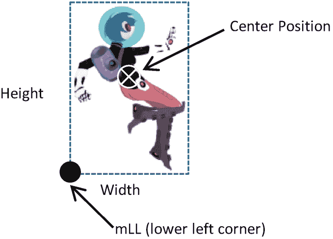

**图 6-11** ¶ 对象包围盒的左下角与尺寸

有趣的是，除了表示对象的包围范围外，包围盒还可以用来表示任意给定矩形区域的包围范围。例如，回想一下 `Camera` 可见的世界坐标系（WC）是一个矩形区域，摄像机的位置位于中心，WC 的宽度/高度由游戏开发者定义。可以定义一个 AABB 来表示可见的 WC 矩形区域（即 WC 窗口），并用于检测游戏世界中 WC 窗口与 `GameObject` 实例之间的碰撞。

> **注意**
>
> 在本书中，AABB 和“包围盒”交替使用。

### 包围盒与碰撞项目


## 项目概述

本项目演示了如何为 `GameObject` 实例定义包围盒，以及如何基于它们的包围盒检测两个 `GameObject` 实例之间的碰撞。重要的是要记住，包围盒是轴对齐的，因此本节提出的解决方案不支持旋转对象之间的碰撞检测。您可以在图 6-12 中看到该项目运行的示例。该项目的源代码定义在 `chapter6/6.3.bbox_and_collisions` 文件夹中。

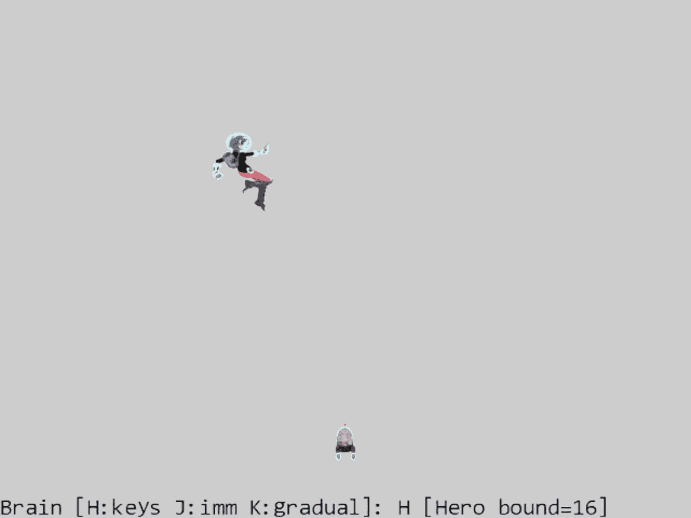

**图 6-12 ¶ 运行包围盒与碰撞项目**

该项目的控制方式与前一个项目相同：

*   **WASD 键**：移动 Hero 对象
*   **左/右箭头键**：当 Brain 对象处于用户控制下时，改变其朝向
*   **上/下箭头键**：增加/减少 Brain 对象的速度
*   **H 键**：将 Brain 对象切换为用户箭头键控制模式
*   **J 键**：将 Brain 对象切换为始终指向并移动至 Hero 对象当前位置的模式
*   **K 键**：将 Brain 对象切换为逐渐转向并移动至 Hero 对象当前位置的模式

项目目标如下：

*   理解包围盒类的实现
*   体验使用 `GameObject` 实例的包围盒进行工作
*   计算并使用 Camera WC 窗口的边界
*   编程实现对象碰撞以及对象与 Camera WC 窗口的碰撞

您可以在 `assets` 文件夹中找到与前一个项目相同的外部资源文件。

## 定义包围盒类

定义一个 `BoundingBox` 类来表示矩形区域的边界：

### 步骤 1：创建 `bounding_box.js` 并定义枚举

在 `src/engine` 文件夹中创建一个新文件；将其命名为 `bounding_box.js`。首先，定义一个枚举数据类型，其值用于标识包围盒的碰撞边。

```javascript
const eBoundCollideStatus = Object.freeze({
    eCollideLeft: 1,
    eCollideRight: 2,
    eCollideTop: 4,
    eCollideBottom: 8,
    eInside: 16,
    eOutside: 0
});
```

请注意，每个枚举值只有一个非零位。这允许使用按位或运算符组合枚举值以表示多边碰撞。例如，如果一个物体同时与包围盒的顶部和左侧发生碰撞，碰撞状态将为 `eCollideLeft | eCollideTop = 1 | 4 = 5`。

### 步骤 2：定义 `BoundingBox` 类和构造函数

现在，定义 `BoundingBox` 类和构造函数，其中包含表示边界的实例变量，如图 6-11 所示。请注意，`eBoundCollideStatus` 也必须被导出，以便引擎的其余部分（包括客户端代码）也能访问它。

```javascript
class BoundingBox {
    constructor(centerPos, w, h) {
        this.mLL = vec2.fromValues(0, 0);
        this.setBounds(centerPos, w, h);
    }
    // ... 后续实现 ...
}
export {eBoundCollideStatus}
export default BoundingBox;
```

### 步骤 3：`setBounds()` 函数

`setBounds()` 函数计算并设置包围盒的实例变量：

```javascript
setBounds(centerPos, w, h) {
    this.mWidth = w;
    this.mHeight = h;
    this.mLL[0] = centerPos[0] - (w / 2);
    this.mLL[1] = centerPos[1] - (h / 2);
}
```

### 步骤 4：`containsPoint()` 函数

定义一个函数来确定给定位置 (x, y) 是否在盒子的边界内：

```javascript
containsPoint(x, y) {
    return ((x > this.minX()) && (x < this.maxX()) &&
            (y > this.minY()) && (y < this.maxY()));
}
```

### 步骤 5：`intersectsBound()` 函数

定义一个函数来确定给定边界是否与当前边界相交：

```javascript
intersectsBound(otherBound) {
    return ((this.minX() < otherBound.maxX()) &&
            (this.maxX() > otherBound.minX()) &&
            (this.minY() < otherBound.maxY()) &&
            (this.maxY() > otherBound.minY()));
}
```

### 步骤 6：`boundCollideStatus()` 函数

定义一个函数来计算给定边界与当前边界之间的相交状态：

```javascript
boundCollideStatus(otherBound) {
    let status = eBoundCollideStatus.eOutside;
    if (this.intersectsBound(otherBound)) {
        if (otherBound.minX() < this.minX()) {
            status |= eBoundCollideStatus.eCollideLeft;
        }
        if (otherBound.maxX() > this.maxX()) {
            status |= eBoundCollideStatus.eCollideRight;
        }
        if (otherBound.minY() < this.minY()) {
            status |= eBoundCollideStatus.eCollideBottom;
        }
        if (otherBound.maxY() > this.maxY()) {
            status |= eBoundCollideStatus.eCollideTop;
        }
        // 如果边界相交但没有任何边重叠
        // 则 otherBound 完全在 thisBound 内部
        if (status === eBoundCollideStatus.eOutside) {
            status = eBoundCollideStatus.eInside;
        }
    }
    return status;
}
```

请注意 `intersectsBound()` 和 `boundCollideStatus()` 函数之间微妙但重要的区别：前者只能返回 true 或 false 条件，而后者将碰撞边编码在返回的状态中。

### 步骤 7：最小/最大值访问器函数

实现返回包围盒最小和最大边界 X/Y 值的函数：

```javascript
minX() { return this.mLL[0]; }
maxX() { return this.mLL[0] + this.mWidth; }
minY() { return this.mLL[1]; }
maxY() { return this.mLL[1] + this.mHeight; }
```

最后，请记住更新引擎访问文件 `index.js`，以将新定义的功能转发给客户端。

## 在引擎中使用 BoundingBox

新定义的功能将用于检测对象之间的碰撞以及对象与 WC 边界之间的碰撞。为了实现这一点，必须修改 `GameObject` 和 `Camera` 类。

### 步骤 1：编辑 `game_object.js`

编辑 `game_object.js` 以导入新定义的功能并修改 `GameObject` 类；实现 `getBBox()` 函数以返回未旋转 `Renderable` 对象的包围盒：

```javascript
import BoundingBox from "../bounding_box.js";
class GameObject {
    // ... 与之前代码相同 ...
    getBBox() {
        let xform = this.getXform();
        let b = new BoundingBox(
            xform.getPosition(),
            xform.getWidth(),
            xform.getHeight());
        return b;
    }
    // ... 与之前代码相同 ...
}
```

### 步骤 2：编辑 `camera.js`

编辑 `camera.js` 以从 bounding box 导入，并修改 `Camera` 类以计算 `Transform` 对象边界（通常在 `Renderable` 对象中定义）与 WC 窗口之间的碰撞状态：

```javascript
import BoundingBox from "./bounding_box.js";
class Camera {
    // ... 与之前代码相同 ...
    collideWCBound(aXform, zone) {
        let bbox = new BoundingBox(
            aXform.getPosition(),
            aXform.getWidth(),
            aXform.getHeight());
        let w = zone * this.getWCWidth();
        let h = zone * this.getWCHeight();
        let cameraBound = new BoundingBox(this.getWCCenter(), w, h);
        return cameraBound.boundCollideStatus(bbox);
    }
}
```

请注意，`zone` 参数定义了碰撞计算中应使用的 WC 相对大小。例如，`zone` 值为 `0.8` 将意味着基于当前 WC 窗口大小的 80% 来计算相交状态。图 6-13 展示了 Camera 如何与对象发生碰撞。

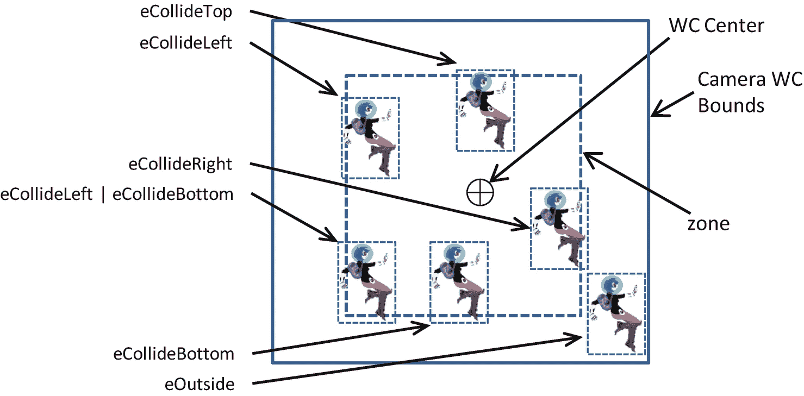

**图 6-13 ¶ Camera WC 边界与定义 Transform 对象的边界发生碰撞**

## 使用 MyGame 测试包围盒


本测试用例的目标是验证包围盒实现在检测物体-物体和物体-相机相交方面的正确性。再次强调，除 `update()` 函数外，`my_game.js` 文件中的大部分代码与之前的项目相似，此处不再重复。`update()` 函数是在上一个项目的基础上修改的，用于测试包围盒相交。

```javascript
update() { 
    ... identical to previous code ... 
    switch (this.mMode) { 
        case 'H': 
            this.mBrain.update();  // 玩家通过方向键控制转向 
            break; 
        case 'K': 
            rate = 0.02;   // 渐进速率 
            // 故意不写 break 
        case 'J': 
            // 当碰到英雄包围盒时停止大脑 
            if (!hBbox.intersectsBound(bBbox)) { 
                this.mBrain.rotateObjPointTo( 
                    this.mHero.getXform().getPosition(), rate); 
                // 默认 GameObject：仅向前移动 
                engine.GameObject.prototype.update.call(this.mBrain); 
            } 
            break; 
    } 
    // 检查英雄是否超出 WC 窗口包围盒的 80% 范围 
    let status = this.mCamera.collideWCBound(this.mHero.getXform(), 0.8); 
    ... identical to previous code ... 
    this.mMsg.setText(msg + this.mMode + " [Hero bound=" + status + "]"); 
}
```

在 switch 语句的 J 和 K 分支中，修改部分在调用 `Brain.rotateObjPointTo()` 和 `update()` 以产生追逐行为之前，测试 Brain 和 Hero 对象之间的包围盒碰撞。这样，Brain 对象一旦接触到 Hero 对象的包围盒就会停止移动。此外，还会计算并显示 Hero 对象与相机 WC 窗口 80% 区域之间的碰撞结果。

### 观察

现在可以运行项目并观察到，当处于自主模式（按 J 或 K 键）时，Brain 对象一旦接触到 Hero 对象就会停止移动。当你移动 Hero 对象时，观察 Hero bound 输出消息会在 Hero 对象实际接触 WC 窗口边界之前就开始回显 WC 窗口碰撞。这是由于传递给 `mCamera.collideWCBound()` 函数的 0.8（即 80%）参数导致的，它将碰撞计算配置为当前 WC 窗口大小的 80%。当 Hero 对象完全位于 WC 窗口边界的 80% 范围内时，输出的 Hero bound 值为 16，即 `eboundcollideStatus.eInside` 的值。尝试将 Hero 对象移动到接触窗口边界顶部 20% 的区域，观察 Hero bound 值为 4，即 `eboundcollideStatus.eCollideTop` 的值。现在将 Hero 对象移向窗口的左上角，观察 Hero bound 值为 5，即 `eboundcollideStatus.eCollideTop | eboundcollideStatus.eCollideLeft`。以这种方式，碰撞状态是所有碰撞边界的按位或结果。

## 逐像素碰撞

在前面的示例中，你看到了包围盒碰撞近似的结果。即 Brain 对象的运动在其包围盒与 Hero 对象的包围盒重叠时立即停止。这比 Brain 对象永不停止移动的原始情况有了很大改进。然而，如图 6-14 所示，基于包围盒的碰撞检测存在两个严重局限性。

1. 上一个示例中引入的 `BoundingBox` 对象不考虑旋转。这是 `AABB`（轴对齐包围盒）公认的局限性：虽然该方法计算效率高，但不支持旋转物体。

2. 两个物体实际上并未碰撞。两个物体的包围盒重叠并不自动等同于这两个物体发生了碰撞。

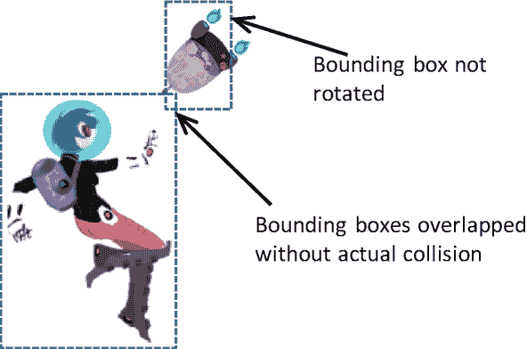

图 6-14 ¶ 基于包围盒的碰撞检测的局限性

在本项目中，你将实现逐像素精确碰撞检测、像素精确碰撞检测或逐像素碰撞检测，以检测两个碰撞物体的非透明像素重叠。但请记住，这并非终极解决方案。虽然逐像素碰撞检测很精确，但代价是潜在的性能成本。随着图像变得更大、更复杂，需要检查碰撞的像素也会更多。这与包围盒碰撞检测所需的恒定计算成本形成对比。

### 逐像素碰撞项目

该项目演示了如何检测大型纹理物体（Collector 小兵）与小型纹理物体（Portal 小兵）之间的碰撞。这两个纹理都包含透明和非透明区域。仅当非透明像素重叠时才会发生碰撞。在本项目中，发生碰撞时，一个黄色的 DyePack（染料包）会出现在碰撞点。你可以在图 6-15 中看到该项目运行的示例。该项目的源代码定义在 `chapter6/6.4.per_pixel_collisions` 文件夹中。


图 6-15 ¶ 运行逐像素碰撞项目

项目控制如下：

- `方向键`：移动小型纹理物体，Portal 小兵
- `WASD 键`：移动大型纹理物体，Collector 小兵

项目目标如下：

- 演示如何检测非透明像素重叠
- 理解使用逐像素精确碰撞检测的优缺点

> **注意**
>
> “透明”像素是指你可以完全看穿的像素，在本引擎中，其 Alpha 值为 0。“非透明”像素的 Alpha 值大于 0，或者该像素不会完全阻挡其后方的内容；它可能遮挡也可能不遮挡。“不透明”像素会遮挡其后方的内容，属于“非透明”，且 Alpha 值为 1。例如，请注意你可以“看穿” Portal 对象的顶部区域。这些像素是非透明但不不透明的，根据项目定义的参数，当发生重叠时它们应引发碰撞。

你可以在 `assets` 文件夹中找到以下外部资源：包含默认系统字体的 `fonts` 文件夹、`minion_collector.png`、`minion_portal.png` 和 `minion_sprite.png`。请注意，`minion_collector.png` 是一张大尺寸的 1024x1024 图像，而 `minion_portal.png` 是一张小尺寸的 64x64 图像；`minion_sprite.png` 定义了 DyePack 精灵元素。

#### 逐像素碰撞算法概述

在继续之前，确定检测两个纹理物体之间碰撞的要求非常重要。首要的是纹理本身需要包含透明区域，这种类型的碰撞检测才能提供准确性的提升。如果纹理中没有透明度，你可以也应该使用简单的包围盒碰撞检测。如果一个或两个纹理包含透明区域，则需要处理两种碰撞情况。第一种情况是检查两个物体的包围盒是否碰撞。你可以在图 6-16 中看到这一点。请注意物体的包围盒重叠了，但没有任何非透明的彩色像素接触。

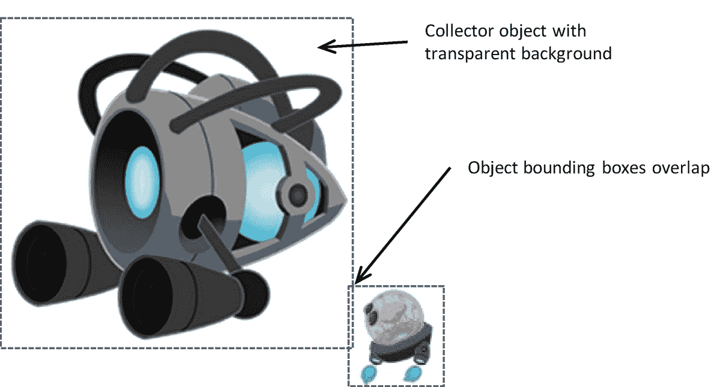

图 6-16 ¶ 包围盒重叠但未发生实际碰撞


## 检查纹理非透明像素重叠

下一个案例是检查纹理的非透明像素是否重叠。请看图 6-17。`Collector` 和 `Portal` 对象纹理的非透明像素明显相互接触。

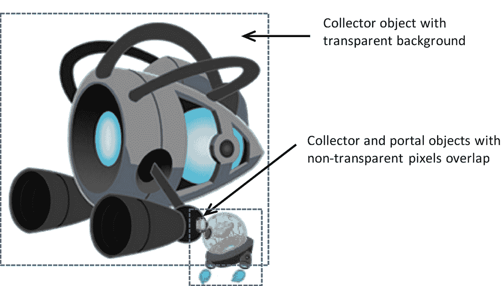

**图 6-17 ¶ 大纹理与小纹理之间发生的像素碰撞**

问题已明确定义，以下是逐像素精确碰撞检测的逻辑或伪代码：

给定两张图像 `Image-A` 和 `Image-B`
如果两者的边界框碰撞，则
&nbsp;&nbsp;&nbsp;&nbsp;对于 `Image-A` 中的每个 `Pixel-A`
&nbsp;&nbsp;&nbsp;&nbsp;&nbsp;&nbsp;&nbsp;&nbsp;如果 `Pixel-A` 不完全透明
&nbsp;&nbsp;&nbsp;&nbsp;&nbsp;&nbsp;&nbsp;&nbsp;&nbsp;&nbsp;&nbsp;&nbsp;`pixelCameraSpace` = `Pixel-A` 在相机空间中的位置
&nbsp;&nbsp;&nbsp;&nbsp;&nbsp;&nbsp;&nbsp;&nbsp;&nbsp;&nbsp;&nbsp;&nbsp;将 `pixelCameraSpace` 转换到 `Image-B` 空间
&nbsp;&nbsp;&nbsp;&nbsp;&nbsp;&nbsp;&nbsp;&nbsp;&nbsp;&nbsp;&nbsp;&nbsp;从 `Image-B` 读取 `Pixel-B`
&nbsp;&nbsp;&nbsp;&nbsp;&nbsp;&nbsp;&nbsp;&nbsp;&nbsp;&nbsp;&nbsp;&nbsp;如果 `Pixel-B` 不完全透明，则
&nbsp;&nbsp;&nbsp;&nbsp;&nbsp;&nbsp;&nbsp;&nbsp;&nbsp;&nbsp;&nbsp;&nbsp;&nbsp;&nbsp;&nbsp;&nbsp;发生碰撞

从 `pixelCameraSpace` 到 `Image-B` 空间的逐像素变换是必需的，因为碰撞检查必须在同一坐标空间内进行。

请注意，在算法中 `Image-A` 和 `Image-B` 是可交换的。即在测试两张图像的碰撞时，哪张是 `Image-A` 或 `Image-B` 无关紧要。碰撞结果将相同：要么两张图像重叠，要么不重叠。此外，请注意该算法的运行时间。`Image-A` 中的每个像素都必须处理；因此运行时间为 `O(N)`，其中 `N` 是 `Image-A` 的像素数或分辨率。出于性能原因，选择两张图像中较小者（本例中为 `Portal` 手下）作为 `Image-A` 非常重要。

此时，您可能已明白为何逐像素精确碰撞检测的性能令人担忧。在每次更新时用许多高分辨率纹理检查这些碰撞会迅速拖慢性能。现在您已准备好研究逐像素精确碰撞的实现。

## 修改 Texture 以将纹理加载为颜色数组

回顾 `Texture` 组件从服务器文件系统读取图像文件，将图像加载到 GPU 内存，并将图像处理为 `WebGL` 纹理。这样，纹理图像存储在 GPU 上，运行在 CPU 上的游戏引擎无法访问。为支持逐像素碰撞检测，必须从 GPU 检索颜色信息并存储在 CPU 中。可修改 `Texture` 组件以支持此需求。

### 1. 扩展 TextureInfo 对象

在 `texture.js` 文件中，扩展 `TextureInfo` 对象以包含用于存储文件纹理颜色数组的新变量：

```javascript
class TextureInfo {
    constructor(w, h, id) {
        this.mWidth = w;
        this.mHeight = h;
        this.mGLTexID = id;
        this.mColorArray = null;
    }
}
```

### 2. 定义并导出从 GPU 内存检索颜色数组的函数

```javascript
function getColorArray(textureName) {
    let gl = glSys.get();
    let texInfo = get(textureName);
    if (texInfo.mColorArray === null) {
        // create framebuffer bind to texture and read the color content
        let fb = gl.createFramebuffer();
        gl.bindFramebuffer(gl.FRAMEBUFFER, fb);
        gl.framebufferTexture2D(gl.FRAMEBUFFER,
            gl.COLOR_ATTACHMENT0,
            gl.TEXTURE_2D, texInfo.mGLTexID, 0);
        if (gl.checkFramebufferStatus(gl.FRAMEBUFFER) ===
            gl.FRAMEBUFFER_COMPLETE) {
            let pixels = new Uint8Array(
                texInfo.mWidth * texInfo.mHeight * 4);
            gl.readPixels(0, 0, texInfo.mWidth, texInfo.mHeight,
                gl.RGBA, gl.UNSIGNED_BYTE, pixels);
            texInfo.mColorArray = pixels;
        } else {
            throw new Error("...");
            return null;
        }
        gl.bindFramebuffer(gl.FRAMEBUFFER, null);
        gl.deleteFramebuffer(fb);
    }
    return texInfo.mColorArray;
}
export {has, get, load, unload,
    TextureInfo,
    activate, deactivate,
    getColorArray }
```

`getColorArray()` 函数创建一个 `WebGL FRAMEBUFFER`，用所需纹理填充缓冲区，并将缓冲区内容检索到由 `texInfo.mColorArray` 引用的 CPU 内存中。

## 修改 TextureRenderable 以支持逐像素碰撞

`TextureRenderable` 是实现逐像素碰撞功能最合适的类。因为 `TextureRenderable` 是所有渲染纹理类的基类。在基类中实现意味着所有子类只需极少的额外更改即可继承该功能。

随着 `TextureRenderable` 类功能的增加，实现源代码的复杂性和规模也将增加。为保持可读性和可扩展性，维护源代码文件大小很重要。一种有效方法是根据功能将类的源代码分离到多个文件中。

### 组织源代码

以下步骤将 `TextureRenderable` 类分离为三个源代码文件：`texture_renderable_main.js` 实现之前项目的基本功能，`texture_renderable_pixel_collision.js` 实现新引入的逐像素精确碰撞，`texture_renderable.js` 作为类访问点。

#### 1. 重命名文件

将 `texture_renderable.js` 重命名为 `texture_renderable_main.js`。此文件定义 `TextureRenderable` 类的基本功能。

#### 2. 创建像素碰撞文件

在 `src/engine/renderables` 中创建新文件 `texture_renderable_pixel_collision.js`。此文件将用于扩展 `TextureRenderable` 类功能以支持逐像素精确碰撞。添加以下代码以从 `Texture` 模块和基本 `TextureRenderable` 类导入，并重新导出 `TextureRenderable` 类。目前此文件无实际用途；您将在下一小节添加适当的扩展函数。

```javascript
"use strict";
import TextureRenderable from "./texture_renderable_main.js";
import * as texture from "../resources/texture.js";
... implementation to follow ...
export default TextureRenderable;
```

#### 3. 创建访问点文件

创建新 `texture_renderable.js` 文件作为 `TextureRenderable` 访问点，添加以下代码：

```javascript
"use strict";
import TextureRenderable from "./texture_renderable_pixel_collision.js";
export default TextureRenderable;
```

采用此结构，`texture_renderable_main.js` 文件实现所有基本功能并导出到 `texture_renderable_pixel_collision.js`，后者向 `TextureRenderable` 类追加额外功能。最后，`texture_renderable.js` 从 `texture_renderable_pixel_collision.js` 导入扩展函数。`TextureRenderable` 类的用户只需从 `texture_renderable.js` 导入即可访问所有定义的功能。

这样，从游戏开发者的角度看，`texture_renderable.js` 作为 `TextureRenderable` 类的访问点，隐藏了实现源代码结构的细节。同时，从引擎开发者的角度看，复杂实现被分离到文件名指示内容的源代码文件中，实现了各个文件的可读性。

### 定义对纹理颜色数组的访问

回顾您通过首先编辑 `Texture` 模块开始此项目，从 GPU 向 CPU 检索表示纹理的颜色数组。现在必须编辑 `TextureRenderable` 以获得对该颜色数组的访问。

#### 1.


## 编辑 texture_renderable_main.js 文件

编辑 `texture_renderable_main.js` 文件，并修改构造函数以添加实例变量来保存纹理信息，包括对检索到的颜色数组的引用，以支持逐像素碰撞检测和后续子类重写：

```javascript
class TextureRenderable extends Renderable {
    constructor(myTexture) {
        super();
        // Alpha of 0: switch off tinting of texture
        super.setColor([1, 1, 1, 0]);
        super._setShader(shaderResources.getTextureShader());
        this.mTexture = null;
        // these two instance variables are to cache texture information
        // for supporting per-pixel accurate collision
        this.mTextureInfo = null;
        this.mColorArray = null;
        // defined for subclass to override
        this.mElmWidthPixels = 0;
        this.mElmHeightPixels = 0;
        this.mElmLeftIndex = 0;
        this.mElmBottomIndex = 0;
        // texture for this object, cannot be a "null"
        this.setTexture(myTexture);
    }
}
```

## 修改 setTexture() 函数

修改 `setTexture()` 函数以相应地初始化实例变量：

```javascript
setTexture(newTexture) {
    this.mTexture = newTexture;
    // these two instance variables are to cache texture information
    // for supporting per-pixel accurate collision
    this.mTextureInfo = texture.get(newTexture);
    this.mColorArray = null;
    // defined for one sprite element for subclass to override
    // For texture_renderable, one sprite element is the entire texture
    this.mElmWidthPixels = this.mTextureInfo.mWidth;
    this.mElmHeightPixels = this.mTextureInfo.mHeight;
    this.mElmLeftIndex = 0;
    this.mElmBottomIndex = 0;
}
```

注意，默认情况下 `mColorArray` 被初始化为 `null`。为了 CPU 内存优化，颜色数组仅从 GPU 获取参与逐像素碰撞的纹理。`mElmWidthPixels` 和 `mElmHeightPixels` 变量是纹理的宽度和高度。这些变量是为后续子类重写定义的，以便算法可以支持精灵元素的碰撞。

## 实现逐像素碰撞

你现在可以在新创建的 `texture_renderable_pixel_collision.js` 文件中实现逐像素碰撞算法。

## 1. 定义 setColorArray 函数

编辑 `texture_renderable_pixel_collision.js` 文件，并为 `TextureRenderable` 类定义一个新函数来设置 `mColorArray`：

```javascript
TextureRenderable.prototype.setColorArray = function() {
    if (this.mColorArray === null) {
        this.mColorArray = texture.getColorArray(this.mTexture);
    }
}
```

> **注意**
>
> JavaScript 类是基于原型链实现的。类构造完成后，实例方法可以通过类的原型或 `aClass.prototype.method` 来访问和定义。有关 JavaScript 类和原型的更多信息，请参阅 [MDN 文档](https://developer.mozilla.org/en-US/docs/Web/JavaScript/Inheritance_and_the_prototype_chain)。

## 2. 定义 _pixelAlphaValue 函数

定义一个新函数以返回任意给定像素 `(x, y)` 的 alpha 值（即透明度）：

```javascript
TextureRenderable.prototype._pixelAlphaValue = function(x, y) {
    x = x * 4;
    y = y * 4;
    return this.mColorArray[(y * this.mTextureInfo.mWidth) + x + 3];
}
```

请注意，`mColorArray` 是一个一维数组，像素的颜色以四个浮点数存储并按行组织。

## 3. 定义 _indexToWCPosition 函数

定义一个函数来计算给定像素 `(i, j)` 的世界坐标位置 (`returnWCPos`)：

```javascript
TextureRenderable.prototype._indexToWCPosition = function(returnWCPos, i, j) {
    let x = i * this.mXform.getWidth() / this.mElmWidthPixels;
    let y = j * this.mXform.getHeight() / this.mElmHeightPixels;
    returnWCPos[0] = this.mXform.getXPos() +
                     (x - (this.mXform.getWidth() * 0.5));
    returnWCPos[1] = this.mXform.getYPos() +
                     (y - (this.mXform.getHeight() * 0.5));
}
```

## 4. 定义 _wcPositionToIndex 函数

现在，实现上一个函数的逆操作，并使用世界坐标位置 (`wcPos`) 来计算纹理像素索引 (`returnIndex`)：

```javascript
TextureRenderable.prototype._wcPositionToIndex = function(returnIndex, wcPos) {
    // use wcPos to compute the corresponding returnIndex[0 and 1]
    let delta = [];
    vec2.sub(delta, wcPos, this.mXform.getPosition());
    returnIndex[0] = this.mElmWidthPixels *
                     (delta[0] / this.mXform.getWidth());
    returnIndex[1] = this.mElmHeightPixels *
                     (delta[1] / this.mXform.getHeight());
    // recall that xForm.getPosition() returns center, yet
    // Texture origin is at lower-left corner!
    returnIndex[0] += this.mElmWidthPixels / 2;
    returnIndex[1] += this.mElmHeightPixels / 2;
    returnIndex[0] = Math.floor(returnIndex[0]);
    returnIndex[1] = Math.floor(returnIndex[1]);
}
```

## 5. 实现 pixelTouches 函数

现在可以实现概述的逐像素碰撞算法：

```javascript
TextureRenderable.prototype.pixelTouches = function(other, wcTouchPos) {
    let pixelTouch = false;
    let xIndex = 0, yIndex;
    let otherIndex = [0, 0];
    while ((!pixelTouch) && (xIndex < this.mElmWidthPixels)) {
        yIndex = 0;
        while ((!pixelTouch) && (yIndex < this.mElmHeightPixels)) {
            if (this._pixelAlphaValue(xIndex, yIndex) > 0) {
                this._indexToWCPosition(wcTouchPos, xIndex, yIndex);
                other._wcPositionToIndex(otherIndex, wcTouchPos);
                if ((otherIndex[0] >= 0) &&
                    (otherIndex[0] < other.mElmWidthPixels) &&
                    (otherIndex[1] >= 0) &&
                    (otherIndex[1] < other.mElmHeightPixels)) {
                    pixelTouch = other._pixelAlphaValue(
                                     otherIndex[0], otherIndex[1]) > 0;
                }
            }
            yIndex++;
        }
        xIndex++;
    }
    return pixelTouch;
}
```

参数 `other` 是对正在测试碰撞的另一个 `TextureRenderable` 对象的引用。如果对象之间的像素重叠，返回的 `wcTouchPos` 值是在世界坐标空间中检测到的第一个碰撞位置。请注意，嵌套循环一旦检测到一个像素重叠或 `pixelTouch` 变为 `true` 就会终止。这是出于效率考虑的重要特性。然而，这也意味着返回的 `wcTouchPos` 只是许多潜在碰撞点中的一个。

## 在 GameObject 中支持逐像素碰撞

编辑 `game_object.js` 文件，向 `GameObject` 类添加 `pixelTouches()` 函数：

```javascript
pixelTouches(otherObj, wcTouchPos) {
    // only continue if both objects have getColorArray defined
    // if defined, should have other texture intersection support!
    let pixelTouch = false;
    let myRen = this.getRenderable();
    let otherRen = otherObj.getRenderable();
    if ((typeof myRen.pixelTouches === "function") &&
        (typeof otherRen.pixelTouches === "function")) {
        let otherBbox = otherObj.getBBox();
        if (otherBbox.intersectsBound(this.getBBox())) {
            myRen.setColorArray();
            otherRen.setColorArray();
            pixelTouch = myRen.pixelTouches(otherRen, wcTouchPos);
        }
        return pixelTouch;
    }
}
```

此函数检查以确保对象正在碰撞，并将实际的逐像素碰撞委托给 `TextureRenderable` 对象。请注意，在调用可能昂贵的 `TextureRenderable.pixelTouches()` 函数之前，会先使用 `intersectsBound()` 函数进行包围盒相交检查。

## 在 MyGame 中测试逐像素碰撞


如图 6-15 所示，逐像素碰撞测试相当简单，涉及三个`GameObject`实例：大型`Collector`爪牙、小型`Portal`爪牙和`DyePack`。`Collector`和`Portal`爪牙分别由`arrow`和`WASD`键控制。`MyGame`的实现细节与之前的项目相似，不再展示。

值得注意的代码片段是`update()`函数中的碰撞测试，如下所示：

```
update() {
    let msg = "No Collision";
    this.mCollector.update(engine.input.keys.W, engine.input.keys.S,
        engine.input.keys.A, engine.input.keys.D);
    this.mPortal.update(engine.input.keys.Up, engine.input.keys.Down,
        engine.input.keys.Left, engine.input.keys.Right);
    let h = [];
    // Portal's resolution is 1/16 x 1/16 that of Collector!
    // VERY EXPENSIVE!!
    // if (this.mCollector.pixelTouches(this.mPortal, h)) {
    if (this.mPortal.pixelTouches(this.mCollector, h)) {
        msg = "Collided!: (" + h[0].toPrecision(4) + " " +
            h[1].toPrecision(4) + ")";
        this.mDyePack.setVisibility(true);
        this.mDyePack.getXform().setXPos(h[0]);
        this.mDyePack.getXform().setYPos(h[1]);
    } else {
        this.mDyePack.setVisibility(false);
    }
    this.mMsg.setText(msg);
}
```

### 观察

现在你可以通过移动两个爪牙并在不同位置使它们相交（例如，顶部与底部碰撞，左侧与右侧碰撞）或移动它们使其有大面积重叠来测试碰撞精度。注意，预测实际报告的相交位置（`DyePack`的位置）相当困难，甚至不可能。重要的是要记住，逐像素碰撞函数主要是一个返回 true 或 false 以指示是否发生碰撞的函数。你不能依赖此函数来计算实际的碰撞位置。

最后，尝试切换到调用`Collector.pixelTouches()`函数来检测碰撞。注意其性能低于实时要求！在这种情况下，`Collector.pixelTouches()`函数的计算成本是`Portal.pixelTouches()`函数的 16×16=256 倍。

## 广义逐像素碰撞

在上一节中，你看到了实现逐像素精确碰撞检测所需的基本操作。然而，正如你可能注意到的，之前的项目仅适用于纹理沿 x/y 轴对齐的情况。这意味着你的实现不支持旋转对象之间的碰撞。

本节解释了如何在对象旋转时实现逐像素精确的碰撞检测。该项目的基本概念与上一个项目相同；然而，此版本涉及向量分解，快速复习会有帮助。

## 向量回顾：分量与分解

回顾一下，两个垂直方向可用于将向量分解为相应的分量。例如，图 6-18 包含两个归一化向量（或分量向量），可用于分解向量 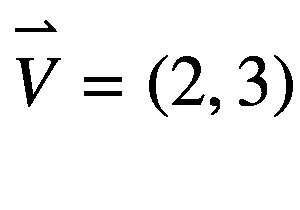：归一化分量向量 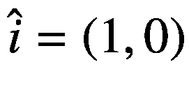 和 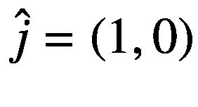 将向量  分解为分量 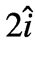 和 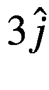。 的分解](images/334805_2_En_6_Chapter/334805_2_En_6_Fig18_HTML.png)

图 6-18 ¶ 向量  的分解

一般来说，如图 6-19 所示，给定归一化的垂直分量向量  和  以及任意向量 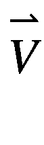，以下公式始终成立： 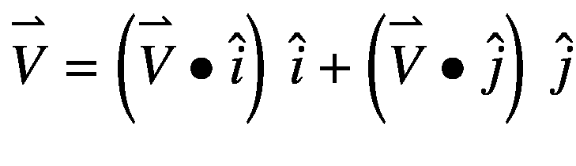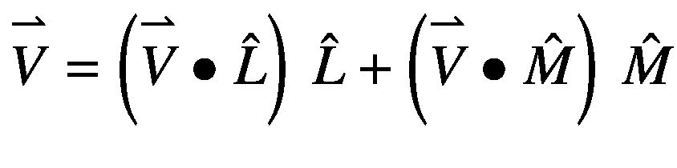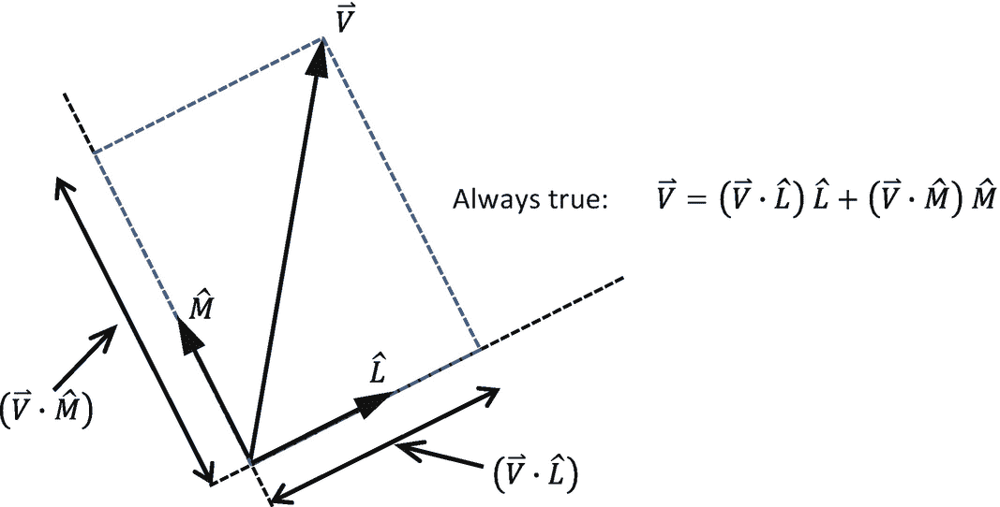

图 6-19 ¶ 通过两个归一化分量向量分解向量

向量分解与此项目相关，因为涉及旋转的图像轴。如果没有旋转，图像可以通过沿默认 x 轴  和 y 轴 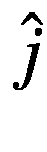 的熟悉的归一化垂直向量集来引用。你在上一个项目中处理了这种情况。你可以在图 6-20 中看到一个示例。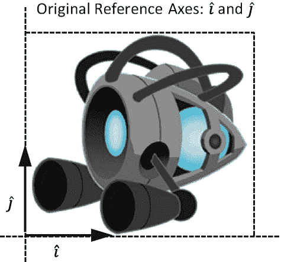

图 6-20 ¶ 轴对齐的纹理

然而，图像旋转后，参考向量集不再位于 x/y 轴上。因此，碰撞计算必须考虑新旋转的轴  和 ，如图 6-21 所示。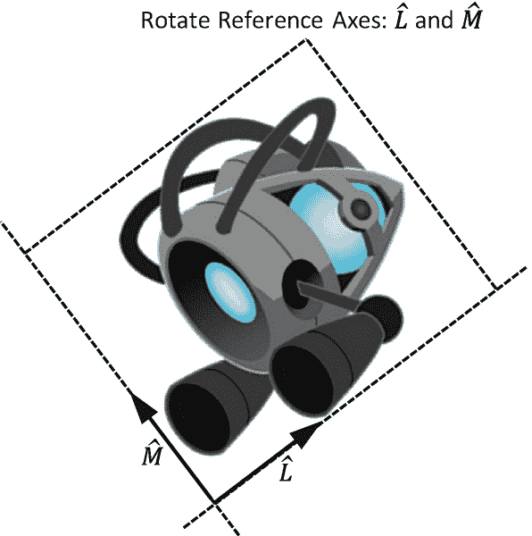

图 6-21 ¶ 旋转纹理及其分量向量

## 广义像素碰撞项目

该项目演示了如何以逐像素精度检测两个旋转的`TextureRenderable`对象之间的碰撞。与上一个项目类似，一个黄色的`DyePack`对象（作为测试确认）将显示在检测到的碰撞位置。你可以在图 6-22 中看到该项目运行的示例。该项目的源代码定义在`chapter6/6.5.general_pixel_collisions`文件夹中。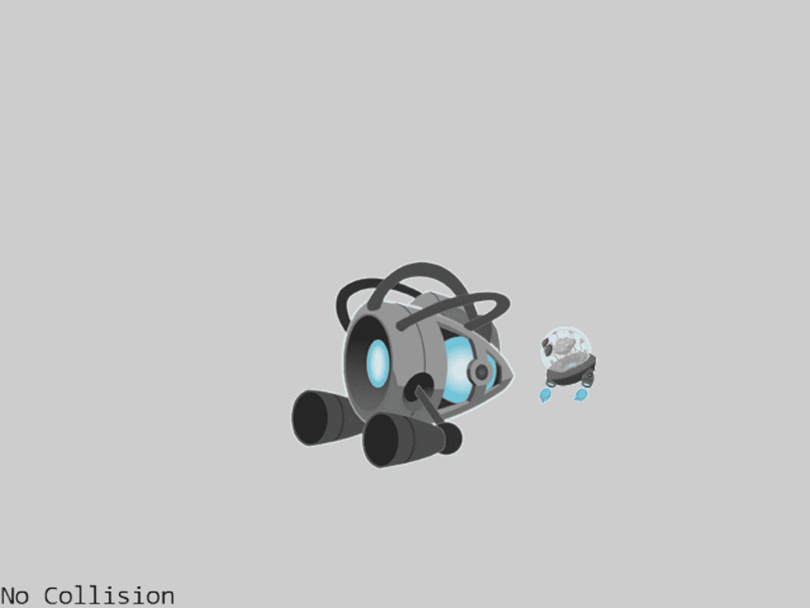

图 6-22 ¶ 运行广义像素碰撞项目

该项目的控制方式如下：

*   `Arrow keys`：移动小型纹理对象，即`Portal`爪牙
*   `P key`：旋转小型纹理对象，即`Portal`爪牙
*   `WASD keys`：移动大型纹理对象，即`Collector`爪牙
*   `E key`：旋转大型纹理对象，即`Collector`爪牙

该项目的目标如下：

*   通过向量分解访问旋转图像的像素
*   支持两个旋转纹理对象之间的逐像素精确碰撞检测


您可以在 `assets` 文件夹中找到与上一个项目相同的外部资源文件。

## 修改像素碰撞以支持旋转

### 步骤 1

编辑 `texture_renderable_pixel_collision.js` 文件并修改 `_indexToWCPosition()` 函数：

```javascript
TextureRenderable.prototype._indexToWCPosition = function (returnWCPos, i, j, xDir, yDir) {
    let x = i * this.mXform.getWidth() / this.mElmWidthPixels;
    let y = j * this.mXform.getHeight() / this.mElmHeightPixels;
    let xDisp = x - (this.mXform.getWidth() * 0.5);
    let yDisp = y - (this.mXform.getHeight() * 0.5);
    let xDirDisp = [];
    let yDirDisp = [];
    vec2.scale(xDirDisp, xDir, xDisp);
    vec2.scale(yDirDisp, yDir, yDisp);
    vec2.add(returnWCPos, this.mXform.getPosition(), xDirDisp);
    vec2.add(returnWCPos, returnWCPos, yDirDisp);
}
```

在上述代码中，`xDir` 和 `yDir` 是 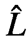 和 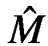 归一化分量向量。变量 `xDisp` 和 `yDisp` 分别是沿 `xDir` 和 `yDir` 偏移的位移量。返回值 `returnWCPos` 是从物体中心位置沿 `xDirDisp` 和 `yDirDisp` 向量的简单位移。注意 `xDirDisp` 和 `yDirDisp` 是缩放后的 `xDir` 和 `yDir` 向量。

### 步骤 2

以类似的方式，修改 `_wcPositionToIndex()` 函数以支持旋转后的归一化向量分量：

```javascript
TextureRenderable.prototype._wcPositionToIndex = function (returnIndex, wcPos, xDir, yDir) {
    // 使用 wcPos 计算对应的 returnIndex[0 和 1]
    let delta = [];
    vec2.sub(delta, wcPos, this.mXform.getPosition());
    let xDisp = vec2.dot(delta, xDir);
    let yDisp = vec2.dot(delta, yDir);
    returnIndex[0] = this.mElmWidthPixels *
                     (xDisp / this.mXform.getWidth());
    returnIndex[1] = this.mElmHeightPixels *
                     (yDisp / this.mXform.getHeight());
    // 回想一下 xForm.getPosition() 返回中心，但
    // 纹理原点位于左下角！
    returnIndex[0] += this.mElmWidthPixels / 2;
    returnIndex[1] += this.mElmHeightPixels / 2;
    returnIndex[0] = Math.floor(returnIndex[0]);
    returnIndex[1] = Math.floor(returnIndex[1]);
}
```

### 步骤 3

`pixelTouches()` 函数需要修改以计算旋转后的归一化分量向量：

```javascript
TextureRenderable.prototype.pixelTouches = function (other, wcTouchPos) {
    let pixelTouch = false;
    let xIndex = 0, yIndex;
    let otherIndex = [0, 0];
    let xDir = [1, 0];
    let yDir = [0, 1];
    let otherXDir = [1, 0];
    let otherYDir = [0, 1];
    vec2.rotate(xDir, xDir, this.mXform.getRotationInRad());
    vec2.rotate(yDir, yDir, this.mXform.getRotationInRad());
    vec2.rotate(otherXDir, otherXDir, other.mXform.getRotationInRad());
    vec2.rotate(otherYDir, otherYDir, other.mXform.getRotationInRad());
    while ((!pixelTouch) && (xIndex < this.mElmWidthPixels)) {
        yIndex = 0;
        while ((!pixelTouch) && (yIndex < this.mElmHeightPixels)) {
            if (this._pixelAlphaValue(xIndex, yIndex) > 0) {
                this._indexToWCPosition(wcTouchPos,
                                        xIndex, yIndex, xDir, yDir);
                other._wcPositionToIndex(otherIndex, wcTouchPos,
                                         otherXDir, otherYDir);
                if ((otherIndex[0] >= 0) &&
                    (otherIndex[0] < other.mElmWidthPixels) &&
                    (otherIndex[1] >= 0) &&
                    (otherIndex[1] < other.mElmHeightPixels)) {
                    pixelTouch = other._pixelAlphaValue(
                                     otherIndex[0], otherIndex[1]) > 0;
                }
            }
            yIndex++;
        }
        xIndex++;
    }
    return pixelTouch;
}
```

变量 `xDir` 和 `yDir` 是此 `TextureRenderable` 对象旋转后的归一化分量向量  和 ，而 `otherXDir` 和 `otherYDir` 是碰撞对象的相应向量。这些向量用作从纹理索引到世界坐标（WC）以及从世界坐标到纹理索引变换计算的参考。

## 修改 GameObject 以支持旋转

回想一下，`GameObject` 类首先测试两个对象之间的包围盒碰撞，然后才会调用开销大得多的逐像素碰撞计算。如图 6-14 所示，`BoundingBox` 对象不能正确支持对象旋转，以下代码弥补了这一缺陷：

```javascript
pixelTouches(otherObj, wcTouchPos) {
    // 仅当两个对象都定义了 getColorArray 时才继续
    // 如果已定义，应具备其他纹理相交支持！
    let pixelTouch = false;
    let myRen = this.getRenderable();
    let otherRen = otherObj.getRenderable();
    if ((typeof myRen.pixelTouches === "function") &&
        (typeof otherRen.pixelTouches === "function")) {
        if ((myRen.getXform().getRotationInRad() === 0) &&
            (otherRen.getXform().getRotationInRad() === 0)) {
            // 无旋转，可以使用包围盒...
            let otherBbox = otherObj.getBBox();
            if (otherBbox.intersectsBound(this.getBBox())) {
                myRen.setColorArray();
                otherRen.setColorArray();
                pixelTouch = myRen.pixelTouches(otherRen, wcTouchPos);
            }
        } else {
            // 一个或两个都旋转了，使用斜边作为半径计算包含圆
            let mySize = myRen.getXform().getSize();
            let otherSize = otherRen.getXform().getSize();
            let myR = Math.sqrt(0.5*mySize[0]*0.5*mySize[0] +
                                0.5*mySize[1]*0.5*mySize[1]);
            let otherR = Math.sqrt(0.5*otherSize[0]*0.5*otherSize[0] +
                                   0.5*otherSize[1]*0.5*otherSize[1]);
            let d = [];
            vec2.sub(d, myRen.getXform().getPosition(),
                     otherRen.getXform().getPosition());
            if (vec2.length(d) < (myR + otherR)) {
                myRen.setColorArray();
                otherRen.setColorArray();
                pixelTouch = myRen.pixelTouches(otherRen, wcTouchPos);
            }
        }
    }
    return pixelTouch;
}
```

上述代码显示，如果碰撞对象中有任何一个发生了旋转，则使用两个包含圆来判断对象是否足够接近以进行昂贵的逐像素碰撞计算。这两个圆的半径等于相应 `TextureRenderable` 对象 x/y 尺寸的斜边。仅当这两个圆之间的距离小于半径之和时，才会调用逐像素碰撞检测。

## 测试广义逐像素碰撞

测试旋转 `TextureRenderable` 对象的代码基本上与上一个项目相同，只是增加了两个用于旋转的控制。实现细节不再展示。您现在可以运行项目，旋转这两个对象，并观察准确的碰撞结果。

## 精灵的逐像素碰撞

上一个项目隐含假设 `Renderable` 对象完全被整个纹理贴图覆盖。这一假设意味着逐像素碰撞实现不支持精灵或动画精灵对象。在本节中，您将弥补这一缺陷。

### 精灵像素碰撞项目


本项目演示了如何在屏幕上移动动画精灵对象，并与其他对象执行逐像素碰撞检测。项目测试 `TextureRenderable`、`SpriteRenderable` 和 `SpriteAnimateRenderable` 对象之间碰撞的正确性。您可以在图 6-23 中看到该项目运行的示例。该项目的源代码定义在 `chapter6/6.6.sprite_pixel_collisions` 文件夹中。

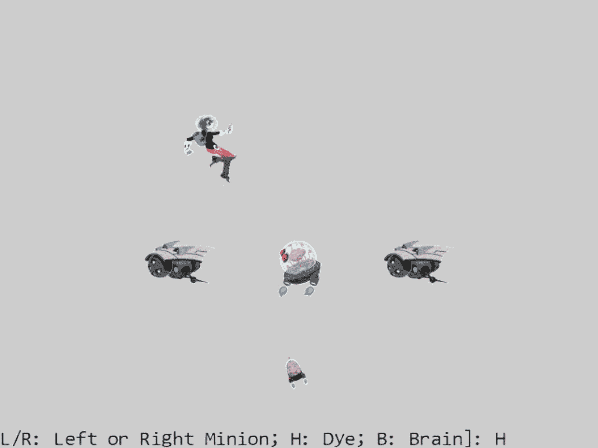

**图 6-23** ¶ 运行精灵像素碰撞项目

项目控制方式如下：

*   **`Arrow` 和 `P` 键**：移动和旋转传送门爪牙
*   **`WASD` 键**：移动英雄
*   **`L`、`R`、`H`、`B` 键**：选择与传送门爪牙碰撞的目标

项目目标如下：

*   为精灵和动画精灵对象概括逐像素碰撞实现

您可以在 `assets` 文件夹中找到以下外部资源文件：包含默认系统字体的 `fonts` 文件夹、`minion_sprite.png` 和 `minion_portal.png`。

### 为 SpriteRenderable 实现逐像素碰撞

编辑 `sprite_renderable.js` 以实现 `SpriteRenderable` 对象的逐像素专用支持：

1.  修改 `SpriteRenderable` 构造函数以调用 `_setTexInfo()` 函数来初始化逐像素碰撞参数；该函数在下一步中定义：

```javascript
constructor(myTexture) {
    super(myTexture);
    super._setShader(shaderResources.getSpriteShader());
    // 精灵坐标
    // 纹理坐标边界（0 为左，1 为右）
    this.mElmLeft = 0.0;
    this.mElmRight = 1.0;
    this.mElmTop = 1.0;   // 1 为图像顶部，0 为底部
    this.mElmBottom = 0.0;
    // 设置信息以支持逐像素碰撞
    this._setTexInfo();
}
```

2.  定义 `_setTexInfo()` 函数以覆盖 `TextureRenderable` 超类中定义的实例变量。实例变量现在标识当前活动的精灵元素，而不是整个纹理图像。

```javascript
_setTexInfo() {
    let imageW = this.mTextureInfo.mWidth;
    let imageH = this.mTextureInfo.mHeight;
    this.mElmLeftIndex = this.mElmLeft * imageW;
    this.mElmBottomIndex = this.mElmBottom * imageH;
    this.mElmWidthPixels = ((this.mElmRight - this.mElmLeft) * imageW) + 1;
    this.mElmHeightPixels = ((this.mElmTop - this.mElmBottom) * imageH) + 1;
}
```

请注意，`mElmWidthPixel` 和 `mElmHeightPixel` 现在包含对应于精灵表中单个精灵元素尺寸的像素值，而不是整个纹理贴图的尺寸。

3.  请记得在 `setElementUVCoordinate()` 和 `setElementPixelPositions()` 函数中更新当前精灵元素时调用 `_setTexInfo()` 函数：

```javascript
setElementUVCoordinate(left, right, bottom, top) {
    this.mElmLeft = left;
    this.mElmRight = right;
    this.mElmBottom = bottom;
    this.mElmTop = top;
    this._setTexInfo();
}

setElementPixelPositions(left, right, bottom, top) {
    // 整个图像的宽度、高度
    let imageW = this.mTextureInfo.mWidth;
    let imageH = this.mTextureInfo.mHeight;
    this.mElmLeft = left / imageW;
    this.mElmRight = right / imageW;
    this.mElmBottom = bottom / imageH;
    this.mElmTop = top / imageH;
    this._setTexInfo();
}
```

### 在 TextureRenderable 中支持精灵像素访问

编辑 `texture_renderable_pixel_collision.js` 文件，并修改 `_pixelAlphaValue()` 函数以支持带有精灵元素索引偏移量的像素访问：

```javascript
TextureRenderable.prototype._pixelAlphaValue = function (x, y) {
    y += this.mElmBottomIndex;
    x += this.mElmLeftIndex;
    x = x * 4;
    y = y * 4;
    return this.mColorArray[(y * this.mTextureInfo.mWidth) + x + 3];
}
```

### 在 MyGame 中测试精灵的逐像素碰撞

测试此项目的代码是对之前项目的简单修改，详细信息不再列出。重要的是要注意场景中的不同对象类型。

*   **`Portal minion`（传送门爪牙）**：一个简单的 `TextureRenderable` 对象
*   **`Hero`（英雄）和 `Brain`（大脑）**：`SpriteRenderable` 对象，几何体上显示的纹理是在 `minion_sprite.png` 精灵表中定义的精灵元素
*   **`Left and Right minions`（左爪牙和右爪牙）**：`SpriteAnimateRenderable` 对象，其精灵元素定义在 `minion_sprite.png` 动画精灵表的前两行中

### 观察

您现在可以运行此项目，并观察不同对象类型碰撞产生的正确结果：

1.  尝试移动 `Hero` 对象，观察 `Brain` 对象如何持续寻找并与其碰撞。这是两个 `SpriteRenderable` 对象之间碰撞的情况。
2.  按下 `L`/`R` 键，然后用 `WASD` 键移动 `Portal minion` 与 `Left` 或 `Right minions` 碰撞。请记住，您可以用 `P` 键旋转 `Portal minion`。这是 `TextureRenderable` 和 `SpriteAnimatedRenderable` 对象之间碰撞的情况。
3.  按下 `H` 键，然后移动 `Portal minion` 与 `Hero` 对象碰撞。这是 `TextureRenderable` 和 `SpriteRenderable` 对象之间碰撞的情况。
4.  按下 `B` 键，然后移动 `Portal minion` 与 `Brain` 对象碰撞。这是旋转后的 `TextureRenderable` 和 `SpriteRenderable` 对象之间碰撞的情况。

## 总结

本章向您展示了如何封装游戏中对象的通用行为，并以客户端 `MyGame` 测试关卡中更简单、更有条理的控制逻辑形式，演示了封装的好处。您复习了二维空间中的向量。向量由其方向和大小定义。向量便于描述位移（速度）。您复习了一些基础向量运算，包括向量归一化以及如何计算点积和叉积。您使用这些运算符实现了朝向功能，并创建了指向特定对象和追逐等简单的自主行为。

随着对象行为日益复杂，检测对象碰撞的需求成为了一个显著的缺失。引入了轴对齐包围盒（AABB）作为一种粗略但计算高效的解决方案，用于近似对象碰撞。您学习了逐像素精确碰撞检测算法，并了解到其精确性是以性能为代价的。您现在理解了如何以两种方式减轻计算成本。首先，仅当对象彼此足够接近时（例如当它们的包围盒碰撞时）才调用像素级精确过程。其次，基于分辨率较低的纹理调用像素迭代过程。

在实现像素级精确碰撞时，您从解决轴对齐纹理的基本情况入手。在此实现之后，您又回过头来增加了对旋转纹理之间碰撞检测的支持。最后，您将实现推广以支持精灵元素之间的碰撞。先解决最简单的情况，可以让您测试和观察结果，并有助于定义更高级问题（本例中的旋转和纹理子区域）可能需要的内容。


在本章开始时，您的游戏引擎支持绘制方面有趣的复杂功能，范围涵盖从定义 WC 空间的能力，到使用 Camera 对象查看 WC 空间，再到在对象上绘制视觉上令人愉悦的纹理和动画。然而，当时并没有支持对象行为的基础设施。这一缺陷导致初始化和控制逻辑聚集在客户端层面的实现中。随着本章介绍并实现了对象行为抽象、数学算法和碰撞算法，您的游戏引擎功能现在更加平衡。您游戏引擎的客户端现在拥有封装特定行为和检测碰撞的工具。下一章将重新审视并增强 Camera 对象的功能。您将学习控制和操作 Camera 对象，以及在同一个游戏中使用多个 Camera 对象。

## 游戏设计考量

第 1 至 5 章介绍了在屏幕上绘制、移动和为对象添加动画的基础技术。第 4 章的 *Scene Objects*（场景对象）项目描述了一种简单的交互行为，并向您展示了如何根据矩形的位置更改游戏画面：回想一下，将矩形移动到左边界会导致关卡在视觉上发生变化，而 *Audio Support*（音频支持）项目则添加了情境音效以增强整体的临场感。虽然仅使用第 1 至 5 章的元素就可以构建一个引人入胜（尽管简单）的益智游戏，但当您能够整合对象检测和碰撞触发器时，事情会变得有趣得多；这些行为构成了许多常见游戏机制的基础，并提供了设计各种有趣游戏场景的机会。

从 *Game Objects*（游戏对象）项目开始，您可以看到屏幕元素如何开始协同工作以传达游戏背景；即使该项目中的交互仅限于角色移动，背景设定也开始呈现出一种传达场所感的雏形。主角角色似乎正飞越一个由许多机械机器人组成的移动场景，屏幕中心有一个小物体，您可以想象它可能会变成某种特殊的拾取物。

即使在开发的这个基本阶段，也可以头脑风暴潜在的游戏机制，这些机制可能构成完整游戏的基础。如果您仅基于 *Game Objects* 项目中发现的屏幕元素设计一个简单的游戏机制，您会选择什么样的行为，要求玩家执行什么样的动作？举个例子，假设主角角色必须避免与飞行机器人碰撞，也许有些机器人会检测并追逐主角试图阻止玩家的进度；也许主角一旦接触机器人就会受到某种惩罚。再假设屏幕中心的小物体允许主角在一段固定时间内无敌，而我们设计关卡要求临时无敌才能到达终点，从而创造一个更复杂、更有趣的游戏循环（例如，避开追逐的机器人以到达道具，激活道具获得临时无敌，利用无敌状态到达终点）。仅凭这些基本交互，我们就为探索机制和关卡设计打开了大门，这些设计会让人感觉非常熟悉，源自许多不同类型的游戏，而所有这些仅靠第 6 章涵盖的对象检测、追逐和碰撞行为即可实现。请使用 *Game Objects* 项目中显示的元素亲自尝试这个设计练习：您可能会设计什么样的简单条件和行为来使您的体验独一无二？您能想出多少种利用屏幕中心小物体的方法？第 12 章的最终设计项目将更详细地探讨这些主题。

这也是一个很好的机会，针对第 1 章讨论的其他九个游戏设计要素进行头脑风暴。如果游戏背景不是太空机器人呢？也许背景设定在森林、水下，甚至是完全抽象的东西。您如何融入音频以增强临场感并强化游戏背景？您可能会对自己想出的各种背景和场景感到惊讶。将自己限制在第 6 章涵盖的元素和交互中，实际上是一个有益的练习，因为设计约束通常能通过塑造和引导您的想法来帮助创作过程。即使是最先进的视频游戏，通常也以一套相当基础的核心游戏循环为基础。

*Vectors: Front and Chase*（矢量：前向与追逐）项目从游戏机制和临场感两个角度来看都很有趣。当然，许多游戏要求游戏世界中的对象检测主角角色，并会追逐或试图躲避玩家（如果对象有多种状态，甚至两者兼有）。该项目还演示了两种不同的追逐行为方法：瞬间追逐和平滑追逐，游戏背景通常会影响您选择实现哪种行为。在瞬间追逐和平滑追逐之间的选择，是微妙行为如何显著影响临场感的一个绝佳例子。例如，如果您设计的是一艘船在海洋上互动的游戏，您可能希望它们的追逐行为考虑现实世界的惯性和动量，因为船无法瞬间转向并响应运动变化；相反，它们平稳、逐渐地移动，表现出响应移动目标速度的明显延迟。物理世界中的大多数对象都会在一定程度上表现出相同的惯性和动量约束，但也存在一些情况，您可能希望游戏对象直接响应路径变化（或者，您可能想故意违背现实物理，创建一种不基于物理对象限制的行为）。关键是始终对您的设计选择保持深思熟虑，并记住几乎没有任何实现细节是微不足道到不会被玩家注意到的。

*Bounding Box and Collisions*（包围盒与碰撞）项目为您的设计武器库引入了关键的检测元素，允许您开始包含更健壮的因果机制，这些机制构成了许多游戏交互的基础。第 6 章讨论了在精度较低但性能更好的包围盒碰撞检测方法与精确但资源密集的逐像素检测方法之间进行选择的权衡。在许多情况下，包围盒方法已足够，但如果玩家认为碰撞是随意的，因为包围盒与实际视觉对象差异太大，这会对临场感产生负面影响。当结合 *Per-Pixel Collisions*（逐像素碰撞）项目的结果时，检测和碰撞将成为更强大的设计工具。虽然本例中的染料包用于指示首个碰撞点，但您可以想象围绕两个对象碰撞产生新对象来构建有趣的因果链（例如，玩家追逐对象，玩家与对象碰撞，对象“掉落”一个新对象，使玩家能够做以前做不到的事）。在游戏屏幕上移动的游戏对象通常都会有动画，因此 *Sprite Pixel Collisions*（精灵像素碰撞）项目描述了如何在对象边界不固定的情况下实现碰撞检测。


随着第 6 章技术的加入，你现在拥有了一组关键量级的行为，它们可以组合创造出真正有趣的游戏机制，涵盖从动作游戏到益智游戏的全谱系。当然，游戏机制行为只是游戏设计九大要素之一，通常单靠它们不足以创造出神奇的游戏体验：背景设定、视觉风格、元游戏元素等都有重要贡献。好消息是，创造难忘的游戏体验不必像你通常认为的那样复杂精细，基于第 1 至 6 章涵盖的行为和技术的相对基础组合，依然能制作出伟大的游戏。最耀眼的游戏并不总是最复杂的，而是往往那些设计九大要素的每个方面都经过深思熟虑、和谐共处的游戏。如果你对游戏设计的各个方面给予适当的关注和专注，无论你是独自开发还是身处大型团队，你都已踏上制作佳作的正轨。

© The Author(s), under exclusive license to APress Media, LLC, part of Springer Nature 2022 K. Sung et al. *Build Your Own 2D Game Engine and Create Great Web Games* [`doi.org/10.1007/978-1-4842-7377-7_7`](https://doi.org/10.1007/978-1-4842-7377-7_7) Begin Abstract
