# 7. 操控摄像机

Kelvin Sung^(1), Jebediah Pavleas^(2), Matthew Munson^(3) and Jason Pace^(4) (1) Bothell, WA, USA (2) Kenmore, WA, USA (3) Lake Forest Park, WA, USA (4) Portland, OR, USA

End Abstract

完成本章后，你将能够：

*   实现操控 `Camera`（摄像机）时常用的操作
*   在旧值和新值之间插值以创建平滑过渡
*   理解某些运动或行为如何用简单的数学公式描述
*   构建具有多摄像机视图的游戏
*   将鼠标点击的像素位置转换为 `World Coordinate (WC)`（世界坐标）位置
*   在具有多摄像机的游戏环境中编程处理鼠标输入

## 简介

你的游戏引擎现在能够表示和绘制对象。有了上一章介绍的基本抽象机制，引擎还能支持这些对象的交互和行为。本章将关注点重新聚焦于控制和交互 `Camera` 对象，该对象抽象并促进了游戏对象在画布上的呈现。这样，你的游戏引擎将能够控制和操控具有良好结构行为的视觉吸引力游戏对象的呈现。

图 7-1 简要回顾了第 3 章介绍的 `Camera` 对象抽象。`Camera` 对象允许游戏程序员定义要显示在 HTML 画布 `viewport`（视口）中的游戏世界的 `World Coordinate (WC)`（世界坐标）窗口。`WC window` 由 `WC center` 和 `W_wc × H_wc` 的尺寸定义边界。`viewport` 是 HTML 画布上的一个矩形区域，其左下角位于 (`V_x`, `V_y`)，尺寸为 `W_v × H_v`。`Camera` 对象的 `setViewAndCameraMatrix()` 函数封装了细节，使得位于 `WC window bounds`（世界坐标窗口边界）内的所有游戏对象的绘制能够显示在相应的 `viewport` 中。 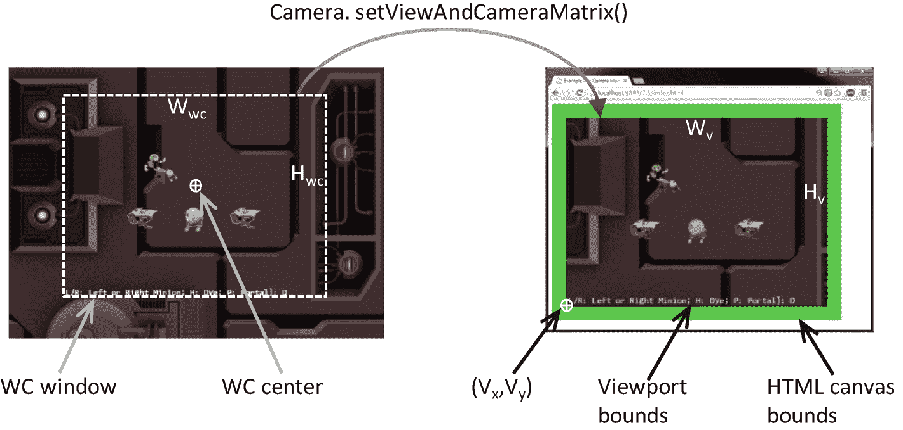

Figure 7-1 ¶ Review of WC parameters that define a Camera object

> **Note**
>
> 在本书中，`WC window` 或 `WC bounds` 均用于指代 `WC window bounds`。

`Camera` 对象抽象让游戏程序员能够忽略 `WC bounds` 和 HTML 画布的细节，专注于设计有趣且娱乐性的游戏体验。在游戏关卡中使用 `Camera` 对象编程，应反映现实世界中使用实体摄像机的方式。例如，你可能想平移摄像机向观众展示环境，可能想将摄像机固定在女演员身上与观众分享她的旅程，或者你可能想扮演导演，指示场景中的演员保持在摄像机的视觉范围内。这些例子的显著特征，如平移或跟随角色视角，是高层功能规格。注意，在现实世界中，你不需要指定坐标位置或窗口边界。

本章介绍一些最常见的摄像机操控操作，包括限制、平移和缩放。将推导以插值形式呈现的解决方案，以缓解摄像机操控导致的恼人或困惑的突兀过渡。你还将学习在同一游戏关卡中支持多摄像机视图以及处理鼠标输入。

## 摄像机操控

在 2D 世界中，你可能希望将对象的移动限制在 `Camera` 的边界内，或者平移 `Camera`，又或者向特定区域缩放 `Camera` 或拉远 `Camera`。这些高层功能规格可以通过策略性地更改 `Camera` 对象的参数来实现：`WC center` 和 `WC window` 的 `W_wc × H_wc`。关键在于为游戏开发者创建方便的函数，以便在游戏上下文中操控这些值。例如，不用直接增加/减少 `WC window` 的宽度/高度，而是可以为程序员定义 `zoom functions`（缩放函数）。

### 摄像机操控项目

该项目演示了如何通过操作 `Camera` 对象的 `WC center`、宽度和高度来实现直观的摄像机操控操作。你可以在图 7-2 中看到该项目运行的示例。该项目的源代码定义在 `chapter7/7.1.camera_manipulations` 文件夹中。 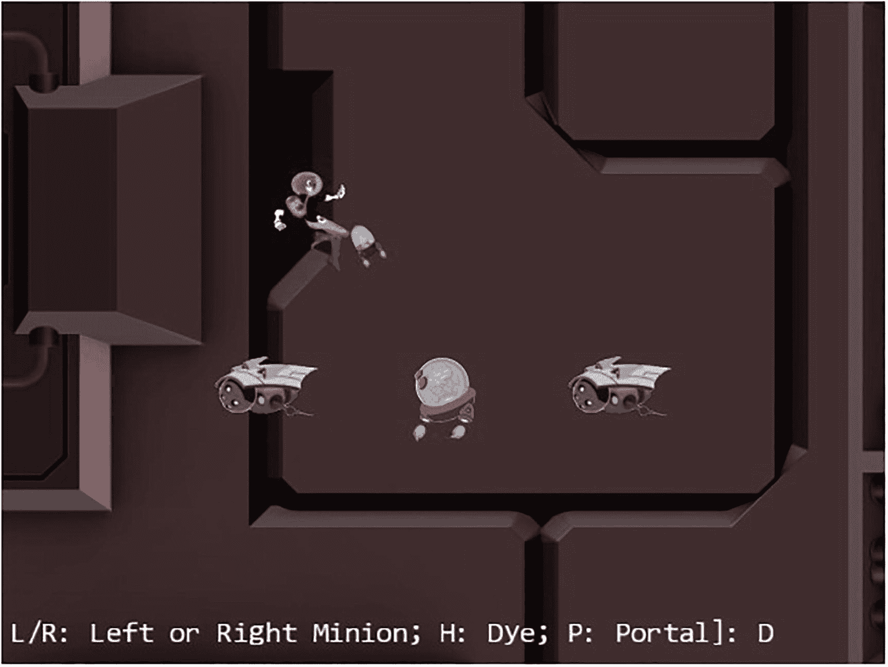

Figure 7-2 ¶ Running the Camera Manipulations project

项目控制如下：

*   `WASD keys`：移动 Dye 角色（`Hero object` 主角对象）。注意当 `Hero object` 尝试移动超出 `WC bounds` 的 90% 时，`Camera WC window` 会更新以跟随 `Hero object`。
*   `Arrow keys`：移动 `Portal object`（传送门对象）。注意 `Portal object` 无法移动超出 `WC bounds` 的 80%。
*   `L/R/P/H keys`：选择 `Left minion`（左侧小兵）、`Right minion`（右侧小兵）、`Portal object` 或 `Hero object` 作为聚焦对象；`L/R keys` 还会将 `Camera` 中心设置在 `Left minion` 或 `Right minion` 上。
*   `N/M keys`：向 `Camera` 中心缩放或拉远。
*   `J/K keys`：缩放或拉远，同时确保当前聚焦对象的相对位置保持不变。换句话说，随着 `Camera` 缩放，所有对象的位置都会改变，除了聚焦对象的位置。

项目目标如下：

*   体验一些常见的摄像机操控操作
*   理解从操控操作到必须修改的相应摄像机参数值的映射
*   实现摄像机操控操作


你可以在 `assets` 文件夹中找到以下外部资源：包含默认系统字体的 `fonts` 文件夹以及三张纹理图片（`minion_portal.png`、`minion_sprite.png` 和 `bg.png`）。`Portal` 对象由第一张纹理图片表示，其余对象是 `minion_sprite.png` 的精灵元素，背景是一个使用 `bg.png` 进行纹理映射的大型 `TextureRenderable` 对象。

## 整理源代码

为了适应功能的增加和 `Camera` 类的复杂性，你将创建一个单独的文件夹来存储相关的源代码文件。这类似于将复杂的 `TextureRenderable` 源代码分割到多个文件中的情况，在本项目中，`Camera` 类的实现将被分离到三个文件中。

*   `camera_main.js` 用于实现来自先前项目的基本功能
*   `camera_manipulation.js` 用于支持新引入的操纵操作
*   `camera.js` 用作类访问点

实现步骤如下：

1.  在 `src/engine` 中创建一个名为 `cameras` 的新文件夹。将 `camera.js` 文件移动到此文件夹并将其重命名为 `camera_main.js`。
2.  在 `src/engine/cameras` 中创建一个新文件并将其命名为 `camera_manipulation.js`。此文件将用于扩展 `Camera` 类的功能以支持操纵。添加以下代码以导入和导出基本的 `Camera` 类功能。目前，此文件不包含任何有用的源代码，因此不起任何作用。你将在下一小节中定义适当的扩展函数。

```javascript
import Camera from "./camera_main.js"; // new functionality to be defined here in the next subsection
export default Camera;
```

3.  创建一个新的 `camera.js` 作为 `Camera` 访问点，方法是添加以下代码：

```javascript
import Camera from "./camera_manipulation.js";
export default Camera;
```

采用这种源代码文件结构，`camera_main.js` 实现所有基本功能并导出到 `camera_manipulation.js`，后者为 `Camera` 类定义额外功能。最后，`camera.js` 从 `camera_manipulation.js` 导入扩展函数。`Camera` 类的用户只需从 `camera.js` 导入即可访问所有定义的功能。这使得 `camera.js` 能够作为 `Camera` 类的访问点，同时隐藏实现源代码结构的细节。

## 支持钳制到摄像机世界坐标边界

编辑 `camera_main.js` 以导入包围盒功能并定义一个函数，将与 `Transform` 对象关联的边界钳制到摄像机世界坐标边界：

```javascript
import * as glSys from "../core/gl.js";
import BoundingBox from "../bounding_box.js";
import { eBoundCollideStatus } from "../bounding_box.js";
// ... identical to previous code ...
clampAtBoundary(aXform, zone) {
    let status = this.collideWCBound(aXform, zone);
    if (status !== eBoundCollideStatus.eInside) {
        let pos = aXform.getPosition();
        if ((status & eBoundCollideStatus.eCollideTop) !== 0) {
            pos[1] = (this.getWCCenter())[1] +
                (zone * this.getWCHeight() / 2) -
                (aXform.getHeight() / 2);
        }
        if ((status & eBoundCollideStatus.eCollideBottom) !== 0) {
            pos[1] = (this.getWCCenter())[1] -
                (zone * this.getWCHeight() / 2) +
                (aXform.getHeight() / 2);
        }
        if ((status & eBoundCollideStatus.eCollideRight) !== 0) {
            pos[0] = (this.getWCCenter())[0] +
                (zone * this.getWCWidth() / 2) -
                (aXform.getWidth() / 2);
        }
        if ((status & eBoundCollideStatus.eCollideLeft) !== 0) {
            pos[0] = (this.getWCCenter())[0] -
                (zone * this.getWCWidth() / 2) +
                (aXform.getWidth() / 2);
        }
    }
    return status;
}
```

`aXform` 对象可以是 `GameObject` 或 `Renderable` 对象的 `Transform`。`clampAtBoundary()` 函数通过钳制 `aXform` 位置，确保 `aXform` 的边界保持在摄像机的世界坐标边界内。`zone` 变量定义了世界坐标边界的钳制百分比。例如，`1.0` 意味着钳制到精确的世界坐标边界，而 `0.9` 意味着钳制到当前世界坐标窗口大小 90% 的边界。重要的是要注意，`clampAtBoundary()` 函数仅作用于与摄像机世界坐标边界碰撞的边界。例如，如果 `aXform` 对象的边界完全在摄像机世界坐标边界之外，它将保持在外部。

## 在 `camera_manipulation.js` 文件中定义摄像机操纵操作

回想一下，你已经创建了一个空的 `camera_manipulation.js` 源代码文件。现在你可以编辑此文件并在 `Camera` 类上定义额外的函数来操纵摄像机。

1.  编辑 `camera_manipulation.js`。确保在 `Camera` 类功能的初始导入和最终导出之间添加代码。
2.  导入包围盒碰撞状态，并定义 `panWith()` 函数，根据 `Transform` 对象的边界来平移摄像机。此函数与 `clampAtBoundary()` 函数互补，它不是改变 `aXform` 位置，而是移动摄像机以确保正确包含 `aXform` 边界。与 `clampAtBoundary()` 函数的情况类似，如果 `aXform` 边界完全在测试的世界坐标边界区域之外，摄像机将不会改变。

```javascript
import { eBoundCollideStatus } from "../bounding_box.js";
Camera.prototype.panWith = function (aXform, zone) {
    let status = this.collideWCBound(aXform, zone);
    if (status !== eBoundCollideStatus.eInside) {
        let pos = aXform.getPosition();
        let newC = this.getWCCenter();
        if ((status & eBoundCollideStatus.eCollideTop) !== 0) {
            newC[1] = pos[1] + (aXform.getHeight() / 2) -
                (zone * this.getWCHeight() / 2);
        }
        if ((status & eBoundCollideStatus.eCollideBottom) !== 0) {
            newC[1] = pos[1] - (aXform.getHeight() / 2) +
                (zone * this.getWCHeight() / 2);
        }
        if ((status & eBoundCollideStatus.eCollideRight) !== 0) {
            newC[0] = pos[0] + (aXform.getWidth() / 2) -
                (zone * this.getWCWidth() / 2);
        }
        if ((status & eBoundCollideStatus.eCollideLeft) !== 0) {
            newC[0] = pos[0] - (aXform.getWidth() / 2) +
                (zone * this.getWCWidth() / 2);
        }
    }
}
```

3.  通过向 `Camera` 类原型追加代码，定义摄像机平移函数 `panBy()` 和 `panTo()`。这两个函数通过添加增量或将其移动到新位置来改变摄像机世界坐标中心。

```javascript
Camera.prototype.panBy = function (dx, dy) {
    this.mWCCenter[0] += dx;
    this.mWCCenter[1] += dy;
}
Camera.prototype.panTo = function (cx, cy) {
    this.setWCCenter(cx, cy);
}
```

4.  定义相对于中心或目标位置缩放摄像机的函数：


## 相机缩放函数

```javascript
Camera.prototype.zoomBy = function (zoom) {
    if (zoom > 0) {
        this.setWCWidth(this.getWCWidth() * zoom);
    }
}

Camera.prototype.zoomTowards = function (pos, zoom) {
    let delta = [];
    vec2.sub(delta, pos, this.mWCCenter);
    vec2.scale(delta, delta, zoom - 1);
    vec2.sub(this.mWCCenter, this.mWCCenter, delta);
    this.zoomBy(zoom);
}
```

`zoomBy()` 函数相对于相机中心进行缩放，而 `zoomTowards()` 函数相对于世界坐标位置进行缩放。如果 `zoom` 变量大于 1，WC 窗口尺寸会变大，你将看到更多的世界内容，这一过程我们直观地称为**缩小（zooming out）**。`zoom` 值小于 1 则是**放大（zooming in）**。图 7-3 展示了 `zoom=0.5` 时相对于 WC 中心缩放和相对于 `Hero` 对象位置缩放的结果。

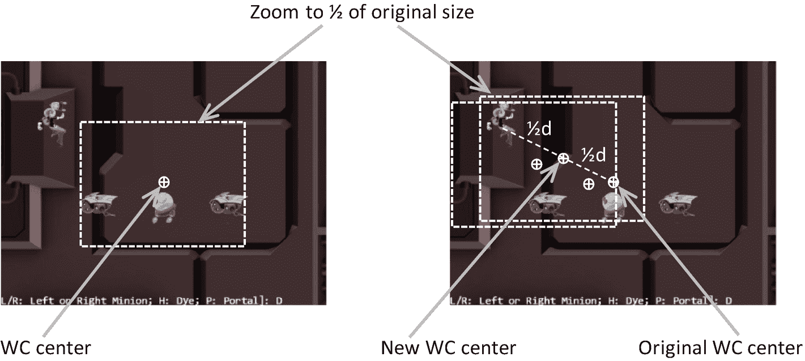

## 在 MyGame 中操控相机

有两个重要功能需要测试：平移和缩放。`MyGame` 类中唯一显著的变化在于 `update()` 函数。`init()`、`load()`、`unload()` 和 `draw()` 函数与之前的项目类似，可在项目源代码中找到。

```javascript
update() {
    let zoomDelta = 0.05;
    let msg = "L/R: Left or Right Minion; H: Dye; P: Portal]: ";
    // ... 更新各对象的代码未显示
    // Brain 追踪 Hero
    let h = [];
    if (!this.mHero.pixelTouches(this.mBrain, h)) {
        this.mBrain.rotateObjPointTo(
            this.mHero.getXform().getPosition(), 0.01);
        engine.GameObject.prototype.update.call(this.mBrain);
    }
    // 平移相机至对象
    if (engine.input.isKeyClicked(engine.input.keys.L)) {
        this.mFocusObj = this.mLMinion;
        this.mChoice = 'L';
        this.mCamera.panTo(this.mLMinion.getXform().getXPos(),
            this.mLMinion.getXform().getYPos());
    }
    if (engine.input.isKeyClicked(engine.input.keys.R)) {
        this.mFocusObj = this.mRMinion;
        this.mChoice = 'R';
        this.mCamera.panTo(this.mRMinion.getXform().getXPos(),
            this.mRMinion.getXform().getYPos());
    }
    if (engine.input.isKeyClicked(engine.input.keys.P)) {
        this.mFocusObj = this.mPortal;
        this.mChoice = 'P';
    }
    if (engine.input.isKeyClicked(engine.input.keys.H)) {
        this.mFocusObj = this.mHero;
        this.mChoice = 'H';
    }
    // 缩放
    if (engine.input.isKeyClicked(engine.input.keys.N)) {
        this.mCamera.zoomBy(1 - zoomDelta);
    }
    if (engine.input.isKeyClicked(engine.input.keys.M)) {
        this.mCamera.zoomBy(1 + zoomDelta);
    }
    if (engine.input.isKeyClicked(engine.input.keys.J)) {
        this.mCamera.zoomTowards(
            this.mFocusObj.getXform().getPosition(),
            1 - zoomDelta);
    }
    if (engine.input.isKeyClicked(engine.input.keys.K)) {
        this.mCamera.zoomTowards(
            this.mFocusObj.getXform().getPosition(),
            1 + zoomDelta);
    }
    // 与 WC 边界交互
    this.mCamera.clampAtBoundary(this.mBrain.getXform(), 0.9);
    this.mCamera.clampAtBoundary(this.mPortal.getXform(), 0.8);
    this.mCamera.panWith(this.mHero.getXform(), 0.9);
    this.mMsg.setText(msg + this.mChoice);
}
```

在上述代码中，前四个 `if` 语句用于选择聚焦对象，其中 `L` 和 `R` 键还会通过使用相应的 WC 位置调用 `panTo()` 函数来将相机重新置中。第二组四个 `if` 语句控制缩放，既可以相对于 WC 中心，也可以相对于当前聚焦对象。随后，函数分别将 `Brain` 和 `Portal` 对象限制在 WC 边界的 90% 和 80% 范围内。函数最后根据 `Hero` 对象的变换（或位置）平移相机而结束。

现在你可以运行项目，并使用 `WASD` 键移动 `Hero` 对象。将 `Hero` 对象移向 WC 边界，观察相机被推动的效果。继续用 `Hero` 对象推动相机；注意由于调用了 `clampAtBoundary()` 函数，`Portal` 对象随之会被推动，从而永远不会离开相机的 WC 边界。现在按 `L`/`R` 键，观察相机中心切换到左侧或右侧 `Minion` 的中心。`N`/`M` 键演示了相对于中心的直接缩放。要体验相对于目标的缩放，将 `Hero` 对象移向画布左上角，然后按 `H` 键将其选为缩放焦点。现在，将鼠标指针指向 `Hero` 对象的头部，你可以先按 `K` 键放大（缩小视野），再按 `J` 键缩小（放大视野）。注意当你缩放时，场景中所有对象的位置都会改变，除了 `Hero` 对象周围的区域。缩放至世界期望区域是游戏开发者一项有用的功能，有着许多应用。你可以体验在缩放进/出 `Hero` 对象的同时移动它。

## 插值

现在可以基于 `pan` 或 `zoom` 等高级函数来操控相机。然而，结果往往是渲染图像发生突然或视觉上不连贯的变化，这可能导致烦躁或困惑。例如，在之前的项目中，`L` 或 `R` 键通过简单地赋予新的 WC 中心值导致相机重新置中。相机位置的突变导致游戏世界突然出现一个看似全新的场景。这不仅在视觉上分散注意力，还会让玩家对发生了什么感到困惑。

当相机参数的新值可用时，与其直接赋值导致突变，不如随着时间的推移逐渐从旧值**插值**到新值。例如，如图 7-4 所示，在时间 *t*[1]，一个具有旧值的参数将被赋予新值。在这种情况下，插值会随时间逐渐改变值，而不是突然更新。它将计算中间结果（值递减），并在稍后时间 *t*[2] 完成向新值的变化。

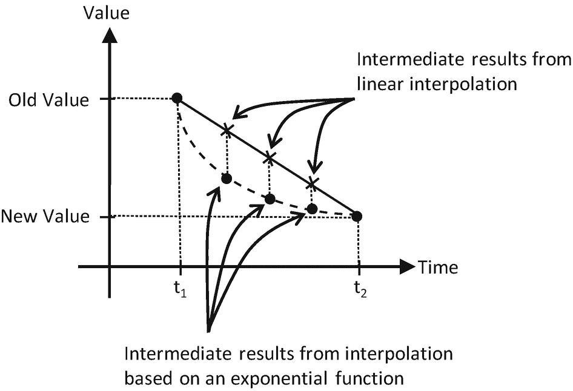

图 7-4 显示了随时间插值的多种方式。例如，线性插值根据连接新旧值的直线斜率计算中间结果。相比之下，指数函数可能根据前值的百分比计算中间结果。这样，使用线性插值时，相机位置会以恒定速度从旧位置移动到新位置，类似于以某个恒定速度移动（或平移）相机。相比之下，基于给定指数函数的插值会使相机位置最初快速移动，随后随时间迅速减速，给人一种移动并聚焦相机到新目标的感觉。


## 相机插值

## 人体运动与指数插值

人体运动和移动通常遵循指数插值函数。例如，尝试将头从面朝前转向面朝右，或者移动手去拿桌上的物体。注意在这两种情况下，你开始时动作相对较快，当接近目的地时会显著减速。也就是说，你可能开始时快速转头，随着视线接近右侧而迅速减速，同样你的手可能开始时快速朝物体移动，当手快要触及物体时显著减速。在这两个例子中，你的位移都遵循图 7-4 所示的指数插值函数，即快速变化后随着接近目的地而迅速减速。这就是你将在游戏引擎中实现的函数，因为它模仿人类运动，对人类玩家来说显得很自然。

> **注意**
>
> 线性插值通常称为 `LERP` 或 `lerp`。lerp 的结果是初始值和最终值的线性组合。在本章中，以及在几乎所有情况下，图 7-4 所示的指数插值都是通过反复应用 `lerp` 函数来近似的，其中每次调用的初始值都是前一次 `lerp` 调用的结果。这样，指数函数就用分段线性函数来近似了。

本节介绍 `Lerp` 和 `LerpVec2` 实用工具类，以支持因相机操作而产生的平滑渐进的相机移动。

## 相机插值项目

该项目演示了来自相机操作的更平滑、视觉上更吸引人的插值结果。你可以在图 7-5 中看到该项目运行的示例。该项目的源代码定义在 `chapter7/7.2.camera_interpolations` 文件夹中。

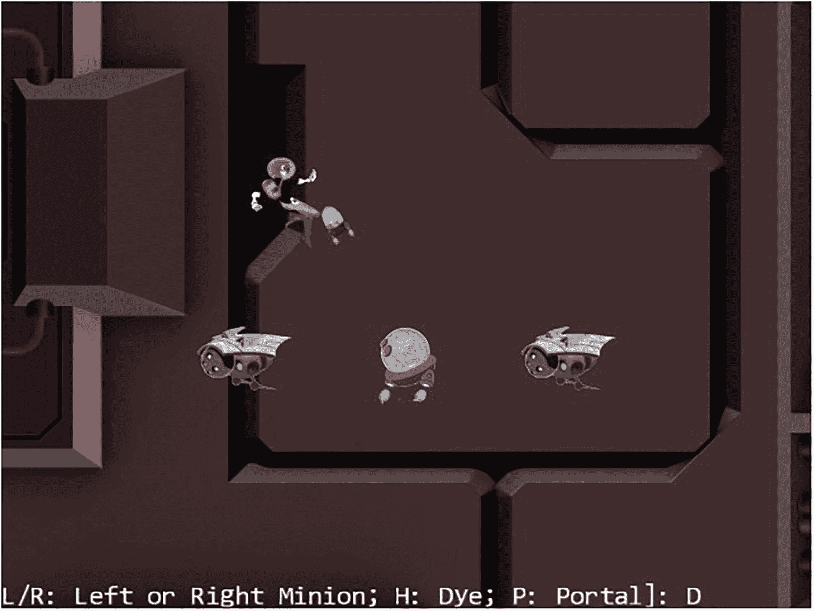

**图 7-5 ¶ 运行相机插值项目**

### 项目控制

该项目的控制与前一个项目相同：

*   **`WASD` 键**：移动 Dye 角色（`Hero` 对象）。注意当 `Hero` 对象试图移出 WC 边界 90% 范围时，相机 WC 窗口会更新以跟随 `Hero` 对象。
*   **方向键**：移动 `Portal` 对象。注意 `Portal` 对象无法移出 WC 边界 80% 范围。
*   **`L`/`R`/`P`/`H` 键**：选择左小兵、右小兵、`Portal` 对象或 `Hero` 对象作为焦点对象。`L`/`R` 键也会设置相机聚焦于左或右小兵。
*   **`N`/`M` 键**：以相机中心为基准放大或缩小。
*   **`J`/`K` 键**：在确保当前焦点对象相对位置不变的情况下放大或缩小。换句话说，随着相机缩放，所有对象的位置都会改变，除了焦点对象。

### 项目目标

项目目标如下：

*   理解给定值之间插值的概念
*   实现支持相机参数渐进变化的插值
*   体验相机参数的插值变化

与前几个项目一样，你可以在 `assets` 文件夹中找到外部资源文件。

### 插值作为实用工具

类似于支持变换功能的 `Transform` 类和支持碰撞检测的 `BoundingBox` 类，可以定义一个 `Lerp` 类来支持值的插值。为了保持源代码有序，应定义一个新文件夹来存放这些实用工具。

创建 `src/engine/utils` 文件夹，并将 `transform.js` 和 `bounding_box.js` 文件移入该文件夹。

#### Lerp 类

定义 `Lerp` 类以计算两个值之间的插值：

1.  **在 `src/engine/utils` 文件夹中创建一个新文件**，命名为 `lerp.js`，并定义构造函数。该类旨在在 `mCycles` 持续时间内将值从 `mCurrentValue` 插值到 `mFinalValue`。在每次更新期间，根据 `mCurrentValue` 和 `mFinalValue` 之差的 `mRate` 增量计算中间结果，如下所示。

```javascript
class Lerp {
    constructor(value, cycles, rate) {
        this.mCurrentValue = value;   // 插值的起始值
        this.mFinalValue = value;     // 插值的最终值
        this.mCycles = cycles;
        this.mRate = rate;
        // 插值剩余的周期数
        this.mCyclesLeft = 0;
    }
    ... 后续实现 ...
}
```

2.  **定义计算中间结果的函数：**

```javascript
// 子类应重写此函数以处理非标量值
_interpolateValue() {
    this.mCurrentValue = this.mCurrentValue + this.mRate *
                         (this.mFinalValue - this.mCurrentValue);
}
```

注意 `_interpolateValue()` 函数计算的结果是在 `mCurrentValue` 和 `mFinalValue` 之间进行线性插值。这样，在每次迭代中 `mCurrentValue` 都会被设置为中间值，随着它接近 `mFinalValue` 的值，从而近似一条指数曲线。

3.  **定义一个配置插值的函数。** `mRate` 变量定义插值结果接近最终值的速度。`mRate` 为 `0.0` 将导致完全没有变化，而 `1.0` 会导致瞬间变化。`mCycle` 变量定义插值过程的持续时间。

```javascript
config(stiffness, duration) {
    this.mRate = stiffness;
    this.mCycles = duration;
}
```

4.  **定义相关的 getter 和 setter 函数。** 注意 `setFinal()` 函数既设置最终值，又触发新一轮插值计算。

```javascript
get() { return this.mCurrentValue; }
setFinal(v) {
    this.mFinalValue = v;
    this.mCyclesLeft = this.mCycles;   // 将触发插值
}
```

5.  **定义触发计算每个中间结果的函数：**

```javascript
update() {
    if (this.mCyclesLeft <= 0) { return; }
    this.mCyclesLeft--;
    if (this.mCyclesLeft === 0) {
        this.mCurrentValue = this.mFinalValue;
    } else {
        this._interpolateValue();
    }
}
```

6.  **最后，确保导出定义的类：**

```javascript
export default Lerp;
```

#### LerpVec2 类

由于许多相机参数都是 `vec2` 对象（例如 WC 中心位置），因此将 `Lerp` 类泛化以支持 `vec2` 对象的插值非常重要：

1.  **在 `src/engine/utils` 文件夹中创建一个新文件**，命名为 `lerp_vec2.js`，并定义其构造函数：

```javascript
class LerpVec2 extends Lerp {
    constructor(value, cycle, rate) {
        super(value, cycle, rate);
    }
    ... 后续实现 ...
}
```

2.  **重写 `_interpolateValue()` 函数** 以计算 `vec2` 的中间结果：

```javascript
_interpolateValue() {
    vec2.lerp(this.mCurrentValue, this.mCurrentValue,
              this.mFinalValue, this.mRate);
}
```

`gl-matrix.js` 文件中定义的 `vec2.lerp()` 函数计算 `vec2` 的 `x` 和 `y` 分量。所涉及的计算与 `Lerp` 类中的 `_interpolateValue()` 函数相同。

最后，记得更新引擎访问文件 `index.js`，将新定义的 `Lerp` 和 `LerpVec2` 功能转发给客户端。

### 使用 CameraState 表示插值中间结果

`Camera` 对象的状态必须泛化以支持插值中间结果的渐进变化。引入 `CameraState` 类来实现这一目的。

1.  **在 `src/engine/cameras` 文件夹中创建一个新文件**，命名为 `camera_state.js`，导入定义的 `Lerp` 功能，并定义构造函数：


## CameraState 类与插值实现

## CameraState 实现

### 构造函数与属性

```javascript
import Lerp from "../utils/lerp.js";
import LerpVec2 from "../utils/lerp_vec2.js";

class CameraState {
    constructor(center, width) {
        this.kCycles = 300;  // 完成过渡所需的周期数
        this.kRate = 0.1;    // 每个周期的变化率
        this.mCenter = new LerpVec2(center, this.kCycles, this.kRate);
        this.mWidth = new Lerp(width, this.kCycles, this.kRate);
    }
    // ... implementation to follow ...
}

export default CameraState;
```

观察可知，`mCenter` 和 `mWidth` 是支持相机平移（改变 `mCenter`）和缩放（改变 `mWidth`）所需的唯一变量。这两个变量都是相应 `Lerp` 类的实例，能够插值并计算中间结果以实现渐变。

### Getter 与 Setter 函数

```javascript
getCenter() { return this.mCenter.get(); }
getWidth() { return this.mWidth.get(); }
setCenter(c) { this.mCenter.setFinal(c); }
setWidth(w) { this.mWidth.setFinal(w); }
```

### Update 函数：触发插值计算

```javascript
update() {
    this.mCenter.update();
    this.mWidth.update();
}
```

### Config 函数：配置插值参数

```javascript
config(stiffness, duration) {
    this.mCenter.config(stiffness, duration);
    this.mWidth.config(stiffness, duration);
}
```

`stiffness` 变量对应 `Lerp` 的 `mRate`。它定义了插值中间结果收敛到最终值的速度。正如 `Lerp` 类定义中所述，这是一个 0 到 1 之间的数值，0 意味着永远不会收敛，1 意味着瞬间收敛。`duration` 变量对应 `Lerp` 的 `mCycle`。它定义了结果收敛所需的更新周期数。这必须是一个正整数。

## 引擎集成说明

随着引擎复杂度的增加，支撑代码的复杂度也随之增加。在此例中，你设计了一个内部工具类 `CameraState`，用于存储 `Camera` 对象的内部状态以支持插值。这是引擎内部操作。游戏程序员无需访问此类，因此引擎入口文件 `index.js` 不应修改以转发该定义。

## 将插值集成到相机操作中

`camera_main.js` 中的 `Camera` 类必须修改为使用新定义的 `CameraState` 来表示世界坐标中心和宽度：

### 1. 导入 CameraState 类

```javascript
import CameraState from "./camera_state.js";
```

### 2. 修改 Camera 构造函数，用 CameraState 实例替换 center 和 width 变量

```javascript
constructor(wcCenter, wcWidth, viewportArray) {
    this.mCameraState = new CameraState(wcCenter, wcWidth);
    // ... identical to previous code ...
}
```

### 3. 编辑 camera_manipulation.js，定义更新和配置 CameraState 插值功能的函数

```javascript
Camera.prototype.update = function () {
    this.mCameraState.update();
}

// LERP 功能配置
Camera.prototype.configLerp = function (stiffness, duration) {
    this.mCameraState.config(stiffness, duration);
}
```

### 4. 修改 panBy() 函数以支持 CameraState 对象

```javascript
Camera.prototype.panBy = function (dx, dy) {
    let newC = vec2.clone(this.getWCCenter());
    newC[0] += dx;
    newC[1] += dy;
    this.mCameraState.setCenter(newC);
}
```

### 5. 更新 panWith() 和 zoomTowards() 函数，接收并设置世界坐标中心到 CameraState 对象

```javascript
Camera.prototype.panWith = function (aXform, zone) {
    let status = this.collideWCBound(aXform, zone);
    if (status !== eBoundCollideStatus.eInside) {
        let pos = aXform.getPosition();
        let newC = vec2.clone(this.getWCCenter());
        if ((status & eBoundCollideStatus.eCollideTop) !== 0)
            // ... identical to previous code ...
        this.mCameraState.setCenter(newC);
    }
}

Camera.prototype.zoomTowards = function (pos, zoom) {
    // ... identical to previous code ...
    this.zoomBy(zoom);
    this.mCameraState.setCenter(newC);
}
```

## 在 MyGame 中测试插值

回顾一下，本项目的用户控制与前一个项目相同。唯一的区别是，在本项目中，你可以期望不同相机设置之间的渐变和顺滑过渡。要观察正确的插值结果，必须在每个游戏场景更新时调用相机的 `update()` 函数。

```javascript
update() {
    let zoomDelta = 0.05;
    let msg = "L/R: Left or Right Minion; H: Dye; P: Portal: ";
    this.mCamera.update();  // 为了更顺滑的相机移动
    // ... identical to previous code ...
}
```

在 `my_game.js` 文件中，调用相机更新以计算插值中间结果是唯一的变更。现在可以运行项目，体验相机操作带来的顺滑渐变效果。注意插值结果不会突变渲染图像，从而在操作命令前后保持空间连续感。你可以尝试修改 `stiffness` 和 `duration` 变量，以更好地体会不同的插值收敛速率。

## 相机抖动与物体振荡效果

在视频游戏中，抖动相机是一种传达事件重要性或威力的便捷方式，例如敌方首领出现或大型物体碰撞。类似于数值插值，相机抖动运动也可以用直观的数学公式建模。

考虑现实生活中相机抖动如何发生。例如，用摄像机拍摄时，假设你被某人或某物碰撞而感到惊吓或受惊。你的反应可能是轻微的定向障碍，随后迅速重新聚焦于原目标。从相机角度看，这种反应可描述为：从原始相机中心的初始大位移，随后快速调整以重新居中。数学上，如图 7-6 所示，阻尼简谐运动可用三角函数的阻尼来表示这类位移。

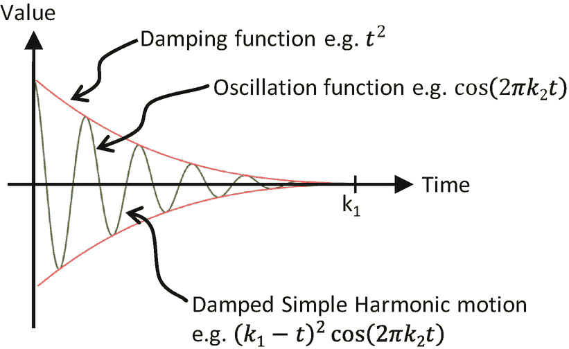

*图 7-6 ¶ 阻尼简谐运动的位移*

注意，纯数学公式精确且完全可预测。此类公式适合描述规律、正常或预期的行为，例如球的弹跳或钟摆的振荡。抖动效果应包含轻微的混沌和不可预测的随机性，例如意外碰撞后端咖啡手的稳定过程，或如前例中受惊后摄像机的稳定过程。基于此推理，本节将定义一个通用的阻尼振荡函数，并注入伪随机性以模拟轻微混沌，从而实现抖动效果。

## 相机抖动与物体振荡项目


### 相机抖动与物体振荡项目

## 项目概述

本项目演示如何实现阻尼简谐运动以模拟物体振荡，并注入伪随机性以创建相机抖动效果。您可以在图 7-7 中看到该项目运行的示例。除了增加了一个用于创建物体振荡和相机抖动效果的命令外，该项目与前一个项目相同。该项目的源代码定义在 `chapter7/7.3.camera_shake_and_object_oscillate` 文件夹中。

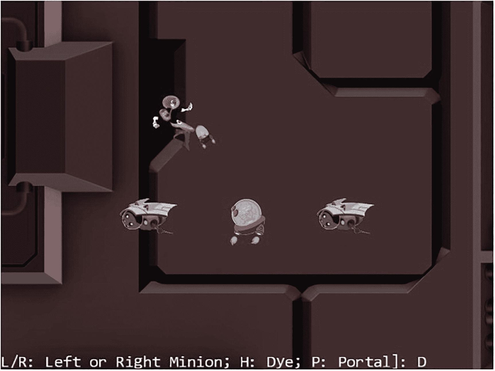

## 控制

### 新增控制

*   **`Q 键`**: 启动 Dye 角色的位置振荡和相机抖动效果。

### 现有控制（与前一个项目相同）

*   **`WASD 键`**: 移动 Dye 角色（即 `Hero` 对象）。请注意，当 `Hero` 对象试图移出 `WC` 边界的 90% 范围时，相机 `WC` 窗口会更新以跟随 `Hero` 对象。
*   **`方向键`**: 移动 `Portal` 对象。请注意，`Portal` 对象无法移出 `WC` 边界的 80% 范围。
*   **`L/R/P/H 键`**: 选择左侧小兵、右侧小兵、`Portal` 对象或 `Hero` 对象作为焦点对象。`L/R` 键还会将相机焦点设置为左侧或右侧小兵。
*   **`N/M 键`**: 以相机中心为基准进行放大或缩小。
*   **`J/K 键`**: 在确保当前焦点对象相对位置不变的情况下进行放大或缩小。换句话说，随着相机缩放，所有物体的位置都会改变，除了焦点对象的位置。

## 目标

项目目标如下：

*   了解如何使用简单的数学函数来建模位移
*   体验物体上的振荡效果
*   体验相机上的抖动效果
*   将振荡实现为阻尼简谐运动，并引入伪随机性以创建相机抖动效果

与前几个项目一样，您可以在 `assets` 文件夹中找到外部资源文件。

## 抽象抖动行为

相机抖动能力是许多游戏中常见且动态的行为。然而，重要的是要认识到抖动行为不仅可以应用于相机。也就是说，抖动效果可以抽象为对数值（如大小、点或位置）的扰动（抖动）。在相机抖动的情况下，被抖动的数值恰好代表相机的 x 和 y 位置。因此，抖动及其相关支持应该是游戏引擎的通用工具函数，以便游戏开发者可以将其应用于任何数值。以下是将要定义的新工具：

*   **`Oscillate`**: 实现数值随时间进行简谐振荡的基类
*   **`Shake`**: `Oscillate` 类的扩展，向振荡幅度引入随机性，以模拟抖动效果在数值上的轻微混乱
*   **`ShakeVec2`**: `Shake` 类的扩展，将 `Shake` 行为扩展到两个数值，如位置

### 创建 Oscillate 类以模拟简谐运动

因为所有描述的行为都依赖于简单振荡，所以应首先实现它。

#### 步骤 1.1：创建 `oscillate.js`

在 `src/engine/utils` 文件夹中创建一个新文件，命名为 `oscillate.js`。定义一个名为 `Oscillate` 的类，并添加以下代码来构造对象：

```javascript
class Oscillate {
    constructor(delta, frequency, duration) {
        this.mMag = delta;
        this.mCycles = duration; // cycles to complete the transition
        this.mOmega = frequency * 2 * Math.PI; // Converts to radians
        this.mNumCyclesLeft = duration;
    }
    ... implementation to follow ...
}
export default Oscillate;
```

`delta` 变量表示阻尼前的初始位移，单位为 `WC` 空间。`frequency` 参数指定振荡程度，值为 1 代表余弦函数的一个完整周期。`duration` 参数定义振荡持续时间，单位为游戏循环更新次数。

#### 步骤 1.2：定义阻尼简谐运动

定义阻尼简谐运动：

```javascript
_nextDampedHarmonic() {
    // computes (Cycles) * cos(Omega * t)
    let frac = this.mNumCyclesLeft / this.mCycles;
    return frac * frac * Math.cos((1 - frac) * this.mOmega);
}
```

请参阅图 7-8。`mNumCyclesLeft` 是振荡剩余的周期数，即 `k-t`，而 `frac` 变量，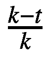，是阻尼因子。该函数返回 -1 到 1 之间的值，可根据需要进行缩放。

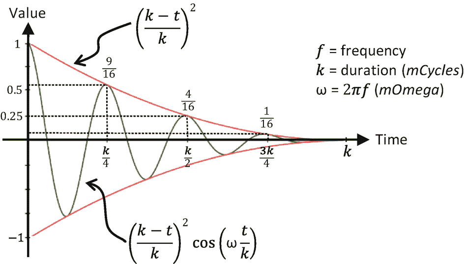

#### 步骤 1.3：定义受保护函数 `_nextValue()`

定义一个受保护函数以获取下一个阻尼谐波运动的值。此函数可能看起来微不足道且没有必要。然而，正如您在下一小节中将看到的，此函数允许 shake 子类覆盖并注入随机性。

```javascript
// local/protected methods
_nextValue() {
    return (this._nextDampedHarmonic());
}
```

#### 步骤 1.4：定义结束检查和重启函数

定义函数以检查振荡是否结束以及重启振荡：

```javascript
done() { return (this.mNumCyclesLeft <= 0); }
reStart() { this.mNumCyclesLeft = this.mCycles; }
```

#### 步骤 1.5：定义公共函数 `getNext()`

最后，定义一个公共函数来触发振荡计算。请注意，计算出的振荡结果必须按所需幅度 `mMag` 进行缩放：

```javascript
getNext() {
    this.mNumCyclesLeft--;
    let v = 0;
    if (!this.done()) {
        v = this._nextValue();
    }
    return (v * this.mMag);
}
```

### 创建 Shake 类以随机化振荡

现在，您可以通过向效果中引入伪随机性来扩展振荡行为，以传达抖动感。

#### 步骤 1.1：创建 `shake.js`

在 `src/engine/utils` 文件夹中创建一个新文件 `shake.js`。定义 `Shake` 类以扩展 `Oscillate`，并添加以下代码来构造对象：

```javascript
import Oscillate from "./oscillate.js";
class Shake extends Oscillate {
    constructor(delta, frequency, duration) {
        super(delta, frequency, duration);
    }
    ... implementation to follow ...
}
export default Shake;
```

#### 步骤 1.2：覆盖 `_nextValue()` 以随机化符号

按如下方式覆盖 `_nextValue()` 以随机化振荡结果的符号。回想一下，`_nextValue()` 函数是从公共 `getNext()` 函数调用的，用于获取振荡值。虽然阻尼简谐振荡的结果在幅度上持续且可预测地减小，但相关值的符号被随机化，导致突然且意外的不连续性，传达出抖动结果的混乱感。

```javascript
_nextValue() {
    let v = this._nextDampedHarmonic();
    let fx = (Math.random() > 0.5) ? -v : v;
    return fx;
}
```

### 创建 ShakeVec2 类以模拟 vec2（即位置）的抖动

现在，您可以将抖动效果推广以支持同时抖动两个值。这是一个有用的工具，因为 2D 游戏中的位置是双值实体，且位置是抖动效果的便利目标。例如，在本项目中，对相机位置（一个双值实体）进行抖动，模拟了相机抖动效果。

`ShakeVec2` 类扩展了 `Shake` 类，以支持对 `vec2` 对象进行抖动，同时抖动 x 和 y 两个维度的值。x 维度的抖动通过 `Shake` 对象的实例支持，而 y 维度则通过超类中定义的 `Shake` 类功能支持。

#### 步骤 1.1


#### 创建 ShakeVec2 类

在 `src/engine/utils` 文件夹下创建新文件 `shake_vec2.js`。定义 `ShakeVec2` 类继承自 `Shake` 类。与 `Shake` 超类的构造函数参数类似，`deltas` 和 `freqs` 参数是二维的，即 `vec2` 版本的 magnitude 和 frequency，用于控制 x 和 y 两个维度的抖动。在构造函数中，`xShake` 实例变量跟踪 x 维度的抖动效果。注意 `super()` 构造函数调用中 y 分量参数、数组索引为 1 的部分。`Shake` 超类跟踪 y 维度的抖动效果。

```javascript
class ShakeVec2 extends Shake {
    constructor(deltas, freqs, duration) {
        super(deltas[1], freqs[1], duration); // super in y-direction
        this.xShake = new Shake(deltas[0], freqs[0], duration);
    }
    ... implementation to follow ...
}
export default ShakeVec2;
```

## 扩展 reStart() 和 getNext() 函数以支持第二维度

```javascript
reStart() {
    super.reStart();
    this.xShake.reStart();
}
getNext() {
    let x = this.xShake.getNext();
    let y = super.getNext();
    return [x, y];
}
```

最后，记得更新引擎访问文件 `index.js`，将新定义的 `Oscillate`、`Shake` 和 `ShakeVec2` 功能转发给客户端。

## 定义 CameraShake 类以抽象相机抖动效果

有了 `ShakeVec2` 类，就可以方便地将伪随机阻尼简谐运动的位移应用到 `Camera` 的位置上。然而，`Camera` 对象需要一个额外的抽象层。

## 1. 创建 camera_shake.js 并定义构造函数

在 `src/engine/cameras` 文件夹下创建新文件 `camera_shake.js`，定义构造函数接收相机状态、state 参数和抖动配置：`deltas`、`freqs` 和 `shakeDuration`。参数 `state` 的数据类型是 `CameraState`，包含相机中心位置和宽度。

```javascript
import ShakeVec2 from "../utils/shake_vec2.js";
class CameraShake {
    // state is the CameraState to be shaken
    constructor(state, deltas, freqs, shakeDuration) {
        this.mOrgCenter = vec2.clone(state.getCenter());
        this.mShakeCenter = vec2.clone(this.mOrgCenter);
        this.mShake = new ShakeVec2(deltas, freqs, shakeDuration);
    }
    ... implementation to follow ...
}
export default CameraShake;
```

## 2. 定义触发位移计算的函数以实现抖动效果

注意抖动结果是相对于原始位置的偏移量。给定的代码将此偏移量加到原始相机中心位置上。

```javascript
update() {
    let delta = this.mShake.getNext();
    vec2.add(this.mShakeCenter, this.mOrgCenter, delta);
}
```

## 3. 定义工具函数：查询抖动是否完成、重启抖动、getter/setter 函数

```javascript
done() { return this.mShake.done(); }
reShake() { this.mShake.reStart(); }
getCenter() { return this.mShakeCenter; }
setRefCenter(c) {
    this.mOrgCenter[0] = c[0];
    this.mOrgCenter[1] = c[1];
}
```

与 `CameraState` 类似，`CameraShake` 也是游戏引擎内部工具，不应导出给客户端游戏程序员。引擎访问文件 `index.js` 不应更新以导出此类。

## 修改 Camera 以支持抖动效果

有了合适的 `CameraShake` 抽象，支持相机抖动仅意味着启动和更新抖动效果。

## 1. 修改 camera_main.js 和 camera_manipulation.js 导入 camera_shake.js

```javascript
import CameraShake from "./camera_shake.js";
```

## 2. 在 camera_main.js 中修改 Camera 构造函数以初始化 CameraShake 对象

```javascript
constructor(wcCenter, wcWidth, viewportArray) {
    this.mCameraState = new CameraState(wcCenter, wcWidth);
    this.mCameraShake = null;
    ... identical to previous code ...
}
```

## 3. 修改 setViewAndCameraMatrix() 函数的步骤 B，如果定义了 CameraShake 对象则使用其 center

```javascript
setViewAndCameraMatrix() {
    ... identical to previous code ...
    // Step B: Compute the Camera Matrix
    let center = [];
    if (this.mCameraShake !== null) {
        center = this.mCameraShake.getCenter();
    } else {
        center = this.getWCCenter();
    }
    ... identical to previous code ...
}
```

## 4. 修改 camera_manipulation.js 文件以添加启动和重启抖动效果的支持

```javascript
Camera.prototype.shake = function (deltas, freqs, duration) {
    this.mCameraShake = new CameraShake(this.mCameraState,
                                        deltas, freqs, duration);
}
// Restart the shake
Camera.prototype.reShake = function () {
    let success = (this.mCameraShake !== null);
    if (success)
        this.mCameraShake.reShake();
    return success;
}
```

## 5. 继续修改 camera_manipulation.js 中的 update() 函数，如果定义了抖动则触发相机抖动更新

```javascript
Camera.prototype.update = function () {
    if (this.mCameraShake !== null) {
        if (this.mCameraShake.done()) {
            this.mCameraShake = null;
        } else {
            this.mCameraShake.setRefCenter(this.getWCCenter());
            this.mCameraShake.update();
        }
    }
    this.mCameraState.update();
}
```

## 在 MyGame 中测试相机抖动和振荡效果

`my_game.js` 文件只需在 `init()` 和 `update()` 函数中稍作修改，即可支持通过 Q 键触发振荡和相机抖动效果。

## 1. 定义新的实例变量以在 Dye 角色上创建振荡或弹跳效果

```javascript
init() {
    ... identical to previous code ...
    // create an Oscillate object to simulate motion
    this.mBounce = new engine.Oscillate(2, 6, 120);
    // delta, freq, duration
}
```

## 2. 修改 update() 函数以通过 Q 键触发弹跳和相机抖动效果

在以下代码中，注意设计良好的抽象的优势。例如，相机抖动效果是不透明的，程序员只需指定实际的抖动行为，即抖动幅度、频率和持续时间。相比之下，Dye 角色位置的振荡或弹跳效果是通过显式查询和使用 `mBounce` 结果来完成的。

```javascript
update() {
    ... identical to previous code ...
    if (engine.input.isKeyClicked(engine.input.keys.Q)) {
        if (!this.mCamera.reShake())
            this.mCamera.shake([6, 1], [10, 3], 60);
        // also re-start bouncing effect
        this.mBounce.reStart();
    }
    if (!this.mBounce.done()) {
        let d = this.mBounce.getNext();
        this.mHero.getXform().incXPosBy(d);
    }
    this.mMsg.setText(msg + this.mChoice);
}
```

现在可以运行项目，体验模拟相机抖动效果的伪随机阻尼简谐运动。也可以观察 Dye 角色 x 位置的振荡。注意相机中心位置的位移将经历插值，从而产生更平滑的最终抖动效果。可以尝试更改创建 `mBounce` 对象时的参数或调用 `mCamera.shake()` 函数时的参数，以实验不同的振荡和抖动配置。回顾一下，在这两种情况下，前两个参数控制初始位移和频率（余弦周期数），第三个参数是效果持续的时间长度。

## 多相机

视频游戏通常向玩家呈现游戏世界的多个视图，以传达重要或有趣的游戏信息，例如显示小地图帮助玩家导航世界，或提供敌人首领的视图以警告玩家即将发生的事情。


## 多摄像机项目

该项目演示了如何使用多个 `Camera` 对象在游戏世界中呈现多个视图。您可以在图 7-9 中看到该项目运行的示例。该项目的源代码定义在 `chapter7/7.4.multiple_cameras` 文件夹中。

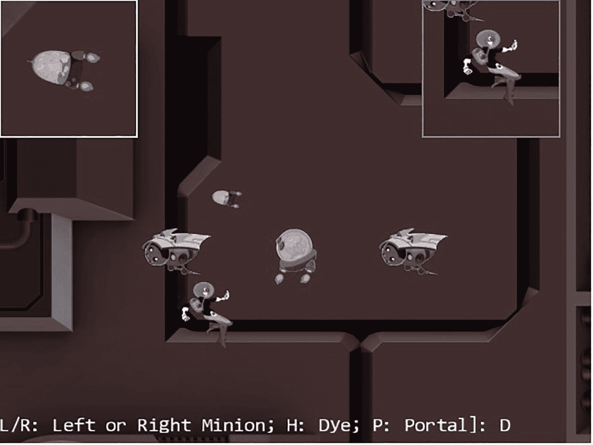

图 7-9 ¶ 运行多摄像机项目

该项目的控制方式与前一个项目相同：

*   **Q 键**：启动 Dye 角色的位置振荡和摄像机抖动效果。
*   **WASD 键**：移动 Dye 角色（Hero 对象）。请注意，当 Hero 对象尝试移动到 WC 边界之外 90% 的位置时，摄像机 WC 窗口会更新以跟随 Hero 对象。
*   **方向键**：移动 Portal 对象。请注意，Portal 对象无法移动到 WC 边界之外 80% 的位置。
*   **L/R/P/H 键**：选择左小兵、右小兵、Portal 对象或 Hero 对象作为焦点对象。L/R 键还会将摄像机设置为聚焦于左小兵或右小兵。
*   **N/M 键**：以摄像机中心为基准进行放大或缩小。
*   **J/K 键**：在确保当前焦点对象恒定相对位置的前提下进行放大或缩小。换句话说，随着摄像机缩放，所有对象的位置都会改变，除了焦点对象的位置。

项目目标如下：

*   理解用于呈现游戏世界视图的摄像机抽象概念
*   体验在同一游戏关卡中使用多个摄像机进行工作
*   认识到为特定用途的摄像机配置插值的重要性

与前几个项目一样，您可以在 assets 文件夹中找到外部资源文件。

### 修改摄像机

`Camera` 对象将进行轻微修改，以允许绘制带有边界的视口。这将使得在画布上轻松区分摄像机视图成为可能。

1.  **编辑 `camera_main.js` 并修改 `Camera` 构造函数**，以允许程序员定义围绕摄像机视口的边界像素数：

```javascript
constructor(wcCenter, wcWidth, viewportArray, bound) {
    this.mCameraState = new CameraState(wcCenter, wcWidth);
    this.mCameraShake = null;
    this.mViewport = [];  // [x, y, width, height]
    this.mViewportBound = 0;
    if (bound !== undefined) {
        this.mViewportBound = bound;
    }
    this.mScissorBound = [];  // 用于边界
    this.setViewport(viewportArray, this.mViewportBound);
    // 摄像机变换操作符
    this.mCameraMatrix = mat4.create();
    // 背景颜色
    this.mBGColor = [0.8, 0.8, 0.8, 1]; // RGB 和 Alpha
}
```

请参考后面的 `setViewport()` 函数。默认情况下，`bound` 假定为零，摄像机将绘制到整个 `mViewport`。当不为零时，围绕 `mViewport` 的边界像素数将保留为背景颜色，从而允许在画布上轻松区分多个视口。

2.  **定义 `setViewport()` 函数**：

```javascript
setViewport(viewportArray, bound) {
    if (bound === undefined) {
        bound = this.mViewportBound;
    }
    // [x, y, width, height]
    this.mViewport[0] = viewportArray[0] + bound;
    this.mViewport[1] = viewportArray[1] + bound;
    this.mViewport[2] = viewportArray[2] - (2 * bound);
    this.mViewport[3] = viewportArray[3] - (2 * bound);
    this.mScissorBound[0] = viewportArray[0];
    this.mScissorBound[1] = viewportArray[1];
    this.mScissorBound[2] = viewportArray[2];
    this.mScissorBound[3] = viewportArray[3];
}
```

回想一下，设置摄像机视口时，您需要调用 `gl.scissor()` 函数来定义要清除的区域，并调用 `gl.viewport()` 函数来标识绘制的目标区域。以前，剪裁区域和视口边界是相同的，而在这种情况下，请注意实际的 `mViewport` 边界比 `mScissorBound` 小边界像素数。这些设置允许 `mScissorBound` 标识要清除为背景颜色的区域，而 `mViewport` 边界定义实际用于绘制的画布区域。这样，视口周围的边界像素数将保持为背景颜色。

3.  **定义 `getViewport()` 函数**以返回为此摄像机保留的实际边界。在这种情况下，它是 `mScissorBound`，而不是可能较小的视口边界。

```javascript
getViewport() {
    let out = [];
    out[0] = this.mScissorBound[0];
    out[1] = this.mScissorBound[1];
    out[2] = this.mScissorBound[2];
    out[3] = this.mScissorBound[3];
    return out;
}
```

4.  **修改 `setViewAndCameraMatrix()` 函数**，以将剪裁边界绑定到 `mScissorBound` 而不是视口边界：

```javascript
setViewAndCameraMatrix() {
    let gl = glSys.get();
    ... 与之前的代码相同 ...
    // 步骤 A2：设置相应的剪裁区域以限制清除区域
    gl.scissor(this.mScissorBound[0], // 左下角的 x
               this.mScissorBound[1], // 左下角的 y 位置
               this.mScissorBound[2], // 要绘制区域的宽度
               this.mScissorBound[3]);// 要绘制区域的高度
    ... 与之前的代码相同 ...
}
```

### 在 MyGame 中测试多摄像机

MyGame 关卡必须创建多个摄像机，正确配置它们，并独立绘制每一个。为了便于演示，将创建两个新的 `Camera` 对象，一个聚焦于 Hero 对象，另一个聚焦于追逐的 Brain 对象。与前面的示例一样，MyGame 关卡的实现基本相同。在本示例中，`init()`、`draw()` 和 `update()` 函数的某些部分被修改以处理多个 `Camera` 对象，并已高亮显示。

1.  **修改 `init()` 函数以定义三个 Camera 对象**。`mHeroCam` 和 `mBrainCam` 都为其视口定义了两像素的边界，`mHeroCam` 的边界定义为灰色（背景颜色），而 `mBrainCam` 为白色。请注意 `mBrainCam` 对象的僵硬插值设置，告知摄像机插值在十个周期内收敛到新值。

```javascript
init() {
    // 步骤 A：设置摄像机
    this.mCamera = new engine.Camera(
        vec2.fromValues(50, 36), // 摄像机的位置
        100,                     // 摄像机的宽度
        [0, 0, 640, 480]         // 视口 (orgX, orgY, width, height)
    );
    this.mCamera.setBackgroundColor([0.8, 0.8, 0.8, 1]); // 将背景设置为灰色
    this.mHeroCam = new engine.Camera(
        vec2.fromValues(50, 30), // 每周期更新以指向 hero
        20,
        [490, 330, 150, 150],
        2                        // 视口边界
    );
    this.mHeroCam.setBackgroundColor([0.5, 0.5, 0.5, 1]);
    this.mBrainCam = new engine.Camera(
        vec2.fromValues(50, 30), // 每周期更新以指向 brain
        10,
        [0, 330, 150, 150],
        2                        // 视口边界
    );
    this.mBrainCam.setBackgroundColor([1, 1, 1, 1]);
    this.mBrainCam.configLerp(0.7, 10);
    ... 与之前的代码相同 ...
}
```


## 定义通用绘制辅助函数

定义一个辅助函数 `_drawCamera(camera)`，用于绘制所有三个摄像机共同的世界：

```javascript
_drawCamera(camera) {
    camera.setViewAndCameraMatrix();
    this.mBg.draw(camera);
    this.mHero.draw(camera);
    this.mBrain.draw(camera);
    this.mPortal.draw(camera);
    this.mLMinion.draw(camera);
    this.mRMinion.draw(camera);
}
```

## 3. 修改 `MyGame` 对象的 `draw()` 函数

修改 `MyGame` 对象的 `draw()` 函数以绘制所有三个摄像机。注意 `mMsg` 对象仅绘制到 `mCamera`（主摄像机）。因此，回显消息将仅出现在主摄像机的视口中。

```javascript
draw() {
    // Step A: clear the canvas
    engine.clearCanvas([0.9, 0.9, 0.9, 1.0]); // clear to light gray
    // Step B: Draw with all three cameras
    this._drawCamera(this.mCamera);
    this.mMsg.draw(this.mCamera);  // only draw status in main camera
    this._drawCamera(this.mHeroCam);
    this._drawCamera(this.mBrainCam);
}
```

## 4. 修改 `update()` 函数

修改 `update()` 函数以使 `mHeroCam` 和 `mBrainCam` 随相应对象平移，并持续移动 `mHeroCam` 视口：

> **注意**
>
> 视口通常在游戏过程中不会改变位置。为了测试目的，以下代码使 `mHeroCam` 视口在画布中从左向右持续移动。

```javascript
update() {
    let zoomDelta = 0.05;
    let msg = "L/R: Left or Right Minion; H: Dye; P: Portal]: ";
    this.mCamera.update();  // for smoother camera movements
    this.mHeroCam.update();
    this.mBrainCam.update();
    // ... identical to previous code ...
    // set the hero and brain cams
    this.mHeroCam.panTo(this.mHero.getXform().getXPos(),
                        this.mHero.getXform().getYPos());
    this.mBrainCam.panTo(this.mBrain.getXform().getXPos(),
                         this.mBrain.getXform().getYPos());
    // Move the hero cam viewport just to show it is possible
    let v = this.mHeroCam.getViewport();
    v[0] += 1;
    if (v[0] > 500) {
        v[0] = 0;
    }
    this.mHeroCam.setViewport(v);
    this.mMsg.setText(msg + this.mChoice);
}
```

现在可以运行项目，观察 HTML 画布上显示的三个不同视口。`mHeroCam` 和 `mBrainCam` 视口周围两像素宽的边界便于直观区分三个视图。观察到 `mBrainCam` 视口绘制在 `mHeroCam` 之上，这是因为在 `MyGame.draw()` 函数中，`mBrainCam` 最后绘制。最后绘制的对象总是出现在最顶层。移动 Hero 对象可观察到 `mHeroCam` 跟随英雄，并体验平移摄像机的平滑插值效果。

尝试更改 `mBrainCam.configLerp()` 函数的参数以生成更平滑的插值效果，例如将刚度设为 `0.1`、持续时间设为 `100` 个周期。观察摄像机仿佛在不断尝试追赶 Brain 对象。在这种情况下，摄像机需要较硬的插值设置以确保主体保持在摄像机视图中心。为了获得更剧烈且有趣的效果，可尝试将 `mBrainCam` 设为更平滑的插值，如刚度 `0.01`、持续时间 `200` 个周期。这些值下，摄像机永远无法追上 Brain 对象，显得在游戏世界中漫无目的地游荡。

## 鼠标输入与摄像机

鼠标是一种指向输入设备，在画布坐标空间报告位置信息。回顾第 3 章的讨论，画布坐标空间仅是相对于画布左下角沿 x/y 轴的像素偏移量测量。游戏引擎定义并使用世界坐标（WC）空间，所有对象和测量均在 WC 中指定。为了让游戏引擎处理报告的鼠标位置，必须将该位置从画布坐标空间转换到 WC。

图 7-10 左侧绘图展示了位于画布上 `(mouseX, mouseY)` 的鼠标位置示例。右侧绘图显示，当在画布内定义一个左下角位于 `(V[x], V[y])`、尺寸为 `W[v] × H[v]` 的视口时，相同的 `(mouseX, mouseY)` 位置可表示为视口中的位置 `(mouseDCX, mouseDCY)`，其中：

- `mouseDCX = mouseX − V[x]`
- `mouseDCY = mouseY − V[y]`

这样，`(mouseDCX, mouseDCY)` 即为相对于视口左下角 `(V[x], V[y])` 的偏移量。

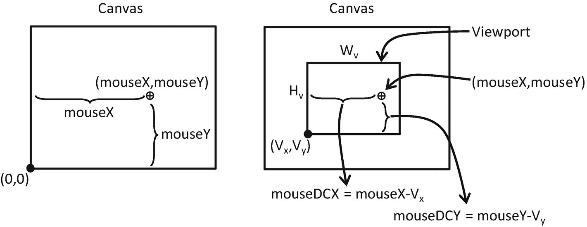

**Figure 7-10** 鼠标在画布和视口上的位置

图 7-11 左侧绘图显示，设备坐标（DC）空间定义视口内的像素位置，偏移量相对于视口左下角测量。因此 DC 空间也称为像素空间。计算出的 `(mouseDCX, mouseDCY)` 位置即为 DC 空间中的位置示例。右侧绘图显示，该位置可根据以下公式转换到左下角位于 `(minWCX, minWCY)`、尺寸为 `W[wc] × H[wc]` 的 WC 空间：

- `mouseWCX = minWCX + (mouseDCX × W[wc] / W[v])`
- `mouseWCY = minWCY + (mouseDCY × H[wc] / H[v])`

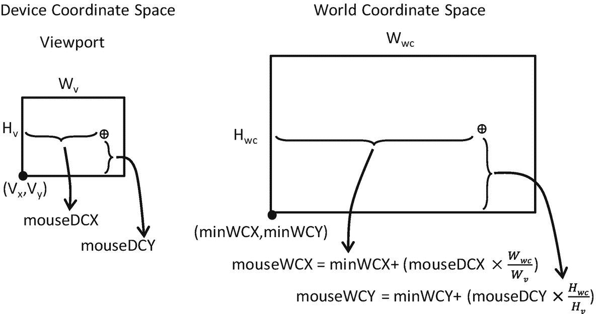

**Figure 7-11** 视口 DC 空间和 WC 空间中的鼠标位置

了解如何将位置从画布坐标空间转换到 WC 空间后，便可在游戏引擎中实现鼠标输入支持。

## 鼠标输入项目

该项目演示游戏引擎中的鼠标输入支持。图 7-12 展示了运行示例。项目源代码位于 `chapter7/7.5.mouse_input` 文件夹。

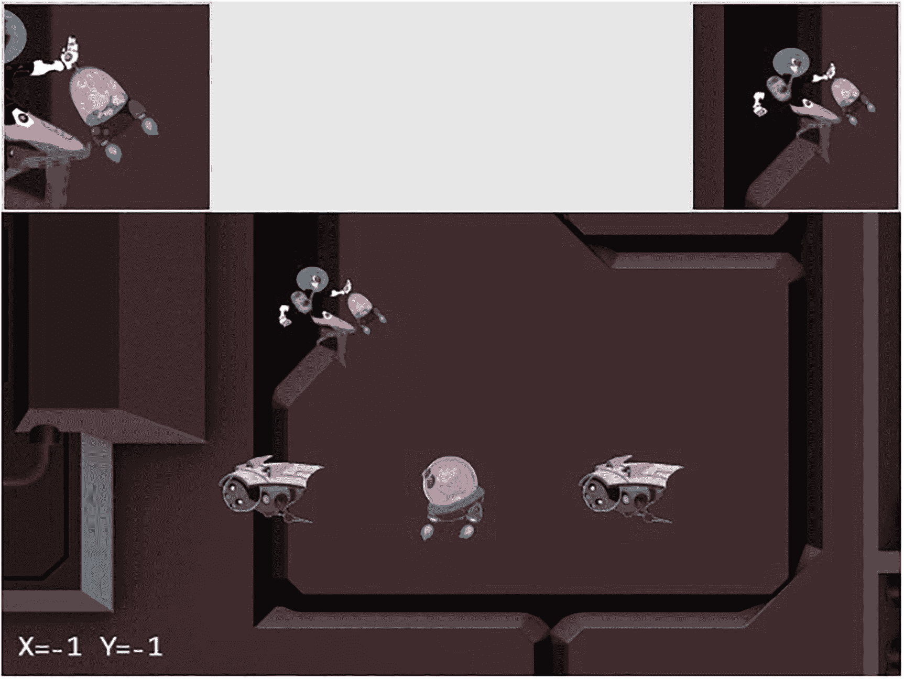

**Figure 7-12** 运行鼠标输入项目

本项目的新控制方式如下：

- **主摄像机视图中左键点击**：拖拽 Portal 对象
- **HeroCam 视图中中键点击**：拖拽 Hero 对象
- **任意视图中右键/中键点击**：隐藏/显示 Portal 对象

以下控制与前一项目相同：

- **Q 键**：启动 Dye 角色的位置振荡和摄像机抖动效果
- **WASD 键**：移动 Dye 角色（Hero 对象）并推动摄像机 WC 边界
- **方向键**：移动 Portal 对象
- **L/R/P/H 键**：选择聚焦对象，L/R 键将摄像机重新聚焦到左侧或右侧小兵
- **N/M 和 J/K 键**：对准摄像机中心或聚焦对象进行缩放

项目目标如下：

- 理解画布坐标空间到 WC 空间的变换
- 认识区分视口处理鼠标事件的重要性
- 实现坐标空间间的变换
- 支持并体验鼠标输入操作

与前几个项目一样，外部资源文件位于 `assets` 文件夹。

### 修改 `index.js` 以将画布 ID 传递给输入组件


## 初始化输入组件

为了接收鼠标输入信息，输入组件需要访问 HTML 画布。编辑 `index.js` 并修改 `init()` 函数，以便在初始化期间将 `htmlCamvasID` 传递给输入组件。

```javascript
// 通用引擎工具
function init(htmlCanvasID) {
    glSys.init(htmlCanvasID);
    vertexBuffer.init();
    input.init(htmlCanvasID);
    audio.init();
    shaderResources.init();
    defaultResources.init();
}
```

## 在 input.js 中实现鼠标支持

与键盘输入类似，您应该通过编辑 `input.js` 向输入模块添加鼠标支持：

1. **定义鼠标按钮常量**

   编辑 `input.js` 并定义常量来表示三个鼠标按钮：

   ```javascript
   // 鼠标按钮枚举
   const eMouseButton = Object.freeze({
       eLeft: 0,
       eMiddle: 1,
       eRight: 2
   });
   ```

2. **定义鼠标输入变量**

   定义变量以支持鼠标输入。与键盘输入类似，鼠标按钮状态是包含三个布尔元素的数组，每个元素代表三个鼠标按钮的状态。

   ```javascript
   let mCanvas = null;
   let mButtonPreviousState = [];
   let mIsButtonPressed = [];
   let mIsButtonClicked = [];
   let mMousePosX = -1;
   let mMousePosY = -1;
   ```

3. **定义鼠标移动事件处理程序**

   定义鼠标移动事件处理程序：

   ```javascript
   function onMouseMove(event) {
       let inside = false;
       let bBox = mCanvas.getBoundingClientRect();
       // 现已处于画布空间。通过画布到客户端的比率进行转换。
       let x = Math.round((event.clientX - bBox.left) *
           (mCanvas.width / bBox.width));
       let y = Math.round((event.clientY - bBox.top) *
           (mCanvas.height / bBox.height));
       if ((x >= 0) && (x < mCanvas.width) &&
           (y >= 0) && (y < mCanvas.height)) {
           mMousePosX = x;
           mMousePosY = mCanvas.height - 1 - y;
           inside = true;
       }
       return inside;
   }
   ```

   请注意，鼠标事件处理程序首先检查位置是否在画布范围内，然后翻转 y 位置，使得位移相对于左下角进行测量，从而将原始像素位置转换为画布坐标空间。

4. **定义鼠标按下处理程序**

   定义鼠标按钮点击处理程序以记录按钮事件：

   ```javascript
   function onMouseDown(event) {
       if (onMouseMove(event)) {
           mIsButtonPressed[event.button] = true;
       }
   }
   ```

5. **定义鼠标释放处理程序**

   定义鼠标按钮释放处理程序，以便于检测鼠标按钮点击事件。回顾第 4 章中关于键盘输入的讨论，为了检测按钮释放事件，您应该测试之前已释放且当前被点击的按钮状态。`onMouseUp()` 处理程序记录鼠标按钮的释放状态。

   ```javascript
   function onMouseUp(event) {
       onMouseMove(event);
       mIsButtonPressed[event.button] = false;
   }
   ```

6. **修改 init() 函数以支持鼠标**

   修改 `init()` 函数以接收 `canvasID` 参数并初始化鼠标事件处理程序：

   ```javascript
   function init(canvasID) {
       let i;
       // 键盘支持
       // ... 与之前的代码相同 ...
       // 鼠标支持
       for (i = 0; i < 3; i++) {
           mButtonPreviousState[i] = false;
           mIsButtonPressed[i] = false;
           mIsButtonClicked[i] = false;
       }
       window.addEventListener('mousedown', onMouseDown);
       window.addEventListener('mouseup', onMouseUp);
       window.addEventListener('mousemove', onMouseMove);
       mCanvas = document.getElementById(canvasID);
   }
   ```

7. **修改 update() 函数以处理鼠标状态**

   修改 `update()` 函数以类似键盘的方式处理鼠标按钮状态变化。请注意鼠标点击条件：之前未点击的按钮现在被点击了。

   ```javascript
   function update() {
       let i;
       // 更新键盘输入状态
       // ... 与之前的代码相同 ...
       // 更新鼠标输入状态
       for (i = 0; i < 3; i++) {
           mIsButtonClicked[i] = (!mButtonPreviousState[i]) &&
               mIsButtonPressed[i];
           mButtonPreviousState[i] = mIsButtonPressed[i];
       }
   }
   ```

8. **定义鼠标状态访问器函数**

   定义函数以检索鼠标位置和鼠标按钮状态：

   ```javascript
   function isButtonPressed(button) {
       return mIsButtonPressed[button];
   }
   function isButtonClicked(button) {
       return mIsButtonClicked[button];
   }
   function getMousePosX() {
       return mMousePosX;
   }
   function getMousePosY() {
       return mMousePosY;
   }
   ```

9. **导出鼠标功能**

   最后，请记住导出新定义的功能：

   ```javascript
   export {
       keys,
       eMouseButton,
       init, cleanUp, update,
       // 键盘
       isKeyClicked, isKeyPressed,
       // 鼠标
       isButtonClicked, isButtonPressed, getMousePosX, getMousePosY
   };
   ```

## 修改相机以支持视口到 WC 空间的变换

`Camera` 类封装了 WC 窗口和视口，因此应负责转换鼠标位置。回顾一下，为了保持可读性，`Camera` 类的源代码文件是根据功能分离的。类的基本函数定义在 `camera_main.js` 中。`camera_manipulate.js` 文件从 `camera_main.js` 导入并定义额外的操作函数。最后，`camera.js` 文件从 `camera_manipulate.js` 导入以包含所有定义的函数，并导出 `Camera` 类供外部访问。

这种从后续源代码文件链式导入以定义额外函数的方式将继续用于 `Camera` 类，`camera_input.js` 将定义输入功能：

1. **创建 camera_input.js**

   在 `src/engine/cameras` 文件夹中创建一个新文件并将其命名为 `camera_input.js`。该文件将通过定义鼠标输入支持函数来扩展 `Camera` 类。导入以下文件：

   - `camera_manipulation.js` 以获取 `Camera` 类的所有已定义函数
   - `eViewport` 常量以访问视口数组
   - `input` 模块以访问鼠标相关函数

   ```javascript
   import Camera from "./camera_manipulation.js";
   import { eViewport } from "./camera_main.js";
   import * as input from "../input.js";
   // ... 实现如下 ...
   export default Camera;
   ```

2. **定义鼠标 DC 坐标函数**

   定义函数将鼠标位置从画布坐标空间转换到 DC 空间，如图 7-10 所示：

   ```javascript
   Camera.prototype._mouseDCX = function () {
       return input.getMousePosX() - this.mViewport[eViewport.eOrgX];
   }
   Camera.prototype._mouseDCY = function() {
       return input.getMousePosY() - this.mViewport[eViewport.eOrgY];
   }
   ```

3. **定义视口边界检查**

   定义一个函数来确定给定的鼠标位置是否在相机的视口边界内：

   ```javascript
   Camera.prototype.isMouseInViewport = function () {
       let dcX = this._mouseDCX();
       let dcY = this._mouseDCY();
       return ((dcX >= 0) && (dcX < this.mViewport[eViewport.eWidth]) &&
           (dcY >= 0) && (dcY < this.mViewport[eViewport.eHeight]));
   }
   ```

4. **定义鼠标 WC 坐标函数**

   定义函数将鼠标位置转换到 WC 空间，如图 7-11 所示：

   ```javascript
   Camera.prototype.mouseWCX = function () {
       let minWCX = this.getWCCenter()[0] - this.getWCWidth() / 2;
       return minWCX + (this._mouseDCX() *
           (this.getWCWidth() / this.mViewport[eViewport.eWidth]));
   }
   Camera.prototype.mouseWCY = function () {
       let minWCY = this.getWCCenter()[1] - this.getWCHeight() / 2;
       return minWCY + (this._mouseDCY() *
           (this.getWCHeight() / this.mViewport[eViewport.eHeight]));
   }
   ```

   最后，更新 `Camera` 类访问文件以正确导出新定义的输入功能。这通过编辑 `camera.js` 文件并将从 `camera_manipulate.js` 的导入替换为 `camera_input.js` 来完成：

   ```javascript
   import Camera from "./camera_input.js";
   export default Camera;
   ```

## 在 MyGame 中测试鼠标输入


## 鼠标输入功能

要测试的主要功能包括检测哪个视图应接收鼠标输入、响应鼠标按钮状态变化，以及将鼠标点击的像素位置转换到 WC 空间的能力。与前面的示例一样，`my_game.js` 的实现与之前的项目基本相似。在这种情况下，只有 `update()` 函数包含与新鼠标输入功能配合工作的值得注意的更改。

## `update()` 函数

```javascript
update() {
    ... identical to previous code ...
    msg = "";
    // testing the mouse input
    if (engine.input.isButtonPressed(engine.input.eMouseButton.eLeft)) {
        msg += "[L Down]";
        if (this.mCamera.isMouseInViewport()) {
            this.mPortal.getXform().setXPos(this.mCamera.mouseWCX());
            this.mPortal.getXform().setYPos(this.mCamera.mouseWCY());
        }
    }
    if (engine.input.isButtonPressed(engine.input.eMouseButton.eMiddle)){
        if (this.mHeroCam.isMouseInViewport()) {
            this.mHero.getXform().setXPos(this.mHeroCam.mouseWCX());
            this.mHero.getXform().setYPos(this.mHeroCam.mouseWCY());
        }
    }
    if (engine.input.isButtonClicked(engine.input.eMouseButton.eRight)) {
        this.mPortal.setVisibility(false);
    }
    if (engine.input.isButtonClicked(engine.input.eMouseButton.eMiddle)){
        this.mPortal.setVisibility(true);
    }
    msg += " X=" + engine.input.getMousePosX() +
            " Y=" + engine.input.getMousePosY();
    this.mMsg.setText(msg);
}
```

当视口上下文很重要时，会检查 `camera.isMouseInViewport()` 条件，例如在主摄像机视图中左键单击或在 `mHeroCam` 视图中中键单击的情况。这与用于设置 `Portal` 对象可见性的右键或中键单击形成对比。这两种鼠标点击无论鼠标位置在哪里都会触发执行。

## 测试实现

现在您可以运行项目并验证到 WC 空间转换的正确性。在主视图中按住左键拖拽，或在 `mHeroCam` 视图中按住中键拖拽，观察相应对象随鼠标位置变化而准确移动。在错误视图中的左键或中键拖拽动作对相应对象没有影响。例如，在 `mHeroCam` 或 `mBrainCam` 视图中左键拖拽对 `Portal` 对象没有影响。但请注意，右键或中键单击控制 `Portal` 对象的可见性，与鼠标指针位置无关。请注意，浏览器将右键单击映射到默认弹出菜单。因此，您应该避免在游戏中使用右键单击。

## 总结

本章介绍了控制和交互 `Camera` 对象。您学习了最常见的摄像机操作，包括钳制、平移和缩放。这些操作通过实用函数在游戏引擎中实现，将高级规范映射到实际的 WC 窗口边界参数。摄像机操作带来的突兀、往往令人恼火且可能令人困惑的移动，通过引入插值得以缓解。通过实现摄像机抖动效果，您发现某些移动可以用简单的数学公式建模。您还体会到了有效的 `Camera` 对象抽象在支持多摄像机视图方面的重要性。最后一节指导您实现了将鼠标位置从画布坐标空间转换到 WC 空间。

在 第 5 章 中，您了解了如何用视觉上吸引人的图像表示和绘制对象并控制其动画。在 第 6 章 中，您阅读了如何定义抽象来封装对象的行为以及检测对象间碰撞所需的基本支持。本章讲述了这些对象的“导演”工作：什么应该可见、焦点在哪里、展示多少世界、如何确保焦点间平滑过渡，以及如何接收鼠标输入。有了这些能力，您现在拥有一个全面的游戏引擎框架，能够表示和绘制对象、建模和管理对象行为，并控制如何、在哪里以及显示什么对象。

后续章节将继续在更高级的层面探讨对象的外观和行为，包括在 2D 世界中创建光照和照明效果，以及基于简单经典力学模拟和集成行为。

## 游戏设计考量

您已经学习了对象交互的基础知识，现在是时候开始考虑创建您的第一个简单游戏机制，并尝试构成完善游戏体验的逻辑条件和规则了。许多设计师采用自顶向下的方法进行游戏创作（即他们从特定类型的实现想法开始，如即时战略、塔防或角色扮演游戏），这在视频游戏行业中是意料之中的，因为创作者通常在转型为内容创作者之前花费大量时间作为内容消费者。游戏工作室往往强化这种自顶向下的设计方法，让新员工在资深主管手下工作，学习该工作室所从事类型的最佳实践。这已被证明能有效培养能够胜任已知类型迭代的设计师，但并不总是培养能够从零开始设计全新系统和机制的全面创作者的最佳途径。

## 什么造就了完善的游戏玩法？

上述内容可能引出一个问题：“什么造就了完善的游戏玩法？”从根本上说，游戏是一种互动体验，玩家必须学习并应用规则以达成特定结果；所有游戏都必须满足这一最低标准，包括纸牌、棋盘、体育、电子游戏等类型。更进一步说，好的游戏是一种规则让人乐于学习和应用、且结果让人感到投入其中的互动体验。这个简短的定义当然包含很多内涵，但一般来说，当规则可发现、一致、合乎逻辑，且结果让人感觉像是掌握规则后令人满意的奖励时，玩家会更享受游戏。这一定义既适用于单个游戏机制，也适用于整个游戏体验。打个比方，可以将游戏设计想象为由字母（交互）组成单词（机制），单词组成句子（关卡），最终形成可读的内容（类型）。大多数新设计师在不认识字母前就试图写小说，每个人都玩过这样的游戏：其机制和关卡充其量像语法拙劣的句子，最坏则像令人不满的、随机拼凑的无法理解的字母堆砌。

## 设计探索策略

在接下来的几章中，您将学习 2D 游戏引擎的更多高级功能，包括光照模拟和物理行为模拟。您还将接触一组设计技术，使您能够交付完整且完善的游戏关卡，有意识地整合这些技术并利用 第 4 章 中讨论的九大游戏设计要素中的更多内容，从零开始打造统一的体验。在设计探索的最早阶段，专注于创建和完善基本游戏机制和交互模型通常很有帮助；在这个阶段，尽量避免考虑背景设定、元游戏、系统设计等（这些将随着设计推进融入其中）。


## 第一种设计技巧：密室逃脱场景

我们将探索的第一种设计技巧是一个简单的练习，它能让你开始学习游戏设计的“字母表”：一个只包含单一简单机制的“密室逃脱”场景，玩家必须完成一项任务才能解锁大门并获得奖励。这个练习将帮助你培养创建结构良好、逻辑严密、可被发现且一致的规则的洞察力，当任务被分解为基本交互时，这要容易实现得多。你已经在早期项目中探索过潜在的基于规则场景的雏形：回顾第 4 章的“键盘支持”项目，它建议你可以让玩家将一个较小的方块完全移入一个较大方块的边界内，以触发某种行为。那种单一交互（或“游戏字母表中的字母”）该如何组合，才能形成一个讲得通的游戏机制（或“单词”）呢？图 7-13 为密室谜题设定了舞台。 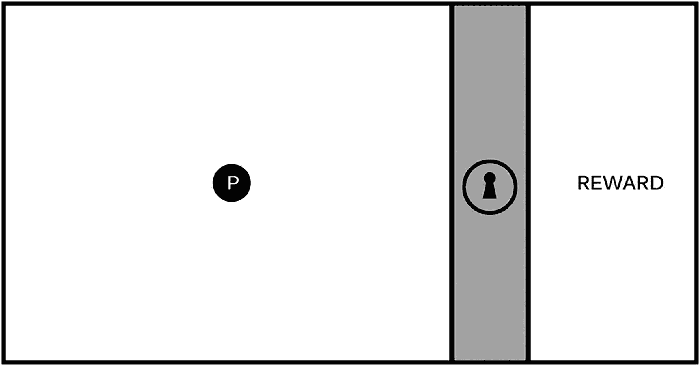

图 7-13 ¶ 该图像代表一个被分为三个区域的单个游戏画面。左侧是一个可玩区域，包含一个主角角色（标记为 P 的圆圈），一个标有锁图标的不可通过屏障，以及右侧的奖励区域

图 7-13 中所示的画面是在探索新机制时一个有用的切入点。本练习的目标是创建一个合乎逻辑的挑战，玩家必须完成它才能解锁屏障并到达奖励处。任务的具体性质可以基于各种基本机制：可能涉及跳跃或射击、解谜、叙事情境等。关键在于保持这个首次迭代的**简单性**（第一个挑战应只有有限数量的组成部分构成解决方案）和**可发现性**（玩家必须能够通过实验学习交战规则，从而有意识地解决挑战）。你将在后续迭代中为机制增加复杂性和趣味性，并会看到基本机制如何演变以支持多种游戏类型。

图 7-14 为一个逻辑关系机制设定了舞台，玩家必须与环境中的物体互动以学习规则。 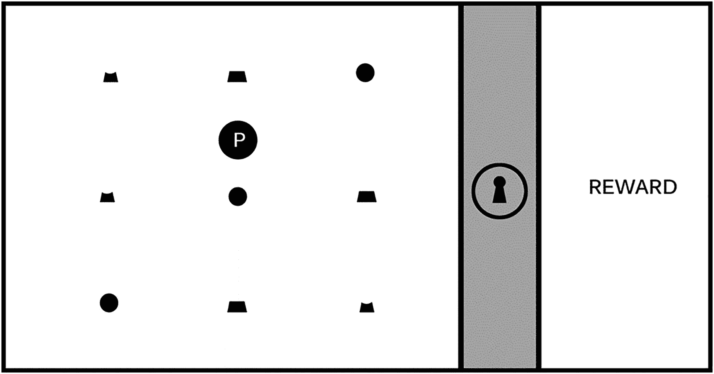

图 7-14 ¶ 游戏画面布满了各种单独的物体

仅凭观察图 7-14 并不能立刻看出玩家需要做什么来解锁屏障，因此他们必须通过实验来学习游戏世界运作的规则；正是这种实验构成了驱动玩家推进关卡的游戏机制的核心要素，而该机制的满意度取决于其规则的可发现性和逻辑一致性。在这个例子中，想象当玩家在游戏画面中移动主角角色时，他们会注意到当主角与物体互动时，物体总会以高亮形式“激活”，如图 7-15 所示，有时还会导致锁图标的一个区段和锁周围环的三分之一发光。然而，某些形状被激活时不会导致锁和环发光，如图 7-16 所示。 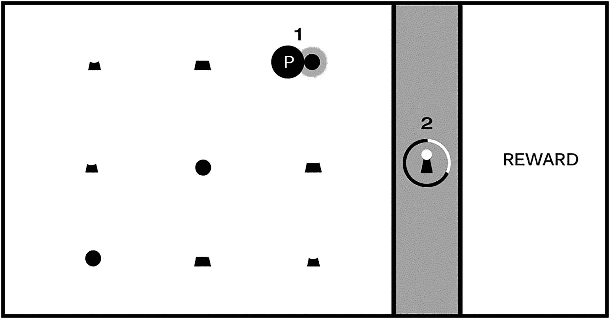

图 7-15 ¶ 当玩家在游戏画面中移动主角角色时，形状会以高亮“激活”（#1）；激活特定形状会导致锁的一个区段和周围环的三分之一发光（#2）

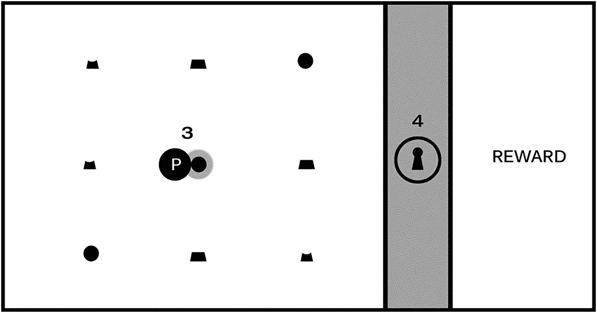

图 7-16 ¶ 激活某些形状（#3）不会导致锁和环发光（#4）

敏锐的玩家会相当快地领会这个谜题的规则。仅凭观察图 7-15 和 7-16，你能猜出规则可能是什么吗？如果你感到困惑，图 7-17 应该能提供足够的信息来解开谜题。 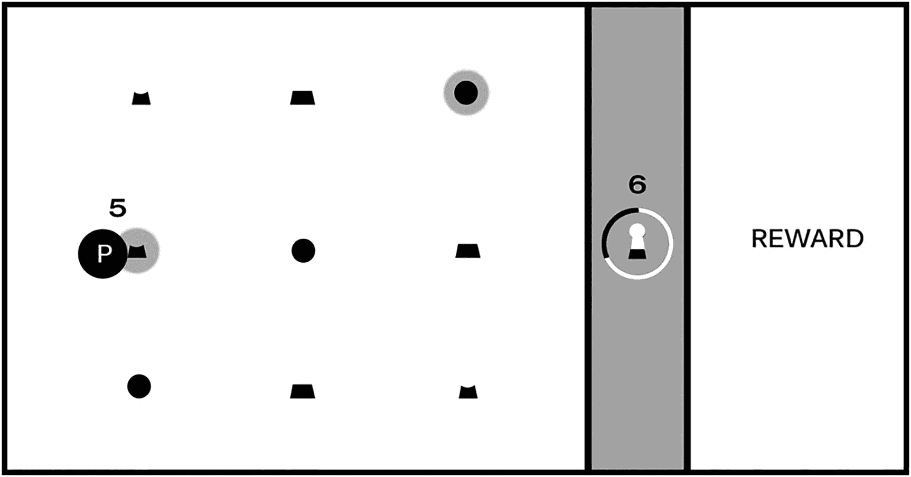

图 7-17 ¶ 在第一个物体被激活（右上角的圆圈）并导致锁的顶部区段和环的第一个三分之一发光后，如图 7-15 所示，正确序列中的第二个物体（#5）导致锁的中部区段和环的第二个三分之一发光（#6）

现在，你（和玩家）应该拥有学习该机制规则并解开谜题所需的所有线索。玩家可以与三种形状互动，每行每种形状只有一个实例；这些形状代表锁图标的顶部、中部和底部，正如图 7-15 所示，激活圆形导致锁的对应区段发光。然而，图 7-16 并未导致锁的对应区段发光，这种差异就是该机制的“钩子”（核心吸引点）：锁的区段必须按正确的相对位置激活：顶行激活顶部，中行激活中部，底行激活底部（你也可以选择要求玩家按正确顺序激活，从顶部开始，尽管仅从图 7-15 到 7-17 无法直接发现这一要求）。

恭喜，你现在已经创建了一个结构良好且逻辑自洽（尽管简单）的谜题，拥有构建更大、更宏大关卡所需的所有要素！这个解锁序列是一个没有叙事背景的游戏机制：在这个设计阶段，游戏画面刻意没有游戏设定、视觉风格或类型归属，因为我们不想让探索过早地背负任何预设期望。作为设计师，在添加叙事和类型等高层游戏元素之前，花时间探索游戏机制最纯粹的形式是大有裨益的，当你把这些简单机制构建出来时，你很可能会惊讶于它们将你带向的意想不到的方向。

像本例中的简单机制可以描述为“按正确顺序完成多阶段任务以达成目标”，并出现在许多类型的游戏中；例如，任何要求玩家收集物体部件并在物品栏中组合它们以完成挑战的游戏，都利用了这一机制。单个机制也可以与其他机制和游戏特性结合，形成复合要素，为你的游戏体验增加复杂性和风味。


# 8. 实现光照与阴影

本章的摄像机练习提供了很好的示例，说明如何为单一机制增加趣味性；例如，简单的摄像机操纵项目演示了一种推进游戏动作的方法。想象一下，在前一个示例中，玩家因解锁屏障而获得奖励后，将英雄对象移动到屏幕右侧，并前进到一个新的“房间”或区域。现在想象一下，如果关卡开始时摄像机以固定速率推进屏幕，游戏玩法会发生怎样的变化；自动滚屏的加入极大地改变了这一机制，因为玩家必须在推进的屏障将玩家推出屏幕之前解开谜题并解锁屏障。前一种情况创造了一种悠闲的解谜游戏体验，而后者通过给玩家有限的时间来完成每个屏幕，大大增加了紧张感。在自动滚屏的实现中，你该如何布局游戏屏幕，以确保玩家有足够的时间学习规则并解开谜题？

多摄像机项目作为小地图特别有用，它提供当前未显示在游戏屏幕上的游戏世界地点的信息；在前一个练习的情况下，想象一下锁定的屏障出现在游戏世界中玩家当前屏幕以外的某个地方，而充当小地图的辅助摄像机显示了整个游戏世界地图的缩小视图。作为游戏设计师，你可能希望让玩家知道何时完成了允许他们推进的任务，并提供关于他们下一步需要去哪里的信息，因此在这种情况下，你可能会在小地图上闪烁一个信标，以引起对刚刚解锁的屏障的注意，并指引玩家前往何处。在我们“游戏设计如同书面语言”这一隐喻的语境下，添加摄像机行为等额外元素以增强或扩展简单机制，是开始形成“形容词”的一种方式，这些形容词为我们从游戏设计字母表中的字母创造出的基本名词和动词增添了趣味。

游戏设计师的主要挑战通常是创造需要巧妙尝试同时保持逻辑一致性的场景；通过创造需要创造性解决问题的棘手场景来让玩家感到挫败是完全可以的（我们称之为“良性”挫败），但通过创造逻辑不一致的场景让玩家感到挫败，让玩家觉得他们只是靠运气才成功完成挑战，这通常被认为是糟糕的设计（“恶性”挫败）。回想一下你玩过的导致恶性挫败感的游戏：它们哪里出了问题，设计师本可以做些什么来改善体验？

锁定房间场景是一个有用的设计工具，因为它迫使你构建基本机制，但你可能会对该练习产生的各种场景感到惊讶。尝试几种不同的方法来解决锁定房间谜题，看看设计过程会带你去向何方，但要保持简单。目前，请专注于解锁房间的单步事件，这些事件只要求玩家学习一条规则。你将在下一章重温这个练习，并开始创建更具雄心的机制，增加额外的挑战。

© 作者，独家授权 APress Media, LLC，Springer Nature 的一部分 2022 K. Sung 等人 *Build Your Own 2D Game Engine and Create Great Web Games* [`doi.org/10.1007/978-1-4842-7377-7_8`](https://doi.org/10.1007/978-1-4842-7377-7_8)
