## 摘要

**Kelvin Sung**^1, **Jebediah Pavleas**^2, **Matthew Munson**^3 和 **Jason Pace**^4  
(1) 美国华盛顿州博塞尔  
(2) 美国华盛顿州肯莫尔  
(3) 美国华盛顿州莱克福里斯特帕克  
(4) 美国俄勒冈州波特兰

完成本章后，你将能够：

*   理解简单光照模型的参数
*   定义用于处理多光源的基础设施支持
*   理解漫反射和法线贴图的基础知识
*   理解镜面反射和 `Phong` 光照模型的基础知识
*   实现 `GLSL` 着色器以模拟漫反射、镜面反射和 `Phong` 光照模型
*   创建和操控点光源、方向光和聚光灯
*   使用 `WebGL` 模板缓冲区模拟阴影

## 简介

到目前为止，在游戏引擎中，你主要实现了功能模块，以提供许多类型 2D 游戏所需的基础。也就是说，你开发了旨在直接支持实际游戏玩法的引擎组件和工具类。这是一个很好的方法，因为它允许你系统地扩展引擎的功能，以支持更多类型的游戏和玩法。例如，有了迄今为止涵盖的主题，你可以实现各种不同的游戏，包括益智游戏、俯视角太空射击游戏，甚至简单的平台游戏。

光照模型是一种数学公式，它基于对场景中表面反射光能的近似，描述场景的颜色和亮度。在本章中，你将实现一个光照模型，它间接影响你的游戏引擎可以支持的游戏玩法类型和可实现的视觉保真度。这是因为游戏引擎的光照支持不仅仅是简单的美学效果。当创造性地应用时，光照可以增强游戏玩法或为你的游戏提供戏剧性的场景设定。例如，你可以有一个场景，火把照亮了英雄原本黑暗的道路，火把闪烁着向玩家传达一种不安或危险的感觉。此外，虽然光照模型基于物理世界中的光行为，但在你的游戏实现中，光照模型允许超现实或物理上不可能的设置，例如显示明亮或彩虹色的过饱和光源，甚至吸收周围可见能量的负光源。

在实现游戏引擎中常见的光照模型时，你需要涉足 3D 空间的概念，以正确模拟光照。因此，必须为光源指定第三个维度（即深度），以便将光能投射到游戏对象或 `Renderable` 对象上，这些对象是平面的 2D 几何体。一旦你考虑 3D 概念，实现光照模型的任务就会变得简单得多，你可以应用计算机图形学知识来正确照亮场景。

将推导并实现一个专门针对你的游戏引擎 2D 方面的简化版 `Phong` 光照模型变体。然而，光照模型的原则保持不变。如果你想要更多信息或对 `Phong` 光照模型进行更深入的分析，请参阅第 1 章推荐的参考书籍。

## 光照与 GLSL 实现概述

一般来说，光照模型是一组数学方程，描述人类如何观察环境中光与物体材质的相互作用。正如你所想象的，基于物理世界的精确光照模型可能非常复杂且计算成本高昂。`Phong` 光照模型用一个相对简单且可高效实现的方程捕捉了光/材质相互作用的许多有趣方面。本章的项目将按以下顺序指导你理解 `Phong` 光照模型的基本要素：

*   **环境光**：回顾在没有显式光源情况下光的效果


*   **光源**：检查来自单个光源照明的效果
*   **多光源**：开发游戏引擎基础设施以支持多光源
*   **漫反射与法线贴图**：模拟光线从哑光或漫反射表面的反射
*   **高光与材质**：模拟光线从闪亮表面反射并到达相机的过程
*   **光源类型**：基于不同类型的光源引入照明
*   **阴影**：模拟光线被遮挡产生的结果

本章中的项目共同构建了一个强大的工具，用于为你的游戏增加视觉细节。为了正确渲染和显示照明结果，必须为每个受影响的像素执行相关计算。回顾一下，`GLSL` 片元着色器负责计算每个像素的颜色。这样，`Phong` 照明模型的每个基本元素都可以作为额外功能实现到现有或新的 `GLSL` 片元着色器中。在本章的所有项目中，你将从使用 `GLSL` 片元着色器开始。

## 环境光

环境光，通常称为背景光，使你能够在没有显式光源的情况下看到环境中的物体。例如，在漆黑的夜晚，即使所有灯都关闭，你也能看到房间里的物体。在现实世界中，来自窗户、门底下或背景的光线为你照亮了房间。对背景光照明的真实模拟（通常称为间接照明）在算法上很复杂，且计算开销可能很大。相反，在计算机图形学和大多数 2D 游戏中，环境光通过向当前场景或世界中的每个物体添加一个恒定颜色（即环境光）来近似。重要的是要注意，虽然环境光可以提供期望的结果，但它只是一个粗略的近似，并不模拟真实世界的间接照明。

### 全局环境光项目

该项目演示了如何通过为绘制每个 `Renderable` 对象定义全局环境颜色和全局环境强度，在场景中实现环境光。你可以在图 8-1 中看到该项目运行的示例。该项目的源代码位于 `chapter8/8.1.global_ambient` 文件夹中。 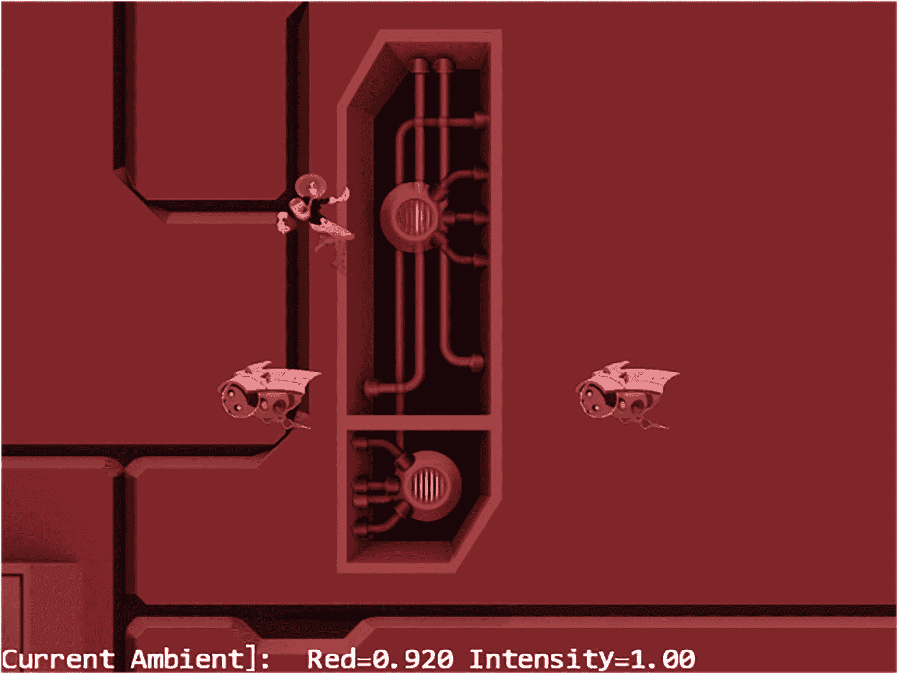

图 8-1 ¶ 运行全局环境光项目

项目控制如下：

*   **鼠标左键**：增加全局红色环境光
*   **鼠标中键**：减少全局红色环境光
*   **左/右箭头键**：减小/增大全局环境光强度

项目目标如下：

*   体验环境光的效果
*   了解如何在场景中实现简单的全局环境照明
*   重新熟悉 `SimpleShader`/`Renderable` 对结构，以便与 `GLSL` 着色器和游戏引擎交互

你可以在 `assets` 文件夹中找到以下外部资源。`fonts` 文件夹包含默认系统字体和两张纹理图片：`minion_sprite.png` 定义了英雄和小兵的精灵元素，`bg.png` 定义了背景。

#### 修改 GLSL 着色器

在为游戏引擎实现新着色器或着色功能时，`GLSL` 着色器是一个很好的起点。`GLSL` 代码的创建或修改允许你实现实际的功能细节，这反过来又作为扩展引擎的需求。例如，在该项目中，你将首先向所有现有的 `GLSL` 着色器添加环境光功能。对这一新增功能的支持随后成为指导引擎其余部分修改的需求。你将在本章的所有示例中观察到这种实现模式。因此，首先将全局环境光集成到你的 `simple_fs.glsl` 中。

1.  **通过定义两个新的 uniform 变量 `uGlobalAmbientColor` 和 `uGlobalAmbientIntensity`，并在计算每个像素的最终颜色时将这些变量与 `uPixelColor` 相乘，来修改片元着色器 `simple_fs.glsl`：**

```
precision mediump float; // 像素颜色
uniform vec4 uPixelColor;
uniform vec4 uGlobalAmbientColor;   // 全局共享
uniform float uGlobalAmbientIntensity;   // 全局共享
void main(void) {
    // 对于每个像素调用，设置为用户指定的颜色
    gl_FragColor = uPixelColor * uGlobalAmbientIntensity *
                   uGlobalAmbientColor;
}
```

2.  **同样，通过添加 uniform 变量 `uGlobalAmbientColor` 和 `uGlobalAmbientIntensity` 来修改纹理片元着色器 `texture_fs.glsl`。将这两个变量与采样的纹理颜色相乘，以创建背景光照效果。**

```
uniform sampler2D uSampler; // 像素颜色
uniform vec4 uPixelColor;
uniform vec4 uGlobalAmbientColor;   // 全局共享
uniform float uGlobalAmbientIntensity;   // 全局共享
varying vec2 vTexCoord;
void main(void) {
    // 基于 vTexCoord 中插值的 UV 值进行纹素颜色查找
    vec4 c = texture2D(uSampler, vec2(vTexCoord.s, vTexCoord.t));
    c = c * uGlobalAmbientIntensity * uGlobalAmbientColor;
    ... 与之前代码相同 ...
}
```

#### 定义为全局共享资源

环境光影响整个场景，因此相关变量必须是全局且共享的。在这种情况下，两个变量——一种颜色（环境颜色）和一个浮点数（颜色强度）——应该可被引擎的其余部分和客户端全局访问。`defaultResources` 模块非常适合此目的。编辑 `src/engine/resources/default_resources.js` 文件，定义颜色和强度变量、它们对应的 getter 和 setter，并记得导出这些功能。

```
import * as font from "./font.js";
import * as map from "../core/resource_map.js";
// 全局环境颜色
let mGlobalAmbientColor = [0.3, 0.3, 0.3, 1];
let mGlobalAmbientIntensity = 1;
function getGlobalAmbientIntensity() { return mGlobalAmbientIntensity; }
function setGlobalAmbientIntensity(v) { mGlobalAmbientIntensity = v; }
function getGlobalAmbientColor() { return mGlobalAmbientColor; }
function setGlobalAmbientColor(v) {
    mGlobalAmbientColor = vec4.fromValues(v[0], v[1], v[2], v[3]);
}
... 与之前代码相同 ...
export {
    init, cleanUp,
    // 默认系统字体名称：保证已加载
    getDefaultFontName,
    // 全局环境光：强度和颜色
    getGlobalAmbientColor, setGlobalAmbientColor,
    getGlobalAmbientIntensity, setGlobalAmbientIntensity
}
```

#### 修改 SimpleShader

现在全局环境颜色和强度已在 `GLSL` 着色器中实现，你需要修改游戏引擎的其余部分以支持新定义的功能。回顾一下，`simple_fs.glsl` 被 `SimpleShader` 类引用，而 `texture_fs.glsl` 被 `TextureShader` 类引用。由于 `TextureShader` 是 `SimpleShader` 的子类，`texture_fs.glsl` 中新定义的 `GLSL` 功能将通过适当的 `SimpleShader` 修改得到支持。

1.  **修改 `src/engine/shaders` 文件夹中的 `simple_shader.js` 文件，从 `defaultResources` 模块导入以访问全局环境光效果变量：**

```
import * as defaultResources from "../resources/default_resources.js";
```

2.  **在构造函数中定义两个新的实例变量，用于存储环境颜色和强度变量在 `GLSL` 着色器中的引用或位置：**


## 测试环境光照

现在您可以定义 `MyGame` 类来验证新定义的环境光照效果的正确性。为了应对即将到来的测试复杂性，`MyGame` 类的源代码将被分离到多个文件中，这类似于您在第 7 章中使用 `Camera` 类的经验。所有实现 `MyGame` 的文件名都将以 `my_game` 开头，并以该文件中定义的相关功能指示作为结尾。例如，在后续示例中，`my_game_light.js` 表示该文件实现光源相关逻辑。对于本项目，类似于 `Camera` 类的命名方案，`MyGame` 类的基本功能将在 `my_game_main.js` 中实现，并通过文件 `my_game.js` 进行访问。

## 步骤 1：创建 MyGame 类访问文件

在 `src/my_game` 中创建 `MyGame` 类访问文件。目前，`MyGame` 功能应从基本类实现文件 `my_game_main.js` 导入。拥有对 `MyGame` 类的完全访问权限后，在此文件中定义网页 `onload()` 函数非常方便。

```javascript
import engine from "../engine/index.js";
import MyGame from "./my_game_main.js";
window.onload = function () {
    engine.init("GLCanvas");
    let myGame = new MyGame();
    myGame.start();
}
```

## 步骤 2：创建 my_game_main.js

创建 `my_game_main.js`；从引擎访问文件 `index.js` 以及 `Hero` 和 `Minion` 导入；并记得导出 `MyGame` 功能。现在，与之前所有情况一样，将 `MyGame` 定义为 `engine.Scene` 的子类，其构造函数将实例变量初始化为 null。

```javascript
import engine from "../engine/index.js";
// user stuff
import Hero from "./objects/hero.js";
import Minion from "./objects/minion.js";

class MyGame extends engine.Scene {
    constructor() {
        super();
        this.kMinionSprite = "assets/minion_sprite.png";
        this.kBg = "assets/bg.png";
        // The camera to view the scene
        this.mCamera = null;
        this.mBg = null;
        this.mMsg = null;
        // the hero and the support objects
        this.mHero = null;
        this.mLMinion = null;
        this.mRMinion = null;
    }
    // ... implementation to follow ...
}
export default MyGame;
```

## 步骤 3：加载和卸载资源

加载和卸载背景和小兵：

```javascript
load() {
    engine.texture.load(this.kMinionSprite);
    engine.texture.load(this.kBg);
}
unload() {
    engine.texture.unload(this.kMinionSprite);
    engine.texture.unload(this.kBg);
}
```

## 步骤 4：初始化相机和场景对象

使用相应的值初始化相机和场景对象，以确保启动时有正确的场景视图。请注意场景中的简单元素：相机、大背景、一个 `Hero`、左侧和右侧 `Minion` 对象以及状态消息。

```javascript
init() {
    // Step A: set up the cameras
    this.mCamera = new engine.Camera(
        vec2.fromValues(50, 37.5), // position of the camera
        100,                       // width of camera
        [0, 0, 640, 480]           // viewport (orgX, orgY, width, height)
    );
    this.mCamera.setBackgroundColor([0.8, 0.8, 0.8, 1]); // sets the background to gray
    let bgR = new engine.SpriteRenderable(this.kBg);
    bgR.setElementPixelPositions(0, 1900, 0, 1000);
    bgR.getXform().setSize(190, 100);
    bgR.getXform().setPosition(50, 35);
    this.mBg = new engine.GameObject(bgR);
    this.mHero = new Hero(this.kMinionSprite);
    this.mLMinion = new Minion(this.kMinionSprite, 30, 30);
    this.mRMinion = new Minion(this.kMinionSprite, 70, 30);
    this.mMsg = new engine.FontRenderable("Status Message");
    this.mMsg.setColor([1, 1, 1, 1]);
    this.mMsg.getXform().setPosition(1, 2);
    this.mMsg.setTextHeight(3);
}
```

## 步骤 5：定义绘制函数

定义 `draw()` 函数。和往常一样，最后绘制状态消息，以免被其他对象遮挡。

```javascript
draw() {
    // Clear the canvas
    engine.clearCanvas([0.9, 0.9, 0.9, 1.0]); // clear to light gray
    // Set up the camera and draw
    this.mCamera.setViewAndCameraMatrix();
    this.mBg.draw(this.mCamera);
    this.mHero.draw(this.mCamera);
    this.mLMinion.draw(this.mCamera);
    this.mRMinion.draw(this.mCamera);
    this.mMsg.draw(this.mCamera); // draw last
}
```

## 步骤 6：实现更新函数

最后，实现 `update()` 函数以更新所有对象并接收对全局环境光颜色和强度的控制：

```javascript
update() {
    let deltaAmbient = 0.01;
    let msg = "Current Ambient: ";
    this.mCamera.update();   // ensure proper interpolated movement
    this.mLMinion.update();  // ensure sprite animation
    this.mRMinion.update();
    this.mHero.update();     // allow keyboard control to move
    this.mCamera.panWith(this.mHero.getXform(), 0.8);
    let v = engine.defaultResources.getGlobalAmbientColor();
    if (engine.input.isButtonPressed(engine.input.eMouseButton.eLeft))
        v[0] += deltaAmbient;
    if (engine.input.isButtonPressed(engine.input.eMouseButton.eMiddle))
        v[0] -= deltaAmbient;
    if (engine.input.isKeyPressed(engine.input.keys.Left))
        engine.defaultResources.setGlobalAmbientIntensity(
            engine.defaultResources.getGlobalAmbientIntensity() - deltaAmbient);
    if (engine.input.isKeyPressed(engine.input.keys.Right))
        engine.defaultResources.setGlobalAmbientIntensity(
            engine.defaultResources.getGlobalAmbientIntensity() + deltaAmbient);
    msg += " Red=" + v[0].toPrecision(3) + " Intensity=" +
        engine.defaultResources.getGlobalAmbientIntensity().toPrecision(3);
    this.mMsg.setText(msg);
}
```

## 观察


## 光源

观察你的周围环境，你可以看到许多类型的光源，例如，你的台灯、来自太阳的光线，或一个孤立的灯泡。孤立的灯泡可以描述为一个向各个方向均匀发光的点，即点光源。点光源是你开始分析光源的地方。

从根本上说，点光源照亮指定点周围的一个区域或半径。在三维空间中，这个照明区域就是一个球体，称为照明体积。点光源的照明体积由光源的位置（即球心）和光源照射的距离（即球的半径）定义。要观察光源的效果，必须有物体存在且位于照明体积内。

正如本章介绍中提到的，2D 引擎将需要涉足第三维度，以正确模拟光能的传播。现在，考虑你的 2D 引擎；到目前为止，你实现了一个所有东西都是 2D 的系统。另一种解释方式是：引擎在`z = 0`的单个平面上定义和渲染所有内容，并通过绘制顺序对物体进行分层。在这个系统上，你将添加存在于 3D 空间中的光源。

要观察光源的效果，其照明体积必须与定义物体的 XY 平面上的物体重叠。图 8-2 显示了位于`z = 10`处的简单点光源的照明体积与`z = 0`处的平面相交。这种相交导致平面上出现一个被照亮的圆。下一个项目实现了图 8-2，你将采用面向对象的方法来研究光源，同时遵循光源照亮场景的预期行为。这可以通过定义一个`Light`对象来表示光源来实现。

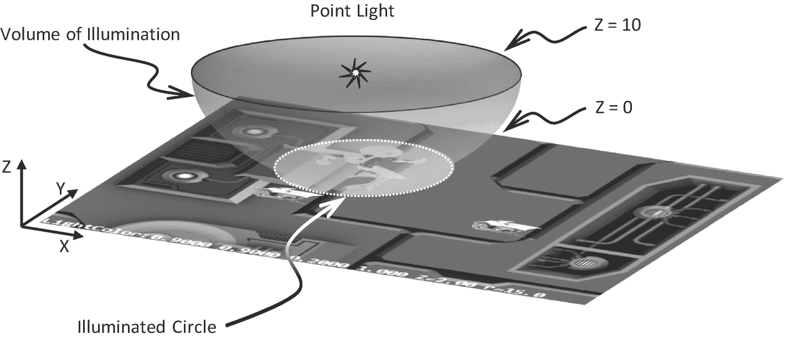

图 8-2 ¶ 点光源及其在 3D 中对应的照明体积

## GLSL 实现与游戏引擎集成

回顾一下，引擎通过`SimpleShader`/`Renderable`对的相应子类与 GLSL 着色器进行接口交互。`SimpleShader`及其子类与 GLSL 着色器交互，而`Renderable`及其子类为程序员提供了操作具有相同着色器类型的多个几何体副本的便利。例如，`texture_vs.glsl`和`texture_fs.glsl`通过`TextureShader`对象与游戏引擎交互，而`TextureRenderable`对象允许游戏程序员创建和操作由`texture_vs`/`fs`着色器着色的几何体的多个实例。图 8-3 描绘了下一个项目如何扩展此架构以实现点光源照明。`Light`类封装了点光源的属性，包括位置、半径和颜色。这些信息通过`LightShader`/`LightRenderable`对传递给 GLSL 片段着色器`light_fs`，用于计算适当的像素颜色。GLSL 顶点着色器`texture_vs`被重用，因为光源照明涉及在每个顶点处处理相同的信息。

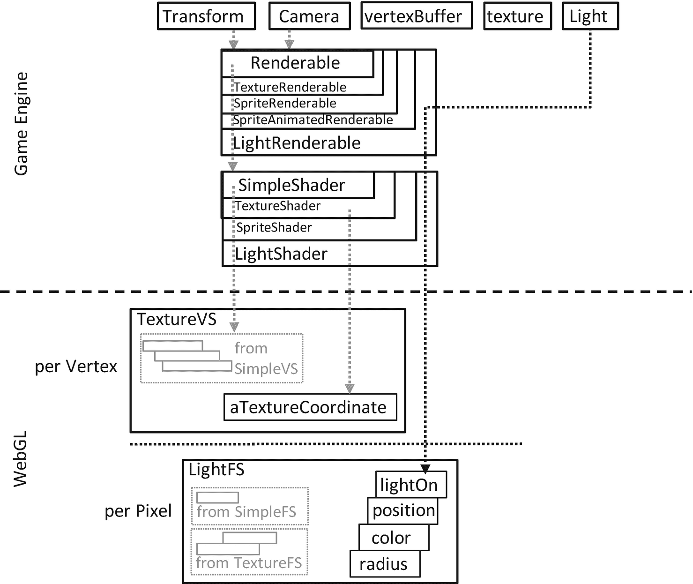

图 8-3 ¶ LightShader/LightRenderable 对及对应的 GLSL LightShader

最后，重要的是要记住，GLSL 片段着色器会为相应几何体覆盖的每个像素调用一次。这意味着你即将创建的 GLSL 片段着色器每帧将被调用多次，可能达到数十万甚至数百万次。考虑到游戏循环以实时速率（即每秒约 60 帧重绘）启动重绘，GLSL 片段着色器每秒将被调用数百万次！实现的效率对于流畅的体验至关重要。

## 简单光源着色器项目

该项目演示了如何使用简单的点光源实现照明。你可以在图 8-4 中看到该项目运行的示例。该项目的源代码位于`chapter8/8.2.simple_light_shader`文件夹中。

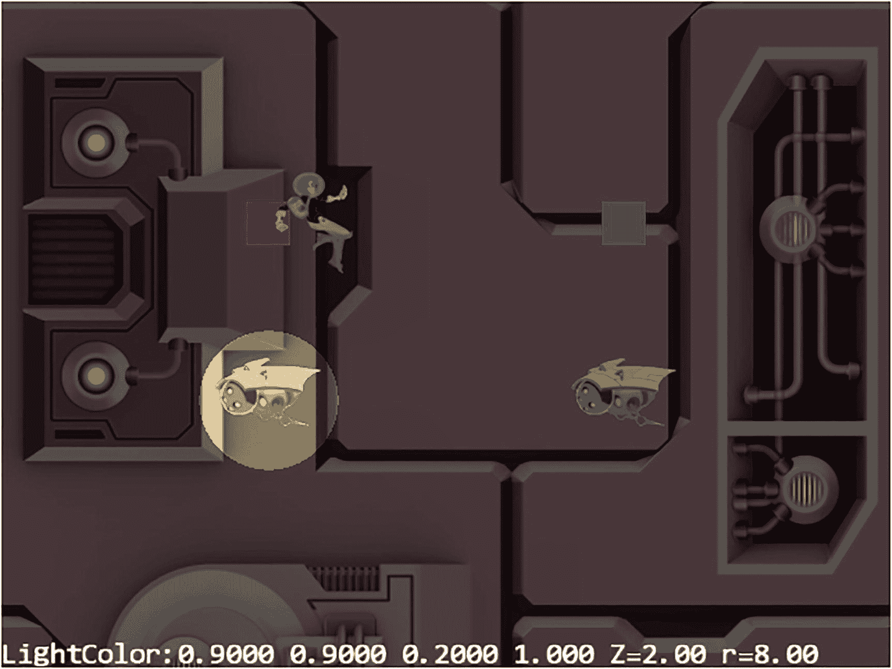

图 8-4 ¶ 运行简单光源着色器项目

项目的控制方式如下：

*   **WASD 键**：移动屏幕上的主角角色
*   **WASD 键 + 鼠标左键**：移动主角角色和光源在屏幕上移动
*   **左/右箭头键**：降低/增加光照强度
*   **Z/X 键**：增加/减少光源的 Z 位置
*   **C/V 键**：增加/减少光源半径

项目目标如下：

*   理解如何模拟点光源的照明效果
*   观察点光源照明
*   实现支持点光源照明的 GLSL 着色器

### 创建 GLSL 光源片段着色器

与上一节一样，实现将从 GLSL 着色器开始。不需要定义新的 GLSL 顶点着色器，因为涉及的逐顶点信息和计算与`texture_vs`相同。必须定义一个新的 GLSL 片段着色器来计算被照亮的圆。

1.  在`src/glsl_shaders`文件夹中，创建一个新文件并将其命名为`light_fs.glsl`。
2.  参考`texture_fs.glsl`并复制所有 uniform 和 varying 变量。这是一个重要步骤，因为`light_fs`片段着色器将通过`LightShader`类与游戏引擎交互。而`LightShader`类将作为`TextureShader`的子类实现，其中假定这些变量存在。

```
precision mediump float;
// The object that fetches data from texture.
// Must be set outside the shader.
uniform sampler2D uSampler;
// Color of pixel
uniform vec4 uPixelColor;
uniform vec4 uGlobalAmbientColor;
// this is shared globally
uniform float uGlobalAmbientIntensity;
// "varying" keyword signifies that the texture coordinate will be
// interpolated and thus varies.
varying vec2 vTexCoord;
... implementation to follow ...
```

3.  现在，定义支持点光源的变量：开/关开关、颜色、位置和半径。重要的是要注意，位置和半径的单位是像素。


## 光源信息 Uniform 变量

```glsl
// Light information uniform
bool uLightOn;
uniform vec4 uLightColor;
uniform vec3 uLightPosition;   // in pixel space!
uniform float uLightRadius;    // in pixel space!
```

## 在 `main()` 中实现光照

1. **步骤 A**：采样纹理颜色并应用环境光颜色和强度。
2. **步骤 B**：执行光源照明。这是通过确定是否需要计算来完成的——测试光源是否开启以及像素是否不透明。如果两者都满足条件，则将光源位置与当前像素之间的距离与光源半径进行比较，以确定像素是否在照明体积内。请注意，`gl_FragCoord.xyz` 是 GLSL 定义的当前像素位置变量，并且此计算假设使用像素空间单位。当所有条件都满足时，光源的颜色会累加到最终结果中。
3. **步骤 C**：应用色调并通过 `gl_FragColor` 设置最终颜色。

```glsl
void main(void) {
    // Step A: sample the texture and apply ambient
    vec4 textureMapColor = texture2D(uSampler, vec2(vTexCoord.s, vTexCoord.t));
    vec4 lgtResults = uGlobalAmbientIntensity * uGlobalAmbientColor;
    
    // Step B: decide if the light should illuminate
    if (uLightOn && (textureMapColor.a > 0.0)) {
        float dist = length(uLightPosition.xyz - gl_FragCoord.xyz);
        if (dist <= uLightRadius)
            lgtResults += uLightColor;
    }
    lgtResults *= textureMapColor;
    
    // Step C: tint texture leave transparent area defined by texture
    vec3 r = vec3(lgtResults) * (1.0 - uPixelColor.a) + vec3(uPixelColor) * uPixelColor.a;
    vec4 result = vec4(r, textureMapColor.a);
    gl_FragColor = result;
}
```

## 定义 Light 类

随着 GLSL `light_fs` 着色器的定义完成，你现在可以定义一个类来为游戏引擎封装一个点光源：

1. 在 `src/engine` 文件夹中创建一个新的 `lights` 文件夹。在 `lights` 文件夹中，添加一个新文件并将其命名为 `lights.js`。
2. 编辑 `lights.js` 以创建 `Light` 类，并定义构造函数以初始化光源颜色、位置、半径和开/关状态。别忘了导出该类。

```javascript
class Light {
    constructor() {
        this.mColor = vec4.fromValues(0.1, 0.1, 0.1, 1); // light color
        this.mPosition = vec3.fromValues(0, 0, 5); // WC light position
        this.mRadius = 10; // effective radius in WC
        this.mIsOn = true;
    }
    // ... implementation to follow ...
}
export default Light;
```

3. 为实例变量定义 getter 和 setter：

```javascript
// simple setters and getters
setColor(c) { this.mColor = vec4.clone(c); }
getColor() { return this.mColor; }

set2DPosition(p) {
    this.mPosition = vec3.fromValues(p[0], p[1], this.mPosition[2]);
}
setXPos(x) { this.mPosition[0] = x; }
setYPos(y) { this.mPosition[1] = y; }
setZPos(z) { this.mPosition[2] = z; }
getPosition() { return this.mPosition; }

setRadius(r) { this.mRadius = r; }
getRadius() { return this.mRadius; }

setLightTo(isOn) { this.mIsOn = isOn; }
isLightOn() { return this.mIsOn; }
```

最后，记得更新引擎访问文件 `index.js`，以将新定义的功能转发给客户端。

## 定义 LightShader 类

`LightShader` 类继承自 `SpriteShader`，用于封装向 `light_fs` 片元着色器中为点光源定义的 uniform 变量传递特定值的通信过程。这样，`LightShader` 类就可以作为 GLSL 片元着色器的一个便捷接口。

1. 在 `src/engine/shaders` 文件夹中，创建一个新文件并将其命名为 `light_shader.js`。
2. 定义 `LightShader` 类作为 `SpriteShader` 的子类。在构造函数中，定义支持将与点光源相关的信息发送到 `light_fs` 片元着色器所需的变量。引擎中的点光源信息存储在 `mLight` 中，而对 `Camera` 的引用对于将所有信息从世界坐标系 (WC) 转换到像素空间至关重要。构造函数的最后四行查询以获取 `light_fs` 中 uniform 变量的引用位置。别忘了导出该类。

```javascript
import SpriteShader from "./sprite_shader.js";
import * as glSys from "../core/gl.js";

class LightShader extends SpriteShader {
    constructor(vertexShaderPath, fragmentShaderPath) {
        // Call super class constructor
        super(vertexShaderPath, fragmentShaderPath);
        
        // glsl uniform position references
        this.mColorRef = null;
        this.mPosRef = null;
        this.mRadiusRef = null;
        this.mIsOnRef = null;
        this.mLight = null;  // the light source in the Game Engine
        this.mCamera = null; // camera to draw, need for WC to DC xform
        
        // create the references to these uniforms in the LightShader
        let shader = this.mCompiledShader;
        let gl = glSys.get();
        this.mColorRef = gl.getUniformLocation(shader, "uLightColor");
        this.mPosRef = gl.getUniformLocation(shader, "uLightPosition");
        this.mRadiusRef = gl.getUniformLocation(shader, "uLightRadius");
        this.mIsOnRef = gl.getUniformLocation(shader, "uLightOn");
    }
    // ... implementation to follow ...
}
export default LightShader;
```

3. 定义一个简单的 setter 函数，将光源和相机与着色器关联：

```javascript
setCameraAndLight(c, l) {
    this.mCamera = c;
    this.mLight = l;
}
```

4. 重写 `activate()` 函数，以在光源存在时追加加载 `mLight` 中点光源信息的新功能。请注意，你仍然需要调用超类的 `activate()` 函数，以将其余值传递给 `light_fs` 片元着色器的 uniform 变量。

```javascript
activate(pixelColor, trsMatrix, cameraMatrix) {
    // first call the super class' activate
    super.activate(pixelColor, trsMatrix, cameraMatrix);
    if (this.mLight !== null) {
        this._loadToShader();
    } else {
        glSys.get().uniform1i(this.mIsOnRef, false); // switch off light!
    }
}
```

5. 实现 `_loadToShader()` 函数，将点光源的值传递给着色器中的 uniform 变量。回想一下，这种通信是通过构造函数中创建的引用和设置 uniform 的函数来执行的。重要的是要注意，相机提供了新的坐标空间变换功能 `wcPosToPixel()` 和 `wcSizeToPixel()`。这两个函数确保 `light_fs` 中的相应值处于像素空间中，以便执行相关计算，例如位置之间的距离。这些函数的实现稍后将进行探讨。

```javascript
_loadToShader(aCamera) {
    let gl = glSys.get();
    gl.uniform1i(this.mIsOnRef, this.mLight.isLightOn());
    if (this.mLight.isLightOn()) {
        let p = this.mCamera.wcPosToPixel(this.mLight.getPosition());
        let r = this.mCamera.wcSizeToPixel(this.mLight.getRadius());
        let c = this.mLight.getColor();
        gl.uniform4fv(this.mColorRef, c);
        gl.uniform3fv(this.mPosRef, vec3.fromValues(p[0], p[1], p[2]));
        gl.uniform1f(this.mRadiusRef, r);
    }
}
```

## 定义 LightRenderable 类

随着 `LightShader` 的定义完成，可以与 GLSL `light_fs` 着色器进行交互，你现在可以专注于为游戏程序员定义一个新的 `Renderable` 类。重要的是，光源必须能照射并照亮所有 `Renderable` 类型，包括带有纹理和动画精灵的类型。因此，新类必须封装所有现有的 `Renderable` 功能，并成为 `SpriteAnimateRenderable` 的子类。你可以将这个新类视为一个可以被 `Light` 对象照亮的 `SpriteAnimateRenderable`。

1. 


## 创建 LightRenderable 类

## 1. 创建文件

在 `src/engine/renderables` 文件夹下创建新文件，命名为 `light_renderable.js`。

## 2. 定义 LightRenderable 类

定义 `LightRenderable` 类继承 `SpriteAnimateRenderable`，将着色器设置为引用新的 `LightShader`，并在构造函数中初始化 `Light` 引用。这是照亮 `SpriteAnimateRenderable` 的光源。别忘了导出该类。

```javascript
import SpriteAnimateRenderable from "./sprite_animate_renderable.js";
import * as defaultShaders from "../core/shader_resources.js";

class LightRenderable extends SpriteAnimateRenderable {
    constructor(myTexture) {
        super(myTexture);
        super._setShader(defaultShaders.getLightShader());
        // here is the light source
        this.mLight = null;
    }
    // ... implementation to follow ...
}
export default LightRenderable;
```

## 3. 定义 draw 函数

定义 `draw` 函数，在调用超类 `draw()` 函数完成绘制前，将摄像机和照明光源传递给 `LightShader`：

```javascript
draw(camera) {
    this.mShader.setCameraAndLight(camera, this.mLight);
    super.draw(camera);
}
```

## 4. 添加光源获取与设置支持

最后，添加获取和设置光源的支持：

```javascript
getLight() { return this.mLight; }
addLight(l) { this.mLight = l; }
```

继续之前，请记得更新引擎访问文件 `index.js`，将新定义的功能转发给客户端。

## 定义默认 LightShader 实例

如前所述，当你首次定义 `TextureShader`（第 5 章）时，每种着色器类型只需要一个实例，且所有着色器始终由相应的 `Renderable` 类型对游戏程序员隐藏。每个着色器类型的实例在引擎初始化期间由 `src/engine/core` 文件夹中的 `shaderResources` 模块创建。

现在可以修改引擎，以支持 `LightShader` 对象的引擎级初始化、加载和卸载：

## 1. 编辑 shader_resources.js

编辑 `src/engine/core` 文件夹中的 `shader_resources.js`，导入 `LightShader`；定义 GLSL 源代码路径、对应变量和着色器访问函数：

```javascript
// ... identical to previous code ...
import LightShader from "../shaders/light_shader.js";
// Light Shader
let kLightFS = "src/glsl_shaders/light_fs.glsl"; // FragmentShader
let mLightShader = null;
function getLightShader() { return mLightShader; }
```

## 2. 在 createShaders() 中创建光着色器实例

在 `createShaders()` 函数中创建新的光着色器实例：

```javascript
function createShaders() {
    mConstColorShader = new SimpleShader(kSimpleVS, kSimpleFS);
    mTextureShader = new TextureShader(kTextureVS, kTextureFS);
    mSpriteShader = new SpriteShader(kTextureVS, kTextureFS);
    mLineShader = new LineShader(kSimpleVS, kLineFS);
    mLightShader = new LightShader(kTextureVS, kLightFS);
}
```

## 3. 在 init() 中加载光着色器 GLSL 源代码

在 `init()` 函数中加载光着色器 GLSL 源代码：

```javascript
function init() {
    let loadPromise = new Promise(
        async function(resolve) {
            await Promise.all([
                text.load(kSimpleFS),
                text.load(kSimpleVS),
                text.load(kTextureFS),
                text.load(kTextureVS),
                text.load(kLineFS),
                text.load(kLightFS)
            ]);
            resolve();
        }
    ).then(
        function resolve() { createShaders(); }
    );
    map.pushPromise(loadPromise);
}
```

## 4. 清理时释放 GLSL 资源并卸载源代码

清理时记得释放 GLSL 资源并卸载源代码：

```javascript
function cleanUp() {
    mConstColorShader.cleanUp();
    mTextureShader.cleanUp();
    mSpriteShader.cleanUp();
    mLineShader.cleanUp();
    mLightShader.cleanUp();
    text.unload(kSimpleVS);
    text.unload(kSimpleFS);
    text.unload(kTextureVS);
    text.unload(kTextureFS);
    text.unload(kLineFS);
    text.unload(kLightFS);
}
```

## 5. 导出访问函数

最后，导出访问函数以允许在引擎中共享创建的实例：

```javascript
export {init, cleanUp,
    getConstColorShader, getTextureShader,
    getSpriteShader, getLineShader, getLightShader}
```

## 修改 Camera

`Camera` 实用函数（如 `wcPosToPixel()`）在渲染 `LightShader` 对象时会被多次调用。这些函数计算世界坐标（WC）与像素空间之间的变换。该变换需要计算中间值（例如 WC 窗口的左下角），这些值在每次渲染调用期间不会改变。为避免重复计算这些值，应为 `Camera` 对象定义每次渲染调用的缓存。

## 为 Camera 定义每次渲染的缓存

定义每次渲染的缓存，存储支持着色操作所需的中间值：

### 1. 编辑 camera_main.js 并定义 PerRenderCache 类

在构造函数中，定义变量以保存 WC 空间与像素空间的比率以及 Camera 的原点。这些是计算 WC 到像素空间变换所需的中间值，一旦渲染开始这些值就不再改变。

```javascript
class PerRenderCache {
    // Information to be updated once per render for efficiency concerns
    constructor() {
        this.mWCToPixelRatio = 1; // WC to pixel transformation
        this.mCameraOrgX = 1; // Lower-left corner of camera in WC
        this.mCameraOrgY = 1;
    }
}
```

### 2. 修改 Camera 类以实例化 PerRenderCache 对象

重要的是要注意，此变量代表信息的本地缓存，应对引擎其余部分隐藏。

```javascript
constructor(wcCenter, wcWidth, viewportArray, bound) {
    // ... identical to previous code ...
    // per-rendering cached information
    // needed for computing transforms for shaders
    // updated each time in SetupViewProjection()
    this.mRenderCache = new PerRenderCache();
    // SHOULD NOT be used except
    // xform operations during the rendering
    // Client game should not access this!
}
```

### 3. 在 setViewAndCameraMatrix() 中初始化每次渲染的缓存

通过添加步骤 B3，根据 Camera 视口宽度、世界宽度和世界高度计算并设置缓存：

```javascript
setViewAndCameraMatrix() {
    // ... identical to previous code ...
    // Step B2: first operation is to translate camera center to origin
    mat4.translate(this.mCameraMatrix, this.mCameraMatrix,
        vec3.fromValues(-center[0], -center[1], 0));
    // Step B3: compute and cache per-rendering information
    this.mRenderCache.mWCToPixelRatio =
        this.mViewport[eViewport.eWidth] / this.getWCWidth();
    this.mRenderCache.mCameraOrgY = center[1] - (this.getWCHeight() / 2);
    this.mRenderCache.mCameraOrgX = center[0] - (this.getWCWidth() / 2);
}
```

注意 `PerRenderCache` 类完全局限于 `camera_main.js` 文件。隐藏并谨慎处理复杂的本地缓存功能非常重要。

## 添加 Camera 变换函数

现在每次渲染的缓存已定义并正确初始化，可以扩展 Camera 功能以支持从 WC 到像素空间的变换。为代码可读性和可维护性，此功能将在单独文件中实现。另一个重要注意事项：由于你要从 WC 转换到像素空间，而像素空间没有 z 轴，因此需要为像素空间坐标计算一个“假的” z 值。

### 1. 编辑 Camera 访问文件 camera.js

从将包含最新功能添加的文件 `camera_xform.js` 导入 WC 到像素空间变换支持：

```javascript
import Camera from "./camera_xform.js";
export default Camera;
```

### 2.


### 测试光源

必须修改 MyGame 关卡以使用并测试新定义的光源功能。

### 修改 Hero 和 Minion

修改 `Hero` 和 `Minion` 类以适配新的 `LightRenderable` 对象：

#### 步骤 1

编辑 `src/my_game/objects` 文件夹中的 `hero.js` 文件；在构造函数中，将 `SpriteRenderable` 替换为 `LightRenderable` 实例化：

```javascript
constructor(spriteTexture) {
    super(null);
    this.kDelta = 0.3;
    this.mRenderComponent = new engine.LightRenderable(spriteTexture);
    // ... identical to previous code ...
}
```

#### 步骤 2

编辑 `src/my_game/objects` 文件夹中的 `minion.js` 文件；在构造函数中，将 `SpriteRenderable` 替换为 `LightRenderable` 实例化：

```javascript
constructor(spriteTexture, atX, atY) {
    super(null);
    this.kDelta = 0.2;
    this.mRenderComponent = new engine.LightRenderable(spriteTexture);
    // ... identical to previous code ...
}
```

### 修改 MyGame 对象

随着光源实现的完成和游戏对象的妥善更新，你现在可以修改 MyGame 关卡以显示和测试光源。由于在 `my_game_main.js` 文件中为新对象添加变量、初始化对象、绘制对象和更新对象的代码更改既简单又重复，此处不再展示详细内容。

### 观察结果

项目现已完成，你可以运行它并检查结果。有几个观察点值得注意。首先是光源产生的照明效果看起来像一个圆圈。如图 8-2 所示，这是点光源在 `z = 0` 平面（你的对象所在平面）上形成的照明圆圈。按 `Z` 或 `X` 键增加或减少光源的 `z` 位置，观察照明圆圈因相交面积变化而缩小和增大。当你继续增加/减少 `z` 位置时，可以验证球体/平面相交的结果。照明圆圈最终将开始缩小，当球体移离 `z=0` 平面的距离超过其半径时，圆圈将完全消失。

你也可以按 `C` 或 `V` 键增加或减少点光源半径，以增大或减小照明体积，并观察照明圆圈半径的相应变化。

现在，按 `WASD` 键并配合鼠标左键移动 Hero，观察点光源始终跟随 Hero 并正确照亮背景。请注意，光源照亮了左侧的 Minion、Hero 和背景，但**没有**照亮场景中的另外三个对象。这是因为右侧的 Minion 和红绿方块不是 `LightRenderable` 对象，因此无法被定义的光源照亮。

## 多光源与距离衰减

在之前的项目中，定义了一个具有照亮球形体积能力的单个点光源。这种类型的光源在许多游戏中很有用，但仅限于单个光源是一种限制。引擎应支持来自多个光源的照明，以满足不同游戏的设计需求。这一缺陷将在下一个项目中通过对多光源的通用支持得到解决。多光源的实现原则与之前的项目相同，修改点在于将单个光源替换为光源数组。如图 8-5 所示，将定义一个新的 `Light` 对象，而 `LightRenderable` 对象将被修改以支持 `Light` 对象数组。`LightShader` 对象将定义一个 `ShaderLightAtIndex` 对象数组，它们能够将光源信息传递给 GLSL `light_fs` 片段着色器中的 `uLights` 数组，以进行照明计算。

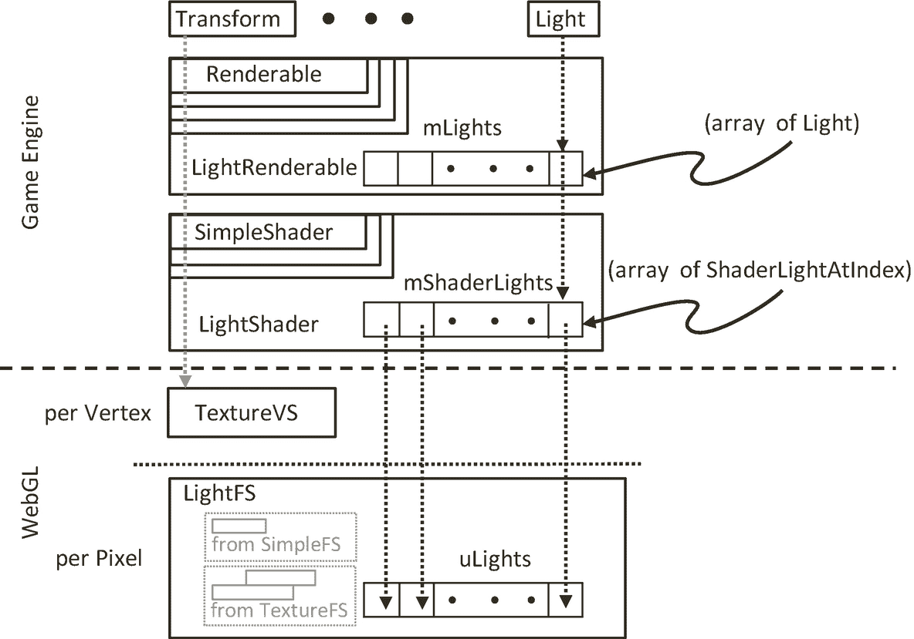

**图 8-5 ¶ 多光源支持**

之前项目的点光源照明结果可以得到改进。你可能已经观察到，在其边界处，照明圆圈会突然消失，亮度过渡生硬。这种照明效果的骤然消失不符合现实生活，在现实中，给定光源的效果会随距离逐渐减弱，而不是突然关闭。一个更具视觉愉悦感的光照明结果应显示一个照明圆圈，其边界处的照明效果逐渐消失。这种光照明效果随距离逐渐减弱的现象称为**距离衰减**。通常做法是用二次函数来近似远距离衰减，因为它们产生的效果类似于现实世界。一般来说，距离衰减可以用多种方式近似，且常针对游戏需求进行细化。

在下文中，你将实现近截断距离和远截断距离，即距离光源两个位置，距离衰减效果将在这两个位置开始和结束。这两个值让你能控制光源显示一个完全照明的中心区域，照明衰减仅在指定距离处发生。最后，将定义光强度，以允许在不改变颜色的情况下调暗光线。有了这些额外参数，就可以定义截然不同的效果。例如，你可以拥有一个柔和、几乎难以察觉且覆盖范围广的光源，或者一个过度饱和、发光且集中在场景小区域内的光源。

### 多光源项目


本项目演示了如何在单个场景中实现多个点光源。它还演示了如何提升点光源模型的复杂度，使其更加灵活，从而服务于更广泛的用途。您可以在图 8-6 中看到该项目运行的示例。该项目的源代码位于 `chapter8/8.3.multiple_lights` 文件夹中。

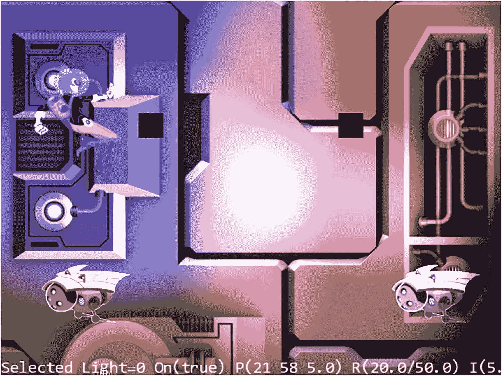

**图 8-6 ¶ 运行多光源项目**

项目控制方式如下：

*   **WASD 键**：移动屏幕上的主角角色
*   **数字键 0、1、2 和 3**：选择对应的光源
*   **方向键**：移动当前选中的光源
*   **Z/X 键**：增加/减小光源的 z 位置
*   **C/V 和 B/N 键**：增加/减小选中光源的近裁剪和远裁剪距离
*   **K/L 键**：增加/减小选中光源的强度
*   **H 键**：切换选中光源的开/关状态

项目目标如下：

*   在引擎和 GLSL 着色器中构建支持多光源的基础设施
*   理解并检验光照的距离衰减效果
*   体验在场景中控制和操纵多个光源

## 修改 GLSL 光照片元着色器

`light_fs` 片元着色器需要修改以支持距离衰减、裁剪范围和多光源：

1.  在 `light_fs.glsl` 文件中，移除为单个光源添加的光照变量，并添加一个用于保存光照信息的结构体，该结构体包含位置、颜色、近距离、远距离、强度和开/关变量。定义好结构体后，向片元着色器添加一个光源统一变量数组。请注意，已添加一个 `#define` 来保存要使用的光源数量。

> **注意**
>
> GLSL 要求数组大小和循环迭代次数必须是常量。`kGLSLuLightArraySize` 是光源数组大小和相应循环迭代控制的常量。请随意更改此值，以定义硬件所能支持的任意数量的光源。例如，您可以尝试将光源数量增加到 50，然后测试和衡量性能。

```glsl
// 光照信息
#define kGLSLuLightArraySize 4     // GLSL 片元着色器要求循环控制
                                   // 变量为常数。这个数字 4 表示，
                                   // 该片元着色器将 _ 始终 _ 处理
                                   // 所有 4 个光源。
                                   // **********警告**************
                                   // 此数字必须与 LightShader.js 文件中定义的
                                   // 同名常量对应。
                                   // **********警告**************
                                   // 更改此数字时，请务必：更新
                                   // LightShader.js 文件中定义的
                                   // kGLSLuLightArraySize。
struct Light {
    vec3 Position;   // 以像素空间为单位！
    vec4 Color;
    float Near;      // 以像素空间为单位的距离
    float Far;       // 以像素空间为单位的距离
    float Intensity;
    bool IsOn;
};
uniform Light uLights[kGLSLuLightArraySize];     // 此着色器支持的最大光源数组
```

2.  定义 `LightEffect()` 函数以计算来自光源的照明结果。该函数利用光源与当前像素之间的距离，判断像素位于近半径内、近远半径之间，还是远半径之外。如果像素位置位于近半径内，则无衰减，强度设为 1。如果位置位于近半径和远半径之间，则强度由二次函数调制。大于远半径的距离将导致相应光源不产生任何照明，即强度为 0。

```glsl
vec4 LightEffect(Light lgt) {
    vec4 result = vec4(0);
    float strength = 0.0;
    float dist = length(lgt.Position.xyz - gl_FragCoord.xyz);
    if (dist <= lgt.Far) {
        if (dist <= lgt.Near)
            strength = 1.0;  // 无衰减
        else {
            // 简单的二次衰减
            float n = dist - lgt.Near;
            float d = lgt.Far - lgt.Near;
            strength = smoothstep(0.0, 1.0, 1.0-(n*n)/(d*d));
                            // 混合衰减
        }
    }
    result = strength * lgt.Intensity * lgt.Color;
    return result;
}
```

3.  修改 `main()` 函数以遍历所有定义的光源，并调用 `LightEffect()` 函数计算和累加数组中相应光源的贡献：

```glsl
void main(void) {
    // 基于 uPixelColor 设置的简单着色
    vec4 textureMapColor = texture2D(uSampler,
                                     vec2(vTexCoord.s, vTexCoord.t));
    vec4 lgtResults = uGlobalAmbientIntensity * uGlobalAmbientColor;
    // 现在决定是否由光源照明
    if (textureMapColor.a > 0.0) {
        for (int i=0; i<kGLSLuLightArraySize; i++) {
            if (uLights[i].IsOn) {
                lgtResults += LightEffect(uLights[i]);
            }
        }
    }
    lgtResults *= textureMapColor;
    ... 与之前的代码相同 ...
}
```

## 修改 Light 类

游戏引擎 `Light` 对象必须修改以反映 `light_fs` 片元着色器中新增的属性：近衰减、远衰减和强度。

1.  修改 `Lights.js` 构造函数以定义新属性的变量：

```javascript
constructor() {
    this.mColor = vec4.fromValues(0.1, 0.1, 0.1, 1);  // 光照颜色
    this.mPosition = vec3.fromValues(0, 0, 5); // 世界坐标系下的光源位置
    this.mNear = 5;   // 世界坐标系下的有效半径
    this.mFar = 10;   // 近距离内全亮，远距离外关闭
    this.mIntensity = 1;
    this.mIsOn = true;
}
```

2.  为这些变量定义相应的 get 和 set 访问器。请注意，radius 变量已被泛化，并由近裁剪和远裁剪距离取代。

```javascript
setNear(n) { this.mNear = n; }
getNear() { return this.mNear; }
setFar(f) { this.mFar = f; }
getFar() { return this.mFar; }
setIntensity(i) { this.mIntensity = i; }
getIntensity() { return this.mIntensity; }
setLightTo(on) { this.mIsOn = on; }
```

## 定义 LightSet 类

您将定义一个 `LightSet` 类，以便于处理 `Light` 对象的集合。在 `src/engine/lights` 文件夹中，创建一个新文件并命名为 `light_set.js`。定义用于操作 `Light` 对象集合的基本接口。

```javascript
class LightSet {
    constructor() { this.mSet = []; }
    numLights() { return this.mSet.length; }
    getLightAt(index) { return this.mSet[index]; }
    addToSet(light) { this.mSet.push(light); }
}
export default LightSet;
```

最后，别忘了导出该类，并记得更新引擎访问文件 `index.js`，将新定义的功能转发给客户端。

## 定义 ShaderLightAt 类

定义 `ShaderLightAt` 类，将 `Light` 对象的信息发送给 `light_fs` GLSL 片元着色器中 `uLights` 数组的一个元素：

1.  在 `src/engine/shaders` 文件夹中，创建一个新文件并命名为 `shader_light_at.js`；定义 `ShaderLightAt` 类及其构造函数，接收一个着色器和 `uLight` 数组的索引。别忘了导出该类。

```javascript
import * as glSys from "../core/gl.js";
class ShaderLightAt {
    constructor(shader, index) {
        this._setShaderReferences(shader, index);
    }
    ... 后续实现 ...
}
export default ShaderLightAt;
```

2.  实现 `_setShaderReferences()` 函数，将光源属性引用设置为 `light_fs` 片元着色器中 `uLights` 数组的特定索引：


## ShaderLightAt 类实现

```javascript
_setShaderReferences(aLightShader, index) {
    let gl = glSys.get();
    this.mColorRef = gl.getUniformLocation(
        aLightShader, "uLights[" + index + "].Color");
    this.mPosRef = gl.getUniformLocation(
        aLightShader, "uLights[" + index + "].Position");
    this.mNearRef = gl.getUniformLocation(
        aLightShader, "uLights[" + index + "].Near");
    this.mFarRef = gl.getUniformLocation(
        aLightShader, "uLights[" + index + "].Far");
    this.mIntensityRef = gl.getUniformLocation(
        aLightShader, "uLights[" + index + "].Intensity");
    this.mIsOnRef = gl.getUniformLocation(
        aLightShader, "uLights[" + index + "].IsOn");
}
```

### 步骤 3：实现 `loadToShader()` 函数

实现 `loadToShader()` 函数以将光源属性推送到 `light_fs` 片段着色器。注意此函数类似于之前项目中 `light_shader.js` 文件中定义的 `_loadToShader()` 函数。重要区别在于，在这种情况下，光源信息被加载到特定的数组索引。

```javascript
loadToShader(aCamera, aLight) {
    let gl = glSys.get();
    gl.uniform1i(this.mIsOnRef, aLight.isLightOn());
    if (aLight.isLightOn()) {
        let p = aCamera.wcPosToPixel(aLight.getPosition());
        let n = aCamera.wcSizeToPixel(aLight.getNear());
        let f = aCamera.wcSizeToPixel(aLight.getFar());
        let c = aLight.getColor();
        gl.uniform4fv(this.mColorRef, c);
        gl.uniform3fv(this.mPosRef, vec3.fromValues(p[0], p[1], p[2]));
        gl.uniform1f(this.mNearRef, n);
        gl.uniform1f(this.mFarRef, f);
        gl.uniform1f(this.mIntensityRef, aLight.getIntensity());
    }
}
```

### 步骤 4：定义 `switchOffLight()` 函数

定义一个简单函数以更新 `light_fs` 片段着色器数组中光源的开/关状态：

```javascript
switchOffLight() {
    let gl = glSys.get();
    gl.uniform1i(this.mIsOnRef, false);
}
```

注意 `ShaderLightAt` 类是为将光源加载到 GLSL 片段着色器中的特定数组元素而定义的。这是内部引擎操作。游戏程序员无需访问此类，因此引擎访问文件 `index.js` 不应修改以转发此类的定义。

## 修改 LightShader 类

现在必须修改 `LightShader` 对象以正确处理 `Light` 对象与 `light_fs` 片段着色器中光源数组之间的通信：

### 步骤 1：编辑 `light_shader.js`

首先编辑 `light_shader.js` 文件，导入 `ShaderLightAt`，并**移除** `_loadToShader()` 函数。实际的光源信息加载到 `light_fs` 片段着色器现在由新定义的 `ShaderLightAt` 对象处理。

```javascript
import ShaderLightAt from "./shader_light_at.js";
```

### 步骤 2：修改构造函数

修改构造函数以定义 `mLights`，即 `ShaderLightAt` 对象数组，对应 `light_fs` 片段着色器中定义的 `uLights` 数组。重要的是要注意 `mLights` 和 `uLights` 数组必须完全相同大小。

```javascript
constructor(vertexShaderPath, fragmentShaderPath) {
    // Call super class constructor
    super(vertexShaderPath, fragmentShaderPath);
    this.mLights = null;  // lights from the Renderable
    this.mCamera = null;  // camera to draw, need for WC to DC xform
    // *****WARNING**********
    // MUST correspond to GLSL uLight[] array size (for LightFS.glsl)
    // **********************
    this.kGLSLuLightArraySize = 4;  // must be the same as LightFS.glsl
    this.mShaderLights = [];
    let i, ls;
    for (i = 0; i < this.kGLSLuLightArraySize; i++) {
        ls = new ShaderLightAt(this.mCompiledShader, i);
        this.mShaderLights.push(ls);
    }
}
```

### 步骤 3：修改 `activate()` 函数

修改 `activate()` 函数以迭代并通过调用相应的 `loadToShader()` 函数将每个 `ShaderLightAt` 对象的内容加载到 `light_fs` 着色器。回想一下 GLSL 片段着色器要求 for 循环控制变量为常量。这意味着 `uLights` 数组的所有元素将在每次 `light_fs` 调用时被处理。因此，确保所有未使用的光源被关闭非常重要。这由以下代码中的最后一个 while 循环确保：

```javascript
activate(pixelColor, trsMatrix, cameraMatrix) {
    // first call the super class' activate
    super.activate(pixelColor, trsMatrix, cameraMatrix);
    // now push the light information to the shader
    let numLight = 0;
    if (this.mLights !== null) {
        while (numLight < this.mLights.length) {
            this.mShaderLights[numLight].loadToShader(
                this.mCamera, this.mLights[numLight]);
            numLight++;
        }
    }
    // switch off the left over ones.
    while (numLight < this.kGLSLuLightArraySize) {
        this.mShaderLights[numLight].switchOffLight(); // off the un-use
        numLight++;
    }
}
```

### 步骤 4：重命名 `setCameraAndLight()` 为 `setCameraAndLights()`

重命名 `setCameraAndLight()` 函数为 `setCameraAndLights()`；除了设置相应变量外，检查以确保光源数组大小不大于 `light_fs` 片段着色器中定义的数组大小。最后，记得在 `sprite_shader.js` 中更新相应的函数名。

```javascript
setCameraAndLights(c, l) {
    this.mCamera = c;
    this.mLights = l;
    if (this.mLights.length > this.kGLSLuLightArraySize)
        throw new Error ("Error: " ...);
}
```

## 修改 LightRenderable 类

现在可以修改 `LightRenderable` 类以支持多光源：

### 步骤 1：更新构造函数

在 `LightRenderable` 构造函数中，将单个光源引用变量替换为数组：

```javascript
constructor(myTexture) {
    super(myTexture);
    super._setShader(defaultShaders.getLightShader());
    // the light sources
    this.mLights = [];
}
```

### 步骤 2：更新 `draw()` 函数

确保更新 `draw` 函数以反映多光源的变化：

```javascript
draw(camera) {
    this.mShader.setCameraAndLights(camera, this.mLights);
    super.draw(camera);
}
```

### 步骤 3：定义光源数组的访问器函数

```javascript
getLightAt(index) { return this.mLights[index]; }
addLight(l) { this.mLights.push(l); }
```

## 使用 MyGame 测试光源

通过引擎中多光源支持的正确集成，现在可以修改 `MyGame` 来测试实现并检查结果。除了向场景添加多个光源外，还将添加控制每个光源属性的能力。为了保持可读性，将光源实例化和控制分离到不同的文件中。为了避免冗余和重复的代码列表，不展示简单实现的细节。

### 步骤 1：修改 `my_game_main.js`

修改 `src/my_game` 文件夹中的 `my_game_main.js` 文件以反映构造函数、`initialize` 函数、`draw` 函数和 `update` 函数的变化。所有这些变化都围绕通过光源集合处理多光源。

### 步骤 2：创建 `my_game_lights.js`

在 `src/my_game` 文件夹中，创建新文件 `my_game_lights.js` 以从 `my_game_main.js` 导入 `MyGame` 类并添加实例化和初始化光源的功能。

### 步骤 3：创建 `my_game_light_control.js`

在 `src/my_game` 文件夹中，创建新文件 `my_game_light_control.js` 以从 `my_game_lights.js` 导入并继续向 `MyGame` 添加光源控制。

### 步骤 4：修改 `my_game.js`

修改 `my_game.js` 以从 `my_game_light_control.js` 导入，确保访问所有新定义的功能。

## 观察


## 漫反射与法线贴图

## 项目实验

运行项目以检查实现。尝试使用 `0`、`1`、`2` 和 `3` 键选择灯光，并切换选中灯光的开/关状态。注意，游戏程序员可以控制哪个灯光照亮哪个对象：所有灯光都照亮背景，而主角仅由灯光 `0` 和 `3` 照亮，左侧小兵仅由灯光 `1` 和 `3` 照亮，右侧小兵仅由灯光 `2` 和 `3` 照亮。

使用 `WASD` 键移动主角对象，观察其穿过光源 `0` 的近半径和远半径时照明如何变化。选中光源 `0` 后（按 `0`），按 `C` 键增加光源的近半径。注意，随着近半径接近远半径的值，照亮的圆形边界边缘也会变得更锐利。最终，当近半径大于远半径时，你可以再次观察到边界处的突然亮度变化。你正在观察底层照明模型的一个隐含假设被违反的情况：即近半径总是小于远半径。按 `N` 键减小远半径也可以创造完全相同的情况。

你可以使用方向键移动光源，以观察光的叠加特性。尝试改变光源的 `z` 位置及其近/远值，观察如何通过不同的 `z`/近/远设置实现相似的照明效果。特别地，尝试使用 `K/L` 键调整光强，以观察过度曝光和几乎难以察觉的照明效果。你可以持续按 `L` 键直到强度变为负值，从而创建一个从场景中移除颜色的光源。场景中的两个恒定颜色方块用于确认未被照明的对象仍然可以被渲染。

## 表面法线向量

尽管看起来很奇怪，但在 2D 世界中，图 8-7 左侧图像的结果是意料之中的。那些垂直面只是美术表现，你的照明计算并不考虑图像内容所暗示的几何轮廓。本节通过引入漫反射和法线贴图来近似表面法线向量，从而解决了平面 2D 世界中照明的这一限制。


图 8-7 ¶ 左图：来自前一个项目。右图：预期照明效果

如图 8-8 左图所示，表面法线向量、表面法线或法线是指与给定表面元素垂直的向量。图 8-8 右图显示，在 3D 空间中，物体的表面法线向量描述了物体的形状或轮廓。


图 8-8 ¶ 物体的表面法线向量

## 漫反射照明

人眼对光照的观察，是光源发出的可见能量经物体表面反射后到达眼睛的结果。漫反射、哑光或朗伯表面会向各个方向均匀地反射光能量。漫反射表面的例子包括普通打印纸或哑光漆面。图 8-9 展示了一个光源照亮三个漫反射表面元素位置 A、B 和 C 的情况。首先，注意从被照亮位置指向光源的方向被定义为该位置的光线向量 `\hat{L}`。重要的是要注意，`\hat{L}` 向量的方向始终指向光源，并且这是一个大小为 1 的归一化向量。


图 8-9 ¶ 法线与光线向量及漫反射照明

图 8-9 还通过示例展示了漫反射照明，即漫反射的大小。位置 A 无法从给定光源接收任何能量，因为其法线向量 `\hat{N}` 与其光线向量 `\hat{L}` 垂直，即 `\hat{N} \bullet \hat{L} = 0`。位置 B 可以接收所有能量，因为其法线向量与其光线向量指向相同方向，即 `\hat{N} \bullet \hat{L} = 1`。一般来说，如位置 C 所示，漫反射表面接收并反射的光能量比例与其法线与光线向量之间夹角的余弦成正比，即 `\hat{N} \bullet \hat{L}`。在照明模型中，包含 `\hat{N} \bullet \hat{L}` 计算的项被称为漫反射分量或朗伯分量。

## 3D 形状感知

人类视觉系统主要基于 `\hat{N} \bullet \hat{L}`（即漫反射分量）来推断 3D 几何形状轮廓。例如，图 8-10 展示了带有（左图）和不带有（右图）相应漫反射分量的球体和环面（甜甜圈形状物体）。显然，在两种情况下，物体的 3D 轮廓都被带有漫反射分量的左侧图像所捕捉。


图 8-10 ¶ 带有和不带有漫反射分量的 3D 物体示例

## 2D 中的法线贴图

在 2D 世界中，如你的游戏引擎那样，所有对象都表示为 2D 图像或纹理。由于所有对象都是定义在 xy 平面上的 2D 纹理图像，因此所有对象的法线向量都相同：即 `z` 方向的向量。这种对象缺乏独特法线向量的情况意味着无法为对象计算独特的漫反射分量。幸运的是，正如纹理映射解决了每个几何体只能拥有单一颜色的限制一样，法线贴图可以解决每个几何体只能拥有单一法线向量的问题。


## 法线贴图与光照着色器

图 8-11 展示了法线贴图背后的思路：除了颜色纹理图像外，还需要一个相应的法线纹理图像。图 8-11 的左侧图像是一个典型的颜色纹理图像，右侧的两个图像是左侧图像上高亮正方形的放大视图。请再次注意，法线贴图涉及两幅图像：颜色纹理图像，其纹理的 RGB 通道记录物体的颜色（图 8-11 右侧图像的底部）；以及相应的法线纹理图像，其 RGB 通道记录颜色纹理中相应物体的法线向量的 x、y 和 z 值（右侧图像的顶部）。

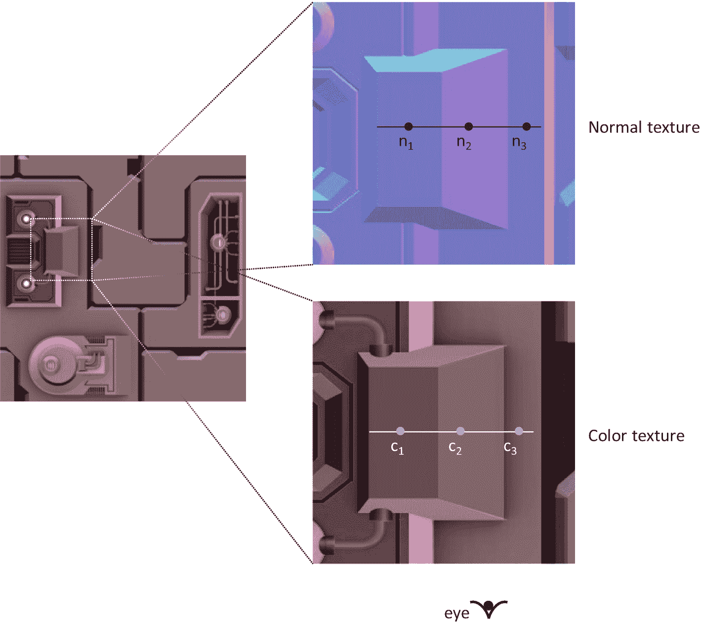

**图 8-11** ¶ 使用两个纹理图像的法线贴图：法线纹理和颜色纹理

图 8-12 捕捉了图 8-11 右侧图像上标记的三个对应位置的视图，即法线纹理上的位置 `n[1]`、`n[2]` 和 `n[3]` 以及颜色纹理上对应的位置 `c[1]`、`c[2]` 和 `c[3]`，以说明法线贴图的细节。图 8-12 的底层显示颜色纹理记录颜色，并且在这三个位置采样颜色 `c[1]`、`c[2]` 和 `c[3]`。图 8-12 的中间层显示法线纹理的 RGB 分量记录了颜色纹理对应位置上物体的法线向量 xyz 值。图 8-12 的顶层显示，当被光源照亮时，通过正确计算和显示  项，人类视觉系统将感知到一个倾斜的轮廓。

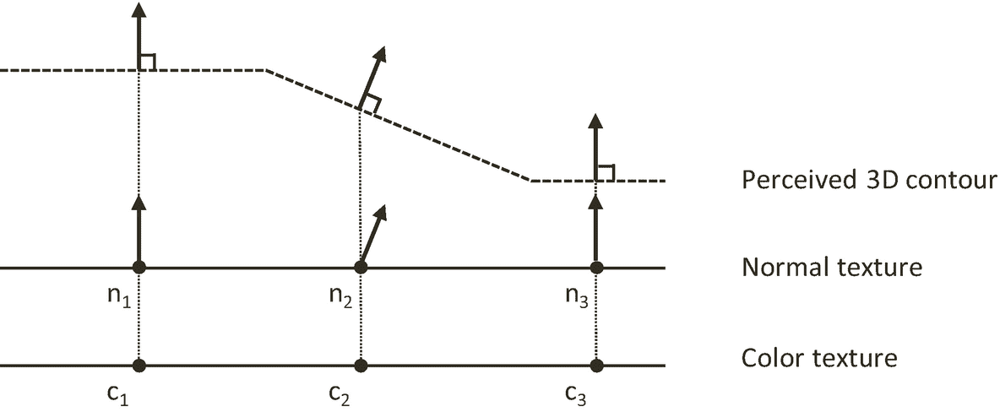

**图 8-12** ¶ 使用两个纹理图像的法线贴图：法线纹理和颜色纹理

总之，法线纹理贴图或法线贴图是一种存储法线向量信息而非常规颜色信息的纹理贴图。法线贴图的每个纹素在 RGB 通道中编码一个法线向量的 xyz 值。法线贴图的纹素不像颜色纹理那样直接显示，而是纯粹用于计算表面如何与光线相互作用。这样，当一个正方形被应用法线贴图时，每个被渲染像素的法线向量将由法线贴图的纹素定义，而不是使用一个指向 z 方向的恒定法线向量，并可用于计算漫反射分量。因此，渲染图像将显示类似于法线贴图中编码形状的轮廓。

在上一个项目中，你扩展了引擎以支持多光源。在本节中，你将定义 `IllumShader` 类，以泛化 `LightShader`，使其支持基于法线贴图的漫反射分量计算。

## 法线贴图与光照着色器项目

该项目演示了如何将法线贴图集成到你的游戏引擎中，并利用结果计算物体的漫反射分量。你可以在图 8-13 中看到该项目运行的示例。该项目的源代码位于 `chapter8/8.4.normal_maps_and_illumination_shaders` 文件夹中。

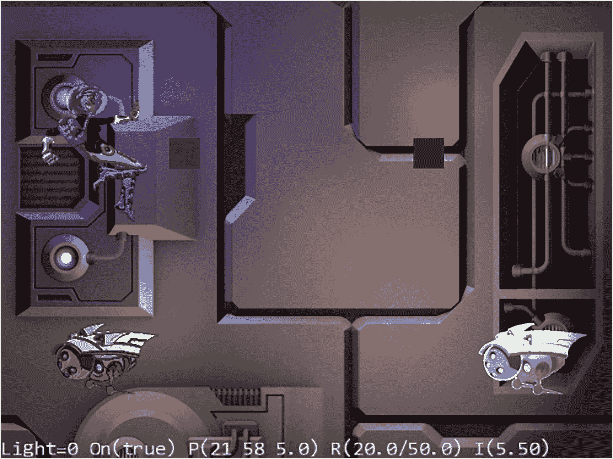

**图 8-13** ¶ 运行法线贴图与光照着色器项目

该项目的控制方式与上一个项目相同：

- **WASD 键**：移动屏幕上的主角角色
- **数字键 0、1、2 和 3**：选择相应的光源
- **方向键**：移动当前选中的光源
- **Z/X 键**：增加/减少光源的 z 位置
- **C/V 和 B/N 键**：增加/减少选中光源的近和远截断距离
- **K/L 键**：增加/减少选中光源的强度
- **H 键**：切换选中光源的开/关

项目目标如下：

- 理解并使用法线贴图
- 在游戏引擎中将法线贴图实现为纹理
- 实现支持漫反射分量光照的 GLSL 着色器
- 在光照模型中检查漫反射分量 

你可以在 `assets` 文件夹中找到以下外部资源文件。`fonts` 文件夹包含默认系统字体、两个纹理图像以及针对这些纹理图像的两个相应法线贴图：`minion_sprite.png` 和 `bg.png`，以及相应的法线贴图：`minion_sprite_normal.png` 和 `bg_normal.png`。与之前的项目一样，对象是 `minion_sprite.png` 的精灵元素，背景由 `bg.png` 表示。

> **注意**
>
> `minion_sprite_normal.png` 法线贴图是基于 `minion_sprite.png` 图像，通过 [`cpetry.github.io/NormalMap-Online/`](http://cpetry.github.io/NormalMap-Online/) 算法生成的。

## 创建 GLSL 光照片段着色器

与之前的项目一样，你的法线贴图集成将从 GLSL 着色器的实现开始。请注意，这个新着色器将与你的 `light_fs.glsl` 非常相似，但增加了法线贴图和漫反射计算支持。为确保支持不使用法线贴图的简单光照，你将创建一个新的 GLSL 片段着色器。

### 步骤 1：将 `light_fs.glsl` 复制到 `illum_fs.glsl`

首先从 `light_fs.glsl` 复制并粘贴到 `src/glsl_shaders` 文件夹中的新文件 `illum_fs.glsl`。

### 步骤 2：添加 `uNormalSampler`

编辑 `illum_fs.glsl` 文件，添加一个 `sampler2D` 对象 `uNormalSampler` 以采样法线贴图：

```glsl
uniform sampler2D uSampler;
uniform sampler2D uNormalSampler;
// ... identical to the variables declared in light_fs.glsl ...
```

### 步骤 3：修改 `LightEffect()` 函数

修改 `LightEffect()` 函数以接收法线向量参数 `N`。假设该法线向量 `N` 已归一化，模长为 1，并将用于漫反射分量  的计算。输入代码以计算 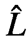 向量，记得归一化该向量，并使用  的结果相应地缩放光照强度。

```glsl
vec4 LightEffect(Light lgt, vec3 N) {
    vec4 result = vec4(0);
    float strength = 0.0;
    vec3 L = lgt.Position.xyz - gl_FragCoord.xyz;
    float dist = length(L);
    if (dist <= lgt.Far) {
        if (dist <= lgt.Near) {
            // ... identical to previous code ...
        }
        L = L / dist; // To normalize L
        // Not calling normalize() function to avoid re-computing
        // "dist". This is computationally more efficient.
        float NdotL = max(0.0, dot(N, L));
        strength *= NdotL;
    }
    result = strength * lgt.Intensity * lgt.Color;
    return result;
}
```

### 步骤 4


## 法线贴图实现

## 编辑 main() 函数

编辑 `main()` 函数，以同时从 `uSampler` 的颜色纹理和 `uNormalSampler` 的法线纹理进行采样。请记住，法线贴图为您提供了一个向量，该向量表示该特定位置表面元素的法线向量。由于 `xyz` 法线向量值存储在 `0` 到 `1` 的 RGB 颜色格式中，因此采样得到的法线贴图结果必须缩放并偏移到 `-1` 到 `1` 的范围。此外，请回顾一下，纹理 `uv` 坐标可以定义为 `v` 方向向上或向下增加。在这种情况下，根据法线贴图的 `v` 方向，您可能还需要翻转采样法线贴图值的 `y` 方向。然后将归一化的法线向量 `N` 传递给 `LightEffect()` 函数进行光照计算。

```glsl
void main(void) {
    // simple tint based on uPixelColor setting
    vec4 textureMapColor = texture2D(uSampler, vTexCoord);
    vec4 normal = texture2D(uNormalSampler, vTexCoord); // same UV
    vec4 normalMap = (2.0 * normal) - 1.0;
    //
    // normalMap.y = -normalMap.y; // flip Y
    // depending on the normal map you work with,
    // this may or may not be flipped
    //
    vec3 N = normalize(normalMap.xyz);
    vec4 lgtResult = uGlobalAmbientColor * uGlobalAmbientIntensity;
    // now decide if we should illuminate by the light
    if (textureMapColor.a > 0.0) {
        for (int i = 0; i < kGLSLuLightArraySize; i++) {
            if (uLights[i].IsOn) {
                lgtResult += LightEffect(uLights[i], N);
            }
        }
    }
    ... identical to previous code ...
}
```

**注意**

法线贴图可以用多种不同的布局创建，其中 `x` 或 `y` 可能需要翻转，以便正确表示所需的表面几何形状。这完全取决于创建该贴图的工具或艺术家。

## 定义 IllumShader 类

有了支持法线贴图的 `Illum_fs` 片元着色器，您可以创建 JavaScript `IllumShader` 类来与其交互：

### 1.1 创建 illum_shader.js

在 `src/engine/shaders` 文件夹中，创建 `illum_shader.js`，并定义 `IllumShader` 为 `LightShader` 的子类，以利用与光源相关的功能。在构造函数中，定义一个变量 `mNormalSamplerRef`，以保持对 `illum_fs` 片元着色器中法线采样器的引用。别忘了导出该类。

```javascript
import LightShader from "./light_shader.js";
import * as glSys from "../core/gl.js";

class IllumShader extends LightShader {
    constructor(vertexShaderPath, fragmentShaderPath) {
        super(vertexShaderPath, fragmentShaderPath);
        let gl = glSys.get();
        // reference to the normal map sampler
        this.mNormalSamplerRef = gl.getUniformLocation(
            this.mCompiledShader, "uNormalSampler"
        );
    }
    ... implementation to follow ...
}
export default IllumShader;
```

### 1.2 重写 activate()

重写并扩展 `activate()` 函数，以将法线纹理采样器引用绑定到 WebGL 纹理单元 `1`。您可能还记得第 5 章中 `TextureShader` 将颜色纹理采样器绑定到纹理单元 `0`。通过将法线贴图绑定到纹理单元 `1`，WebGL 纹理系统可以同时使用两个活动纹理：单元 `0` 和 `1`。正如下一小节将讨论的那样，通过纹理模块配置 WebGL，为相应用途（颜色与法线纹理映射）激活适当的纹理单元非常重要。

```javascript
activate(pixelColor, trsMatrix, cameraMatrix) {
    // first call the super class' activate
    super.activate(pixelColor, trsMatrix, cameraMatrix);
    let gl = glSys.get();
    gl.uniform1i(this.mNormalSamplerRef, 1); // binds to texture unit 1
    // do not need to set up texture coordinate buffer
    // as we are going to use the ones from the sprite texture
    // in the fragment shader
}
```

**注意**

WebGL 支持在渲染期间同时激活多个纹理单元。根据 GPU 的不同，单次渲染通道中至少可以有八个纹理单元同时处于活动状态。在本书中，渲染期间您将仅激活两个纹理单元：一个用于颜色纹理，另一个用于法线纹理。

## 修改纹理模块

到目前为止，您一直将颜色纹理贴图绑定到 WebGL 纹理单元 `0`。随着法线纹理的加入，绑定到 WebGL 纹理系统的单元现在必须参数化。幸运的是，这是一个简单的更改。

通过打开 `src/engine/resources` 文件夹中的 `texture.js` 来修改纹理模块。编辑 `activate()` 函数以接受第二个参数，即要绑定的 WebGL 纹理单元。请注意，这是一个可选参数，默认值设置为纹理单元 `0`。这样现有的对 `activate()` 函数的调用就不需要任何更改。

```javascript
function activate(textureName, textureUnit = glSys.get().TEXTURE0) {
    let gl = glSys.get();
    let texInfo = get(textureName);
    // Binds texture reference to current webGL texture functionality
    gl.activeTexture(textureUnit); // activate the WebGL texture unit
    gl.bindTexture(gl.TEXTURE_2D, texInfo.mGLTexID);
    ... identical to previous code ...
}
```

## 创建 IllumRenderable 类

现在您可以定义光照 `Renderable` 类，以利用新创建的光照着色器：

### 1.1 创建 illum_renderable.js

首先在 `src/engine/renderables` 文件夹中创建 `illum_renderable.js`，定义 `IllumRenderable` 类继承自 `LightRenderable`，并初始化一个 `mNormalMap` 实例变量来记录法线贴图 ID。`IllumRenderable` 对象使用两个纹理贴图：`myTexture` 用于颜色纹理贴图，`myNormalMap` 用于法线贴图。请注意，这两个纹理贴图共享在 `SpriteShader` 的 `mTexCoordBuffer` 中定义的相同纹理坐标。这种纹理坐标的共享隐含地假设对象的几何形状描绘在颜色纹理贴图中，而法线纹理贴图是为捕捉对象轮廓而派生的，这*几乎*总是成立的。最后，别忘了导出该类。

```javascript
import * as texture from "../resources/texture.js";
import * as glSys from "../core/gl.js";
import LightRenderable from "./light_renderable.js";
import * as defaultShaders from "../core/shader_resources.js";

class IllumRenderable extends LightRenderable {
    constructor(myTexture, myNormalMap) {
        super(myTexture);
        super._setShader(defaultShaders.getIllumShader());
        // here is the normal map resource id
        this.mNormalMap = myNormalMap;
        // Normal map texture coordinate is same as sprite sheet
        // This means, the normal map MUST be based on the sprite sheet
    }
    ... implementation to follow ...
}
export default IllumRenderable;
```

**注意**

再次强调，法线纹理贴图是一张必须由艺术家显式创建或由合适的程序算法生成的图像。通常情况下，使用普通的颜色纹理贴图图像作为法线纹理贴图是行不通的。

### 1.2 重写 draw()

接下来，重写 `draw()` 函数，在调用超类的 `draw()` 方法之前激活法线贴图。请注意 `texture.activate()` 函数调用的第二个参数，其中显式指定了 WebGL 纹理单元 `1`。通过这种方式，`IllumShader` 将 `uNormalSampler` 链接到 WebGL 纹理单元 `1`，而 `illum_fs` 将 `uNormalSampler` 作为法线贴图进行采样，您的引擎现在支持正确的法线贴图。

```javascript
draw(camera) {
    texture.activate(this.mNormalMap, glSys.get().TEXTURE1);
    // Here the normal map texture coordinate is copied from those of
    // the corresponding sprite sheet
    super.draw(camera);
}
```

最后，请记住更新引擎访问文件 `index.js`，以将新定义的功能转发给客户端。

## 定义默认 IllumShader 实例


## 测试法线贴图

与引擎中的所有其他着色器类似，必须定义一个 `IllumShader` 的默认实例以供共享。定义默认 `IllumShader` 实例所涉及的代码与本章前面介绍的 `LightShader` 完全相同，唯一直接的区别在于替换相应的变量名和数据类型。详情请参阅“定义默认 LightShader 实例”小节以及 `src/engine/core` 文件夹中的 `shader_resources.js` 源代码文件。

### 修改主角和小兵

测试新集成的法线贴图功能必须包括验证非法线贴图的简单颜色纹理是否正常工作。为实现这一点，背景、主角和左侧小兵将被创建为新定义的 `IllumRenderable` 对象，而右侧小兵将保持为 `LightRenderable` 对象。

`Hero` 和 `Minion` 对象应实例化为新定义的 `IllumRenderable` 对象：

1.  编辑 `src/my_game/objects` 中的 `hero.js`，修改 `Hero` 类的构造函数，以使用 `IllumRenderable` 实例化游戏对象：

```javascript
constructor(spriteTexture, normalMap) {
    super(null);
    this.kDelta = 0.3;
    this.mRenderComponent = new engine.IllumRenderable(
        spriteTexture, normalMap);
    this.mRenderComponent.setColor([1, 1, 1, 0]);
    ... identical to previous code ...
}
```

2.  在同一文件夹中，编辑 `minion.js`，修改 `Minion` 类的构造函数，以便在存在法线纹理贴图时，有条件地使用 `LightRenderable` 或 `IllumRenderable` 实例化游戏对象：

```javascript
constructor(spriteTexture, normalMap, atX, atY) {
    super(null);
    this.kDelta = 0.2;
    if (normalMap === null) {
        this.mRenderComponent = new engine.LightRenderable(
            spriteTexture);
    } else {
        this.mRenderComponent = new engine.IllumRenderable(
            spriteTexture, normalMap);
    }
    ... identical to previous code ...
}
```

### 修改 MyGame

现在你可以修改 `MyGame` 来测试和显示光照着色器的实现。修改 `src/my_game` 文件夹中的 `my_game_main.js` 文件，以加载和卸载新的法线贴图，并使用法线贴图文件创建 `Hero` 和 `Minion` 对象。与之前一样，所涉及的更改简单且相对较少；因此，此处不展示详细内容。

## 观察

项目现已完成，你可以运行它并检查结果，以观察漫反射光照的效果。请注意，`Hero`、左侧 `Minion` 和背景对象都通过漫反射计算进行光照，并呈现出由光源带来的更多深度感。这些对象上的颜色和阴影变化丰富得多。

你可以验证图 8-7 左侧图像中观察到的奇特效果已得到解决。为了更清晰地观察，关闭除 2 号灯光外的所有其他灯光（输入灯光编号后跟 `H` 键）。现在，移动灯光位置（使用 `方向键`）以照亮 `Hero` 角色身后的几何方块；你可以使用 `WASD` 键将其移开。验证你看到的结果是否与图 8-7 右侧图像相似。你应该能清晰地观察到对应点光源位置的最亮点。此外，请注意，方块的底面仅当灯光位置*在*该面*前方*时，或者当漫反射项  为正时才会被照亮。

一般来说，当你移动光源时，观察具有垂直朝向的面，例如几何方块的侧面或缝隙。当光源位置移过此类边界时，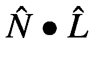 项的符号会翻转，相应的表面光照会发生剧烈变化（从暗变亮，或反之）。为了获得更显著的效果，降低光源的 `z` `height`（使用 `X` 键）至低于 5 的值。借助法线贴图和漫反射计算，你已将静态背景图像转变为由复杂 3D 几何形状定义的背景。尝试移动其他光源，并观察光源移过物体时所有物体上的光照变化。

最后，`Hero` 和左侧 `Minion` 略微呈现像素化和粗糙的外观，这证明这些对象的法线贴图是根据相应的颜色图像通过算法生成的，而非由美术师创建。

## 镜面反射与材质

你实现的漫反射光照适用于模拟哑光表面的光照，例如普通打印纸、许多室内涂料墙面，甚至传统黑板。Phong 光照模型通过引入镜面项来扩展这种简单的漫反射光照，以模拟光源在光滑表面上的反射。图 8-14 展示了三个球体的示例：一个简单的哑光球体、一个具有中等镜面高光的球体和一个高度抛光的球体。右侧两个球体上的高光是 Phong 镜面项的结果。 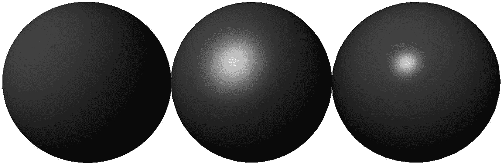

图 8-14 ¶ 物体的镜面度与光泽度

图 8-15 说明了给定一个光亮或反射表面（如抛光地板或抛光塑料），当眼睛或摄像机位于光源的反射方向上时，光源的反射将可见。光源在光滑表面上的这种反射被称为*镜面反射*、*镜面高光*或*镜面度*。 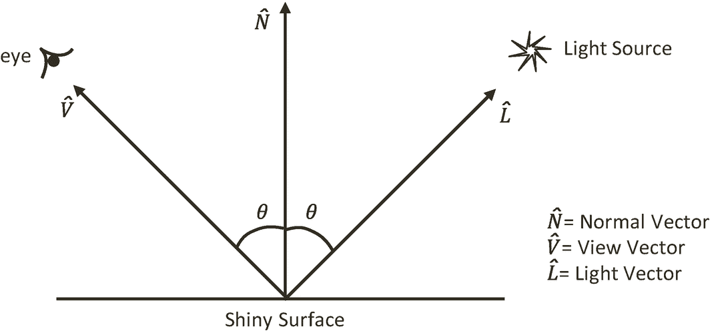

图 8-15 ¶ 镜面度：光源的反射

根据现实生活经验，即使眼睛的观察方向未与光源的反射方向完美对齐，镜面高光依然可见。如图 8-16 所示，其中 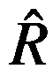 向量是光向量  的反射方向，即使观察方向  未与  向量完美对齐，物体上的镜面高光依然可见。现实经验还告诉我们， 偏离  越远，或者角度 `α` 越大，观察到光反射的可能性就越小。事实上，当 `α` 为零时，你会观察到最大的光反射；当 `α` 为 90°，或者  与  垂直时，你会观察到零光反射。 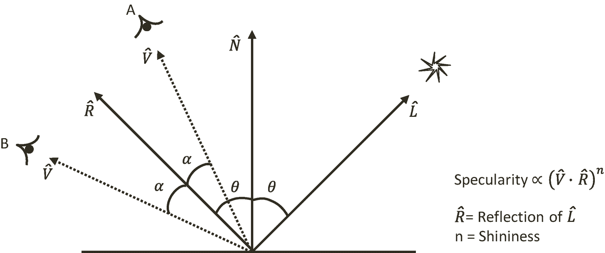

图 8-16 ¶ Phong 镜面模型


## Phong 光照模型

Phong 光照模型通过 `(\hat{V} \bullet \hat{R})^n` 项来模拟镜面反射的特性。当 `\hat{V}` 和 `\hat{R}` 对齐，或者当 α=0° 时，镜面项的值为 1，并且根据余弦函数，当 `\hat{V}` 和 `\hat{R}` 之间的夹角增加到 90° 或 α=90° 时，该项下降到 0。幂 `n` 被称为光泽度，描述了随着 α 增加，镜面高光衰减的速度。`n` 值越大，余弦函数随 α 增加而减小的速度越快，镜面高光衰减得越快，表面看起来就越光滑。例如，在图 8-14 中，左、中、右三个球体对应的 `n` 值分别为 0、5 和 30。

虽然 `(\hat{V} \bullet \hat{R})^n` 项能有效模拟镜面高光，但为每个着色像素计算 `\hat{R}` 向量的开销可能很大。如图 8-17 所示，半程向量 `\hat{H}` 定义为 `\hat{L}` 和 `\hat{V}` 向量的平均值。观察到 β（即 `\hat{N}` 和 `\hat{H}` 之间的夹角）也可以用来表征镜面反射。虽然略有不同，但 `(\hat{N} \bullet \hat{H})^n` 产生的结果与 `(\hat{V} \bullet \hat{R})^n` 相似，且每像素计算成本更低。半程向量将在你的实现中用于近似镜面反射。

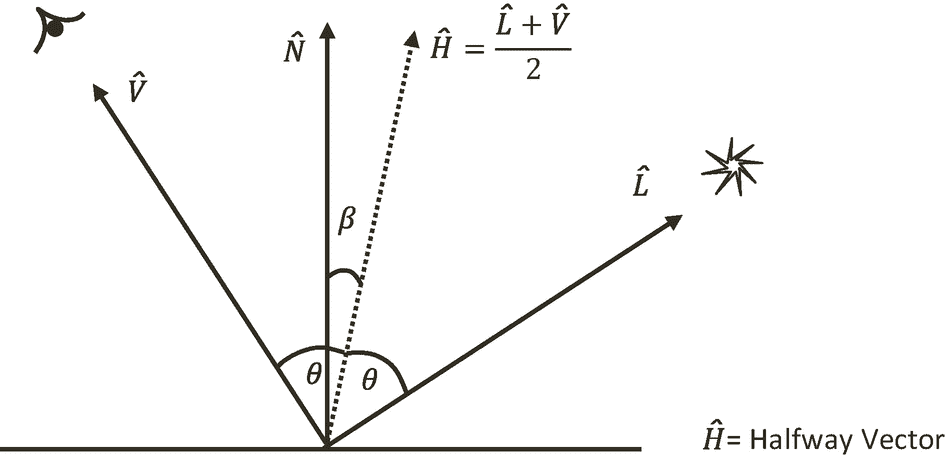

**图 8-17 ¶ 半程向量**

如图 8-18 所示，你将要实现的 Phong 光照模型变体，包含通过三个不同的项来模拟场景中三个参与元素的相互作用。这三个参与元素分别是：全局环境光、光源以及待照明物体的材质属性。前面的示例已经解释了前两项：全局环境光和光源。因此，为了支持 Phong 光照模型，物体的材质属性可以用 `K[a]`、`K[d]`、`K[s]` 和 `n` 来表示。它们分别代表三种颜色（环境反射率、漫反射率和镜面反射率）和一个浮点数（物体的光泽度）。结合全局环境光强度 `I[a]` 和颜色 `C[a]`，以及光源强度 `I[L]` 和颜色 `C[L]`，Phong 光照模型的三个项如下：

*   **环境光项**：`I[a] * C[a] * K[a]`
*   **漫反射项**：`I_L * C_L * K_d * (\hat{N} \bullet \hat{L})`
*   **镜面反射项**：`I_L * C_L * K_s * (\hat{N} \bullet \hat{H})^n`

请注意，前两项（环境光项和漫反射项）已在之前的示例中涵盖。上一个示例中的 `illum_fs` GLSL 片元着色器实现了这两项，包含光距离衰减，但不包含 `K[a]` 和 `K[d]` 材质属性。本项目将指导你构建对每个物体材质属性的支持，并在 `IllumShader`/`IllumRenderable` 对象对的引擎支持下，在 `illum_fs` GLSL 着色器中完成 Phong 光照模型的实现。

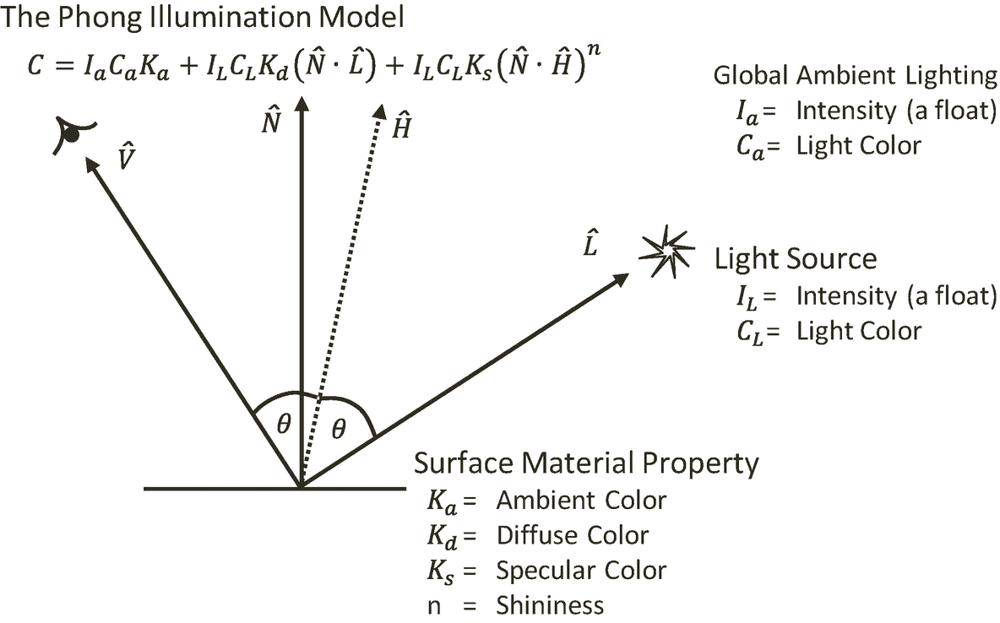

**图 8-18 ¶ Phong 光照模型**

## 游戏引擎与 GLSL 着色器中的材质集成

要实现 Phong 光照模型，必须定义一个封装了图 8-18 中表面材质属性的 `Material` 类，并由每个将由相应 `illum_fs` 片元着色器着色的 `IllumRenderable` 对象引用。图 8-19 说明了在你的实现中，将定义一个新的 `ShaderMaterial` 对象并在 `IllumShader` 中引用它，以便将 `Material` 对象的内容加载到 `illum_fs` GLSL 片元着色器中。

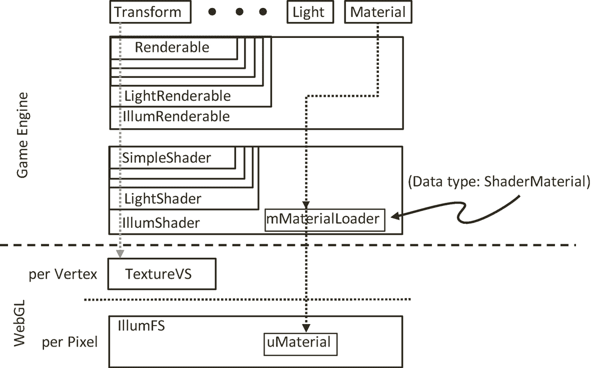

**图 8-19 ¶ 材质支持**

## 材质与镜面反射项目

该项目演示了利用法线贴图和相机位置实现的一种 Phong 光照模型版本。它还实现了一个系统，用于存储并转发每个 `Renderable` 对象的材质属性给 GLSL 着色器以进行 Phong 光照计算。你可以在图 8-20 中看到项目运行的示例。该项目的源代码位于 `chapter8/8.5.material_and_specularity` 文件夹中。

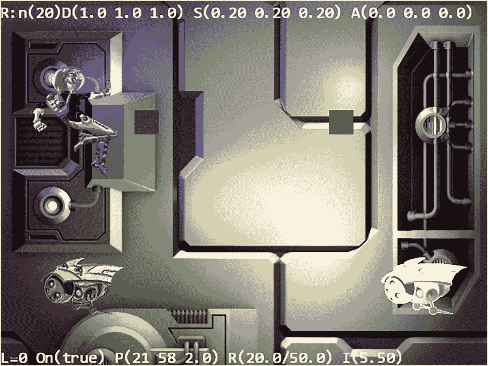

**图 8-20 ¶ 运行材质与镜面反射项目**

该项目的主要控制与前一个项目相同：

*   **`WASD` 键**：移动屏幕上的主角角色

**光照控制：**

*   **数字键 `0`、`1`、`2` 和 `3`**：选择对应的光源
*   **方向键**：移动当前选中的光源
*   **`Z`/`X` 键**：增加/减少光源的 z 位置
*   **`C`/`V` 和 `B`/`N` 键**：增加/减少选中光源的近裁剪和远裁剪距离
*   **`K`/`L` 键**：增加/减少选中光源的强度
*   **`H` 键**：切换选中光源的开/关

**材质属性控制是本项目新增的：**

*   **数字键 `5` 和 `6`**：选择左侧小兵和主角
*   **数字键 `7`、`8` 和 `9`**：选择选中角色（左侧小兵或主角）的 `K[a]`、`K[d]` 和 `K[s]` 材质属性
*   **`E`/`R`、`T`/`Y` 和 `U`/`I` 键**：增加/减少选中材质属性的红、绿、蓝通道
*   **`O`/`P` 键**：增加/减少选中材质属性的光泽度

项目目标如下：

*   理解镜面反射和 Phong 镜面项
*   在 GLSL 片元着色器中实现镜面高光照明
*   理解并体验控制被照明物体的 `Material`
*   检查被照明图像中的镜面高光

### 修改 GLSL 光照片元着色器

与之前的项目一样，你将从在 GLSL `illum_fs` 片元着色器中实现实际的光照模型开始：

1.  1.


## 编辑 `illum_fs.glsl` 文件

编辑 `illum_fs.glsl` 文件并定义变量 `uCameraPosition`，用于存储相机位置。该位置用于计算 `$\hat{V}$` 向量（视图方向）。现在，创建一个 `Material` 结构体和对应的变量 `uMaterial`，用于存储每个物体的材质属性。注意变量名 `Ka`、`Kd`、`Ks` 和 `n` 与图 8-18 中 Phong 光照模型项的对应关系。

```glsl
// 支持简单的类 Phong 光照模型
uniform vec3 uCameraPosition; // 用于计算 V 向量
// 材质属性
struct Material {
    vec4 Ka;        // 简单增强颜色
    vec4 Kd;        // 漫反射
    vec4 Ks;        // 镜面反射
    float Shininess; // 这是 "n"
};
uniform Material uMaterial;
```

## 步骤 2：`DistanceDropOff()` 函数

为支持可读性，光照模型中的数学项将被定义为单独的函数。首先定义 `DistanceDropOff()` 函数，执行与前一个项目相同的近/远切断计算。

```glsl
// 计算 L 向量，返回强度
float DistanceDropOff(Light lgt, float dist) {
    float strength = 0.0;
    if (dist <= lgt.Far) {
        if (dist <= lgt.Near)
            strength = 1.0;  // 无衰减
        else {
            // 简单二次衰减
            float n = dist - lgt.Near;
            float d = lgt.Far - lgt.Near;
            strength = smoothstep(0.0, 1.0, 1.0 - (n * n) / (d * d));
            // 混合衰减
        }
    }
    return strength;
}
```

## 步骤 3：漫反射项函数

定义计算漫反射项的函数。注意纹理贴图颜色应用于漫反射项。

```glsl
vec4 DiffuseResult(vec3 N, vec3 L, vec4 textureMapColor) {
    return uMaterial.Kd * max(0.0, dot(N, L)) * textureMapColor;
}
```

## 步骤 4：镜面反射项函数

定义计算镜面反射项的函数。向量 `$\hat{V}$` (即 `V`) 通过将 `uCameraPosition` 从当前像素位置 `gl_FragCoord` 中减去并归一化来计算。重要的是要注意，此操作在像素空间中执行，`IllumShader`/`IllumRenderable` 对象对必须在发送信息前将 WC 相机位置转换到像素空间。

```glsl
vec4 SpecularResult(vec3 N, vec3 L) {
    vec3 V = normalize(uCameraPosition - gl_FragCoord.xyz);
    vec3 H = (L + V) * 0.5;
    return uMaterial.Ks * pow(max(0.0, dot(N, H)), uMaterial.Shininess);
}
```

## 步骤 5：Phong 光照模型累加

现在可以实现 Phong 光照模型以累加漫反射和镜面反射项。注意图 8-18 中的 `lgt.Intensity` ($I_L$) 和 `lgt.Color` ($C_L$) 被提取并乘以漫反射和镜面反射结果之和。基于近/远切断计算的光强缩放 `strength` 是此实现与图 8-18 中列出的漫反射/镜面反射项的唯一区别。

```glsl
vec4 ShadedResult(Light lgt, vec3 N, vec4 textureMapColor) {
    vec3 L = lgt.Position.xyz - gl_FragCoord.xyz;
    float dist = length(L);
    L = L / dist;
    float strength = DistanceDropOff(lgt, dist);
    vec4 diffuse = DiffuseResult(N, L, textureMapColor);
    vec4 specular = SpecularResult(N, L);
    vec4 result = strength * lgt.Intensity *
                  lgt.Color * (diffuse + specular);
    return result;
}
```

## 步骤 6：`main()` 函数实现

在 `main()` 函数中完成实现，通过考虑环境项并循环遍历所有定义的光源来累加 `ShadedResult()`。`main` 函数的主体与前一个项目中 `illum_fs.glsl` 文件中的类似。唯一重要的区别已用粗体标出。

```glsl
void main(void) {
    ... identical to previous code ...
    vec3 N = normalize(normalMap.xyz);
    vec4 shadedResult = uGlobalAmbientIntensity *
                        uGlobalAmbientColor * uMaterial.Ka;
    // 现在决定是否由光源照明
    if (textureMapColor.a > 0.0) {
        for (int i = 0; i < kGLSLuLightArraySize; i++) {
            if (uLights[i].IsOn) {
                shadedResult += ShadedResult(
                    uLights[i], N, textureMapColor);
            }
        }
    }
    ... identical to previous code ...
}
```

## 定义 `Material` 类

如所述，需要一个简单的 `Material` 类来封装 Phong 光照模型中每个 `Renderable` 的材质属性。

## 步骤 1：创建 `material.js`

在 `src/engine` 文件夹中创建 `material.js`，定义 `Material` 类，并在构造函数中初始化变量，如图 8-18 中的表面材质属性定义。注意 `ambient`、`diffuse` 和 `specular` (`Ka`、`Kd` 和 `Ks`) 是颜色，而 `shininess` 是浮点数。

```javascript
class Material {
    constructor() {
        this.mKa = vec4.fromValues(0.0, 0.0, 0.0, 0);
        this.mKs = vec4.fromValues(0.2, 0.2, 0.2, 1);
        this.mKd = vec4.fromValues(1.0, 1.0, 1.0, 1);
        this.mShininess = 20;
    }
    ... implementation to follow ...
}
export default Material;
```

## 步骤 2：提供访问器

为变量提供直接的 get 和 set 访问器：

```javascript
setAmbient(a) { this.mKa = vec4.clone(a); }
getAmbient() { return this.mKa; }
setDiffuse(d) { this.mKd = vec4.clone(d); }
getDiffuse() { return this.mKd; }
setSpecular(s) { this.mKs = vec4.clone(s); }
getSpecular() { return this.mKs; }
setShininess(s) { this.mShininess = s; }
getShininess() { return this.mShininess; }
```

注意 `Material` 类旨在表示 `Renderable` 对象的材质属性，且必须对游戏程序员可访问。因此，请记得更新引擎访问文件 `index.js`，以将新定义的功能转发给客户端。

## 定义 `ShaderMaterial` 类

类似于定义 `ShaderLightAt` 类以将光源信息按数组索引传递给 GLSL 片段着色器，应定义一个新的 `ShaderMaterial` 类来将 `Material` 的内容传递给 GLSL `illum_fs` 着色器。类似于 `ShaderLightAt` 的实现，`ShaderMaterial` 类也将在 `src/engine/shaders` 文件夹中定义。

## 步骤 1：创建 `shader_material.js`

在 `src/engine/shaders` 文件夹中创建 `shader_material.js`，定义 `ShaderMaterial` 类，并在构造函数中初始化变量作为对 `illum_fs` GLSL 着色器中 `ambient`、`diffuse`、`specular` 和 `shininess` 的引用。

```javascript
import * as glSys from "../core/gl.js";

class ShaderMaterial {
    constructor(aIllumShader) {
        let gl = glSys.get();
        this.mKaRef = gl.getUniformLocation(
            aIllumShader, "uMaterial.Ka");
        this.mKdRef = gl.getUniformLocation(
            aIllumShader, "uMaterial.Kd");
        this.mKsRef = gl.getUniformLocation(
            aIllumShader, "uMaterial.Ks");
        this.mShineRef = gl.getUniformLocation(
            aIllumShader, "uMaterial.Shininess");
    }
    ... implementation to follow ...
}
export default ShaderMaterial;
```

## 步骤 2：定义 `loadToShader()` 函数

定义 `loadToShader()` 函数以将 `Material` 的内容推送到 GLSL 着色器：

```javascript
loadToShader(aMaterial) {
    let gl = glSys.get();
    gl.uniform4fv(this.mKaRef, aMaterial.getAmbient());
    gl.uniform4fv(this.mKdRef, aMaterial.getDiffuse());
    gl.uniform4fv(this.mKsRef, aMaterial.getSpecular());
    gl.uniform1f(this.mShineRef, aMaterial.getShininess());
}
```


类似于 `ShaderLightAt` 类，`ShaderMaterial` 类被定义用于将材质加载到 GLSL 片段着色器中。这是一个内部引擎操作。游戏程序员没有理由访问此类，因此，引擎访问文件 `index.js` 不应被修改以转发此类的定义。

## 修改 IllumShader 类

回顾 `IllumShader` 类是引擎与对应的 GLSL `illum_fs` 片段着色器的接口。现在必须修改 `IllumShader` 类以支持 `illum_fs` 中新定义的 Phong 光照功能。这可以通过修改 `IllumShader` 来定义一个 `ShaderMaterial` 对象，将 `Material` 对象的内容加载到 `illum_fs` 片段着色器中来实现。

### 1. 编辑 illum_shader.js

编辑 `src/engine/shaders` 中的 `illum_shader.js` 以导入 `ShaderMaterial`，并修改构造函数以定义新变量 `mMaterial` 和 `mCameraPos` 以支持 Phong 光照计算。然后定义变量 `mMaterialLoader` 和 `mCameraPosRef` 以保持引用并将相应内容加载到着色器中的统一变量。

```javascript
import ShaderMaterial from "./shader_material.js";

constructor(vertexShaderPath, fragmentShaderPath) {
    // Call super class constructor
    super(vertexShaderPath, fragmentShaderPath);
    // this is the material property of the Renderable
    this.mMaterial = null;
    this.mMaterialLoader = new ShaderMaterial(this.mCompiledShader);
    let gl = glSys.get();
    // Reference to the camera position
    this.mCameraPos = null;  // points to a vec3
    this.mCameraPosRef = gl.getUniformLocation(
        this.mCompiledShader, "uCameraPosition");
    // reference to the normal map sampler
    this.mNormalSamplerRef = gl.getUniformLocation(
        this.mCompiledShader, "uNormalSampler");
}
```

### 2. 修改 activate() 函数

修改 `activate()` 函数以将材质和相机位置加载到 `illum_fs` 片段着色器：

```javascript
activate(pixelColor, trsMatrix, cameraMatrix) {
    // first call the super class' activate
    super.activate(pixelColor, trsMatrix, cameraMatrix);
    let gl = glSys.get();
    gl.uniform1i(this.mNormalSamplerRef, 1); // binds to texture unit 1
    this.mMaterialLoader.loadToShader(this.mMaterial);
    gl.uniform3fv(this.mCameraPosRef, this.mCameraPos);
}
```

### 3. 定义 setMaterialAndCameraPos() 函数

定义 `setMaterialAndCameraPos()` 函数以设置 Phong 光照计算的相应变量：

```javascript
setMaterialAndCameraPos(m, p) {
    this.mMaterial = m;
    this.mCameraPos = p;
}
```

## 修改 IllumRenderable 类

现在可以修改 `IllumRenderable` 类以包含材质属性并正确支持 `IllumShader`。这是一个直接的更改。

### 1. 编辑 illum_renderable.js

编辑 `src/engine/renderables` 文件夹中的 `illum_renderable.js`，并修改构造函数以实例化一个新的 `Material` 对象：

```javascript
import Material from "../material.js";

constructor(myTexture, myNormalMap) {
    ... identical to previous code ...
    // Material for this Renderable
    this.mMaterial = new Material();
}
```

### 2. 更新 draw() 函数

更新 `draw()` 函数以在实际渲染之前将材质和相机位置设置到着色器。注意在调用 `camera.getWCCenterInPixelSpace()` 时，相机位置被正确转换到像素空间。

```javascript
draw(camera) {
    texture.activate(this.mNormalMap, glSys.get().TEXTURE1);
    this.mShader.setMaterialAndCameraPos(
        this.mMaterial, camera.getWCCenterInPixelSpace());
    super.draw(camera);
}
```

### 3. 定义材质对象的简单访问器

```javascript
getMaterial() { return this.mMaterial; }
```

## 修改 Camera 类

正如你在 `illum_fs` 片段着色器实现中所见，计算 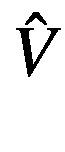 向量所需的相机位置必须在像素空间中。`Camera` 对象必须被修改以提供此类信息。由于 `Camera` 对象将其位置存储在世界坐标（WC）空间中，因此对于每个渲染的 `IllumRenderable` 对象，此位置必须被转换到像素空间。

场景中可能有大量 `IllumRenderable` 对象，且一旦渲染开始，相机位置就不能改变。这些观察表明，像素空间相机位置应在每个绘制周期中计算一次并缓存。`PerRenderCache` 类在“Simple Light Shader”项目中专门定义用于缓存每绘制周期信息，非常适合缓存像素空间相机位置。

### 1. 编辑 camera_main.js

编辑 `camera_main.js` 文件并在 `PerRenderCache` 中添加一个 `vec3` 以缓存相机在像素空间中的位置：

```javascript
class PerRenderCache {
    // Information to be updated once per render for efficiency concerns
    constructor() {
        this.mWCToPixelRatio = 1;  // WC to pixel transformation
        this.mCameraOrgX = 1; // Lower-left corner of camera in WC
        this.mCameraOrgY = 1;
        this.mCameraPosInPixelSpace = vec3.fromValues(0, 0, 0);
    }
}
```

### 2. 在 Camera 构造函数中定义 z 变量

在 `Camera` 构造函数中，定义一个 `z` 变量来模拟 `Camera` 对象与其余 `Renderable` 对象之间的距离。这第三个信息代表深度，是光照计算所需的。

```javascript
this.kCameraZ = 10; // this is for illumination computation
```

### 3. 在 setViewAndCameraMatrix() 的步骤 B4 中调用 wcPosToPixel()

在 `setViewAndCameraMatrix()` 函数的步骤 B4 中，调用 `wcPosToPixel()` 函数将相机位置转换到 3D 像素空间并缓存计算结果：

```javascript
// Step B4: compute and cache per-rendering information
this.mRenderCache.mWCToPixelRatio =
    this.mViewport[eViewport.eWidth] / this.getWCWidth();
this.mRenderCache.mCameraOrgX = center[0] - (this.getWCWidth() / 2);
this.mRenderCache.mCameraOrgY = center[1] - (this.getWCHeight() / 2);
let p = this.wcPosToPixel(this.getWCCenter());
this.mRenderCache.mCameraPosInPixelSpace[0] = p[0];
this.mRenderCache.mCameraPosInPixelSpace[1] = p[1];
this.mRenderCache.mCameraPosInPixelSpace[2] =
    this.fakeZInPixelSpace(this.kCameraZ);
```

### 4. 定义像素空间相机位置的访问器

```javascript
getWCCenterInPixelSpace() {
    return this.mRenderCache.mCameraPosInPixelSpace;
}
```

## 测试镜面反射

现在你可以测试 Phong 光照模型的实现，并观察改变对象的材质属性和镜面反射率的效果。由于背景、Hero 和左侧 Minion 已经是 `IllumRenderable` 对象的实例，这三个对象现在将表现出镜面反射。为了确保镜面反射的显著性，背景对象的镜面材质属性 `Ks` 在 `init()` 函数中被设置为亮红色。

一个新函数 `_selectCharacter()` 被定义以允许用户处理 Hero 或左侧 Minion 对象的材质属性。文件 `my_game_material_control.js` 实现了控制选定材质属性的实际用户交互。

## 观察

你可以运行项目并交互式地控制当前选定对象的材质属性（按键 5 选择左侧 Minion，按键 6 选择 Hero）。默认情况下，选择 Hero 对象的材质属性。你可以尝试通过按 E/R、T/Y 或 U/I 键来改变漫反射 RGB 分量。注意你可以同时按下多个键以同时改变多个颜色通道。


背景图像的法线贴图经过精心生成，因此最适合检查镜面反射效果。你可以在背景图像的垂直边界处观察到红色高光。如果不确定，请注意背景图像右上角区域，选择光源 3（按 `3` 键），并切换开/关开关（按 `H` 键）。注意当光源从关切换到开时，整个右上角区域变亮，垂直边界处出现红色高光。这种红色高光是光源 3 向相机的反射。现在，在光源 3 开启的情况下，将其向左和向右移动（左/右箭头键）。观察高光如何随着半程向量 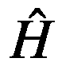 和面法线向量 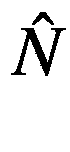 之间夹角的变化而增强然后减弱。

你也可以调整材质以观察英雄模型上的镜面反射。现在，选择英雄对象（按 `6` 键），将其漫反射材质属性降低到 0.2 左右（同时按 `R`、`Y` 和 `I` 键），并将镜面反射属性增加到 1 以上（按 `9` 选择 Specular，然后同时按 `E`、`T` 和 `U` 键）。使用此设置，漫反射项减弱而镜面高光增强，你可以观察到一个带有明亮高光点的暗色英雄模型。如果不确定，尝试切换光源 0（按 `0` 键）开/关（按 `H` 键）。此时，你可以按住 `P` 键降低光泽度 `n` 的值。随着 `n` 值减小，你可以观察到高光点尺寸增大且亮度降低。如图 8-14 中间的球体所示，较小的 `n` 值对应较不光滑的表面，通常表现为高光区域较大但强度较低。

相对较小的物体（如英雄模型）占据的像素不多；相关的高光可能跨越更少的像素，难以观察。镜面高光可以传达微妙且重要的效果；然而，其使用也可能难以掌握。

## 光源类型

此时，你的游戏引擎支持由单一类型光源（点光源）的多个实例进行照明。点光源的行为很像现实世界中的灯泡。它从单个位置发光，具有近、远半径，物体可以被光源完全、部分或完全不照亮。大多数游戏引擎中还有两种流行的光源类型：方向光和聚光灯。

方向光与点光源相反，没有光源位置或范围。相反，它向特定方向照亮所有东西。虽然这些特性可能看起来不直观，但它们非常适合通用背景照明。现实世界中就是这种情况。白天，太阳照亮整个环境，太阳光线可以方便地建模为方向光。从地球视角看，太阳光线几乎是平行的，来自固定方向，并照亮所有东西。方向光是一种简单的光源类型，只需要一个方向变量，没有距离衰减。方向光通常用作照亮整个场景的全局光源。

聚光灯模拟带有锥形灯罩的台灯。如图 8-21 所示，聚光灯是一个被指向特定方向（光照方向）的锥体包围的点光源，具有内、外锥角的角度衰减参数。类似于距离衰减的近、远半径，内锥角内的物体完全被照亮，外锥角外的物体不被照亮，两个角度之间的物体部分被照亮。就像点光源一样，聚光灯常用于在游戏场景的特定区域创建照明效果。聚光灯具有方向和角度衰减参数，为模拟游戏中特定区域的局部效果提供了更精细的控制。 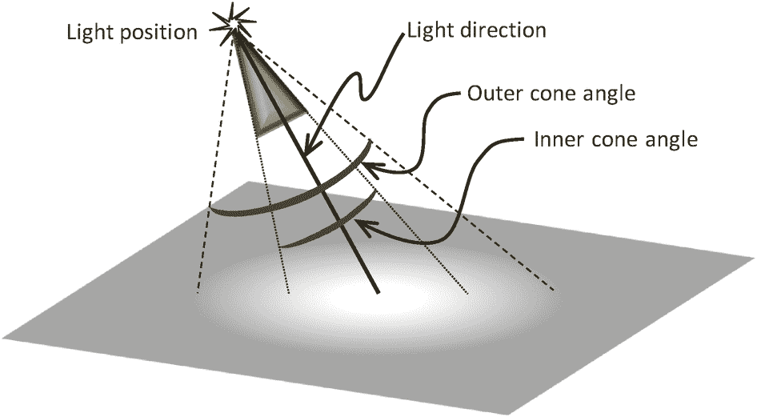

图 8-21 ¶ 聚光灯及其参数

> **注意**
>
> 在说明性图表（如图 8-21）中，为清晰起见，光照方向通常用从光源位置指向环境的线表示。这些线通常仅用于说明目的，不包含数学含义。这些说明性图表与解释照明计算的矢量图表（如图 8-15 和 8-16）形成对比。在矢量图表中，所有矢量始终指向远离被照亮位置的方向，并假设已归一化，大小为 1。

## 方向光与聚光灯项目

该项目演示如何将方向光和聚光灯集成到引擎中，以支持更广泛的照明效果。你可以在图 8-22 中看到项目运行示例。该项目的源代码位于 `chapter8/8.6.directional_and_spotlights` 文件夹中。 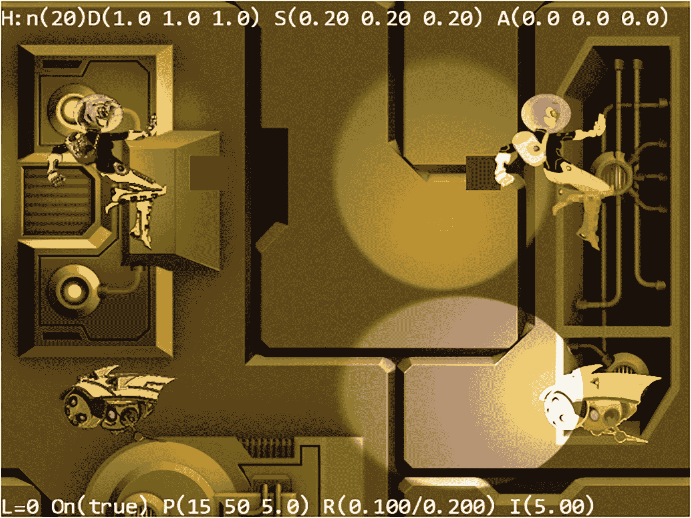

图 8-22 ¶ 运行方向光与聚光灯项目

项目控制如下：

*   **`WASD` 键**：移动屏幕上的英雄角色

光照控制：

*   **数字键 `0`、`1`、`2` 和 `3`**：选择对应的光源。
*   **方向键**：移动当前选中的光源；注意这对方向光（光源 1）无效。
*   **按住空格键 + 方向键**：改变当前选中光源的方向；注意这对点光源（光源 0）无效。
*   **`Z`/`X` 键**：增加/减少光源的 z 位置；注意这对方向光（光源 1）无效。
*   `C`/`V` 和 `B`/`N` 键**：增加/减少选中光源的内、外锥角；注意这些仅影响场景中的两个聚光灯（光源 2 和 3）。
*   **`K`/`L` 键**：增加/减少选中光源的强度。
*   **`H` 键**：切换选中光源开/关。

材质属性控制：

*   **数字键 `5` 和 `6`**：选择左侧小兵和英雄
*   **数字键 `7`、`8` 和 `9`**：选择选中角色（左侧小兵或英雄）的 `K_a`、`K_d` 和 `K_s` 材质属性
*   **`E`/`R`、`T`/`Y` 和 `U`/`I` 键**：增加/减少选中材质属性的红、绿、蓝通道
*   **`O`/`P` 键**：增加/减少选中材质属性的光泽度

项目目标如下：

*   理解两种额外的光源类型：方向光和聚光灯
*   检查所有三种不同光源类型的照明结果
*   体验控制所有三种光源类型的参数
*   在引擎和 GLSL 着色器中支持三种不同的光源类型

### 在 GLSL 片段着色器中支持新光源类型

与之前的项目一样，新功能的集成将从 GLSL 着色器开始。你必须修改 GLSL `IllumShader` 和 `LightShader` 片段着色器以支持两种新光源类型。

#### 修改 GLSL 光照片段着色器

回顾一下，`IllumShader` 基于点光源模拟 Phong 照明模型。这将扩展为支持两种新光源类型。

1.  1.


## 修改 GLSL 着色器与 Light 类以支持新光源类型

## 编辑 `illum_fs.glsl`

首先编辑 `illum_fs.glsl`，为三种光源类型定义常量。注意，为了支持 GLSL 着色器与引擎之间的正确通信，这些常量的值必须与 `light.js` 中定义的对应枚举数据完全一致。

```glsl
#define ePointLight       0
#define eDirectionalLight 1
#define eSpotLight        2

// ****** WARNING ******
// The above enumerated values must be identical to
// Light.eLightType values defined in Light.js
// ****** WARNING ******
```

### 扩展 Light 结构体

扩展 `Light` 结构体以适配新光源类型。方向光仅需 `Direction` 变量，而聚光灯需要 `Direction`、内外角度以及 `DropOff` 变量。为便于高效实现，结构体中存储的是内外角度的余弦值而非实际角度值。`DropOff` 控制聚光灯内外角之间光照衰减的速率。`LightType` 标识结构体所代表的光源类型。

```glsl
struct Light {
    vec3 Position;     // in pixel space!
    vec3 Direction;    // Light direction
    vec4 Color;
    float Near;
    float Far;
    float CosInner;    // Cosine of inner cone angle for spotlight
    float CosOuter;    // Cosine of outer cone angle for spotlight
    float Intensity;
    float DropOff;     // for spotlight
    bool   IsOn;
    int LightType;     // One of ePoint, eDirectional, or eSpot
};
```

### 定义 `AngularDropOff()` 函数

定义 `AngularDropOff()` 函数以计算聚光灯的角度衰减：

```glsl
float AngularDropOff(Light lgt, vec3 lgtDir, vec3 L) {
    float strength = 0.0;
    float cosL = dot(lgtDir, L);
    float num = cosL - lgt.CosOuter;
    if (num > 0.0) {
        if (cosL > lgt.CosInner)
            strength = 1.0;
        else {
            float denom = lgt.CosInner - lgt.CosOuter;
            strength = smoothstep(0.0, 1.0, pow(num/denom, lgt.DropOff));
        }
    }
    return strength;
}
```

参数 `lgt` 是 `Light` 结构体中的聚光灯，`lgtDir` 是聚光灯方向（即归一化的 `Light.Direction`），`L` 是当前被照亮位置的光向量。注意：归一化向量的点积等于它们夹角的余弦，因此用余弦值表示所有角度位移并基于余弦值计算非常方便。图 8-23 展示了角度衰减计算涉及的参数。

> **注意**  
> `lgtDir` 是聚光灯方向，而光向量 **`L`** 是从被照亮位置指向聚光灯位置的向量。

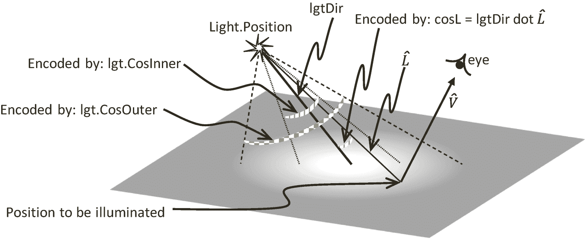

> **注意**  
> 以下代码基于角度位移的余弦值。重要提醒：给定两个角度 *α* 和 *β*（均在 0 到 180 度之间），若 *α* > *β*，则 cos *α* < cos *β*。

1. `cosL` 是 `L` 与 `lgtDir` 的点积，记录当前被照亮位置的角度位移。
2. `num` 存储 `cosL` 与 `cosOuter` 的差值。负 `num` 意味着当前位置在外锥体之外，不会被照亮，无需进一步计算。
3. 若被照亮点在内锥体内，`cosL` 大于 `lgt.CosInner`，返回满强度 `1.0`。
4. 若被照亮点在内外锥角之间，使用 `smoothstep()` 函数计算有效光照强度。

### 修改 `ShadedResult()` 函数

修改 `ShadedResult()` 函数，在合并结果前分别处理各光源类型：

```glsl
vec4 ShadedResult(Light lgt, vec3 N, vec4 textureMapColor) {
    float aStrength = 1.0, dStrength = 1.0;
    vec3 lgtDir = -normalize(lgt.Direction.xyz);
    vec3 L; // light vector
    float dist; // distance to light
    if (lgt.LightType == eDirectionalLight) {
        L = lgtDir;
    } else {
        L = lgt.Position.xyz - gl_FragCoord.xyz;
        dist = length(L);
        L = L / dist;
    }
    if (lgt.LightType == eSpotLight) {
        // spotlight: do angle dropoff
        aStrength = AngularDropOff(lgt, lgtDir, L);
    }
    if (lgt.LightType != eDirectionalLight) {
        // both spot and point light has distance dropoff
        dStrength = DistanceDropOff(lgt, dist);
    }
    vec4 diffuse = DiffuseResult(N, L, textureMapColor);
    vec4 specular = SpecularResult(N, L);
    vec4 result = aStrength * dStrength *
                  lgt.Intensity * lgt.Color * (diffuse + specular);
    return result;
}
```

## 修改 GLSL `light_fs` 片元着色器

现在可以修改 GLSL `light_fs` 片元着色器以支持两种新光源类型。修改内容与 `illum_fs` 的更改非常相似：定义对应光源类型的常量值、扩展 `Light` 结构体以支持方向光和聚光灯、定义角度和距离衰减函数以正确计算光照强度。详细实现请参考 `light_fs.glsl` 源码文件。

## 修改 `Light` 类

必须扩展 `Light` 类以支持两种新光源类型的参数：

### 1. 编辑 `light.js` 定义枚举类型

编辑 `src/engine/lights/light.js`，定义并导出不同光源类型的枚举数据。枚举值必须与 GLSL `illum_fs` 和 `light_fs` 着色器中定义的常量值对应。

```javascript
// **** WARNING: The following enumerate values must be identical to
// the values of
//
//    ePointLight, eDirectionalLight, eSpotLight
//
// defined in LightFS.glsl and IllumFS.glsl
const eLightType = Object.freeze({
    ePointLight: 0,
    eDirectionalLight: 1,
    eSpotLight: 2
});
export { eLightType };
```

### 2. 修改构造函数初始化新变量

修改构造函数，定义并初始化对应方向光和聚光灯参数的新变量。

```javascript
constructor() {
    this.mColor = vec4.fromValues(1, 1, 1, 1); // light color
    this.mPosition = vec3.fromValues(0, 0, 5); // light position in WC
    this.mDirection = vec3.fromValues(0, 0, -1); // in WC
    this.mNear = 5;    // effective radius in WC
    this.mFar = 10;
    this.mInner = 0.1; // in radian
    this.mOuter = 0.3;
    this.mIntensity = 1;
    this.mDropOff = 1; //
    this.mLightType = eLightType.ePointLight;
    this.mIsOn = true;
}
```

### 3. 定义新变量的 getter/setter

为新变量定义 get 和 set 访问器。此处不列出详尽函数列表，详情请参考 `light.js` 源码文件。

## 修改 `ShaderLightAt` 类

`ShaderLightAt` 类负责将光源数值加载到 GLSL 片元着色器。该对象必须完善以支持方向光和聚光灯对应的新光源参数。

### 1. 导入 `eLightType` 枚举

编辑 `shader_light_at.js`，从 `light.js` 导入 `eLightType` 枚举类型：

```javascript
import { eLightType } from "../lights/light.js";
```

### 2. 修改 `_setShaderReferences()` 设置新属性引用

修改 `_setShaderReferences()` 函数，设置新增光源属性的引用：


## 设置着色器引用

```javascript
_setShaderReferences(aLightShader, index) {
    let gl = glSys.get();
    this.mColorRef = gl.getUniformLocation(
        aLightShader, "uLights[" + index + "].Color");
    this.mPosRef = gl.getUniformLocation(
        aLightShader, "uLights[" + index + "].Position");
    this.mDirRef = gl.getUniformLocation(
        aLightShader, "uLights[" + index + "].Direction");
    this.mNearRef = gl.getUniformLocation(
        aLightShader, "uLights[" + index + "].Near");
    this.mFarRef = gl.getUniformLocation(
        aLightShader, "uLights[" + index + "].Far");
    this.mInnerRef = gl.getUniformLocation(
        aLightShader, "uLights[" + index + "].CosInner");
    this.mOuterRef = gl.getUniformLocation(
        aLightShader, "uLights[" + index + "].CosOuter");
    this.mIntensityRef = gl.getUniformLocation(
        aLightShader, "uLights[" + index + "].Intensity");
    this.mDropOffRef = gl.getUniformLocation(
        aLightShader, "uLights[" + index + "].DropOff");
    this.mIsOnRef = gl.getUniformLocation(
        aLightShader, "uLights[" + index + "].IsOn");
    this.mLightTypeRef = gl.getUniformLocation(
        aLightShader, "uLights[" + index + "].LightType");
}
```

## 修改 `loadToShader()` 函数

修改 `loadToShader()` 函数以加载新添加的定向光和聚光灯的光照变量。请注意，根据光照类型，某些变量的值可能不会传递给 GLSL 着色器。例如，与角度衰减相关的参数（内角、外角和衰减系数）仅针对聚光灯传递。

```javascript
loadToShader(aCamera, aLight) {
    let gl = glSys.get();
    gl.uniform1i(this.mIsOnRef, aLight.isLightOn());
    // 仅在光源开启时处理
    if (aLight.isLightOn()) {
        ... identical to previous code ...
        gl.uniform1f(this.mFarRef, f);
        gl.uniform1f(this.mInnerRef, 0.0);
        gl.uniform1f(this.mOuterRef, 0.0);
        gl.uniform1f(this.mIntensityRef, aLight.getIntensity());
        gl.uniform1f(this.mDropOffRef, 0);
        gl.uniform1i(this.mLightTypeRef, aLight.getLightType());
        // 点光源不需要方向
        if (aLight.getLightType() === eLightType.ePointLight) {
            gl.uniform3fv(this.mDirRef, vec3.fromValues(0, 0, 0));
        } else {
            // 聚光灯或定向光：必须计算方向
            let d = aCamera.wcDirToPixel(aLight.getDirection());
            gl.uniform3fv(this.mDirRef, vec3.fromValues(d[0], d[1], d[2]));
            if (aLight.getLightType() === eLightType.eSpotLight) {
                gl.uniform1f(this.mInnerRef,
                    Math.cos(0.5 * aLight.getInner()));
                gl.uniform1f(this.mOuterRef,
                    Math.cos(0.5 * aLight.getOuter()));
                gl.uniform1f(this.mDropOffRef, aLight.getDropOff());
            }
        }
    }
}
```

对于 `mInnerRef` 和 `mOuterRef`，实际计算并传递的是半角的余弦值。内角和外角是聚光灯的总角度展开范围，这些角度的一半描述了从光照方向的角度偏移。因此，半角的余弦值将在计算中实际使用。这种优化避免了 GLSL 片段着色器在每次调用时重新计算这些角度的余弦值。

## 修改相机变换类

定向光和聚光灯需要光照方向，GLSL 的 `illum_fs` 和 `light_fs` 着色器期望该方向以像素空间指定。编辑 `Camera` 对象的 `camera_xform.js` 文件，定义 `wcDirToPixel()` 函数以将方向从世界坐标系（WC）转换到像素空间。

```javascript
Camera.prototype.wcDirToPixel = function (d) {
    // d: vec3 方向（世界坐标系）
    // 将位置转换到像素空间
    let x = d[0] * this.mRenderCache.mWCToPixelRatio;
    let y = d[1] * this.mRenderCache.mWCToPixelRatio;
    let z = d[2];
    return vec3.fromValues(x, y, z);
}
```

## 测试新光照类型

`MyGame` 关卡的主要目标是测试并提供操控新光照类型的功能。修改内容很简单：`my_game_lights.js` 被修改为创建所有三种光照类型，`my_game_light_control.js` 被修改为支持在同时按下方向键和空格键时操控选中光源的方向。这些简单更改的实现此处不展示，详情请参考源代码文件。

## 观察结果

你可以运行项目并交互式地控制光源以观察相应效果。场景中定义了四个光源，每个光源照亮场景中的所有物体。光源 0 是点光源，光源 1 是定向光，光源 2 和 3 是聚光灯。

你可以通过按 `1` 键选择定向光来观察其效果。现在按住空格键，同时轮流按左/右或上/下键来摆动定向光的方向。你会注意到背景图像中 3D 几何形状边界边缘的光照发生剧烈变化，并伴随偶尔出现的显著红色镜面反射高光。现在按 `H` 键关闭定向光，观察整个场景变暗。由于没有任何衰减，定向光可作为照亮整个场景的有效工具。

按 `2` 或 `3` 键选择一个聚光灯，再次按住空格键并轮流按左/右或上/下键来摆动聚光灯的方向。使用聚光灯时，你会观察到照亮区域摆动并形状在圆形（当聚光灯垂直指向背景图像时）和不同的拉长椭圆之间变化。方向键会移动照亮区域。尝试使用 `C`/`V` 和 `B`/`N` 键增加/减小内锥角和外锥角。注意，如果将内锥角设置得大于外锥角，照亮区域的边界会变得清晰，聚光灯的光照效果会突然衰减。你可以考虑关闭定向光（光源 1）以更清晰地观察聚光灯效果。

尝试不同的光照设置，包括重叠光照区域并将光照强度（`K` 和 `L` 键）设置为负数。虽然在物理世界中不可能，但负强度光源在游戏世界中是完全有效的选项。

## 阴影模拟

阴影是光被遮挡或遮蔽的结果。作为一种日常现象，阴影是你观察到但可能很少深思的东西。然而，阴影在人类视觉感知系统中起着至关重要的作用。例如，物体的阴影传达了相对大小、深度、距离、顺序等重要线索。在视频游戏中，适当的阴影模拟可以提升外观质量和保真度。例如，你可以利用阴影正确传达两个游戏物体之间的距离或英雄跳跃的高度。


## 使用 WebGL 模板缓冲区进行阴影模拟

阴影可以通过确定待照明位置与环境中每个光源位置之间的可见性来模拟。如果某物体遮挡了该位置相对于光源的视线，或者该位置从光源处不可见，则该位置相对于该光源处于阴影中。从计算角度来看，这是一项开销很大的操作，因为通用可见性确定是一个 `O(n)` 操作，其中 `n` 是场景中的物体数量，并且必须为每个被照明的像素执行此操作。从算法角度来看，这是一个具有挑战性的问题，因为可见性解决方案必须在片段着色器的照明计算期间可用，同样是针对每个被照明的像素。

由于计算和算法上的挑战，许多视频游戏不再根据物理世界模拟阴影，而是基于专用硬件资源，仅为选定的物体近似或创建类阴影效果。在本节中，你将学习如何通过基于 WebGL 模板缓冲区选择专用的阴影投射者和接收者来近似阴影。

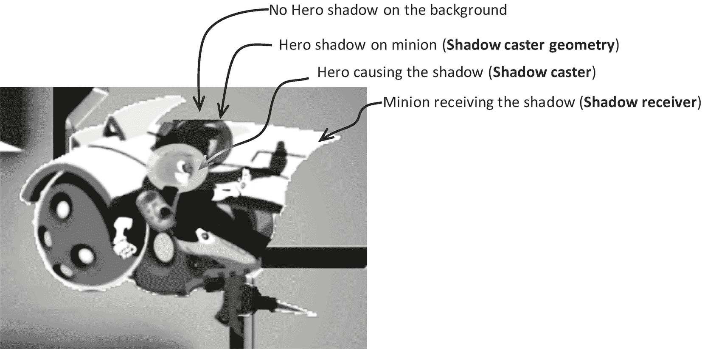

图 8-24：英雄在小兵身上投射阴影而非背景上

为了正确模拟和渲染图 图 8-24 中的阴影，如图 图 8-25 所示，有三个重要元素。

*   `Shadow caster`（阴影投射者）：这是导致阴影的物体。在图 图 8-24 示例中，英雄物体是阴影投射者。
*   `Shadow receiver`（阴影接收者）：这是阴影出现其上的物体。在图 图 8-24 示例中，小兵物体是阴影接收者。
*   `Shadow caster geometry`（阴影投射者几何体）：这是实际的阴影，换句话说，是因光线遮挡而在阴影接收者上形成的黑暗区域。在图 图 8-24 示例中，真实英雄物体后方出现在小兵身上的英雄黑色印记即为阴影投射者几何体。

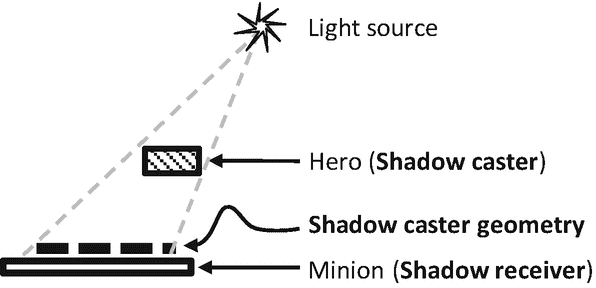

图 8-25：阴影模拟的三个参与元素：投射者、投射者几何体和接收者

给定这三个参与元素，阴影模拟算法相当直接：计算阴影投射者几何体，像往常一样渲染阴影接收者，将阴影投射者几何体作为深色阴影投射者物体渲染在接收者之上，最后像往常一样渲染阴影投射者。例如，要渲染图 图 8-24 中的阴影，首先根据光源位置、英雄物体（阴影投射者）和小兵物体（阴影接收者）的位置计算深色英雄阴影投射者几何体。之后，首先像往常一样渲染小兵物体（阴影接收者），接着将阴影投射者几何体作为具有深色恒定颜色的英雄物体进行渲染，最后像往常一样渲染英雄物体（阴影投射者）。

请注意，阴影实际上是一种视觉效果，物体上的颜色因光能被阻挡而显得更暗。重要的是要注意，当人类观察阴影时，并没有新的物体或几何体参与其中。这与上述算法形成鲜明对比，在该算法中，阴影是通过阴影投射者几何体（一个深色物体）来模拟的。这个深色物体在场景中并不实际存在。它是通过算法创建的，用于近似光线被遮挡的视觉感知。虽然这种创建和渲染额外几何体来模拟人类视觉感知结果的做法很有趣，但它也有自己的挑战。

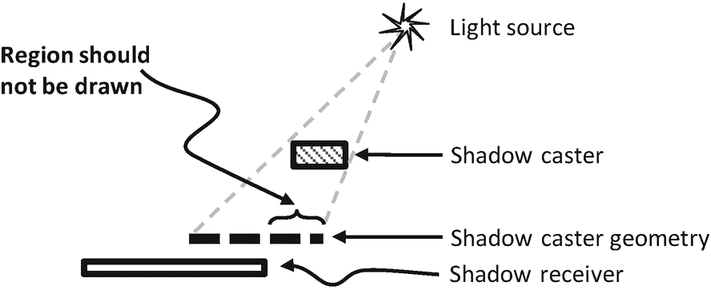

图 8-26：阴影投射者超出阴影接收者的边界

幸运的是，WebGL 模板缓冲区专门设计用于解决这类情况。WebGL 模板缓冲区可配置为一个开/关开关的二维数组，其像素分辨率与网页浏览器中显示的画布相同。通过此配置，当启用模板缓冲区检查时，画布中可绘制的像素将仅限于那些对应的模板缓冲区像素处于开启状态的像素。

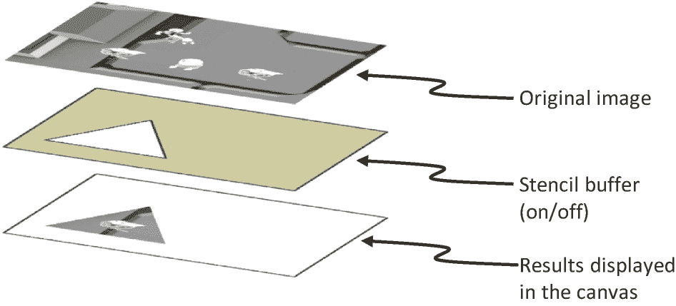

图 8-27：WebGL 模板缓冲区

在 WebGL 模板缓冲区的支持下，现在可以通过识别所有阴影接收者并将相应的阴影投射者与每个接收者分组，来相应地指定阴影模拟。在图 图 8-24 示例中，英雄物体被分组为小兵阴影接收者的阴影投射者。在该示例中，为了让背景物体接收来自英雄的阴影，必须将其明确标识为阴影接收者，并将英雄物体分组为其阴影投射者。请注意，如果不明确将小兵物体分组为背景阴影接收者的阴影投射者，小兵就不会在背景上投射阴影。

正如将在后续实现讨论中详述的那样，阴影投射者和接收者的透明度以及投射光源的强度都会影响阴影的生成。重要的是要认识到，这种阴影模拟实际上是一种算法创建，其效果可用于近似人类感知。此过程并不描述阴影在现实世界中是如何形成的，因此完全有可能创建出非真实的戏剧性效果，例如投射透明或蓝色的阴影。

### 阴影模拟算法


## 阴影模拟与渲染算法

阴影模拟与渲染算法大纲如下：

给定一个 `shadowReceiver`：

- **A**：像往常一样将 `shadowReceiver` 绘制到 `canvas` 上
- **B1**：将所有 `stencil buffer` 像素初始化为关闭状态
- **B2**：开启对应 `shadowReceiver` 的 `stencil buffer` 像素
- **B3**：启用 `stencil buffer` 检查
- **C**：对于该 `shadowReceiver` 的每个 `shadowCaster`
  - **D**：对于每个 `shadow casting light source`
    - **D1**：计算 `shadowCaster` 几何体
    - **D2**：绘制 `shadowCaster` 几何体

列出的代码渲染 `shadow receiver` 和所有 `shadow caster` 几何体，而不渲染实际的 `shadow caster` 对象。`B1`、`B2` 和 `B3` 步骤开启对应 `shadow receiver` 的 `stencil buffer` 像素。这类似于开启与图 8-27 中白色三角形相关联的像素，从而启用可绘制区域。步骤 `C` 和 `D` 的循环表明，必须为每个 `shadow casting light source` 计算单独的几何体。当步骤 `D1` 绘制 `shadow caster` 几何体时，`stencil buffer` 包含 `shadow receiver` 的印记且已启用检查，因此只有 `shadow receiver` 占据的像素才会在 `canvas` 上被启用绘制。

## 阴影着色器项目

该项目演示了如何将阴影模拟算法实现并集成到你的游戏引擎中。你可以在图 8-28 中看到该项目运行的示例。该项目的源代码位于 `chapter8/8.7.shadow_shaders` 文件夹中。

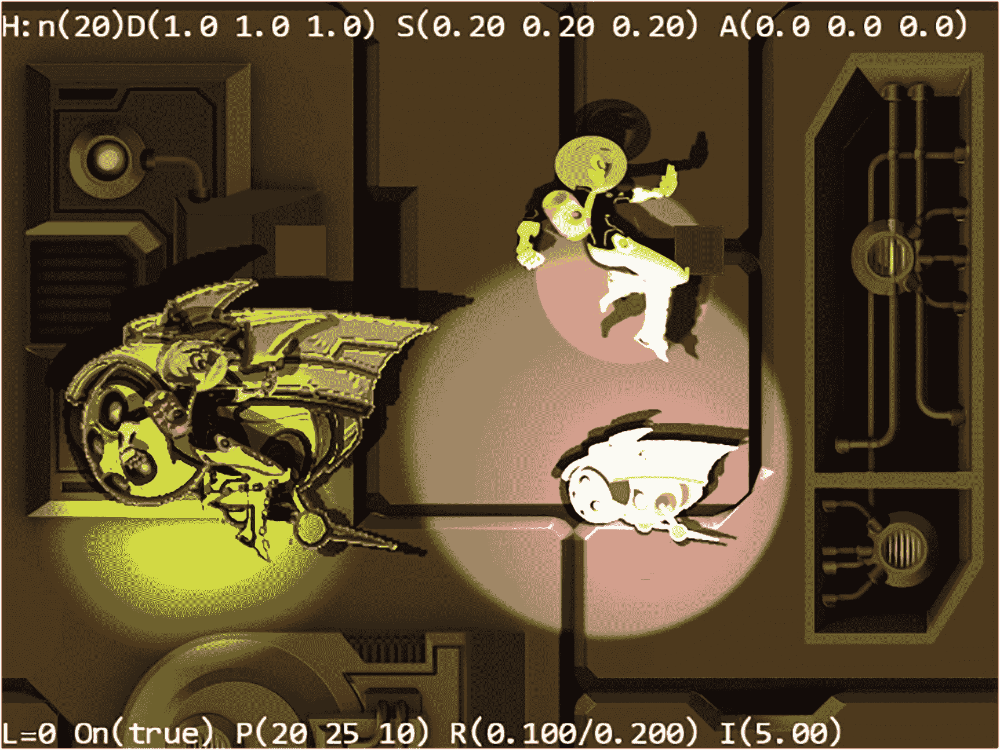

**图 8-28 ¶ 运行阴影着色器项目**

该项目的控制方式与前一个项目相同：

- **`WASD` 键**：移动屏幕上的主角角色

**光照控制：**

- **数字键 `0`、`1`、`2` 和 `3`**：选择对应的光源
- **方向键**：移动当前选中的光源；注意这对定向光（光源 1）无效。
- **按住 `spacebar` 的同时按方向键**：改变当前选中光源的方向；注意这对点光源（光源 0）无效。
- **`Z`/`X` 键**：增加/减小光源的 z 位置；注意这对定向光（光源 1）无效。
- **`C`/`V` 和 `B`/`N` 键**：增加/减小选中光源的内外锥角；注意这些仅影响场景中的两个聚光灯（光源 2 和 3）。
- **`K`/`L` 键**：增加/减小选中光源的强度。
- **`H` 键**：切换选中光源的开/关状态。

**材质属性控制：**

- **数字键 `5` 和 `6`**：选择左侧小兵和主角
- **数字键 `7`、`8` 和 `9`**：选择选中角色（左侧小兵或主角）的 `K_a`、`K_d` 和 `K_s` 材质属性
- **`E`/`R`、`T`/`Y` 和 `U`/`I` 键**：增加/减小选中材质属性的红、绿、蓝通道
- **`O`/`P` 键**：增加/减小选中材质属性的光泽度

项目目标如下：

- 理解阴影可以通过算法定义和渲染显式几何体来近似
- 了解 `WebGL` `stencil buffer` 的基本操作
- 理解利用 `shadow caster` 和 `receiver` 模拟阴影
- 基于 `WebGL` `stencil buffer` 实现阴影模拟算法

### 创建 GLSL 片元着色器

需要两个单独的 `GLSL` 片元着色器来支持阴影渲染，一个用于将 `shadow caster` 几何体绘制到 `canvas` 上，另一个用于将 `shadow receiver` 绘制到 `stencil buffer` 中。

#### 定义 GLSL 阴影投射体片元着色器

`GLSL` `shadow_caster_fs` 片元着色器支持 `shadow caster` 几何体的绘制。请参考图 8-25；`shadow caster` 几何体是伪装成 `shadow caster` 阴影的那块几何体。引擎通常会根据该几何体到 `shadow caster` 的距离对其进行缩放；离投射体越远，该几何体越大。

在片元着色器中，该几何体应渲染为深色物体，以产生阴影的假象。注意，每个 `shadow casting light source` 都需要一个 `shadow caster` 几何体；因此，片元着色器仅支持一个光源。最后，该物体的暗度取决于 `shadow casting light sources` 的有效强度，因此，片元着色器必须定义计算各类光源强度的功能。

1. 在 `src/glsl_shaders` 文件夹中，创建一个名为 `shadow_caster_fs.glsl` 的文件。由于所有光源类型都可以投射阴影，因此必须支持现有的光源结构。现在，从 `light_fs` 中复制 `Light` 结构体和光源类型常量（此处不显示）。这些数据结构和常量必须完全相同，以便引擎中的对应接口着色器可以复用支持 `LightShader` 的现有工具。唯一的区别是，由于必须为每个光源定义一个 `shadow caster` 几何体，因此在这种情况下 `uLight` 数组的大小恰好为 1。

2. 定义阴影渲染的常量。`kMaxShadowOpacity` 表示阴影的最大不透明度，`kLightStrengthCutOff` 是一个截止阈值，强度低于该值的光源将不投射阴影。

```glsl
#define kMaxShadowOpacity 0.7   // max of shadow opacity
#define kLightStrengthCutOff 0.05 // any less will not cause shadow
```

3. 为了正确支持三种不同光源类型的阴影投射，`AngularDropOff()` 和 `DistanceDropOff()` 函数也必须以与 `light_fs`（和 `illum_fs`）中完全相同的方式定义。你可以从 `light_fs` 复制这些函数。注意，由于 `uLight` 数组中只有一个光源，你可以从这些函数中移除 light 参数，并在计算中直接引用 `uLight[0]`。这种参数替换是唯一需要的修改，因此此处不展示代码。

4. 请记住，阴影的产生是因为光线遮挡，与光源颜色无关。现在，修改 `LightStrength()` 函数以计算到达待照亮位置的光强，而不是计算着色颜色。

```glsl
float LightStrength() {
    float aStrength = 1.0, dStrength = 1.0;
    vec3 lgtDir = -normalize(uLights[0].Direction.xyz);
    vec3 L; // light vector
    float dist; // distance to light
    if (uLights[0].LightType == eDirectionalLight) {
        L = lgtDir;
    } else {
        L = uLights[0].Position.xyz - gl_FragCoord.xyz;
        dist = length(L);
        L = L / dist;
    }
    if (uLights[0].LightType == eSpotLight) {
        // spotlight: do angle dropoff
        aStrength = AngularDropOff(lgtDir, L);
    }
    if (uLights[0].LightType != eDirectionalLight) {
        // both spot and point light has distance dropoff
        dStrength = DistanceDropOff(dist);
    }
    float result = aStrength * dStrength;
    return result;
}
```

将列出的 `LightStrength()` 与 `light_fs` 中的同名函数进行比较，有两个主要区别。首先，该函数不考虑光源颜色，返回一个 `float`，即光源的聚合强度。其次，由于 `uLight` 数组大小为 1，该函数移除了 `Light` 参数，并在计算中引用了 `uLight[0]`。

5.


在 `main()` 函数中根据光源强度计算阴影的颜色。请注意，如果光照强度小于 `kLightStrengthCutOff`，则不会投射阴影，并且阴影的实际颜色并非完全不透明的黑色。相反，它是程序员定义的 `uPixelColor` 与从纹理贴图采样的透明度的混合。

```glsl
void main(void) {
    vec4 texFragColor = texture2D(uSampler, vTexCoord);
    float lgtStrength = LightStrength();
    if (lgtStrength < kLightStrengthCutOff)
        discard;
    vec3 shadowColor = lgtStrength * uPixelColor.rgb;
    shadowColor *= uPixelColor.a * texFragColor.a;
    gl_FragColor = vec4(shadowColor,
                        kMaxShadowOpacity * lgtStrength * texFragColor.a);
}
```

### 定义 GLSL 阴影接收片元着色器

GLSL `shadow_receiver_fs` 片元着色器是用于将阴影接收者绘制到模板缓冲区的着色器。请注意，模板缓冲区被配置为开/关缓冲区，其中 `gl_FragColor` 中返回的任何值都会将对应的像素切换为开启状态。因此，透明的接收片元必须被丢弃。

1. **步骤 1.1**  
   在 `src/glsl_shaders` 文件夹下创建 `shadow_receiver_fs.glsl`，并定义一个 `sampler2D` 对象以采样阴影接收者对象的颜色纹理贴图。此外，定义常量 `kSufficientlyOpaque` 作为阈值，不透明度低于该值的片元将被视为透明并丢弃。对应于被丢弃片元的模板缓冲区像素将保持关闭状态，因此无法接收阴影几何体。

```glsl
// The object that fetches data from texture.
// Must be set outside the shader.
uniform sampler2D uSampler;
uniform vec4 uPixelColor;
// "varying" signifies that the texture coordinate will be
// interpolated and thus varies.
varying vec2 vTexCoord;
#define kSufficientlyOpaque 0.1
```

请注意，为了方便引擎着色器类代码复用，`uSampler` 和 `vTexCoord` 的变量名不得更改。这些名称对应 `texture_fs.glsl` 中定义的变量名，游戏引擎可以使用现有的 `SpriteShader` 来方便地向该着色器加载信息。

2. **步骤 1.2**  
   实现 `main()` 函数以采样阴影接收者对象的纹理并测试不透明度阈值，以确定是否可以接收阴影：

```glsl
void main(void) {
    vec4 texFragColor = texture2D(uSampler, vTexCoord);
    if (texFragColor.a < kSufficientlyOpaque)
        discard;
    else
        gl_FragColor = vec4(1, 1, 1, 1);
}
```

### 将 GLSL 阴影着色器接入引擎

定义了两个新的 GLSL 着色器后，你可能会认为有必要定义两个相应的 `SimpleShader`/`Renderable` 对来促进通信。但实际情况并非如此，原因有二：

*   **首先**，仅需要一种新的引擎着色器类型来支持 `shadow_caster_fs`。凭借 `shadow_receiver_fs` 着色器中策略性的变量命名，现有的 `SpriteShader` 对象可用于与 `shadow_receiver_fs` GLSL 片元着色器通信。
*   **其次**，不需要新的 `Renderable` 类。`Renderable` 类旨在支持使用相应着色器绘制和操作游戏对象。这样，`Renderable` 对象对玩家可见。在阴影着色器的情况下，`shadow_caster_fs` 绘制阴影投射体几何体，而 `shadow_receiver_fs` 将阴影接收体几何体绘制到模板缓冲区中。请注意，这两个着色器均未设计为支持绘制对玩家可见的对象。基于这些原因，不需要相应的 `Renderable` 对象。

#### 创建阴影投射体着色器

必须定义一个 JavaScript `SimpleShader` 子类，以便将信息从游戏引擎加载到 GLSL 着色器中。在这种情况下，需要定义一个 `ShadowCasterShader` 来与 GLSL `shadow_caster_fs` 片元着色器通信。

1. **步骤 2.1**  
   在 `src/engine/shaders` 文件夹下创建 `shadow_caster_shader.js`；定义 `ShadowCasterShader` 类继承自 `SpriteShader`。由于每个阴影投射体几何体由一个投射光源创建，因此为该着色器定义单个光源。

```javascript
import SpriteShader from "./sprite_shader.js";
import ShaderLightAt from "./shader_light_at.js";

class ShadowCasterShader extends SpriteShader {
    // constructor
    constructor(vertexShaderPath, fragmentShaderPath) {
        super(vertexShaderPath, fragmentShaderPath);
        this.mLight = null;  // The light that casts the shadow
        this.mCamera = null;
        // GLSL Shader must define uLights[1] (size of 1)!!
        this.mShaderLight = new ShaderLightAt(this.mCompiledShader, 0);
    }
    // ... implementation to follow ...
}
export default ShadowCasterShader;
```

2. **步骤 2.2**  
   重写 `activate()` 函数，以确保单个光源正确加载到着色器中：

```javascript
// Overriding the activation of the shader for rendering
activate(pixelColor, trsMatrix, cameraMatrix) {
    // first call the super class' activate
    super.activate(pixelColor, trsMatrix, cameraMatrix);
    this.mShaderLight.loadToShader(this.mCamera, this.mLight);
}
```

3. **步骤 2.3**  
   定义一个函数以设置该着色器的当前相机和光源：

```javascript
setCameraAndLights(c, l) {
    this.mCamera = c;
    this.mLight = l;
}
```

#### 实例化默认阴影投射体和接收体着色器

必须创建引擎着色器的默认实例，以连接到新定义的 GLSL 着色器投射体和接收体片元着色器：

1. **步骤 3.1**  
   修改 `src/engine/core` 文件夹中的 `shader_resources.js` 以导入 `ShadowCasterShader`，并为两个新的阴影相关着色器定义常量和变量。

```javascript
import ShadowCasterShader from "../shaders/shadow_caster_shader.js";

let kShadowReceiverFS = "src/glsl_shaders/shadow_receiver_fs.glsl";
let mShadowReceiverShader = null;
let kShadowCasterFS = "src/glsl_shaders/shadow_caster_fs.glsl";
let mShadowCasterShader = null;
```

2. **步骤 3.2**  
   编辑 `createShaders()` 函数以定义引擎着色器，使其与新的 GLSL 片元着色器接口。请注意，这两个引擎着色器均基于 `texture_vs` GLSL 顶点着色器。此外，正如所讨论的，创建了一个引擎 `SpriteShader` 的新实例来与 `shadow_receiver_fs` GLSL 片元着色器接口。

```javascript
function createShaders() {
    // ... identical to previous code ...
    mIllumShader = new IllumShader(kTextureVS, kIllumFS);
    mShadowCasterShader = new ShadowCasterShader(kTextureVS, kShadowCasterFS);
    mShadowReceiverShader = new SpriteShader(kTextureVS, kShadowReceiverFS);
}
```

3. **步骤 3.3**  
   对 `shader_resources.js` 文件的其余修改属于常规操作，包括定义访问器、加载和卸载 GLSL 源代码文件、清理着色器以及导出访问器。此处不列出这些详细清单，因为你在许多场合都见过类似的更改。请参考源代码文件了解实际实现。

### 配置和支持 WebGL 缓冲区

需要进行三项修改才能将 WebGL 模板缓冲区集成到游戏引擎中。首先，必须启用并正确配置 WebGL 模板缓冲区。其次，必须定义函数以支持使用模板缓冲区进行绘制。第三，必须在每个绘制周期之前正确清除缓冲区。

1. **步骤 4.1**  


## 编辑 gl.js 以启用 WebGL 模板缓冲区

编辑 `src/engine/core/gl.js` 文件，在引擎初始化期间启用并配置 WebGL 模板缓冲区。在 `init()` 函数中，添加在 WebGL 初始化期间请求分配和配置模板缓冲区及深度缓冲区的代码。注意，深度缓冲区（或 Z 缓冲区）也会被分配和配置。这对于正确的阴影投射器支持是必要的，因为阴影投射器必须位于接收器前方，或具有更大的 Z 深度，才能在接收器上投射阴影。

```javascript
function init(htmlCanvasID) {
    // ... identical to previous code ...
    mGL = mCanvas.getContext("webgl2",
        {alpha: false, depth: true, stencil: true}) ||
        mCanvas.getContext("experimental-webgl2",
            {alpha: false, depth: true, stencil: true});
    // ... identical to previous code ...
    // make sure depth testing is enabled
    mGL.enable(mGL.DEPTH_TEST);
    mGL.depthFunc(mGL.LEQUAL);
}
```

## 继续完善 gl.js：定义模板缓冲区绘制函数

继续处理 `gl.js`；定义开始、结束和禁用模板缓冲区绘制的函数。记得导出这些新的模板缓冲区支持函数。

```javascript
function beginDrawToStencil(bit, mask) {
    mGL.clear(mGL.STENCIL_BUFFER_BIT);
    mGL.enable(mGL.STENCIL_TEST);
    mGL.colorMask(false, false, false, false);
    mGL.depthMask(false);
    mGL.stencilFunc(mGL.NEVER, bit, mask);
    mGL.stencilOp(mGL.REPLACE, mGL.KEEP, mGL.KEEP);
    mGL.stencilMask(mask);
}

function endDrawToStencil(bit, mask) {
    mGL.depthMask(mGL.TRUE);
    mGL.stencilOp(mGL.KEEP, mGL.KEEP, mGL.KEEP);
    mGL.stencilFunc(mGL.EQUAL, bit, mask);
    mGL.colorMask(true, true, true, true);
}

function disableDrawToStencil() {
    mGL.disable(mGL.STENCIL_TEST);
}
```

## 编辑引擎访问文件 index.js

编辑 `src/engine/index.js` 中的 `clearCanvas()` 函数，在清空画布时同时清空模板缓冲区和深度缓冲区：

```javascript
function clearCanvas(color) {
    // ... identical to previous code ...
    gl.clear(gl.COLOR_BUFFER_BIT | gl.STENCIL_BUFFER_BIT | gl.DEPTH_BUFFER_BIT);
}
```

## 为游戏开发者定义阴影支持

正如定义 `ShadowCasterShader` 时所述，`Renderable` 类不应被定义为与阴影投射器和接收器着色器配对，因为这会赋予游戏开发者操纵算法创建对象作为常规游戏对象的能力。相反，引入 `ShadowCaster` 和 `ShadowReceiver` 类，允许游戏开发者创建阴影，而无需授予操纵底层几何体的权限。

## 定义阴影投射器类

不同于熟悉的 `Renderable` 类层次结构，`ShadowCaster` 类被定义为封装隐式定义的阴影投射器几何体的功能。回顾图 8-25，阴影投射器几何体是基于阴影投射器（一个 `Renderable`）和阴影接收器（另一个 `Renderable`）对象的位置，为每个投射阴影的光源算法推导得出的。

为了支持在动画精灵元素上接收阴影，阴影接收器必须是 `SpriteRenderable` 或其子类。投射阴影的 `Renderable` 对象必须能够接收光源，因此它必须是 `LightRenderable` 或其子类。`ShadowCaster` 对象维护对实际投射和接收阴影的 `Renderable` 对象的引用，并定义为 `caster LightRenderable` 对象引用的每个光源计算和渲染阴影投射器几何体的算法。`ShadowCaster` 类的详细内容如下：

### 1. 创建阴影相关文件夹和文件

创建 `src/engine/shadows` 文件夹用于组织阴影相关支持文件，并在该文件夹中创建 `shadow_caster.js` 文件。

### 2. 定义 ShadowCaster 类和构造函数

定义 `ShadowCaster` 类和构造函数，初始化投射器几何体计算所需的实例变量和常量：

```javascript
import * as shaderResources from "../core/shader_resources.js";
import SpriteRenderable from "../renderables/sprite_renderable.js";
import Transform from "../utils/transform.js";
import { eLightType } from "../lights/light.js";

// shadowCaster: GameObject referencing at least a LightRenderable
// shadowReceiver: GameObject referencing at least a SpriteRenderable
class ShadowCaster {
    constructor(shadowCaster, shadowReceiver) {
        this.mShadowCaster = shadowCaster;
        this.mShadowReceiver = shadowReceiver;
        this.mCasterShader = shaderResources.getShadowCasterShader();
        this.mShadowColor = [0, 0, 0, 0.2];
        this.mSaveXform = new Transform();
        this.kCasterMaxScale = 3;      // Max amount a caster will be scaled
        this.kVerySmall = 0.001;
        this.kDistanceFudge = 0.01;    // to avoid caster-receiver overlap
        this.kReceiverDistanceFudge = 0.6; // Factor to reduce the projected caster geometry size
    }

    setShadowColor(c) {
        this.mShadowColor = c;
    }

    // ... implementation to follow ...
}

export default ShadowCaster;
```

`mShadowCaster` 是对至少包含 `LightRenderable` 的阴影投射器 `GameObject` 的引用，`mShadowReceiver` 是至少包含 `SpriteRenderable` 渲染组件的 `GameObject` 的引用。正如下一步详述的，`mCasterShader`、`mShadowColor` 和 `mSaveXform` 是支持渲染阴影投射器几何体的变量。

### 3. 实现 draw() 函数

实现 `draw()` 函数，为照亮 `mShadowCaster` 的 `Renderable` 对象的每个光源计算并绘制阴影投射器几何体：

```javascript
draw(aCamera) {
    let casterRenderable = this.mShadowCaster.getRenderable();
    // Step A: save caster xform/shader/color. Set caster to shadow color
    this.mShadowCaster.getXform().cloneTo(this.mSaveXform);
    let s = casterRenderable.swapShader(this.mCasterShader);
    let c = casterRenderable.getColor();
    casterRenderable.setColor(this.mShadowColor);
    let l, lgt;
    // Step B: loop through each light, if shadow casting is on
    //         compute the proper shadow offset
    for (l = 0; l < casterRenderable.getNumLights(); l++) {
        lgt = casterRenderable.getLightAt(l);
        if (lgt.isLightOn() && lgt.isLightCastShadow()) {
            // Step C: turn caster into caster geometry
            //         draws as SpriteRenderable
            this.mSaveXform.cloneTo(this.mShadowCaster.getXform());
            if (this._computeShadowGeometry(lgt)) {
                this.mCasterShader.setCameraAndLights(aCamera, lgt);
                SpriteRenderable.prototype.draw.call(
                    casterRenderable, aCamera);
            }
        }
    }
    // Step D: restore the original shadow caster
    this.mSaveXform.cloneTo(this.mShadowCaster.getXform());
    casterRenderable.swapShader(s);
    casterRenderable.setColor(c);
}
```

`casterRenderable` 是实际投射阴影的 `Renderable` 对象。`draw()` 函数包含以下四个主要步骤：

#### 步骤 A
保存投射器 `Renderable` 的状态、变换、着色器和颜色，并通过将其着色器设置为 `ShadowCasterShader`（`mCasterShader`）并将其颜色设置为阴影颜色，将其设为阴影投射器几何体。

#### 步骤 B
遍历照亮 `casterRenderable` 的所有光源，查找已开启且投射阴影的光源。

#### 步骤 C
对于每个产生阴影的光源，调用 `_computeShadowGeometry()` 函数计算适当大小和位置的阴影投射器几何体，并将其作为 `SpriteRenderable` 渲染。通过替换的 `ShadowCasterShader` 和阴影颜色，渲染的几何体呈现为实际 `casterRenderable` 的阴影。

#### 步骤 D
恢复 `casterRenderable` 的状态。

### 4. 后续实现


## 定义 `_computeShadowGeometry()` 函数

定义 `_computeShadowGeometry()` 函数，以根据 `mShadowCaster`（阴影投射体）、`mShadowReceiver`（阴影接收体）以及投射光源来计算阴影投射体几何。尽管该函数长度略显吓人，但可以在逻辑上将其分为四个区域。第一个区域声明并初始化变量。第二和第三区域是 `if` 语句的两种情况，分别处理平行光以及点光源/聚光灯的变换参数计算。最后一个区域将计算出的参数设置给投射体几何的变换 `cxf`。

```javascript
_computeShadowGeometry(aLight) {
    // Region 1: declaring variables
    let cxf = this.mShadowCaster.getXform();
    let rxf = this.mShadowReceiver.getXform();
    // vector from light to caster
    let lgtToCaster = vec3.create();
    let lgtToReceiverZ;
    let receiverToCasterZ;
    let distToCaster, distToReceiver; // along the lgtToCaster vector
    let scale;
    let offset = vec3.fromValues(0, 0, 0);
    receiverToCasterZ = rxf.getZPos() - cxf.getZPos();
    if (aLight.getLightType() === eLightType.eDirectionalLight) {
        // Region 2: Processing a directional light
        if (((Math.abs(aLight.getDirection()[2]) < this.kVerySmall) ||
            ((receiverToCasterZ * (aLight.getDirection())[2]) < 0)) {
            return false;   // direction light casting side way or
                            // caster and receiver on different sides of light in Z
        }
        vec3.copy(lgtToCaster, aLight.getDirection());
        vec3.normalize(lgtToCaster, lgtToCaster);
        distToReceiver = Math.abs(receiverToCasterZ / lgtToCaster[2]);
                                                // measured along lgtToCaster
        scale = Math.abs(1 / lgtToCaster[2]);
    } else {
        // Region 3: Processing a point or spot light
        vec3.sub(lgtToCaster, cxf.get3DPosition(), aLight.getPosition());
        lgtToReceiverZ = rxf.getZPos() - (aLight.getPosition())[2];
        if ((lgtToReceiverZ * lgtToCaster[2]) < 0) {
            return false;  // caster and receiver
                           // on different sides of light in Z
        }
        if ((Math.abs(lgtToReceiverZ) < this.kVerySmall) ||
            ((Math.abs(lgtToCaster[2]) < this.kVerySmall))) {
            // almost the same Z, can't see shadow
            return false;
        }
        distToCaster = vec3.length(lgtToCaster);
        vec3.scale(lgtToCaster, lgtToCaster, 1 / distToCaster);
                                                // normalize lgtToCaster
        distToReceiver = Math.abs(receiverToCasterZ / lgtToCaster[2]);
                                                // measured along lgtToCaster
        scale = (distToCaster +
                    (distToReceiver * this.kReceiverDistanceFudge)) /
                distToCaster;
    }
    vec3.scaleAndAdd(offset, cxf.get3DPosition(),
                        lgtToCaster, distToReceiver + this.kDistanceFudge);
    // Region 4: Setting casterRenderable xform
    cxf.setRotationInRad(cxf.getRotationInRad());
    cxf.setPosition(offset[0], offset[1]);
    cxf.setZPos(offset[2]);
    cxf.setWidth(cxf.getWidth() * scale);
    cxf.setHeight(cxf.getHeight() * scale);
    return true;
}
```

参数 `aLight` 是投射光源。该函数的目标是利用 `aLight` 将阴影投射体投影到阴影接收体上，从而计算并设置阴影投射体几何的变换 `cxf`。如图 8-29 所示，关于投射体几何的投影尺寸有两种情况需要考虑。首先，对于平行光源，投影尺寸是常数。其次，对于点光源或聚光灯，投影尺寸是到接收体距离的函数。这就是 `if` 语句的两种情况，即区域 2 和区域 3，详情如下：

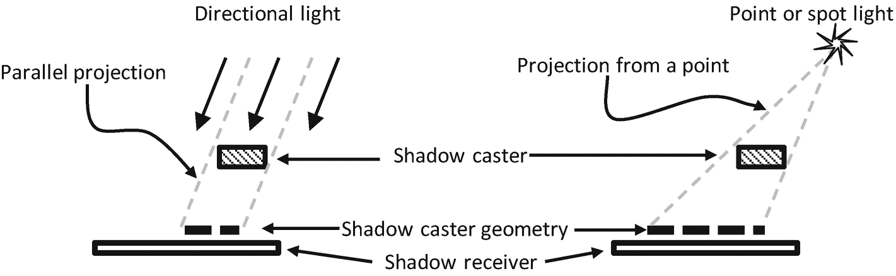

**图 8-29** ¶ 计算阴影投射体几何

1.  **区域 2**：根据平行光计算平行投影。该区域内的 `if` 语句旨在确保当光线方向平行于 xy 平面，或光线方向是从阴影接收体指向阴影投射体时，不计算阴影。请注意，为了戏剧效果，阴影投射体几何将适度缩放。

2.  **区域 3**：从点光源或聚光灯位置计算投影。该区域内的两个 `if` 语句旨在确保阴影投射体和接收体位于光源位置的同一侧，并且为了保持数学稳定性，两者均不极其接近光源。

3.  **区域 4**：使用计算出的 `distToReceiver` 和 `scale` 来设置阴影投射体（即 `cxf`）的变换。

`ShadowCaster` 对象旨在供游戏开发者定义和处理阴影。因此，请记得更新引擎访问文件 `index.js`，以将新定义的功能转发给客户端。

## 定义 Shadow Receiver 类

回顾图 8-25，`ShadowReceiver` 是投射体对象的阴影将出现的对象。如图 8-26 所示，`ShadowReceiver` 必须将自身绘制到模板缓冲区中，以确保阴影投射体几何仅出现在 `ShadowReceiver` 对象占据的像素上。

### 步骤 1：创建 `shadow_receiver.js`

在 `src/engine/shadows` 文件夹中创建一个新文件 `shadow_receiver.js`；定义 `ShadowReceiver` 类。在构造函数中，初始化接收阴影所需的常量和变量。如前所述，`mReceiver` 是一个至少包含 `SpriteRenderable` 引用的 `GameObject`，它是阴影的实际接收者。请注意，`mShadowCaster` 是一个 `ShadowCaster` 对象数组。这些对象将在 `mReceiver` 上投射阴影。

```javascript
import * as shaderResources from "../core/shader_resources.js";
import ShadowCaster from "./shadow_caster.js";
import * as glSys from "../core/gl.js";

class ShadowReceiver {
    constructor(theReceiverObject) {
        this.kShadowStencilBit = 0x01;   // stencil bit for shadow
        this.kShadowStencilMask = 0xFF;  // The stencil mask
        this.mReceiverShader = shaderResources.getShadowReceiverShader();
        this.mReceiver = theReceiverObject;
        // To support shadow drawing
        this.mShadowCaster = [];         // array of ShadowCasters
    }
    // ... implementation to follow ...
}
export default ShadowReceiver;
```

### 步骤 2：定义 `addShadowCaster()`

定义 `addShadowCaster()` 函数，以将游戏对象添加为该接收体的阴影投射体：

```javascript
addShadowCaster(lgtRenderable) {
    let c = new ShadowCaster(lgtRenderable, this.mReceiver);
    this.mShadowCaster.push(c);
}
// for now, cannot remove shadow casters
```

### 步骤 3：定义 `draw()`

定义 `draw()` 函数以绘制接收体和所有阴影投射体几何：

```javascript
draw(aCamera) {
    let c;
    // Step A: draw receiver as a regular renderable
    this.mReceiver.draw(aCamera);
    // Step B: draw receiver into stencil to enable corresponding pixels
    glSys.beginDrawToStencil(this.kShadowStencilBit,
                            this.kShadowStencilMask);
    //       Step B1: swap receiver shader to a ShadowReceiverShader
    let s = this.mReceiver.getRenderable().swapShader(
                        this.mReceiverShader);
    //       Step B2: draw the receiver again to the stencil buffer
    this.mReceiver.draw(aCamera);
    this.mReceiver.getRenderable().swapShader(s);
    glSys.endDrawToStencil(this.kShadowStencilBit,
                          this.kShadowStencilMask);
    // Step C: draw shadow color to pixels with stencil switched on
    for (c = 0; c < this.mShadowCaster.length; c++) {
        this.mShadowCaster[c].draw(aCamera);
    }
    // switch off stencil checking
    glSys.disableDrawToStencil();
}
```


该函数实现了上述的阴影模拟算法，并不绘制实际的阴影投射体。请注意，`mReceiver` 对象被绘制了两次，分别在步骤 A 和步骤 B2 中。步骤 A，第一个 `draw()` 函数，像往常一样将 `mReceiver` 渲染到画布上。步骤 B 启用模板缓冲区进行绘制，所有后续的绘制都将指向开启模板缓冲区像素。因此，步骤 B2 处的 `draw()` 函数使用 `ShadowReceiverShader`，并开启模板缓冲区中对应 `mReceiver` 对象的所有像素。通过适当的模板缓冲区设置，在步骤 C 中，对 `mShadowCaster` 调用 `draw()` 函数将仅在被接收体覆盖的像素中绘制相应的阴影投射体几何体。

最后，再次强调，`ShadowReceiver` 对象是为客户端游戏开发者创建阴影而设计的。因此，请记得更新引擎访问文件 `index.js`，以将新定义的功能转发给客户端。

## 更新引擎支持

随着新对象的定义和引擎的配置，必须修改一些现有的引擎类以支持新的阴影操作。以下总结了所需的更改，未列出简单直接的更改。实际实现细节请参阅源代码文件。

*   `renderable.js`：`ShadowCaster` 和 `ShadowReceiver` 对象都需要具备交换着色器的能力，以便为阴影模拟目的渲染对象。最好在 `Renderable` 继承体系的根节点中实现此 `swapShader()` 函数。
*   `light.js`：`Light` 光源现在定义了 `mCastShadow`，一个布尔变量，以及相关的 getter 和 setter，指示该光源是否应投射阴影。
*   `camera_main.js`：`Camera` 的世界坐标中心现在必须位于某个 z 距离处。为此定义了一个 `kCameraZ` 常量，并用于 `setViewAndCameraMatrix()` 函数中的 `mCameraMatrix` 计算。
*   `transform.js`：必须修改 `Transform` 类以支持 `cloneTo()` 以及 z 深度值的操作。

## 测试阴影算法

测试阴影模拟有两个重要方面。首先，你必须理解如何根据实现来编程和创建阴影效果。其次，你必须验证 `Renderable` 对象能否充当阴影投射体和接收体。`MyGame` 关卡测试用例与之前的项目类似，除了阴影的设置和绘制之外。

### 设置阴影

设置阴影系统的正确方法是先创建所有 `ShadowCaster` 对象，然后创建并添加到 `ShadowReceiver` 对象中。`my_game_shadow.js` 文件定义了 `_setupShadow()` 函数来演示这一点。

```
MyGame.prototype._setupShadow = function () {
    // mLgtMinion 拥有一个 LightRenderable
    this.mLgtMinionShadow = new engine.ShadowReceiver(this.mLgtMinion);
    this.mLgtMinionShadow.addShadowCaster(this.mIllumHero);
    this.mLgtMinionShadow.addShadowCaster(this.mLgtHero);
    // mIllumMinion 拥有一个 SpriteAnimateRenderable
    this.mMinionShadow = new engine.ShadowReceiver(this.mIllumMinion);
    this.mMinionShadow.addShadowCaster(this.mIllumHero);
    this.mMinionShadow.addShadowCaster(this.mLgtHero);
    this.mMinionShadow.addShadowCaster(this.mLgtMinion);
    // mBg 拥有一个 IllumRenderable
    this.mBgShadow = new engine.ShadowReceiver(this.mBg);
    this.mBgShadow.addShadowCaster(this.mLgtHero);
    this.mBgShadow.addShadowCaster(this.mIllumMinion);
    this.mBgShadow.addShadowCaster(this.mLgtMinion);
}
```

`_setupShadow()` 函数在 `MyGame.init()` 函数末尾被调用，此时所有其他 `GameObject` 实例都已正确创建并初始化。该函数演示了不同类型的 `Renderable` 对象都可以充当阴影接收体。

*   `LightRenderable`：`mLgtMinionShadow` 以 `mLgtMinon` 作为接收体创建，后者持有对 `LightRenderable` 对象的引用。
*   `IllumRenderable`：`mBgShadow` 和 `mMinionShadow` 分别以 `mBg` 和 `mIllumMinion` 作为接收体创建，两者都持有对 `IllumRenderable` 对象的引用。

请注意，为了在对象上观察到阴影，必须显式创建相应的 `ShadowReceiver`，并显式地将 `ShadowCaster` 对象添加到接收体中。例如，`mLgtMinionShadow` 定义 `mLgtMinion` 对象为接收体，只有 `mIllumHero` 和 `mLgtHero` 会在此对象上投射阴影。最后，请注意 `mLgtMinon` 和 `mIllumMinion` 既是阴影的接收体，也是投射体。

### 绘制阴影

在 2D 绘制中，对象是通过覆盖先前绘制的对象来绘制的。因此，在绘制阴影投射体之前，先绘制阴影接收体和阴影投射体几何体非常重要。`my_game_main.js` 中的以下 `my_game.draw()` 函数说明了对象的重要绘制顺序：

```
draw() {
    // 清除画布
    engine.clearCanvas([0.9, 0.9, 0.9, 1.0]); // 清除为浅灰色
    // 设置相机并绘制
    this.mCamera.setViewAndCameraMatrix();
    // 始终先绘制阴影接收体！
    this.mBgShadow.draw(this.mCamera); // 同时也绘制接收体对象
    this.mMinionShadow.draw(this.mCamera);
    this.mLgtMinionShadow.draw(this.mCamera);
    this.mBlock1.draw(this.mCamera);
    this.mIllumHero.draw(this.mCamera);
    this.mBlock2.draw(this.mCamera);
    this.mLgtHero.draw(this.mCamera);
    this.mMsg.draw(this.mCamera);  // 最后绘制
    this.mMatMsg.draw(this.mCamera);
}
```

请注意绘制顺序的重要性。所有三个阴影接收体首先被绘制。此外，在三个接收体中，`mBgShadow` 对象是实际背景，因此最先被绘制。回顾 `ShadowReceiver` 类的定义，其 `draw()` 函数也会绘制接收体对象。因此，无需调用 `mLgtMinion`、`mIllumMinion` 和 `mBg` 对象的 `draw()` 函数。

`MyGame` 关卡的其余部分与之前的项目基本相似，此处不再列出。详情请参阅源代码。

## 观察结果

现在你可以运行项目并观察阴影。注意模板缓冲区的效果，`mIllumHero` 对象的阴影投射到了小兵身上，却没有投射到背景上。按 `WASD` 键移动两个英雄对象。观察阴影如何随着两个英雄对象的移动提供深度和距离线索。右侧的 `mLgtHero` 受到所有四个光源的照亮，因此投射出许多阴影。尝试选择并操作每个光源，例如移动、改变方向或开关灯光，以观察对阴影的影响。你甚至可以尝试更改阴影的颜色（在 `shadow_caster.js` 中）为某种夸张的颜色，如亮蓝色 `[0, 0, 5, 1]`，并观察现实世界中不可能存在的阴影。

## 总结

本章指导你为游戏引擎开发了一个简单而完整的 Phong 光照模型变体。示例的组织遵循了 Phong 光照模型的三个项：环境光、漫反射和镜面反射。光源的介绍被策略性地穿插其中，以确保能为每个讨论的主题观察到适当的光照效果。

本章中关于环境光照的第一个示例介绍了交互式控制和微调场景颜色的想法。随后关于光源的两个示例阐述了这样一个概念：光照作为一种颜色操作的算法方法，可以被局部化并在引擎基础设施中开发，以支持最终的 Phong 光照模型。关于漫反射和法线贴图的示例至关重要，因为它基于简单的物理模型实现了光照计算，并实现了 3D 环境的模拟。


## 第 8 章概述

Phong 光照模型及对逐对象材质属性的需求是在镜面反射示例中介绍的。实现了 Phong 光照模型的半程向量版本，以避免为每个像素计算光源反射向量。光源类型项目演示了如何通过模拟现实世界中的不同光源，实现微妙但重要的光照变化。最后一个示例解释了精确的阴影计算并非易事，并介绍了一种近似算法。尽管生成的阴影模拟从现实世界的角度来看是不准确且有局限性的，但它在美学上可能很吸引人，并能传达许多相同的关键视觉线索。

本书前四章介绍了游戏引擎的基本基础和组件。第 5、6 和 7 章分别扩展了核心引擎功能，以支持绘制、游戏对象行为和相机控制。本章作为第 5 章的补充，将引擎渲染高保真场景的能力提升到了一个新的水平。在接下来的三章中，这种互补模式将重复出现。第 9 章将介绍物理行为模拟，第 10 章将讨论粒子效果，第 11 章将通过为相机提供包括平铺和视差在内的更高级支持，完成引擎开发。

### 游戏设计考量

您在第 7 章“*游戏设计考量*”一节中为创建一个基本的、结构良好的游戏机制所做的工作，最终需要与游戏设计的其他要素相结合，才能创造出让玩家感到满意的体验。除了基本的游戏循环，您还需要考虑游戏的系统、背景设定和元游戏，以及它们如何帮助决定您设计的关卡类型。当您开始定义背景设定时，就会开始探索视觉和音频设计的创意。

与大多数视觉艺术一样，游戏在很大程度上依赖于有效地利用光照来传达背景设定。一款发生在午夜墓地的恐怖游戏，通常会使用与一款专注于积极、快乐主题的游戏截然不同的光照模型和调色板。许多人认为光照主要适用于能够模拟真实光影的 3D 引擎创建的游戏，但光照的概念也适用于大多数 2D 游戏环境；请看 Playdead 工作室的 2D 横向卷轴平台游戏 *Limbo* 所呈现的示例，如图 8-30 所示。


图 8-30 ¶ Playdead 和 Double Eleven 的《Limbo》，一款 2D 横向卷轴游戏，巧妙地利用背景光照和明暗对照法来传达紧张感和恐怖感。光照既可以通过程序生成，也可以由视觉艺术家设计进图像的调色板本身，且通常是两者的结合（图片版权归 Playdead 所有；更多信息请访问 [www.​playdead.​com/​limbo](http://www.playdead.com/limbo)）

光照除了营造氛围外，也常被用作游戏循环的核心元素；玩家或许在黑暗中借助虚拟手电筒导航的游戏就是一个显而易见的例子，但灯光也可以通过提供关于游戏环境的重要信息来间接支持游戏机制。红色脉冲灯通常预示危险区域，某些类型的绿色环境灯可能预示安全区域或充满致命气体的区域，地图上的闪烁灯光可以帮助引导玩家前往重要位置，等等。

在“*简单全局环境光*”项目中，您看到了彩色环境光照对游戏背景设定的影响。在该项目中，主角在金属面板、管道和机械的背景前移动，或许是飞船的外部。环境光是红色的，且可以脉动——注意当强度设置为相对较低的 1.5 与设置为超饱和的 3.5 等值时对情绪的影响，并想象在这两个值之间脉动如何传达故事或增加张力。在“*简单光照着色器*”项目中，一盏灯被附着在主角身上（此处为点光源），您可以想象主角必须在环境中导航，收集仅在光照下可见的物体以完成关卡（或激活仅在光照下才开启的物体）。

“*多光源*”项目展示了各种光源和颜色如何为环境增加相当大的视觉趣味（有时称为局部环境光照）。改变光源的类型、强度和颜色值，往往能让环境看起来更生动、更吸引人，因为现实世界中遇到的光通常源自许多不同的光源。本章中的其他项目也都起到了类似增强游戏关卡临场感的作用；当您使用漫反射着色器、法线贴图、镜面高光、不同光源类型和阴影时，请考虑如何将其中一些或所有技术整合到关卡的视觉设计中，使游戏对象和环境感觉更生动有趣。

在开始思考光照和其他设计元素如何增强游戏背景设定和视觉风格之前，让我们回到第 7 章“游戏设计考量”部分的简单游戏机制项目，考虑如何为机制添加光照以使谜题更具吸引力。图 8-31 从练习结束时的基本机制开始。

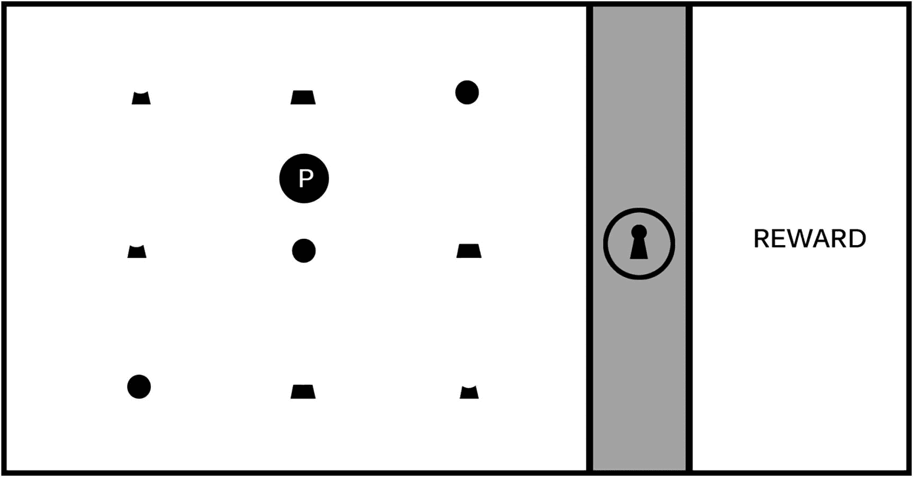

图 8-31 ¶ 简单游戏机制项目，无光照。回想一下，玩家控制标有 P 的圆圈，必须按正确顺序激活锁的三个部分，以解除屏障并获得奖励


## 将光照融入游戏循环

对于简单游戏机制项目的下一阶段，你该如何将光照直接融入游戏循环，使其成为游戏玩法的一部分？与之前的练习一样，将复杂度降至最低，并将自己限制在每次仅对当前游戏循环进行一项添加或演进，这将有助于防止设计变得过于繁重或过于复杂。

## 初始概念

通过考虑光照可能影响当前游戏画面的各种不同方式，开始这阶段的练习。你可以选择让环境漆黑一片，玩家只能看到模糊的轮廓，除非用手电筒照亮某个区域；你可以使用彩色光来改变被照亮物体的可见颜色；或者你可以使用类似 X 射线或紫外线光束的东西，来揭示肉眼无法看到的物体信息。

在本例中，你将为简单的序列机制增加一个额外维度：一束能揭示物体隐藏信息的光束，如图 8-32 所示。

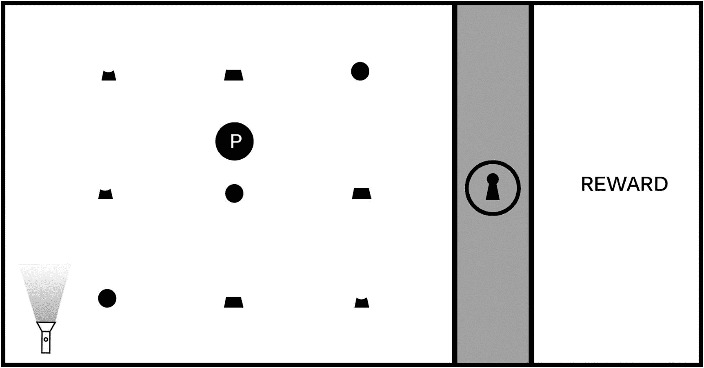

**图 8-32** ¶ 增加一个可移动的“手电筒”，发射特殊光束

## 手电筒机制

在该游戏循环的第一次迭代中，设计要求玩家按正确的相对位置（顶部在顶部，中间在中间，底部在底部）和正确的顺序（顶-中-底）激活锁的每个段落。交互设计为正确和错误的移动提供了一致的视觉反馈，使玩家能够理解游戏规则，经过一些尝试，敏锐的玩家将推断出解锁屏障所需的正确序列。

现在想象一下，特殊光束的加入会如何让游戏玩法向新的方向发展：在排序的基本概念之上，你可以创建一个日益巧妙的谜题，要求玩家首先在环境中发现手电筒，并将其作为工具进行实验，然后才能在锁的解谜上取得任何进展。设想一下，也许玩家即使没有手电筒，仍然可以在英雄角色接触形状时直接激活它们（触发物体周围的高亮环，就像第一次迭代的情况一样，如图 8-33 所示），但这种直接交互不足以激活锁的对应区域，除非手电筒首先揭示了解谜所需的秘密线索。

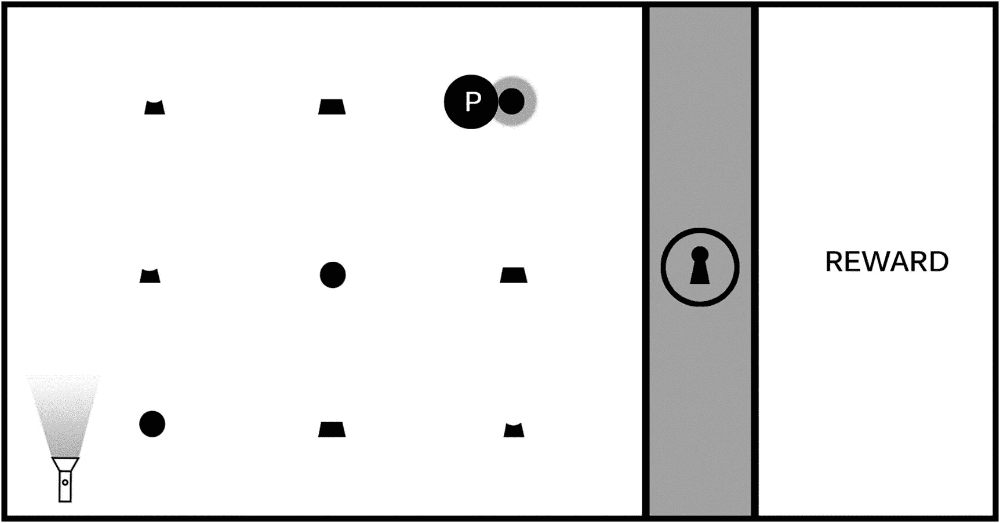

**图 8-33** ¶ 玩家能够像机制第一次迭代那样直接激活物体，但锁的对应部分现在保持非激活状态

图 8-34 显示手电筒移动到某个物体下方并用光束照亮它，揭示了一个白点。

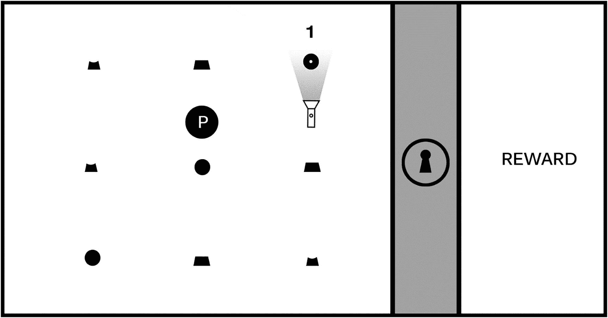

**图 8-34** ¶ 玩家将手电筒移到形状下方以揭示隐藏线索 (#1)

从游戏玩法的角度来看，游戏环境中的任何物体都可以作为工具；你作为设计师的工作是确保该工具遵循玩家能够首先理解、进而预测性应用以达成目标的一致、合乎逻辑的规则。在本例中，合理假设玩家会探索游戏环境寻找工具或线索；如果手电筒是一个可交互物体，玩家将尝试学习它在关卡语境下的功能。

## 带手电筒的序列

我们示例项目中的游戏循环随着手电筒的加入而演进，但使用了相同的基本排序原则和反馈隐喻。当玩家用手电筒揭示物体上的秘密符号时，玩家只能在符号可见时激活物体，从而开始解锁序列。新设计要求玩家按正确顺序激活与锁的每个部分对应的三个物体，在本例中是从一个点到三个点；当一部分的所有物体按顺序被激活后，该部分锁就会亮起，就像第一次迭代那样。图 8-35 至 8-37 展示了使用手电筒光束的新序列。

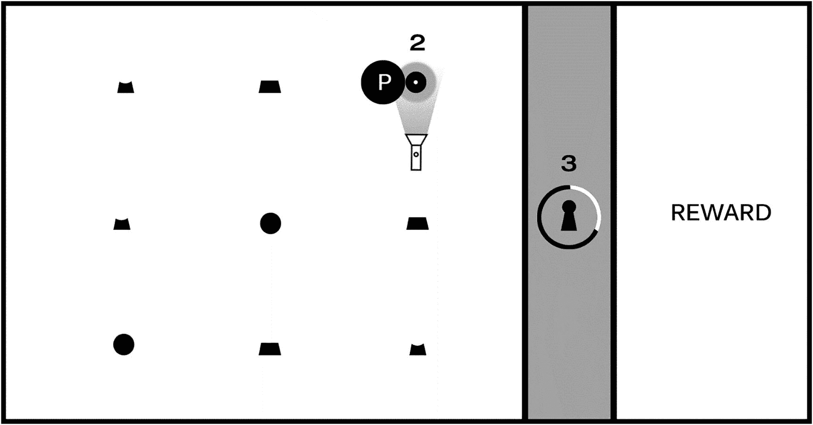

**图 8-35** ¶ 手电筒揭示隐藏符号后，玩家现在可以激活物体 (#2)，锁上的进度条 (#3) 表明玩家正按正确轨道完成序列

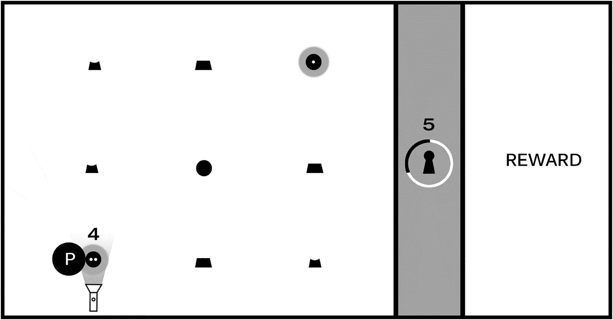

**图 8-36** ¶ 玩家按正确顺序激活顶部三个部分中的第二个 (#4)，进度条通过点亮另一部分 (#5) 确认序列正确。在此实现中，玩家无法在激活有一个点的物体之前激活有两个点的物体（规则要求按一到三个点的顺序激活同类物体）

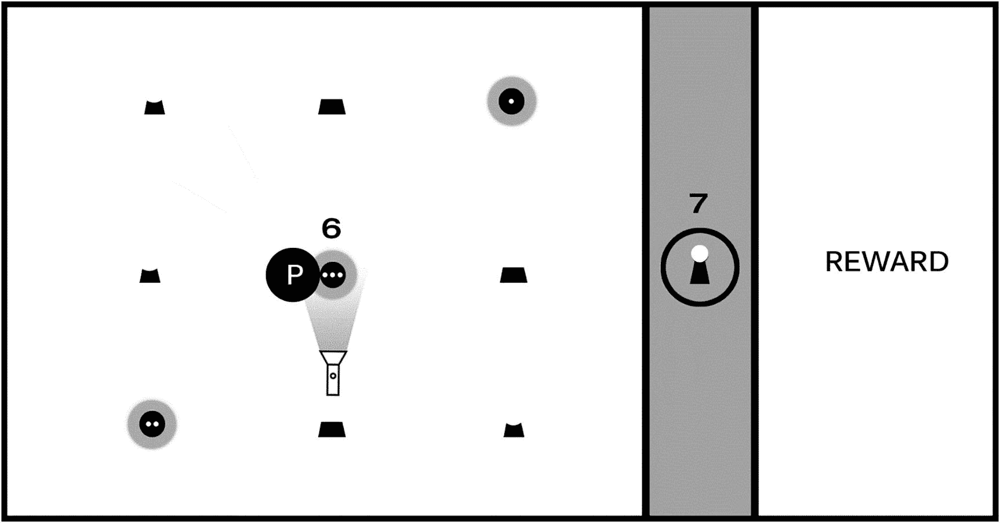

**图 8-37** ¶ 顶部三个部分中的第三个被手电筒光束揭示并由玩家激活 (#6)，从而激活锁的顶部部分 (#7)。一旦锁的中部和底部部分以类似方式被激活，屏障即被禁用，玩家可领取奖励

## 设计含义

请注意，你已略微改变了玩家从游戏循环第一次迭代中获得的反馈：你最初使用进度条来表示解锁屏障的总体进度，但现在用它来表示解锁锁的每个部分的总体进度。手电筒在通向关卡解法的因果链中引入了一个额外步骤，你现在已将一个单步的元素级游戏循环变成了一个复杂且具有挑战性得多的东西，同时保持了逻辑一致性，并遵循了一套玩家可以先学习、后预测性应用的规则。事实上，该关卡开始体现许多冒险游戏中常见的谜题类型：游戏画面是一个充满多个可移动物体的复杂环境；找到手电筒并了解到其光束能揭示游戏世界中物体的隐藏信息，将成为游戏设定本身的一部分。


