# 9. 使用 RigidShapes 模拟世界

**Kelvin Sung**^1, **Jebediah Pavleas**^2, **Matthew Munson**^3, **Jason Pace**^4  
(1) Bothell, WA, USA (2) Kenmore, WA, USA (3) Lake Forest Park, WA, USA (4) Portland, OR, USA

## 摘要

完成本章后，您将能够：

*   认识到模拟真实世界物理交互的巨大计算复杂性和成本
*   理解典型游戏引擎物理组件基于圆形和矩形等简单几何体来近似物理交互
*   实现圆形和矩形几何形状的精确碰撞
*   使用 `Symplectic Euler Integration`（辛普利克欧拉积分）近似牛顿运动公式
*   基于数值稳定的松弛法解决相互穿透的碰撞
*   计算并实现类似于真实世界中刚体行为的碰撞响应

## 简介

在游戏引擎中，模拟能量传递的功能通常被称为物理、物理系统、物理组件或物理引擎。游戏引擎物理组件在许多类型的游戏中发挥着重要作用。游戏物理涵盖的主题范围很广，包括但不限于刚体、软体、流体动力学和车辆物理等领域。可信的物理行为和游戏对象交互已成为许多现代 PC 和主机游戏，以及最近的浏览器和智能手机游戏的关键要素——例如，球的弹跳、果冻块的晃动、湖面的涟漪或汽车的打滑。对这些现象进行逼真的模拟和渲染正成为普遍期望。

不幸的是，对真实世界的精确模拟可能涉及令人望而生畏的细节，并需要深厚的学科知识，其底层数学模型可能很复杂，且相关的计算成本可能高得难以承受。例如，汽车的打滑取决于其速度、轮胎属性等；湖面的涟漪取决于其成因、湖泊大小等；果冻块的晃动取决于其密度、初始变形等。即使在非常简单的情况下，球的弹跳也取决于其材质、充气状态，理论上甚至取决于周围空气的粒子浓度。现代游戏引擎物理组件通过限制物理交互类型和简化模拟计算要求来应对这些复杂性。

物理引擎通常限制并模拟孤立的物理交互类型，不支持交互类型的通用组合。例如，球弹跳（刚体）的正确模拟通常不支持球与果冻块（软体）碰撞并使其晃动，或精确模拟球与流体交互产生的涟漪效果（流体动力学）。也就是说，通常刚体物理引擎不支持与软体对象、流体或车辆的交互。同样，软体物理引擎通常也不允许与刚体或其他类型物理对象的交互。

此外，物理引擎通常在主要专注于获得视觉上令人信服的结果的同时，近似一个极度简化的交互模型。简化通常体现在对对象几何形状和物理属性的假设上，并对游戏世界中的选定子集应用限制性交互规则。例如，刚体物理引擎通常通过以下方式简化对象的交互：

*   假设对象是质量均匀分布的连续几何体，质心位于几何形状的中心
*   用直接的弹性和摩擦力来近似对象材质属性
*   规定对象在交互过程中不改变形状

## 交互模型复杂性

重要的是要意识到，随着游戏玩法复杂性的增加，交互模型的复杂性也随之增加，为玩家提供适当的视听反馈以帮助他们理解自己的行为的重要性也随之增加（回顾第 1 章，交互模型是玩家用来完成游戏任务的按键、按钮、控制器摇杆、触摸手势等的组合）。在当前示例中，玩家现在不仅能控制主角，还能控制手电筒。创建直观的交互模型是游戏设计的关键组成部分，往往比设计师意识到的要复杂得多；举个例子，考虑将许多为鼠标和键盘设计的 PC 游戏移植到使用按钮和拇指摇杆的游戏主机，或仅使用触摸的移动设备上的难度。开发团队经常投入数千小时进行控制方案的研究和测试，但仍经常偏离目标；交互设计很难做对，即使是相当基本的动作，往往也需要数千小时的测试和改进，因此如果可能，您应该利用既定惯例。设计交互时请牢记两条黄金法则：第一，除非有令人信服的理由让玩家学习新东西，否则尽可能使用已知且经过测试的模式；第二，将玩家必须记住的独特动作数量降至最低。数十年的用户测试清楚地表明，玩家不喜重新学习跨标题相似任务的基本按键组合（这就是为什么如此多的游戏将移动标准化为 `WASD`，例如），类似的数据也显示了当您要求玩家记住超过几个简单的独特按钮组合时，他们有多容易感到不知所措。当然也有例外；例如许多经典街机格斗游戏使用数十个复杂组合，但那些类型面向特定类型的玩家，他们将掌握按钮组合视为体验乐趣的基本组成部分。作为一般规则，如果交互复杂性不是有意的游戏组成部分，大多数玩家倾向于保持交互尽可能精简和简单。

## 控制多个对象

处理控制多个对象有多种方法。对于我们的手电筒，最常见的模式可能是让玩家“装备”它；也许如果玩家移动到手电筒上方并点击鼠标左键，它就会成为玩家的一个新能力，可以通过按键盘上的某个键或点击鼠标右键来激活。或者，也许主角可以用 `WASD` 键在游戏屏幕上自由移动，而其他活动对象（如手电筒）则先通过左键点击选中，然后按住左键拖动到位置。同样，有多种方法为玩家提供情境反馈，以帮助教授谜题逻辑和规则（在本例中，我们使用锁周围的圆环作为进度条，确认玩家遵循正确的序列）。当您尝试各种交互和反馈模型时，回顾其他游戏如何处理类似任务总是个好主意，特别要注意您认为效果特别好的地方。

## 后续步骤

在下一章中，您将探索如何通过将简单物理应用于游戏世界中的对象，再次发展您的游戏循环。

---

© The Author(s), under exclusive license to APress Media, LLC, part of Springer Nature 2022  
K. Sung et al. *Build Your Own 2D Game Engine and Create Great Web Games*  
[`https://doi.org/10.1007/978-1-4842-7377-7_9`](https://doi.org/10.1007/978-1-4842-7377-7_9)


* 将模拟限制在游戏场景中对象的选定子集上

基于这组假设，刚体物理模拟（或刚体模拟）能够捕获并重现许多熟悉的现实世界物理交互，例如物体弹跳、下落和碰撞，比如一个充满气的弹力球或一个简单的 *Lego* 积木从桌面弹起并落在硬木地板上。只要碰撞过程中不发生变形，这类刚体物理交互就能可靠地进行实时模拟。

质量均匀分布且在交互过程中不改变形状的物体可适用于游戏中许多重要且实用的场景。一般来说，刚体物理引擎非常擅长模拟移动物体相互接触的情况，例如保龄球撞击瓶子或炮弹击中装甲板。然而，重要的是要认识到，基于给定的这组假设，刚体物理模拟不支持以下情况：

* 由多个几何部分组成的物体，例如箭
* 具有非平凡材质属性的物体，例如磁性
* 具有非均匀质量分布的物体，例如棒球棒
* 在碰撞过程中改变形状的物体，例如橡胶球

在所有现实世界的物理物体交互类型中，刚体交互是理解最透彻、最容易求近似解、实现起来挑战最小的。本章仅专注于刚体模拟。

## 章节概览

与光照功能类似，游戏引擎的物理组件也是游戏引擎设计、架构和实现中一个庞大而复杂的领域。考虑到这一点，你将采用与之前所有游戏引擎组件相同的方法来开发刚体物理组件。即分析、理解并实现各个步骤，以逐步实现组件的核心功能。对于物理组件，涵盖刚体模拟的主要思想包括以下内容：

* **`RigidShape` 类**：定义 `RigidShape` 类，通过在独立的简单几何体上执行计算（而不是潜在的复杂 `Renderable` 对象）来支持优化模拟。该主题将在第一个项目“刚体形状与包围盒项目”中介绍。
* **碰撞检测**：研究并实现数学原理，以精确碰撞圆形和矩形 `RigidShape` 对象。一个重要概念是，在数字世界中，刚体形状可以且经常会重叠，因此必须在 `CollisionInfo` 对象中保留此重叠事件的详细信息。碰撞检测涵盖的主题将通过三个独立的项目进行讨论，每个项目专注于一种独特的碰撞交互。它们包括：
    * 圆形之间的碰撞：圆形碰撞与 `CollisionInfo` 项目
    * 矩形之间的碰撞：矩形碰撞项目
    * 矩形与圆形之间的碰撞：矩形与圆形碰撞项目
* **运动**：近似描述在固定时间间隔更新的世界中运动的积分。运动主题将在刚体形状运动项目中介绍。
* **碰撞物体的相互渗透**：采用数值稳定的解决方案，增量式地修正碰撞刚体形状之间的相互渗透问题。该主题在碰撞位置修正项目中介绍。
* **碰撞响应**：使用冲量法模拟碰撞响应。冲量法将在两个项目中介绍，首先是不考虑旋转的简单情况（碰撞响应项目），最后是考虑旋转的情况（碰撞角度响应项目）。

## 刚体形状与包围盒

模拟任意刚体形状之间交互所涉及的计算在算法上可能很复杂，且计算成本高昂。基于这些原因，刚体模拟通常基于一组有限的简单几何形状，例如刚性圆和矩形。在典型的游戏引擎中，这些简单的刚体形状可以附加到几何结构复杂的游戏对象上，以对这些游戏对象之间的物理交互进行近似模拟，例如，在飞船上附加刚性圆，并对刚性圆进行刚体物理模拟，以近似飞船之间的物理交互。

根据现实经验，你知道简单的刚体形状只有在发生物理接触时才能相互作用。从算法角度来看，这一观察转化为检测刚体形状之间的碰撞。为了进行正确的模拟，每个形状都必须与其他每个形状进行碰撞测试。这样，碰撞测试就是一个 `O(n²)` 操作，其中 `n` 是参与模拟的形状数量。作为对这一高昂操作的优化，刚体形状通常会被一个简单的几何体（例如圆）包围，仅当形状的包围体重叠时，才会调用潜在的昂贵碰撞计算。

### 刚体形状与包围盒项目

该项目引入了带有简单圆形包围盒的 `RigidShape` 类，用于碰撞优化。定义的 `RigidShape` 类将集成到游戏引擎中，每个 `GameObject` 对象将同时持有对 `Renderable` 和 `RigidShape` 对象的引用。`Renderable` 对象将被绘制出来，向玩家展示视觉上美观的游戏元素，而 `RigidShape` 将在刚体形状模拟中被处理，以近似 `GameObject` 对象的行为。你可以在图 9-1 中看到该项目运行的示例。该项目的源代码定义在 `chapter9/9.1.rigid_shapes_and_bounds` 中。

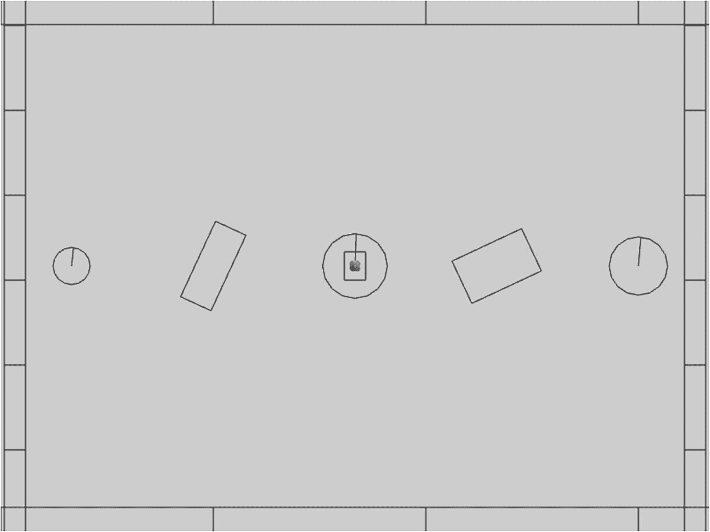

图 9-1 ¶ 运行刚体形状与包围盒项目

该项目的控制方式如下：

* **行为控制**：
    * `G 键`：随机创建一个新的刚性圆或矩形
* **绘制控制**：
    * `T 键`：切换所有对象的纹理显示
    * `R 键`：切换 `RigidShape` 的绘制显示
    * `B 键`：切换每个 `RigidShape` 包围盒的绘制显示
* **对象控制**：
    * `左/右方向键`：依次遍历并选择一个对象
    * `WASD 键`：移动选中的对象
    * `Z/X 键`：旋转选中的对象
    * `Y/U 键`：增加/减小选中对象的 `RigidShape` 大小；这不会改变对应 `Renderable` 对象的大小

该项目的目标如下：

* 定义 `RigidShape` 类并与 `GameObject` 集成
* 演示 `RigidShape` 代表同一 `GameObject` 上对应的 `Renderable` 几何体
* 为构建刚体形状物理模拟器奠定基础
* 定义一个初始场景用于测试物理组件

除了系统字体文件夹外，你可以在 `assets` 文件夹中找到以下外部资源文件：

* `minion_sprite.png` 用于小兵和英雄对象
* `platform.png` 和 `wall.png` 是测试场景中的水平和垂直边界对象
* `target.png` 显示在当前选中的对象上方

### 设置实现支持


## 设置实现支持

您将首先设置实现支持来开始构建此项目。首先，通过为预期的复杂性增加新文件夹来组织引擎源代码结构。其次，定义用于可视化和验证正确性的调试工具。第三，扩展库支持以实现旋转刚性形状。

## 组织引擎源代码

为了预期新组件的加入，在 `src/engine` 文件夹中创建 `components` 文件夹，并将 `input.js` 组件源代码文件移动到此文件夹中。该文件夹将包含物理及后续章节将引入的其他组件的源代码。您必须编辑 `camera_input.js`、`loop.js` 和 `index.js` 以更新 `input.js` 的源代码文件位置变更。

## 支持调试绘制

重要的是要注意，只有 `Renderable` 对象（通常由 `GameObject` 引用）实际上在游戏世界中可见。刚性形状实际上并不存在于游戏世界中；它们被定义用于近似模拟相应 `Renderable` 对象的物理交互。为了支持适当的调试和正确性验证，能够绘制和可视化刚性形状非常重要。

### 步骤 1：创建 `debug_draw.js`

在 `src/core` 文件夹中创建 `debug_draw.js`，从 `LineRenderable` 导入，并定义用于绘制简单形状（作为线段）的支持常量和变量：

```javascript
import LineRenderable from "../renderables/line_renderable.js";
let kDrawNumCircleSides = 16;  // 将圆周近似为线段
let mUnitCirclePos = [];
let mLine = null;
```

### 步骤 2：定义 `init()` 函数

定义 `init()` 函数以初始化绘制对象。`mUnitCirclePos` 是单位圆圆周上的位置，`mLine` 变量是将用于绘制的线条对象。

```javascript
function init() {
    mLine = new LineRenderable();
    mLine.setPointSize(5);  // 确保显示时可见
    let deltaTheta = (Math.PI * 2.0) / kDrawNumCircleSides;
    let theta = deltaTheta;
    let i, x, y;
    for (i = 1; i <= kDrawNumCircleSides; i++) {
        let x = Math.cos(theta);
        let y = Math.sin(theta);
        mUnitCirclePos.push([x, y]);
        theta = theta + deltaTheta;
    }
}
```

### 步骤 3：定义绘制函数

定义 `drawLine()`、`drawCrossMarker()`、`drawRectangle()` 和 `drawCircle()` 函数，以基于定义的 `mLine` 对象绘制相应形状。这些函数的源代码与物理模拟无关，故不予展示。详情请参阅项目源代码文件夹。

### 步骤 4：导出函数

请记住导出定义的函数：

```javascript
export {
    init,
    drawLine,
    drawCrossMarker,
    drawCircle,
    drawRectangle
}
```

### 初始化调试绘制功能

编辑 `loop.js`，从 `debug_draw.js` 导入，并在 `start()` 中所有异步加载 Promise 完成后调用 `init()` 函数：

```javascript
import * as debugDraw from "./debug_draw.js";
// ... 与之前代码相同 ...
async function start(scene) {
    // ... 与之前代码相同 ...
    // 等待游戏加载前的任何异步请求
    await map.waitOnPromises();
    // 所有资源加载完毕后，现在可以初始化
    // 依赖着色器等的系统内部函数
    debugDraw.init();  // 刚性形状等的绘制支持
    // ... 与之前代码相同 ...
}
```

> **注意**：初始化调试绘制的一个有效替代方案是在 `shader_resources` 模块的 `createShaders()` 函数中，在所有着色器创建完成后进行。然而，在 `shader_resources.js` 中从 `debug_draw.js` 导入会产生循环导入：`debug_draw` 从 `LineRenderable` 导入，后者尝试从 `shader_resources` 导入。

## 更新 gl-matrix 库

`gl-matrix` 库通过其 `vec2` 加法支持顶点平移，通过其 `vec2` 标量乘法支持顶点缩放，但不支持顶点旋转。编辑 `src/lib/gl-matrix.js` 文件，并定义 `vec2.rotateWRT()` 函数以支持将顶点位置 `pt` 相对于 `ref` 位置按 `angle` 旋转。遵循 `gl-matrix` 的惯例，函数的第一个参数 `out` 返回操作结果。

```javascript
vec2.rotateWRT = function(out, pt, angle, ref) {
    var r = [];
    vec2.subtract(r, pt, ref);
    vec2.rotate(r, r, angle);
    vec2.add(r, r, ref);
    out[0] = r[0];
    out[1] = r[1];
    return r;
};
```

## 定义 RigidShape 基类

您现在可以定义 `RigidShape` 作为矩形和圆形刚性形状的基类。该基类将封装两种形状共有的所有功能。

### 步骤 1：创建 `rigid_shape.js`

首先在 `src/engine` 中创建一个新的子文件夹 `rigid_shapes`。在此文件夹中创建 `rigid_shape.js`，从 `debug_draw` 导入，并定义绘制颜色和 `RigidShape` 类。

```javascript
import * as debugDraw from "../core/debug_draw.js";
let kShapeColor = [0, 0, 0, 1];
let kBoundColor = [1, 1, 1, 1];
class RigidShape {
    // ... 实现如下 ...
}
export default RigidShape;
```

### 步骤 2：定义构造函数

定义构造函数以包含所有子类共享的实例变量。`xf` 参数通常是对该 `RigidShape` 所代表的 `Renderable` 的 `Transform` 的引用。`mType` 变量将由子类初始化以区分形状类型，例如圆形与矩形。`mBoundRadius` 是用于碰撞优化的圆形包围半径，`mDrawBounds` 指示是否绘制圆形包围。

```javascript
constructor(xf) {
    this.mXform = xf;
    this.mType = "";
    this.mBoundRadius = 0;
    this.mDrawBounds = false;
}
```

### 步骤 3：定义 Getter 和 Setter 函数

为实例变量定义适当的 getter 和 setter 函数：

```javascript
getType() { return this.mType; }
getCenter() { return this.mXform.getPosition(); }
getBoundRadius() { return this.mBoundRadius; }
toggleDrawBound() { this.mDrawBounds = !this.mDrawBounds; }
setBoundRadius(r) { this.mBoundRadius = r; }
setTransform(xf) { this.mXform = xf; }
setPosition(x, y) { this.mXform.setPosition(x, y); }
adjustPositionBy(v, delta) {
    let p = this.mXform.getPosition();
    vec2.scaleAndAdd(p, p, v, delta);
}
_shapeColor() { return kShapeColor; }
_boundColor() { return kBoundColor; }
```

### 步骤 4：定义 `boundTest()` 函数

定义 `boundTest()` 函数以确定两个形状的圆形包围是否重叠。如图 9-2 所示，两个圆之间的碰撞可以通过比较两个半径之和 `rSum` 与两圆圆心之间的距离 `dist` 来确定。这再次是一个相对高效的操作，旨在先于两个形状之间更昂贵的精确碰撞计算。

```javascript
boundTest(otherShape) {
    let vFrom1to2 = [0, 0];
    vec2.subtract(vFrom1to2, otherShape.mXform.getPosition(),
        this.mXform.getPosition());
    let rSum = this.mBoundRadius + otherShape.mBoundRadius;
    let dist = vec2.length(vFrom1to2);
    if (dist > rSum) {
        // 未重叠
        return false;
    }
    return true;
}
```

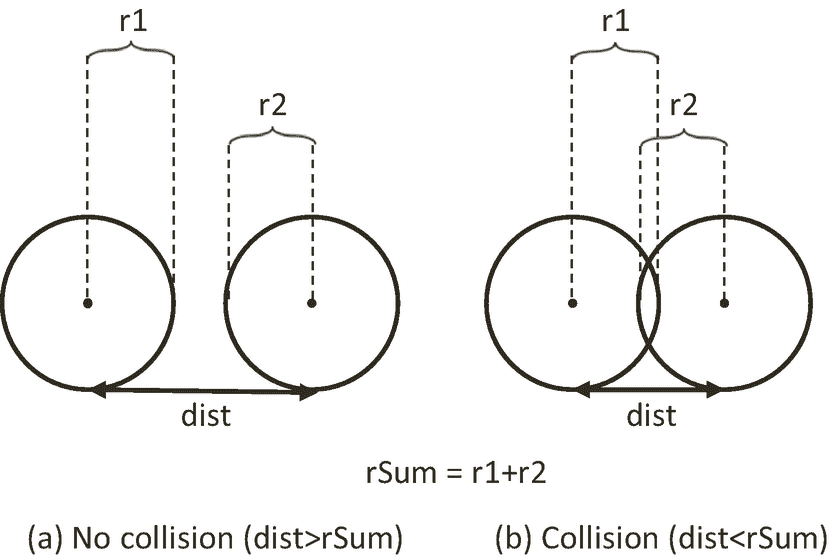

### 步骤 5：定义 `update()` 和 `draw()` 函数

定义 `update()` 和 `draw()` 函数。目前 `update()` 为空。启用时，`draw()` 函数绘制圆形包围并在包围中心绘制一个 "X" 标记。

```javascript
update() {  // 暂无内容  }
draw(aCamera) {
    if (!this.mDrawBounds)
        return;
    debugDraw.drawCircle(aCamera, this.mXform.getPosition(),
        this.mBoundRadius, this._boundColor());
    debugDraw.drawCrossMarker(aCamera, this.mXform.getPosition(),
        this.mBoundRadius * 0.2, this._boundColor());
}
```

## 定义 RigidRectangle 类


## 可渲染对象与刚体形状

可渲染对象基于应用于单位正方形的 `Transform` 运算符来编码形状的几何信息。例如，一个旋转的矩形被编码为一个缩放并旋转的单位正方形。正如你所经历的，这种表示方式——单位正方形的顶点保持不变，并结合来自 `GLSL` 顶点着色器的矩阵变换支持——能有效且高效地支持绘制变换后的形状。

`RigidShape` 对象是专为交互设计的 `Renderable` 对象，其底层表示必须支持大量数学计算。在这种情况下，显式表示和更新底层几何形状的顶点更为高效。例如，不再使用缩放并旋转的正方形，而是可以显式计算并存储矩形的顶点位置。这样，实际顶点位置始终可直接用于数学计算。因此，`RigidRectangle` 将显式定义并维护矩形的顶点。

有了刚体形状的抽象基类，你现在可以创建第一个具体的刚体形状——`RigidRectangle` 类。为了预期复杂的碰撞函数，实现源代码将被分离到多个文件中。目前，创建 `rigid_rectangle.js` 作为访问文件，并从 `rigid_rectangle_main.js` 导入，后者将实现核心 `RigidRectangle` 功能。

## 实现 RigidRectangle 类

### 步骤 1：创建访问文件

在 `src/rigid_shapes` 文件夹中，创建 `rigid_rectangle.js` 以从 `rigid_rectangle_main.js` 导入并导出 `RigidRectangle` 类。这是 `RigidRectangle` 类的访问文件，使用该类的用户应从此文件导入。

```javascript
import RigidRectangle from "./rigid_rectangle_main.js";
export default RigidRectangle;
```

### 步骤 2：创建主实现文件

现在，在 `src/rigid_shapes` 文件夹中创建 `rigid_rectangle_main.js` 以导入 `RigidShape` 和 `debugDraw`，并定义 `RigidRectangle` 为 `RigidShape` 的子类。

```javascript
import RigidShape from "./rigid_shape.js";
import * as debugDraw from "../core/debug_draw.js";

class RigidRectangle extends RigidShape {
    // ... implementation to follow ...
}
export default RigidRectangle;
```

### 步骤 3：定义构造函数

定义构造函数以初始化矩形尺寸 `mWidth` 乘 `mHeight` 以及 `mType`。重要的是要认识到，刚体矩形的顶点位置由 `mXform` 引用的 `Transform` 控制。相比之下，宽度和高度尺寸由 `mWidth` 和 `mHeight` 独立定义。这种尺寸分离允许设计者决定 `RigidRectangle` 应多紧密地包裹相应的 `Renderable`。请注意，形状的实际顶点和面法线是在 `setVertices()` 和 `computeFaceNormals()` 函数中计算的。面法线的定义将在以下步骤中详述：

```javascript
constructor(xf, width, height) {
    super(xf);
    this.mType = "RigidRectangle";
    this.mWidth = width;
    this.mHeight = height;
    this.mBoundRadius = 0;
    this.mVertex = [];
    this.mFaceNormal = [];
    this.setVertices();
    this.computeFaceNormals();
}
```

### 步骤 4：定义 setVertices() 函数

定义 `setVertices()` 函数，根据 `mXform` 定义的尺寸设置顶点位置。如图 9-3 所示，矩形上的顶点定义为：索引 0 为左上角，1 为右上角，2 为右下角，索引 3 对应左下角顶点位置。

```javascript
setVertices() {
    this.mBoundRadius = Math.sqrt(this.mWidth * this.mWidth +
                                  this.mHeight * this.mHeight) / 2;
    let center = this.mXform.getPosition();
    let hw = this.mWidth / 2;
    let hh = this.mHeight / 2;
    // 0--左上角; 1--右上角; 2--右下角; 3--左下角
    this.mVertex[0] = vec2.fromValues(center[0] - hw, center[1] - hh);
    this.mVertex[1] = vec2.fromValues(center[0] + hw, center[1] - hh);
    this.mVertex[2] = vec2.fromValues(center[0] + hw, center[1] + hh);
    this.mVertex[3] = vec2.fromValues(center[0] - hw, center[1] + hh);
}
```

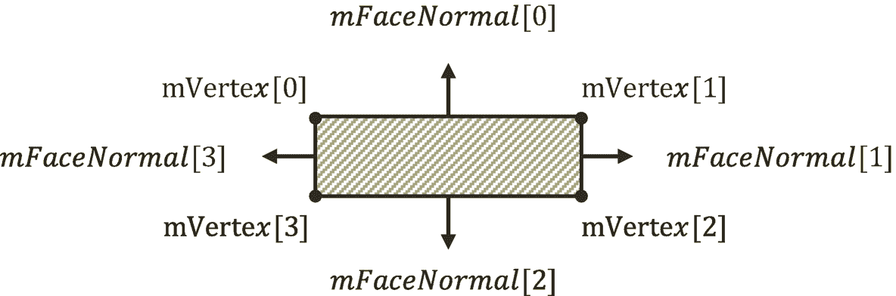

*图 9-3：矩形的顶点和面法线*

### 步骤 5：定义 computeFaceNormals() 函数

定义 `computeFaceNormals()` 函数。图 9-3 显示，矩形的面法线是垂直于边并指向矩形中心外侧的向量。此外，请注意面法线索引与相应顶点之间的关系。面法线索引 0 指向与从顶点 2 到顶点 1 的向量相同的方向。该方向垂直于由顶点 0 和 1 形成的边。这样，索引 0 的面法线垂直于第一条边，依此类推。请注意，面法线向量已归一化，长度为 1。面法线向量稍后将用于确定碰撞。

```javascript
computeFaceNormals() {
    // 0--上; 1--右; 2--下; 3--左
    // mFaceNormal 是指向矩形外部的面法线
    for (let i = 0; i < 4; i++) {
        let v = (i + 1) % 4;
        let nv = (i + 2) % 4;
        this.mFaceNormal[i] = vec2.clone(this.mVertex[v]);
        vec2.subtract(this.mFaceNormal[i], this.mFaceNormal[i], this.mVertex[nv]);
        vec2.normalize(this.mFaceNormal[i], this.mFaceNormal[i]);
    }
}
```

### 步骤 6：定义尺寸与位置操作函数

定义尺寸与位置操作函数。在所有情况下，必须重新计算顶点和面法线（`rotateVertices()` 调用 `computeFaceNormals()`），且必须确保顶点位置与 `mXform` 的状态保持一致，这至关重要。

```javascript
incShapeSizeBy(dt) {
    this.mHeight += dt;
    this.mWidth += dt;
    this.setVertices();
    this.rotateVertices();
}

setPosition(x, y) {
    super.setPosition(x, y);
    this.setVertices();
    this.rotateVertices();
}

adjustPositionBy(v, delta) {
    super.adjustPositionBy(v, delta);
    this.setVertices();
    this.rotateVertices();
}

setTransform(xf) {
    super.setTransform(xf);
    this.setVertices();
    this.rotateVertices();
}

rotateVertices() {
    let center = this.mXform.getPosition();
    let r = this.mXform.getRotationInRad();
    for (let i = 0; i < 4; i++) {
        vec2.rotateWRT(this.mVertex[i], this.mVertex[i], r, center);
    }
    this.computeFaceNormals();
}
```

### 步骤 7：定义 draw() 和 update() 函数

现在，定义 `draw()` 函数以线段形式绘制矩形边缘，并定义 `update()` 函数以更新矩形的顶点。必须重新计算顶点和面法线，因为正如你可能从 `RigidShape` 基类构造函数的讨论中回忆的那样，`mXform` 是对 `Renderable` 对象的 `Transform` 的引用；游戏可能已经操纵了 `Transform` 的位置或旋转。为确保 `RigidRectangle` 始终反映潜在的 `Transform` 变化，必须在每次更新时重新计算顶点和面法线。

```javascript
draw(aCamera) {
    super.draw(aCamera);  // 中心的十字标记
    debugDraw.drawRectangle(aCamera, this.mVertex, this._shapeColor());
}

update() {
    super.update();
    this.setVertices();
    this.rotateVertices();
}
```

最后，请记得更新引擎访问文件 `index.js`，以将新定义的功能转发给客户端。

## 定义 RigidCircle 类

你现在可以用与 `RigidRectangle` 相似的整体结构来实现 `RigidCircle` 类。

### 步骤 1：创建访问文件

在 `src/rigid_shapes` 文件夹中，创建 `rigid_circle.js` 以从 `rigid_circle_main.js` 导入并导出 `RigidCircle` 类。这是 `RigidCircle` 类的访问文件，使用该类的用户应从此文件导入。

```javascript
import RigidCircle from "./rigid_circle_main.js";
export default RigidCircle;
```

### 步骤 2：创建主实现文件


## 创建 RigidCircle 类

现在，在 `src/rigid_shapes` 文件夹中创建 `rigid_circle_main.js`，导入 `RigidShape` 和 `debugDraw`，并定义 `RigidCircle` 为 `RigidShape` 的子类：

```javascript
import RigidShape from "./rigid_shape.js";
import * as debugDraw from "../core/debug_draw.js";

class RigidCircle extends RigidShape {
    // ... implementation to follow ...
}

export default RigidCircle;
```

## 3. 定义构造函数

定义构造函数以初始化圆的半径 `mRadius` 和 `mType`。与 `RigidRectangle` 的尺寸类似，`RigidCircle` 的半径由 `mRadius` 定义，独立于 `mXform` 定义的大小。注意 `RigidCircle` 的半径 `mRadius` 和圆形边界 `mBoundRadius` 是分别定义的，这是为了确保未来可以将两者分离。

```javascript
constructor(xf, radius) {
    super(xf);
    this.mType = "RigidCircle";
    this.mRadius = radius;
    this.mBoundRadius = radius;
}
```

## 4. 定义尺寸的 getter 和 setter

```javascript
getRadius() {
    return this.mRadius;
}

incShapeSizeBy(dt) {
    this.mRadius += dt;
    this.mBoundRadius = this.mRadius;
}
```

## 5. 定义绘制函数

将圆绘制为沿圆周的线段集合。为了正确可视化圆的旋转，从中心向旋转后的垂直圆周位置绘制一条线段。

```javascript
draw(aCamera) {
    let p = this.mXform.getPosition();
    debugDraw.drawCircle(aCamera, p, this.mRadius, this._shapeColor());
    let u = [p[0], p[1] + this.mBoundRadius];
    // angular motion
    vec2.rotateWRT(u, u, this.mXform.getRotationInRad(), p);
    debugDraw.drawLine(aCamera, p, u, false, this._shapeColor()); // show rotation
    super.draw(aCamera); // draw last to be on top
}
```

最后，记得更新引擎访问文件 `index.js`，将新定义的功能转发给客户端。

## 修改 GameObject 类以集成 RigidShape

回顾第 6 章的讨论，`GameObject` 类旨在封装游戏场景中对象的视觉外观和行为。`GameObject` 的视觉外观由引用的 `Renderable` 对象定义。到目前为止，`GameObject` 的行为一直作为类的一部分以特设的形式定义和实现，例如 `mSpeed` 和简单的自主行为 `rotateObjPointTo()`。现在可以用即将推出的系统物理组件支持来替换这些特设参数。

## 1. 编辑 GameObject.js

移除对速度 `mSpeed` 的支持，以及相应的 setter 和 getter 函数和 `rotateObjPointTo()` 函数。通过本章其余部分的更改，游戏对象行为将由刚体物理模拟支持。确保保留其他变量和函数；它们是为支持外观和检测纹理重叠 `pixelTouches()` 而定义的。

## 2. 在构造函数中定义新实例变量

引用 `RigidShape` 并提供绘制选项：

```javascript
class GameObject {
    constructor(renderable) {
        this.mRenderComponent = renderable;
        this.mVisible = true;
        this.mCurrentFrontDir = vec2.fromValues(0, 1); // front direction
        this.mRigidBody = null;
        this.mDrawRenderable = true;
        this.mDrawRigidShape = false;
    }
    // ... implementation to follow ...
}
```

## 3. 定义 mRigidBody 的 getter 和 setter 以及切换绘制选项的函数

```javascript
getRigidBody() {
    return this.mRigidBody;
}

setRigidBody(r) {
    this.mRigidBody = r;
}

toggleDrawRenderable() {
    this.mDrawRenderable = !this.mDrawRenderable;
}

toggleDrawRigidShape() {
    this.mDrawRigidShape = !this.mDrawRigidShape;
}
```

## 4. 优化 draw() 和 update() 函数

遵守绘制选项并将 `GameObject` 行为更新委托给 `RigidShape` 类：

```javascript
draw(aCamera) {
    if (this.isVisible()) {
        if (this.mDrawRenderable)
            this.mRenderComponent.draw(aCamera);
        if ((this.mRigidBody !== null) && (this.mDrawRigidShape))
            this.mRigidBody.draw(aCamera);
    }
}

update() {
    // simple default behavior
    if (this.mRigidBody !== null)
        this.mRigidBody.update();
}
```

## 5. 编辑 game_object_set.js

修改 `GameObjectSet` 类以支持为整个集合切换不同的绘制选项：

```javascript
// ... identical to previous code ...
toggleDrawRenderable() {
    let i;
    for (i = 0; i < this.mSet.length; i++) {
        this.mSet[i].toggleDrawRenderable();
    }
}

toggleDrawRigidShape() {
    let i;
    for (i = 0; i < this.mSet.length; i++) {
        this.mSet[i].toggleDrawRigidShape();
    }
}

toggleDrawBound() {
    let i;
    for (i = 0; i < this.mSet.length; i++) {
        let r = this.mSet[i].getRigidBody();
        if (r !== null)
            r.toggleDrawBound();
    }
}
```

## RigidShape 功能测试

`RigidShape` 旨在代表 `Renderable` 对象参与刚体形状模拟。因此，创建和测试不同组合的 `RigidShape` 类型（包括圆形和矩形）与所有 `Renderable` 类型组合（更具体地说是 `TextureRenderable`、`SpriteRenderable` 和 `SpriteAnimateRenderable`）至关重要。这些组合的正常运行可以证明 `RigidShape` 实现的正确性，并允许你直观地检查用简单圆形和矩形近似 `Renderable` 对象的适用性及局限性。

测试程序 `MyGame` 的整体结构与之前的项目基本相似，源代码细节可能会分散注意力，因此此处不列出。以下描述测试对象及其如何满足指定要求。一如既往，源代码文件位于 `src/my_game` 文件夹，支持对象类位于 `src/my_game/objects` 文件夹。

即将发生的碰撞测试需要操纵每个对象的位置和旋转。`WASDObj` 类（在 `wasd_obj.js` 中实现）定义了 `GameObject` 的 WASD 键移动和 Z/X 键旋转控制。`Hero` 类（`WASDObj` 的子类，在 `hero.js` 中实现）是一个带有 `SpriteRenderable` 和 `RigidRectangle` 的 `GameObject`。`Minion` 类（也是 `WASDObj` 的子类，在 `minion.js` 中实现）是一个带有 `SpriteAnimateRenderable` 并由 `RigidCircle` 或 `RigidRectangle` 包裹的 `GameObject`。基于这些支持类，创建的 `Hero` 和 `Minion` 对象涵盖了不同的 `Renderable` 和 `RigidShape` 类型组合，允许你直观检查用不同 `RigidShape` 表示复杂纹理的准确性。

游戏场景中的垂直和水平边界是带有 `TextureRenderable` 和 `RigidRectangle` 的 `GameObject` 实例，由 `my_game_bounds.js` 文件中定义的 `wallAt()` 和 `platformAt()` 函数创建。`MyGame` 的构造函数、`init()`、`draw()`、`update()` 等在 `my_game_main.js` 文件中定义，功能与之前的测试项目基本相同。

## 观察


现在你可以运行项目并观察创建的 `RigidShape` 对象。请注意，默认情况下，只绘制 `RigidShape` 对象。你可以通过按 `T` 键来切换开启 `Renderable` 对象的绘制来验证这一点。请注意 `Renderable` 对象的纹理是如何被相应的 `RigidShape` 实例包围的。你可以按 `R` 键来切换关闭 `RigidShape` 对象的绘制。通常，这正是游戏玩家所观察到的，即只绘制 `Renderable` 而不绘制 `RigidShape` 对象。由于本章的重点在于刚性形状及其交互的模拟，因此默认显示 `RigidShape` 而不显示 `Renderable` 对象。

现在再次按 `T` 和 `R` 键以切换回 `RigidShape` 对象的绘制。`B` 键显示形状的圆形边界。下几节将要讨论的更精确且开销更大的碰撞计算，仅会在对象的这些边界重叠时才在对象之间进行。

你可以尝试使用 `WASD` 键移动当前选中的对象，默认情况下中心是 Hero。`Z`/`X` 和 `Y`/`U` 键允许你旋转并改变 Hero 的尺寸。按 `T` 键开启纹理，以验证旋转和移动同时应用于 `Renderable` 及其对应的 `RigidShape`，而 `Y`/`U` 键仅改变 `RigidShape` 的尺寸。这使设计师能够控制用相应的 `RigidShape` 多紧密地包裹 `Renderable`。你可以按左/右箭头键来选择并操作场景中的任意对象。最后，`G` 键会创建新的 Minion 对象，它们具有 `RigidCircle` 或 `RigidRectangle`。

最后，请注意你可以将任何选中的对象移动到任何位置，包括与另一个 `RigidShape` 对象重叠。在现实世界中，刚性形状对象的重叠或相互渗透永远不会发生，而在模拟的数字世界中，这是一个必须解决的问题。随着 `RigidShape` 类的功能得到验证，你现在可以研究如何计算这些形状之间的碰撞。

## 碰撞检测

为了模拟刚性形状的交互，你必须首先检测哪些形状彼此处于物理接触状态，或者哪些形状发生了碰撞。一般来说，在处理刚性形状碰撞时，有两个重要问题需要解决：计算开销以及形状重叠或相互渗透的情况。在下文中，将解释宽相位和窄相位方法作为一种降低计算开销的途径，并引入碰撞信息来记录相互渗透的状况，以便加以解决。本节和接下来的两小节将详细介绍圆-圆、矩形-矩形和圆-矩形碰撞的碰撞检测算法及实现。

## 宽相位和窄相位方法

正如在介绍 `RigidShape` 对象的圆形边界时所讨论的，通常情况下，每个对象都必须与游戏场景中的其他每个对象进行碰撞测试。例如，如果你想检测五个对象 A、B、C、D 和 E 之间的碰撞，你必须对第一个对象 A 执行四次检测计算，分别针对对象 B、C、D 和 E。计算完 A 和 B 的结果后，接下来必须对第二个对象 B 执行三次碰撞检测，分别针对对象 C、D 和 E；随后对第三个对象 C 执行两次；最后对第四个对象 D 执行一次。第五个对象 E 已经针对其他四个对象进行过测试。虽然这一测试过程很彻底，但也有其缺点。如果没有专门的优化，你必须执行 `O(n²)` 次操作来检测 n 个对象之间的碰撞。

在刚性形状模拟中，需要一种涉及大量计算的详细碰撞检测算法。这是因为必须计算出准确的结果，以支持有效的相互渗透解决和逼真的碰撞响应模拟。宽相位方法通过利用对象的邻近性来排除那些物理上相距甚远、因此明显不可能碰撞的对象，从而优化这一计算。这使得详细且计算密集型的算法（即窄相位方法）仅部署给物理上彼此接近的对象。

一种流行的宽相位方法使用轴对齐包围盒（`AABBs`）或包围圆来近似对象的邻近性。正如第 6 章详述的，`AABBs` 非常适合近似与主轴对齐的对象，但对于旋转的对象存在局限性。正如你通过按 `B` 键运行上一个项目所观察到的，包围圆是一个以对象为中心并完全包围该对象的圆。通过执行简单直接的包围盒/圆相交计算，可以仅关注边界重叠的对象作为窄相位碰撞检测操作的候选者。

还有其他宽相位方法，它们使用空间结构（如均匀网格或四叉树）或将对象组织成连贯的组（如包围碰撞体的层次结构）。宽相位方法的结果通常被送入中相位，最后送入窄相位碰撞检测方法。每个阶段都会缩小最终碰撞计算的候选范围，而每个后续阶段都会逐步变得更准确、开销更大。

## 碰撞信息

除了报告对象是否发生碰撞外，碰撞检测算法还应计算并返回可用于解决和响应碰撞的信息。正如你在测试上一个项目时所观察到的，`RigidShape` 对象在空间中可能会重叠，即相互渗透。由于现实世界中的刚性形状对象无法相互渗透，因此记录细节并解决 `RigidShape` 重叠至关重要。

如图 9-4 所示，碰撞和相互渗透的基本信息包括碰撞深度、法线、起点和终点。碰撞深度是对象相互渗透的最小量，碰撞法线是测量碰撞深度的方向。起点和终点是相互渗透的开始和结束位置，定义它们是为了方便将相互渗透绘制为线段。对于凸对象的任何相互渗透，总是可以通过沿碰撞法线移动碰撞对象碰撞深度的大小（或从起点到终点的距离）来解决。

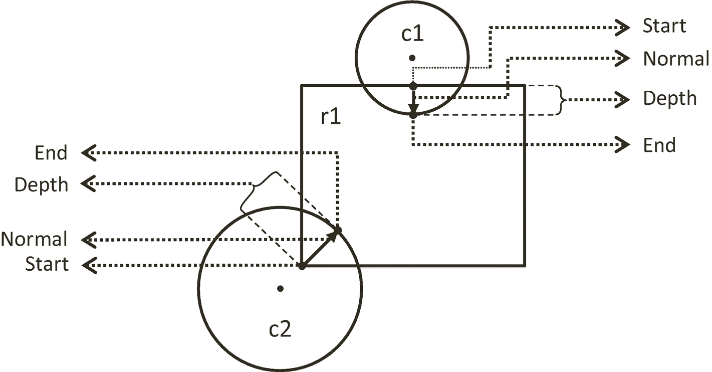

图 9-4 ¶ 碰撞信息

## 圆碰撞与 CollisionInfo 项目

该项目构建了基于圆之间碰撞来计算和处理碰撞信息的基础设施。你可以在图 9-5 中看到该项目运行的示例。该项目的源代码定义在 `chapter9/9.2.circle_collisions_and_colllision_info` 中。

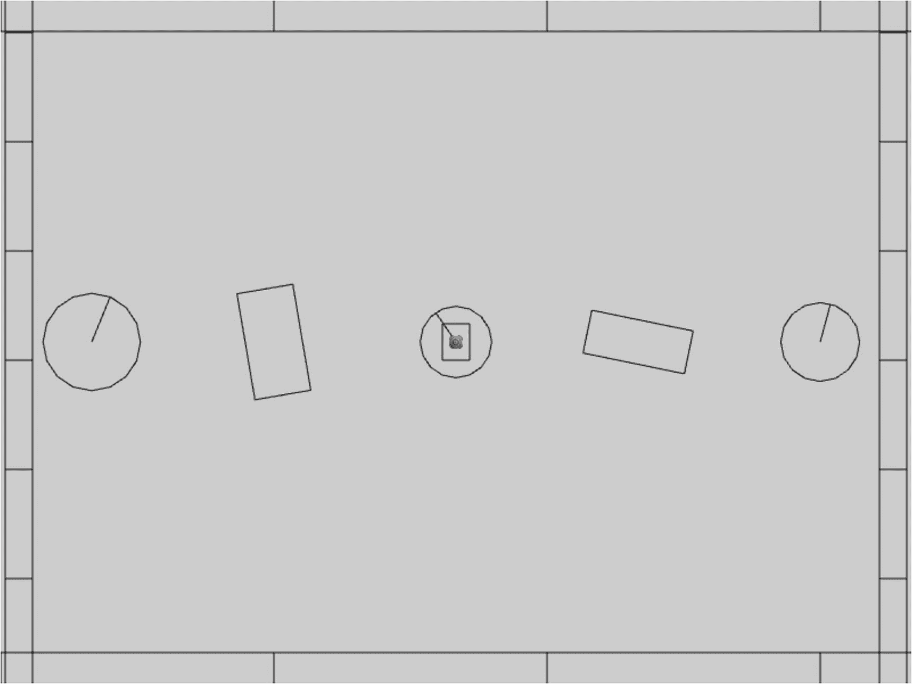

图 9-5 ¶ 运行 CollisionInfo 和圆碰撞项目

该项目的控制方式与上一个项目相同，仅在绘制控制中增加了一个 `C` 键命令：

**行为控制**：

- `G` 键：随机创建一个新的刚性圆或矩形

**绘制控制**：

- `C` 键：切换所有 `CollisionInfo` 的绘制
- `T` 键：切换所有对象的纹理
- `R` 键：切换 `RigidShape` 的绘制
- `B` 键：切换每个 `RigidShape` 边界的绘制


## 对象控制

- 左/右箭头键：依次遍历并选择对象。
- WASD 键：移动选中的对象。
- Z/X 键：旋转选中的对象。
- Y/U 键：增加/减小选中对象的 `RigidShape` 尺寸；这不会改变对应 `Renderable` 对象的尺寸。

## 项目目标

- 理解广相位碰撞检测的优缺点
- 构建计算圆间碰撞的基础设施
- 通过 `CollisionInfo` 类定义并处理碰撞条件
- 理解并实现圆碰撞检测算法

## 定义 CollisionInfo 类

必须定义一个新类来记录 `RigidShape` 相互穿透的情况，如图 9-4 所示：

1. 在 `src/engine/rigid_shape` 文件夹中，创建 `collision_info.js` 文件，从 `debugDraw` 导入，声明绘制颜色为品红，并定义 `CollisionInfo` 类：

```javascript
import * as debugDraw from "../core/debug_draw.js";
let kInfoColor = [1, 0, 1, 1]; // draw the info in magenta
class CollisionInfo {
    ... implementation to follow ...
}
export default CollisionInfo;
```

2. 定义构造函数，包含对应图 9-4 中所示的碰撞深度、法线、起始和结束位置的实例变量：

```javascript
constructor() {
    this.mDepth = 0;
    this.mNormal = vec2.fromValues(0, 0);
    this.mStart = vec2.fromValues(0, 0);
    this.mEnd = vec2.fromValues(0, 0);
}
```

3. 为变量定义 getter 和 setter：

```javascript
getDepth() { return this.mDepth; }
setDepth(s) { this.mDepth = s; }
getNormal() { return this.mNormal; }
setNormal(s) { this.mNormal = s; }
getStart() { return this.mStart; }
getEnd() { return this.mEnd; }
setInfo(d, n, s) {
    this.mDepth = d;
    this.mNormal[0] = n[0];
    this.mNormal[1] = n[1];
    this.mStart[0] = s[0];
    this.mStart[1] = s[1];
    vec2.scaleAndAdd(this.mEnd, s, n, d);
}
```

4. 创建一个函数来翻转碰撞法线的方向。此函数将用于确保法线始终指向正在进行碰撞测试的对象。

```javascript
changeDir() {
    vec2.scale(this.mNormal, this.mNormal, -1);
    let n = this.mStart;
    this.mStart = this.mEnd;
    this.mEnd = n;
}
```

5. 定义 `draw()` 函数，以品红色可视化起点、终点和碰撞法线：

```javascript
draw(aCamera) {
    debugDraw.drawLine(aCamera, this.mStart, this.mEnd, true, kInfoColor);
}
```

最后，别忘了更新引擎访问文件 `index.js`，将新定义的功能转发给客户端。

## 修改 RigidShape 类

`RigidShape` 类必须更新以支持碰撞。由于抽象基础形状 `RigidShape` 不包含实际的几何信息，实际的碰撞函数必须在矩形和圆形类中实现。

### 修改 RigidRectangle 类

为提高可读性，碰撞支持将在单独的源代码文件 `rigid_rectangle_collision.js` 中实现：

1. 修改 `rigid_rectangle.js` 以从新源代码文件导入：

```javascript
import RigidRectangle from "./rigid_rectangle_collision.js";
export default RigidRectangle;
```

2. 在 `src/engine/rigid_shapes` 文件夹中，创建 `rigid_rectangle_collision.js` 文件，导入 `CollisionInfo` 和 `RigidRectangle`，并定义 `collisionTest()` 函数始终返回碰撞失败状态。直到下一小节之前，与 `RigidRectangle` 形状的碰撞将始终失败。

```javascript
RigidRectangle.prototype.collisionTest = function (otherShape, collisionInfo) {
    let status = false;
    if (otherShape.mType === "RigidCircle") {
        status = false;
    } else {
        status = false;
    }
    return status;
}
```

3. 记得导出扩展后的 `RigidRectangle` 类供客户端使用：

```javascript
export default RigidRectangle;
```

### 修改 RigidCircle 类

以与 `RigidRectangle` 完全相同的方式修改 `RigidCircle` 源代码文件：编辑 `rigid_circle.js` 以从 `rigid_circle_collision.js` 导入。现在，你可以实现圆-圆碰撞检测了。

1. 在 `src/engine/rigid_shape` 文件夹中，创建 `rigid_circle_collision.js` 文件，导入 `RigidCircle`，并定义 `collisionTest()` 函数：如果 `otherShape` 不是 `RigidCircle`，则始终返回碰撞失败状态；否则，调用并返回 `collideCircCirc()` 的状态。目前，`RigidCircle` 不知道如何与 `RigidRectangle` 碰撞。

```javascript
import RigidCircle from "./rigid_circle_main.js";
RigidCircle.prototype.collisionTest = function (otherShape, collisionInfo) {
    let status = false;
    if (otherShape.mType === "RigidCircle") {
        status = this.collideCircCirc(this, otherShape, collisionInfo);
    } else {
        status = false;
    }
    return status;
}
```

2. 定义 `collideCircCirc()` 函数以检测两个圆之间的碰撞，并在检测到碰撞时计算相应的碰撞信息。碰撞检测有三种情况：无碰撞（步骤 1）、两个圆心位于不同位置时的碰撞（步骤 2）、以及两个圆心位于完全相同位置时的碰撞（步骤 3）。以下代码展示了步骤 1，即无碰撞的检测；请注意，此代码也对应图 9-2 所示的情况。

```javascript
RigidCircle.prototype.collideCircCirc = function (c1, c2, collisionInfo) {
    let vFrom1to2 = [0, 0];
    // **步骤 1**：确定圆是否重叠
    vec2.subtract(vFrom1to2, c2.getCenter(), c1.getCenter());
    let rSum = c1.mRadius + c2.mRadius;
    let dist = vec2.length(vFrom1to2);
    if (dist > Math.sqrt(rSum * rSum)) {
        // not overlapping
        return false;
    }
    ... implementation of Steps 2 and 3 to follow ...
}
```

3. 当检测到碰撞时，如果两个圆心位于不同位置（步骤 2），则可以按图 9-6 所示计算碰撞深度和法线。由于 `c2` 是对另一个 `RigidShape` 的引用，碰撞法线是一个从 `c1` 指向 `c2` 的向量，或与 `vFrom1to2` 方向相同。碰撞深度是 `rSum` 和 `dist` 的差值，`c1` 的起始位置就是沿着负 `mFrom1to2` 方向距离 `c2` 中心 `c2` 半径处的位置。

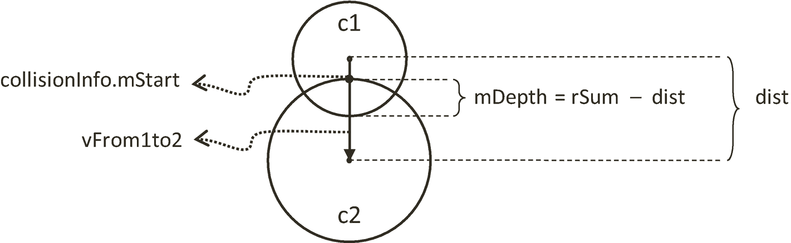

图 9-6 ¶ 圆-圆碰撞的细节

```javascript
// Step 1: refer to previous step
if (dist !== 0) {
    // **步骤 2**：碰撞圆心位于不同位置
    vec2.normalize(vFrom1to2, vFrom1to2);
    let vToC2 = [0, 0];
    vec2.scale(vToC2, vFrom1to2, -c2.mRadius);
    vec2.add(vToC2, c2.getCenter(), vToC2);
    collisionInfo.setInfo(rSum - dist, vFrom1to2, vToC2);
}
... implementation of Step 3 to follow ...
```

4. 两个碰撞圆的最后一种情况是两个圆心都位于完全相同的位置（步骤 3）。在这种情况下，碰撞法线被定义为负 y 方向，碰撞深度就是两个半径中较大的那个。


## 定义物理组件

现在你可以定义物理组件以触发碰撞检测计算：

1. 在 `src/engine/components` 文件夹中，创建 `physics.js` 文件，导入 `CollisionInfo` 并声明变量以支持该文件局部的计算。

2. 定义 `collideShape()` 函数以触发碰撞检测计算。请注意在实际调用形状 `collisionTest()` 之前的两个测试。首先，检查确保这两个形状不是同一个对象。其次，调用宽相位 `boundTest()` 方法以确定形状的接近程度。请注意，最后一个参数 `infoSet`，如果已定义，将包含所有成功碰撞的 `CollisionInfo` 对象。定义它是为了支持可视化 `CollisionInfo` 对象，以便进行验证和调试。

```javascript
function collideShape(s1, s2, infoSet = null) {
    let hasCollision = false;
    if (s1 !== s2) {
        if (s1.boundTest(s2)) {
            hasCollision = s1.collisionTest(s2, mCInfo);
            if (hasCollision) {
                // 确保 mCInfo 始终是从 s1 指向 s2
                vec2.subtract(mS1toS2, s2.getCenter(), s1.getCenter());
                if (vec2.dot(mS1toS2, mCInfo.getNormal()) < 0)
                    mCInfo.changeDir();
                // 用于展示碰撞 mCInfo！
                if (infoSet !== null) {
                    infoSet.push(mCInfo);
                    mCInfo = new CollisionInfo();
                }
            }
        }
    }
    return hasCollision;
}
```

3. 定义实用函数以支持游戏开发者：`processSet()` 用于执行同一 `GameObjectSet` 中所有对象之间的碰撞判定，`processObjToSet()` 用于检查给定 `GameObject` 与 `GameObjectSet` 中对象之间的碰撞，`processSetToSet()` 用于检查两个不同 `GameObjectSets` 中所有对象之间的碰撞。

```javascript
// 碰撞 GameObjectSet 中所有对象与其自身
function processSet(set, infoSet = null) {
    let i = 0, j = 0;
    let hasCollision = false;
    for (i = 0; i < set.size(); i++) {
        let s1 = set.getObjectAt(i).getRigidBody();
        for (j = i + 1; j < set.size(); j++) {
            let s2 = set.getObjectAt(j).getRigidBody();
            hasCollision = collideShape(s1, s2, infoSet) || hasCollision;
        }
    }
    return hasCollision;
}

// 碰撞给定的 GameObject 与一个 GameObjectSet
function processObjToSet(obj, set, infoSet = null) {
    let j = 0;
    let hasCollision = false;
    let s1 = obj.getRigidBody();
    for (j = 0; j < set.size(); j++) {
        let s2 = set.getObjectAt(j).getRigidBody();
        hasCollision = collideShape(s1, s2, infoSet) || hasCollision;
    }
    return hasCollision;
}

// 碰撞两个不同 GameObjectSets 中的所有对象
function processSetToSet(set1, set2, infoSet = null) {
    let i = 0, j = 0;
    let hasCollision = false;
    for (i = 0; i < set1.size(); i++) {
        let s1 = set1.getObjectAt(i).getRigidBody();
        for (j = 0; j < set2.size(); j++) {
            let s2 = set2.getObjectAt(j).getRigidBody();
            hasCollision = collideShape(s1, s2, infoSet) || hasCollision;
        }
    }
    return hasCollision;
}
```

4. 现在，导出所有定义的功能：

```javascript
export {
    // 碰撞两个形状
    collideShape,
    // 碰撞处理
    processSet, processObjToSet, processSetToSet
}
```

最后，记得更新引擎访问文件 `index.js`，将新定义的功能转发给客户端。

## 修改 MyGame 以测试圆形碰撞

测试新定义的碰撞功能所需的修改相当简单：

1. 编辑 `my_game_main.js`；在构造函数中，定义用于存储 `CollisionInfo` 的数组和一个指示是否绘制 `CollisionInfo` 的新标志：

```javascript
constructor() {
    super();
    ... identical to previous code ...
    this.mCollisionInfos = [];
    ... identical to previous code ...
    // 绘制控制
    this.mDrawCollisionInfo = true;  // 显示碰撞信息
    ... identical to previous code ...
}
```

2. 修改 `update()` 函数以触发碰撞测试：

```javascript
update() {
    ... identical to previous code ...
    if (this.mDrawCollisionInfo)
        this.mCollisionInfos = [];
    else
        this.mCollisionInfos = null;
    engine.physics.processObjToSet(this.mHero,
        this.mPlatforms, this.mCollisionInfos);
    engine.physics.processSetToSet(this.mAllObjs,
        this.mPlatforms, this.mCollisionInfos);
    engine.physics.processSet(this.mAllObjs, this.mCollisionInfos);
}
```

3. 修改 `draw()` 函数以在定义时绘制创建的 `CollisionInfo` 数组：

```javascript
draw() {
    ... identical to previous code ...
    if (this.mCollisionInfos !== null) {
        for (let i = 0; i < this.mCollisionInfos.length; i++)
            this.mCollisionInfos[i].draw(this.mCamera);
        this.mCollisionInfos = [];
    }
    ... identical to previous code ...
}
```

4. 记得更新 `drawControlUpdate()` 函数以支持 `C` 键切换 `CollisionInfo` 对象的绘制：

```javascript
drawControlUpdate() {
    let i;
    if (engine.input.isKeyClicked(engine.input.keys.C)) {
        this.mDrawCollisionInfo = !this.mDrawCollisionInfo;
    }
    ... identical to previous code ...
}
```

## 观察

你现在可以运行项目，通过生成的 `CollisionInfo` 对象来检查你在 `RigidCircle` 形状之间的碰撞实现。请记住，你目前只实现了圆-圆碰撞。现在，使用左/右箭头键选择并操作一个 `RigidCircle` 对象。使用 `WASD` 键移动该对象，观察当它与另一个 `RigidCircle` 重叠时，代表碰撞法线和深度的洋红色线段。尝试按 `Y`/`U` 键验证不同半径形状的 `CollisionInfo` 正确性。现在，按 `G` 键创建更多 `RigidCircle` 对象。尝试移动选定对象并增加其大小，使其同时与多个 `RigidCircle` 对象碰撞，观察每次碰撞都能计算出正确的 `CollisionInfo`。最后，请注意你可以使用 `C` 键切换 `CollisionInfo` 的绘制。

你现在已经实现了圆形碰撞检测，构建了支持碰撞所需的引擎基础设施，并验证了系统的正确性。你现在准备好学习分离轴定理（SAT）并实现派生算法来检测矩形之间的碰撞。

## 分离轴定理

分离轴定理（SAT）是用于检测二维通用凸形状碰撞的最流行算法之一的基础。由于派生算法计算量可能很大，通常会先进行一轮宽相位方法的初步检测。SAT 定理指出：

> 如果存在一条线（或轴），它垂直于两个多边形给定边缘中的任意一条，并且当将两个多边形的所有边缘投影到此轴上时，投影边缘之间没有重叠，则这两个凸多边形**没有**发生碰撞。


换句话说，给定二维空间中的两个凸形状，逐个遍历两个凸形状的所有边。对于每一条边，推导出一条垂直于该边的线（或轴），将两个凸形状的所有边投影到这条线上，并计算投影边的重叠情况。如果你能找到一条垂直线，使得没有任何投影边重叠，则这两个凸形状不发生碰撞。

图 9-7 使用两个轴对齐矩形演示了这一描述。在这种情况下，有两条线垂直于给定两个形状的边，即 X 轴和 Y 轴。

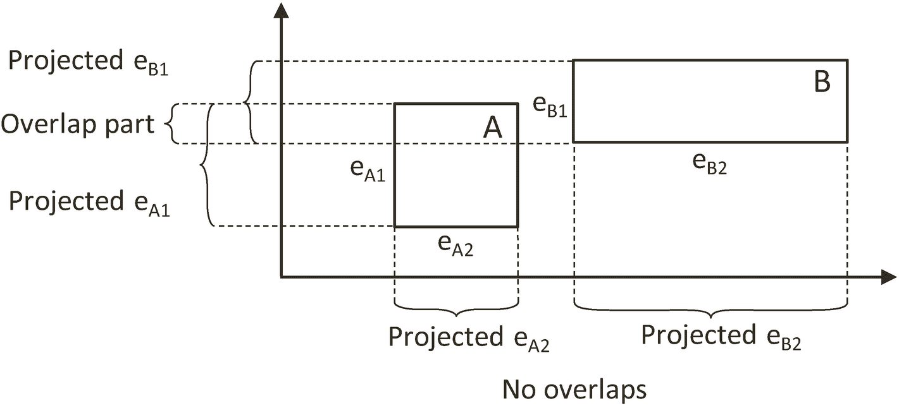

当将形状的所有边投影到这两条线/轴上时，请注意 Y 轴上的投影结果重叠，而 X 轴上没有重叠。由于存在一条垂直于其中一个矩形边的线，使得投影边不重叠，SAT 得出结论：这两个给定矩形不发生碰撞。

源自 SAT 的算法的主要优势在于，对于非碰撞形状，它具有提前退出的能力。一旦检测到没有重叠投影边的轴，算法即可报告无碰撞，无需继续测试其他轴。在图 9-7 的情况下，如果算法从处理 X 轴开始，则无需执行 Y 轴的计算。

## 基于 SAT 的简单算法

基于 SAT 推导的算法通常包含四个步骤。请注意，该算法适用于检测任意凸形状之间的碰撞。为清晰起见，在以下解释中，每个步骤都附带一个由两个矩形组成的简单示例：

*   **步骤 1. 计算面法线**：计算用于投影边的垂直轴或面法线。以矩形为例，图 9-8 说明了有四条边，每条边都有一个对应的垂直轴。例如，`A1` 是对应轴，因此垂直于边 `e[A1]`。请注意，在你的 `RigidRectangle` 类中，`mFaceNormal`（即面法线）是垂直轴 `A1`、`A2`、`A3` 和 `A4`。

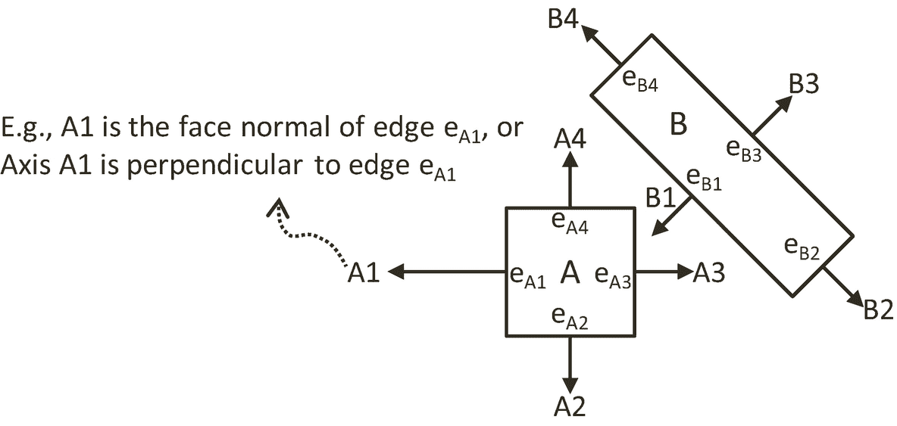

*   **步骤 2. 投影顶点**：将两个凸形状的每个顶点投影到面法线上。对于给定的矩形示例，图 9-9 说明了将所有顶点投影到图 9-8 中的 `A1` 轴上。

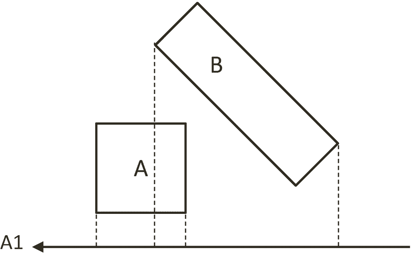

*   **步骤 3. 确定边界**：确定每个凸形状投影顶点的最小和最大边界。继续矩形示例；图 9-10 显示了两个矩形各自的最小和最大位置。请注意，最小/最大位置是相对于给定轴的方向定义的。

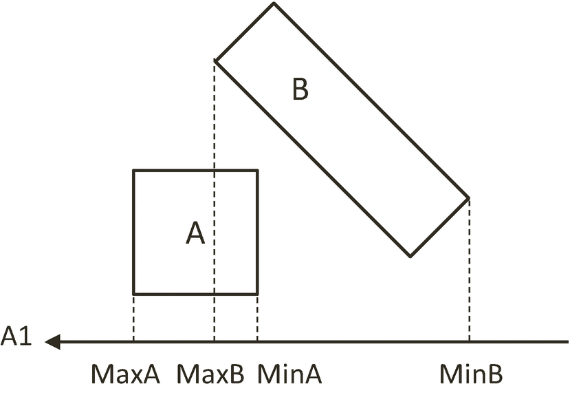

*   **步骤 4. 判断重叠**：判断两个最小/最大边界是否重叠。图 9-11 显示两个投影边界确实重叠。在这种情况下，算法无法得出结论，必须继续处理下一个面法线。请注意，如图 9-8 所示，处理面法线 `B1` 或 `B3` 将得出无碰撞的确定性结论。

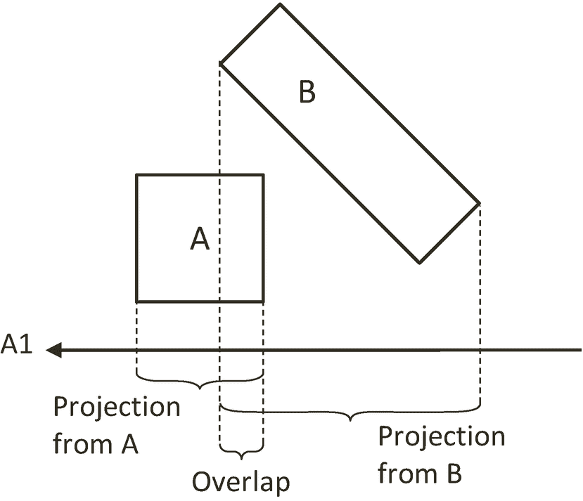

给定的算法能够在无额外信息的情况下判断碰撞是否发生。回顾一下，检测到碰撞后，物理引擎还必须解决潜在的相互穿透，并为碰撞形状推导响应。这两项计算都需要额外信息——即图 9-4 中介绍的碰撞信息。下一节将介绍一种高效的基于 SAT 的算法，该算法计算支撑点，既可告知碰撞检测的真/假结果，又可作为推导碰撞信息的基础。

## 高效的 SAT 算法：支撑点

如图 9-12 所示，形状 A 的面法线的支撑点被定义为形状 B 上的顶点位置，该顶点到形状 A 对应边的距离最负。当沿 `A1` 方向测量时，形状 B 上的顶点 `S[A1]` 到边 `e[A1]` 的距离负值最大，因此 `S[A1]` 是面法线 `A1` 的支撑点。负距离意味着测量是有方向的，且支撑点必须位于面法线的反方向。

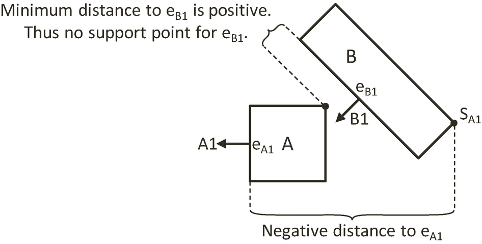

通常，给定面法线的支撑点在每个更新周期可能不同，因此必须在每次碰撞调用时重新计算。此外，也是非常重要的是，面法线完全可能没有定义的支撑点。

### 面法线可能不存在支撑点

仅当沿面法线测量的距离为负值时，支撑点才被定义。例如，在图 9-12 中，形状 B 的面法线 `B1` 在形状 A 上没有对应的支撑点。这是因为形状 A 上的所有顶点在沿 `B1` 测量时，到对应边 `e[B1]` 的距离均为正值。正距离意味着形状 A 的所有顶点都在边 `e[B1]` 的前方。换句话说，整个形状 A 都在形状 B 的边 `e[B1]` 前方；因此，这两个形状在物理上不接触；因此，它们不发生碰撞。

由此可见，在计算两个形状之间的碰撞时，如果任意面法线没有对应的支撑点，则这两个形状不发生碰撞。再一次，提前退出能力是一个重要优势——算法一旦检测到第一个未定义支撑点的情况，即可返回判定。

为便于讨论和实现，支撑点与对应边之间的距离称为支撑点距离，并作为正数计算。这样，支撑点距离实际上是沿负面法线方向测量的。本书后续讨论将遵循这一约定。

### 最小穿透轴与碰撞信息


## 支持点 SAT 算法

当为凸形状的所有面法线定义了支持点时，具有最小支持点距离的面法线就是导致最小相互渗透的轴。图 9-13 展示了两个形状之间的碰撞，其中形状 B 的所有面法线都定义了支持点：形状 A 上的顶点 `S[B1]` 是面法线 `B1` 对应的支持点，`S[B2]` 对应面法线 `B2`，以此类推。在这种情况下，`S[B1]` 具有最小的对应支持点距离，因此，面法线 `B1` 就是导致最小相互渗透的轴。图 9-13 右侧的插图显示，在这种情况下，支持点距离即为碰撞深度，面法线 `B1` 是碰撞法线，支持点 `S[B1]` 是碰撞起点，碰撞终点可以很容易地计算出来；它就是 `S[B1]` 沿碰撞法线方向偏移碰撞深度后的位置。

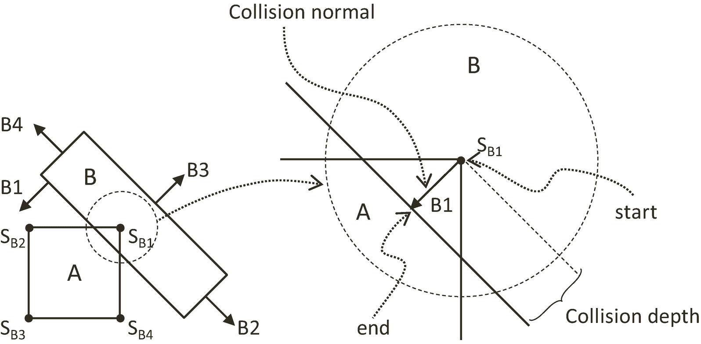

**Figure 9-13** ¶ 最小渗透轴及对应的碰撞信息

## 算法

有了上述背景描述，用于计算两个凸形状 A 和 B 之间碰撞的高效基于 SAT 的算法可以总结如下：

1. 计算形状 A 所有面法线的支持点
   - 如果任意支持点未定义，则没有碰撞
   - 如果所有支持点都已定义，计算最小渗透轴
2. 计算形状 B 所有面法线的支持点
   - 如果任意支持点未定义，则没有碰撞
   - 如果所有支持点都已定义，计算最小渗透轴

碰撞信息就是前两个结果中较小的碰撞深度。现在你已经准备好实现支持点 SAT 算法了。

## 矩形碰撞项目

该项目将指导你完成支持点 SAT 算法的实现。你可以在图 9-14 中看到该项目运行的示例。该项目的源代码定义在 `chapter9/9.3.rectangle_collisions` 中。

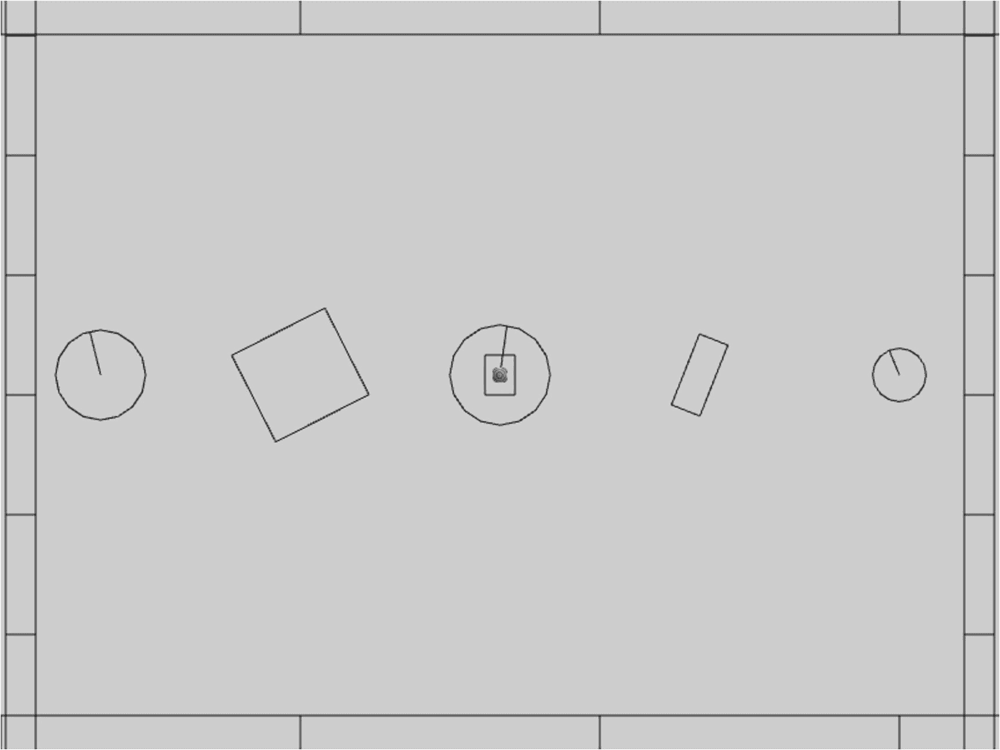

**Figure 9-14** ¶ 运行矩形碰撞项目

该项目的控制方式与前一个项目相同：

### 行为控制
- **G 键**：随机创建一个新的刚性圆形或矩形

### 绘制控制
- **C 键**：切换所有 `CollisionInfo` 的绘制
- **T 键**：切换所有物体的纹理
- **R 键**：切换 `RigidShape` 的绘制
- **B 键**：切换每个 `RigidShape` 包围盒的绘制

### 物体控制
- **左/右箭头键**：依次遍历并选择一个物体
- **WASD 键**：移动选中的物体
- **Z/X 键**：旋转选中的物体
- **Y/U 键**：增大/减小选中物体的 `RigidShape` 尺寸；这不会改变对应 `Renderable` 物体的尺寸

项目目标如下：
- 深入理解并实现支持点 SAT 算法
- 继续完成窄相碰撞检测的实现

完成该项目后，你的游戏引擎将能够处理圆形与圆形、矩形与矩形之间的碰撞，但仍不支持圆形与矩形之间的碰撞。这将使你更接近完成刚性形状窄相碰撞检测的实现。剩余的功能——检测圆形-矩形碰撞——将在下一小节中介绍。

## 实现支持点 SAT

随着上一个项目中碰撞检测基础设施的完成，唯一需要的修改就是将新功能添加到 `RigidRectangle` 类中。回想一下，源代码文件 `rigid_rectangle_collision.js` 是为实现矩形碰撞而创建的。

### 步骤 1：定义局部变量

在 `src/engine/rigid_shapes` 文件夹中，编辑 `rigid_rectangle_collision.js` 以定义局部变量。这些是计算过程中的临时存储；它们被静态分配并重复使用，以避免每次调用时重复动态分配的开销。

```javascript
class SupportStruct {
    constructor() {
        this.mSupportPoint = null;
        this.mSupportPointDist = 0;
    }
}

// temp work area to save memory allocations
let mTmpSupport = new SupportStruct();
let mCollisionInfoR1 = new CollisionInfo();
let mCollisionInfoR2 = new CollisionInfo();
```

### 步骤 2：创建 `findSupportPoint()` 函数

创建一个新函数 `findSupportPoint()`，根据 `dir`（取反的面法线方向）和 `ptOnEdge`（给定边上的一个位置，例如顶点）来计算支持点。列出的代码遍历所有顶点；计算 `vToEdge`（从顶点指向 `ptOnEdge` 的向量）；将该向量投影到输入的 `dir` 上；并记录最大的正投影距离。回想一下，`dir` 是取反的面法线方向，因此，最大的正距离对应最远的顶点位置。注意，所有投影距离均为负值的情况完全可能发生。在这种情况下，所有顶点都在输入 `dir` 的前方，给定边不存在支持点，因此，两个矩形不会发生碰撞。

```javascript
RigidRectangle.prototype.findSupportPoint = function (dir, ptOnEdge) {
    // the longest project length
    let vToEdge = [0, 0];
    let projection;
    mTmpSupport.mSupportPointDist = -Number.MAX_VALUE;
    mTmpSupport.mSupportPoint = null;
    // check each vector of other object
    for (let i = 0; i < this.mVertex.length; i++) {
        vec2.subtract(vToEdge, this.mVertex[i], ptOnEdge);
        projection = vec2.dot(vToEdge, dir);
        // find the longest distance with certain edge
        // dir is -n direction, so the distance should be positive
        if ((projection > 0) &&
            (projection > mTmpSupport.mSupportPointDist)) {
            mTmpSupport.mSupportPoint = this.mVertex[i];
            mTmpSupport.mSupportPointDist = projection;
        }
    }
}
```

### 步骤 3：寻找最小渗透轴

有了为任意面法线定位支持点的能力，下一步是使用 `findAxisLeastPenetration()` 函数找到最小渗透轴。回想一下，最小渗透轴是具有最小支持点距离的支持点。列出的代码循环遍历四个面法线，找到对应的支持点和支持点距离，并记录最短距离。while 循环表示如果任意面法线没有定义支持点，则两个矩形不发生碰撞。


## 矩形-矩形与矩形-圆形碰撞检测实现

## 矩形-矩形碰撞实现

### `findAxisLeastPenetration` 函数

```javascript
RigidRectangle.prototype.findAxisLeastPenetration = function (otherRect, collisionInfo) {
    let n;
    let supportPoint;
    let bestDistance = Number.MAX_VALUE;
    let bestIndex = null;
    let hasSupport = true;
    let i = 0;
    let dir = [0, 0];
    while ((hasSupport) && (i < this.mFaceNormal.length)) {
        // Retrieve a face normal from A
        n = this.mFaceNormal[i];
        // use -n as direction and the vertex on edge i as point on edge
        vec2.scale(dir, n, -1);
        let ptOnEdge = this.mVertex[i];
        // find the support on B
        // the point has longest distance with edge i
        otherRect.findSupportPoint(dir, ptOnEdge);
        hasSupport = (mTmpSupport.mSupportPoint !== null);
        // get the shortest support point depth
        if ((hasSupport) && (mTmpSupport.mSupportPointDist < bestDistance)) {
            bestDistance = mTmpSupport.mSupportPointDist;
            bestIndex = i;
            supportPoint = mTmpSupport.mSupportPoint;
        }
        i = i + 1;
    }
    if (hasSupport) {
        // all four directions have support point
        let bestVec = [0, 0];
        vec2.scale(bestVec, this.mFaceNormal[bestIndex], bestDistance);
        let atPos = [0, 0];
        vec2.add(atPos, supportPoint, bestVec);
        collisionInfo.setInfo(bestDistance, this.mFaceNormal[bestIndex], atPos);
    }
    return hasSupport;
}
```

### 实现 `collideRectRect()` 函数

通过计算相对于两个矩形各自的最小穿透轴，并选择两个结果中较小的一个，即可实现 `collideRectRect()` 函数：

```javascript
Rectangle.prototype.collideRectRect = function (r1, r2, collisionInfo) {
    var status1 = false;
    var status2 = false;
    // find Axis of Separation for both rectangle
    status1 = r1.findAxisLeastPenetration(r2, collisionInfoR1);
    if (status1) {
        status2 = r2.findAxisLeastPenetration(r1, collisionInfoR2);
        if (status2) {
            // if rectangles overlap, the shorter normal is the normal
            if (collisionInfoR1.getDepth() < collisionInfoR2.getDepth()) {
                var depthVec = collisionInfoR1.getNormal().scale(
                    collisionInfoR1.getDepth());
                collisionInfo.setInfo(collisionInfoR1.getDepth(),
                    collisionInfoR1.getNormal(),
                    collisionInfoR1.mStart.subtract(depthVec));
            } else {
                collisionInfo.setInfo(collisionInfoR2.getDepth(),
                    collisionInfoR2.getNormal().scale(-1),
                    collisionInfoR2.mStart);
            }
        }
    }
    return status1 && status2;
}
```

### 修改 `collisionTest()` 函数

通过调用新定义的 `collideRectRect()` 函数来计算两个矩形之间的碰撞，完成实现：

```javascript
RigidRectangle.prototype.collisionTest = function (otherShape, collisionInfo) {
    let status = false;
    if (otherShape.mType === "RigidCircle") {
        status = false;
    } else {
        status = this.collideRectRect(this, otherShape, collisionInfo);
    }
    return status;
}
```

## 观察结果

现在可以运行项目来测试实现。使用左/右箭头键选择任意刚体形状，使用 `WASD` 键移动选中的对象。再次观察重叠矩形或重叠圆形之间的洋红色碰撞信息。请记住，这条线显示的是确保形状之间无重叠所需的最小位置修正量。按 `Z/X` 键旋转，按 `Y/U` 键改变选中对象的大小，观察碰撞信息如何随之变化。

此时，仅支持圆-圆和矩形-矩形碰撞，因此当圆与矩形重叠时，不会显示碰撞信息。这将在下一个项目中解决。

## 矩形与圆形的碰撞

支持点算法不适用于圆形，因为圆形没有可识别的顶点位置。取而代之的是，你将实现一个算法，根据圆心相对于矩形的位置来检测矩形与圆形之间的碰撞。

在讨论实际算法之前，如图 9-15 所示，通过延伸相连的边，矩形一条边外部的区域可以分为三个不同的区域。在这种情况下，虚线将给定边的外部区域分为 `RG1`（左/上区域）、`RG2`（右/下区域）和 `RG3`（紧邻给定边的外部区域）。

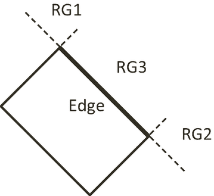

Figure 9-15 ¶ The three regions outside a given edge of a rectangle

基于此背景，矩形与圆形的碰撞检测步骤如下：

*   **步骤 A**：计算距离圆心最近的矩形边。
*   **步骤 B**：如果圆心在矩形内部，则检测到碰撞。
*   **步骤 C**：如果圆心在矩形外部
    *   **步骤 C1**：如果在 `RG1` 区域，圆心与顶点之间的距离决定是否发生碰撞。
    *   **步骤 C2**：如果在 `RG2` 区域，圆心与底点之间的距离决定是否发生碰撞。
    *   **步骤 C3**：如果在 `RG3` 区域，圆心与边的垂直距离决定是否发生碰撞。

## 矩形与圆形碰撞项目

该项目指导你实现上述矩形-圆形碰撞检测算法。图 9-16 展示了该项目运行的示例。源代码定义在 `chapter9/9.4.rectangle_and_circle_collisions` 中。

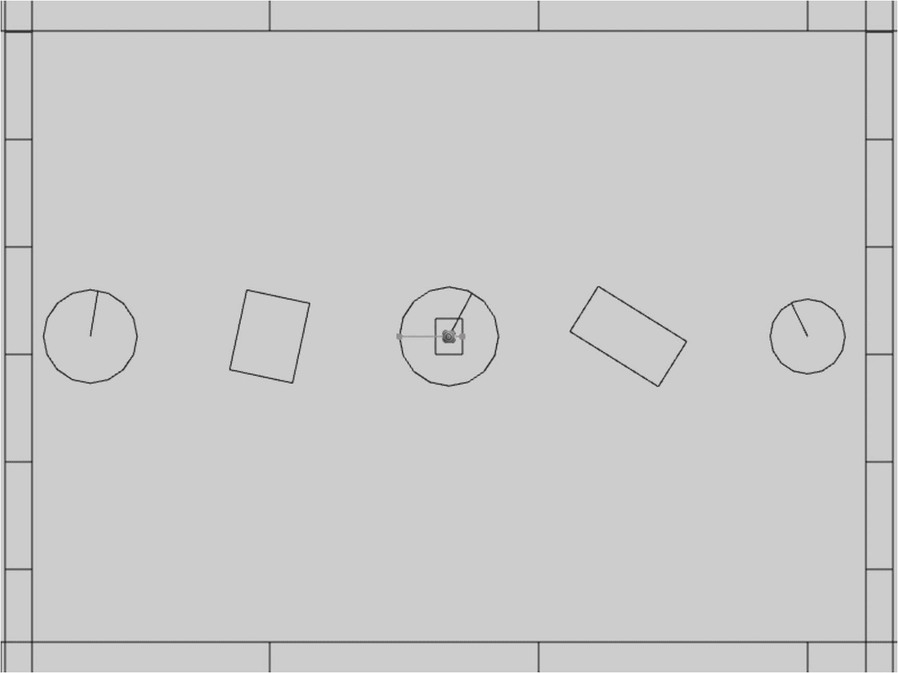

Figure 9-16 ¶ Running the Rectangle and Circle Collisions project

项目控制方式与前一个项目相同：

### 行为控制

*   `G` 键：随机创建一个新的刚体圆形或矩形

### 绘制控制

*   `C` 键：切换所有 `CollisionInfo` 的绘制
*   `T` 键：切换所有对象的纹理
*   `R` 键：切换 `RigidShape` 的绘制
*   `B` 键：切换每个 `RigidShape` 边界的绘制

### 对象控制

*   左/右箭头键：依次选择对象
*   `WASD` 键：移动选中的对象
*   `Z/X` 键：旋转选中的对象
*   `Y/U` 键：增加/减小选中对象的 `RigidShape` 大小；这不会改变对应 `Renderable` 对象的大小

### 项目目标

*   理解并实现矩形-圆形碰撞检测算法
*   完成圆形和矩形形状的窄阶段碰撞检测实现

## 定义矩形-圆形碰撞

再次强调，在完成碰撞检测基础设施后，唯一需要的修改是追加新功能。这将在 `RigidRectangle` 类中实现。为了提高这个相对复杂算法的可读性，将创建一个新的源代码文件 `rigid_rectangle_circle_collision.js` 用于实现。

### 更新 `RigidRectangle` 访问文件

在 `src/engine/rigid_shapes` 文件夹中，编辑 `rigid_rectangle.js`，将导入替换为最新的源代码文件。


## 矩形与圆形碰撞检测实现

## 导入模块

```javascript
import RigidRectangle from "./rigid_rectangle_circle_collision.js";
export default RigidRectangle;
```

## 步骤 2：创建碰撞文件

在同一文件夹下，创建 `rigid_rectangle_circle_collision.js` 文件，从 `rigid_rectangle_collision.js` 导入，以便向类中追加新的碰撞函数：

```javascript
import RigidRectangle from "./rigid_rectangle_collision.js";
```

## 步骤 3：定义 `checkCircRectVertex()` 函数

定义新函数 `checkCircRectVertex()` 以处理区域 RG1 和 RG2。如图 9-17 左图所示，参数 `v1` 是从顶点位置到圆心的向量。右图显示：当 `v1` 的长度 `dist` 小于半径 `r` 时发生碰撞。此时碰撞深度就是 `r` 与 `dist` 的差值。

```javascript
RigidRectangle.prototype.checkCircRectVertex = function(v1, cirCenter, r, info) {
    // the center of circle is in corner region of mVertex[nearestEdge]
    let dist = vec2.length(v1);
    // compare the distance with radius to decide collision
    if (dist > r)
        return false;
    let radiusVec = [0, 0];
    let ptAtCirc = [0, 0];
    vec2.scale(v1, v1, 1/dist); // normalize
    vec2.scale(radiusVec, v1, -r);
    vec2.add(ptAtCirc, cirCenter, radiusVec);
    info.setInfo(r - dist, v1, ptAtCirc);
    return true;
}
```

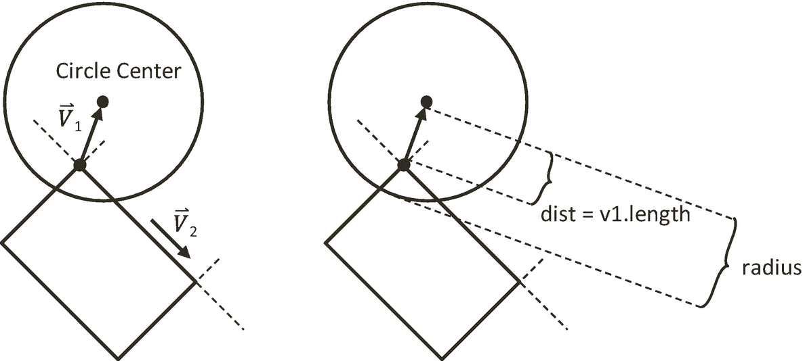

**图 9-17** ¶ 左图：圆心位于区域 RG1 时的条件。右图：对应的碰撞信息。

## 步骤 4：定义 `collideRectCirc()` 函数

定义 `collideRectCirc()` 函数以检测矩形与圆形之间的碰撞。以下代码展示了局部变量声明以及必须执行的五个主要步骤（A 到 C3）。各步骤的细节将在本小节后续部分讨论。

```javascript
RigidRectangle.prototype.collideRectCirc = function (otherCir, collisionInfo) {
    let outside = false;
    let bestDistance = -Number.MAX_VALUE;
    let nearestEdge = 0;
    let vToC = [0, 0];
    let projection = 0;
    let i = 0;
    let cirCenter = otherCir.getCenter();
    ... Step A: Compute nearest edge, handle if center is inside ...
    if (!outside) {
        ... Step B: Circle center is inside rectangle ...
        return;
    }
    ... Steps C1 to C3: Circle center is outside rectangle ...
    return true;
};
```

## 步骤 5：步骤 A - 计算最近边

最近边可通过计算圆心到矩形各边的垂直距离来找到。该距离即为从各顶点到圆心的向量在对应面法线上的投影。列出的代码遍历所有顶点，计算从顶点到圆心的向量，并将计算出的向量投影到对应的面法线上。

```javascript
// Step A: Compute the nearest edge
while ((!outside) && (i<4)) {
    // find the nearest face for center of circle
    vec2.subtract(vToC, cirCenter, this.mVertex[i]);
    projection = vec2.dot(vToC, this.mFaceNormal[i]);
    if (projection > bestDistance) {
        outside = (projection > 0); // if projection < 0, inside
        bestDistance = projection;
        nearestEdge = i;
    }
    i++;
}
```

如图 9-18 左图所示，当圆心在矩形内部时，所有顶点到圆心的向量将与其对应的面法线方向相反，从而产生负的投影长度。这与右图形成对比，当圆心在矩形外部时，至少有一个投影长度为正。因此，“最近投影距离”是负值最小的那个，实际上是最大的数值。

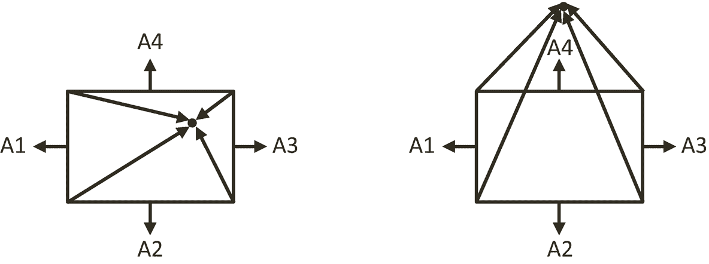

**图 9-18** ¶ 左图：圆心在矩形内部将导致所有投影长度为负。右图：圆心在矩形外部将导致至少有一个投影长度为正。

## 步骤 6：步骤 B - 圆心在矩形内部

如果圆心在矩形内部，则检测到碰撞，可计算并返回相应的碰撞信息：

```javascript
if (!outside) { // inside
    // Step B: The center of circle is inside of rectangle
    vec2.scale(radiusVec, this.mFaceNormal[nearestEdge], otherCir.mRadius);
    dist = otherCir.mRadius - bestDistance; // bestDist is -ve
    vec2.subtract(ptAtCirc, cirCenter, radiusVec);
    collisionInfo.setInfo(dist, this.mFaceNormal[nearestEdge], ptAtCirc);
    return true;
}
```

## 步骤 7：步骤 C1 - 判断并处理区域 RG1

如图 9-17 左图所示，当 `v1`（圆心与顶点之间的向量）与 `v2`（边的方向）方向相反时，可检测到区域 RG1。该条件在以下代码中计算：

```javascript
let v1 = [0, 0], v2 = [0, 0];
vec2.subtract(v1, cirCenter, this.mVertex[nearestEdge]);
vec2.subtract(v2, this.mVertex[(nearestEdge + 1) % 4], this.mVertex[nearestEdge]);
let dot = vec2.dot(v1, v2);
if (dot < 0) {
    // Step C1: In Region RG1
    return this.checkCircRectVertex(v1, cirCenter, otherCir.mRadius, collisionInfo);
} else {
    ... implementation of Steps C2 and C3 to follow ...
}
```

## 步骤 8：步骤 C2 和 C3 - 区分并处理区域 RG2 和 RG3

列出的代码对同一矩形边上的另一顶点执行互补计算以处理区域 RG2。圆心可能位于的最后一个区域是紧邻最近边的外部区域。在这种情况下，步骤 A 中计算的 `bestDistance` 即为圆心到该边的距离。如果该距离小于圆半径，则发生碰撞。

```javascript
if (dot < 0) {
    // Step C1: In Region RG1
    ... identical to previous code ...
} else {
    // Either in Region RG2 or RG3
    // v1 is from right vertex of face to center of circle
    // v2 is from right vertex of face to left vertex of face
    vec2.subtract(v1, cirCenter, this.mVertex[(nearestEdge + 1) % 4]);
    vec2.scale(v2, v2, -1);
    dot = vec2.dot(v1, v2);
    if (dot < 0) {
        // Step C2: In Region RG2
        return this.checkCircRectVertex(v1, cirCenter, otherCir.mRadius, collisionInfo);
    } else {
        // Step C3: In Region RG3
        if (bestDistance < otherCir.mRadius) {
            vec2.scale(radiusVec, this.mFaceNormal[nearestEdge], otherCir.mRadius);
            dist = otherCir.mRadius - bestDistance;
            vec2.subtract(ptAtCirc, cirCenter, radiusVec);
            collisionInfo.setInfo(dist, this.mFaceNormal[nearestEdge], ptAtCirc);
            return true;
        } else {
            return false;
        }
    }
}
```

## 调用新定义的函数

最后一步是调用新定义的函数。注意，当圆形接触矩形时，以及当矩形接触圆形时，都应调用碰撞函数。因此，必须同时修改 `rigid_rectangle_collision.js` 中的 `RigidRectangle` 类和 `rigid_circle_collision.js` 中的 `RigidCircle` 类。

## 步骤 1


## 修改碰撞检测代码

## 修改 `rigid_rectangle_collision.js`

在 `src/engine/rigid_shapes` 文件夹中，编辑 `rigid_rectangle_collision.js`，修改 `collisionTest()` 函数，当参数为圆形时调用新定义的 `collideRectCirc()`：

```javascript
RigidRectangle.prototype.collisionTest = function (otherShape, collisionInfo) {
    let status = false;
    if (otherShape.mType === "RigidCircle") {
        status = this.collideRectCirc(otherShape, collisionInfo);
    } else {
        status = this.collideRectRect(this, otherShape, collisionInfo);
    }
    return status;
}
```

## 修改 `rigid_circle_collision.js`

在同一文件夹中，编辑 `rigid_circle_collision.js`，修改 `collisionTest()` 函数，当参数为矩形时调用新定义的 `collideRectCirc()`：

```javascript
RigidCircle.prototype.collisionTest = function (otherShape, collisionInfo) {
    let status = false;
    if (otherShape.mType === "RigidCircle") {
        status = this.collideCircCirc(this, otherShape, collisionInfo);
    } else {
        status = otherShape.collideRectCirc(this, collisionInfo);
    }
    return status;
}
```

## 观察

现在可以运行项目以测试实现。你可以创建新的矩形和圆形，移动并旋转它们，以观察相应的碰撞信息。

你已完成狭相碰撞检测的实现，可以开始检查这些刚体形状的运动。

## 运动

**运动** 是描述对象在模拟世界中位置如何变化的。数学上，运动可以用多种方式表述。在第 6 章中，你体验了通过不断将位移累加到对象位置来处理运动。如下面的方程和图 9-19 所示，你一直在使用基于恒定位移来描述运动。

*   `p[new] = p[current] + displacement`

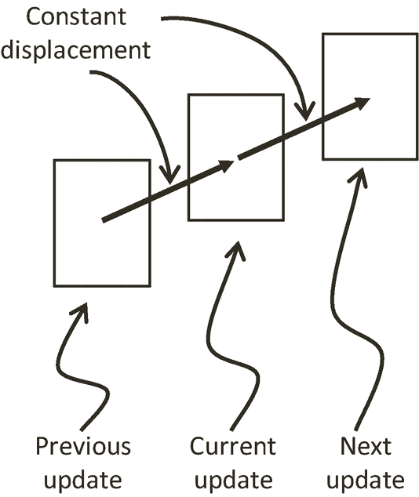

**图 9-19 ¶ 基于恒定位移的运动**

当需要随时间改变位移量时，基于恒定位移公式的运动会变得受限。牛顿力学通过在运动公式中考虑时间来解决这一限制，如下面的方程所示：

*   `v[new] = v[current] + ∫ a(t)dt`
*   `p[new] = p[current] + ∫ v(t)dt`

这两个方程代表基于牛顿力学的运动，其中 `v(t)` 是描述位置随时间变化的速度，`a(t)` 是描述速度随时间变化的加速度。

注意，速度和加速度都是矢量量，同时编码大小和方向。速度矢量的大小定义了速率，归一化的速度矢量标识了对象移动的方向。加速度矢量让你知道对象是加速还是减速，以及对象移动方向的变化。作用在对象上的力会改变加速度。例如，如果你向空中抛出一个球，重力会随时间影响对象的加速度，进而改变对象的速度。

## 显式欧拉积分

欧拉方法，或 **显式欧拉积分**，基于初始值近似积分。这是最直接的积分近似方法之一。如下面的两个方程所示，在牛顿运动公式中，对象的新速度 `v[new]` 可以近似为当前速度 `v[current]` 加上当前加速度 `a[current]` 乘以经过的时间。类似地，对象的新位置 `p[new]` 可以近似为对象的当前位置 `p[current]` 加上当前速度 `v[current]` 乘以经过的时间。

*   `v[new] = v[current] + a[current] * dt`
*   `p[new] = p[current] + v[current] * dt`

图 9-20 左图展示了使用 **显式欧拉积分** 近似运动的简单示例。注意，新位置 `p[new]` 基于当前速度 `v[current]` 计算，而新速度 `v[new]` 则被计算用于下一个更新周期的位置移动。

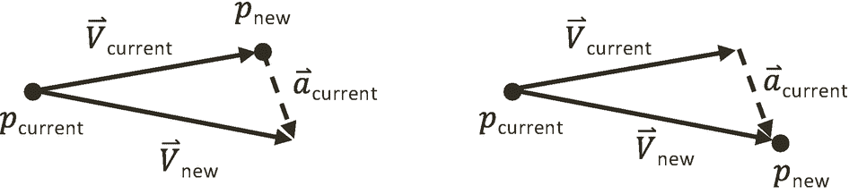

**图 9-20 ¶ 显式（左）和辛（右）欧拉积分**

## 辛欧拉积分

你将实现 **半隐式欧拉积分** 或 **辛欧拉积分**。使用 **辛欧拉积分** 时，后续近似使用中间结果而非当前结果，从而更好地模拟实际运动。以下方程展示了 **辛欧拉积分**。注意，它与欧拉方法几乎相同，只是在计算新位置 `p[new]` 时使用了新速度 `v[new]`。这实质上意味着使用下一帧的速度来计算当前帧的位置。

*   `v[new] = v[current] + a[current] * dt`
*   `p[new] = p[current] + v[new] * dt`

图 9-20 右图展示了使用 **辛欧拉积分** 时，新位置 `p[new]` 基于新计算的速度 `v[new]` 计算。

## 刚体形状运动项目

你现在准备好实现 **辛欧拉积分** 来近似运动。固定时间步长 `dt` 的公式方便地允许每个更新周期评估一次积分。该项目将指导你使用 `RigidShape` 类支持基于 **辛欧拉积分** 的运动近似。你可以在图 9-21 中看到该项目运行的示例。该项目的源代码定义在 `chapter9/9.5.rigid_shape_movements` 中。

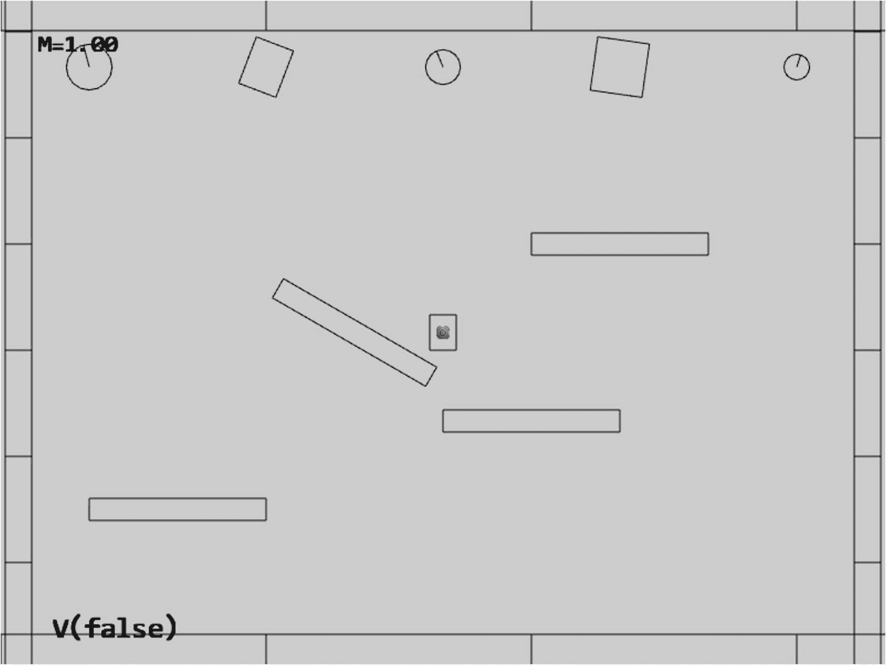

**图 9-21 ¶ 运行刚体形状运动项目**

项目的控制方式与之前相同，并增加了控制选中对象行为和质量的命令：

### 行为控制

*   **`V` 键**：切换所有对象的运动
*   **`H` 键**：向所有对象注入随机速度
*   **`G` 键**：随机创建一个新的刚体圆形或矩形

### 绘制控制

*   **`C` 键**：切换所有 `CollisionInfo` 的绘制
*   **`T` 键**：切换所有对象的纹理
*   **`R` 键**：切换 `RigidShape` 的绘制
*   **`B` 键**：切换每个 `RigidShape` 边界的绘制

### 对象控制

*   **左/右箭头键**：依次选择对象
*   **`WASD` 键**：移动选中的对象
*   **`Z/X` 键**：旋转选中的对象
*   **`Y/U` 键**：增加/减小选中对象的 `RigidShape` 大小；这不会改变对应 `Renderable` 对象的大小
*   **上/下箭头键 + `M`**：增加/减小选中对象的质量

项目目标如下：

*   完成 `RigidShape` 类的实现，包含相关的物理属性
*   基于 **辛欧拉积分** 实现运动近似

除了实现 **辛欧拉积分**，该项目还指导你定义碰撞模拟和响应所需的属性，如质量、惯性、摩擦力等。正如将要解释的，这些属性中的每一个都将在对象碰撞响应的模拟中发挥作用。这些直接的信息在此呈现，是为了避免在后续项目中讨论更复杂的概念时分散注意力。


在本节的其余部分，您将首先定义相关的物理属性以完成 `RigidShape` 的实现。之后，您将专注于构建 `Symplectic Euler Integration`（辛普莱克欧拉积分）支持，用于近似运动。

## 完成 RigidShape 实现

如前所述，为了在后续章节中允许对更复杂的概念进行聚焦讨论，本项目中引入了支持碰撞的属性及其相应的支持函数。这些属性定义在刚体形状类中。

### 修改 RigidShape 类

编辑 `src/engine/rigid_shape` 文件夹中的 `rigid_shape.js`：

1.  在 `RigidShape` 类的构造函数中，定义表示加速度、速度、角速度、质量、转动惯量、恢复系数（弹性）和摩擦力的变量。请注意，为了计算效率（避免每次更新时进行额外的除法运算），实际存储的是质量值的倒数。此外，质量为零用于表示静止物体。

```javascript
class RigidShape {
    constructor(xf) {
        this.mXform = xf;
        this.mAcceleration = physics.getSystemAcceleration();
        this.mVelocity = vec2.fromValues(0, 0);
        this.mType = "";
        this.mInvMass = 1;
        this.mInertia = 0;
        this.mFriction = 0.8;
        this.mRestitution = 0.2;
        this.mAngularVelocity = 0;
        this.mBoundRadius = 0;
        this.mDrawBounds = false;
    }
}
```

2.  定义 `setMass()` 函数以设置物体的质量。同样为了计算效率，存储的是质量的倒数。将物体质量设置为零或负值表示该物体是静止的，具有零加速度，且不参与任何运动计算。请注意，当物体质量改变时，需要调用 `updateInertia()` 来更新其转动惯量 `mInertia`。转动惯量取决于几何形状，`updateInertia()` 的实现是子类特有的。

```javascript
setMass(m) {
    if (m > 0) {
        this.mInvMass = 1 / m;
        this.mAcceleration = physics.getSystemAcceleration();
    } else {
        this.mInvMass = 0;
        this.mAcceleration = [0, 0];  // 确保物体不移动
    }
    this.updateInertia();
}
```

3.  为所有其他相应变量定义 getter 和 setter 函数。这些函数很简单，此处不再列出。

4.  为了方便调试，定义 `getCurrentState()` 函数以文本形式检索变量值，并定义 `userSetsState()` 函数以允许交互式操作变量：

```javascript
getCurrentState() {
    let m = this.mInvMass;
    if (m !== 0)
        m = 1 / m;
    return "M=" + m.toFixed(kPrintPrecision) +
           "(I=" + this.mInertia.toFixed(kPrintPrecision) + ")" +
           " F=" + this.mFriction.toFixed(kPrintPrecision) +
           " R=" + this.mRestitution.toFixed(kPrintPrecision);
}

userSetsState() {
    // 键盘控制
    let delta = 0;
    if (input.isKeyPressed(input.keys.Up)) {
        delta = kRigidShapeUIDelta;
    }
    if (input.isKeyPressed(input.keys.Down)) {
        delta = -kRigidShapeUIDelta;
    }
    if (delta !== 0) {
        if (input.isKeyPressed(input.keys.M)) {
            let m = 0;
            if (this.mInvMass > 0)
                m = 1 / this.mInvMass;
            this.setMass(m + delta * 10);
        }
        if (input.isKeyPressed(input.keys.F)) {
            this.mFriction += delta;
            if (this.mFriction < 0)
                this.mFriction = 0;
            if (this.mFriction > 1)
                this.mFriction = 1;
        }
        if (input.isKeyPressed(input.keys.R)) {
            this.mRestitution += delta;
            if (this.mRestitution < 0)
                this.mRestitution = 0;
            if (this.mRestitution > 1)
                this.mRestitution = 1;
        }
    }
}
```

### 修改 RigidCircle 类

如前所述，转动惯量 `mInertia` 取决于几何形状，必须由相应的类进行修改：

1.  编辑 `src/engine/rigid_shapes` 文件夹中的 `rigid_circle_main.js`，修改 `RigidCircle` 类以定义 `updateInertia()` 函数。当质量改变时，该函数计算圆的转动惯量。

```javascript
updateInertia() {
    if (this.mInvMass === 0) {
        this.mInertia = 0;
    } else {
        // this.mInvMass 是倒数!!
        // Inertia = mass * radius²
        this.mInertia = (1 / this.mInvMass) *
                        (this.mRadius * this.mRadius) / 12;
    }
};
```

2.  更新 `RigidCircle` 构造函数和 `incShapeSizeBy()` 函数以调用 `updateInertia()` 函数：

```javascript
constructor(xf, radius) {
    super(xf);
    ... identical to previous code ...
    this.updateInertia();
}

incShapeSizeBy(dt) {
    ... identical to previous code ...
    this.updateInertia();
}
```

### 修改 RigidRectangle 类

必须为 `RigidRectangle` 类定义与 `RigidCircle` 类类似的修改：

1.  编辑 `src/engine/rigid_shapes` 文件夹中的 `rigid_rectangle_main.js` 以定义 `updateInertia()` 函数：

```javascript
updateInertia() {
    // Expect this.mInvMass to be already inverted!
    if (this.mInvMass === 0)
        this.mInertia = 0;
    else {
        // inertia = mass * (width² + height²)
        this.mInertia = (1 / this.mInvMass) *
                        (this.mWidth * this.mWidth +
                         this.mHeight * this.mHeight) / 12;
        this.mInertia = 1 / this.mInertia;
    }
}
```

2.  与 `RigidCircle` 类类似，更新构造函数和 `incShapeSizeBy()` 函数以调用 `updateInertia()` 函数：

```javascript
constructor(xf, width, height) {
    super(xf);
    ... identical to previous code ...
    this.updateInertia();
}

incShapeSizeBy(dt) {
    ... identical to previous code ...
    this.updateInertia();
}
```

## 定义系统加速度和运动控制

随着 `RigidShape` 实现的完成，您现在可以定义运动近似的支持了。

通过向 `src/engine/components` 文件夹中的 `physics.js` 添加适当的变量和访问函数，定义系统范围的加速度和运动控制。请记住导出新定义的功能。

```javascript
let mSystemAcceleration = [0, -20];  // 系统范围的默认加速度
let mHasMotion = true;

// getters and setters
function getSystemAcceleration() {
    return vec2.clone(mSystemAcceleration);
}

function setSystemAcceleration(x, y) {
    mSystemAcceleration[0] = x;
    mSystemAcceleration[1] = y;
}

function getHasMotion() {
    return mHasMotion;
}

function toggleHasMotion() {
    mHasMotion = !mHasMotion;
}

... identical to previous code ...

export {
    // Physics system attributes
    getSystemAcceleration, setSystemAcceleration,
    getHasMotion, toggleHasMotion,
    ... identical to previous code ...
}
```

## 访问固定时间间隔

在您的游戏引擎中，固定时间步长 `dt` 就是游戏循环组件中对 `loopOnce()` 函数调用之间的时间间隔。现在，编辑 `src/engine/core` 文件夹中的 `loop.js` 以定义并导出更新时间间隔。

```javascript
const kUPS = 60; // Updates per second
const kMPF = 1000 / kUPS; // Milliseconds per update.
const kSPU = 1 / kUPS; // seconds per update

... identical to previous code ...

function getUpdateIntervalInSeconds() {
    return kSPU;
}

... identical to previous code ...

export { getUpdateIntervalInSeconds }
```

## 在 RigidShape 类中实现辛普莱克欧拉积分

您现在可以在刚体形状类中实现辛普莱克欧拉积分运动近似。由于这种运动行为是所有类型刚体形状共有的，实现应位于基类 `RigidShape` 中。

1.  


## 实现辛普莱欧拉积分

在 `src/engine/rigid_shapes` 目录下，编辑 `rigid_shape.js` 以定义 `travel()` 函数，实现用于运动的辛普莱欧拉积分。请注意实现如何紧密遵循列出的方程，其中更新后的速度用于计算新位置。此外，请注意线性运动和角运动之间的相似性，其中位置（无论是位置还是角度）都通过从速度和时间步长得出的位移进行更新。旋转将在本章最后一节详细讨论。

```
travel() {
    let dt = loop.getUpdateIntervalInSeconds();
    // update velocity by acceleration
    vec2.scaleAndAdd(this.mVelocity, this.mVelocity, this.mAcceleration, dt);
    // p = p + v*dt with new velocity
    let p = this.mXform.getPosition();
    vec2.scaleAndAdd(p, p, this.mVelocity, dt);
    this.mXform.incRotationByRad(this.mAngularVelocity * dt);
}
```

1. 修改 `update()` 函数，当对象不静止（`mInvMass` 不为 0）且物理组件的运动开关开启时，调用 `travel()`：

```
update() {
    if (this.mInvMass === 0)
        return;
    if (physics.getHasMotion())
        this.travel();
}
```

### 修改 MyGame 以测试运动

对 `MyGame` 类的修改涉及支持新的用户命令，用于切换系统级运动、注入随机速度，以及将场景中的静止边界对象设置为质量为零的刚性形状。随机速度的注入由 `my_game_bounds.js` 文件中定义的 `randomizeVelocity()` 函数实现。

对 `MyGame` 类的所有更新都很简单。为避免不必要的干扰，此处不展示详细代码。一如既往，您可以参考 `src/my_game` 文件夹中的源代码文件以获取实现细节。

### 观察

现在可以运行项目以测试实现。为了正确观察和跟踪对象的运动，初始时运动是关闭的。准备好时，可以按 `V` 键启用运动。当运动开启时，可以观察到所有对象具有自然的自由落体运动。按 `G` 键可创建更多对象，并观察新创建对象类似的自由落体运动。

请注意，当对象掉落到下方平台以下时，它们会在场景中央区域重新生成，并具有随机的初始向上速度。观察对象向上运动直到速度的 y 分量变为零，然后由于重力加速度开始向下落体。按 `H` 键会向所有对象注入新的随机向上速度，导致对象在向上运动时减速。

尝试按 `C` 键观察当对象重叠或相互穿透时计算出的碰撞信息。请注意，当对象穿过场景时，相互穿透会频繁发生。现在您已准备好在下一节中研究并实现如何解决对象相互穿透问题。

## 碰撞对象的相互穿透

上一项目中引入的固定更新时间步意味着连续运动中对象的实际位置由一组离散的位置来近似。如图 9-22 所示，矩形对象的运动通过在三个更新周期内将对象放置在三个不同位置来近似。这种近似最显著的后果在于确定对象间碰撞时面临的挑战。

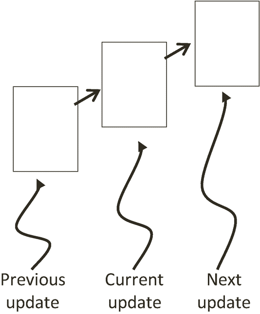

**图 9-22 ¶ 连续运动中的刚性矩形**

在图 9-22 中可以看到这样一个挑战。假设在当前更新和下一次更新之间的空间存在一堵薄墙。您会期望对象在下一次更新时与墙碰撞并停下。然而，如果墙足够薄，对象会仿佛直接穿过墙壁，因为它从一个位置跳跃到了下一个位置。这是许多游戏引擎面临的常见问题。这类问题的通用解决方案在算法上可能很复杂且计算密集。通常由游戏设计师通过精心设计（如合适的尺寸）和良好行为（如合适的移动速度）的游戏对象来缓解和避免此问题。

图 9-23 展示了由固定更新时间步导致的另一个更重大的碰撞相关挑战。在这种情况下，在时间步之前，对象互不接触。时间步之后，运动近似的结果将两个对象放置在部分重叠的位置。在现实世界中，如果两个对象是刚性形状或固体，则永远不会发生重叠或相互穿透。因此，在刚性形状物理模拟中，必须妥善解决这种情况。这就是必须计算碰撞细节的地方，以便正确解决此类相互穿透情况。

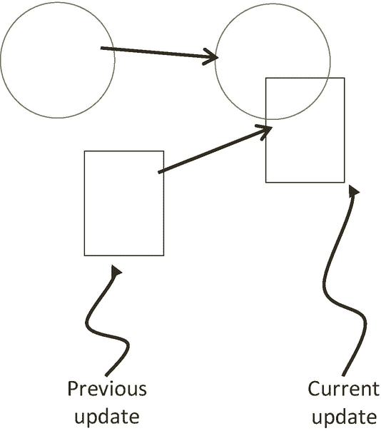

**图 9-23 ¶ 碰撞对象的相互穿透**

### 碰撞位置修正

在游戏引擎的语境中，碰撞解决是指确定碰撞后对象响应的过程，包括解决可能发生的相互穿透情况的策略。请注意，在现实世界中，刚性对象的相互穿透永远不会发生，因为碰撞严格受物理定律支配。因此，相互穿透的解决仅与模拟虚拟世界相关，在该世界中运动是近似的，不可能的情况可能发生。这些情况必须通过算法解决，其中计算成本和视觉效果都应是可接受的。

通常有三种常见的方法来响应相互穿透的碰撞。第一种是简单地将对象彼此分开穿透深度的距离。这被称为**投影法**，因为您只是移动对象的位置使它们不再重叠。虽然这易于计算和实现，但当许多对象靠近并相互重叠时，它缺乏稳定性。在这种情况下，解决一对相互穿透对象的简单方法可能导致与其他附近对象产生新的穿透。然而，投影法仍常用于简单引擎或具有简单对象交互规则的游戏中。例如，在乒乓球游戏中，球永远不会停在球拍或墙上，而是通过弹开碰撞的任何对象保持持续运动。投影法非常适合解决这类简单对象交互的碰撞。

第二种方法，**冲量法**，使用对象速度计算并施加冲量，使对象在碰撞点以相反方向移动。这种方法倾向于使碰撞对象迅速减速并收敛到相对稳定的解。这是因为冲量基于动量传递计算，而动量传递反过来又对碰撞对象的速度有阻尼效果。

第三种方法，**惩罚法**，将对象相互穿透的深度建模为弹簧压缩的程度，并近似施加加速度以施加力分离对象。这种方法最复杂，实现起来最具挑战性。


## 碰撞位置修正项目

对于您的引擎，您将结合投影法和冲量法的优势。投影法将用于分离相互渗透的物体，而冲量法将用于计算冲量，以减小导致相互渗透方向上的物体速度。正如所述，简单的投影法可能导致系统不稳定，例如物体堆叠时会相互陷入。您将通过实现一个松弛循环来克服这种不稳定性，在该循环中，在单个更新周期内，通过重复应用投影法，以增量方式分离相互渗透的物体。

有了松弛循环，投影法的每一次应用被称为一次松弛迭代。在每次松弛迭代期间，投影法会按总渗透深度的固定百分比，以增量方式减少相互渗透。例如，默认情况下，引擎将松弛迭代次数设置为 15 次，每次松弛迭代可减少 80% 的相互渗透。这意味着在一次更新函数调用中，在运动积分近似之后，碰撞检测和解析过程将执行 15 次。虽然代价高昂，但重复的增量分离确保了系统的稳定。

该项目将指导您实现松弛迭代，以增量方式解析物体间的相互渗透。您将使用上一个项目计算出的碰撞信息来修正碰撞物体的位置。您可以在图 9-24 中看到该项目运行的示例。该项目的源代码定义在 `chapter9/9.6.collision_position_correction` 中。

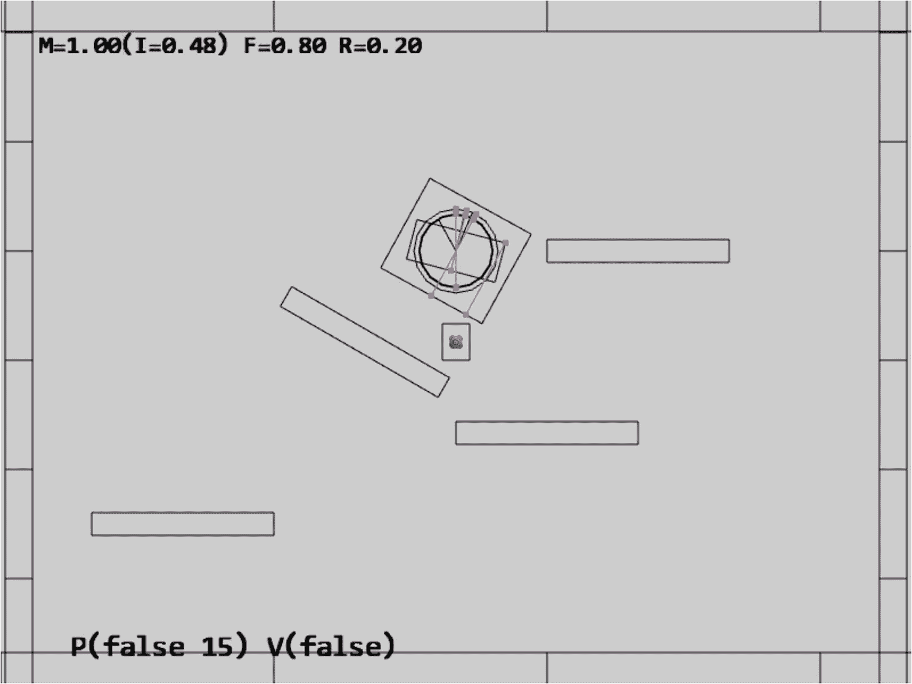

**图 9-24** ¶ 运行碰撞位置修正项目

该项目的控制方式与上一个项目相同，仅在行为控制中增加了 `P` 键命令：

**行为控制**：

*   **`P` 键**：切换所有物体的渗透解析
*   **`V` 键**：切换所有物体的运动
*   **`H` 键**：向所有物体注入随机速度
*   **`G` 键**：随机创建一个新的刚性圆形或矩形

**绘制控制**：

*   **`C` 键**：切换所有 `CollisionInfo` 的绘制
*   **`T` 键**：切换所有物体的纹理
*   **`R` 键**：切换 `RigidShape` 的绘制
*   **`B` 键**：切换每个 `RigidShape` 边界的绘制

**物体控制**：

*   **左/右箭头键**：依次遍历并选择一个物体
*   **`WASD` 键**：移动选中的物体
*   **`Z/X` 键**：旋转选中的物体
*   **`Y/U` 键**：增加/减小选中物体的 `RigidShape` 尺寸；这不会改变对应 `Renderable` 物体的尺寸
*   **上/下箭头键 + `M`**：增加/减小选中物体的质量

项目目标如下：

*   实现带有松弛迭代的位置修正
*   使用计算出的碰撞信息并理解其重要性
*   理解并体验实现相互渗透解析

## 更新物理组件

之前的项目已经建立了所需的模拟基础设施，包括完成 `RigidShape` 的实现。现在您可以专注于位置修正逻辑的细节，该逻辑位于 `src/engine/components` 文件夹下 `physics.js` 文件中物理组件的核心部分，是局部且隐藏的。

### 步骤 1：定义变量和 Getter/Setter

编辑 `physics.js` 以定义变量以及位置修正率、松弛循环计数和切换位置修正计算的相关 getter 和 setter。确保导出新定义的函数。

```javascript
let mPosCorrectionRate = 0.8;  // 投影分离物体的百分比
let mRelaxationCount = 15;     // 松弛迭代次数
let mCorrectPosition = true;

function getPositionalCorrection() {
    return mCorrectPosition;
}

function togglePositionalCorrection() {
    mCorrectPosition = !mCorrectPosition;
}

function getRelaxationCount() {
    return mRelaxationCount;
}

function incRelaxationCount(dc) {
    mRelaxationCount += dc;
}

// ... 与之前代码相同 ...

export {
    // ... 与之前代码相同 ...
    togglePositionalCorrection,
    getPositionalCorrection,
    getRelaxationCount,
    incRelaxationCount
};
```

### 步骤 2：定义 positionalCorrection() 函数

定义 `positionalCorrection()` 函数，按预定义的速率 `mPosCorrectionRate` 移动并减少物体间的重叠。为了在模拟中正确支持物体动量，每个物体移动的量与其质量成反比。也就是说，发生碰撞时，质量较大的物体移动的量将小于质量较小的物体。请注意，移动方向沿着 `collisionInfo` 对象中定义的碰撞法线。

```javascript
function positionalCorrection(s1, s2, collisionInfo) {
    if (!mCorrectPosition)
        return;
    let s1InvMass = s1.getInvMass();
    let s2InvMass = s2.getInvMass();
    let num = collisionInfo.getDepth() /
              (s1InvMass + s2InvMass) * mPosCorrectionRate;
    let correctionAmount = [0, 0];
    vec2.scale(correctionAmount, collisionInfo.getNormal(), num);
    s1.adjustPositionBy(correctionAmount, -s1InvMass);
    s2.adjustPositionBy(correctionAmount, s2InvMass);
}
```

### 步骤 3：修改 collideShape() 函数

修改 `collideShape()` 函数，以便在检测到碰撞时执行位置修正。请注意，仅当至少有一个物体的质量非零时，才执行碰撞检测。

```javascript
function collideShape(s1, s2, infoSet = null) {
    // ... 与之前代码相同 ...
    if ((s1 !== s2) &&
        ((s1.getInvMass() !== 0) || (s2.getInvMass() !== 0))) {
        if (s1.boundTest(s2)) {
            hasCollision = s1.collisionTest(s2, mCInfo);
            if (hasCollision) {
                vec2.subtract(mS1toS2, s2.getCenter(), s1.getCenter());
                if (vec2.dot(mS1toS2, mCInfo.getNormal()) < 0)
                    mCInfo.changeDir();
                positionalCorrection(s1, s2, mCInfo);
                // ... 与之前代码相同 ...
            }
        }
    }
    return hasCollision;
}
```

### 步骤 4：在工具函数中集成松弛循环

在所有三个工具函数 `processObjToSet()`、`processSetToSet()` 和 `processSet()` 中集成一个循环，以便在执行位置修正时运行松弛迭代：

```javascript
function processObjToSet(obj, set, infoSet = null) {
    let j = 0, r = 0;
    let hasCollision = false;
    let s1 = obj.getRigidBody();
    for (r = 0; r < mRelaxationCount; r++) {
        for (j = 0; j < set.size(); j++) {
            let s2 = set.getObjectAt(j).getRigidBody();
            hasCollision = collideShape(s1, s2, infoSet) || hasCollision;
        }
    }
    return hasCollision;
}

function processSetToSet(set1, set2, infoSet = null) {
    let i = 0, j = 0, r = 0;
    let hasCollision = false;
    for (r = 0; r < mRelaxationCount; r++) {
        // ... 与之前代码相同 ...
    }
    return hasCollision;
}

// 碰撞 GameObjectSet 中所有物体与其自身
function processSet(set, infoSet = null) {
    let i = 0, j = 0, r = 0;
    let hasCollision = false;
    for (r = 0; r < mRelaxationCount; r++) {
        // ... 与之前代码相同 ...
    }
    return hasCollision;
}
```

## 在 MyGame 中测试位置修正


`MyGame` 类必须修改以支持新的 `P` 键命令，以切换关闭初始运动、位置修正，并在游戏场景的中央区域生成初始对象以保证初始碰撞。这些修改很简单，细节不再展示。和往常一样，你可以参考 `src/my_game` 文件夹中的源代码文件以获取实现细节。

## 观察

你现在可以运行项目来测试你的实现。注意，默认情况下，运动是关闭的，位置修正也是关闭的，而碰撞信息显示是开启的。由于这些原因，你将观察到创建的刚体形状聚集在游戏场景的中央区域，并伴有大量相关的洋红色碰撞信息。

现在，按下 `P` 键，观察所有形状被推开，所有重叠得到解决。你可以按下 `G` 键创建额外的形状，并观察形状不断相互推开以确保无重叠。一个有趣的实验是关闭位置修正，然后按下 `G` 键创建大量重叠的形状，再按下 `P` 键观察形状相互推开。

如果你按 `V` 键开启运动，你将首先观察到所有物体因重力而自由下落。这些物体最终将静止在其中一个静止平台上。接下来，你将观察到洋红色的碰撞深度在垂直方向上持续增加。这种尺寸的增加是由于向下的重力加速度导致向下速度持续增加的结果。最终，向下速度将变得非常大，以至于在一次更新中物体会移动穿过平台，看起来像是直接掉落穿过了平台。你所观察到的正是图 9-22 中讨论的情况。下一小节将讨论碰撞响应并解决这个不断增加的速度问题。

最后，注意物理组件中定义的实用函数，即 `processSet()`、`processObjToSet()` 和 `processSetToSet()`，它们旨在检测和解决碰撞。虽然有用，但这些函数并非设计用于报告碰撞是否发生——这是典型物理引擎支持的常见操作。为了避免分散对刚体形状模拟讨论的注意力，支持无响应简单碰撞检测的函数未予展示。此时，你已具备定义此类函数的必要知识，留作练习供你完成。

## 碰撞解决

有了合适的位置修正系统，你现在可以开始实现碰撞解决，并支持类似现实世界的行为。为了专注于碰撞解决系统的核心功能，包括理解和实现冲量法以及确保系统稳定性，你将首先检查不包含旋转的碰撞响应。在完全理解并实现简单冲量解决背后的机制后，下一节将探讨与角冲量解决相关的复杂性。

在下面的讨论中，矩形和圆形不会因碰撞而旋转。然而，所描述的概念和实现可以直接推广以支持旋转碰撞响应。该项目旨在帮助你理解基于冲量的碰撞解决的基本概念。

### 冲量法

你将通过首先回顾一个圆在理想世界中如何弹离墙壁和其他圆，来构建冲量法的解决方案。随后将利用这一点推导出适当碰撞响应的近似值。请注意，以下讨论侧重于推导冲量法的公式，并不试图回顾牛顿力学。以下是一些相关术语的简要回顾：

*   `Mass`（质量）：是物体包含的物质量，或物体的密度程度。
*   `Force`（力）：是作用在物体上并改变该物体运动状态的任何相互作用或能量。
*   `Relative velocity`（相对速度）：是两个运动形状之间的速度差。
*   `Coefficient of restitution`（恢复系数/弹性系数）：碰撞后相对速度与碰撞前相对速度的比值。这是衡量物体弹离另一物体后保留多少动能的指标，即弹性。
*   `Coefficient of friction`（摩擦系数）：两物体间摩擦力的比值。在你的简化实现中，摩擦力直接施加以减慢线性运动或旋转。
*   `Impulse`（冲量）：随时间累积的力，可导致速度变化。例如，由碰撞产生。

> **注意**  
> 物体旋转由其角速度描述，将在下一节中探讨。在本节其余部分中，术语“速度”用于指代物体的运动或其线速度。

#### 碰撞中的速度分量

图 9-25 展示了圆 A 处于三个不同阶段的情况。在第 1 阶段，圆以速度 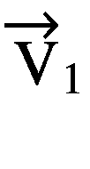 向右侧的墙壁移动。在第 2 阶段，圆与墙壁碰撞，在第 3 阶段，圆已被反射，并以速度  远离墙壁。 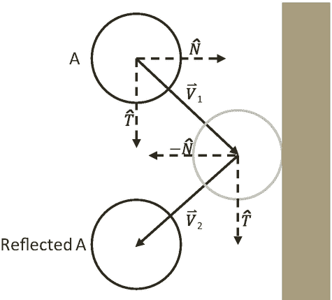

图 9-25 ¶ 理想世界中圆与墙壁的碰撞

从数学上讲，这种碰撞和响应可以通过将初始速度  分解为垂直于碰撞墙壁和平行于碰撞墙壁的分量来描述。通常，垂直于碰撞的方向称为碰撞法线，，而与碰撞位置相切的方向称为碰撞切线 。这种分解可以在以下公式中看到：

*   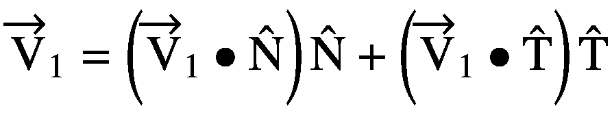

在一个没有摩擦且动能无损失的理想世界中，碰撞不会影响切线方向上的分量，而法线分量将简单地反向。这样，反射向量  可以表示为  的法线和切线分量的线性组合，如下所示：

*   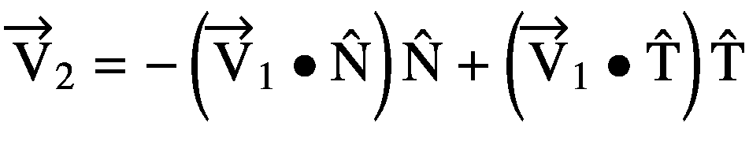


注意  分量前面的负号。你可以在图 9-25 中看到，由于碰撞，向量  的  分量指向与  相反的方向。此外，请注意在切线方向  上， 继续指向同一方向。这是因为切线分量平行于墙壁，不受碰撞影响。在一个没有摩擦且动能不损失的完美世界中，这种分析普遍适用于任何碰撞。

### 碰撞形状的相对速度

将向量分解为碰撞的法线方向和切线方向，也可以应用于两个碰撞形体都在运动的一般情况。例如，图 9-26 说明了两个运动的圆形 A 和 B 发生碰撞的情况。

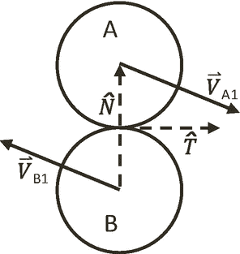

在图 9-26 的情况下，碰撞前，物体 A 以速度  运动，而物体 B 以速度  运动。碰撞的法线方向  定义为两个圆心之间的向量，碰撞的切线方向  是在碰撞点处与两个圆相切的向量。为了解决这次碰撞，必须计算碰撞后物体 A 和 B 的速度  和 。

碰撞后的速度是基于两个形体之间的相对速度确定的。形体 A 和 B 之间的相对速度定义如下：

*   

现在可以将碰撞向量分解应用到相对速度的法线方向和切线方向上，其中碰撞后的相对速度是 ：

*   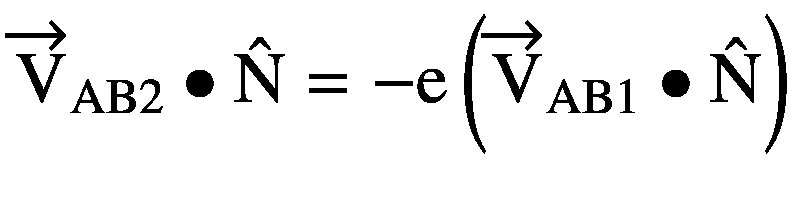 **(1)**
*   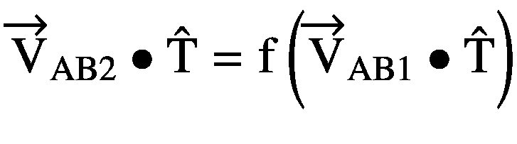 **(2)**

恢复系数 e 和摩擦系数 f 模拟了现实世界中碰撞期间部分动能转化为其他形式能量的情况。公式 (1) 中的负号表示碰撞后，物体将沿着与初始碰撞法线方向相反的方向运动。公式 (2) 表示碰撞后，摩擦会减小速度大小，物体将继续沿同一切线方向运动，但速度降低。请注意，公式 (1) 和 (2) 右侧的所有变量都是已定义的，因为它们在碰撞时刻是已知的。重要的是要记住

*   

目标是推导出  和  的解，即碰撞后碰撞物体的各自速度。你现在可以建立一个模型来近似  和 。

**注意**

恢复系数 e 描述了弹性或碰撞后保留的速度比例。恢复系数值为 1.0 意味着碰撞前后的速度相同。相反，摩擦直观上与碰撞后损失的比例或减速有关。例如，摩擦系数为 1.0 意味着无限大的摩擦，碰撞会导致速度变为零。为了公式的一致性，公式 (2) 中的系数 f 实际上是 1 减去直观的摩擦系数。

### 冲量

准确描述碰撞涉及复杂的考量因素，包括能量形式转换、不同材料属性产生的摩擦等。不考虑这些高级问题，发生在形体上的碰撞的简单描述是：一个恒定质量的物体在与另一个物体接触后，其速度从  变为 。方便的是，这就是冲量的定义，如下所示：

*   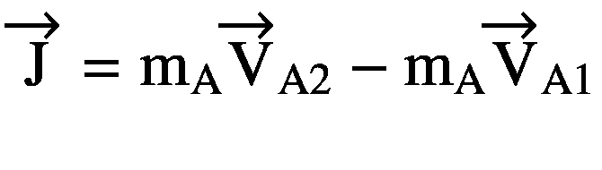

或当求解 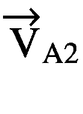 时

*   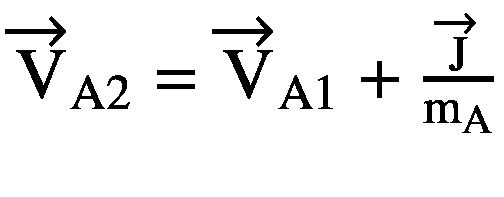 **(3)**

请记住，同一个冲量也会导致物体 B 的速度变化，只是方向相反：


*   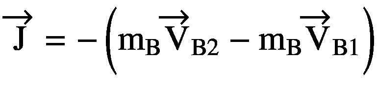

或当求解  时

*   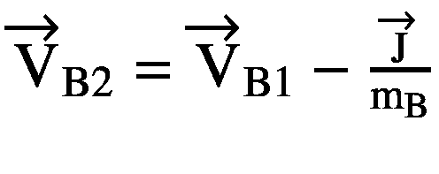   **(4)**

从数学公式中抽离出来，思考一下这个公式陈述了什么。这符合直觉。该方程表明速度的变化与物体的质量成反比。换句话说，物体质量越大，碰撞后其速度变化越小。冲量法实现了这一观察结果。

回顾一下，公式 (1) 和 (2) 分别根据碰撞法线和切线方向描述了碰撞后的相对速度。冲量作为一个向量，也可以表示为碰撞法线和切线方向上分量 `j[N]` 和 `j[T]` 的线性组合：

*   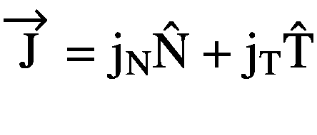

将此表达式代入公式 (3) 和 (4) 得到以下结果：

*   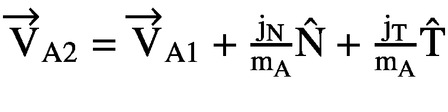   **(5)**

*      **(6)**

注意，`j[N]` 和 `j[T]` 是这两个方程中唯一的未知数，其余项要么由用户定义，要么可根据几何形状计算得出。即，量 、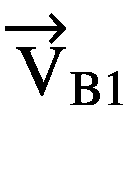、`m[A]` 和 `m[B]` 由用户定义，而  和  可以计算得出。

> **注意**
>
> 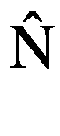 和 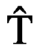 向量已归一化且相互垂直。因此，这些向量与自身点积的值为 1，与彼此点积的值为 0。

### 冲量的法线分量

冲量的法线分量 `j[N]` 可以通过对公式 (5) 和 (6) 两边同时与  向量进行点积来求解：

*   

*   

将前两个方程相减得到以下结果：

*   

回想一下，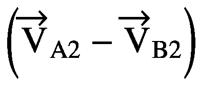 就是 ，而 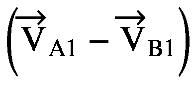 是 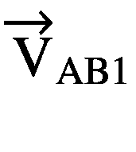，因此该方程简化为以下形式：

*   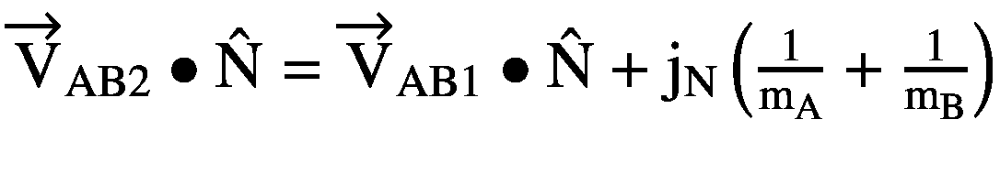

用公式 (1) 替换左边得到以下方程：

*   

合并项并求解 `j[N]`（法线方向上的冲量），得到以下结果：

*   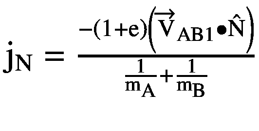   **(7)**

### 冲量的切线分量

冲量的切线分量 `j[T]` 可以通过对公式 (5) 和 (6) 两边同时与  向量进行点积来求解：


*   

*   

遵循与法向分量情况类似的步骤，相减这些方程，并认识到  是 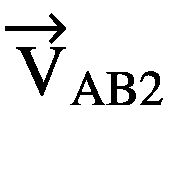 而  是 ，可推导出以下方程：

*   

现在，将方程 (2) 代入左侧，得到以下结果：

*   

最后，合并项并求解 `jT` 或切向冲量，得到以下结果：

*   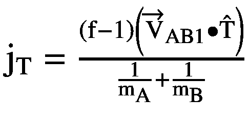 **(8)**

## 碰撞解析项目

该项目将指导您通过计算冲量并更新碰撞物体的速度来解析碰撞。您可以在图 9-27 中看到该项目运行的示例。该项目的源代码定义在 `chapter9/9.7.collision_resolution` 中。

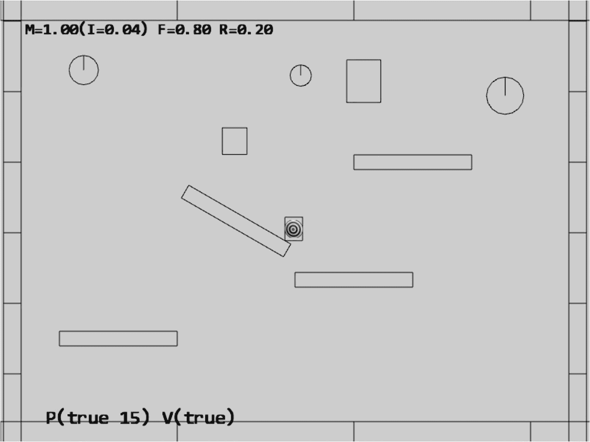

**图 9-27 ¶ 运行碰撞解析项目**

该项目的控制方式与前一个项目相同，并增加了用于恢复系数和摩擦系数的控制：

### 行为控制

*   `P` 键：切换所有物体的穿透解析
*   `V` 键：切换所有物体的运动
*   `H` 键：向所有物体注入随机速度
*   `G` 键：随机创建一个新的刚性圆形或矩形

### 绘制控制

*   `C` 键：切换所有 `CollisionInfo` 的绘制
*   `T` 键：切换所有物体的纹理
*   `R` 键：切换 `RigidShape` 的绘制
*   `B` 键：切换每个 `RigidShape` 包围盒的绘制

### 物体控制

*   `左/右箭头` 键：依次遍历并选择一个物体
*   `WASD` 键：移动选中的物体
*   `Z/X` 键：旋转选中的物体
*   `Y/U` 键：增加/减小选中物体的 `RigidShape` 尺寸；这不会改变对应 `Renderable` 物体的尺寸
*   `上/下箭头` 键 + `M/N/F`：增加/减小选中物体的质量/恢复系数/摩擦系数

项目目标如下：

*   理解冲量法的细节
*   实现冲量法以解析碰撞

### 更新物理组件

为了正确支持碰撞解析，您只需关注物理组件并修改 `src/engine/components` 文件夹中的 `physics.js` 文件：

1.  编辑 `physics.js` 并定义 `resolveCollision()` 函数，以解析 `RigidShape` 物体 `a` 和 `b` 之间的碰撞，碰撞信息记录在 `collisionInfo` 对象中：

```javascript
function resolveCollision(b, a, collisionInfo) {
    let n = collisionInfo.getNormal();
    // 步骤 A：计算相对速度
    let va = a.getVelocity();
    let vb = b.getVelocity();
    let relativeVelocity = [0, 0];
    vec2.subtract(relativeVelocity, va, vb);
    // 步骤 B：确定法向方向的相对速度
    let rVelocityInNormal = vec2.dot(relativeVelocity, n);
    // 如果物体正在分离则忽略
    if (rVelocityInNormal > 0) {
        return;
    }
    // 步骤 C：计算碰撞切向方向
    let tangent = [0, 0];
    vec2.scale(tangent, n, rVelocityInNormal);
    vec2.subtract(tangent, tangent, relativeVelocity);
    vec2.normalize(tangent, tangent);
    // 切向方向的相对速度
    let rVelocityInTangent = vec2.dot(relativeVelocity, tangent);
    // 步骤 D：确定有效系数
    let newRestituion = (a.getRestitution() + b.getRestitution()) * 0.5;
    let newFriction = 1 - ((a.getFriction() + b.getFriction()) * 0.5);
    // 步骤 E：法向和切向方向的冲量
    let jN = -(1 + newRestituion) * rVelocityInNormal;
    jN = jN / (a.getInvMass() + b.getInvMass());
    let jT = (newFriction - 1) * rVelocityInTangent;
    jT = jT / (a.getInvMass() + b.getInvMass());
    // 步骤 F：更新法向和切向方向的速度
    vec2.scaleAndAdd(va, va, n, (jN * a.getInvMass()));
    vec2.scaleAndAdd(va, va, tangent, (jT * a.getInvMass()));
    vec2.scaleAndAdd(vb, vb, n, -(jN * b.getInvMass()));
    vec2.scaleAndAdd(vb, vb, tangent, -(jT * b.getInvMass()));
}
```

列出的代码紧密遵循了解决方案的推导过程：

1.  **步骤 A 和 B**：计算相对速度及其法向分量。当该法向分量为正时，表示两个物体正在相互远离，因此不需要进行碰撞解析。
2.  **步骤 C**：计算碰撞切向方向和相对速度的切向分量。
3.  **步骤 D**：使用系数的平均值进行冲量推导。注意计算 `newFriction` 时减去 1，以保持与方程 (2) 一致。
4.  **步骤 E**：遵循列出的方程 (7) 和 (8) 计算冲量的法向和切向分量。
5.  **步骤 F**：遵循方程 (5) 和 (6) 求解最终速度。

2.  编辑 `collideShape()`，以便在检测到碰撞并修正位置时调用 `resolveCollision()` 函数。


```javascript
function collideShape(s1, s2, infoSet = null) {
    let hasCollision = false;
    if ((s1 !== s2) &&
        ((s1.getInvMass() !== 0) || (s2.getInvMass() !== 0))) {
        if (s1.boundTest(s2)) {
            hasCollision = s1.collisionTest(s2, mCInfo);
            if (hasCollision) {
                ... identical to previous code ...
                positionalCorrection(s1, s2, mCInfo);
                **resolveCollision(s1, s2, mCInfo);**
                ... identical to previous code ... };
```

### 更新 MyGame 以测试碰撞解析

对 `MyGame` 类的修改微不足道，主要是将运动和位置修正默认设为激活状态。此外，创建的 `RigidShape` 对象的初始随机旋转被禁用，因为此时碰撞响应不支持旋转。一如既往，您可以参考 `src/my_game` 文件夹中的源代码文件以获取实现细节。

### 观察

您应该通过三种方式测试您的实现。首先，确保移动的形状发生碰撞并表现自然。其次，尝试更改对象的物理属性。第三，观察运动形状与具有无限质量的静止形状（周围的墙壁和静止平台）之间的碰撞解析。请记住，仅考虑线性速度，碰撞不会产生旋转。

现在，运行项目，注意到形状逐渐落向平台和地板，在轻微反弹后运动停止。这清楚地表明 `Euler Integration`（欧拉积分）、碰撞检测、位置修正和解析的基本情况都在按预期运行。按 `H` 键激发所有形状，按 `C` 键显示碰撞信息。注意游荡的形状与墙壁/平台通过柔和的弹跳正常交互，且没有明显的相互渗透。

使用左/右箭头键选择一个对象，并使用 `N`/`F` 和上/下箭头键调整其恢复系数/摩擦系数。例如，将恢复系数调整为 1，摩擦系数调整为 0。现在按 `H` 键注入速度。注意对象看起来弹性十足，且由于摩擦系数为 0，似乎在平台/地板上滑行。您可以尝试不同的系数设置，观察相应的弹性和滑腻程度。

可以通过按 `G` 键增加场景中的形状数量来测试系统的稳定性。15 次松弛循环在每次迭代中持续且逐步地将相互渗透的形状分开。例如，您可以使用 `V` 和 `P` 键关闭运动和位置修正，并创建多个（例如 10 到 20 个）重叠的形状。现在开启运动和位置修正，观察一个正常运行的系统。

在下一个项目中，您将改进解析方案，以考虑碰撞产生的角速度变化。

## 碰撞响应的角度分量

现在您已经有了具体的理解，并成功实现了用于线性速度碰撞响应的 `Impulse Method`（冲量法），是时候集成对更一般旋转情况的支持了。在讨论细节之前，将牛顿线性力学与旋转力学的对应关系联系起来会很有帮助。即，线性位移对应旋转，速度对应角速度，力对应扭矩，质量对应转动惯量或角质量。转动惯量决定了绕旋转轴产生所需角加速度所需的扭矩。

以下讨论侧重于在 `Impulse Method`（冲量法）公式中集成旋转，并不试图对旋转的牛顿力学进行回顾。方便的是，将正确的旋转集成到 `Impulse Method`（冲量法）中不涉及任何新算法的推导。所需的只是在适当考虑旋转属性的情况下制定冲量响应。

### 考虑旋转的碰撞

将旋转集成到 `Impulse Method`（冲量法）公式中的关键在于认识到这样一个事实：您一直在使用的线性速度，例如物体 A 的速度 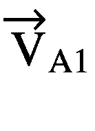，实际上是形状在其中心位置的速度。在没有旋转的情况下，该速度在整个物体中是恒定的，可应用于任何位置。然而，如图 9-28 所示，当物体的运动包含角速度  时，其在位置 P 处的线性速度  实际上是该点与形状旋转中心之间的相对位置或位置矢量  的函数。

*   


**图 9-28 ¶ 存在旋转时某位置的线性速度**

> **注意**
>
> 角速度是一个与线性速度垂直的矢量。在这种情况下，由于线性速度定义在 X/Y 平面上， 是 z 方向的矢量。回顾本章“简介”部分的讨论，最初的假设是刚体形状对象是具有均匀分布质量的连续几何体，其质心位于几何形状的中心。这个质心是旋转轴的位置。为简单起见，在您的实现中， 将作为一个简单的标量存储，表示矢量的 z 分量大小。

图 9-29 展示了一个具有线速度  和角速度  的物体 B 在位置 P 处与物体 A 发生碰撞。到目前为止，您知道碰撞前两个物体在点 P 处的线速度如下：

*    **(9)**
*    **(10)**


**图 9-29 ¶ 具有角速度的碰撞形状**

碰撞后，碰撞位置的线速度可以表示如下：


*    (11)
*    (12)

其中  和 ，以及  和  分别是物体 `A` 和 `B` 碰撞后的线速度和角速度，推导这些量的解正是本节的目标。

## 考虑旋转的相对速度

回顾上一节，物体 `A` 和 `B` 碰撞前后的相对速度定义如下：

*   
*   

这些速度根据方程 (1) 和 (2) 中的碰撞法线和切线方向分量进行分析，为方便起见重新列出如下：

*    (1)
*    (2)

这些方程是在不考虑旋转的情况下推导出来的，且该公式假设速度在整个形状上是恒定的。为了支持旋转，这些方程必须推广并在碰撞点 `P` 处求解。

*    (13)
*    (14)

在这种情况下， 和  分别是碰撞前后碰撞位置 `P` 处的相对速度。这些向量仍然由物体 `A` 和 `B` 在碰撞前（ 和 ）和碰撞后（ 和 ）各自碰撞位置 `P` 处的速度差来定义。

*    (15)
*    (16)

现在你已经准备好将冲量法推广以支持旋转，并推导出一个解来近似线速度和角速度：，，，以及 。

## 考虑旋转的冲量法

继续上一节的冲量法讨论，物体 `A` 和 `B` 碰撞后，冲量法通过一个冲量  来描述它们线速度的变化，该冲量按其对应质量 `m[A]` 和 `m[B]` 的倒数进行缩放。线速度的这种变化在方程 (3) 和 (4) 中描述，为方便起见重新列出如下：

*    (3)
*    (4)

一般来说，旋转是碰撞的内在结果，同一个冲量必须恰当地描述碰撞前后角速度的变化。请记住，惯性，或称转动惯量，是旋转质量。与线速度和质量的情况类似，碰撞中角速度的变化也与转动惯量成反比。如图 9-29 所示，对于转动惯量为 `I[A]` 和 `I[B]` 的物体 `A` 和 `B`，碰撞后，角速度  和  可描述如下，其中  和  是各物体的位置向量：

*    (17)


*      **(18)**

回顾上一节，将冲量表示为碰撞法线方向和切线方向分量的线性组合是很方便的，即  和 ，如下所示：

*   

将该表达式代入公式 (17) 可得以下结果：

*   ![$$ {\overrightarrow{\upomega}}_{\mathrm{A}2}={\overrightarrow{\upomega}}_{\mathrm{A}1}+\left({\overrightarrow{\mathrm{R}}}_{AP}\times \frac{{\mathrm{j}}_{\mathrm{N}}\hat{\mathrm{N}}+{\mathrm{j}}_{\mathrm{T}}\hat{\mathrm{T}}}{{\mathrm{I}}_{\mathrm{A}}}\right)={\overrightarrow{\upomega}}_{\mathrm{A}1}+\frac{{\mathrm{j}}_{\mathrm{N}}}{{\mathrm{I}}_{\mathrm{A}}}\left({\overrightarrow{\mathrm{R}}}_{AP}\times \hat{\mathrm{N}}\right)+\frac{{\mathrm{j}}_{\mathrm{T}}}{{\mathrm{I}}_{\mathrm{A}}}\left({\overrightarrow{\mathrm{R}}}_{AP}\times \hat{\mathrm{T}}\right) $$](img/334805_2_En_9_Chapter_TeX_IEq116.png)

这样，公式 (17) 和 (18) 可以展开，以描述由冲量的法线分量和切线分量引起的角速度变化，如下所示：

*      **(19)**

*      **(20)**

描述线速度变化的相应公式，即公式 (5) 和 (6)，重列如下：

*      **(5)**

*      **(6)**

现在可以将公式 (5) 和 (19) 代入公式 (11)，将公式 (6) 和 (20) 代入公式 (12)：

*   ![$$ {\overrightarrow{\mathrm{V}}}_{AP2}=\left({\overrightarrow{\mathrm{V}}}_{\mathrm{A}1}+\frac{{\mathrm{j}}_{\mathrm{N}}}{{\mathrm{m}}_{\mathrm{A}}}\hat{\mathrm{N}}+\frac{{\mathrm{j}}_{\mathrm{T}}}{{\mathrm{m}}_{\mathrm{A}}}\hat{\mathrm{T}}\right)+\left({\overrightarrow{\upomega}}_{\mathrm{A}1}+\frac{{\mathrm{j}}_{\mathrm{N}}}{{\mathrm{I}}_{\mathrm{A}}}\left({\overrightarrow{\mathrm{R}}}_{AP}\times \hat{\mathrm{N}}\right)+\frac{{\mathrm{j}}_{\mathrm{T}}}{{\mathrm{I}}_{\mathrm{A}}}\left({\overrightarrow{\mathrm{R}}}_{AP}\times \hat{\mathrm{T}}\right)\right)\times {\overrightarrow{\mathrm{R}}}_{AP} $$](img/334805_2_En_9_Chapter_TeX_IEq121.png)   **(21)**

*   ![$$ {\overrightarrow{\mathrm{V}}}_{BP2}=\left({\overrightarrow{\mathrm{V}}}_{\mathrm{B}1}-\frac{{\mathrm{j}}_{\mathrm{N}}}{{\mathrm{m}}_{\mathrm{B}}}\hat{\mathrm{N}}-\frac{\mathrm{j}}{{\mathrm{m}}_{\mathrm{B}}}\hat{\mathrm{T}}\right)+\left({\overrightarrow{\upomega}}_{\mathrm{B}1}-\frac{{\mathrm{j}}_{\mathrm{N}}}{{\mathrm{I}}_{\mathrm{B}}}\left({\overrightarrow{\mathrm{R}}}_{BP}\times \hat{\mathrm{N}}\right)-\frac{{\mathrm{j}}_{\mathrm{T}}}{{\mathrm{I}}_{\mathrm{B}}}\left({\overrightarrow{\mathrm{R}}}_{BP}\times \hat{\mathrm{T}}\right)\right)\times {\overrightarrow{\mathrm{R}}}_{BP} $$](img/334805_2_En_9_Chapter_TeX_IEq122.png)   **(22)**

必须重申，线速度和角速度的变化均由同一冲量  描述。换句话说，公式 (21) 和 (22) 中的法线和切线冲量分量 `j[N]` 和 `j[T]` 是相同的量，而且这两个是这些方程中仅有的未知量，其余项均为用户定义的值或可根据几何形状计算得出的值。即量 、、`m[A]`、`m[B]`、、、`I[A]` 和 `I[B]` 由用户定义，而 、、 和  可被计算得出。现在你已准备好推导 `j[N]` 和 `j[T]` 的解。

### 注意

在以下推导中，必须牢记混合积（三重标量积）恒等式的定义；该恒等式指出，给定向量 、 和 ，以下恒成立：


### 冲量的法线分量

冲量的法线分量 `j[N]` 可以通过假设角速度切线分量的贡献微乎其微而予以忽略，并从公式 (21) 和 (22) 中分离出法线分量来近似求得。为清晰起见，你将一次处理一个公式，首先从物体 A 的公式 (21) 入手。


## 冲量的切向分量

现在，忽略角速度的切向分量，并在等式 (21) 两边同时对 `\hat{\mathrm{N}}` 向量执行点积，以分离法向分量：

```math
{\overrightarrow{\mathrm{V}}}_{AP2}\bullet \hat{\mathrm{N}}=\left\{ \left( {\overrightarrow{\mathrm{V}}}_{\mathrm{A}1}+ \frac{{\mathrm{j}}_{\mathrm{N}}}{{\mathrm{m}}_{\mathrm{A}}}\hat{\mathrm{N}}+ \frac{{\mathrm{j}}_{\mathrm{T}}}{{\mathrm{m}}_{\mathrm{A}}}\hat{\mathrm{T}} \right)+ \left( {\overrightarrow{\upomega}}_{\mathrm{A}1}+ \frac{{\mathrm{j}}_{\mathrm{N}}}{{\mathrm{I}}_{\mathrm{A}}} \left( {\overrightarrow{\mathrm{R}}}_{AP}\times \hat{\mathrm{N}} \right) \right)\times {\overrightarrow{\mathrm{R}}}_{AP} \right\}\bullet \hat{\mathrm{N}}
```

对右侧执行点积运算，认识到 `\hat{\mathrm{N}}` 是单位向量且垂直于 `\hat{\mathrm{T}}`，并令 `\overrightarrow{\mathrm{D}}={\overrightarrow{\mathrm{R}}}_{AP}\times \hat{\mathrm{N}}`；则该等式可重写如下：

```math
{\overrightarrow{\mathrm{V}}}_{AP2}\bullet \hat{\mathrm{N}}= \left( {\overrightarrow{\mathrm{V}}}_{\mathrm{A}1}\bullet \hat{\mathrm{N}} \right)+ \frac{{\mathrm{j}}_{\mathrm{N}}}{{\mathrm{m}}_{\mathrm{A}}}+ \left( {\overrightarrow{\upomega}}_{\mathrm{A}1}\times {\overrightarrow{\mathrm{R}}}_{AP} \right)\bullet \hat{\mathrm{N}}+ \frac{{\mathrm{j}}_{\mathrm{N}}}{{\mathrm{I}}_{\mathrm{A}}} \left( \overrightarrow{\mathrm{D}}\times {\overrightarrow{\mathrm{R}}}_{AP} \right)\bullet \hat{\mathrm{N}} \tag{23}
```

通过应用混合积恒等式并记住 `\overrightarrow{\mathrm{D}}={\overrightarrow{\mathrm{R}}}_{AP}\times \hat{\mathrm{N}}`，等式 (23) 中最右侧项的向量运算可简化如下：

```math
\left( \overrightarrow{\mathrm{D}}\times {\overrightarrow{\mathrm{R}}}_{AP} \right)\bullet \hat{\mathrm{N}}= \overrightarrow{\mathrm{D}}\bullet \left( {\overrightarrow{\mathrm{R}}}_{AP}\times \hat{\mathrm{N}} \right)= \left( {\overrightarrow{\mathrm{R}}}_{AP}\times \hat{\mathrm{N}} \right)\bullet \left( {\overrightarrow{\mathrm{R}}}_{AP}\times \hat{\mathrm{N}} \right) = {\left\| {\overrightarrow{\mathrm{R}}}_{AP}\times \hat{\mathrm{N}} \right\|}²
```

通过这一处理并合并含点积的项，等式 (23) 变为以下形式：

```math
{\overrightarrow{\mathrm{V}}}_{AP2}\bullet \hat{\mathrm{N}}= \left( {\overrightarrow{\mathrm{V}}}_{\mathrm{A}1}+ \left( {\overrightarrow{\upomega}}_{\mathrm{A}1}\times {\overrightarrow{\mathrm{R}}}_{AP} \right) \right)\bullet \hat{\mathrm{N}}+ \frac{{\mathrm{j}}_{\mathrm{N}}}{{\mathrm{m}}_{\mathrm{A}}}+ \frac{{\mathrm{j}}_{\mathrm{N}}}{{\mathrm{I}}_{\mathrm{A}}} {\left\| {\overrightarrow{\mathrm{R}}}_{AP}\times \hat{\mathrm{N}} \right\|}²
```

根据等式 (9)，右侧含点积的项简为 `\overrightarrow{\mathrm{V}}_{AP1}`：

```math
{\overrightarrow{\mathrm{V}}}_{AP2}\bullet \hat{\mathrm{N}}= {\overrightarrow{\mathrm{V}}}_{AP1}\bullet \hat{\mathrm{N}}+ \frac{{\mathrm{j}}_{\mathrm{N}}}{{\mathrm{m}}_{\mathrm{A}}}+ \frac{{\mathrm{j}}_{\mathrm{N}}}{{\mathrm{I}}_{\mathrm{A}}} {\left\| {\overrightarrow{\mathrm{R}}}_{AP}\times \hat{\mathrm{N}} \right\|}² \tag{24}
```

等式 (22) 可通过相同的代数运算步骤处理：忽略角速度的切向分量，并在等式两边同时对 `\hat{\mathrm{N}}` 向量执行点积；可推导出以下结果：

```math
{\overrightarrow{\mathrm{V}}}_{BP2}\bullet \hat{\mathrm{N}}= {\overrightarrow{\mathrm{V}}}_{BP1}\bullet \hat{\mathrm{N}}- \frac{{\mathrm{j}}_{\mathrm{N}}}{{\mathrm{m}}_{\mathrm{B}}}- \frac{{\mathrm{j}}_{\mathrm{N}}}{{\mathrm{I}}_{\mathrm{B}}} {\left\| {\overrightarrow{\mathrm{R}}}_{BP}\times \hat{\mathrm{N}} \right\|}² \tag{25}
```

用等式 (24) 减去等式 (25) 得到以下结果：

```math
\left( {\overrightarrow{\mathrm{V}}}_{AP2}-{\overrightarrow{\mathrm{V}}}_{BP2} \right)\bullet \hat{\mathrm{N}}= \left( {\overrightarrow{\mathrm{V}}}_{AP1}-{\overrightarrow{\mathrm{V}}}_{BP1} \right)\bullet \hat{\mathrm{N}}+ {\mathrm{j}}_{\mathrm{N}} \left( \frac{1}{{\mathrm{m}}_{\mathrm{A}}}+ \frac{1}{{\mathrm{m}}_{\mathrm{b}}}+ \frac{{\left\| {\overrightarrow{\mathrm{R}}}_{AP}\times \hat{\mathrm{N}} \right\|}²}{{\mathrm{I}}_{\mathrm{A}}}+ \frac{{\left\| {\overrightarrow{\mathrm{R}}}_{BP}\times \hat{\mathrm{N}} \right\|}²}{{\mathrm{I}}_{\mathrm{B}}} \right)
```

在左侧代入等式 (16) 后继之以等式 (13)，在右侧代入等式 (15)，得到以下结果：

```math
-\mathrm{e} \left( {\overrightarrow{\mathrm{V}}}_{ABP1}\bullet \hat{\mathrm{N}} \right)= {\overrightarrow{\mathrm{V}}}_{ABP1}\bullet \hat{\mathrm{N}}+ {\mathrm{j}}_{\mathrm{N}} \left( \frac{1}{{\mathrm{m}}_{\mathrm{A}}}+ \frac{1}{{\mathrm{m}}_{\mathrm{b}}}+ \frac{{\left\| {\overrightarrow{\mathrm{R}}}_{AP}\times \hat{\mathrm{N}} \right\|}²}{{\mathrm{I}}_{\mathrm{A}}}+ \frac{{\left\| {\overrightarrow{\mathrm{R}}}_{BP}\times \hat{\mathrm{N}} \right\|}²}{{\mathrm{I}}_{\mathrm{B}}} \right)
```

最后，合并项并求解 `j_N`：

```math
{\mathrm{j}}_{\mathrm{N}}= \frac{-\left( 1+\mathrm{e} \right) \left( {\overrightarrow{\mathrm{V}}}_{ABP1}\bullet \hat{\mathrm{N}} \right)}{ \frac{1}{{\mathrm{m}}_{\mathrm{A}}}+ \frac{1}{{\mathrm{m}}_{\mathrm{B}}}+ \frac{{\left\| {\overrightarrow{\mathrm{R}}}_{AP}\times \hat{\mathrm{N}} \right\|}²}{{\mathrm{I}}_{\mathrm{A}}}+ \frac{{\left\| {\overrightarrow{\mathrm{R}}}_{BP}\times \hat{\mathrm{N}} \right\|}²}{{\mathrm{I}}_{\mathrm{B}}} } \tag{26}
```

冲量的切向分量 `j_T` 可通过假设角速度法向分量的贡献极小并可忽略，以及通过在等式 (21) 和 (22) 两边同时对 `\hat{\mathrm{T}}` 向量执行点积来分离切向分量来进行近似：


## 碰撞角分辨率项目

![$$ {\overrightarrow{\mathrm{V}}}_{AP2}\bullet \hat{\mathrm{T}}=\left\{\left({\overrightarrow{\mathrm{V}}}_{\mathrm{A}1}+\frac{{\mathrm{j}}_{\mathrm{N}}}{{\mathrm{m}}_{\mathrm{A}}}\hat{\mathrm{N}}+\frac{{\mathrm{j}}_{\mathrm{T}}}{{\mathrm{m}}_{\mathrm{A}}}\hat{\mathrm{T}}\right)+\left({\overrightarrow{\upomega}}_{\mathrm{A}1}+\frac{{\mathrm{j}}_{\mathrm{T}}}{{\mathrm{I}}_{\mathrm{A}}}\left({\overrightarrow{\mathrm{R}}}_{AP}\times \hat{\mathrm{T}}\right)\right)\times {\overrightarrow{\mathrm{R}}}_{AP}\right\}\bullet \hat{\mathrm{T}} $$](img/334805_2_En_9_Chapter_TeX_IEq153.png)

![$$ {\overrightarrow{\mathrm{V}}}_{BP2}\bullet \hat{\mathrm{T}}=\left\{\left({\overrightarrow{\mathrm{V}}}_{\mathrm{B}1}-\frac{{\mathrm{j}}_{\mathrm{N}}}{{\mathrm{m}}_{\mathrm{B}}}\hat{\mathrm{N}}-\frac{{\mathrm{j}}_{\mathrm{T}}}{{\mathrm{m}}_{\mathrm{B}}}\hat{\mathrm{T}}\right)+\left({\overrightarrow{\upomega}}_{\mathrm{B}1}-\frac{{\mathrm{j}}_{\mathrm{T}}}{{\mathrm{I}}_{\mathrm{B}}}\left({\overrightarrow{\mathrm{R}}}_{BP}\times \hat{\mathrm{T}}\right)\right)\times {\overrightarrow{\mathrm{R}}}_{BP}\right\}\bullet \hat{\mathrm{T}} $$](img/334805_2_En_9_Chapter_TeX_IEq154.png)

现在遵循处理法线分量时完全相同的代数运算步骤，切线方向上的冲量 `j[T]` 可以推导并表示如下：

 **(27)**

## 图 9-30

您可以在图 9-30 中看到该项目运行的示例。该项目的源代码定义在 `chapter9/9.8.collision_angular_resolution` 中。


*图 9-30 ¶ 运行碰撞角分辨率项目*

## 控制

该项目的控制方式与前一个项目相同：

### 行为控制

*   **`P` 键**：切换所有物体的穿透解算
*   **`V` 键**：切换所有物体的运动
*   **`H` 键**：向所有物体注入随机速度
*   **`G` 键**：随机创建一个新的刚性圆形或矩形

### 绘制控制

*   **`C` 键**：切换所有 `CollisionInfo` 的绘制
*   **`T` 键**：切换所有物体的纹理
*   **`R` 键**：切换 `RigidShape` 的绘制
*   **`B` 键**：切换每个 `RigidShape` 包围盒的绘制

### 物体控制

*   **左/右箭头键**：依次遍历并选择一个物体。
*   **`WASD` 键**：移动选中的物体。
*   **`Z/X` 键**：旋转选中的物体。
*   **`Y/U` 键**：增加/减小选中物体的 `RigidShape` 尺寸；这不会改变对应 `Renderable` 物体的尺寸。
*   **上/下箭头键 + `M/N/F`**：增加/减小选中物体的质量/恢复系数/摩擦力。

## 目标

该项目的目标如下：

*   理解角冲量的细节
*   将旋转集成到您的碰撞解算中
*   完成物理组件

## 注意

x-y 平面上的线速度 、沿 z 轴的角速度 、 之间的叉积是 x-y 平面上的一个向量。

## 更新物理组件

为了正确集成角冲量，您只需要替换 `src/engine/components` 文件夹中 `physics.js` 文件里的 `resolveCollision()` 函数。虽然实现紧密遵循代数推导步骤，但它相当冗长且复杂。为了便于理解和清晰起见，以下分步骤详细说明实现过程：

```javascript
function resolveCollision(b, a, collisionInfo) {
    let n = collisionInfo.getNormal();
    // Step A: Compute relative velocity
    // ... implementation to follow ...
    // Step B: Determine relative velocity in normal direction
    // ... implementation to follow ...
    // Step C: Compute collision tangent direction
    // ... implementation to follow ...
    // Step D: Determine the effective coefficients
    // ... implementation to follow ...
    // Step E: Impulse in the normal and tangent directions
    // ... implementation to follow ...
    // Step F: Update velocity in both normal and tangent directions
    // ... implementation to follow ...
}
```

### 步骤 A：计算相对速度

如图 9-29 和公式 (9)、(10) 所示，在存在角速度的情况下，确定碰撞位置（步骤 A1）并计算碰撞位置处的线速度  和  非常重要（步骤 A2）。

```javascript
// Step A: Compute relative velocity
let va = a.getVelocity();
let vb = b.getVelocity();
// Step A1: Compute the intersection position p
// the direction of collisionInfo is always from b to a
// but the Mass is inverse, so start scale with a and end scale with b
let invSum = 1 / (b.getInvMass() + a.getInvMass());
let start = [0, 0], end = [0, 0], p = [0, 0];
vec2.scale(start, collisionInfo.getStart(), a.getInvMass() * invSum);
vec2.scale(end, collisionInfo.getEnd(), b.getInvMass() * invSum);
vec2.add(p, start, end);
// Step A2: Compute relative velocity with rotation components
// Vectors from center to P
// r is vector from center of object to collision point
let rBP = [0, 0], rAP = [0, 0];
vec2.subtract(rAP, p, a.getCenter());
vec2.subtract(rBP, p, b.getCenter());
// newV = V + mAngularVelocity cross R
let vAP1 = [-1 * a.getAngularVelocity() * rAP[1],
            a.getAngularVelocity() * rAP[0]];
vec2.add(vAP1, vAP1, va);
let vBP1 = [-1 * b.getAngularVelocity() * rBP[1],
            b.getAngularVelocity() * rBP[0]];
vec2.add(vBP1, vBP1, vb);
let relativeVelocity = [0, 0];
vec2.subtract(relativeVelocity, vAP1, vBP1);
```

### 步骤 B：确定法线方向上的相对速度

正的法线方向分量表示物体正在分离，碰撞已解决。

```javascript
// Step B: Determine relative velocity in normal direction
let rVelocityInNormal = vec2.dot(relativeVelocity, n);
// if objects moving apart ignore
if (rVelocityInNormal > 0) {
    return;
}
```

### 步骤 C：计算碰撞切线方向

计算碰撞切线方向和相对速度的切线方向分量。


## 步骤 C：计算碰撞切线方向

```javascript
// Step C: Compute collision tangent direction
let tangent = [0, 0];
vec2.scale(tangent, n, rVelocityInNormal);
vec2.subtract(tangent, tangent, relativeVelocity);
vec2.normalize(tangent, tangent);
// Relative velocity in tangent direction
let rVelocityInTangent = vec2.dot(relativeVelocity, tangent);
```

## 步骤 D：确定有效系数

**步骤 D**：通过使用碰撞物体的平均值来确定有效系数。与之前的项目一样，为了保持一致性，摩擦系数为 1 减去 `RigidShape` 对象的值。

```javascript
// Step D: Determine the effective coefficients
let newRestituion = (a.getRestitution() + b.getRestitution()) * 0.5;
let newFriction = 1 - ((a.getFriction() + b.getFriction()) * 0.5);
```

## 步骤 E：法线和切线方向上的冲量

**步骤 E**：法线和切线方向上的冲量，这些是严格遵循公式 (26) 和 (27) 计算得出的。

```javascript
// Step E: Impulse in the normal and tangent directions
// R cross N
let rBPcrossN = rBP[0] * n[1] - rBP[1] * n[0]; // rBP cross n
let rAPcrossN = rAP[0] * n[1] - rAP[1] * n[0]; // rAP cross n
// Calc impulse scalar, formula of jN
// can be found in http://www.myphysicslab.com/collision.html
let jN = -(1 + newRestituion) * rVelocityInNormal;
jN = jN / (b.getInvMass() + a.getInvMass() +
           rBPcrossN * rBPcrossN * b.getInertia() +
           rAPcrossN * rAPcrossN * a.getInertia());
let rBPcrossT = rBP[0] * tangent[1] - rBP[1] * tangent[0];
let rAPcrossT = rAP[0] * tangent[1] - rAP[1] * tangent[0];
let jT = (newFriction - 1) * rVelocityInTangent;
jT = jT / (b.getInvMass() + a.getInvMass() +
           rBPcrossT * rBPcrossT * b.getInertia() +
           rAPcrossT * rAPcrossT * a.getInertia());
```

## 步骤 F：更新线速度和角速度

**步骤 F**：更新线速度和角速度。这些更新严格遵循公式 (5)、(6)、(19) 和 (20)。

```javascript
// Update linear and angular velocities
vec2.scaleAndAdd(va, va, n, (jN * a.getInvMass()));
vec2.scaleAndAdd(va, va, tangent, (jT * a.getInvMass()));
setAngularVelocityDelta((rAPcrossN * jN * a.getInertia() +
                         rAPcrossT * jT * a.getInertia()));
vec2.scaleAndAdd(vb, vb, n, -(jN * b.getInvMass()));
vec2.scaleAndAdd(vb, vb, tangent, -(jT * b.getInvMass()));
b.setAngularVelocityDelta(-(rBPcrossN * jN * b.getInertia() +
                            rBPcrossT * jT * b.getInertia()));
```

### 观察

运行项目以测试你的实现。你插入场景中的形状现在会以类似现实世界的方式旋转、碰撞和响应。当其他形状与圆形碰撞时，圆形会滚动，而矩形在碰撞时应自然旋转。在正常情况下，形状之间的相互渗透不应可见。然而，仍有两种情况会导致可观察到的相互渗透：第一，松弛迭代次数过少；第二，你的 CPU 难以应对形状的数量。对于第一种情况，你可以尝试增加松弛迭代次数以防止任何相互渗透。

有了旋转支持，你现在可以检查质量差异在碰撞中的影响。由于它们能够滚动，圆形之间的碰撞最容易观察。等待所有物体静止，然后使用方向键选择一个创建的圆形；按住上方向键的同时按 M 键将其质量增加到一个较大的值，例如 20。现在选择另一个物体，使用 WASD 键移动并将选中的物体落在大质量圆形上。注意大质量圆形对碰撞的响应运动不大。例如，碰撞甚至可能不会导致大质量圆形滚动。现在，按 H 键向所有物体注入随机速度并观察碰撞。注意与大质量圆形的碰撞几乎就像与静止的墙壁/平台碰撞一样。冲量法建模的逆质量和转动惯量能够成功捕捉不同质量物体的碰撞效果。

现在你的 2D 物理引擎实现已完成。你可以通过创建更多形状来继续测试，以观察 CPU 何时开始难以维持实时性能。

## 概要

本章引导你了解工作物理引擎背后的基础。通过仅关注刚体交互或刚性形状模拟，现实世界中物体复杂的物理交互得到了极大简化。模拟过程假设物体是质量均匀分布的连续几何体，且其形状在碰撞过程中不发生改变。计算成本高昂的模拟仅在一组选定的、由简单圆形和矩形近似的物体上执行。

在逐步推导模拟相关公式之后，紧接着是构建功能系统的详细指南。你已经学会了提取形状间的碰撞信息，基于分离轴定理构思并计算形状碰撞，用辛普利克欧拉积分近似牛顿运动积分，基于数值稳定的逐步松弛解决碰撞物体的相互渗透，以及基于冲量法推导并实现碰撞解决。

现在你已经完成了物理引擎，你可以仔细检查系统并确定优化和进一步抽象的潜力。物理引擎仍有许多改进空间。特别是从支持游戏开发者利用新定义的强大功能的角度来看，这一点尤为明显。例如，大多数物理引擎还支持不产生任何响应的直接碰撞检测。这是你的物理组件缺少的一项重要功能。虽然你的引擎能够按原样模拟碰撞结果，但该引擎不支持响应物体是否发生碰撞这个简单且计算成本低得多的问题。正如所提到的，这可以作为一个极好的练习。

虽然简单且缺少一些方便的接口函数，但你的物理组件在功能上是完整的，能够以视觉上愉悦且逼真的结果模拟刚性形状交互。你的系统支持直观的参数，包括物体质量、加速度、速度、恢复系数和摩擦力，这些都可以与现实世界中物体的行为相关联。尽管计算要求高，你的系统仍能支持大量的刚性形状交互。如果游戏类型只需要一个或一小组物体（例如主角和友方角色）与其余物体（例如道具、平台和敌人）交互，情况尤其如此。

### 游戏设计考量

到目前为止，示例中的谜题关卡完全专注于创造一个可理解且一致的逻辑挑战；我们避免用任何视觉设计、叙事或虚构背景（传统上与增强玩家临场感相关的设计元素）来增加练习负担，以确保我们只思考游戏规则而不引入干扰。然而，当你创建核心游戏机制时，理解游戏玩法的某些元素如何直接促进临场感很重要；核心游戏机制的逻辑规则和要求通常对临场感的影响有限，直到它们与交互模型、声音和视觉设计以及背景设定相结合。正如第 8 章所讨论的，光照是一个增强临场感的视觉设计元素的例子，它也可以直接用作核心游戏机制，向游戏世界物体引入物理特性同样是一种增强临场感的技术，而且可能更频繁地直接与游戏玩法相关联。


## 物理学与游戏设计中的临场感

## 物理学作为临场感增强器与核心机制

我们在现实世界中的体验受物理学支配，因此在游戏中引入类似行为理应能增强临场感。物体物理学增强临场感但不一定贡献游戏机制的一个例子，是那些对游戏玩法没有直接影响的可破坏环境：例如，在第一人称射击游戏中，如果玩家向箱子和其他游戏物体射击，它们会在撞击时真实地爆炸；或者他们在游戏世界中扔一个球，球以合理近似物理世界中球的弹跳方式弹跳，这些都是物理学纯粹用于增强临场感但不一定贡献游戏玩法的例子。

## 愤怒的小鸟：物理学既是机制也是临场感

然而，如果玩家正在玩像*愤怒的小鸟*这样的游戏，从弹弓发射一只鸟进入游戏空间，并需要根据鸟发射后遵循的物理建模抛物线弧来把握发射时机（如图 9-31 所示），这就是物理学既作为游戏玩法的核心元素又增强临场感的例子。事实上，任何涉及在模拟重力环境中跳跃角色或其他游戏物体的游戏，都是物理学同时贡献于临场感和核心机制的例子，因此许多平台游戏将物理学同时用作核心机制和增强临场感的设计元素。


**图 9-31** — Rovio 的《愤怒的小鸟》要求玩家在一个虚拟世界中从弹弓发射弹丸，该世界模拟了重力、质量、动量和物体碰撞检测。游戏物理是游戏机制的基本组成部分，并通过赋予虚拟对象物理世界特性来增强临场感。

## 第 9 章项目：引入物理学

第 9 章的项目将向你介绍物理学将玩家带入游戏世界的强大能力。玩家不再只是像移动屏幕光标一样移动主角，现在可以体验模拟的惯性、动量和重力，这些需要同类型的预测评估，涉及瞄准、时机和前向轨迹，就像在物理世界中操纵物体时一样；游戏物体现在也能以我们熟悉的物理世界体验方式发生碰撞。即使在模拟游戏空间中特定数值可能偏离现实世界（例如更低或更高的重力、更大或更小的惯性等），只要关系保持一致且与我们的物理体验合理类比，当这些效果添加到游戏物体时，临场感通常会增加。例如，想象一个游戏关卡，主角需要在规定时间内将所有机器人推入特定区域，同时避免被弹丸击中。再想象一下没有物理学的同一关卡，那当然会是一种截然不同的体验。

## 从第 8 章演进关卡设计

我们在第 8 章结束时的关卡设计包含一个有趣的两阶段机制，几乎完全专注于抽象逻辑规则，尚未融入能为体验增添临场感并将玩家带入游戏世界的元素。回顾图 9-32 中关卡的当前状态。


**图 9-32** — 关卡目前的状态包含一个两步谜题，首先要求玩家移动手电筒以揭示隐藏符号；然后玩家必须按正确顺序激活形状以解锁屏障并获得奖励。

当然，当前的关卡设计确实传达了一定的临场感：阻止玩家获得奖励的屏障是“不可穿透的”，并由一堵虚拟墙表示；手电筒物体正在“照射”一束虚拟光束，以类似现实世界中紫外线灯显示特殊墨水的方式揭示隐藏线索。然而，坦白说，在这个开发阶段临场感很弱，因为我们尚未将游戏体验置于一个场景中，而故意设计的通用形状无法为玩家构建自己的内部叙事提供太多帮助。我们当前的原型使用类似手电筒的游戏物体来揭示隐藏符号，但现在可以将游戏机制的逻辑规则与当前实现解耦，并将核心游戏机制描述为“玩家必须探索环境以找到按正确顺序组装序列所需的工具”。

## 下一次迭代：加入基于物理学的灵巧性挑战

对于我们游戏的下一次迭代，让我们重新审视交互模型，将其从纯粹的逻辑谜题演变为利用物体物理学的更具活力的东西。图 9-33 更改了游戏屏幕以包含跳跃组件。


**图 9-33** — 游戏屏幕现在显示锁的每个部分（顶部、中部、底部）各只有一个实例，主角以传统跳跃类 2D 平台游戏的方式移动。左侧和右侧的六个平台是静止的，中间的平台上下移动，允许玩家上升到更高层级。（此图假设玩家能够让主角在同一层级的平台间“跳跃”，但若不使用移动平台则无法到达更高层级。）

我们现在正在让游戏玩法包含灵巧性挑战——在本例中是把握跳跃时机——但它保留了早期迭代的相同逻辑规则：必须按正确顺序激活形状以解锁阻挡奖励的屏障。想象玩家第一次体验这个屏幕；他们将开始探索屏幕以了解关卡的交互规则，包括交互模型（用于移动和跳跃主角的键和/或鼠标按钮）、跳跃失败是否会导致惩罚（例如，如果主角跳跃失误掉出游戏屏幕会损失一条“命”），以及“激活”形状并开始解锁屏障序列意味着什么。


## 第 9 章：平台跳跃谜题开发

游戏现在有了一个有趣（尽管仍然基础）的平台跳跃谜题的开端，但与我们早期的迭代相比，我们也简化了解决方案，并且如图 9-33 所示，平台跳跃组件并不具有特别的挑战性。回顾一下，在第 8 章中添加手电筒如何通过增加第二种挑战（要求玩家识别并利用环境中的物体作为工具）来增加原始机制的逻辑挑战；我们可以给平台跳跃组件添加类似的第二种挑战，如图 9-34 所示。


图 9-34 ¶ 引入阻挡通往上层平台的力场（#1）可以显著增加平台跳跃组件的挑战性。在该设计中，玩家必须激活开关（#2 中用灯泡表示）以禁用力场并到达第一和第三个形状。

力场的引入开启了多种有趣的可能性来增加挑战。玩家必须在撞上力场之前，把握时机从移动平台跳向开关，并且必须按顺序激活形状（要求玩家先激活右上角，然后是右下角，最后是左上角）。想象一下，当开关被拨动时，力场关闭有一个时间限制，如果在力场重新启用前未激活所有形状，谜题将重置。

我们现在已经获取了一个基于逻辑序列的基本机制，并将其改造为支持动作平台跳跃体验。在该开发阶段，机制变得更有趣，并开始感觉更像一个可玩的关卡，但它仍然缺乏背景设定和语境；这是一个探索我们可能想用这个游戏讲述何种故事的好机会。我们对科幻冒险感兴趣？也许是生存恐怖体验？又或者是一系列没有关联叙事的谜题关卡？背景设定不仅有助于确定游戏的视觉形象，还能指导我们为玩家创建何种挑战（例如，游戏中的“敌人”是否在对抗玩家，游戏玩法将继续专注于解决逻辑谜题，还是两者兼有？）。一个将游戏机制与背景设定联系起来的良好练习是：选择一个地点（例如，飞船内部），开始探索该虚构空间中的游戏玩法，并以符合该背景设定的方式定义挑战元素。对于一款设定在飞船上的游戏，也许出了什么故障，玩家必须巧妙利用环境物体中和安全激光，从船的一端前往另一端。尝试将飞船背景设定应用到当前游戏机制，并调整关卡中的元素以契合该主题：激光只是一种选择，但你能想出不涉及解锁序列的其他游戏机制用途吗？尝试将游戏机制应用到各种不同的环境中，开始建立将抽象游戏玩法应用到特定背景设定的舒适度。

还请记住，在关卡设计中包含物体物理并不总是创造优秀游戏的必要条件；有时你可能想要颠覆或完全忽略你创造的游戏世界中的物理定律。你的游戏体验的最终质量取决于你多有效地协调和平衡游戏设计的九大要素；这不关乎强制实施任何单一设计选项。你的游戏可能完全抽象，涉及以与物理世界无关的方式在空间中移动的形状和形式，但你对色彩、音频和叙事的运用仍可能结合创造出一种让玩家感觉强烈临场感的体验。然而，如果你发现你的游戏环境试图通过使用人们会联想到现实世界中事物的物体来传达物理感，那么探索物体物理如何增强体验是值得的。

© The Author(s), under exclusive license to APress Media, LLC, part of Springer Nature 2022 K. Sung et al. *Build Your Own 2D Game Engine and Create Great Web Games* [`doi.org/10.1007/978-1-4842-7377-7_10`](https://doi.org/10.1007/978-1-4842-7377-7_10)
