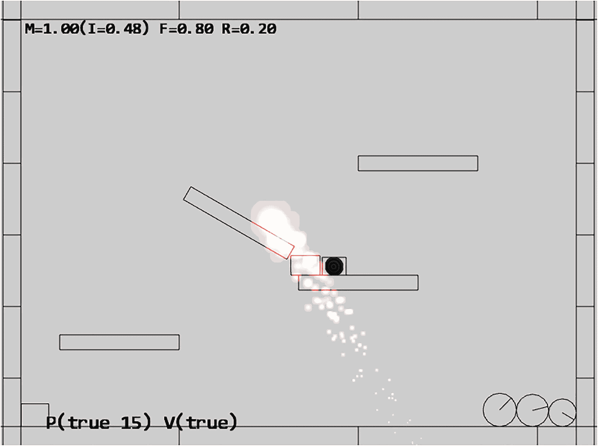
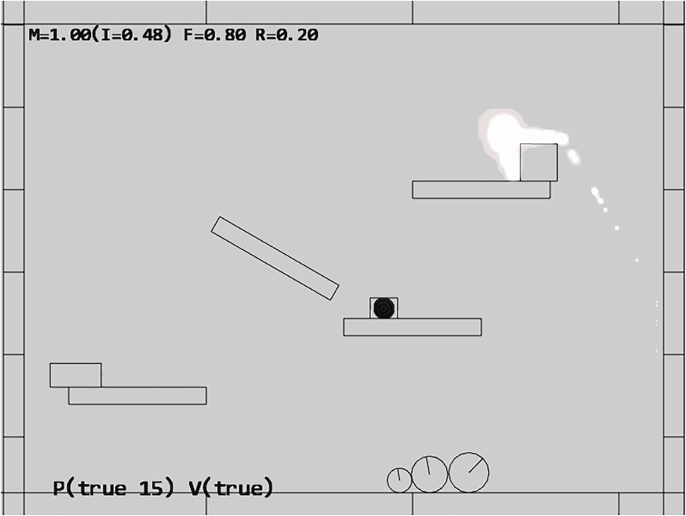
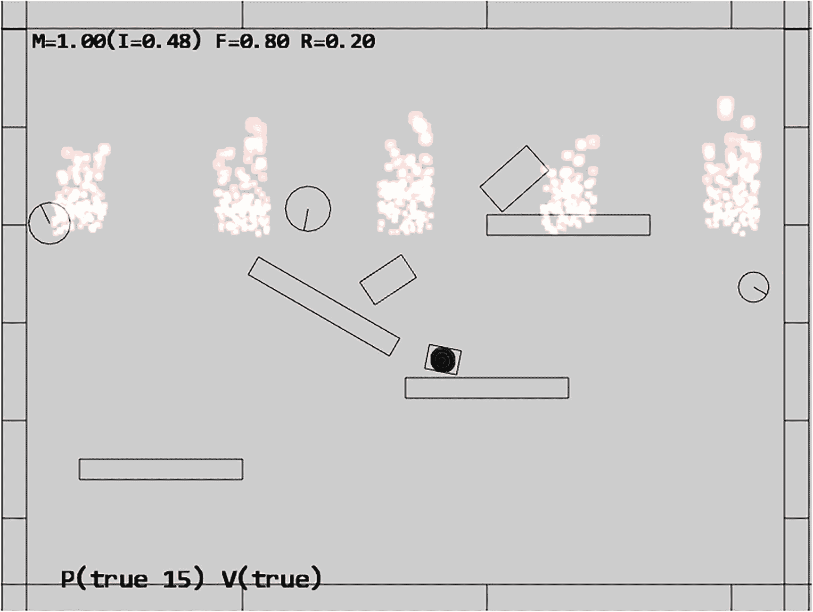
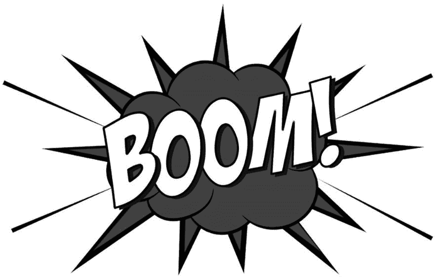

# 第 10 章：使用粒子系统创建特效

**Kelvin Sung**^1, **Jebediah Pavleas**^2, **Matthew Munson**^3, **Jason Pace**^4  
(1) Bothell, WA, USA (2) Kenmore, WA, USA (3) Lake Forest Park, WA, USA (4) Portland, OR, USA

## 摘要

完成本章后，你将能够：

*   理解 `Particle`（粒子）、`ParticleEmitter`（粒子发射器）和 `ParticleSystem`（粒子系统）的基础知识
*   认识到许多有趣的物理效果可以基于一组专用粒子进行建模
*   近似 `Particle` 的基本行为，使这些粒子集合的渲染类似于简单的爆炸效果
*   实现一个简单直接的 `ParticleSystem`，使其与物理组件的 `RigidShape`（刚体形状）系统集成

## 简介

到目前为止，在你的游戏引擎中，假设游戏世界可以由一组几何体描述，其中所有对象都是具有纹理或动画精灵的 `Renderable`（可渲染）实例，并可能由光源照亮。这个游戏引擎功能强大，能够描述现实世界中很大一部分物体。然而，事实也是，你的游戏引擎很难描述许多日常现象，例如火花、火焰、爆炸、泥土、灰尘等。这些观察中的许多都是物质改变物理状态或极小实体集合对物理扰动做出反应产生的瞬态效果。总的来说，这些观察通常被称为特效，通常不适合用具有固定形状几何体和纹理来表示。

`ParticleSystem` 通过发射一组具有特定属性（可能包括位置、大小、颜色、生命周期和精心选择的纹理贴图）的粒子来描述特效。这些粒子被定义为具有特定行为：一旦发射，它们的属性会更新以模拟物理效果。例如，火焰粒子可能被发射为向上移动并呈红色。随着时间的推移，粒子可能会变小、减缓向上运动、颜色向黄色变化，并在一定数量的更新后最终消失。通过精心设计的 `update()` 函数，这组粒子的渲染可以类似于燃烧的火焰。

在本章中，你将学习、设计并创建一个简单灵活的 `ParticleSystem`，它包含实现常见效果（如爆炸和魔法咒语效果）所需的基本功能。此外，你将实现一个 `ParticleShader`（粒子着色器），以正确地将粒子集成到场景中。粒子将与 `RigidShape` 对象发生碰撞并相应地交互。你还将发现 `ParticleEmitter` 的必要性并定义它，以在一段时间内生成粒子，例如篝火或火把。


## 粒子与粒子系统

本章的主要目标是了解粒子系统的基础知识：简单粒子的属性和行为、粒子发射器的细节，以及与游戏引擎其他部分的集成。本章不会指导你创建任何特定类型的特效。这类似于在第 8 章学习光照模型，而不涉及创建任何光照效果的细节。操纵光源参数和材质属性以创建引人入胜的光照条件，以及建模类似特定物理效果的粒子行为，都是游戏开发者的职责。游戏引擎的基本职责是定义足够的基础功能，以确保游戏开发者能够完成他们的工作。

### 粒子与粒子系统

粒子是一个没有尺寸的纹理位置。这个描述可能看似矛盾，因为你已经了解到纹理是一幅图像，而图像总是由宽度和高度定义的，并且肯定会占据一个区域。重要的澄清是：游戏引擎逻辑将粒子视为一个无面积的位置进行处理，而绘制系统则将粒子显示为具有适当尺寸的纹理。这样，即使显示了实际的显示区域，纹理的宽度和高度尺寸也会被底层逻辑忽略。

除了位置外，粒子还具有大小（用于缩放纹理）、颜色（用于着色纹理）和生命周期等属性。与典型的游戏对象类似，每个粒子都定义了在每次更新期间修改其属性的行为。此更新函数的职责是确保一组粒子的渲染类似于熟悉的物理效果。粒子系统是控制每个单个粒子的生成、更新和移除的实体。在你的游戏引擎中，粒子系统将被定义为一个独立的组件，就像物理组件一样。

在下面的项目中，你将首先了解绘制粒子对象所需的支持。之后，你将研究如何创建实际的粒子对象并定义其行为的细节。粒子是你游戏引擎中的一种新对象类型，需要整个绘制系统的支持，包括自定义 `GLSL` 着色器、默认可共享着色器实例和一个新的 `Renderable` 对。

### 粒子项目

该项目演示了如何实现粒子系统以模拟爆炸或法术般的效果。你可以在图 10-1 中看到该项目运行的示例。该项目的源代码位于 `chapter10/10.1.particles` 文件夹中。 

该项目延续自上一章，并支持所有刚体形状和碰撞控制。为简洁起见，这些控制的细节将不在本章重述。该项目特有的粒子系统控制如下：

- `Q` 键：在当前鼠标位置生成粒子
- `E` 键：切换粒子边界的绘制

项目目标如下：

- 了解绘制粒子和定义其行为的详细细节
- 实现一个简单的粒子系统

你可以在 assets 文件夹中找到以下外部资源：包含默认系统字体的 fonts 文件夹、包含 `particle.png`（默认粒子纹理）的 particles 文件夹，以及来自之前项目的相同四个纹理图像。

- `minion_sprite.png` 定义了英雄和小兵的精灵元素。
- `platform.png` 定义了平台、地板和天花板瓦片。
- `wall.png` 定义了墙壁。
- `target.png` 标识当前选中的对象。

#### 支持粒子绘制

粒子是无面积的纹理位置。然而，正如简介中所讨论的，你的引擎将把每个粒子绘制为一个纹理矩形。因此，你可以简单地复用现有的纹理顶点着色器 `texture_vs.glsl`。

##### 创建 GLSL 粒子片段着色器

当涉及到每个像素颜色的实际计算时，必须创建一个新的 `GLSL` 片段着色器 `particle_fs.glsl` 来忽略全局环境光项。火焰和爆炸等物理效果不参与光照计算。

1. 在 `src/glsl_shaders` 文件夹下，创建一个新文件并命名为 `particle_fs.glsl`。

2. 类似于在 `texture_fs.glsl` 中定义的纹理片段着色器，你需要声明 `uPixelColor` 和 `vTexCoord` 以从游戏引擎接收这些值，并定义 `uSampler` 来采样纹理：

```glsl
precision mediump float; // 设置浮点计算的精度
// 从纹理获取数据的对象。
// 必须在着色器外部设置。
uniform sampler2D uSampler;
// 像素颜色
uniform vec4 uPixelColor;
// "varying" 表示纹理坐标将被插值并因此变化。
varying vec2 vTexCoord;
```

3. 现在实现 `main` 函数以在不考虑全局环境光效果的情况下累积颜色。这作为计算粒子颜色的一种方法。此函数可以修改以支持不同种类的粒子效果。

```glsl
void main(void) {
    // 基于 vTexCoord 中插值的 UV 值进行纹素颜色查找
    vec4 c = texture2D(uSampler, vec2(vTexCoord.s, vTexCoord.t));
    vec3 r = vec3(c) * c.a * vec3(uPixelColor);
    vec4 result = vec4(r, uPixelColor.a);
    gl_FragColor = result;
}
```

##### 定义默认 ParticleShader 实例

现在你可以定义一个默认的粒子着色器实例以供共享。回顾之前章节中使用其他类型着色器的经验，着色器只创建一次，并在 `src/engine/core` 文件夹中的 `shader_resources.js` 文件中全引擎共享。

1. 首先编辑 `src/engine/core` 文件夹中的 `shader_resources.js` 文件，以定义默认粒子着色器的常量、变量和访问函数：

```javascript
// 粒子着色器
let kParticleFS = "src/glsl_shaders/particle_fs.glsl";
let mParticleShader = null;
function getParticleShader() {
    return mParticleShader;
}
```

2. 在 `init()` 函数中，确保加载新定义的 `particle_fs` `GLSL` 片段着色器：

```javascript
function init() {
    let loadPromise = new Promise(
        async function(resolve) {
            await Promise.all([
                ... identical to previous code ...
                text.load(kShadowReceiverFS),
                text.load(kParticleFS)
            ]);
            resolve();
        }
    ).then(
        function resolve() {
            createShaders();
        }
    );
    map.pushPromise(loadPromise);
}
```

3. 随着新的 `GLSL` 片段着色器 `particle_fs` 正确加载，当调用 `createShaders()` 函数时，你可以实例化一个新的粒子着色器：

```javascript
function createShaders() {
    ... identical to previous code ...
    mShadowReceiverShader = new SpriteShader(
        kTextureVS,
        kShadowReceiverFS
    );
    mParticleShader = new TextureShader(kTextureVS, kParticleFS);
}
```

4. 在 `cleanUp()` 函数中，记得执行适当的清理和卸载操作：

```javascript
function cleanUp() {
    ... identical to previous code ...
    mShadowCasterShader.cleanUp();
    mParticleShader.cleanUp();
    ... identical to previous code ...
    text.unload(kShadowReceiverFS);
    text.unload(kParticleFS);
}
```

5. 最后，别忘了导出新定义的函数。


```
export {init, cleanUp, getConstColorShader, getTextureShader, getSpriteShader, getLineShader, getLightShader, getIllumShader, getShadowReceiverShader, getShadowCasterShader, getParticleShader}
```

## 创建 ParticleRenderable 对象

随着默认粒子着色器类被定义为与 `GLSL` `particle_fs` 着色器接口，你现在可以创建一个新的 `Renderable` 对象类型来支持粒子的绘制。幸运的是，粒子（或纹理位置）的详细行为与 `TextureRenderable` 完全相同，唯一的区别在于使用了不同的着色器。因此，`ParticleRenderable` 对象的定义非常简单。

在 `src/engine/renderables` 文件夹中，创建 `particle_renderable.js` 文件；从 `defaultShaders` 导入以访问粒子着色器，从 `TextureRenderable` 导入作为基类。定义 `ParticleRenderable` 为 `TextureRenderable` 的子类，并在构造函数中设置适当的默认着色器。别忘了导出该类。

```javascript
import * as defaultShaders from "../core/shader_resources.js";
import TextureRenderable from "./texture_renderable.js";
class ParticleRenderable extends TextureRenderable {
    constructor(myTexture) {
        super(myTexture);
        this._setShader(defaultShaders.getParticleShader());
    }
}
export default ParticleRenderable;
```

## 加载默认粒子纹理

为了绘制方便，游戏引擎将预加载位于 `assets/particles` 文件夹中的默认粒子纹理 `particle.png`。此操作可以作为 `defaultResources` 初始化过程的一部分进行集成。

1. 编辑 `src/engine/resources` 文件夹中的 `default_resources.js`，添加从 `texture.js` 导入以访问纹理加载功能，并定义一个常量字符串用于粒子纹理贴图的位置以及一个用于访问该字符串的访问器：

```javascript
import * as font from "./font.js";
import * as texture from "../resources/texture.js";
import * as map from "../core/resource_map.js";
// 默认粒子纹理
let kDefaultPSTexture = "assets/particles/particle.png";
function getDefaultPSTexture() { return kDefaultPSTexture; }
```

2. 在 `init()` 函数中，调用 `texture.load()` 函数以加载默认粒子纹理贴图：

```javascript
function init() {
    let loadPromise = new Promise(
        async function (resolve) {
            await Promise.all([
                font.load(kDefaultFont),
                texture.load(kDefaultPSTexture)
            ]);
            resolve();
        })
    ... identical to previous code ...
}
```

3. 在 `cleanUp()` 函数中，确保卸载默认纹理：

```javascript
function cleanUp() {
    font.unload(kDefaultFont);
    texture.unload(kDefaultPSTexture);
}
```

4. 最后，别忘了导出该访问器：

```javascript
export {
    ... identical to previous code ...
    getDefaultFontName, getDefaultPSTexture,
    ... identical to previous code ...
}
```

通过这种集成，默认粒子纹理文件将在系统初始化期间被加载到 `resource_map` 中。可以通过 `getDefaultPSTexture()` 函数的返回值轻松访问此默认纹理贴图。

## 定义引擎粒子组件

随着绘制基础设施的定义完成，你现在可以定义引擎组件来管理粒子系统的行为。目前，唯一需要的功能是为所有粒子包含一个默认的系统加速度。

在 `src/engine/components` 文件夹中，创建 `particle_system.js` 文件，并为默认粒子系统加速度定义变量、获取器和设置器函数。别忘了导出新定义的功能。

```javascript
let mSystemAcceleration = [30, -50.0];
function getSystemAcceleration() {
    return vec2.clone(mSystemAcceleration);
}
function setSystemAcceleration(x, y) {
    mSystemAcceleration[0] = x;
    mSystemAcceleration[1] = y;
}
export {getSystemAcceleration, setSystemAcceleration}
```

在继续之前，请确保更新引擎访问文件 `index.js`，以允许游戏开发者访问新定义的功能。

## 定义粒子和粒子游戏类

### 创建粒子

粒子是具有简单属性的轻量级游戏对象，它们封装 `ParticleRenderable` 用于绘制。为了正确支持运动，粒子还实现了基于辛欧拉积分的运动近似。

1. 首先在 `src/engine` 文件夹中创建 `particles` 子文件夹。该文件夹将包含特定于粒子的实现文件。

2. 在 `src/engine/particles` 文件夹中，创建 `particle.js`，并定义构造函数以包含位置、速度、加速度、阻力以及用于调试的绘图参数变量：

```javascript
import * as loop from "../core/loop.js";
import * as particleSystem from "../components/particle_system.js";
import ParticleRenderable from "../renderables/particle_renderable.js";
import * as debugDraw from "../core/debug_draw.js";
let kSizeFactor = 0.2;
class Particle {
    constructor(texture, x, y, life) {
        this.mRenderComponent = new ParticleRenderable(texture);
        this.setPosition(x, y);
        // 位置控制
        this.mVelocity = vec2.fromValues(0, 0);
        this.mAcceleration = particleSystem.getSystemAcceleration();
        this.mDrag = 0.95;
        // 颜色控制
        this.mDeltaColor = [0, 0, 0, 0];
        // 大小控制
        this.mSizeDelta = 0;
        // 生命周期控制
        this.mCyclesToLive = life;
    }
    ... implementation to follow ...
}
export default Particle;
```

3. 定义 `draw()` 函数将粒子作为 `TextureRenderable` 绘制，并定义一个 `drawMarker()` 调试函数在粒子位置绘制一个 X 标记：

```javascript
draw(aCamera) {
    this.mRenderComponent.draw(aCamera);
}
drawMarker(aCamera) {
    let size = this.getSize();
    debugDraw.drawCrossMarker(aCamera, this.getPosition(),
        size[0] * kSizeFactor, [0, 1, 0, 1]);
}
```

4. 你现在可以实现 `update()` 函数，基于辛欧拉积分计算粒子的位置，其中通过 `mDrag` 变量进行缩放来模拟粒子上的阻力。注意，此函数还会对包括颜色和大小在内的其他参数执行增量更改。`mCyclesToLive` 变量会告知粒子系统何时适合移除该粒子。

```javascript
update() {
    this.mCyclesToLive--;
    let dt = loop.getUpdateIntervalInSeconds();
    // 辛欧拉
    //     v += a * dt
    //     x += v * dt
    let p = this.getPosition();
    vec2.scaleAndAdd(this.mVelocity,
        this.mVelocity, this.mAcceleration, dt);
    vec2.scale(this.mVelocity, this.mVelocity, this.mDrag);
    vec2.scaleAndAdd(p, p, this.mVelocity, dt);
    // 更新颜色
    let c = this.mRenderComponent.getColor();
    vec4.add(c, c, this.mDeltaColor);
    // 更新大小
    let xf = this.mRenderComponent.getXform();
    let s = xf.getWidth() * this.mSizeDelta;
    xf.setSize(s, s);
}
```

5. 定义简单的 get 和 set 访问器。这些函数很简单，此处不再列出。

### 创建 ParticleSet

为了处理粒子集合，你现在可以创建 `ParticleSet` 以支持方便地遍历 `Particle` 集合。出于轻量化目的，`Particle` 类不继承自更复杂的 `GameObject`；然而，由于 JavaScript 是无类型语言，`ParticleSet` 仍然可以继承并细化 `GameObjectSet`，以利用现有的特定于集合的功能。

1. 在 `src/engine/particles` 文件夹中，创建 `particle_set.js`，并定义 `ParticleSet` 为 `GameObjectSet` 的子类：


## ParticleSet 类实现

```javascript
import * as glSys from "../core/gl.js";
import GameObjectSet from "../game_objects/game_object_set.js";

class ParticleSet extends GameObjectSet {
    constructor() {
        super();
    }
    // ... implementation to follow ...
}

export default ParticleSet;
```

## 1.2 重写 `draw()` 函数

重写 `GameObjectSet` 的 `draw()` 函数，确保粒子使用加法混合绘制：

> **注意**
>
> 回顾第 5 章，默认的 `gl.blendFunc()` 设置根据 Alpha 通道值实现透明度混合，称为 Alpha 混合。此处的 `gl.blendFunc()` 设置仅累加颜色而不考虑 Alpha 通道，称为加法混合。加法混合常导致像素颜色过饱和，即 RGB 分量值超过最大可显示值 1.0。模拟火焰和爆炸的强烈亮度时，这种过饱和往往是可取的。

```javascript
draw(aCamera) {
    let gl = glSys.get();
    gl.blendFunc(gl.ONE, gl.ONE);  // for additive blending!
    super.draw(aCamera);
    gl.blendFunc(gl.SRC_ALPHA, gl.ONE_MINUS_SRC_ALPHA);  // restore alpha blending
}

drawMarkers(aCamera) {
    let i;
    for (i = 0; i < this.mSet.length; i++) {
        this.mSet[i].drawMarker(aCamera);
    }
}
```

## 1.3 重写 `update()` 函数

重写 `update()` 函数，确保过期粒子被移除：

```javascript
update() {
    super.update();
    // Cleanup Particles
    let i, obj;
    for (i = 0; i < this.size(); i++) {
        obj = this.getObjectAt(i);
        if (obj.hasExpired()) {
            this.removeFromSet(obj);
        }
    }
}
```

最后，记得更新引擎入口文件 `index.js`，将新定义的功能转发给客户端。

## 测试粒子系统

测试应验证两个主要目标：一是实现的粒子系统能生成视觉上愉悦的效果；二是粒子被正确处理——妥善创建、销毁并表现符合预期。测试用例主要基于前一个项目，新增 `_createParticle()` 函数，在按下 Q 键时调用。`my_game_main.js` 中实现的 `_createParticle()` 函数创建具有伪随机行为的粒子，如下所示：

```javascript
function _createParticle(atX, atY) {
    let life = 30 + Math.random() * 200;
    let p = new engine.Particle(
        engine.defaultResources.getDefaultPSTexture(),
        atX, atY, life);
    p.setColor([1, 0, 0, 1]);
    // size of the particle
    let r = 5.5 + Math.random() * 0.5;
    p.setSize(r, r);
    // final color
    let fr = 3.5 + Math.random();
    let fg = 0.4 + 0.1 * Math.random();
    let fb = 0.3 + 0.1 * Math.random();
    p.setFinalColor([fr, fg, fb, 0.6]);
    // velocity on the particle
    let fx = 10 - 20 * Math.random();
    let fy = 10 * Math.random();
    p.setVelocity(fx, fy);
    // size delta
    p.setSizeDelta(0.98);
    return p;
}
```

关于 `_createParticle()` 函数有两个重要观察：

1. `Math.random()` 函数被多次用于配置每个创建的 `Particle`。粒子系统利用大量具有细微差别的相似粒子来构建和传达所需的视觉效果。使用随机性以避免任何模式非常重要。
2. 配置中使用了许多看似任意的数字，例如将粒子寿命设为 30 到 230 之间，或将最终红色分量设为 3.5 到 4.5 之间。这不幸的是粒子系统工作的本质。通常需要大量的临时实验。商业游戏引擎通常通过发布一组粒子系统预设值来缓解这一困难。这样，游戏设计师可以通过调整提供的预设来微调特定的期望效果。

## 观察

运行项目并按下 Q 键观察生成的粒子。看起来就像鼠标指针下方发生了燃烧。按住 Q 键并缓慢移动鼠标指针，观察燃烧效果，仿佛有引擎在鼠标下方产生火焰。按 E 键切换单个粒子位置的绘制。现在可以观察到标记每个生成粒子位置的绿色 X。

如果快速移动鼠标指针，可以观察到单个带绿色 X 中心的粉色圆圈在掉向地板的过程中变色。虽然所有粒子都是由 `_createParticle()` 函数创建并共享掉向地板同时变色的相似行为，但每个粒子看起来都略有不同，且不表现出任何行为模式。现在可以清楚地观察到在创建粒子时集成随机性的重要性。

修改 `_createParticle()` 函数的变体无穷无尽。例如，只需将初始和最终颜色改为不同深浅的灰色和透明度，即可将爆炸效果改为蒸汽或烟雾。此外，还可以通过反转默认粒子纹理的颜色来创建黑烟效果。也可以将尺寸变化增量修改为大于 1，使粒子随时间增大。粒子的创建方式实际上没有限制。你实现的粒子系统允许游戏开发者创建最适合其游戏的定制行为粒子。

最后，注意生成的粒子不与 `RigidShape` 对象交互，且看起来像是绘制在游戏场景中其他对象之上。这个问题将在下一个项目中检查和解决。

## 粒子碰撞

将粒子集成到游戏场景的一种方法是让粒子遵循场景的隐含规则，并与非粒子对象相应交互。碰撞检测能力是对象间交互的基础。因此，有时支持粒子与其他非粒子游戏对象的碰撞很重要。

由于粒子仅由位置定义且无尺寸，实际碰撞计算可以相对简单。然而，粒子通常数量巨大；因此要执行的碰撞检测也可能非常多。作为计算成本的折衷和优化，粒子碰撞可以基于 `RigidShape` 而非实际的 `Renderable` 对象。这类似于物理组件的情况，实际模拟基于简单刚体形状来近似几何结构可能复杂的 `Renderable` 对象。

## 粒子碰撞项目

该项目演示如何实现粒子碰撞系统，能够解决粒子与现有 `RigidShape` 对象之间的碰撞。图 10-2 展示了该项目的运行示例。源代码位于 `chapter10/10.2.particle_collisions` 文件夹中。



**图 10-2  运行粒子碰撞项目**

项目控制与前一个项目相同，支持所有刚体形状和碰撞控制。粒子系统特有的控制如下：

- **Q 键**：在当前鼠标位置生成粒子
- **E 键**：切换粒子边界的绘制
- **1 键**：切换粒子/刚体形状碰撞

项目目标如下：


*   理解并解决单个粒子位置与 `RigidShape` 对象之间的碰撞
*   构建一个支持与 `RigidShape` 交互的粒子引擎组件

## 修改粒子系统

通过精心设计的基础设施，新功能的实现可以被局部化。就粒子碰撞而言，所有修改都在 `src/engine/components` 文件夹下的 `particle_system.js` 文件中。

### 1. 编辑 `particle_system.js` 以定义并初始化临时局部变量

编辑 `particle_system.js` 以定义并初始化用于解决与 `RigidShape` 对象碰撞的临时局部变量。`mCircleCollider` 对象将用于在碰撞中代表单个粒子。

```
import Transform from "../utils/transform.js";
import RigidCircle from "../rigid_shapes/rigid_circle.js";
import CollisionInfo from "../rigid_shapes/collision_info.js";

let mXform = null;        // for collision with rigid shapes
let mCircleCollider = null;
let mCollisionInfo = null;
let mFrom1to2 = [0, 0];

function init() {
    mXform = new Transform();
    mCircleCollider = new RigidCircle(mXform, 1.0);
    mCollisionInfo = new CollisionInfo();
}
```

### 2. 定义 `resolveCirclePos()` 函数

定义 `resolveCirclePos()` 函数，通过将位置推到圆形外部来解决 `RigidCircle` 与某位置之间的碰撞：

```
function resolveCirclePos(circShape, particle) {
    let collision = false;
    let pos = particle.getPosition();
    let cPos = circShape.getCenter();
    vec2.subtract(mFrom1to2, pos, cPos);
    let dist = vec2.length(mFrom1to2);
    if (dist < circShape.getRadius()) {
        vec2.scale(mFrom1to2, mFrom1to2, 1/dist);
        vec2.scaleAndAdd(pos, cPos, mFrom1to2, circShape.getRadius());
        collision = true;
    }
    return collision;
}
```

### 3. 定义 `resolveRectPos()` 函数

定义 `resolveRectPos()` 函数，通过将 `mCircleCollider` 局部变量包裹在该位置周围并调用 `RigidCircle` 对 `RigidRectangle` 的碰撞函数，来解决 `RigidRectangle` 与某位置之间的碰撞。当检测到相互渗透时，根据计算出的 `mCollisionInfo` 将该位置推到矩形外部。

```
function resolveRectPos(rectShape, particle) {
    let collision = false;
    let s = particle.getSize();
    let p = particle.getPosition();
    mXform.setSize(s[0], s[1]); // referred by mCircleCollision
    mXform.setPosition(p[0], p[1]);
    if (mCircleCollider.boundTest(rectShape)) {
        if (rectShape.collisionTest(mCircleCollider, mCollisionInfo)) {
            // make sure info is always from rect towards particle
            vec2.subtract(mFrom1to2,
                mCircleCollider.getCenter(), rectShape.getCenter());
            if (vec2.dot(mFrom1to2, mCollisionInfo.getNormal()) < 0)
                mCircleCollider.adjustPositionBy(
                    mCollisionInfo.getNormal(), -mCollisionInfo.getDepth());
            else
                mCircleCollider.adjustPositionBy(
                    mCollisionInfo.getNormal(), mCollisionInfo.getDepth());
            p = mXform.getPosition();
            particle.setPosition(p[0], p[1]);
            collision = true;
        }
    }
    return collision;
}
```

### 4. 实现 `resolveRigidShapeCollision()` 和 `resolveRigidShapeSetCollision()`

实现 `resolveRigidShapeCollision()` 和 `resolveRigidShapeSetCollision()`，以便客户端游戏开发者能方便地调用。这些函数解决单个或一组 `RigidShape` 对象与 `ParticleSet` 对象之间的碰撞。

```
// obj: a GameObject (with potential mRigidBody)
// pSet: set of particles (ParticleSet)
function resolveRigidShapeCollision(obj, pSet) {
    let i, j;
    let collision = false;
    let rigidShape = obj.getRigidBody();
    for (j = 0; j < pSet.size(); j++) {
        if (rigidShape.getType() == "RigidRectangle")
            collision = resolveRectPos(rigidShape, pSet.getObjectAt(j));
        else if (rigidShape.getType() == "RigidCircle")
            collision = resolveCirclePos(rigidShape, pSet.getObjectAt(j));
    }
    return collision;
}

// objSet: set of GameObjects (with potential mRigidBody)
// pSet: set of particles (ParticleSet)
function resolveRigidShapeSetCollision(objSet, pSet) {
    let i, j;
    let collision = false;
    if ((objSet.size === 0) || (pSet.size === 0))
        return false;
    for (i = 0; i < objSet.size(); i++) {
        let rigidShape = objSet.getObjectAt(i).getRigidBody();
        for (j = 0; j < pSet.size(); j++) {
            if (rigidShape.getType() == "RigidRectangle")
                collision = resolveRectPos(rigidShape,
                    pSet.getObjectAt(j)) || collision;
            else if (rigidShape.getType() == "RigidCircle")
                collision = resolveCirclePos(rigidShape,
                    pSet.getObjectAt(j)) || collision;
        }
    }
    return collision;
}
```

### 5. 导出新定义的函数

最后，别忘了导出新定义的函数：

```
export {init,
    getSystemAcceleration, setSystemAcceleration,
    resolveRigidShapeCollision, resolveRigidShapeSetCollision}
```

## 初始化粒子系统

`particle_system.js` 中定义的临时变量必须在游戏循环开始前初始化。编辑 `loop.js`，从 `particle_system.js` 导入，并在 `start()` 函数中异步加载完成后调用 `init()` 函数。

```
... identical to previous code ...
import * as debugDraw from "./debug_draw.js";
import * as particleSystem from "../components/particle_system.js";
... identical to previous code ...

async function start(scene) {
    ... identical to previous code ...
    // Wait for any async requests before game-load
    await map.waitOnPromises();
    // system init that can only occur after all resources are loaded
    particleSystem.init();
    ... identical to previous code ...
}
```

## 测试粒子系统

`MyGame` 类所需的修改非常简单。必须定义一个新变量以支持碰撞解析的切换，并在 `my_game_main.js` 中按如下方式修改 `update()` 函数：

```
update() {
    ... identical to previous code ...
    if (engine.input.isKeyClicked(engine.input.keys.One))
        this.mPSCollision = !this.mPSCollision;
    if (this.mPSCollision) {
        engine.particleSystem.resolveRigidShapeSetCollision(
            this.mAllObjs, this.mParticles);
        engine.particleSystem.resolveRigidShapeSetCollision(
            this.mPlatforms, this.mParticles);
    }
    ... identical to previous code ...
}
```

## 观察

与之前的项目一样，你可以运行项目并使用 `Q` 和 `E` 键创建粒子。然而，请注意生成的粒子不会与任何对象重叠。你甚至可以尝试将鼠标指针移至某个 `RigidShape` 对象的边界内，然后按 `Q` 键。请注意，在所有情况下，粒子都是在形状外部生成的。

你可以尝试按 `1` 键来切换与刚体形状的碰撞。请注意，启用碰撞后，粒子看起来有点像火焰或爆炸中的琥珀色粒子，它们会在场景中弹离 `RigidShape` 对象的表面。当碰撞关闭时，正如你在上一个项目中观察到的，粒子似乎在其他物体前方燃烧或爆炸。这样，碰撞就只是控制粒子系统与游戏引擎其余部分集成的另一个参数而已。

你可能会觉得一直按着 `Q` 键生成粒子很麻烦。在下一个项目中，你将学习在固定时间段内生成粒子。

## 粒子发射器


在您当前的粒子系统实现中，您可以在特定点和时间创建粒子。这些粒子可以根据其属性移动和变化。然而，只有在发生显式状态变化（如按键点击）时才能创建粒子。当希望在状态变化后持续生成粒子（例如在创建新的 `RigidShape` 对象后，爆炸或烟花持续一小段时间）时，这就会成为一种限制。粒子发射器通过定义在一段时间内生成粒子的功能来解决此问题。

## 粒子发射器项目

该项目演示了如何为您的粒子系统实现粒子发射器，以支持随时间发射粒子。您可以在图 10-3 中看到该项目运行的示例。该项目的源代码位于 `chapter10/10.3.particle_emitters` 文件夹中。



图 10-3 ¶ 运行粒子发射器项目

该项目的控制方式与前一个项目相同，并支持所有刚体形状和碰撞控制。该项目特有的粒子系统控制如下：

*   `Q 键`：在当前鼠标位置生成粒子
*   `E 键`：切换粒子边界的绘制
*   `1 键`：切换 `Particle`/`RigidShape` 碰撞

项目目标如下：

*   理解粒子发射器的必要性
*   体验实现粒子发射器

### 定义 ParticleEmitter 类

您已经观察并体验到了在处理粒子时避免模式的重要性。在本例中，由于 `ParticleEmitter` 对象会随时间生成新粒子，再次强调，注入随机性以避免出现任何模式至关重要。

1. 在 `src/engine/particles` 文件夹中，创建 `particle_emitter.js`；定义 `ParticleEmitter` 类，其构造函数接收位置、数量以及如何发射新粒子。注意 `mParticleCreator` 变量期望一个回调函数。当需要时，将调用此函数来创建粒子。

```javascript
let kMinToEmit = 5; // 每周期发射的最小粒子数
class ParticleEmitter {
    constructor(px, py, num, createrFunc) {
        // 发射器位置
        this.mEmitPosition = [px, py];
        // 剩余待发射的粒子数量
        this.mNumRemains = num;
        // 创建粒子的函数（用户定义）
        this.mParticleCreator = createrFunc;
    }
    ... 后续实现 ...
}
export default ParticleEmitter;
```

2. 定义一个函数以返回发射器的当前状态。当没有更多粒子可发射时，应移除发射器。

```javascript
expired() {
    return (this.mNumRemains <= 0);
}
```

3. 创建一个函数来实际创建或发射粒子。请注意实际发射粒子数量的随机性以及 `mParticleCreator()` 回调函数的调用。通过这种设计，不太可能在随时间创建的粒子数量中遇到模式。此外，发射器仅定义粒子发射的方式、时间和位置机制，而不定义所创建粒子的特性。`mParticleCreator` 指向的函数负责定义每个粒子的实际行为。

```javascript
emitParticles(pSet) {
    let numToEmit = 0;
    if (this.mNumRemains < this.kMinToEmit) {
        // 如果剩余很少，则发射所有剩余粒子
        numToEmit = this.mNumRemains;
    } else {
        // 否则，发射剩余粒子的约 20%
        numToEmit = Math.trunc(Math.random() * 0.2 * this.mNumRemains);
    }
    // 留待未来发射。
    this.mNumRemains -= numToEmit;
    let i, p;
    for (i = 0; i < numToEmit; i++) {
        p = this.mParticleCreator(
            this.mEmitPosition[0], this.mEmitPosition[1]);
        pSet.addToSet(p);
    }
}
```

最后，请记得更新引擎访问文件 `index.js`，以允许游戏开发者访问 `ParticleEmitter` 类。

### 修改粒子集合

定义的 `ParticleEmitter` 类需要集成到 `ParticleSet` 中以管理发射的粒子：

1. 编辑 `src/engine/particles` 文件夹中的 `particle_set.js`，并定义一个新变量来维护发射器：

```javascript
constructor() {
    super();
    this.mEmitterSet = [];
}
```

2. 定义一个用于实例化新发射器的函数。请注意 `func` 参数。这是负责实际创建单个 `Particle` 对象的回调函数。

```javascript
addEmitterAt(x, y, n, func) {
    let e = new ParticleEmitter(x, y, n, func);
    this.mEmitterSet.push(e);
}
```

3. 修改 `update` 函数以循环遍历发射器集合来生成新粒子并移除过期的发射器：

```javascript
update() {
    super.update();
    // 清理粒子
    let i, obj;
    for (i = 0; i < this.size(); i++) {
        obj = this.getObjectAt(i);
        if (obj.hasExpired()) {
            this.removeFromSet(obj);
        }
    }
    // 发射新粒子
    for (i = 0; i < this.mEmitterSet.length; i++) {
        let e = this.mEmitterSet[i];
        e.emitParticles(this);
        if (e.expired()) {  // 完成时删除发射器
            this.mEmitterSet.splice(i, 1);
        }
    }
}
```

### 测试粒子发射器

这是一个简单的测试，用于验证 `ParticleEmitter` 对象的正确功能。修改 `MyGame` 类的 `update()` 函数，以便在按下 `G` 或 `H` 键时，在 `RigidShape` 对象的位置创建一个新的 `ParticleEmitter`。这样，当创建新的 `RigidShape` 对象或为 `RigidShape` 对象分配新速度时，看起来就像发生了爆炸。

在这两种情况下，本章第一个项目中讨论的 `_createParticle()` 函数都作为 `createrFunc` 回调函数参数传递给 `ParticleEmitter` 构造函数。

### 观察

运行项目并观察初始 `RigidShape` 对象创建位置处初始的烟花般爆炸。按 `G` 键观察新创建的 `RigidShape` 对象附近伴随的爆炸。或者，您可以按 `H` 键为所有形状施加速度，并观察每个 `RigidShape` 对象旁边出现的爆炸般效果。为了粗略了解该粒子系统在游戏中的外观，您可以尝试启用纹理（按 `T` 键），禁用 `RigidShape` 绘制（按 `R` 键），并按 `H` 键施加速度。观察起来仿佛 `Renderable` 对象正被爆炸冲击。

注意每个爆炸如何持续一小会儿然后逐渐消失。将此效果与短暂按下 `Q` 键产生的效果进行比较，观察到如果没有专用的粒子发射器，爆炸似乎在开始前就已熄灭。

与粒子类似，发射器也可以具有截然不同的特性来模拟不同的物理效果。例如，您实现的发射器是由要创建的粒子数量驱动的。这种行为可以轻松修改为使用时间作为驱动因素，例如在给定时间段内发射大约数量的粒子。发射器的其他潜在应用包括但不限于：

*   允许发射器的位置随时间变化，例如将发射器连接到火箭的末端
*   允许发射器影响所创建粒子的属性，例如改变所有创建粒子的加速度或速度以模拟风效果


基于你实现的简单而灵活的粒子系统，你现在可以直接尝试所有这些想法。

## 摘要

本章有三个简单的要点。首先，你了解到粒子（带有适当纹理且无尺寸的位置）可用于描述有趣的物理效果。其次，与其他物体碰撞和交互的能力有助于在游戏场景中集成和放置粒子。最后，为了呈现熟悉的物理效果，粒子的发射应持续一段时间。

你开发了一个简单而灵活的粒子系统，以支持对单个粒子及其发射器的一致管理。你的系统之所以简单，是因为它仅包含一个组件，定义在 `particle_system.js` 中，只有三个简单的辅助类定义在 `src/engine/particles` 文件夹中。系统之所以灵活，是因为实际创建粒子的回调机制，游戏开发者可以自由定义和生成具有任意行为的粒子。

你构建的粒子系统用于演示基础知识。要增加粒子行为的复杂性，你可以从简单的 `Particle` 类派生子类，定义额外参数，并相应修改 `update()` 函数。要支持额外的物理效果，你可以考虑修改或从 `ParticleEmitter` 类派生子类，并根据你想要的公式发射粒子。

### 游戏设计考量

正如第 9 章所讨论的，游戏中的临场感并非完全通过在游戏环境中重现现实世界的体验来实现；虽然引入现实世界的物理规律通常是将玩家带入虚拟世界的有效方式，但还有许多其他设计选择能非常有效地将玩家吸引进游戏，无论是配合物体物理还是独立作用。例如，想象一个具有 2D 漫画书视觉风格的游戏，每当发生爆炸时就会显示基于文本的“BOOM!”图像；当然，现实世界中物体爆炸时不会显示“BOOM!”一词，但如图 10-4 所示，在漫画书视觉美学的语境下，对“BOOM!”的风格化且熟悉的使用本身就能非常有效地将玩家与游戏世界中发生的事情联系起来。



图 10-4 ¶ 此图中所示的视觉技巧常用于图像小说，以表现爆炸、拳击、碰撞等各种快速移动或高冲击力的动作；类似的视觉技巧在电影和视频游戏中也被非常有效地使用过

© 作者，独家授权 APress Media, LLC，Springer Nature 旗下部分，2022 K. Sung 等著《Build Your Own 2D Game Engine and Create Great Web Games》 [`https://doi.org/10.1007/978-1-4842-7377-7_11`](https://doi.org/10.1007/978-1-4842-7377-7_11) 开始摘要
