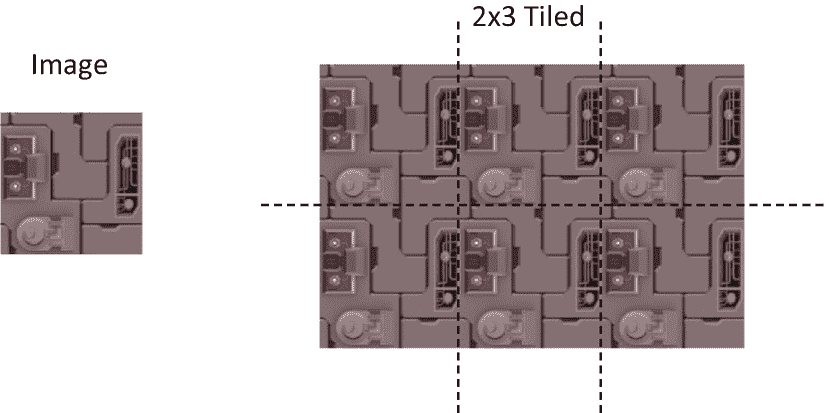
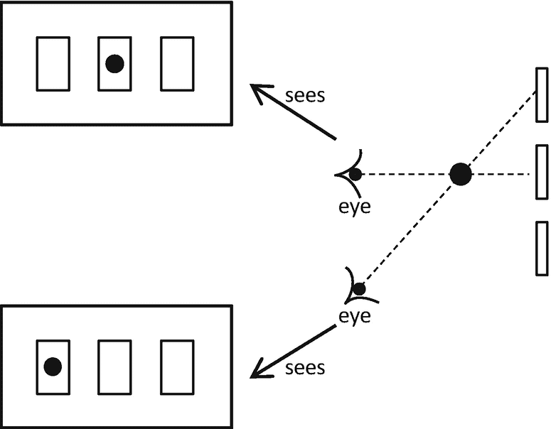
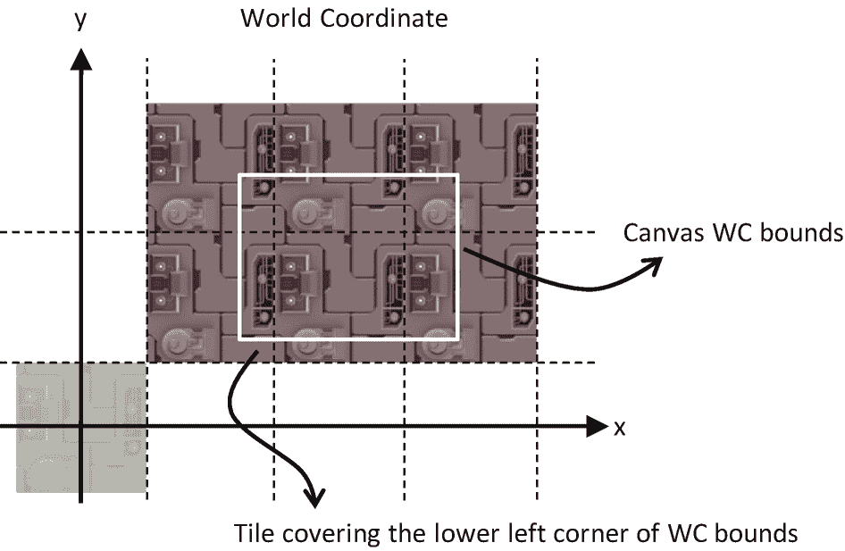
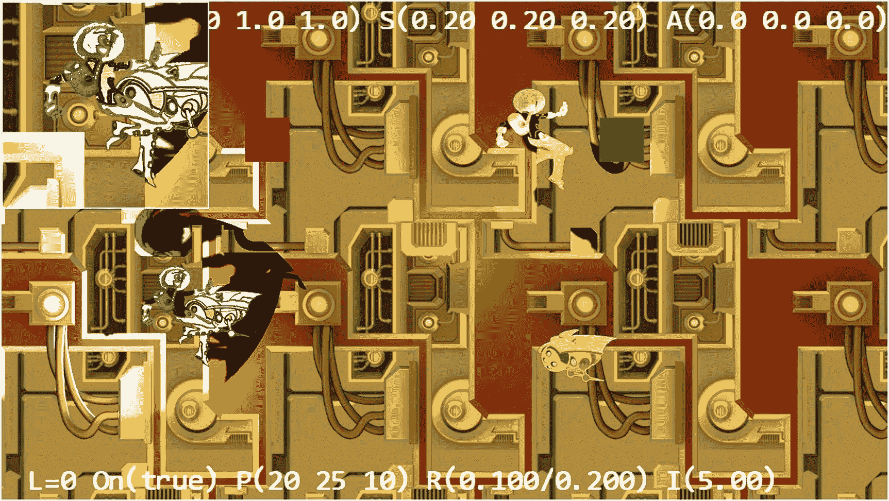
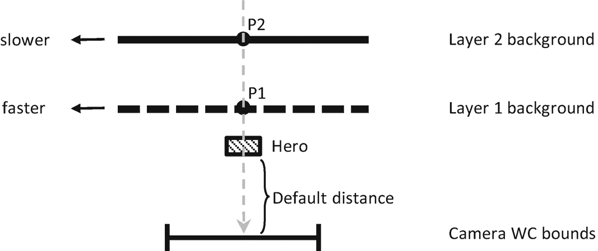
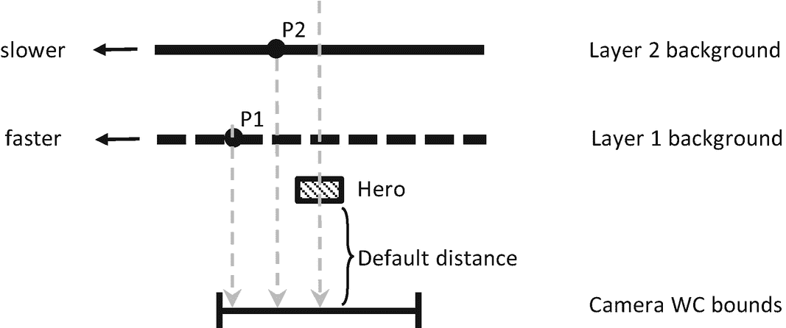
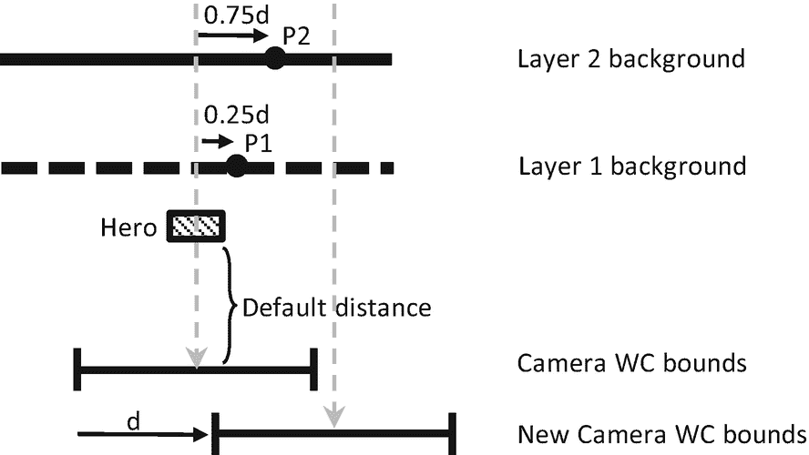
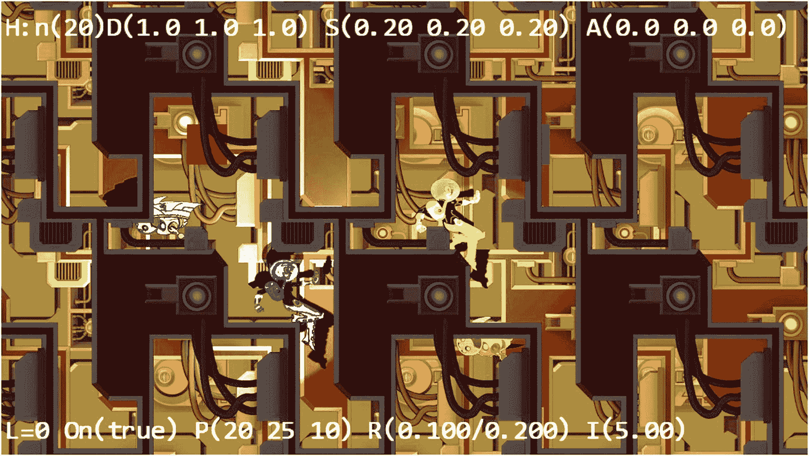
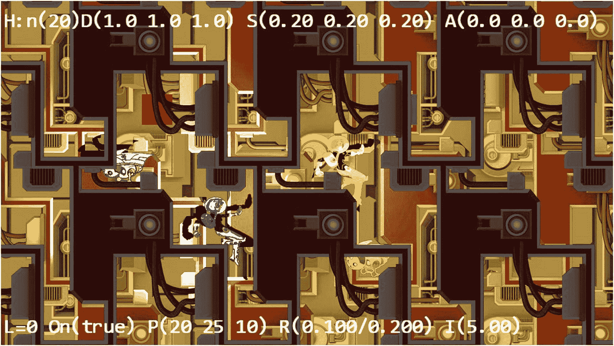

# 11. 支持相机背景

Kelvin Sung^(1), Jebediah Pavleas^(2), Matthew Munson^(3) and Jason Pace^(4) (1) Bothell, WA, USA (2) Kenmore, WA, USA (3) Lake Forest Park, WA, USA (4) Portland, OR, USA

结束摘要 完成本章后，你将能够

* 在任何给定相机 `WC` 边界内使用任意图像实现背景平铺
* 理解视差并通过视差滚动模拟运动视差
* 认识到在 2D 游戏中分层对象的必要性并支持分层绘制

## 简介

到此为止，你的游戏引擎已经能够照亮 2D 图像以生成高光和阴影，并模拟基本的物理行为。为了完成本书的引擎开发，本章重点介绍创建游戏世界环境的通用支持，包括背景平铺和视差，以及解放游戏程序员不必管理绘制顺序。

背景图像或物体被包含进来以装饰游戏世界，进一步吸引玩家。这通常要求图像规模巨大，具有微妙的视觉复杂性。例如，在横向卷轴游戏中，背景必须始终存在，简单的运动视差可以创造深度感，进一步抓住玩家的兴趣。

在计算机图形学和视频游戏的语境下，平铺是指沿 x 和 y 方向复制图像或图案。在视频游戏中，用于平铺的图像通常经过策略性构建，以确保内容在复制边界处连续。图 11-1 展示了一个策略性绘制的背景图像在 x 方向平铺三次、y 方向平铺两次的示例。请注意复制边界处完美的连续性。适当的平铺仅通过创建单个图像就能传达出无边游戏世界的复杂感。



图 11-1 ¶ 策略性绘制的背景图像平铺

视差是指从不同位置观察时物体的明显位移。图 11-2 展示了一个阴影圆的视差示例。从中间眼位观察时，中心阴影圆似乎覆盖了中心矩形块。然而，从底部眼位观察时，同一个阴影圆似乎覆盖了顶部矩形块。运动视差是指当观察者移动时，近处物体似乎比远处物体移动得更快。这是深度感知的基本视觉线索。在 2D 游戏中，模拟运动视差是引入深度复杂性以进一步吸引玩家的直接方法。



图 11-2 ¶ 视差：从不同观察点看时物体出现在不同位置

本章介绍了一个用于平铺相机 `WC` 边界的通用算法，并描述了一个隐藏视差滚动细节的抽象。随着背景视觉复杂性的增加，本章讨论了图层管理器的重要性并创建了一个，以减轻游戏程序员对绘制顺序细节的负担。

## 背景平铺


在 2D 游戏中平铺背景时，重要的是要认识到只需要绘制覆盖相机 WC 边界的瓦片。这在图 11-3 中有所说明。在该示例中，要平铺的背景对象定义在 WC 原点，具有自己的宽度和高度。然而，在这种情况下，相机 WC 边界与定义的背景对象不相交。图 11-3 显示背景对象需要平铺六次才能覆盖相机 WC 边界。请注意，由于通过相机不可见，原点处的玩家定义背景对象不需要绘制。



**图 11-3 ¶ 为相机 WC 边界生成平铺背景**

对于给定的背景对象和相机 WC 边界，计算所需平铺的方法有很多。一种简单的方法是确定覆盖 WC 边界左下角的瓦片位置，然后在正 x 和 y 方向上平铺。

## 平铺对象项目

该项目演示了如何实现简单的背景平铺。您可以在图 11-4 中看到该项目运行的示例。该项目的源代码定义在 `chapter11/11.1.tiled_objects` 文件夹中。



**图 11-4 ¶ 运行平铺对象项目**

项目控制如下：

*   **WASD 键**：移动 Dye 角色（英雄）以平移 WC 窗口边界

项目目标如下：

*   体验使用多层背景
*   实现针对相机 WC 窗口边界的背景对象平铺

您可以在 `assets` 文件夹中找到以下外部资源。`fonts` 文件夹包含默认系统字体和六个纹理图像：`minion_sprite.png`、`minion_sprite_normal.png`、`bg.png`、`bg_normal.png`、`bg_layer.png` 和 `bg_layer_normal.png`。`Hero` 和 `Minion` 对象由 `minion_sprite.png` 图像中的精灵元素表示，`bg.png` 和 `bg_layer.png` 是两层背景图像。对应的 `_normal` 文件是法线贴图。

### 定义 TiledGameObject

回顾一下，`GameObject` 抽象了游戏中对象的基本行为，其外观由它引用的 `Renderable` 对象决定。`TiledGameObject` 是一种 `GameObject`，能够平铺引用的 `Renderable` 对象以覆盖给定 `Camera` 对象的 WC 边界。

1.  **创建文件**  
    在 `src/engine/game_objects` 文件夹中创建一个新文件，命名为 `tiled_game_object.js`。添加以下代码来构建对象。`mShouldTile` 变量提供了停止平铺过程的选项。

```javascript
class TiledGameObject extends GameObject {
    constructor(renderableObj) {
        super(renderableObj);
        this.mShouldTile = true; // can switch this off if desired
    }
    // … implementation to follow …
}
export default TiledGameObject;
```

2.  **定义 getter 和 setter**  
    为 `mShouldTile` 定义 getter 和 setter 函数：

```javascript
setIsTiled(t) { this.mShouldTile = t; }
shouldTile() { return this.mShouldTile; }
```

3.  **定义平铺绘制函数**  
    定义函数以平铺并绘制 `Renderable` 对象，覆盖 `aCamera` 对象的 WC 边界：

```javascript
_drawTile(aCamera) {
    // **Step A:** Compute the positions and dimensions of tiling object.
    let xf = this.getXform();
    let w = xf.getWidth();
    let h = xf.getHeight();
    let pos = xf.getPosition();
    let left = pos[0] - (w / 2);
    let right = left + w;
    let top = pos[1] + (h / 2);
    let bottom = top - h;
    // **Step B:** Get WC positions and dimensions of the drawing camera.
    let wcPos = aCamera.getWCCenter();
    let wcLeft = wcPos[0] - (aCamera.getWCWidth() / 2);
    let wcRight = wcLeft + aCamera.getWCWidth();
    let wcBottom = wcPos[1] - (aCamera.getWCHeight() / 2);
    let wcTop = wcBottom + aCamera.getWCHeight();
    // **Step C:** Determine offset to camera window's lower left corner.
    let dx = 0, dy = 0; // offset to the lower left corner
    // left/right boundary?
    if (right < wcLeft) { // left of WC left
        dx = Math.ceil((wcLeft - right) / w) * w;
    } else {
        if (left > wcLeft) { // not touching the left side
            dx = -Math.ceil((left - wcLeft) / w) * w;
        }
    }
    // top/bottom boundary
    if (top < wcBottom) { // Lower than the WC bottom
        dy = Math.ceil((wcBottom - top) / h) * h;
    } else {
        if (bottom > wcBottom) {  // not touching the bottom
            dy = -Math.ceil((bottom - wcBottom) / h) * h;
        }
    }
    // **Step D:** Save the original position of the tiling object.
    let sX = pos[0];
    let sY = pos[1];
    // **Step E:** Offset tiling object and update related position variables
    xf.incXPosBy(dx);
    xf.incYPosBy(dy);
    right = pos[0] + (w / 2);
    top = pos[1] + (h / 2);
    // **Step F:** Determine number of times to tile in x and y directions.
    let nx = 1, ny = 1; // times to draw in the x and y directions
    nx = Math.ceil((wcRight - right) / w);
    ny = Math.ceil((wcTop - top) / h);
    // **Step G:** Loop through each location to draw a tile
    let cx = nx;
    let xPos = pos[0];
    while (ny >= 0) {
        cx = nx;
        pos[0] = xPos;
        while (cx >= 0) {
            this.mRenderComponent.draw(aCamera);
            xf.incXPosBy(w);
            --cx;
        }
        xf.incYPosBy(h);
        --ny;
    }
    // **Step H:** Reset the tiling object to its original position.
    pos[0] = sX;
    pos[1] = sY;
}
```

`_drawTile()` 函数计算并重新定位 `Renderable` 对象以覆盖相机 WC 边界的左下角，并在正 x 和 y 方向上平铺该对象。请注意以下几点：

1.  **Step A 和 Step B** 计算平铺对象和相机 WC 边界的位置和尺寸。
2.  **Step C** 计算 `dx` 和 `dy` 偏移量，将 `Renderable` 对象平移以使其边界覆盖 `aCamera` WC 边界的左下角。对 `Math.ceil()` 函数的调用确保计算出的 `dx` 和 `dy` 是 `Renderable` 宽度和高度的整数倍。这对于确保平铺过程中没有重叠或间隙非常重要。
3.  **Step D** 在偏移和绘制之前保存 `Renderable` 对象的原始位置。**Step E** 将 `Renderable` 对象偏移以覆盖相机 WC 边界的左下角。
4.  **Step F** 计算所需的重复次数，**Step G** 在正 x 和 y 方向上平铺 `Renderable` 对象，直到结果覆盖整个相机 WC 边界。对 `Math.ceil()` 函数的调用确保计算出的 `nx` 和 `ny`（x 和 y 方向的平铺次数）是整数。
5.  **Step H** 将平铺对象的位置重置为原始位置。

4.  **重写 draw() 函数**  
    重写 `draw()` 函数，在启用平铺时调用 `_drawTile()` 函数：

```javascript
draw(aCamera) {
    if (this.isVisible() && (this.mDrawRenderable)) {
        if (this.shouldTile()) {
            // find out where we should be drawing
            this._drawTile(aCamera);
        } else {
            this.mRenderComponent.draw(aCamera);
        }
    }
}
```

最后，记得更新引擎访问文件 `index.js`，将新定义的功能转发给客户端。

### 修改 MyGame 以测试平铺对象


## MyGame 对象平铺测试

`MyGame` 应测试对象平铺的正确性。为测试多层平铺，创建了两个单独的 `TiledGameObject` 和 `Camera` 实例。两个 `TiledGameObject` 实例位于距离摄像机不同距离（z 深度）处，并由不同组合的光源照亮。新增的第二个摄像机聚焦于其中一个 `Hero` 对象。

仅关注 `TiledGameObject` 实例的创建。因为一旦创建，`TiledGameObject` 实例的处理方式与 `GameObject` 实例相同。因此，仅详细检查 `MyGame` 类的 `init()` 函数。

## 初始化代码

```
init() {
    // 步骤 A：设置摄像机
    this.mCamera = new engine.Camera(
        vec2.fromValues(50, 37.5), // 摄像机位置
        100,                       // 摄像机宽度
        [0, 0, 1280, 720]          // 视口 (X, Y, 宽度, 高度)
    );
    this.mCamera.setBackgroundColor([0.8, 0.8, 0.8, 1]);
    // 将背景设置为灰色
    this.mHeroCam = new engine.Camera(
        vec2.fromValues(20, 30.5), // 摄像机位置
        14,                        // 摄像机宽度
        [0, 420, 300, 300],        // 视口 (X, Y, 宽度, 高度)
        2
    );
    this.mHeroCam.setBackgroundColor([0.5, 0.5, 0.9, 1]);
    // 步骤 B：光源
    this._initializeLights();  // 定义在 MyGame_Lights.js 中
    // 步骤 C：远处背景
    let bgR = new engine.IllumRenderable(this.kBg, this.kBgNormal);
    bgR.setElementPixelPositions(0, 1024, 0, 1024);
    bgR.getXform().setSize(30, 30);
    bgR.getXform().setPosition(0, 0);
    bgR.getMaterial().setSpecular([0.2, 0.1, 0.1, 1]);
    bgR.getMaterial().setShininess(50);
    bgR.getXform().setZPos(-5);
    bgR.addLight(this.mGlobalLightSet.getLightAt(1));
    // 仅方向光
    this.mBg = new engine.TiledGameObject(bgR);
    // 步骤 D：较近的背景
    let i;
    let bgR1 = new engine.IllumRenderable(
        this.kBgLayer, this.kBgLayerNormal);
    bgR1.getXform().setSize(30, 30);
    bgR1.getXform().setPosition(0, 0);
    bgR1.getXform().setZPos(-2);
    for (i = 0; i < 4; i++) {
        bgR1.addLight(this.mGlobalLightSet.getLightAt(i)); // 所有光源
    }
    bgR1.getMaterial().setSpecular([0.2, 0.2, 0.5, 1]);
    bgR1.getMaterial().setShininess(10);
    this.mBgL1 = new engine.TiledGameObject(bgR1);
    ... 与前面的代码相同 ...
}
```

## 代码说明

在列出的代码中，两个摄像机首先在步骤 A 中创建，随后在 `_initializeLights()` 函数中创建并初始化所有光源。步骤 C 将 `bgR` 定义为一个带有 `IllumRenderable` 的 `TiledGameObject`，由一个光源照亮。步骤 D 基于另一个由四个光源照亮的 `IllumRenderable` 定义第二个 `TiledGameObject`。由于 `TileGameObject` 类的 `mShouldTile` 变量默认为 `true`，两个平铺对象都将平铺其绘制目标摄像机。

## 观察结果

现在可以运行项目并使用 `WASD` 键移动 `Hero` 对象。正如预期，两层平铺背景清晰可见。可通过选择并关闭光源 1（按 `1` 键后按 `H` 键）来关闭远处背景的照明。移动 `Hero` 对象以平移摄像机，验证两个摄像机中的平铺和背景移动行为是否正确。

一个有趣的观察是：虽然两层背景位于距离摄像机不同距离处，但当摄像机平移时，两张背景图像同步滚动。若非光源照明的差异，背景看起来将像是一张单独的图像。此例说明了模拟运动视差的重要性。

## 使用视差滚动模拟运动视差

**视差滚动** 通过定义并以不同速度滚动对象来模拟运动视差，传达这些对象位于距离摄像机不同距离的感觉。图 11-5 通过俯视图展示了对象距离摄像机的概念距离。由于是鸟瞰图，摄像机 `WC` 边界的宽度显示为底部的一条水平线。`Hero` 对象最靠近摄像机，位于两层背景 `Layer1` 和 `Layer2` 前方。典型 2D 游戏中，绝大多数游戏对象将位于此默认距离。背景对象位于默认距离之后，更远离摄像机。可通过背景对象上的策略性绘制（如 `Layer1` 的草地和 `Layer2` 的远山）配合适当的滚动速度来传达距离感。注意位置 `P`[1] 和 `P`[2] 分别位于背景对象 `Layer1` 和 `Layer2` 上，直接在 `Hero` 对象后方。



**Figure 11-5** ¶ 具有不同距离的两个背景对象的场景俯视图

图 11-6 展示了摄像机静止时向左视差滚动的结果。`Layer1` 滚动速度快于 `Layer2`，因此位置 `P`[1] 相对于原始位置的位移大于 `P`[2]。持续滚动将使 `Layer1` 比 `Layer2` 移动得更快，从而正确传达 `Layer1` 更近的感觉。在视差滚动中，靠近摄像机的对象始终比较远的对象具有更大的滚动速度。



**Figure 11-6** ¶ 静止摄像机下的视差滚动俯视图

当摄像机运动时，实现视差滚动必须考虑对象的相对速度。图 11-7 通过俯视图说明了移动摄像机与静止对象的情况。此例中，摄像机 `WC` 边界向右移动了 `d` 单位。由于移动发生在摄像机中，摄像机视图内所有静止对象将表现为以摄像机移动的反方向位移。例如，静止的 `Hero` 对象从中心向左位移至新 `WC` 边界的左边缘。为正确模拟运动视差，两个背景 `Layer1` 和 `Layer2` 必须以不同的相对距离位移。此时须计算相对距离，使较远对象看起来移动得更慢。摄像机移动结束时，在新的 `WC` 边界内，最靠近摄像机的 `Hero` 对象将表现为向左位移 `d` 单位，`Layer1` 对象位移 `0.75d`，`Layer2` 对象位移 `0.25d`。这样，对象的位移反映了它们距离摄像机的相对距离。为实现此效果，`Hero` 对象的平移量为零，`Layer1` 和 `Layer2` 对象必须分别向右平移 `0.25d` 和 `0.75d`。注意背景向右平移的量小于摄像机移动量，因此背景实际向左移动。例如，虽然 `Layer1` 对象向右平移 `0.25d`，但从向右移动 `d` 的摄像机视角看，结果是 `Layer1` 对象向左位移了 `0.75d`。



**Figure 11-7** ¶ 摄像机运动时的视差滚动俯视图


需要注意的是，在为移动摄像机实现视差滚动的描述方法中，静止背景对象会被位移。这种方法有两个局限性。首先，对象位置的改变是为了传达视觉线索，并不反映任何特定的游戏状态逻辑。如果游戏逻辑需要精确控制背景对象的移动，这可能会产生棘手的冲突。幸运的是，背景对象通常设计用于装饰环境和吸引玩家，通常不参与实际的游戏玩法逻辑。第二个局限性是静止背景对象实际上处于运动中，当从除引起运动视差的摄像机以外的其他摄像机观看时，这种运动会显现出来。当在存在运动视差的情况下需要来自多个摄像机的视图时，重要的是要仔细协调它们以避免玩家困惑。

## The Parallax Objects Project（视差对象项目）

该项目演示了视差滚动。您可以在图 11-8 中看到该项目运行的示例。该项目的源代码定义在 `chapter11/11.2.parallax_objects` 文件夹中。



**Figure 11-8 ¶ Running the Parallax Objects project（图 11-8 ¶ 运行视差对象项目）**

项目控制如下：

*   **P 键**：切换绘制第二个静止摄像机，以突出显示背景对象在模拟视差滚动中的运动
*   **WASD 键**：移动 Dye 角色（英雄）以平移 WC 窗口边界

项目目标如下：

*   理解并欣赏运动视差
*   使用视差滚动模拟运动视差

### Define ParallaxGameObject to Implement Parallax Scrolling（定义 ParallaxGameObject 以实现视差滚动）

视差滚动涉及对象的连续滚动，`TiledGameObject` 为无尽滚动提供了一个方便的平台。因此，`ParallaxGameObject` 被定义为 `TiledGameObject` 的子类。

1.  在 `src/engine/game_objects` 文件夹中创建 `parallax_game_object.js`，并添加以下代码来构建对象：

```javascript
import TiledGameObject from "./tiled_game_object.js";
class ParallaxGameObject extends TiledGameObject {
    constructor(renderableObj, scale, aCamera) {
        super(renderableObj);
        this.mRefCamera = aCamera;
        this.mCameraWCCenterRef = vec2.clone(this.mRefCamera.getWCCenter());
        this.mParallaxScale = 1;
        this.setParallaxScale(scale);
    }
    ... implementation to follow ...
}
export default ParallaxGameObject;
```

`ParallaxGameObject` 对象维护 `mRefCamera`（对 `aCamera` 的引用）和 `mCameraWCCenterRef`（当前 WC 边界中心）。这些值用于根据参考摄像机的运动计算相对运动，以支持视差滚动。`scale` 参数是一个正值。`scale` 值为 1 表示对象位于默认距离，小于 1 的值表示对象在默认距离之前。大于 1 的 `scale` 表示对象在摄像机后方。`scale` 值越大，对象离摄像机越远。

2.  为 `mParallaxScale` 定义 getter 和 setter 函数。注意对负值的钳制；该变量必须为正。

```javascript
getParallaxScale() {
    return this.mParallaxScale;
}
setParallaxScale(s) {
    this.mParallaxScale = s;
    if (s <= 0) {
        this.mParallaxScale = 1;
    }
}
```

3.  重写 `update()` 函数以实现视差滚动：

```javascript
update() {
    // simple default behavior
    this._refPosUpdate(); // check to see if the camera has moved
    super.update();
}
```

`_refPosUpdate()` 函数根据参考摄像机的 WC 中心位置计算相对位移。

4.  定义 `_refPosUpdate()` 函数：

```javascript
_refPosUpdate() {
    // now check for reference movement
    let deltaT = vec2.fromValues(0, 0);
    vec2.sub(deltaT, this.mCameraWCCenterRef, this.mRefCamera.getWCCenter());
    this.setWCTranslationBy(deltaT);
    // update WC center ref position
    vec2.sub(this.mCameraWCCenterRef, this.mCameraWCCenterRef, deltaT);
}
```

`deltaT` 变量记录摄像机的运动，`setWCTranslationBy()` 移动对象以模拟视差滚动。

5.  定义函数以平移对象实现视差滚动。负的 `delta` 旨在使对象沿摄像机相同的方向移动。注意变量 `f` 是 `1` 减去 `mParallaxScale` 的倒数。

```javascript
setWCTranslationBy(delta) {
    let f = (1 - (1 / this.mParallaxScale));
    this.getXform().incXPosBy(-delta[0] * f);
    this.getXform().incYPosBy(-delta[1] * f);
}
```

当 `mParallaxScale` 小于 1 时，倒数大于 1，`f` 变为负数。在这种情况下，当摄像机移动时，对象将向相反方向移动，从而产生对象位于默认距离之前的感觉。

相反，当 `mParallaxScale` 大于 1 时，其倒数将小于 1，导致 `f` 为小于 1 的正值。在这种情况下，对象将沿摄像机相同的方向移动，但速度较慢。较大的 `mParallaxScale` 对应 `f` 值更接近 1，对象的运动将更接近摄像机的运动，或者对象将显得离摄像机更远。

最后，请记住更新引擎访问文件 `index.js`，以将新定义的功能转发给客户端。

#### Testing ParallaxGameObject in MyGame（在 MyGame 中测试 ParallaxGameObject）


## 测试 ParallaxGameObject

`ParallaxGameObject` 的测试涉及在摄像机移动时测试视差滚动的正确性，场景中包含位于默认距离前方和后方的物体，同时从一个单独的静止摄像机观察 `ParallaxGameObject`。`MyGame` 关卡的源代码与前一个项目基本相似，细节不再列出。下面列出了 `init()` 函数的相关部分，旨在说明如何创建 `ParallaxGameObject` 实例。

```
init() {
    // Step A: 设置摄像机
    this.mCamera = new engine.Camera(
        vec2.fromValues(50, 37.5), // 摄像机位置
        100,                       // 摄像机宽度
        [0, 0, 1280, 720]          // 视口 (orgX, orgY, width, height)
    );
    this.mCamera.setBackgroundColor([0.8, 0.8, 0.8, 1]);
    // 将背景设为灰色
    this.mParallaxCam = new engine.Camera(
        vec2.fromValues(40, 30), // 摄像机位置
        45,                      // 摄像机宽度
        [0, 420, 600, 300],      // 视口 (orgX, orgY, width, height)
        2
    );
    this.mParallaxCam.setBackgroundColor([0.5, 0.5, 0.9, 1]);
    // Step B: 灯光
    this._initializeLights();  // 定义在 MyGame_Lights.js 中
    // Step C: 远景背景
    let bgR = new engine.IllumRenderable(this.kBg, this.kBgNormal);
    bgR.setElementPixelPositions(0, 1024, 0, 1024);
    bgR.getXform().setSize(30, 30);
    bgR.getXform().setPosition(0, 0);
    bgR.getMaterial().setSpecular([0.2, 0.1, 0.1, 1]);
    bgR.getMaterial().setShininess(50);
    bgR.getXform().setZPos(-5);
    // 仅定向光
    bgR.addLight(this.mGlobalLightSet.getLightAt(1));
    this.mBg = new engine.ParallaxGameObject(bgR, 5, this.mCamera);
    // Step D: 较近的背景
    let i;
    let bgR1 = new engine.IllumRenderable(
        this.kBgLayer, this.kBgLayerNormal
    );
    bgR1.getXform().setSize(25, 25);
    bgR1.getXform().setPosition(0, -15);
    bgR1.getXform().setZPos(0);
    // 定向光
    bgR1.addLight(this.mGlobalLightSet.getLightAt(1));
    // 英雄聚光灯
    bgR1.addLight(this.mGlobalLightSet.getLightAt(2));
    // 英雄聚光灯
    bgR1.addLight(this.mGlobalLightSet.getLightAt(3));
    bgR1.getMaterial().setSpecular([0.2, 0.2, 0.5, 1]);
    bgR1.getMaterial().setShininess(10);
    this.mBgL1 = new engine.ParallaxGameObject(bgR1, 3, this.mCamera);
    // Step E: 前景层
    let f = new engine.TextureRenderable(this.kBgLayer);
    f.getXform().setSize(50, 50);
    f.getXform().setPosition(-3, 2);
    this.mFront = new engine.ParallaxGameObject(f, 0.9, this.mCamera);
    ... identical to previous code ...
}
```

`mBg` 对象作为 `ParallaxGameObject` 创建，缩放值为 5；`mBgL1` 缩放值为 3；`mFront` 缩放值为 0.9。回顾一下，缩放值是 `ParallaxGameObject` 构造函数的第二个参数。该参数表示物体距离摄像机的距离，值大于 1 表示比默认距离更远，值小于 1 表示比默认距离更近。在这种情况下，`mBg` 距离摄像机最远，而 `mBgL1` 较近。无论如何，两者仍位于默认距离之后。`mFront` 对象距离摄像机最近，位于默认距离之前，即位于英雄对象之前。

## 观察

现在可以运行项目，观察较暗的前景层如何部分遮挡英雄和爪牙对象。你可以移动英雄对象以平移摄像机，观察两个背景层以不同速度滚动。`mBg` 对象距离较远，因此滚动速度比 `mBgL1` 对象慢。你还会注意到前景层的视差滚动速度比所有其他物体都快，因此，平移摄像机会显示出静止爪牙对象的不同部分。

按 `P` 键启用第二个摄像机的绘制。注意当英雄静止时，该摄像机中的视图符合预期，保持不动。现在，如果你移动英雄对象以平移主摄像机，请注意第二个摄像机视图中的前景和背景物体也在移动，并表现出运动视差，即使第二个摄像机并未移动！作为游戏设计师，重要的是要确保这种副作用不会让玩家感到困惑。

## 图层管理

虽然你正在开发的引擎是用于 2D 游戏，但你已经遇到了一些深度排序和绘制顺序至关重要的情况。例如，阴影接收者必须始终定义在阴影投射者之后，正如前一个示例中讨论的，前景和背景视差物体必须仔细定义并按其深度顺序绘制。如果游戏引擎提供一个实用管理器来帮助游戏程序员管理和处理深度图层，那将非常方便。一个典型的 2D 游戏可以包含以下图层，按距离摄像机的距离从近到远排序：

* **抬头显示 (HUD) 图层**：通常最接近摄像机，显示必要的用户界面信息
* **前景或前景图层**：位于游戏物体前方的图层，用于装饰或部分遮挡游戏物体
* **角色图层**：图 11-5 中的默认距离图层，所有游戏物体驻留于此
* **阴影接收图层**：位于角色图层之后，用于接收潜在阴影的图层
* **背景图层**：装饰性背景

每个图层将引用为该图层定义的所有物体，这些物体将按其插入图层的顺序绘制，最后插入的最后绘制，覆盖在之前的物体之上。本节介绍 `Layer` 引擎组件，以支持上述五个图层，从而减轻游戏程序员管理物体更新和绘制的细节。请注意，游戏引擎应支持的图层数量取决于该引擎设计构建的游戏类型。这里展示的五个图层对于简单游戏来说是合乎逻辑且方便的。你可以选择在自己的游戏引擎中扩展图层数量。

### 图层管理器项目

该项目演示如何开发一个实用组件，协助游戏程序员管理游戏中的图层。你可以在图 11-9 中看到该项目运行的示例。该项目的源代码定义在 `chapter11/11.3.layer_manager` 文件夹中。



图 11-9 ¶ 运行图层管理器项目

该项目的控制方式与前一个项目相同：

* **P 键**：切换第二个摄像机的绘制，该摄像机不移动，用于突出显示背景物体在模拟视差滚动时的运动
* **WASD 键**：移动染料角色（英雄）以平移世界坐标 (WC) 窗口边界

项目目标如下：

* 理解图层在 2D 游戏中的重要性
* 开发一个图层管理器引擎组件

### 引擎中的图层管理

遵循定义引擎组件的模式，例如，类似于物理和粒子系统：

1. 在 `src/engine/components` 文件夹中创建一个新文件，命名为 `layer.js`。该文件将实现 `Layer` 引擎组件。
2. 为图层定义枚举器：

```
const eBackground = 0;
const eShadowReceiver = 1;
const eActors = 2;
const eFront = 3;
const eHUD = 4;
```

3. 定义适当的常量和实例变量以跟踪图层。`mAllLayers` 变量是一个 `GameObjectSet` 实例数组，代表五个图层中的每一个。

```
let kNumLayers = 5;
let mAllLayers = [];
```

4. 定义一个 `init()` 函数来创建 `GameObjectSet` 实例数组：


## 层组件实现

## 核心层函数

### 初始化层

```javascript
function init() {
    mAllLayers[eBackground] = new GameObjectSet();
    mAllLayers[eShadowReceiver] = new GameObjectSet();
    mAllLayers[eActors] = new GameObjectSet();
    mAllLayers[eFront] = new GameObjectSet();
    mAllLayers[eHUD] = new GameObjectSet();
}
```

### 清理层

```javascript
function cleanUp() {
    init();
}
```

### 层管理函数

```javascript
function addToLayer(layerEnum, obj) {
    mAllLayers[layerEnum].addToSet(obj);
}

function removeFromLayer(layerEnum, obj) {
    mAllLayers[layerEnum].removeFromSet(obj);
}

function layerSize(layerEnum) {
    return mAllLayers[layerEnum].size();
}

function addAsShadowCaster(obj) {
    let i;
    for (i = 0; i < mAllLayers[eShadowReceiver].size(); i++) {
        mAllLayers[eShadowReceiver].getObjectAt(i).addShadowCaster(obj);
    }
}
```

### 绘制函数

```javascript
function drawLayer(layerEnum, aCamera) {
    mAllLayers[layerEnum].draw(aCamera);
}

function drawAllLayers(aCamera) {
    let i;
    for (i = 0; i < kNumLayers; i++) {
        mAllLayers[i].draw(aCamera);
    }
}
```

### 层排序

```javascript
function moveToLayerFront(layerEnum, obj) {
    mAllLayers[layerEnum].moveToLast(obj);
}
```

### 更新函数

```javascript
function updateLayer(layerEnum) {
    mAllLayers[layerEnum].update();
}

function updateAllLayers() {
    let i;
    for (i = 0; i < kNumLayers; i++) {
        mAllLayers[i].update();
    }
}
```

### 导出功能

```javascript
export {
    // array indices
    eBackground, eShadowReceiver, eActors, eFront, eHUD,
    // init and cleanup
    init, cleanUp,
    // draw/update
    drawLayer, drawAllLayers,
    updateLayer, updateAllLayers,
    // layer-specific support
    addToLayer, addAsShadowCaster,
    removeFromLayer, moveToLayerFront,
    layerSize
}
```

最后，请记得更新引擎访问文件 `index.js` 以将新定义的功能转发给客户端。

## 修改引擎组件和对象

你必须略微修改游戏引擎的其余部分以集成新的 `Layer` 组件。

### 增强 GameObjectSet 功能

添加以下函数以支持将对象移动到集合数组的末尾：

```javascript
moveToLast(obj) {
    this.removeFromSet(obj);
    this.addToSet(obj);
}
```

### 在 index.js 中初始化层

除了导入/导出 `Layer` 组件外，还需修改 `index.js` 中引擎的 `init()` 和 `cleanUp()` 函数以初始化和清理该组件：

```javascript
function init(htmlCanvasID) {
    glSys.init(htmlCanvasID);
    vertexBuffer.init();
    input.init(htmlCanvasID);
    audio.init();
    shaderResources.init();
    defaultResources.init();
    layer.init();
}

function cleanUp() {
    layer.cleanUp();
    loop.cleanUp();
    shaderResources.cleanUp();
    defaultResources.cleanUp();
    audio.cleanUp();
    input.cleanUp();
    vertexBuffer.cleanUp();
    glSys.cleanUp();
}
```

### 定义层成员资格的更新函数

为可能作为 `Layer` 成员出现的对象定义更新函数：`Renderable` 和 `ShadowReceiver`。

## 修改 MyGame 以配合层组件工作

`MyGame` 关卡实现的功能与前一个项目相同。唯一的区别在于将层管理委托给了 `Layer` 组件。以下描述仅关注与层管理相关的函数调用。

### 1. 修改 unload() 函数

```javascript
unload() {
    engine.layer.cleanUp();
    engine.texture.unload(this.kMinionSprite);
    engine.texture.unload(this.kBg);
    engine.texture.unload(this.kBgNormal);
    engine.texture.unload(this.kBgLayer);
    engine.texture.unload(this.kBgLayerNormal);
    engine.texture.unload(this.kMinionSpriteNormal);
}
```

### 2. 修改 init() 函数

```javascript
init() {
    // ... identical to previous code ...
    // add to layer managers ...
    engine.layer.addToLayer(engine.layer.eBackground, this.mBg);
    engine.layer.addToLayer(engine.layer.eShadowReceiver, this.mBgShadow1);
    engine.layer.addToLayer(engine.layer.eActors, this.mIllumMinion);
    engine.layer.addToLayer(engine.layer.eActors, this.mLgtMinion);
    engine.layer.addToLayer(engine.layer.eActors, this.mIllumHero);
    engine.layer.addToLayer(engine.layer.eActors, this.mLgtHero);
    engine.layer.addToLayer(engine.layer.eFront, this.mBlock1);
    engine.layer.addToLayer(engine.layer.eFront, this.mBlock2);
    engine.layer.addToLayer(engine.layer.eFront, this.mFront);
    engine.layer.addToLayer(engine.layer.eHUD, this.mMsg);
    engine.layer.addToLayer(engine.layer.eHUD, this.mMatMsg);
}
```

### 3. 修改 draw() 函数

```javascript
draw() {
    engine.clearCanvas([0.9, 0.9, 0.9, 1.0]); // clear to light gray
    this.mCamera.setViewAndCameraMatrix();
    engine.layer.drawAllLayers(this.mCamera);
    if (this.mShowParallaxCam) {
        this.mParallaxCam.setViewAndCameraMatrix();
        engine.layer.drawAllLayers(this.mParallaxCam);
    }
}
```

### 4. 修改 update() 函数

```javascript
update() {
    this.mCamera.update();  // to ensure proper interpolated movement
    this.mParallaxCam.update();
    engine.layer.updateAllLayers();
    // ... identical to previous code ...
}
```

## 观察

现在你可以运行项目，观察到与前一个项目相同的输出和交互。本项目的重要观察点在于实现方面。通过在 `init()` 期间将游戏对象插入 `Layer` 组件的适当层中，游戏关卡的 `draw()` 和 `update()` 函数可以变得更加简洁。更简单、更整洁的 `update()` 函数尤为重要。它不再拥挤着繁琐的游戏对象 `update()` 函数调用，现在可以专注于实现游戏逻辑和控制游戏对象之间的交互。

## 总结

本章解释了平铺的必要性，并介绍了 `TileGameObject` 以实现一个简单的算法，该算法可平铺并覆盖给定的相机世界坐标边界。介绍了视差的基础知识以及利用视差滚动模拟运动视差的方法。考察了静止和移动相机下的运动视差，并推导和实现了相应的解决方案。你了解到，计算相对于相机运动的位移来移动背景对象会产生视觉上令人愉悦的运动视差，但从不同相机观看时可能会导致玩家困惑。随着早前引入的阴影计算和现在的视差滚动，游戏程序员必须投入代码和精力来协调不同类型对象的绘制顺序。为了提高游戏引擎的可编程性，`Layer` 引擎组件作为一个实用工具被引入，旨在解放游戏程序员，使其不再需要管理层的绘制。


## 游戏设计考量

本书提出的游戏引擎现已完成。它可以绘制带有纹理贴图、精灵动画的对象，甚至支持来自各种光源的照明。引擎为简单行为定义了适当的抽象，实现了近似和精确计算碰撞的机制，并模拟物理行为。多摄像机视图可以方便地显示在同一游戏画面上，且操作功能经过平滑插值。支持键盘/鼠标输入，现在背景对象可以无边界滚动并模拟视差运动。

为了正确测试引擎，重要的下一步是经历一个简单的游戏设计过程，并基于你新完成的游戏引擎实现一个游戏。

## 创作流程与设计理念

在前几节中，你探索了如何从零开发一个简单的游戏机制，并将其引向多个方向、应用于多种游戏类型。游戏设计工作室的创作团队经常争论游戏设计的哪个要素在创作过程中占主导地位：编剧通常认为故事优先，而许多设计师认为故事和其他一切必须服从于玩法。当然，这没有对错之分；创作过程是一个混沌系统，每个团队和工作室都是独一无二的。一些创意总监想讲述一个特定的故事，会寻找最适合支撑特定叙事的机制和类型，而另一些人则是玩法纯粹主义者，完全致力于“玩法第一、玩法第二、玩法第三”的文化。决策通常归结为了解你的受众；例如，如果你正在创建一个竞技性多人第一人称射击游戏体验，消费者会对许多核心玩法要素有特定期望，通常明智的做法是确保玩法驱动设计。然而，如果你正在创建一个旨在讲述故事、为玩家提供新体验和意想不到转折的冒险游戏，故事和背景设定可能会引领方向。

## 创新与惯例

许多游戏设计师（包括资深老手和初入行的新人）在开始新项目时，设计的体验只是对现有成熟机制的微小变体；虽然这种方法有其合理理由（例如 AAA 工作为要求极高的受众开发内容，或希望使用在许多作品中已被证明成功的机制），但它往往会显著限制对新领域的探索，这也是许多玩家抱怨创意停滞、同类型游戏之间缺乏玩法多样性的原因之一。许多专业游戏设计师在享受某些类型游戏中长大，梦想基于我们熟知和热爱的机制创造新体验，几十年来这种文化使行业聚焦于为数不多的相似机制和惯例上。话虽如此，近年来迅速壮大的独立和小型工作室社区大胆地抛弃了长期存在的类型惯例，而易于访问的分发平台（如移动应用商店和 Valve 的 Steam）为各种新游戏机制和体验的蓬勃发展打开了机会之门。

## 从突破性游戏中学习

如果你继续探索游戏设计，你会意识到完全独特的核心机制相对较少，但当你将那些基本交互构建成更复杂的因果链，并通过与游戏设计其他要素的优雅整合增添独特的风味和质感时，创新的机会是无穷的。一些最具突破性和最成功的游戏，是通过非常类似于你在《游戏设计考量》章节中进行的机制探索练习而创作的；例如 Valve 的《传送门》，就基于你一直在探索的同类“逃离房间”沙盒，并围绕同样简单的基础机制设计。是什么让《传送门》成为这种现象级大作？虽然制作大作需要许多因素共同作用，但《传送门》受益于一个设计团队：他们从最基础的机制开始构建体验，随着对其独特结构和特性越来越熟练，巧妙地增加复杂性，而不是从“万米高空”层面、带着成熟的类型和预设的设计规则开始。

## 将机制应用于背景设定与语境

当然，没人谈论《传送门》时会不提叛逆的人工智能角色 GLaDOS 和她的 Aperture 实验室游乐场：背景设定、叙事和视听设计对《传送门》的体验而言，与发射传送门的游戏机制同等重要，考虑到它们交织得多么巧妙，很难将玩法与叙事分开。本章的项目提供了一个良机，开始同样将《游戏设计考量》章节中的游戏机制置于独特的背景设定和语境中：你可能已经注意到，本书贯穿始终的许多项目都在构建科幻视觉主题，拥有身穿太空服的英雄角色、各种飞行机器人，而现在在第 11 章（`#334805_2_En_11_Chapter.xhtml`）中引入了视差环境。虽然你构建的游戏在环境和交互复杂度上不及《传送门》，但这并不意味着你没有同样的机会开发高度引人入胜的游戏背景、语境和角色阵容。

## 项目分析：分层环境

你应该注意到的关于《平铺对象》项目的第一件事是，与早期项目相比，它对环境体验和规模产生了巨大影响。增强该项目临场感的因素是三个独立移动的层（英雄角色、移动墙壁和静止墙壁）以及两个背景层的无缝平铺。将《平铺对象》项目与第 8 章（`#334805_2_En_8_Chapter.xhtml`）的《阴影着色器》项目进行比较，注意当环境被分解为多个层、并以类似于（即使不完全符合物理准确性）你在物理世界中体验运动的方式移动时，临场感的差异。当你在《视差对象》项目中添加多个具有视差运动的背景层时，临场感会进一步增强；当你在物理世界中移动时，环境似乎以不同速度移动，较近的物体似乎快速掠过，而地平线上的物体似乎移动缓慢。视差环境对象模拟了这种效果，为游戏环境增加了相当的深度和趣味。《图层管理器》项目将各要素整合在一起，开始展示游戏背景设定立即吸引玩家想象力的潜力。仅用几种技术，你就能创造出一个巨大环境的印象，那可能是古老外星机器的内部、大型宇宙飞船的外部，或你想创建的任何其他事物。尝试将不同类型的图像资源与该技术结合使用：外部景观、水下场景、抽象形状等都值得探索。正如你在第 11 章（`#334805_2_En_11_Chapter.xhtml`）中所做的那样，你经常会通过尝试几个基本元素就找到游戏背景设定的灵感。


© 作者所有，独家授权 APress Media, LLC，Springer Nature 旗下公司 2022 K. Sung 等著 《打造你自己的 2D 游戏引擎并创作精彩网页游戏》 [DOI 链接](https://doi.org/10.1007/978-1-4842-7377-7_12) 开始摘要
