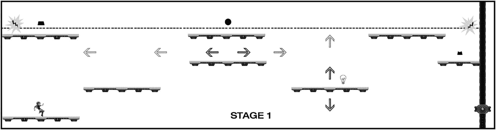
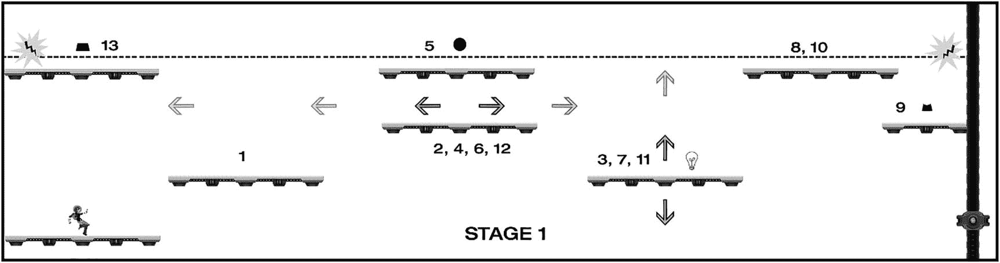
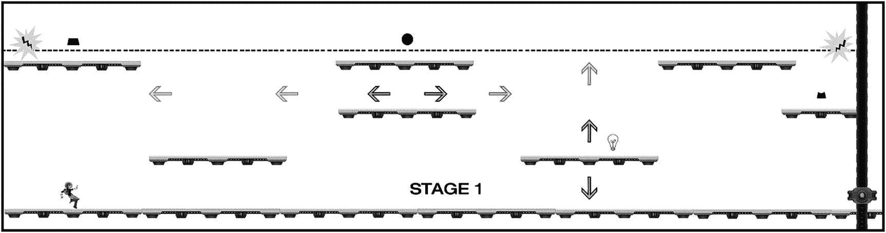
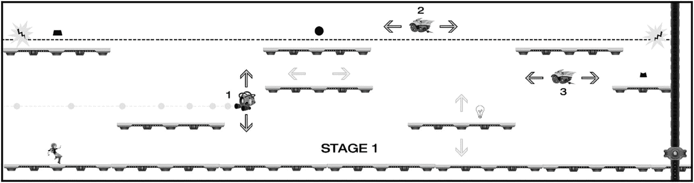
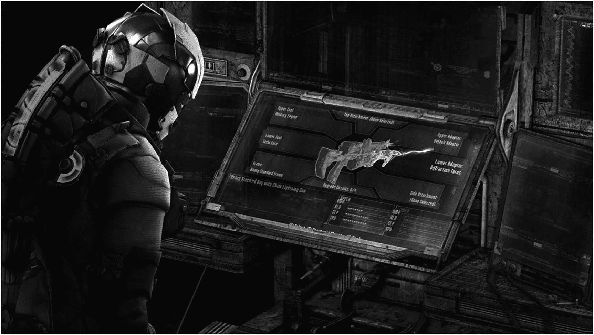

# 12. 构建示例游戏：从设计到完成

Kelvin Sung^(1), Jebediah Pavleas^(2), Matthew Munson^(3) and Jason Pace^(4)
(1) Bothell, WA, 美国 (2) Kenmore, WA, 美国 (3) Lake Forest Park, WA, 美国 (4) Portland, OR, 美国

结束摘要

第 `1` 至 `11` 章主体部分所包含的项目始于简单形状，并逐步引入角色和环境以阐释各章概念；这些项目侧重于个别行为和技术（如碰撞检测、物体物理、光照等），但缺乏提供完整游戏体验所需的结构化挑战。*“设计考量”* 部分的项目演示了如何引入将基本行为转化为完善游戏机制所需的逻辑规则和挑战类型。本章现在将重点转移到强调从早期概念到功能原型的设计过程，通过使用前几章中的一些角色和环境，以及第 `11` 章 *“设计考量”* 部分中解锁平台游戏的基本理念，整合并扩展了早期项目的工作。与早期章节一样，此处采用的设计框架从一个简单灵活的起始模板开始，并有意逐步增加复杂性，以便让游戏以受控方式发展。

直到现在，设计练习一直避免考虑第 `1` 章 *“如何制作一款优秀的电子游戏？”* 部分所述的游戏设计九大要素中的大多数，而是专注于打磨基本游戏机制，以便清晰地定义和完善游戏本身的核心特征。本书采用的设计方法是一个自底向上的框架，强调先处理孤立的游戏机制，然后再考虑游戏的类型或背景设定；当你开始融入背景设定，并在核心机制之上构建包含额外设计要素的关卡时，游戏玩法将随着游戏世界的扩展而向独特的方向成长和演变。游戏机制及你设计的相关游戏循环存在无尽的潜在变体。你会惊讶于相同的游戏玩法基础元素会因你做出的创意选择而以截然不同的方式发展和演变。

## 第 1 部分：完善概念

此时你应该已拥有一个雏形概念，采用 2D 跳跃和解谜机制，核心是解锁屏障并获得奖励。回顾图 `12-1`，这是第 `11` 章的最终屏幕布局和设计。

图 12-1 ¶ 第 `11` 章的 2D 实现

该设计已包含多阶段解决方案，要求玩家同时展示基于时机的敏捷性和解谜逻辑。在当前设计中，玩家控制主角角色（可能使用 `A` 和 `D` 键左右移动，使用 `spacebar` 跳跃）。玩家可以在同一层的水平平台间跳跃，但若不使用会上下移动的中间“电梯”平台，就无法到达上方的平台。如果玩家触碰水平“能量场”，将会被电击，导致游戏重置。完成关卡的明确步骤如下：

1. 玩家必须让主角角色（图 `12-1` 中心带有字母 *p* 的圆圈）跳上移动的电梯平台（图 `12-1` 中的 #1），并在触碰能量场前跳离至右侧柱子的中间平台。
2. 玩家通过让主角角色与其碰撞来激活能量场的关闭开关（#2，图 `12-1` 中用灯泡图标表示）。
3. 当能量场关闭后，玩家乘坐电梯平台到达顶部（#3），并让主角跳至右侧柱子的顶层平台。
4. 玩家让主角与代表锁图标顶部三分之一的小圆圈（#4）碰撞，激活锁图标对应部分并使其发光。
5. 玩家让主角跳回电梯平台（#5），然后跳至右侧柱子的底层平台。
6. 玩家让主角与对应锁图标中间部分的形状（#6）碰撞，激活锁图标对应部分并使其发光。锁图标现在有三分之二发光，表明进度。
7. 玩家再次让主角跳上电梯平台（#7），然后跳至左侧柱子的顶层平台。
8. 玩家让主角与对应锁图标底部部分的形状（#8）碰撞，激活图标的最后一部分并解锁屏障。

写出这个序列（或*游戏流程图*）在你已创建模拟屏幕的情况下可能显得多余。然而，设计师必须详细了解玩家必须按确切顺序做的每一件事，以确保你能在不陷入复杂性或不失去对玩家如何通过关卡的洞察的情况下，调整、平衡和演变游戏玩法。例如，从绘制前面的游戏流程图可以清楚地看出，电梯平台是该关卡的核心，完成每个动作都需要它；在示意图表示和游戏流程描述中拥有这一信息非常有价值，因为它提供了一个机会，让你能智能地优化游戏玩法逻辑，从而直观地看到每次更改对关卡整体流程的影响。

## 第 2 部分：融入背景设定

你可以继续构建机制，使关卡更有趣、更具挑战性（例如，你可能会在能量场的关闭开关上加一个计时器，要求玩家在有限时间内与所有锁部件碰撞）。然而，在概念开发的这个阶段，往往有助于从游戏玩法中抽离出来，开始考虑游戏背景设定和类型，利用这些元素来帮助指导游戏机制接下来如何演变。

回顾第 11 章，项目以一组支持科幻设定的概念探索结束。图 12-2 展示了一个未来工业环境设计、一个身穿太空服的英雄角色，以及看起来像飞行机器人的实体。

图 12-2 ¶ 来自第 11 章的概念图

请注意，你一直在创建的游戏机制并没有什么特别之处会必然将你引向科幻方向；游戏机制是抽象的交互结构，通常可以与任何类型的设定或视觉风格相结合。在本例中，作者选择了一个发生在飞船上的设定，因此本章将使用该主题作为游戏原型的设定。随着你推进设计过程，请考虑探索备选设定：第 11 章的游戏机制如何适应丛林设定、当代都市地点、中世纪奇幻世界或水下大都市？

## 语境图像让设定栩栩如生

现在你已经描述了一个基本叙事和虚构框架，大致为“玩家必须完成一系列平台解谜关卡，在飞船爆炸前拯救它”，只需将早期原型中的几个形状替换为一些包含的概念元素。图 12-3 引入了一个类人英雄角色、更像飞船组件的平台，以及一个带有锁门的屏障墙，以取代机制设计中的抽象锁。

图 12-3 ¶ 引入多个支持游戏设定和不断演变叙事的视觉设计元素

虽然你只做了少量微小替换，且视觉元素尚未锚定在环境中，但图 12-3 传达了更多的虚构语境，并且比图 12-1 的抽象形状对临场感的贡献大得多。英雄角色现在暗示了一种尺度，随着玩家将相对大小与人体参照对比，这种尺度自然会被语境化，从而让整个游戏环境的相对大小在玩家心中聚焦。第 10 章所述的英雄角色物理实现也成为游戏的重要组成部分：模拟重力、动量等将玩家在移动角色穿越游戏世界时，以内在的方式与英雄角色连接起来。通过按图 12-3 所述实现设计，你仅通过添加一些视觉元素和物体物理，就已经完成了一些令人印象深刻的认知壮举，从而支持临场感。

## 定义可玩空间

此时，你已充分描述了游戏的核心机制和设定，可以开始将单个屏幕扩展为完整的关卡概念。在这个阶段，拥有最终视觉风格并非关键，但包含一些概念艺术将有助于指导关卡如何成长。（图 12-3 根据物体尺度，很好地直观展示了单个屏幕上将进行的游戏玩法量。）这也是在可运行原型中“封锁”图 12-3 中元素的好阶段，以开始体会移动手感（例如英雄角色奔跑速度、跳跃高度等）、环境中物体的尺度、相机缩放级别等。目前无需包含锁组件或能量场等交互和行为，因为你尚未设计关卡如何玩。目前你正在尝试基本的英雄角色移动、物体放置和碰撞。下一组任务包括布局完整关卡并调整所有交互。

图 12-3 中的设计现状仍需一些工作以提供足够的挑战。虽然所有成熟关卡的要素都已就位，但当前难度微不足道，大多数玩家可能很快就能完成关卡。然而，有一个坚实的基础可以开始扩展跳跃和序列机制；首先，你可以扩展水平游戏空间，以包含更多可玩区域，并为角色机动提供额外空间，如图 12-4 所示。

图 12-4 ¶ 关卡设计扩展以包含额外可玩区域

回顾第 7 章中的简单相机操作项目，你可以通过将角色移动到边界区域边缘来“推进”游戏画面，这允许你设计远超单个静态屏幕尺寸的关卡。当然，你可以选择将关卡限制在原始游戏屏幕尺寸内，并增加基于时机的敏捷性和逻辑序列挑战的复杂性（事实上，在空间限制内挑战自我是一个很好的设计练习），但为了本设计的目的，水平滚动呈现增加了趣味性和挑战性。

## 为可玩空间添加布局

## 关卡布局与挑战调整

## 扩展关卡设计

现在是时候开始布局关卡，以充分利用额外的水平空间了。此时无需更改基本玩法；你只需扩展当前的关卡设计以适应游戏屏幕的新尺寸。

**图 12-5** 扩展布局以利用额外的屏幕空间，该图表展示了第 1 关的全长，玩家在任何时候大约能看到完整关卡的 50%。当玩家将主角移向屏幕边界区域时，摄像机会向前或向后滚动屏幕。注意：图中移动平台的深色箭头表示方向，浅色箭头表示平台的移动范围。

现在关卡有了额外的空间可供利用，有几个因素需要评估和调整。例如，图 12-5 中主角的缩放比例已缩小，以增加在单个屏幕上可执行的垂直跳跃次数。注意，此时如果需要，你也有机会在设计中加入额外的垂直玩法，实现与左右移动摄像机相同的上下移动机制；许多 2D 平台游戏允许玩家在游戏世界中进行水平和垂直双向移动。为求简单，该关卡原型将移动限制在 `x` 平面（左右），尽管你可以轻松地在未来的迭代和/或后续关卡中扩展关卡设计以包含垂直玩法。

在放置关卡中的平台时，你仍然希望在梳理游戏流程的同时将设计复杂度降至最低。图 12-5 增加了一个额外的设计元素：一个左右移动的平台。尝试列出在图 12-5 中激活三个锁区段所需的详细序列，使用图 12-1 中所示的相同编号方法。当你完成序列规划后，将其与图 12-6 进行对比。

**图 12-6** 解锁屏障的最高效序列。

你的序列与图 12-6 匹配吗，还是有多余的步骤？玩家完成该关卡有许多潜在路径，极有可能没有两个玩家会走相同的路线（机制设计的唯一要求是锁区段必须按从上到下的顺序激活）。

### 调整挑战与增加趣味性

在此设计阶段，谜题制作过程真正开始展开；图 12-6 展示了仅凭你一直在使用的几个基本元素就能创造出极具吸引力的玩法的潜力。作者在各类游戏的头脑风暴会议中使用上述模板及类似变体——向一个被充分理解的机制引入一两个新颖元素并探索新增内容对玩法的影响——结果往往能开辟出令人兴奋的新方向。例如，你可以引入出现和消失的平台、开关激活后旋转的平台、移动的能量场、传送站等。当然，扩展该机制的方法列表是无限的，但目前的模板定义已足够清晰，以至于添加单个新元素在纸上实验和测试都相当容易。

新扩展的关卡设计有两个因素增加了挑战性。首先，水平移动平台的加入要求玩家更精确地把握跳向“电梯”平台的时机（如果他们在平台上升时跳跃，在能量场电击他们之前，几乎没有时间去关闭它）。第二个因素不那么显而易见，但同样具有挑战性：任何时候只能看到关卡的一部分，因此玩家无法像在单屏可见整个布局时那样，轻松建立整个关卡序列的心智模型。设计师理解显性挑战（如要求玩家把握在两个移动平台间跳跃的时机）和不那么明显（且往往是无意的）挑战（如任何时候只能看到关卡的一部分）都很重要。回想一下你玩过的某款游戏，感觉设计师指望你记住太多元素；这种挫败感往往是无意的挑战过度负担了玩家短期记忆所能合理容纳的内容所导致的。

作为设计师，你需要意识到隐藏的挑战和无意造成的挫败或困难区域；这些正是为什么至关重要地需要尽早、尽可能频繁地观察人们玩你的游戏的关键原因。一般来说，每当你 100% 确信自己设计的东西完全讲得通时，至少有一半玩你游戏的人会告诉你完全相反的情况。虽然详细讨论用户测试的益处超出了本书范围，但你应该计划从最早的概念验证一直到最终发布，都观察人们玩你的游戏。没有任何东西能替代你通过观看不同人玩你设计的内容所获得的洞见。

如前几幅图所述，该关卡目前假设主角只能站在平台上；虽然没有关于角色跳跃失误掉到屏幕底部会发生什么的设计计划，但玩家理所当然会认为这会导致失败状态并触发游戏重置。如果你在关卡中添加了“地板”，玩家策略将明显改变；除了消除一个重大风险外，玩家还能直接进入电梯平台，如图 12-7 所示。

**图 12-7** 向游戏世界添加“地板”显著改变了关卡挑战。

### 进一步调整：引入敌人

你现在正在尝试关卡布局的各种变体，使其随场景演进，并寻找增加玩家投入度同时提高挑战性（如果需要）的方法。在添加地板之前，关卡有两种风险：未能落在平台上而触发失败条件，以及与能量场碰撞而触发失败条件。添加地板消除了坠落风险，并可能降低关卡的挑战性，但你可能会决定地板能鼓励玩家更自由地探索、实验，并更密切地关注环境。你现在也越来越熟悉这一机制和布局的游戏玩法与流程，所以让我们引入一个新元素：攻击性敌人（我们不能让前几章的那些机器人设计白费）！图 12-8 介绍了两种基本的敌人机器人类型：一种发射弹丸，一种只是巡逻。

图 12-8 ¶ 关卡中引入了两种新对象类型：一种射击机器人（#1），垂直移动并以恒定速率射击；一种巡逻机器人（#2），在特定范围内来回移动

你现在已达到该关卡设计的一个转折点，此时场景开始对机制和游戏循环的演进产生重大影响。该机制的核心自第 11 章以来未变，这关卡本质上仍是关于按正确顺序激活锁的各个部分以移除屏障，但移动平台和攻击性敌人是额外的障碍，且深受你所选特定场景的影响。

当然，你完全可以在仍使用抽象形状和纯机制时就添加攻击性敌人行为。然而值得注意的是，机制变得越复杂、越多阶段，场景就越需要顺应实现；这就是为什么在机制仍相当基础时，从纯抽象机制设计过渡到在特定场景背景下布局关卡（或部分关卡）会有所帮助。设计师通常希望游戏机制让人感觉与游戏场景深度融合，因此让两者同步发展是有益的。找到那个最佳平衡点可能很有挑战：有时机制主导设计，但随着场景演进，它往往会转为主导地位。过早引入场景会让你失去对纯游戏玩法打磨的专注；过晚引入场景则会让游戏世界感觉像是事后诸葛亮或生硬拼凑上去的。

## 总体考量

回到图 12-8 所代表的当前设计，你现在拥有创建一个真正引人入胜的、置身于新兴场景中的序列所需的所有元素。你也可以相当容易地调整单个单位的移动和位置，以使事情变得更具挑战性或更简单。玩家需要观察平台和敌人的移动模式，以把握跳跃时机，从而在不被电击或撞击的情况下通过关卡，同时发现并解开解锁谜题。注意关卡如何迅速从极易完成变为可能相当有挑战性：使用多个移动平台增加了复杂性，而需要利用时机跳跃和躲避攻击性敌人——即使是图 12-8 中那些被锁定在基本移动模式中的简单敌人——也以可控且有意图的方式开启了创造棘手谜题的近乎无限的可能性。

如果你还没这样做，现在是用代码原型化你的关卡设计（包括交互）以验证游戏玩法的好时机。对于这个早期关卡原型，重要的是主要行为（奔跑、跳跃、弹丸发射、移动平台、物体激活等）和完成关卡所需的步骤（谜题序列）得到正确实现。有些设计师坚持在这个阶段，从未接触过该关卡的玩家应该能够玩完整个体验，并在几乎无需协助的情况下完全理解他们需要做什么，而另一些设计师则愿意提供指导，填补缺失的屏幕 UI 和未完成的谜题序列留下的空白。在这个阶段进行游戏测试并验证主要游戏玩法部分是常见做法，并向测试玩家提供额外指导，以弥补不完整的 UI 或未实现的序列部分。一般来说，在这个阶段你越不需要依赖过肩指导玩家，你对整体设计的洞察就越好。你在这个阶段将实现的早期关卡原型的数量也取决于你设计的规模和复杂性。大型且高度复杂的关卡可能需要分几块（或许多块）实现和测试，然后才能一次性玩完整个关卡，但即使对于大型复杂关卡，目标也是尽早让完整体验可玩。

> **注意**
>
> 如果你一直在探索随书附带的工作原型，你会发现本章的设计概念与可玩关卡之间存在一些细微差异（例如，工作原型中不包含能量场）。考虑使用附带资源探索替代设计实现；探索和即兴发挥是创意关卡设计过程的关键要素。你能创造出多少当前机制的延伸？

## 第 3 部分：整合额外设计元素

你在本章构建的原型在其当前开发水平下可作为完整游戏的有效概念验证，但它仍缺少完整游戏体验通常所需的许多元素（包括视觉细节和动画、声音、计分系统、胜利条件、菜单和用户界面[UI]元素等）。用游戏术语说，原型关卡现在处于“框架+”阶段（*框架* 是一个用来描述包含布局和功能性玩法但缺乏其他设计元素的原型的术语；此处包含一些额外概念美术即为“+”）。现在是开始探索音频、计分系统、菜单和屏幕 UI 等的好时机。如果这个原型在游戏工作室处于制作中，一小组人可能会将当前关卡推向最终制作级别的打磨和完整度，而另一个团队则致力于设计和原型化额外关卡。被推向最终制作的单个关卡或部分关卡被称为*垂直切片*，意味着游戏的一个小部分包含了随最终产品发布的所有内容。创建垂直切片有助于让团队专注于最终体验的外观、手感和声音，并可用于与测试玩家验证创意方向。

### 视觉设计

虽然你已开始整合一些与场景和叙事相符的视觉设计资产，但此时游戏通常几乎没有（如果有的话）最终制作资产，且任何动画要么粗糙要么尚未实现（游戏音频也是如此）。虽然让游戏玩法与游戏场景并行演进是良好的实践，但工作室不愿在团队确信关卡设计已定型、且知道需要什么对象以及它们将放在哪里之前，花费时间和资源创建制作资产。

您现在应该已经有了一个相当完善的关卡设计布局和流程描述（如果您尝试的布局与示例中所示不同，请确保您拥有如图 12-1 和 12-6 所示的完整游戏流程描述）。在项目的这个阶段，您可以自信地开始“导入”生产资产（*rezzing in* 是游戏工作室使用的术语，意指随着时间的推移提高分辨率——在本例中指关卡的视觉润色和整体生产质量）。导入资产通常是一个多阶段的过程，它始于关卡设计的主要元素被锁定时，并可持续大部分活跃的生产周期。通常会有数百个（或数千个）单独的资产、动画、图标等，它们通常需要根据在游戏构建外部和内部的外观差异进行多次调整。在孤立状态和模型图中看起来协调良好的元素，在集成到游戏后往往会呈现出截然不同的效果。

导入资产的过程可能既繁琐又令人沮丧（资产的数量似乎总比您想象的要多一个数量级）。要让游戏中的效果像美术模型图中那样惊艳，也颇具挑战性。然而，当一切开始融合在一起时，这通常是一种令人满足的体验：当关卡设计从灰盒阶段过渡到精修生产关卡时，会发生一些神奇的变化，通常会有一个构建版本，几个关键的视觉资产加入后，会让团队惊叹：“哇，现在这才像我们的游戏！”对于 3A 级 3D 游戏，这些“哇”时刻通常发生在高分辨率贴图添加到 3D 模型上，以及复杂的动画、光照和阴影让世界栩栩如生时；对于当前的原型关卡，添加视差背景和一些局部光照效果应该能让太飞船场景真正脱颖而出。

随书附带的工作原型代表了最终游戏的一个构建版本，通常处于灰盒阶段和生产精修阶段的中间地带。主角包含多个动画状态（待机、奔跑、跳跃），主角和机器人上的局部光照增加了视觉趣味性和戏剧张力，关卡具有双层视差背景并带有响应光照的法线贴图，主要游戏行为已就位。您可以在此原型基础上继续构建，并持续精修游戏或按您认为合适的方式进行修改。

## 游戏音频

许多新晋游戏设计师（甚至一些资深设计师）都会犯一个错误，即认为音频不如视觉设计重要，但正如每位玩家所知，糟糕的音频在某些情况下可能意味着您喜爱的游戏与您玩了一小会儿就弃坑的游戏之间的区别。与视觉设计一样，音频往往直接作用于游戏机制（例如倒计时器、警报警笛、指示敌人位置的定位音频），背景音乐增强戏剧性和情感的方式，正如导演利用配乐来烘托电影动作一样。然而，移动游戏中的音频通常被视为可选项，因为许多玩家会将移动设备静音。不过，设计良好的音频即使对于移动游戏，也能对临场感产生显著影响。除了对应游戏对象的声音（行走角色的脚步声、开火敌人的射击声、弹出物体的爆破声等），附加在游戏内动作上的情境音频是玩家的重要反馈机制。菜单选择、激活游戏内开关等都应评估是否需要音频支持。作为一般规则，如果游戏内对象对玩家交互做出响应，就应评估其是否需要情境音频。

音频设计师与关卡设计师合作，对需要声音的游戏对象和事件进行全面审查，随着视觉资产的导入，相关音效通常会随之跟进。游戏音效往往滞后于视觉设计，因为音频设计师希望看到他们要为之创作声音的对象；例如，如果您看不到机器人的外观或移动方式，就很难创作“机器人行走”的声音。正如设计师希望紧密融合游戏背景和机制一样，音频工程师也希望确保视觉和音频设计能良好配合。

## 交互模型

当前原型使用了一种常见的交互模型：键盘上的 A 和 D 键控制角色左右移动，空格键用于跳跃。世界中的对象激活只需通过主角与对象碰撞即可发生，这些交互的设计复杂度相当低。然而，想象一下，随着您继续构建机制（也许在后续关卡中），您加入了角色发射弹药和收集游戏对象存入背包的能力。随着游戏中可能交互范围的扩大，复杂度可能会急剧增加，非预期的挑战（如前所述）可能开始累积，从而导致糟糕的玩家挫败感（这与如前所述源于精心设计挑战的“良性”玩家挫败感形成对比）。

同样重要的是要意识到在不同平台间调整交互模型时遇到的挑战。最初为鼠标和键盘设计的交互，在移植到游戏主机或基于触摸的移动设备时，往往面临巨大困难。鼠标和键盘交互方案允许极高的精度和移动速度，而游戏手柄的拇指摇杆则相对不精准；虽然触摸交互可以很精准，但移动屏幕往往小得多，且会被遮挡游戏区域的手指遮挡。行业花费了多年和迭代，才将第一人称射击（FPS）类型从鼠标键盘适配到游戏主机，而在首款移动端 FPS 体验推出十多年后，触摸设备上的 FPS 惯例仍高度多变（部分原因是市场上众多手机和平板的处理能力和屏幕尺寸差异）。如果您计划跨平台发布游戏，请确保在开发过程中考虑每个平台的独特需求。

## 游戏系统与元游戏

当前原型几乎没有需要平衡的系统，且尚未包含元游戏，但想象一下添加需要平衡的元素，例如对象激活或能量场的可变长度计时器。如果您不确定这意味着什么，请考虑以下场景：主角有两种潜在方式来关闭能量场，每种选择都是一种权衡。第一种选择可能永久关闭能量场，但会生成更多敌方机器人，并大幅增加到达目标对象的难度；而第二种选择不会生成额外机器人，但只能关闭能量场很短一段时间，要求玩家选择最高效的路径并执行近乎完美的时机把控。要在两个选项之间有效平衡，您需要了解与每个系统（无限时间 vs. 有限时间）相关的设计和挑战程度。同样，如果您给主角添加了生命值，并让射击机器人造成 `x` 点伤害，冲锋小怪每次撞击造成 `y` 点伤害，您就会想了解通往目标的各条路径之间的相对权衡，也许让某些路径风险较低但导航更复杂，而另一些路径导航更快但风险更高。

## 系统与元游戏

与当前设计的大多数其他方面一样，元游戏的开发有许多可供选择的方向；当玩家游玩完整个游戏（该游戏采用原型关卡的风格创建）时，你可能会提供什么给玩家，以此作为额外的**正向强化**或**宏观背景**？

举个例子，想象一下玩家必须收集一定数量的物体才能进入最终区域并防止飞船爆炸。

也许每个关卡都有一个物体，要求玩家在进入之前解开某种谜题，只有收集了该物体后，他们才能解开该关卡的开门环节。

或者，也许每个关卡都有一个玩家可访问的物体，能解锁过场动画，让玩家了解飞船究竟发生了什么，导致其陷入如此**危急状态**。

又或者，玩家能够以某种方式禁用敌方机器人并收集点数，目标是在游戏结束时收集尽可能多的点数。

也许你会选择完全放弃传统的胜负条件。

游戏并不总是将明确的胜负条件作为元游戏的核心组成部分，对于越来越多的当代游戏，尤其是独立游戏而言，旅程比竞争体验更重要（或者说竞争元素变成了可选项）。

也许你能找到一种方法，将竞争性方面（例如，获得最高分或以最短时间完成每个关卡）与更侧重于增强游戏体验的元游戏元素结合起来。

关于系统与元游戏的最后一点：**玩家教育**（通常通过游戏内教程实现）往往是这些过程的重要组成部分。

设计师会对其设计的机制如何运作以及控制如何工作变得非常熟悉，并且很容易（也很常见）失去对初次接触游戏者而言游戏外观如何的认知。

早期且频繁的试玩测试有助于提供关于玩家需要多少解释才能理解该做什么的信息，但大多数游戏都需要一定程度的教程支持，以帮助教授游戏世界的规则。

教程设计技巧不在本书讨论范围内，但通常最有效的方法是让玩家在游玩引导关卡的过程中学习游戏的逻辑规则和交互。

让玩家看到该做什么，比让他们阅读大段文字更有效（研究表明，许多玩家从不访问可选教程，并会在不阅读的情况下关闭文字过多的教程；每个教程事件用一两句非常短的句子是一个合理的目标）。

如果你要为原型创建一个关卡内教程系统，你会如何实现？

你认为玩家合理地能靠自己发现什么，对比那些你可能需要在教程体验中呈现给他们的内容？

## 用户界面（UI）设计

游戏 UI 设计不仅从功能角度（游戏内菜单、教程、情境重要信息如生命值、分数等）很重要，也是体验整体背景设定和视觉设计的贡献者。

游戏 UI 是视觉游戏设计的核心组成部分，常被新设计师忽视，它可能决定一款游戏是令人喜爱还是无人问津。

回想一下你玩过的使用复杂物品栏系统、或拥有多层菜单需要导航才能访问常用功能或物品的游戏；你能回忆起那些经常要求你导航多个子菜单才能完成常用任务的游戏吗？

又或者那些要求你记忆复杂按键组合才能访问常用游戏对象的游戏？

优雅且逻辑清晰的 UI 对玩家理解至关重要，但融入游戏世界的 UI 也支持游戏设定和叙事。

参考当前原型和建议的系统设计，你会如何以支持设定和美学的方式直观地呈现游戏 UI？

如果你以前没花时间评估 UI（即使花过），也请重温几款具有科幻设定的游戏，特别注意它们如何在游戏画面中直观地整合 UI 元素。

图 12-9 展示了 Visceral Games《Dead Space 3》（死空间 3）的武器定制 UI：注意界面设计是如何完全嵌入游戏设定之中，表现为虚构飞船上的信息屏幕。

图 12-9 Visceral Games《Dead Space 3》中的大多数 UI 元素完全体现在游戏设定和虚构之中，菜单显示为由主角召唤或投射在游戏世界物体上的全息投影（图片版权归 Electronic Arts 所有）

许多游戏选择将其 UI 元素置于游戏屏幕的保留区域（通常在外边缘），这些区域不直接与游戏世界交互；然而，将视觉美学与游戏设定相结合，是另一种直接增强游戏临场感的方式。

想象一下当前的科幻原型示例，如果配上奇幻风格的 UI 和菜单系统，使用类似 Bioware《Dragon Age》（龙腾世纪）那样的中世纪美学设计和书法字体；由此产生的不协调感将令人震惊，并很可能将玩家拉出游戏设定。

用户界面设计是一门复杂的学科，很难精通；然而，花费专门时间确保直观、可用且美观适当的 UI 融入你创建的游戏世界，将大有裨益。

## 游戏叙事

在此阶段，你仅为原型示例添加了一个基本叙事包装：一个英雄角色必须完成若干目标，以防止其飞船爆炸。

目前，你尚未以任何方式将此叙事明确分享给玩家，除了可能最终解开屏幕最右侧的门之外，他们无法知道环境是在飞船上，也不知道目标可能是什么。

设计师有多种选择来向玩家揭示游戏叙事；你可能会创建一个介绍性电影或动画序列，向玩家介绍英雄角色、他们的飞船和危机，也许会选择在关卡开始时弹出一个包含简短介绍文字的窗口，为玩家提供所需信息。

或者，你可能在游戏开始时不提供任何关于正在发生什么的信息，而是选择随着玩家在游戏世界中推进，慢慢揭示飞船的危急状况和目标。

你甚至可以选择隐含叙事元素，允许玩家叠加自己的解读。

与游戏设计的许多其他方面一样，没有单一的方式将玩家引入叙事，也没有关于令人满意的体验需要多少（或多少）叙事的通用指导。

## 游戏设计：叙事与关卡扩展

## 游戏设计中的叙事

叙事也可被设计师用来影响关卡演变与构建的方式，即使这些元素从未向玩家展示。就此原型而言，设计师将爆炸飞船的威胁可视化，以紧迫感推动主角通过一系列挑战，这很有帮助；然而玩家可能只会体验到一个结构精良的横向卷轴动作平台游戏，其中只包含一系列极其巧妙的关卡。你可以围绕被病毒感染的机器人创作额外的虚构设定，导致它们反抗主角，作为其攻击行为的理由（仅举一例）。通过为行动展开创建叙事框架，你能够就如何扩展机制做出明智决策，使其感觉与背景设定完美融合，即使你不与玩家分享所有背景故事。

当然，一些游戏体验几乎没有显性叙事元素，无论是否向玩家展示，它们只是新颖机制的单纯实现。例如 Zynga 的《*Words with Friends*》和 Gabriele Cirulli 的超休闲游戏《*2048*》，就是纯粹基于机制、没有叙事包装的游戏体验示例。

如果你继续开发此原型，你会选择包含多少叙事？又会想向玩家展示多少，以让游戏“活”起来？

## 附加内容：为关卡添加第二阶段

如果你已通关所含原型的第一阶段，你将进入一个包含大型移动单元的第二个房间；这是一个沙盒，拥有一组供你探索的资源。原型实现仅包含一些激发你想象力的基本行为：一个大型、有动画的关卡 Boss 单元悬浮在室内，并生产一种新型敌人机器人，它会追踪主角角色，每隔几秒生成一个新单位。

图 12-10 展示了一个采用你一直用于原型化基本机制风格的布局。 

图 12-10 ¶ 主角角色在解锁第一阶段的门后可进入的一个可能的第二阶段。此概念包含一个拥有三个节点的大型“Boss”单元；此阶段的一个目标可能是禁用每个节点以关闭 Boss

从图 12-10 的图表开始机制探索有点走捷径，但因为你已经确定了背景设定和许多视觉元素，利用现有的视觉资产继续开发新阶段会很有帮助。该图包含第一阶段使用的同类平台，但假如该区域没有重力，主角角色能自由飞行，会怎样？将此区域与第一阶段对比，思考如何在不从根本上改变游戏的前提下稍微改变体验以增加变化；理想情况下，你已相当熟练掌握第一阶段的序列机制，而第二阶段的体验可以是该机制或大或小的演变。

如果你选择包含追踪主角的飞行机器人单元，由于新型机器人不可预测的移动，游戏流程图将比第一阶段使用的模型更复杂。你可能还想考虑一种让主角角色消灭机器人单元的机制（或许甚至将清除机器人单元融入禁用 Boss 节点的机制中）。如果你发现设计难以作为明确且可重复的游戏流程一部分来描述，这可能表明你正在处理更复杂的系统，可能需要在可游玩的原型中评估它们，然后才能有效平衡其与关卡其他组件的整合。当然，你也可以复用第一阶段的惯例和单元；例如，你可以选择将巡逻机器人与追踪主角的机器人及能量场结合，创造一个充满潜在风险的挑战性网络，供玩家在禁用 Boss 节点的过程中穿梭。

你也可能决定该关卡的主要目标是*启用* Boss 节点，以解锁游戏的下一阶段或下一关卡。你可以向任何你喜欢的方向扩展叙事，因此单元可以是有益的或有害的，目标可以涉及禁用或启用，主角角色可以是奔向某物或逃离某物，或任何你能想象的其他场景。请记住，叙事开发与关卡设计会相互配合推动体验向前发展，所以当你对该原型的关卡设计日益娴熟时，请保持警觉以捕捉灵感。

## 总结

在创意艺术中，游戏设计独一无二，因为它要求玩家成为体验中的积极合作伙伴，而体验会因玩家身份的不同而发生巨大变化。虽然一些游戏与电影有很多共同点（尤其是随着故事驱动游戏变得更流行），但当玩家在更大或更小程度上控制屏幕上的动作时，总会存在不可预测的因素。与电影和书籍不同，视频游戏是互动体验，要求与玩家保持持续的双向投入，设计不佳的机制或规则不明确的关卡会阻碍玩家享受你创造的体验。

本书呈现的设计方法论首先专注于教你设计字母表的字母（基本交互），进而创造单词（游戏机制与玩法），接着组成句子（关卡）；我们希望你迈出下一步，开始撰写下一部伟大的小说（现有或全新类型的完整游戏体验）。此处介绍的“逃离房间”设计模板可用于快速原型化多种游戏体验的广泛机制，从所含的 2D 横向卷轴游戏到等轴测游戏、第一人称体验等。请记住，游戏机制本质上是结构良好的抽象谜题，可根据需要进行调整。如果你一开始发现难以头脑风暴新机制，可以从常见休闲游戏中借用一些简单的现有机制（“三消”变体是极佳的灵感来源）并以此为起点，逐步添加一两个简单的变体。与任何创意学科一样，你练习基础越多，对流程就会越娴熟，在积累了一些简单机制和系统的经验后，你可能会惊讶于自己能快速创造出如此多有趣的变体。其中一些变体或许就会造就下一个突破性佳作。

本书展示了游戏设计技术层面与体验层面之间的关系。设计师、开发者、艺术家和音频工程师必须紧密合作以提供最佳体验，在整个制作过程中考虑性能/响应速度、用户输入、系统稳定性等问题。你在本书中开发的游戏引擎非常适合本章描述的游戏类型（以及许多其他类型）。你现在应该已准备好探索自己的游戏设计，拥有坚实的技术基础以构建其上，并对游戏设计的九大要素如何协同创造玩家喜爱的体验有全局性的理解。

