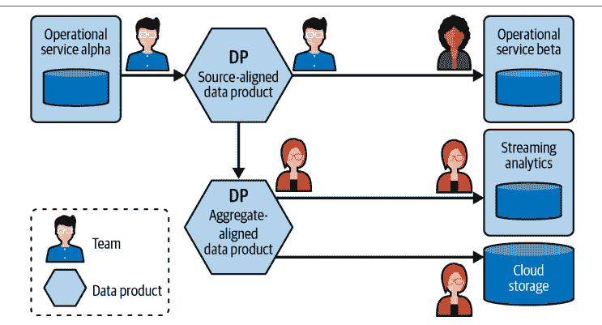
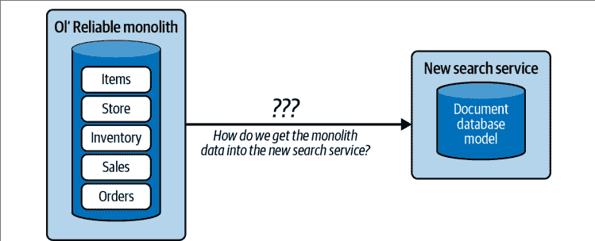
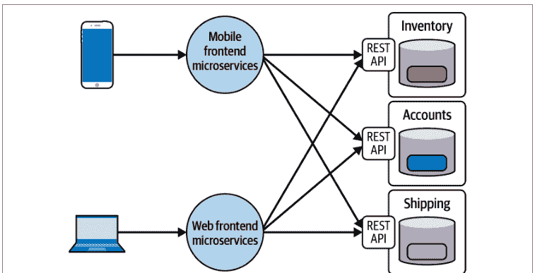
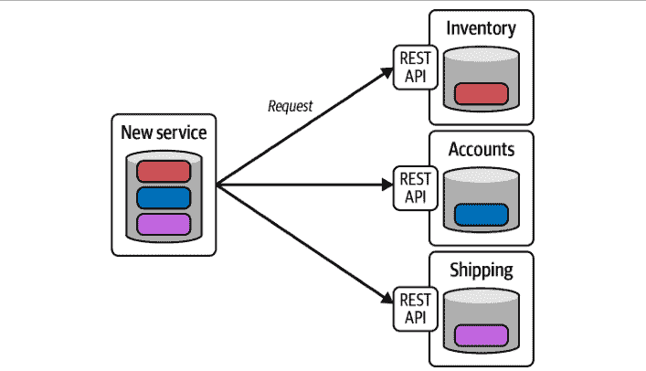
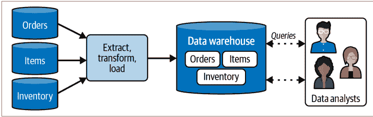
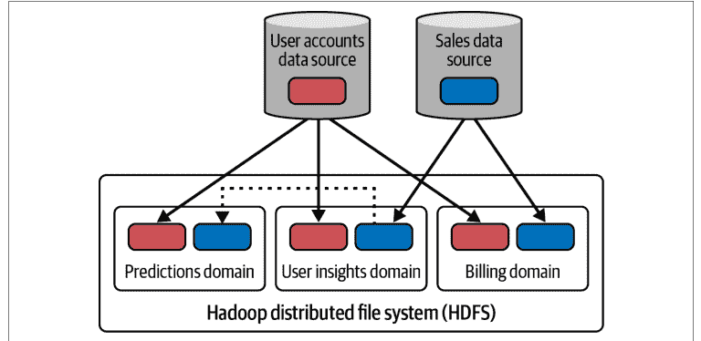

## 事件驱动的数据通信

企业与数据的关系正在快速变化。企业的所有数据都能整齐地装入单个关系数据库的日子已经一去不复返。始于二十多年前的大数据革命已经发展演变，仅将海量数据集存储在大数据湖中进行批量分析已不再足够。速度和互联互通已成为下一代主要竞争性业务要求，再次改变了企业创建、存储、访问和共享重要数据的方式。

数据是企业的命脉。但企业创建、共享和使用数据的许多方式都是杂乱无章且彼此脱节的。数据网格为重新审视这些往往功能失调的关系提供了一个全面的框架，并提供了一种在组织内思考、构建和共享数据的新方式，从而使我们能够做出有帮助和有用的事情：为客户提供更好的服务、无错误的报告、可操作的洞察，以及实现真正的数据驱动流程。

为了了解我们试图修复的问题，我们首先需要了解现代企业面临的主要数据问题。

首先，支撑公司业务分析引擎的大数据系统在规模和复杂性上已急剧膨胀。已经有许多尝试来解决和降低这种复杂性，但它们都未能达标。

其次，大型企业的业务运营早已超越了由单体部署服务的阶段。多服务部署已成为常态，包括微服务和面向服务的架构。这些模块化系统的边界很少容易定义，尤其是当许多独立的运营和分析系统依赖于对同一数据集的只读访问时。这里存在一种对立的张力：一方面，将业务功能部署在同一个应用程序中可以提供对该系统生成和存储的所有数据的一致访问。另一方面，这些业务功能之间除了需要共同只读访问重要业务数据外，可能根本没有任何关系。

第三，运营和分析领域共同面临的一个问题：无法访问高质量、文档齐全、自动更新且可靠的数据。组织处理的数据量年年大幅增加，迫切需要更好的排序、存储和使用数据的方法。这种压力给将一切保存在单个数据库中的理想致命一击，并迫使开发人员将单体应用程序拆分为带有各自数据库的独立部署。与此同时，大数据团队努力跟上这些运营系统的碎片化和重构步伐，因为他们仍然独自负责获取自己的数据。

数据在历史上一直被视为二等公民，被视为业务应用程序排放的废气或副产品。这种以应用为先的思维仍然是当今计算环境中问题的主要根源，导致了临时搭建的数据管道、拼凑在一起的数据访问机制以及相似却不尽相同的真理来源不一致。数据网格通过从根本上改变我们与数据的关系，直面这些缺陷。数据及其访问权不再是次要的副产品，而是被提升为与任何其他业务服务地位平等的一等公民。

重要的业务数据需要作为应用程序的构建块原语，随时可靠地可用，无论应用程序的运行时、环境或代码库如何。我们将数据视为一等公民，配备专属所有权、最低质量保证、服务级别协议（SLA）以及用于干净可靠访问的可扩展机制。事件流是提供此数据的理想机制，以一种简单而强大的方式在组织内可靠地传达重要业务数据，使每个消费者能够访问和使用他们需要的数据原语。

在本章中，我们将审视塑造当今常用运营和分析工具与系统的力量，以及伴随它们而来的问题。当代数据架构中巨大的低效为我们提供了丰富的经验，我们将把这些经验应用到事件驱动的解决方案中。这将为下一章奠定基础，届时我们将讨论数据网格的整体。

## 什么是数据网格？

数据网格由扎马克·德赫加尼发明。它是跨组织创建、访问和共享数据方式的一项社会和技术转变。数据网格提供了一种 *通用语言*，用于讨论不同团队、领域和服务的需求与职责，以及它们如何协作使数据成为一等公民。本章探讨构成数据网格基础的原则。

在我的上一本书 *Building Event-Driven Microservices*（O'Reilly）中，我引入了 *数据通信层* 这一术语，涉及与数据网格许多相同的原则：将数据视为一等公民，形式化域间通信的结构，将数据发布到事件流以供通用用途，并使数据生产者和消费者都能轻松使用。虽然我喜欢数据通信层这一术语，但现实是，我认为数据网格的语言和形式化原则为我们讨论这个问题提供了一切所需，*无需* 引入另一个“数据某某某”范式。

Dehghani 的书 *Data Mesh*（O'Reilly）深入详细地展示了数据网格的理论和思想领导力，但仍然必然对特定实施保持中立。

在本书中，我们将探讨数据网格的一个实际实现，它使用事件流作为跨域数据通信的主要数据产品模式。我们可以更加务实，理论方面不那么深入，而在事件驱动设计的实施方面更加具体和明确。虽然我认为事件流从根本上说是跨域通信的最佳选择，但它们也伴随着权衡，我当然也会涵盖这些权衡，并在最适合的地方提及非流式可能性。

数据网格基于四个主要原则：域所有权、数据即产品、联邦治理和自助服务平台。这些原则共同帮助我们构建一种在整个组织内传达重要业务数据的方式。我们将在下一章更详细地评估这些原则，但在到那之前，让我们先看看 *为什么数据网格今天很重要*。

## 事件驱动的数据网格

大数据实时流动的现代竞争要求，结合现代云计算，要求我们重新思考企业如何创建、存储、移动和使用数据。这种新数据架构的基础是事件，即代表真实业务活动的数据量子，通过大量专门构建的事件流提供。事件流提供了一种中枢神经系统的手段，使业务单元能够访问和使用基本的、自更新的数据构建块。这些数据构建块与容器化、基础设施即服务（IaaS）、持续集成（CI）和持续部署（CD）管道以及监控解决方案并列，是现代云应用程序构建所依赖的组件。

事件流并非新事物。但支撑以前事件驱动架构的许多技术限制，例如有限的规模、保留期和性能，已在很大程度上得到缓解。现代多租户事件代理配备分层存储，可以存储无限量的数据，消除了限制以前架构的严格容量限制。生产者将其重要的业务域数据写入事件流，使其他人可以与该流耦合并使用数据构建块来构建自己的应用程序。最后，消费者应用程序反过来可以创建自己的事件流，与他人共享自己的业务事实，从而为所有人创建一个标准化的通信网格。

数据网格为构建这个互联的中枢神经系统提供了非常有用的概念和语言。图 1-1 显示了数据网格可能的基本示例。

图 1-1. 一个非常基础的 Hello Data Mesh 实现

拥有操作系统 Alpha 的团队从其服务边界中选择一些数据，对其进行重新建模，并将其写入源对齐数据产品（该产品由他们拥有，我们将在“三种数据产品对齐类型”第 33 页中详细介绍数据产品对齐）。拥有操作系统 Beta 的团队将数据从该数据产品读取到其自身服务边界中，再次对其进行重新建模、转换，并仅存储他们需要的内容。

与此同时，第三个团队连接到 Alpha 团队的数据产品，并使用它来构建自己的聚合对齐数据产品。同一团队随后使用其聚合对齐数据产品，既为流式分析用例提供动力，又将一批文件写入云存储，数据分析师将使用它来编写报告并为现有的基于批处理的分析作业提供动力。

这个图表仅仅是数据网格冰山的一角，还有许多领域需要涵盖。但事件驱动数据网格的要点是，将数据以实时方式轻松提供给任何需要它的消费者。

数据网格解决的许多问题已经存在很长时间了。我们现在将进行一次简短的历史回顾，以便更好地理解我们正在解决 *什么* 问题，以及 *为什么* 数据网格是一个非常相关且强大的解决方案。

## 在操作面中使用数据

数据通常由正在 *处理业务事务* 的操作系统创建。最终，这些数据往往会被拉入分析面用于分析和报告。在本节中，我们将重点介绍操作面的一些内容，以及与其他操作（和分析）服务共享业务数据的常见挑战。

### 数据单体

在线事务处理（OLTP）数据库构成了当今大多数操作计算机服务的基础（为简单起见，我们将其称为“单体”）。单体系统在操作面中往往扮演重要角色，因为一致的同步通信通常比异步通信更容易理解和开发。关系型数据库，例如 PostgreSQL 和 MySQL，在单体应用程序中占据重要地位，为应用程序提供原子性、一致性、隔离性和持久性（ACID）事务以及一致状态。

应用程序和数据库共同展示了以下 *单体数据原则*：

- *数据库是真理来源*
  单体依赖底层数据库作为应用程序的持久信息存储。任何新记录或更新记录首先都会写入数据库，使其成为这些实体的 *权威真理来源*。

- *数据具有强一致性*
  当单体的数据存储在典型的关系型数据库中时，它具有强一致性。这为业务逻辑提供了强读后写一致性，并且得益于事务，它不会意外访问部分更新的记录。

- *只读数据随时可用*
  存储在单体数据库中的数据可以由单体的任何部分轻松访问。只读访问权限确保不会对数据进行意外更改。

请注意，数据库应仅由拥有它的服务直接访问，而不应用作集成点。

这三个原则构成了使单体架构强大的约束力。您的应用程序代码对存储在单体数据库中的整个数据范围具有只读访问权限，作为一组权威、一致且可访问的数据基元。只要功能在同一应用程序中，这个基础就使构建新应用程序功能变得容易。但如果您需要构建一个新应用程序呢？

### 为操作问题传达数据的困难

新应用程序无法依赖于如果它作为单体的一部分构建时所能获得的相同轻松访问数据基元的方式。如果新应用程序不需要单体中的任何业务数据，这将不是问题。但情况很少如此，因为企业实际上是一组重叠的域，尤其是共同核心，相同的数据服务于多个业务需求。例如，电子商务零售商可能依赖其单体来处理订单、销售和库存，但需要一个由文档数据库（或其他数据库类型）驱动的新应用程序来实现纯文本搜索功能。图 1-2 凸显了问题的关键：如何将数据从 Ol’ Reliable 移入新的文档数据库以提供搜索功能？

图 1-2. 新搜索服务团队必须想办法将所需数据从单体中导出并保持最新

这给新搜索服务团队带来了一些困境。该服务需要访问单体中的项目、商店和库存数据，但它还需要将所有数据建模为搜索引擎的一组文档。团队尝试解决此问题的两种常见方法是：一种是将数据复制并转换到搜索引擎，试图保留三个单体数据原则。第二种是使用 API 重构源系统的服务边界，例如

that the same data isn’t simply copied out—but served completely from a single system. Both can achieve some success, but are ultimately insufficient as a general solution. Let’s take a look at these in more detail to see why.

## 策略 1：在服务之间复制数据

There are several mechanisms that fall under this strategy. The first and simplest is to just reach into the database and grab the data you need, when you need it. A slightly more structured approach is to periodically query the source database and dump the set of results into your new structure. While this gives you the benefit of selecting a different data store technology for your new service, there are a few major drawbacks:

### 与源紧密耦合

You remain coupled on the source database’s internal model and rely on it exclusively to handle your query needs.

### 对源的性能负载

Large data sets and complex queries can grind the database to a halt. This is especially true in the case of denormalizing data for analytical use cases, where multi-table and complex joins are common.

The second most common mechanism for the data replication strategy is a read-only replica of the source database. While this may help alleviate query performance issues, consumers still remain coupled on the internal model. And, unfortunately, each additional external coupling on the internal data model makes change more expensive, risky, and difficult for all involved members.

Coupling on the internal data model of a source system causes many problems. The source model will change in the course of normal business evolution, which often causes breakages in both the periodic queries and internal operations of all external consumers. Each coupled service will need to refactor its copy of the model to match what is available from the source, migrate data from the old model to the new model, and update its business code accordingly. There is a substantial amount of risk in each of these steps, as a failure to perform each one correctly can lead to misunderstandings in the meaning of the models, divergent copies of the data, and ultimately incorrect business results.

Data replication strategies become more difficult to maintain with each new independent source and each new required replica. This introduces a few new issues:

- The original data set can be difficult to discover

It's not uncommon for a team to accidentally couple its service on a copy of the original data, rather than the original data itself. It can be difficult to discover what the original source of data is without resorting to informal knowledge networks.

- Increase in point-to-point connections

Additionally, each new independent service may become its own authoritative source of data, increasing the number of point-to-point connections for inter-service data replication.

Point-to-point replication of data between services introduces additional complexity, while simultaneously introducing tight coupling on the internal data model of the source. It is insufficient for building the modern data communications layer.

## 策略 2：使用 API 避免数据复制需求

Directly coupled request-response microservices, also sometimes known as synchronous microservices, are another common approach to dealing with accessing remote data. Microservices can directly call the API of another service to exchange small amounts of information and perform work on each other's behalf.

For example, you may have one microservice that manages inventory-related operations, while you have other microservices dedicated to shipping and accounts. Each of these services' requests originate from the dedicated mobile frontend and web frontend microservices, which stitch together operations and return a seamless view to users, as shown in Figure 1-3.

*Figure 1-3. An example of a simple ecommerce microservice architecture*

Synchronous microservices have many benefits:

- Purpose-built services serve the needs of the business domain.
- The owners have a high level of independence to use the tools, technologies, and models that work best for their needs.
- Teams also have more control over the boundaries of their domains, including control and decision making over how to expand them to help serve other clients' needs.

There are numerous books written on synchronous microservices, such as *Building Microservices* by Sam Newman (O’Reilly) and *Microservices Patterns* by Chris Richardson (Manning), that go into far more detail than I have space for, so I won't delve into them in much detail here.

The main downsides of this strategy are the same as with a single service:

- There is no easy and reliable mechanism for accessing data beyond the mechanisms provided in the microservices' API.
- Synchronous microservices are usually structured to offer up an API of *business operations*, not for serving reliable bulk data access to the underlying domain.
- Most teams resort to the same fallbacks as a single monolith does: reach into the database and pull out the data you need, when you need it, (see Figure 1-4).

Figure 1-4. The microservice boundaries may not line up with the needs of the business problem

In this figure, the new service is reliant on the inventory, accounts, and shipping services just for access to the underlying business data—but not for the execution of any business logic. While this form of data access *can* be served via a synchronous API, it may not be suitable for all use cases. For example, large data sets, time-sensitive data, and complex models can prevent this type of access from becoming reality. In addition, there is the operational burden of providing the data access API and data serving performance on top of that of the base microservice functionality.

Operational systems lack a generalized solution for communicating important business data between services. This isn’t something that’s isolated to just operations. The big data domain, underpinning and powering analytics, reporting, machine learning, AI, and other business services, is a voracious consumer of full data sets from all across the business.

While domain boundary violations in the form of smash and grab data access are the foundation on which big data engineering has been built (I have been a part of such raids during the decade I have spent in this space), fortunately for us, it has provided us with rich insights that we can apply to make a better solution for all data users. But before we get to that, let’s take a look at the big data domain requirements for accessing and using data and how this space evolved to where it is today.

## The Analytical Plane: Data Warehouses and Data Lakes

Whereas operational concerns focus primarily on OLTP and server-to-server communication, analytical concerns are historically focused on answering questions about the overall performance of the business. Online analytical processing (OLAP) systems store data in a format more suitable to analytical queries, allowing data analysts to evaluate data on different dimensions. Data warehouses help answer questions such as “How many items did we sell last year?” and “What was our most popular item?” Answering these questions requires remodeling operational data into a model suitable for analytics, and also accounting for the vast amounts of data where the answers are ultimately found.

Getting data into a data warehouse has historically relied on a process known as Extract, Transform, and Load (ETL), as shown in Figure 1-5.

图 1-5. 典型的数据仓库 ETL 工作流

从历史上看，数据仓库在提供分析结果方面已被证明很成功。但不断增加的数据量和计算负载需要更大的磁盘驱动器和更强大的计算芯片，最终触及了计算机硬件的物理极限。因此，与其继续纵向扩展，不如转向横向扩展。

对 Google 来说，对大规模扩展的需求显而易见，该公司于 2003 年 10 月发表了 **Google 文件系统**。这个时代见证了大数据的诞生，并促使全球对如何创建、存储、处理以及最终使用数据进行了大规模重新思考。

许多现代数据仓库也提供高可扩展性，但直到大数据革命到来，这才成为现实。从历史上看，数据仓库受到与任何在单服务器上运行的系统相同的因素的限制。

**Apache Hadoop** 迅速成为解决传统 OLAP 系统面临的扩展问题的权威方法。由于它是免费开源的，任何公司、任何地方都可以使用它，前提是你能弄清楚如何管理基础设施要求。它还提供了一种计算分析的新方式，在这种方式下，你不再受限于受单台计算机资源限制的专有系统。

Hadoop 引入了 Hadoop 分布式文件系统 (HDFS)，这是一个耐用、容错的文件系统，使得创建、存储和处理跨越多个通用硬件节点的真正大规模数据集成为可能。虽然 HDFS 现在已被 Amazon S3 和 Google Cloud Storage 等方案大部分取代，但它为一个大胆的新想法铺平了道路：无论大小，将所需的所有数据复制到一个单一逻辑位置，并应用处理来清理、筛选并将数据重塑为推导重要业务分析所需的格式。

大数据架构在对待数据的心态上引入了重大转变。它不仅解决了现有 OLAP 系统的容量问题，还向数据世界引入了一个新概念：使用非结构化或半结构化数据不仅是可以接受的，而且是更可取的，而不是像数据仓库那样强制执行写入时模式。在这个大数据新世界中，你可以自由地写入带有或不带任何模式或结构的数据，并在查询时通过应用读取时模式稍后解决所有问题。许多数据工程师很高兴摆脱了写入时模式的要求，因为这使得只需将数据放入生态系统变得更容易。

表 1-1. 关系型数据库管理系统与 Hadoop 的比较（约 2009 年）

| | 传统 RDBMS | MapReduce |
|---|---|---|
| 数据大小 | GB | PB |
| 访问 | 交互式和批处理 | 批处理 |
| 更新 | 多次读写 | 写一次，多次读取 |
| 结构 | 静态模式 | 动态模式 |
| 完整性 | 高 | 低 |
| 扩展 | 非线性 | 线性 |

值得注意的是，这份 2009 年的权威指南推广 MapReduce 作为处理具有动态模式的低完整性数据的解决方案，强调 HDFS 应该以低完整性存储非结构化数据，并带有在运行时解决的各种可能相互冲突的模式。它还指出，这些数据是“写一次，多次读取”，这恰恰是你需要一个强大、一致、强制执行的模式的场景——这为善意但不受约束的数据使用者提供了大量机会，让他们应用一个误解或使数据无效的读取时模式。

写入时模式（包括带有类型、默认值、可空性和名称的定义明确的列）并不一定以任何方式限制下游转换。它也不强迫你在写入前反范式化或连接任何数据。

模式确实为你提供了一个合理性检查，确保你摄入的数据至少符合下游处理器的最基本预期。放弃这个合理性检查会将错误检测推向下游，给试图使用数据的人带来重大困难。

在 Hadoop 早期，我认为我自己——或者许多其他人——都没有意识到读取时模式的概念最终会如何改变数据的收集、存储和分析方式。我们相信并支持这样一种想法：按需获取数据，事后再弄清楚，稍后重新构建、清理并强制执行模式。这也让那些考虑迁移到 Hadoop 以缓解分析约束的人觉得非常容易接受，因为这种迁移不会限制你的写入过程，也不会用严格的数据摄入规则来烦扰你——毕竟，你可以在数据复制过后再修复它！

不幸的是，将非结构化数据存储以供读取时模式使用这一基本原则，被证明是大数据革命引入的代价最高、破坏性最大的信条之一。让我们来看看这如何具体负面影响分布式数据访问，以及为什么定义明确的模式化数据是数据网格中如此重要的信条。

## 读取时模式的组织影响

在读取时而非写入时强制执行模式，会导致我们所谓的“坏数据”大量泛滥。缺乏写入时检查意味着写入 HDFS 的数据可能不符合读者在现有工作中使用的模式，如图 1-6 所示。一些坏数据会导致消费者停止处理，而其他坏数据可能会悄然未被发现。虽然这两者都有问题，但静默失败可能是致命的，而且难以检测。

| 记录 ID | 名称（字符串，非 NULL） | 大小（字符串，非 NULL） | 数量（int > 0） | 价格（Float） | 是否符合预期模式 |
|---|---|---|---|---|---|
| 1 | "Adam Bellerame" | "Medium" | -3 | $12.50 | 否 |
| 2 | "Mackenzie B. Dog" | "Small" | 15 | $22.37 | 是 |
| 3 | 8675309 | NULL | 12 | $98.75 | 否 |
| 4 | NULL | "Extra-Large" | 100 | <null> | 否 |
| ... | ... | ... | ... | ... | ... |
| 100 | "Julia Banderas" | "Tiny" | 2 | $12.50 | 是 |

图 1-6. 数据集中坏数据的示例，仅在读取时发现

为了更好地理解读取时模式的破坏性影响，让我们来看看三个角色及其相互关系。虽然我受限于自身经验，但在职业生涯中，我很有幸与来自不同公司和业务线的许多其他数据人员交谈。我可以自信地说，虽然不同组织的职责有所不同，但这一角色摘要在很大程度上适用于大多数使用大数据的当代组织：

### 数据分析师

负责回答业务问题、生成洞察并创建数据驱动的报告。数据分析师查询数据工程师提供的数据集。

### 数据工程师

负责从组织各处系统中获取重要业务数据，并将其转换为数据分析师可使用的格式。

### 应用开发人员

负责开发解决业务问题的应用程序。该应用程序的数据库也是数据分析师完成工作所需数据的*也是*来源。

从历史上看，采用 Hadoop 最常见的方式是建立一个专门的*数据团队*，它可以是常规工程团队的子集，也可以完全独立于该团队。数据工程师会进入应用开发人员的数据库，获取所需数据，并将其拉出放入 HDFS。数据科学家会对其进行清理和重构（并可能在此基础上构建机器学习模型），然后将其传递用于分析。

最后，数据分析师会查询和处理捕获的数据集，以回答他们的分析问题。然而，这种模式导致了许多问题。数据团队与应用开发人员之间的交流不频繁，通常围绕确保数据团队的查询负载不影响生产服务能力展开。

这种关注点和职责的分离存在三个主要问题。让我们来看看它们。

### 问题 1：违反数据模型边界

摄入到分析领域的数据与源的*内部数据模型*耦合，导致该数据的所有下游用户都直接耦合。对于简单且很少更改的源，这可能不是什么大问题。但许多模型跨越多个表，是专门为 OLTP 操作构建的，并且随着业务用例的变化可能会进行大量重构。直接耦合于这个内部模型会使所有下游用户暴露于这些变化之下。

我见过的一个例子是，表格修改默默破坏了下游作业，涉及将一个字段从 boolean 改为 long。原始版本代表对“客户是否付费推广此项？”这一问题的答案。更新版本代表新扩展域的预算 ID，将模型的这一部分与预算及其关联类型（包括新的试用类型）联系起来。该企业已采用“先试后买”模式，即预留，比如，几百美元的广告积分来展示推广效果，而不将其计入总毛收益。

摄取这些数据到 HDFS 的作业毫无滞后（无写入 schema），但一些下游作业开始报告奇怪的值。其中大多数是 Python 作业，它们轻易地将新的 Long 值评估为 Booleans，导致各种用户分析的过度归因。不幸的是，因为没有作业实际中断，此问题直到一位客户开始询问其报告中异常结果时才被发现。这只是我遇到的众多例子之一，其中出于好意、合理的对系统数据模型的更改，会对所有已与之耦合的人产生意外后果。

### Problem 2: Lack of single ownership

应用开发人员是领域专家和源数据模型的掌控者，但他们将数据传达给其他团队（例如大数据团队）的责任通常不存在。相反，他们的职责通常在其应用程序和数据库的边界处结束。

与此同时，数据工程师的任务是找到一种方法，及时将数据从应用开发人员的数据库中提取出来，而不会对生产系统产生负面影响。数据工程师依赖于数据源，但通常对数据源的变化几乎没有影响力，使其角色非常被动。这种生产/数据鸿沟在许多组织中是一个非常真实的障碍，尽管尽力而为、有协议、集成检查和预防性工具，数据摄取管道中的中断仍然是常见主题。

最后，负责实际使用数据来获取商业价值的数据分析师，与领域专家（应用开发人员）相隔两度分离；如果中间还有一层不断处理数据的数据科学家，则相隔三度分离。分析师和数据科学家都必须处理数据工程师能够提取的任何数据，包括解决与其现有读取 schema 不匹配的不一致数据。由于数据分析师经常与其他数据分析师共享他们的 schema，他们还需要确保其解析后的 schema 不会破坏彼此的工作。随着组织及其数据的增长，这变得越来越难以做到，而不幸的是，他们的解决努力仍然局限于仅惠及其他分析师。运营用例必须自己想办法获取数据。

### Problem 3: Do-it-yourself and custom point-to-point data connections

小型组织的数据团队可能只有寥寥数名成员，而大型组织的数据团队则由数百或数千名成员组成。对于大型数据组织来说，根据用例、团队边界和技术边界，将相同的数据源拉入数据平台的多个不同子域中是很常见的。

例如，销售数据可能会被拉入分析部门、消费者报告部门和应收账款部门。每个子组通常会独立创建、调度和执行 ETL 作业，将数据拉入其自身的子域，从而导致源数据的多个独立托管副本，如图 1-7 所示。

Figure 1-7. Three analytical domains, each grabbing data from where it can to get its work done

尽管专门构建的点对点数据连接让用户能在需要的地方访问所需数据，但最终会造成一团混乱。很难说 ETL 作业归谁所有，尤其是当用户和团队共享访问凭据时。追溯血缘、新鲜度以及确定数据集的所有权同样困难，通常会导致新 ETL 作业的进一步增多。毕竟，如果你不确定数据是否正是你所需要的，那么不如自己制作一个作业和一个副本以求保险。

在源上强制执行访问控制可以帮助澄清谁可以访问哪些数据，但仅限于主源。但是，限制数据访问可能会适得其反。冗长或繁琐的访问流程可能导致人们直接从其他受保护较少的源制作副本。在图 1-7 中，请注意，预测域只是通过从用户洞察域复制销售数据来规避源访问控制。

但这些副本 _really_ 是同一份数据吗？同步频率、转换、时区、间歇性故障以及错误的环境（例如，暂存环境而非生产环境）只是可能影响复制源完整性的少数问题。你可能 _think_ 你得到了正确的数据，但实际上并没有，而且你并不知道。例如，你复制一个数据集，以为它同步到 UTC-0 时间，但实际上它同步到 UTC-6。数据的格式、分区和顺序可能看起来相同，但这些难以检测、未记录的差异仍然存在。

自定义点对点连接难以维护，会导致数据泛滥，并可能导致许多重复的同步作业，这些作业生成相似但不同的数据。

这种支离破碎的模式以及数据所有权和分发的责任导致了 _bad data_，这在时间、金钱和错失机会方面代价高昂。让我们先看看成本，然后再总结数据网格声称能解决这些问题的原因。

## Bad Data: The Costs of Inaction

坏数据通常在应用到 schema 之前都不易被发现。例如，你无法将 TEXT 插入数据库的 Int32 列中。然而，通过使用读取时 schema，我们实际上将数据验证推迟到了数据管道流程的末尾。虽然我们的 _sources_ 可能使用 schema，但不能保证我们无数个点对点管道已正确将 schema 与数据一起捕获。许多 Int32 被当作 String 捕获，或者最糟糕的是，被当作 Object 捕获。

修复坏数据成本高昂，而且其范围越广，代价越高。所有访问、使用、复制或处理过该数据的人都可能受到影响，并可能需要采取缓解措施。更复杂的是，并非每个消费者都会以相同的方式“修复”它。这可能导致与其他结果不一致的分歧结果，并且难以检测、追踪和纠正，堪称噩梦。

坏数据通常由出于好意的人无意中创建，仅仅是因为许多数据传输工具具有点对点的“伸手去抓”特性。大规模的使用进一步加剧了这一问题，团队发现不仅他们的数据集副本是错误的，而且已经错误好几个月，使用该数据集计算的每个下游作业的结果也都是错误的。这些作业可能使用数百或数千个处理节点，拥有 32 倍到 128 倍更多的 GB 内存，每晚处理数百 TB 的数据。这仅在重新运行所有受影响作业的处理成本上就可能高达数百万甚至数千万或数亿美元。

商业决策也可能受到影响。我了解一个场景的细节，其中一家公司错误地向其客户共同收取了数百万美元的账单，有些情况下多收了，有些情况下少收了。原因其实相当无辜：一个 schema 变更与复杂的“伸手去抓”数据 ETL 链结合，导致在读取时应用 schema 时出现了一些数据解释问题。直到一位客户注意到其账单成本远超参与成本时，才启动了调查并发现了根本问题。

数据在现代计算中日益凸显的地位促使其他人研究相关成本，尤其是坏数据给企业带来多少损失。结果触目惊心。

2016 年，IBM 的一份报告被《哈佛商业评论》（HBR）重点介绍，估计坏数据的财务影响仅在美国就高达 3.1 万亿美元。尽管原始报告（令人沮丧地）不再可用，但 HBR 保留了一些更相关的数字：

- 50%—知识工作者浪费在寻找数据、查找和纠正错误以及为不信任的数据寻找确认来源上的时间比例。
- 60%—数据科学家花在清理和组织数据上的时间比例的估计值。

坏数据问题已经存在很长时间。随着原始源的变化，数据副本会产生分歧。副本会过时。在一个数据集中检测到的错误不会在重复副本中修复。与解释和理解数据相关的领域知识仍然不完整，原始数据所有者的支持也是如此。

数据网格提议通过将数据提升为一等公民、像任何其他产品一样来解决此问题。一个具有定义良好的 schema、域文档、标准化访问机制和 SLA 的数据产品可以在源头上大幅减少坏数据的影响。消费者一旦与数据产品耦合，仍可能犯自己的业务逻辑错误——这是不可避免的。但是，他们

很少仅在试图获取、理解和解释解决其业务问题所需的数据时无意中犯错。不行动不是解决方案。

## 我们能统一分析与运营工作流吗？

工程核心还存在另一个问题——不仅仅是数据团队面临这些数据访问和质量问题。每一个需要访问存储在其他数据库中的数据的 OLTP 应用程序，都与数据团队面临相同的数据访问问题。你如何为运营需求访问被锁定在另一服务中的重要业务数据？

为了实现服务间更好的运营通信，曾有过多次尝试，包括面向服务架构、企业服务总线，当然还有点对点请求-响应微服务。但是，在这些架构中，每个服务的数据都封装在其自身数据库内，其他服务无法访问。从某种程度上说，这是件好事——内部模型受到保护，并且你拥有一个单一的真实来源。应用程序提供运营 API，其他应用程序可以调用这些 API 来代其执行工作。然而，这些解决方案并未解决根本问题：即无法全面、只读地访问权威数据集，以供其自行的运营用例使用。

更进一步的复杂之处在于，如今许多运营用例都依赖于分析结果。想想机器学习、推荐引擎、AI 等等。某些用例，例如生成畅销产品月度报告，可以明确标记为“分析型”，并从定期计算的作业中得出。

其他用例则不那么明确。考虑一家电子商务零售商，希望根据当前库存（运营型）、用户以往购买记录（分析型）以及用户实时预估的购物会话意图（分析型和运营型）来投放鞋类广告。在实际中，运营与分析之间的边界很少被清晰界定，而完全相同的数据集可能为多种目的所需要——分析型、运营型，或两者之间。

数据分析与传统运营系统在访问其他数据库中包含的数据时都面临巨大困难。这些困难因数据量、速度和规模的不断增加而进一步加剧，同时系统也被迫向外扩展而非向上扩展，因为各个服务的计算限制已达到瓶颈。大多数组织的数据通信策略都基于过去的技术，未能充分考虑现代云存储、计算和软件即服务（SaaS）的产品。这些工具和技术改变了组织内数据建模、存储和通信的方式，我们将在本书余下部分更详细地探讨这一点。

## 借助数据网格重新思考数据

数据网格解决方案的前提很简单。将重要的业务数据集发布到专用、持久且易于访问的数据结构中，这些结构被称为 *数据产品*。数据的原始创建者负责对数据进行建模、演进、质量控制和支持，并对其给予与组织中任何其他产品相同的一流关怀。

潜在消费者可以探索、发现并订阅其业务用例所需的数据产品。数据产品应有良好的描述、易于解释，并构成一组自更新数据基元的基础，用于驱动业务服务和分析。

事件流在数据产品基础中扮演着最佳角色，因为它们为所有消费者提供了不可变、可追加、持久且可重放的基础。这些流成为组织内运营、分析及所有其他形式工作负载的根本真实来源。

该架构通过利用现代云计算和 SaaS 构建（将在第 5 章中更详细地介绍）。一个良好的工程栈使得在整个应用生命周期中创建和管理应用变得容易，包括获取计算资源、提供可扩展性、日志记录和监控功能。事件流为现代工程栈提供了正式化和标准化的数据访问，以完成工作。

让我们通过本提案的视角，重新审视本章前文提到的 *单体数据原则*。这三项原则概述了在单体内并置新业务功能的主要影响因素。一组自更新事件流将如何与这些原则相关联？

*数据库是真实来源 → 事件流是真实来源*

数据域的所有者现在负责构建面向外部的模型，并将其作为一组事件写入一个（或多个）事件流。作为交换，其他服务不再能直接访问并依赖于内部数据模型，生产者也不再负责代表查询服务提供定制的业务任务（这在微服务架构中很常见）。事件流成为系统间主要的耦合点。下游服务从事件流中消费事件，针对自身目的对其建模，并将其存储在自己的专用数据存储中。

*数据具有强一致性 → 数据具有一致最终性*

事件流生产者可以为其自身内部状态保留强读后写一致性，以及诸如本地 ACID 事务等其他数据库优势。然而，事件流的消费者在处理事件和建模状态方面是独立的，因此依赖于其对已处理数据的最终一致性视图。消费者没有事件流的写入权限，因此无法修改数据源。消费者系统设计必须考虑到最终一致性，我们将在本书后续部分更详细地探讨这一主题。

*只读数据随时可用（保持不变！）*

事件流提供了一种正式化的机制，以只读、自更新的格式传递数据，消费者不再需要创建、管理和维护自己的提取机制。如果消费者应用程序需要保留状态，则它会使用自己的专用数据存储来实现，这与生产者的数据库完全独立。

数据网格正式化了组织内数据的所有权边界，并标准化了存储和通信机制。它还提供了一个可重用的框架，用于生产、消费、建模和使用数据，不仅适用于当前系统，也适用于尚未构建的系统。

## 对事件驱动数据网格的常见异议

在讨论事件驱动数据网格时，我经常遇到几种常见的异议。尽管我们将在本书中更详细地介绍这些情况，但我现在想提出它们，以承认这些异议的存在，但每一个异议都是可以管理的。

### 生产者无法为每个人的用例建模数据

这一论点实际上是正确的，尽管它忽略了重点。生产者的主要职责是为其域数据提供准确可靠的面向外部的公共模型，供消费者使用。这些数据模型只需暴露其他团队可以依赖的域部分；其余内部模型保持不可访问。例如，电子商务域将拥有独立的销售、商品和库存模型及事件流，简单详细说明每个销售、商品和库存级别的当前属性和值，而一家航运公司可能为每个货件、卡车和司机拥有事件流。

这些模型刻意简单且专注于单个域定义，从而形成紧凑、模块化的数据构建块，其他系统可以利用这些构建块构建自己的数据模型。摄入这些事件的消费者可以根据需要重新构建它们，包括将其与其他流中的事件关联，或将其与现有状态合并，以得出用于解决其业务用例的模型。消费者还可以与生产者团队接洽，请求向公共模型添加更多信息或对某些字段和值进行澄清。

由于生产者团队拥有原始数据模型，它最有资格决定模型的哪些方面应当暴露并允许他人与之耦合。事实上，没有比实际 *创建原始数据源* 的团队更有资格定义其含义以及他人应如何解释其字段、关系和值的含义。这种方法让数据源所有者能够抽象掉其内部复杂性，例如其高度规范化的关系模型或文档存储。对内部源模型的更改可以对消费者隐藏，否则消费者会直接与其耦合，从而减少中断和错误。

### 制作多份数据副本是不好的

讽刺的是，这一反对意见在潜意识里与第一个论点相对立。虽然和之前的论点一样，它确实有一定道理。同一数据集的多份副本可能会并且确实会不经意地不同步、变得过时，或者以其他方式提供与原始数据源不一致的数据。然而，我们的提议并非让数据复制变得无序，而是要建立一个正式化且得到良好支持的流程，以制定明确的规则和职责，拥抱这一现实而非逃避它。

这种论点主要有三种子类型。

### 数据应仅有一个主副本，所有系统都应直接引用它

这一信念未能考虑到以下事实：自大数据运动兴起之初（实际上，OLAP 也是如此）以来，全球的大数据分析团队就一直在违反这一原则，因为他们的需求无法通过某个数据库中存储的单个主副本来满足。它也未能考虑到其他运营系统的各种需求，这些系统遵循相同的边界突破性数据获取策略。这根本站不住脚。

源系统无法为所有业务用例对其数据进行建模，是同一数据集最终会存在多份副本的主要原因。一个系统可能需要在关系模型中支持 ACID 事务，而另一个系统必须支持用于地理位置和纯文本搜索的文档存储。第三个消费者可能需要将这些数据集写入 HDFS，以应用 MapReduce 风格的处理来得出其制作的 364 份该数据副本的结果，并与其他年度数据集交叉引用。所有这些都无法由单个中央数据库提供服务，如果不是因为建模问题，则是因为无法为所有用例提供满意的性能。

### 创建、存储和更新同一数据的多个副本在计算上成本过高

这一论点过分关注移动和存储数据需要花费金钱，因此存储同一数据的副本是浪费的（当然，不考虑重建模型和性能等因素）。这一论点未能考虑到云计算的低成本，特别是当今主要云服务提供商异常廉价的存储和网络成本。它也未能考虑构建和支持自定义 ETL 管道所需的开发人员工时，这是创建、查找和使用数据中数万亿美元低效问题的一部分。

对于大多数业务应用程序来说，优化以最大限度减少数据传输、应用程序大小和磁盘使用量已不再像过去那样重要。相反，优先事项应放在最大限度减少访问数据构建块所需的开发人员精力上，并着重于运营灵活性。

### 管理跨系统和分布式数据集的信息安全策略太难

通过数据产品正式化数据访问，允许您应用用户和服务访问控制。加密让您能够保护所有敏感数据不被未经授权的消费者访问，因此只有获得许可的人才能读取敏感数据。

自助服务平台在数据网格架构中发挥着重要作用，因为它强制执行所有安全策略、访问控制和加密要求。信息安全合规性已集成到数据产品生产者和消费者的正常工作流程中，使执行和审计合规性变得容易得多。

### 最终一致性太难以管理

通过事件流传输的数据确实需要考虑并规划最终一致性。然而，认为最终一致性太难以管理的抱怨通常基于对其对整体业务流程影响程度的误解。我们可以正确定义系统边界，以考虑系统之间的最终一致性，同时在系统内部实现强一致性。无法回避——如果某个业务流程需要完美一致性，那么数据的创建和使用必须在同一服务边界内。但大多数业务流程不需要这样，对于那些需要的业务流程，本书所提议的任何内容都不会阻止您获得它。我们将在第十章中更详细地讨论如何处理最终一致性。

## 摘要

面对真实的业务需求，现有的数据通信策略会力不从心。通过越过服务边界直接获取其数据的做法并不可持续，但它极其普遍，并且通常支持多个关键系统和分析工作流。将系统重构为整齐的模块化微服务并不能解决数据访问问题；您业务的其他部分，例如大数据分析和机器学习团队，仍然需要跨组织领域对当前和历史数据进行全面访问。无论以何种方式，数据副本 *都* 会被创建，我们要么对抗这一现状，要么接受这一事实并致力于使其变得更好。选择后者，我们可以使用事件流来标准化并简化组织内的数据通信，作为自动更新的单一事实来源。

事件构成了事件驱动架构中通信的基础，并从根本上塑造了我们解决问题的空间。通过事件流传递的事件构成了构建异步和响应式系统的基础模块。这些基础模块是与同步 API 类似的原语：其他应用程序可以发现它们、与它们耦合，并使用它们来构建自己的服务。最终一致性、消费者特定模型、只读副本和流物化视图只是本书将探讨的部分概念，还包括现代云计算、存储和网络资源在这种新数据架构中的作用。

后续章节将深入探讨构建和使用事件驱动数据网格。我们将探讨如何设计事件，包括状态事件、动作事件和通知事件，以及生产和消费它们的模式。本书涵盖了大规模事件处理，包括多集群和多区域、隐私和法规合规性的最佳实践，以及处理最终一致性和异步通信的原则。我们将探讨适应事件驱动数据网格所需的社会和文化变革，并查看一些突出其他人成功经验和所学教训的现实案例研究。

最后，我们还将探讨您可以在自己的组织中采取的实际步骤，以开始向此目标构建。这种架构的最佳之处在于它是模块化和渐进式的，您可以一次在业务的一个领域开始利用其优势。虽然有一些初始投资，但现代云计算和 SaaS 解决方案几乎消除了进入壁垒，使您更容易开始并测试这是否是适合您的解决方案。
