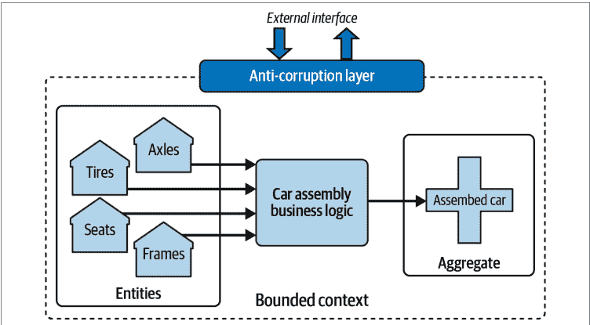
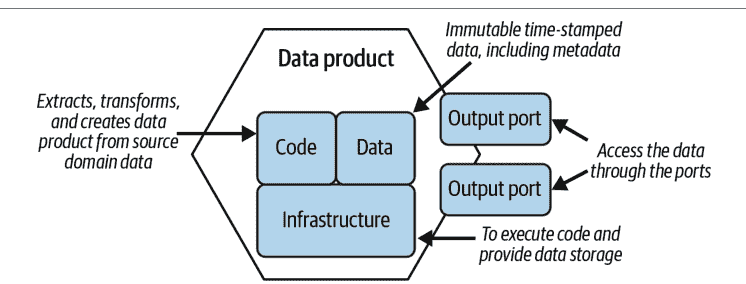
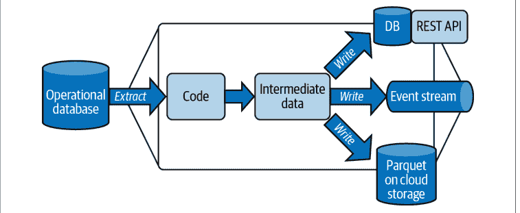
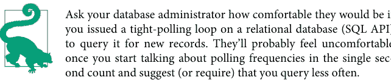
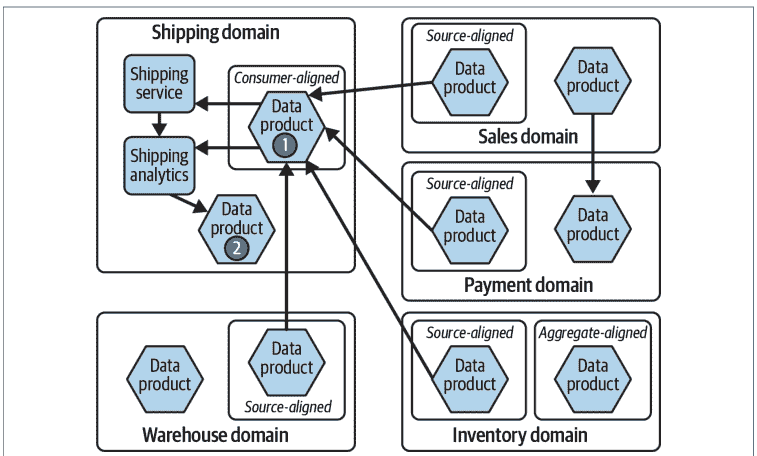
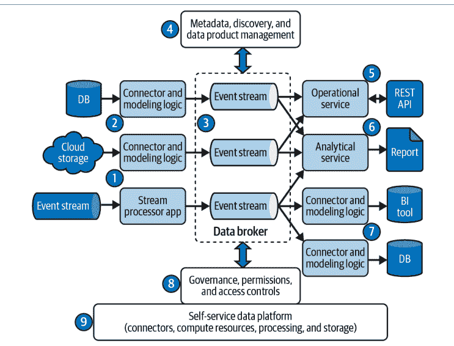

## 数据网格

我常听到的一个有说服力的电梯演讲将数据网格称为“数据的微服务”——相同的原则，但你是将它们应用于数据而不是服务。使用微服务的组织将有一个目录来查找可用服务，包括其 API、SLA、领域所有者、安全信息和访问控制，以及任何其他特定于组织的信息。微服务目录为您提供了可用于拼凑新业务应用程序的功能视图。

在微服务和数据网格两个领域中，常见的基础设施服务（例如 Git、Kubernetes、容器、持续集成、监控）提供自助工具，让您专注于构建有用的业务服务，而不是迷失在基础设施和平台中。数据网格与微服务架构形成直接类比——但使用的是数据集，而不是服务。

构建良好的数据网格的优势包括：

- 发现可信赖且可靠的数据，使投入使用更加便宜和快速。
- 使发布新数据源变得更加容易，以便他人可以快速而轻松地使用它们。
- 将数据视为一流产品，就像其他任何关键任务产品一样，包括专用资源、明确定义的职责、SLA 和产品发布周期。
- 减少并最终消除不可靠、脆弱且昂贵的数据管道和 ETL。


- 通过将事件流作为单一事实来源，消除分析系统与运营系统之间的数据不一致性。

数据网格依赖于四个相互关联的原则。我们将简要探讨每个原则，以及事件驱动数据在这些原则中所起的作用。后续章节将深入讨论这些原则、它们之间的关系，以及构建由事件流驱动的数据网格的具体内容。

## 原则 1：领域所有权

领域所有权的核心在于对自己的领域强制执行主权，无需征求他人批准或许可即可对其进行更改或修改。这一原则通过明确回答“领域所有权人”来确定性地回答“谁负责这个数据集？”这一问题。但完全的所有权伴随着一组重要的职责：以适合域外使用者使用的模式导出内部领域数据的一个子集。

在数据网格中，该数据的所有者负责使其随时可用——不再由数据的潜在使用者去想方设法访问它。首先，拥有源数据的团队最有资格确定模型的哪些部分应该（和不应该）向下游消费者暴露。其次，在源端建立数据所有权使责任边界形式化，简化了长期困扰传统集中式数据团队的所有权问题。

但是，责任不仅限于为导出建模数据，还包括处理待处理数据问题、确保访问方式保持可靠、确保数据模型的演变与历史预期保持兼容（第 137 页“架构演变（随时间变更架构）”有更多介绍），以及确保满足约定的 SLA。这不仅仅是改变谁为导出建模数据，而是最终责任的彻底转移。将数据建模和可用性的所有权转移给生产者，是远离当今数据仓库和数据湖策略中常见的集中化的根本性转变。与其让数据工程师和数据科学家试图弄清楚如何从服务边界内部获取数据（例如，将数据抓取到 ETL 作业中），源数据的所有者必须努力通过受支持良好且可靠的媒介提供必要的数据。

## 领域驱动设计简介

领域驱动设计（DDD）由 Eric Evans 在《领域驱动设计》(Addison-Wesley) 中创建并阐述，是一种应用于数据和领域建模的软件设计方法。它专注于对软件模型的结构和语言进行建模，以匹配业务领域。与数据网格类似，它也为我们提供了一种讨论软件和数据模型的通用语言。我们将借用 DDD 的通用语言来开始讨论如何在系统之间共享数据。区分“这里的数据”与“那里的数据”对于驾驭数据网格成功所需的社会变革和责任下放至关重要。

首先，我们有领域，即领域驱动设计中的领域。领域是个人或团队拥有控制权的兴趣或关注领域，包括构成它的所有实体、聚合、业务逻辑和上下文。简而言之，领域由我们在特定领域关注的事物组成，以便尝试为某个问题构建解决方案。

接下来是有界上下文。有界上下文被定义为领域内域模型适用的边界。在实践中，有界上下文还包含所谓的通用语言，它描述了边界内的每个组件，包括如何识别它、它与其他组件的关系，以及它的建模方式。


通用语言仅在有界上下文中是通用的——在另一个有界上下文中，相同的术语可能（并且经常）表示不同的含义。含义上的细微差别可能导致混淆和数据解释及使用的不一致。

实体是在领域内定义的具有唯一标识的事物或项目。这些最好被视为具有独特属性的对象，这些属性会随着时间的推移而经常变化和演变。例如，电子商务平台的实体包括待售商品、优惠券、交易、运输以及与仓库相关的事务，例如创建包裹和管理库存水平。

最后，聚合是一组可以作为单个单元处理的实体。进一步以我们的电子商务示例为例，将优惠券、商品、交易、运输和支付信息聚合起来，构成订单的基础。但是，要组合此订单聚合，需要应用特定于领域的业务逻辑将每个实体集成到聚合中——应用的顺序和方式完全是领域聚合所有者的关注点。

图 2-1 展示了一个简化的汽车制造领域，其中包含一个带有实体、聚合和业务逻辑的单一有界上下文。每个实体、聚合和流程在边界内都具有完全一致的含义，任何向外部世界暴露内部数据的行为都通过防腐层进行。

有了这些定义，我们就可以开始精确讨论我们要做什么：从领域的有界上下文中发布重要实体和聚合，以供其他领域使用。所有向域外提供的数据都将通过防腐层进行，因为我们想要控制哪些数据暴露、哪些数据不暴露，以确保外部各方不会直接耦合到内部模型。这使领域所有者能够在不不必要地影响外部数据消费者的情况下，演变和更改内部实现。



_图 2-1. 汽车制造领域示例，包括防腐层_

但是，我们如何知道从领域中选择和共享哪些数据？

## 从您的领域中选择要暴露的数据

决定从领域中暴露哪些数据可能有点棘手。最好的起点之一是识别对领域至关重要的实体，因为它们通常是值得评估的首选候选项。鉴于前一节中的电子商务示例，我们可以暴露与待售商品和已创建订单相关的数据。由于该领域也映射到物理世界，暴露当前库存也是合理的，以确保库存正确地向最终用户显示。

我们还可能会将选定的支付信息作为单独的数据集暴露出来，因为这将为财务团队提供重要信息。我们可以通过唯一 ID 映射将支付与订单关联起来，允许下游消费者根据需要将它们合并，或者简单地只使用与其用例相关的数据。

但是，确定哪些领域数据对其他人有必要的最佳方法，就是直接询问他们。采取以客户为中心的方法，关注依赖于您领域的业务流程的需求。这就带我们来到了下一个数据网格原则。

## 原则 2：将数据视为产品

这一原则将数据提升到一等公民的地位，与组织创建的任何其他产品同等对待。这是对数据创建、存储和向其他领域传达方式的完全重新构想。通过应用现有生产产品的同样产品严谨性，我们可以形式化跨领域构建和传达数据的方式。

领域所有者负责识别、提取和建模其数据，以便作为数据产品呈现给外部访问。毕竟，除了领域模型专家，还有谁更适合构建用于导出的数据？而且与任何其他产品一样，会识别并咨询潜在消费者，以确保数据产品是为满足其需求而构建的。但是，数据产品不仅仅是数据本身——它还包括构建数据的代码、存储数据的基础设施，以及用于访问数据的端口（或模式），如图 2-2 所示。



图 2-2. 构成数据产品的代码、数据、基础设施和端口

这四个组件是所有数据产品共有的。每个数据产品创建者都需要牢记这些组件来识别和构建其数据产品。

我们将简化数据产品的创建和管理，就像对待微服务一样，以减少每个数据产品所有者的开销和琐碎工作。我们希望构建和支持数据产品很容易，而不会陷入运营开销中。我们将在本章后面介绍自助服务，但在讨论将数据作为产品提供时，请牢记这一点。


构建数据产品时需要考虑四个主要因素。数据产品必须提供不可变且带时间戳的数据，以便消费者获得可一致复现的结果。数据产品是多模态的，尽管某些模式比其他模式更适合特定用例。取决于模式，您可能最终需要通过查询拉取数据，或者数据可能会通过订阅推送给您，这会影响您能支持的用例类型。最后，数据产品是与源域、聚合或消费者域对齐构建的，这进一步影响了用例的可能性。让我们逐一看看这些因素。


创建数据产品是域所有者的一项正式承诺，承诺投入时间、资源和专业知识，使其域数据的部分对外部客户可用。这包括提供稳定的 API、SLA（例如，我们是否需要半夜起来修复它？），以及优先处理和处理客户功能请求。

## 数据产品提供不可变且带时间戳的数据

数据产品提供的数据必须是不可变且带时间戳的。消费者在查询数据时必须获得一致的结果，无论查询何时执行。例如，今天对给定日期范围执行的查询和一个月后对同一日期范围执行的查询必须产生相同的结果。同样，读取同一数据产品的两个独立消费者必须能够获得完全相同的数据。对该数据的任何修改都需要作为数据集的新增量更改发布。

在考虑迟到数据时，这些要求会变得更棘手一些。数据产品所有者如何将明显迟到但仍可能对数据产品至关重要的数据合并进来？在与消费者协商后，一个选择是：在宽限期（例如一小时）过后再发布新数据，之后所有其他迟到数据均会被丢弃。第二个选择是直接丢弃数据并忽略它。虽然这样能保持一致性，但对于那些更关注准确性而非及时性的某些数据产品消费者来说，这可能会带来问题。

第三个选项，由事件流启用，是让迟到数据一旦到达就立即发布。迟到数据作为事件发布，带有其发生的准确但迟到的时间戳。流消费者会看到事件时间戳稳步增加，直到遇到迟到事件，此时他们可以选择自己的处理方式。

不可变且带时间戳的数据使得多个消费者能够长期一致且反复使用数据产品。至于迟到数据，我们将在第 10 章中更详细地探讨这一点。

## 数据产品是多模态的

创建数据产品并没有确定的“正确方式”，也没有单一预期的形式、格式或模式。数据产品本质上是多模态的，您用于共享数据的确切模式可以协商确定。我们将在第 4 章中更详细地探讨模式选择这一主题。

与此同时，同一数据产品可以以多种不同的格式和 API 提供。例如，单个数据产品可能：

- 生成到事件流中，并在发生更改时更新
- 组合成一组 Parquet 文件，每日更新到云存储桶中
- 保持存储在 REST API 后面，按需提供给客户端



图 2-3. 多模态数据产品，通过三个不同的端口提供数据：REST API、事件流和云存储桶

批量计算的数据产品在数据网格中确实有其位置。毕竟，数据仓库和数据湖架构在很大程度上依赖于定期计算的数据批次来驱动其定期执行的作业。绝大多数分析工作负载都是在批量计算的数据源基础上大规模构建的。然而，大多数操作系统无法依赖批量计算作业那缓慢的频率。没有人想等待 30 分钟让一批数据处理完成，才知道自己的航班是否真正预订成功。事件流为快速变化的运动数据提供了基础，并能实现更快速、更响应灵敏的应用程序，无论是分析应用还是操作应用。它们还提供了将数据聚合为大批量文件的灵活性，以支持经典的数据分析场景。我们将在第 9 章中更详细地探讨这些用例。虽然批量数据产品对于基于批量的分析工作负载仍将有用，但事件流构成了驱动事件驱动的操作和分析工作负载，并支持域间快速高效数据通信的总体介质。

## 通过推送或拉取访问数据产品

用户访问数据产品主要有两种方式：通过拉取机制或推送机制。拉取机制对大多数人来说更熟悉——这是 REST API、SQL、图形查询语言或存储在云存储中的文件提供的类型。数据存储在某种查询处理接口背后，最终，消费者客户端会发出查询将数据拉入其域中。

拉取查询会返回与查询子句匹配的所有数据，数据量可能非常大。消费者必须等到查询完成且数据返回后，才能开始处理数据。完成后，生成的数据批次需要写入其自己的输出位置，这取决于最终记录数，也可能需要一些时间。基于拉取的数据 API 会导致大量数据的周期性并行查询和处理：吞吐量高，但延迟也高。拉取查询的主要问题是，唯一了解更新数据是否可用的方式是发出查询——如果您需要每秒轮询一次，这可能代价相当高昂。



相比之下，事件流提供的推送机制会在有新数据可用时通知下游服务。服务只需订阅事件流，即可注册为监听器，并在有新事件可供消费后不久收到通知。消费者按自己的速率处理事件，理想情况下能跟上流入速率，避免落后。

事件流管理消费者订阅的开销通常非常小，尤其是与拉取 API 相比。事件发生到注册消费者收到有事件可处理的通知之间延迟很低。而且，如果您希望同时支持操作和分析用例，您将需要具有实时性能的数据产品。基于拉取的查询 API 根本不适合提供对数据产品最新更改的实时访问。

推送和拉取机制之所以重要，是因为同类相吸。您通过拉取 API 提供的数据产品越多，您就越多拥有基于拉取 API 的数据产品。您通过推送式事件流提供的数据越多，您就越多拥有使用推送式事件流的数据产品。您关于他人如何访问数据产品所做的选择会波及整个组织，影响的不只是您的直接消费者。

在下一节中，我们将了解您可以构建的最常见的数据产品类型。

## 三种数据产品对齐类型

数据产品可以与源域、聚合或消费者域对齐。现在让我们逐一看看它们。

### 源对齐数据产品

源对齐数据产品与源域的操作系统对齐，是驱动事件驱动的操作系统和分析系统的理想候选者。例如，源对齐数据产品可能会发出包含项目、价格、运输和付款信息详细信息的销售事实，如示例 2-1 所示。

### 示例 2-1. 源对齐销售事件的数据内容

```
Value: {
	sales_id: 8675309,
	item_ids: [4625382, 4625382, 4625382, 100900],
	total_usd: 89.12,
	datetime: "2022-11-12T03:51:19Z",
	shipping_address: "123 Fake Street, Springfield"
}
```

### 聚合对齐数据产品

聚合对齐数据产品针对特定业务标准提供多个数据点的聚合，例如，每家商店每小时的销售聚合，包含一组销售 ID 和美元金额，包括销售总数量和总美元金额。数据产品所有者负责构建聚合，但需要与预期的消费者协商，以确保他们

对聚合有共同的理解。以下显示聚合对齐的每日销售事件的数据内容：

```
Value: {
    date: "2022-11-12",
    total_items_sold: 41292,
    total_items_value_usd: 1902712.22
}
```

### 消费者对齐的数据产品

消费者对齐的数据产品高度定制，旨在为单个领域的特定用例服务。例如，消费者可以混合销售聚合、库存聚合和客户画像聚合，丰富数据，然后通过一组复杂的业务逻辑对其进行处理，以便在其领域内进一步使用。以下显示用于预测给定消费者用于广告定位价值的消费者对齐事件的数据内容：

```
Value: {
    user_id: "UUID-123456789",
    predicted_item_ids_to_advertise: [4625382, 100901],
    cost_tolerance: "high",
    conversion_probability: 0.1233,
    estimated_spend_usd: 500.00,
    ad_bid_limit_usd: 9.75
}
```

这三种数据产品对齐方式在所有者和消费者的职责之间做出权衡。在一端，源对齐的数据产品相当通用。构建它们相对容易，消费者可以将它们用于各种目的。然而，消费者必须应用自己的业务逻辑和转换，并执行任何重塑以生成更符合其需求的内容。

聚合对齐的数据产品是领域所有者将业务逻辑应用于内部领域数据的结果。虽然简单版本可能包括对源对齐领域的聚合，但聚合对齐的数据产品通常还会混合来自其他数据产品的数据。这通常出于可用性考虑：例如，我们用商店位置、销售代表信息和产品类别丰富销售聚合，因为这些是下游消费者最常见的数据用例。

通过采用常见的消费者用例并将其应用于源产品，我们避免了消费者错误计算其自身聚合的风险，同时也减少了数据产品用户的整体负担。然而，这确实要求数据产品所有者拥有足够的资源来支持数据产品改进请求，这并不总是可能的。这让我们回到了第三种类型，即消费者对齐的数据产品。

消费者对齐的数据产品承认，数据产品所有者不可能为每个消费者提供其所需的所有数据。事实上，创建消费者对齐数据产品最常见的原因之一是将来自多个不同领域的数据产品混合在一起，而单个数据产品所有者无法自行提供。消费者对齐的数据产品高度专注于满足消费者的特定领域需求，无论是用于单个应用程序还是其领域内的多个应用程序。

考虑一个需要销售数据、支付数据、库存数据和仓库数据的电子商务运输领域。由于这些数据跨越多个领域，并且需要特殊的业务逻辑来关联和重塑，因此消费者创建了一个专注于满足这些需求的消费者对齐数据产品。图2-4显示这四个领域向运输领域的消费者对齐数据产品提供源对齐数据产品（1）。



图2-4. 使用来自四个不同领域的数据产品创建的消费者对齐数据产品

如果由事件流驱动，消费者对齐的数据产品为运输领域可以发送给客户的产品提供实时更新的数据产品，同时为运输服务和运输分析服务提供支持。可以从运输分析结果中创建第二个数据产品（图2-4中的2），进行聚合以突出显示关键绩效指标来监控整个运输领域的健康状况。

但数据产品不仅仅用于分析。事件流为驱动运营和分析用例提供了最佳解决方案。

## 事件驱动的数据产品作为运营系统的输入

数据产品可用于服务分析和运营用例，但适用性在很大程度上取决于数据产品的模式和运营消费者的延迟容忍度。越接近实时数据，运营用例和分析用例之间的界限就越模糊。幸运的是，工作负载的定义方式其实并不那么重要——重要的是，消费者的性能目标能够通过数据产品的服务级别限制来满足。


> 数据网格最初是为跨领域服务分析数据产品而构想的。但由事件流实时组合和提供的数据产品可以同时满足运营和分析需求。将运营系统的驱动视为数据网格的“非标签”应用，类似于某些药品被用于非其最初创建目的的其他用途。

事件流为这种双重用例提供了最佳解决方案，我们将在第3章中进一步探讨它们。支付微服务可以在毫秒级从事件流中获取销售事件，而从每小时将批次写入云存储的数据产品获取数据则太慢了。数据越接近实时，就越适合运营用例。

将事件流数据产品作为驱动运营系统的手段来推广，是为数据网格建立内部组织支持的一个有力卖点。非分析团队可能会怀疑为制定数据产品承担新职责的必要性，因为他们自己从交易中得不到任何好处。然而，通过实时事件流推广数据产品访问可以作为一种强大的激励，因为事件流还解锁了运营事件驱动服务，而不仅仅是分析，这一切只需一个数据产品的代价。

接下来，让我们看看治理在数据网格中发挥的作用。

## 原则3：联邦治理

创建数据产品要求领域所有者在向消费者建模、构建和交付数据方面拥有一定的自主权。然而，通过赋予他们自主权和独立性，您存在着跨数据产品实现出现重大技术蔓延的风险，这使得消费者更难将数据产品用于自己的目的。联邦治理专注于在消费者需求、数据产品所有者的自主权、业务合规和安全要求以及全球数据产品要求之间找到平衡。

数据产品创建者受益于可以随意组合数据产品的自由，而数据产品消费者则受益于与其他现有数据产品匹配的简单易用的数据访问界面。合规和安全要求可能禁止自主权和易用性，同时保护企业免受严重的财务和法律后果。联邦治理是一项平衡工作。找到中间点并非易事，需要您组织中大量人员的参与和意见。

联邦治理大致可分为两项主要任务。第一项是建立适用于数据网格所有用户的跨组织政策，包括数据产品标准和数据处理要求。第二项是提供使用自助服务工具创建和使用数据产品的指导，以便轻松参与数据网格。

治理团队是一个专门构建的团队，由代表各个领域、技术要求和业务用例的个人组成。他们的工作不是向他人指示可以和不可以做什么，而是讨论多领域问题空间固有的问题，探索解决方案，并尝试找到共同点以减少潜在蔓延的范围。

例如，联邦治理机构可能决定组织在实现数据产品时应使用PostgreSQL数据库而非MySQL数据库——并非因为其中一个必然优于另一个，而是因为该组织拥有支持其中一个而非另一个的技术专长、熟悉度、监控和值班手册。同样，组织可能会选择使用一种编程语言而非另一种，或一种云服务提供商而非另一种。治理团队通过选择、支持和推广仅几种经过验证的用于创建数据产品的技术，力求减少技术蔓延。


构建涵盖广泛技术、语言、规范和 API 的数据网格会使其难以使用和支持。构建良好的数据网格与构建良好的微服务平台非常相似。支持的技术选择越少，构建支持工具以及应用访问控制、安全措施和数据管理政策就越容易。在决定为哪些技术提供一流支持、为哪些技术不提供支持之间找到平衡点，是联邦治理中最具争议的问题之一。这需要健康且基于事实的辩论才能成功。

让我们深入探讨联邦治理的几个具体关注领域。第 4 章将更详细地介绍这些领域。

## 指定数据产品语言、框架和 API 支持

您将支持哪些数据产品技术和格式？前面的 MySQL/PostgreSQL 示例涉及此问题，但远不止于数据库。公司通常面临的最常见技术选择是支持哪些编程语言。软件开发人员在实现应用程序时，想要尝试新的语言、框架和技术，这很自然。但这伴随着额外长期支持的增量成本，例如监控集成、测试框架和领域专业知识。数据产品类型、数据格式和使用的模式技术只是联邦治理管辖的标准中仅有的几个示例。

## 建立数据产品生命周期要求

数据产品与其他任何产品一样都有生命周期。联邦治理负责准确概述数据产品所有者如何将其发布到数据网格。指定要收集的数据产品元数据、确定质量和 SLA 分类以及建立发布流程，只是必要生命周期要求的几个示例。数据产品与软件应用程序一样，会被创建、更新，最终被弃用和删除。简化此流程并确保数据网格中的每个参与者保持一致并拥有相同的预期非常重要。

## 建立数据处理和信息安全政策

数据处理政策各不相同，并深受地区法律影响，例如《一般数据保护条例》(GDPR) 和《加州消费者隐私法》(CCPA)。个人有权要求从相关数据中清除或删除所有个人身份信息 (PII)，即“被遗忘权”，这是构建和提供数据产品的重要原则。您的组织具体如何实现这一点由您决定，但应包括加密碎片化和默认匿名化等选项。我们将在第 4 章中更详细地介绍这些主题。

## 识别和标准化跨领域同形异义词

领域通常对常见业务实体有不同但相似的定义。跨领域识别和标准化这些内容是确保数据产品互操作性的重要步骤。一个常见的示例是用户实体：一个领域可能使用自增 Long 类型作为唯一标识符，而另一个领域可能使用字符串 UUID。标准化同形异义词以使用通用标识符是联邦治理团队的职责，这使得使用数据产品更加简单，且不易出现用户错误。

## 形式化自助服务平台要求

支撑数据网格日常功能的自助服务工具由联邦要求指导。依赖通用工具可降低创建、发布、发现和使用数据产品的门槛。联邦治理最适合收集监控、日志、访问控制、计算服务和存储服务等广泛横跨关注点的需求。这些需求被编码化并提供给自助服务平台团队，以构建支持数据网格所需的工具。

在总结本章之前，让我们简要了解一下第四个也是最后一个数据网格原则。

## 原则 4：自助服务平台

自助服务是支撑数据网格的最后一项原则。它具体包含的内容因组织而异，因此与其告诉你它应该包含什么，不如说明参与者的服务需求，我认为这样更有帮助。他们的需求将帮助您做出如何构建自助服务平台的决策。三个主要用户角色包括：

- *潜在消费者*
  消费者必须能够找到所需的数据产品，作为消费者订阅，并将数据提取/获取到自己的领域。他们随后可以基于数据创建自己的数据产品。

- *数据产品创建者*
  这些人希望使用自助服务平台来获得创建数据产品的支持。这包括自助计算、存储和处理，以及一种将其与其代码库集成、测试和部署的简化方式。

### 数据产品所有者

所有者必须能够长期管理其数据产品。这包括向现有消费者发布即将发生的变更通知、处理功能请求、就破坏性变更发布指南、管理警报和值班轮班以及管理数据产品生命周期（例如弃用和删除）。


您对数据产品形态的联邦治理要求越严格，构建自助服务平台就越容易。一个仅支持一种或两种数据产品格式且带有非常主观的处理框架的自助服务平台，比支持众多选项的平台要容易得多。这是微服务世界中吸取的艰辛教训，我们最好也将其应用于数据网格。

至少，自助服务的具体构成将取决于您的优先事项、现有工具和框架以及文化。没有一劳永逸的解决方案，但我们可以仔细研究一些事项，帮助您了解这对您来说可能是什么样子。

### 发现数据产品和依赖项

参与数据网格的每个人都需要能够轻松浏览、搜索和查找可用的数据产品。这包括但不限于数据产品位置、API、元数据、所有权、文档、数据示例以及已在使用它的现有应用程序链接。数据目录是集中查找可用数据产品的常用工具，每个数据产品所有者负责更新和维护其记录（有关此主题的更多内容请参阅第 5 章）。

潜在消费者可以就数据产品是否适合解决其业务需求做出明智的决定。虽然简单的字母顺序列表在小型数据网格中可能足以用于发现，但随着数据产品数量增加，它很快就会变得不可行。搜索和过滤功能成为关键，尤其是通过更复杂的架构和文档查询来识别相关数据产品时。

您可以通过将电子邮件或即时通讯集成到平台中，使数据产品所有者轻松联系。只需点击一下按钮，您的潜在消费者就可以被转发到相关的即时通讯频道，并与数据产品所有者或值班支持专家直接联系。非常受欢迎的数据产品甚至可以将收集的常见问题解答作为其数据目录元数据的一部分，这些内容来自这些对话。

最后，数据产品生产者和消费者的血缘追踪仍然是依赖关系跟踪的重要元素。构建良好的自助服务平台不仅会提供整个数据网格的当前血缘，还会提供历史血缘快照。数据产品所有者可以使用血缘追踪来识别其数据产品的所有消费者，与他们沟通以识别任何未满足或共同的需求，或告知他们数据产品即将发生的变更。数据产品消费者也可以使用血缘来识别其数据来源，以进一步验证其数据产品选择，或因潜在的信息安全或法律问题而排除任何上游数据产品。

## 数据产品管理控制

自助服务平台需要标准化数据产品生命周期的管理，正如我们在第 38 页“建立数据产品生命周期要求”中概述的那样。创建数据产品不仅需要获取计算和存储资源，还需要申请核心仓库、部署流水线、监控集成以及元数据的收集和显示。弃用和删除数据产品需要通知消费者、传达预期和迁移策略，并遵循数据删除和移除的既定政策。创建管理数据产品的控制需要与这些服务中的每一个集成，并确保发布到数据网格的数据产品之间的兼容性。

总而言之，在多语言数据产品实现中，做好数据产品管理控制既困难又昂贵。这也扩展到数据政策应用领域，例如法律要求的合规性。如果您需要确保数据产品不含 PII，那么扫描一组使用单一数据存储模式创建的数据产品，比扫描关系型、NoSQL、图、时序和事件流等多种数据存储要容易得多。您支持的类型和语言越多，自助服务工具就需要越广泛，以确保在数据产品中正确应用数据管理政策。


自助服务平台为数据产品所有者提供的选项越多，自助服务平台团队需要做的工作就越多，以确保这些选项符合治理政策、数据安全政策和法规政策。对于某些组织来说，这可能只是意味着他们将把问题留给数据产品所有者自行解决，因为政策失败的影响较低，而且他们根本不太在意。但许多组织没有这种奢侈，政策违规可能是一种极其昂贵且具有破坏性的场景，必须避免。支持多种多样的数据产品会增加政策违规的风险，而仅支持少数产品则会降低风险。


## 数据产品访问控制

对数据产品的自助式访问控制是另一个关注领域。注册数据产品访问权限对消费者来说应该简单易行。为每个消费者设置一组独立的凭据，可以实现消费者级别的权限和访问控制、依赖项识别，并且在结合生产者权限时，能够创建谁可以访问哪些数据的完整依赖图。需要注意的是，这些数据直接来自真实的运营访问控制，而不是作为几乎总是不完整的自愿加入方案的一部分。

由于敏感信息而设置的访问限制应经过更严格的审批流程，以符合联合治理要求。这使得对敏感信息访问的审计追踪留有痕迹，并允许信息安全团队审计消费者遵守数据处理策略的情况。

## 构建和使用数据产品的计算和存储资源

构建数据产品可能需要源域已有资源之外的额外计算和数据存储资源。例如，操作系统可能在其数据库中创建和记录销售，但很大程度上无法提供按销售人员、部门和促销优惠划分的每日销售汇总数据产品。与其让域所有者扩展和支持自己的工具来满足数据产品构建需求，不如通过共享自助平台为他们提供一组工具和选项。

现在，平台的这一部分高度依赖实现，并且根据你已经使用的工具和技术而有很大差异。由于我们正在构建事件驱动的数据网格，我们需要能够轻松申请一个事件流（或主题）来写入我们的事件。我是 Apache Kafka 的长期用户和贡献者，如果你以前没听说过它，可能需要花几分钟熟悉一下。我建议先从 Confluent 的“What is Kafka？”开始了解。

自助数据网格的用户可能需要访问一整套控制功能。用户可能需要通过访问控制指定主题所有权、记录保留时长（在大多数情况下为无限）以及谁可以和谁不能读取数据的权限限制。用户还必须能够将 Kafka 主题与数据产品元数据关联，以便数据产品易于发现，并具有完善的文档和架构。

用户还需要能够申请数据处理资源，以便填充其数据产品。虽然可用于构建数据产品的计算资源有许多可能的选项，但我们可能希望将其缩小到仅几种技术。作为治理团队的唯一成员，我可能会决定选择以下技术来帮助我构建数据网格：

### 流处理

原生事件流处理器，例如 Kafka Streams 或 Apache Flink。两者都提供了处理通过 Kafka 主题提供的数据产品的框架，包括流表连接和表表连接等丰富功能。

### 批处理

可处理大量批量数据的大数据处理框架，如果还能处理某些流式用例（例如 Apache Spark、Apache Flink）则得分更高。这些框架可以更轻松地使用由定期更新的批量数据集或通过批量数据和事件流混合提供的数据产品。

### 流 ↔ 批处理数据处理

用于将数据从流转换为批量数据或反之的工具。Kafka Connect 是此技术的典型示例，你可以使用各种连接器将批量数据放入 Kafka 主题以供流式使用，或从事件流获取数据并将其写入批量数据存储。

无论你选择支持哪种处理框架选项，自助团队也将负责维护和支持它们。我们将在第 5 章中更详细地介绍自助能力。

但你的选择不局限于仅仅是内部支持的内容。云计算和 SaaS 可以为你提供创建数据网格所需的构建块。

## 通过 SaaS 提供自助服务

SaaS 解决方案正在改变最终用户与其计算、存储和处理资源的关系。对于数据网格，它们理想情况下开箱即用，提供易于使用的服务来访问数据、以某种方式转换数据，并将其写回数据存储位置。以下是一些示例：

### Confluent with Apache Kafka

提供 Apache Kafka 和支持工具即服务，包括 Kafka Connect 和基于 SQL 的流处理。“Apache Kafka 是一种开源分布式事件流平台，被成千上万家公司用于高性能数据管道、流式分析、数据集成和关键任务应用程序。”

### StarTree with Apache Pinot

作为 Dehghani 数据网格范式的大力支持者，StarTree 提供 Apache Pinot 和支持工具即服务。Pinot 被描述为“一种实时分布式 OLAP 数据存储，用于交付低延迟的可扩展实时分析。”

### Databricks with Apache Spark

提供 Apache Spark 和支持工具即服务，以简化你对 Spark 的使用。“Apache Spark 是一种多语言引擎，用于在单节点机器或集群上执行数据工程、数据科学和机器学习。”

这些 SaaS 产品中每一个的重要部分在于，它们使获取数据的处理和存储资源变得容易，但仅限于其自身服务的范围内。它们为你提供现成的构建块，以便根据你团队的需求和能力组建自己的数据网格解决方案。当然，你完全可以自行启动和管理自己的服务，但现代计算已强烈转向支持基于云的服务。

除非你已经拥有可用于构建数据网格的强大计算、磁盘和流处理平台，否则最好依赖 SaaS 解决方案来启动你的实现。你将能够立即从数据产品中获取价值，并可以开始研究哪些方面工作良好以及需要更改什么。试用 SaaS 解决方案几个月并发现它不适合你的需求，远比先构建整个内部平台 _然后_ 发现它不满足你的需求要好得多。

在刚开始时，保持费用和开销低。当你找到最适合你用例的技术后，随时可以再考虑优化成本。你很可能需要使用几种技术，尤其是如果你希望支持多种数据产品模式的话。但至少，你将需要一个强大可靠的事件代理，例如 Apache Kafka，来为你的事件驱动型数据产品提供服务。

## 总结

数据网格涵盖范围很广。一方面，它是对组织内部责任和社会规范的严格重新谈判。域及其团队成为创建和发布其自身一流数据产品的责任主体，大幅减少了无处不在的集中式数据团队的职责范围。另一方面，它通过自助功能简化了数据产品的定义、创建、建模和使用的技术支持。

很像议会一样，代表组织各成员、应用程序、产品和业务用例的联合治理团队聚集在一起讨论、辩论、争论和立法。每个成员确保其选民的代表性，目标是在完全域自治和专制的自上而下命令之间找到平衡。

发现共同点将产生所需语言、框架、工具和技术的图景。自助平台团队需要将精力集中在创建支持常见用例和工作流的受支持良好的工具箱上。与此同时，数据产品所有者可以开始使用平台工具构建和共享他们的数据产品。

图 2-5 显示了基本事件驱动数据网格的概览。域所有者可以原生写入其数据（1）或使用连接器（2）将其写入存储在事件代理中的事件流（3）。域所有者可以将其数据产品和相关元数据发布到发现端点（4），允许其他人自行发现和使用数据产品。



图 2-5. 事件驱动数据网格的鸟瞰图

运营服务（5）和分析服务（6）均可从事件驱动数据产品中原生获取数据，根据情况选择源对齐、聚合对齐和消费者对齐产品。不原生支持事件流的现有服务可以再次依赖自助连接器（7）来根据需要消费、重塑和插入数据。

最后，横跨整个组织的治理（8）和自助平台（9）支撑每个数据产品的常见用例。治理侧重于安全


policies, roles, ownership, access controls, and lineage, while the self-service platform focuses on making it easy to find, use, and manage data products within the requirements of the organization.

策略、角色、所有权、访问控制和血缘，而自助服务平台则专注于在组织要求范围内，让查找、使用和管理数据产品变得轻松。

Event streams play a pivotal role in data mesh because they provide a single unified mechanism of providing data for both real-time and batch processes, be they operational, analytical, or somewhere in between. Unlike periodically computed batch data sets, event streams can be used not only by analytical users, but by operational applications too. This choice greatly reduces the quantity of similar-yet-different data sets that can regularly cause problems and provides you with a common baseline for building all of your data-powered applications.

事件流在数据网格中发挥着关键作用，因为它们为实时和批处理流程（无论是操作性的、分析性的，还是介于两者之间）提供了一种单一的统一机制来提供数据。与定期计算的批量数据集不同，事件流不仅可以被分析用户使用，也可以被操作性应用程序使用。这一选择大大减少了经常引起问题的相似但又不完全相同的数据集的数量，并为您构建所有数据驱动型应用程序提供了一个共同的基准。

In the next chapter, we’ll take a closer look at how to use event streams to build data products, including some fundamental event-stream properties, the relationship between the stream and the consumer, historical data, and composing state.

在下一章中，我们将更深入地探讨如何使用事件流来构建数据产品，包括一些事件流的基本属性、流与消费者之间的关系、历史数据以及状态组合。
